# MyHomeMaker 튜토리얼 — 요즘 스타일 홈페이지 만들기

이 문서는 앱 안의 **튜토리얼**을 단계별 화면과 함께 그대로 옮긴 것입니다. 빈 사이트에서 시작해 **4개 페이지(홈·요금제·소개·문의)** 로 된 AI 노트 앱 ‘플로우노트’의 홈페이지를 만들고, 디자인을 다듬고, 휴대폰에서 확인하고, 문제점과 맞춤법을 점검한 뒤 게시합니다.

## 튜토리얼 실행하기

- **시작 화면 › 튜토리얼 시작**, 툴바의 **튜토리얼** 버튼, **도움말 › 튜토리얼** 또는 **F11**.
- 카드의 **다음 / 이전**으로 한 단계씩, **자동 재생**으로 끝까지 봅니다. 장 목록으로 원하는 장으로 바로 가고, **✕** 또는 **Esc**로 언제든 끝냅니다.
- 어느 단계로 건너뛰어도 그 단계까지 만든 사이트가 그대로 나타납니다.
- 튜토리얼은 자기 사이트에서만 작업합니다. 열어 둔 사이트는 바뀌지 않고, 바꾼 테마·언어·사전·보기 설정은 끝날 때 원래대로 돌아갑니다.
- 전체 과정 동영상: `doc/video/MyHomeMaker-Tutorial.mp4` (프로젝트 폴더에도 같은 파일이 있습니다). `npm run tutorial:video` 로 다시 만듭니다.

## 이 튜토리얼이 따르는 요즘 홈페이지의 흐름

| 흐름 | 튜토리얼에서 |
| --- | --- |
| 한 문장으로 말하는 큰 첫 화면 | 대표 배너, 짧고 굵은 제목 |
| 벤토 격자 | 특징 블록 2열 4칸 |
| 신뢰를 보여 주기 | 로고, 숫자, 후기 |
| 분명한 다음 행동 | 첫 화면 버튼, 고정된 머리글 버튼, 마지막 행동 유도 |
| 다크 모드와 강조색 | 오로라 디자인, 분홍 강조색, 둥근 모서리 |
| 휴대폰 우선 | 태블릿·휴대폰 너비, 미리 보기 |
| 검색엔진과 접근성 | 사이트 설명·키워드, 그림 대체 글, 맞춤법 |
| 빠르고 안전한 정적 사이트 | HTML·CSS 폴더나 ZIP으로 게시 |

## 차례

1. 시작하기
2. 첫 페이지 만들기
3. 페이지 늘리기
4. 디자인 다듬기
5. 휴대폰에서 보기
6. 점검하기
7. 게시하기
8. 마치며

## 1. 시작하기

### 1. MyHomeMaker에 오신 것을 환영합니다

이 튜토리얼은 빈 사이트에서 시작해 4개 페이지(홈·요금제·소개·문의)로 된 ‘플로우노트’ 홈페이지를 실제로 만들어 게시하기까지 보여 줍니다. 아래 카드의 ‘다음’ 또는 자동 재생을 누르세요.

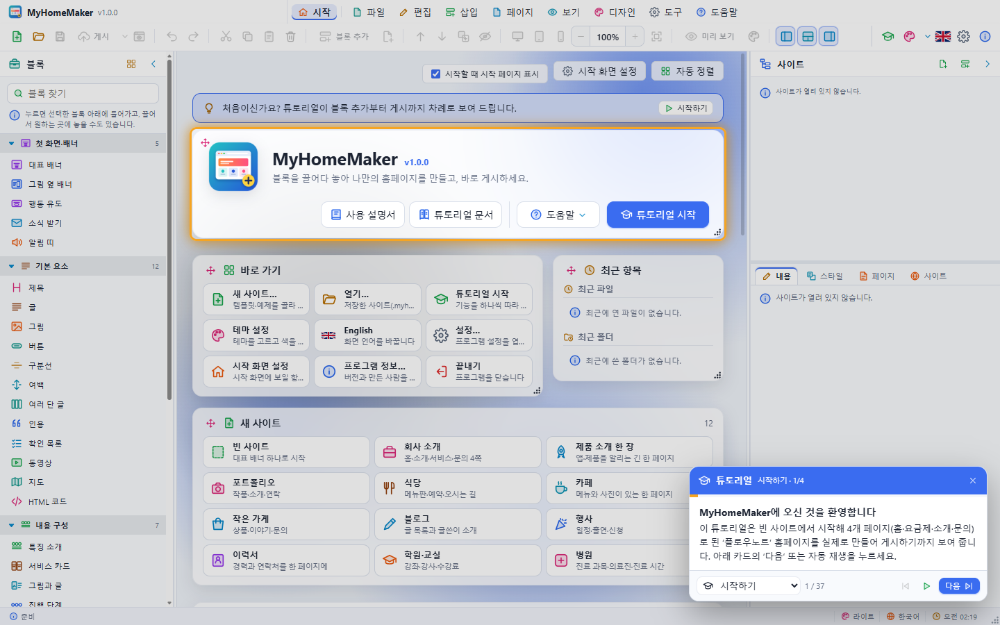

### 2. 완성될 사이트 미리 보기

요즘 홈페이지의 흐름을 따릅니다: 한 문장으로 말하는 큰 첫 화면, 벤토 격자의 기능 소개, 로고·숫자·후기로 보여 주는 신뢰, 페이지마다 분명한 다음 행동, 다크 모드, 휴대폰 우선 확인, 검색엔진 설명과 맞춤법 점검.

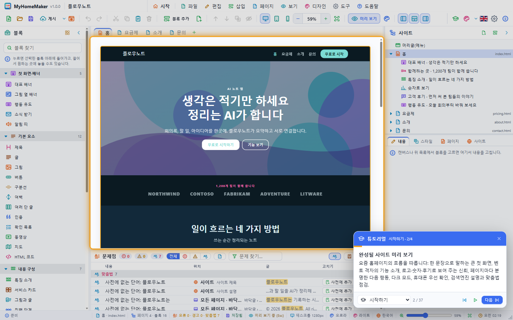

### 3. 새 사이트 만들기

새로 만들기(Ctrl+N)는 빈 사이트, 12가지 템플릿, 40가지 예제 중에서 고릅니다. 이름과 디자인을 정하고 만들기를 누르면 됩니다. 이 튜토리얼은 빈 사이트에 ‘플로우노트’라는 이름으로 시작합니다.

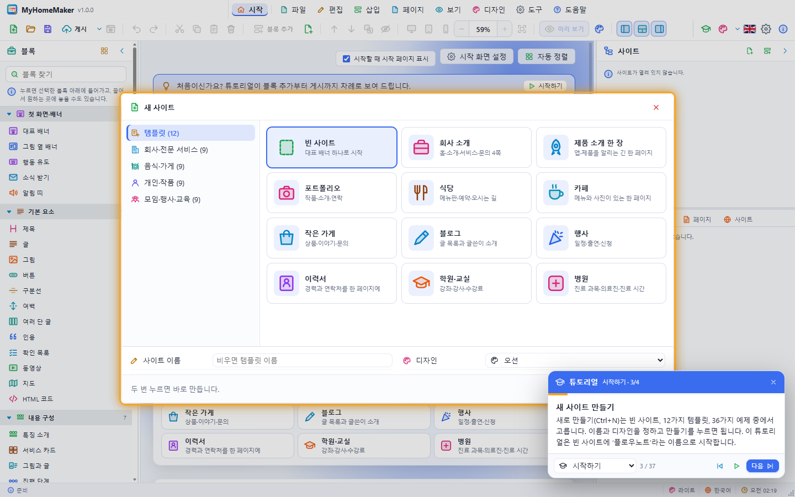

### 4. 작업 화면

왼쪽은 블록 패널, 가운데는 실제 사이트와 똑같이 그려지는 캔버스, 오른쪽은 페이지·블록 목록과 내용·스타일·페이지·사이트 편집 창, 아래는 문제점 패널입니다. 빈 홈 페이지에 블록을 하나씩 쌓아 갑니다.

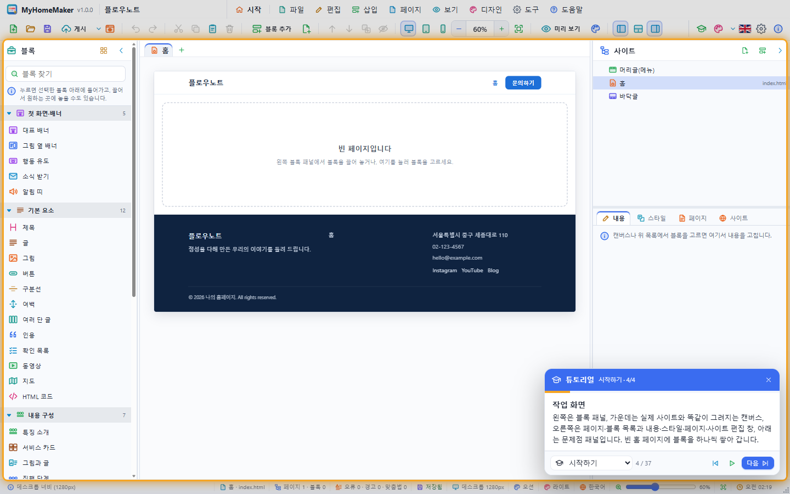

## 2. 첫 페이지 만들기

### 5. 첫 화면: 대표 배너

방문자가 3초 안에 무슨 사이트인지 알아야 합니다. 블록 패널의 ‘대표 배너’를 누르면 선택한 블록 아래에 들어가고, 캔버스로 끌어다 놓아 원하는 자리에 넣을 수도 있습니다.

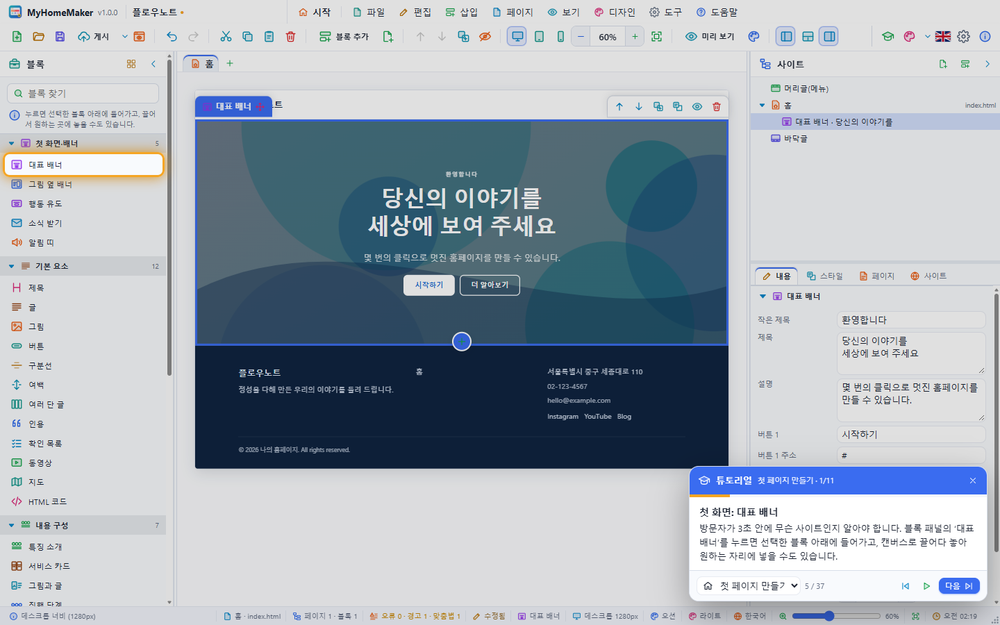

### 6. 글은 화면에서 바로 고칩니다

제목을 클릭하고 그대로 입력합니다. 짧고 굵은 한 문장이 요즘 첫 화면의 핵심입니다. 일부러 틀린 글자가 하나 들어갔는데, 뒤의 ‘점검하기’에서 맞춤법 검사로 찾아 고칩니다.

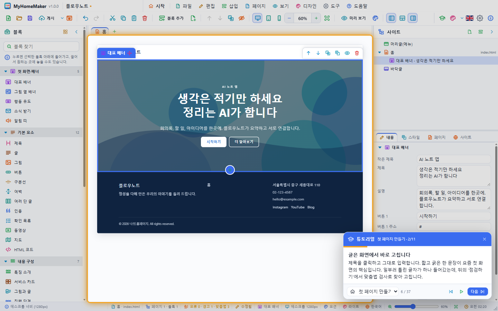

### 7. 버튼과 링크: 다음 행동 하나

내용 탭에서 버튼 글자와 주소를 정합니다. 가장 중요한 버튼(무료로 시작하기)은 요금제 페이지(pricing.html)로, 두 번째 버튼은 같은 페이지의 기능 소개(#features)로 보냅니다. 그림도 여기서 바꿉니다.

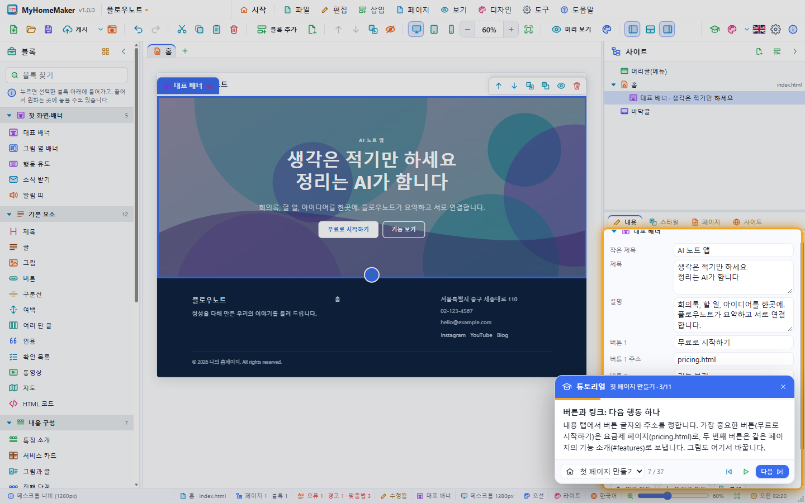

### 8. 신뢰: 함께하는 회사 로고

첫 화면 바로 아래에 ‘누가 쓰는지’를 보여 주면 믿음이 생깁니다. 로고 블록은 회사 이름 글자나 로고 그림을 한 줄로 늘어놓습니다.

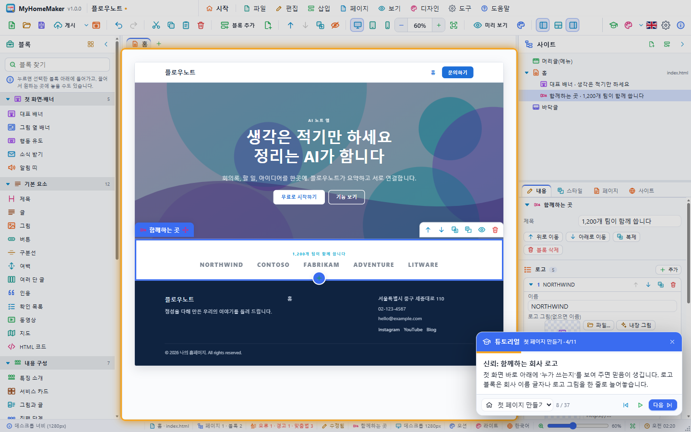

### 9. 벤토 격자로 기능 소개

도시락 칸처럼 나뉜 카드 격자가 요즘 기능 소개의 대세입니다. 특징 블록을 2열로 두고 아이콘·제목·짧은 설명을 네 칸에 넣었습니다. 항목은 내용 탭에서 더하고, 지우고, 순서를 바꿉니다.

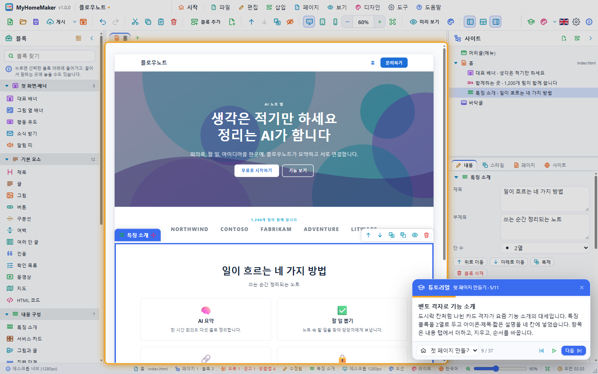

### 10. 숫자로 보여 주기

‘3분’, ‘1,200+’ 같은 숫자는 긴 설명보다 빨리 읽힙니다. 숫자 블록은 어두운 띠 위에 큰 숫자 네 개를 보여 줍니다.

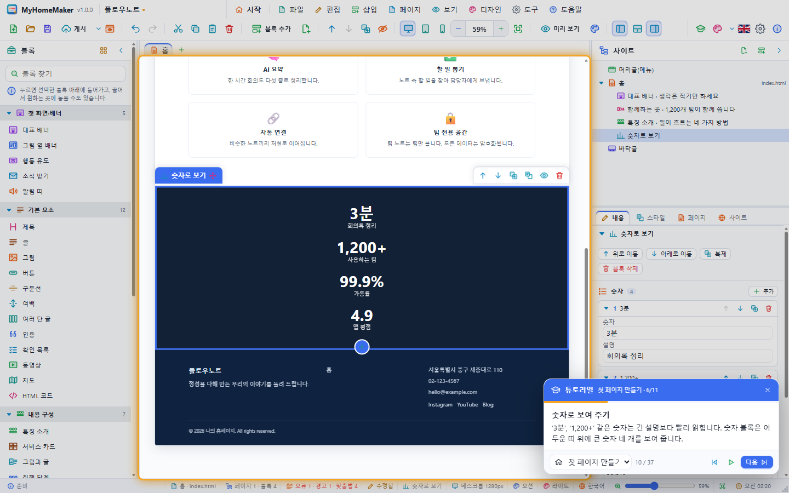

### 11. 고객 후기

실제 사용자의 한마디는 가장 강한 설득입니다. 후기 블록에 사진·이름·직함과 함께 짧은 말을 넣습니다.

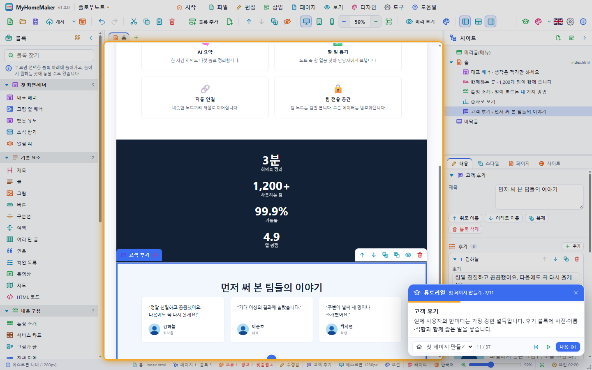

### 12. 마지막에 한 번 더: 행동 유도

끝까지 내려온 방문자에게 다시 다음 행동을 권합니다. 행동 유도 블록은 눈에 띄는 색의 띠에 제목과 버튼 하나를 둡니다.

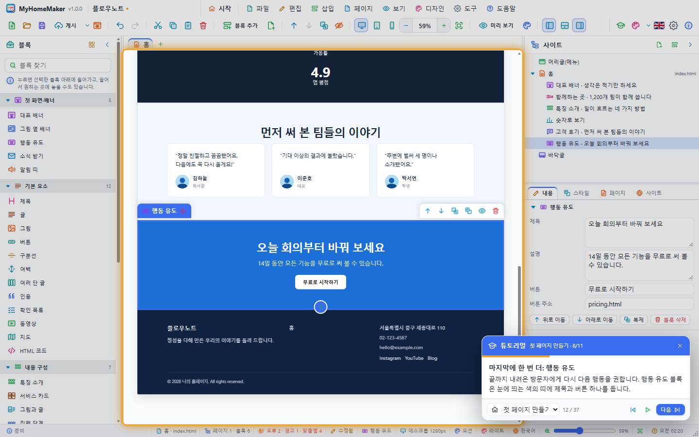

### 13. 블록 순서 바꾸기

선택한 블록 위 막대의 ↑ ↓ 버튼, Ctrl+↑/↓, 또는 이름표를 끌어서 옮깁니다. 페이지·블록 목록에서 끌어도 됩니다. 실행 취소(Ctrl+Z)로 언제든 되돌립니다.

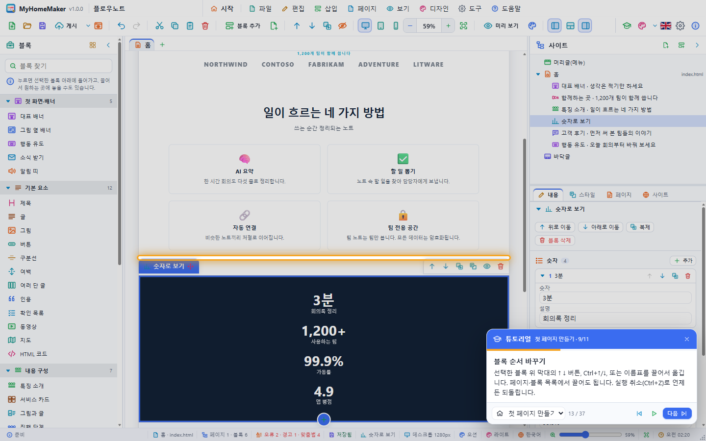

### 14. 머리글: 늘 보이는 메뉴

머리글은 모든 페이지에 똑같이 나옵니다. 사이트 이름과 오른쪽 버튼(무료로 시작)을 정하고 ‘위에 고정’을 켜 두면 스크롤해도 메뉴와 버튼이 늘 보입니다.

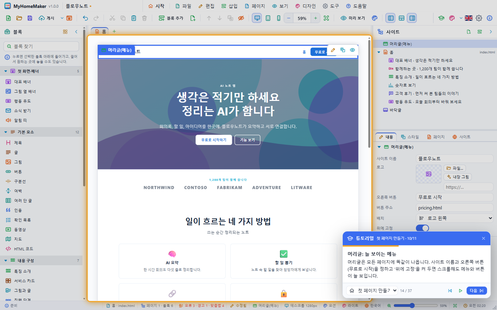

### 15. 바닥글

바닥글도 모든 페이지에 나옵니다. 짧은 소개, 연락처, 저작권 문구, 소셜 링크를 넣습니다. 페이지 링크는 자동으로 채워집니다.

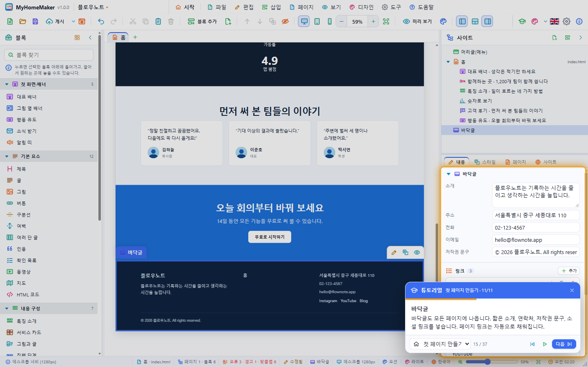

## 3. 페이지 늘리기

### 16. 페이지 더하기

탭 줄의 +, 페이지 › 페이지 추가(Ctrl+Shift+N)로 새 페이지를 만듭니다. 이름을 ‘요금제’로 정하고 빈 페이지·자주 쓰는 구성 중에서 고릅니다. 파일 이름(pricing.html)은 자동으로 정해집니다.

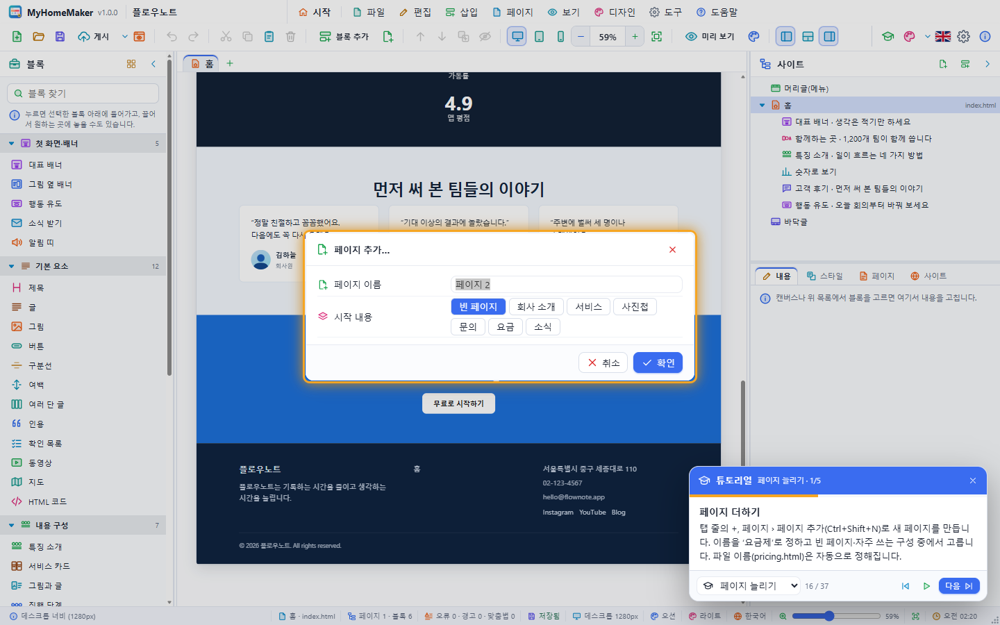

### 17. 요금제 페이지

제목 블록, 가격표, 자주 묻는 질문으로 요금제 페이지를 만들었습니다. 가격표는 추천 요금제를 강조하고, 질문은 클릭하면 펼쳐집니다.

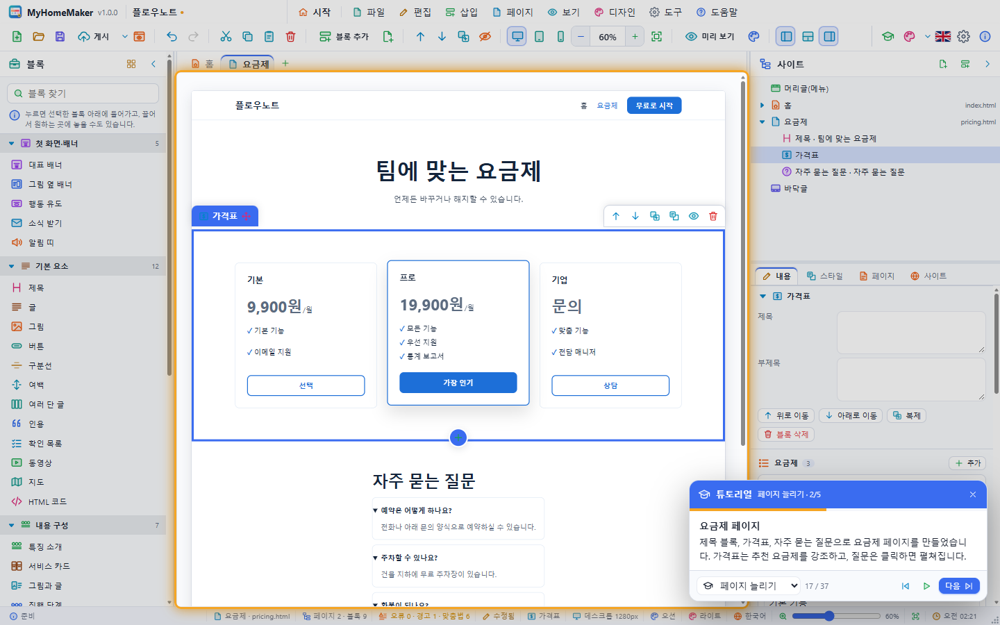

### 18. 소개 페이지

‘우리 이야기’(그림과 글), 팀 소개, 연혁으로 회사의 얼굴을 보여 줍니다. 탭을 눌러 페이지를 오가고, 탭을 끌어 순서를 바꿉니다.

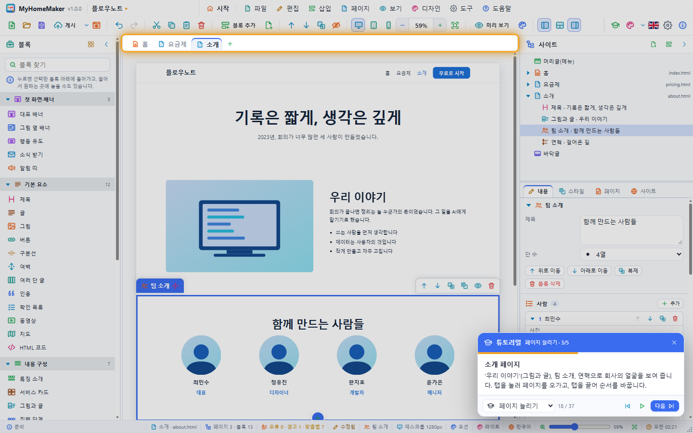

### 19. 문의 페이지

문의 양식, 소식 받기, 소셜 링크로 마무리합니다. 양식은 받을 이메일이나 양식 서비스 주소를 넣으면 게시한 사이트에서 바로 동작합니다.

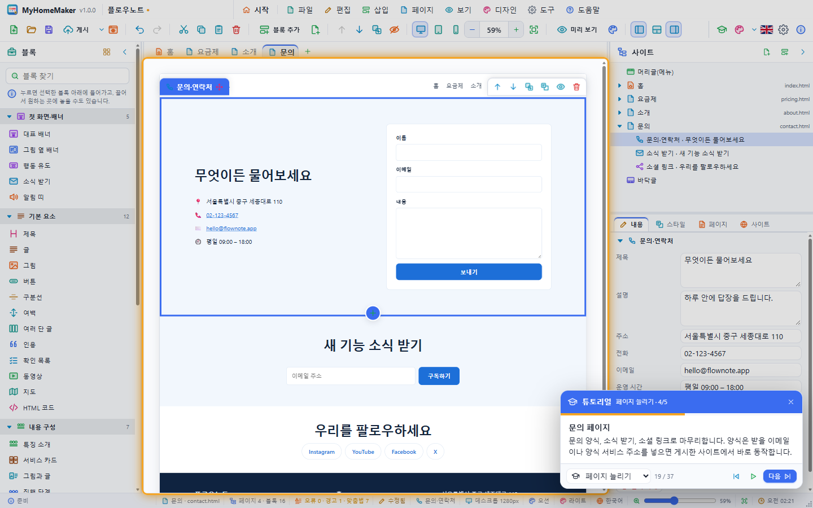

### 20. 메뉴는 저절로

페이지를 더하면 머리글 메뉴와 바닥글에 링크가 자동으로 생깁니다. 오른쪽 목록에서 페이지와 블록을 한눈에 보고, 페이지 탭에서 메뉴에 보일지 정합니다.

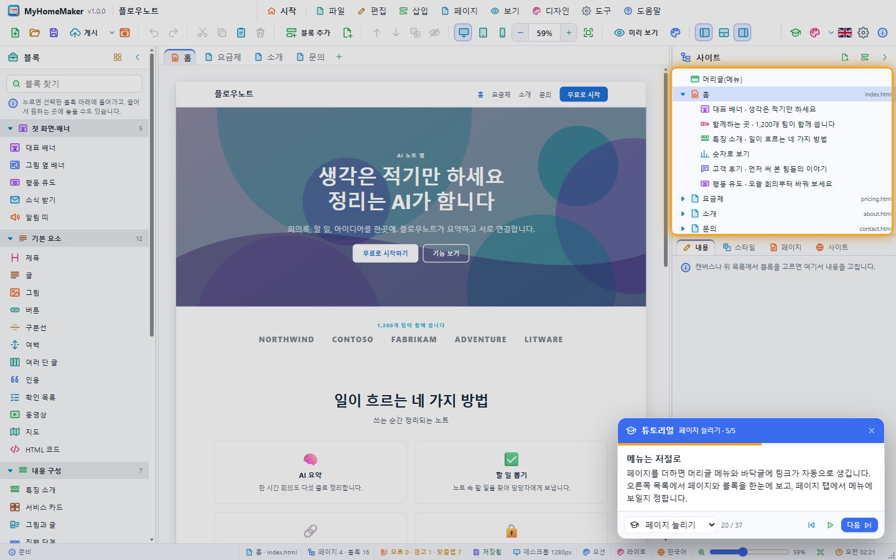

## 4. 디자인 다듬기

### 21. 디자인 고르기

디자인(Ctrl+Shift+D)은 색, 글꼴, 모서리, 폭을 한 번에 바꿉니다. 밝은 디자인 24가지와 어두운 디자인 12가지가 있고, 고르는 대로 미리 보여 줍니다.

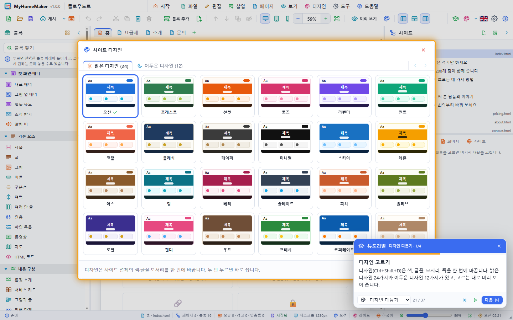

### 22. 다크 모드

어두운 배경에 밝은 글자와 빛나는 강조색은 요즘 기술 서비스의 대표 스타일입니다. ‘오로라’ 디자인으로 바꿨습니다. 글자와 배경의 대비는 모든 디자인에서 읽기 좋게 맞춰져 있습니다.

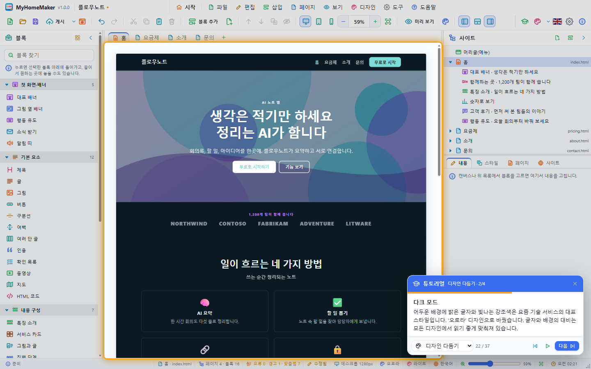

### 23. 나만의 색과 모서리

사이트 탭에서 디자인의 일부만 바꿉니다. 강조색을 분홍으로, 모서리를 더 둥글게 했습니다. ‘디자인 원래대로’로 언제든 되돌립니다.

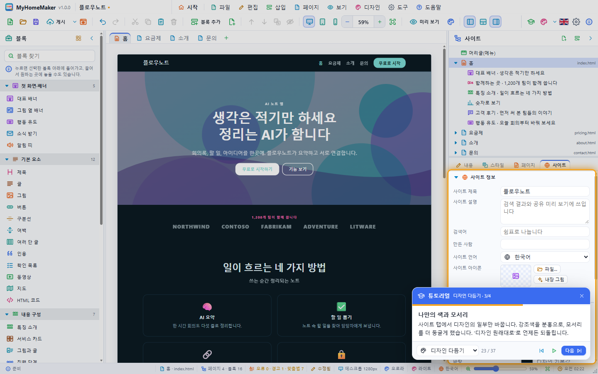

### 24. 구역마다 배경과 여백

스타일 탭에서 블록의 배경(없음·면·주 색·강조색·어둡게·직접 고른 색), 위아래 여백, 정렬, 폭을 정합니다. 구역마다 배경을 번갈아 주면 긴 페이지도 읽기 쉽습니다.

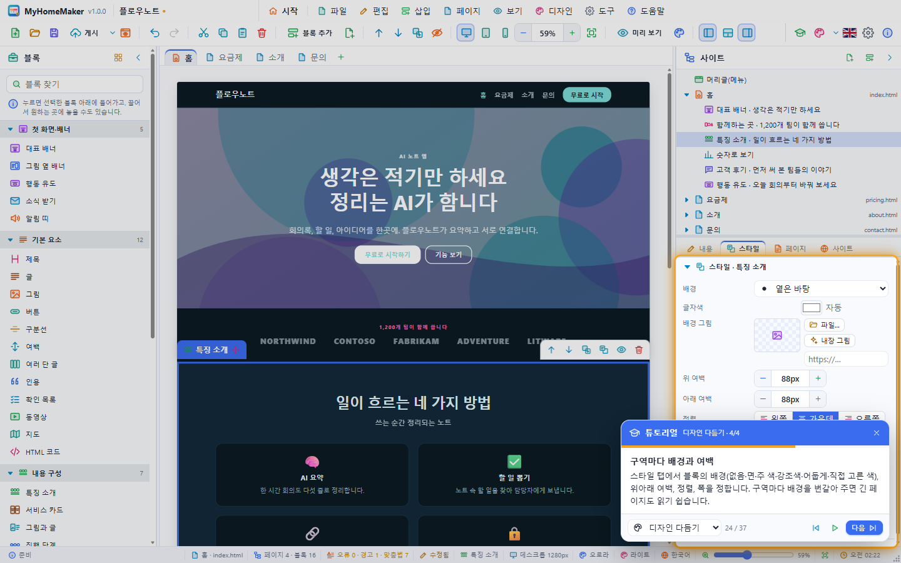

## 5. 휴대폰에서 보기

### 25. 태블릿과 휴대폰 너비

방문자 대부분은 휴대폰으로 봅니다. 툴바의 데스크톱·태블릿·휴대폰 버튼으로 너비를 바꿔 확인하세요. 열은 한 줄로 쌓이고 메뉴는 ☰ 버튼으로 접힙니다.

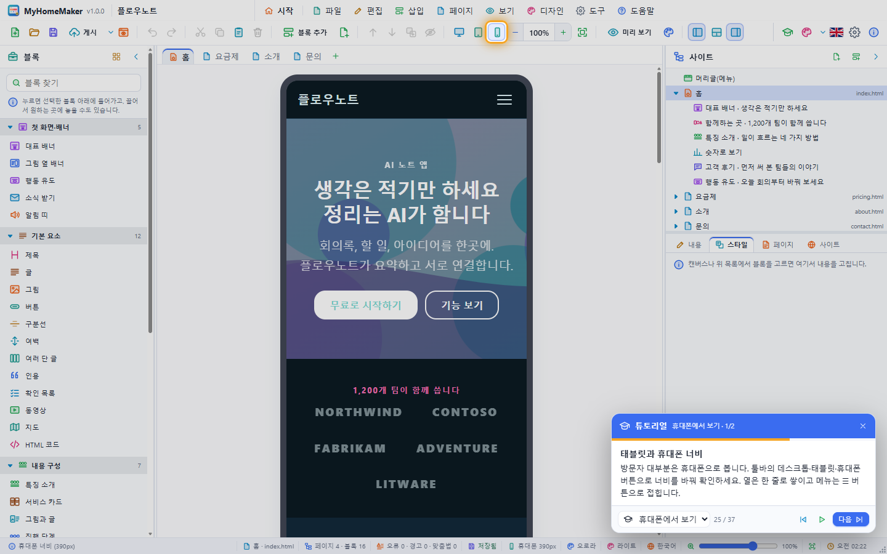

### 26. 미리 보기

미리 보기(Ctrl+E)는 편집 표시 없이 방문자가 보는 그대로 보여 줍니다. 메뉴 링크를 누르면 페이지가 바뀝니다. F5는 실제 브라우저에서 엽니다.

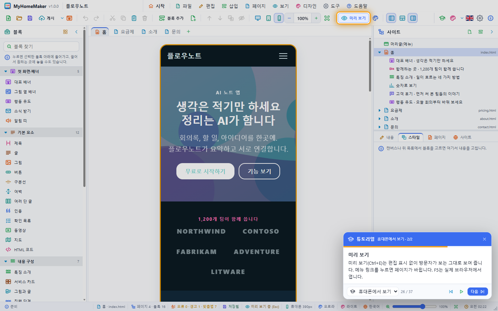

## 6. 점검하기

### 27. 문제점 패널

화면 아래의 문제점 패널은 고칠 점(오류·경고)과 사전에 없는 단어(맞춤법)를 고칠 때마다 바로 다시 검사합니다. 툴바의 패널 버튼이나 Ctrl+J로 열고 접습니다.

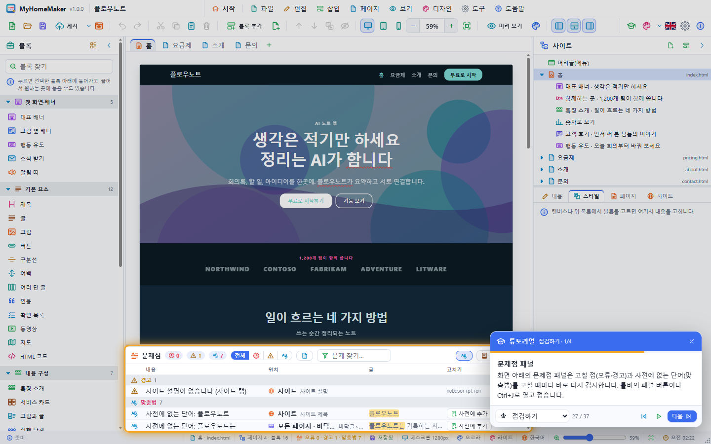

### 28. 맞춤법 고치기

영어·한국어 사전이 첫 화면의 틀린 단어를 찾았습니다. 줄을 클릭하면 캔버스에 위치가 표시되고, 더블클릭하면 그 칸으로 가서 단어가 선택됩니다. 제안 버튼이나 오른쪽 클릭 메뉴로 한 번에 고칩니다.

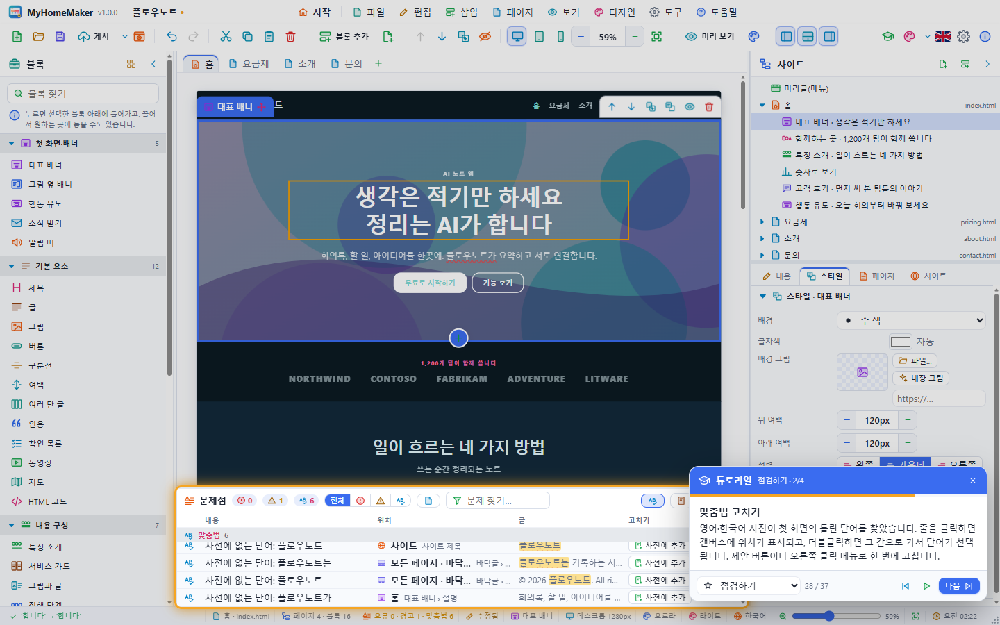

### 29. 새 단어는 사전에 추가

회사 이름처럼 사전에 없지만 맞는 단어는 ‘사전에 추가’를 누릅니다. 내 사전은 도구 › 사전(설정의 사전 탭)에서 보고, 찾고, 지울 수 있습니다.

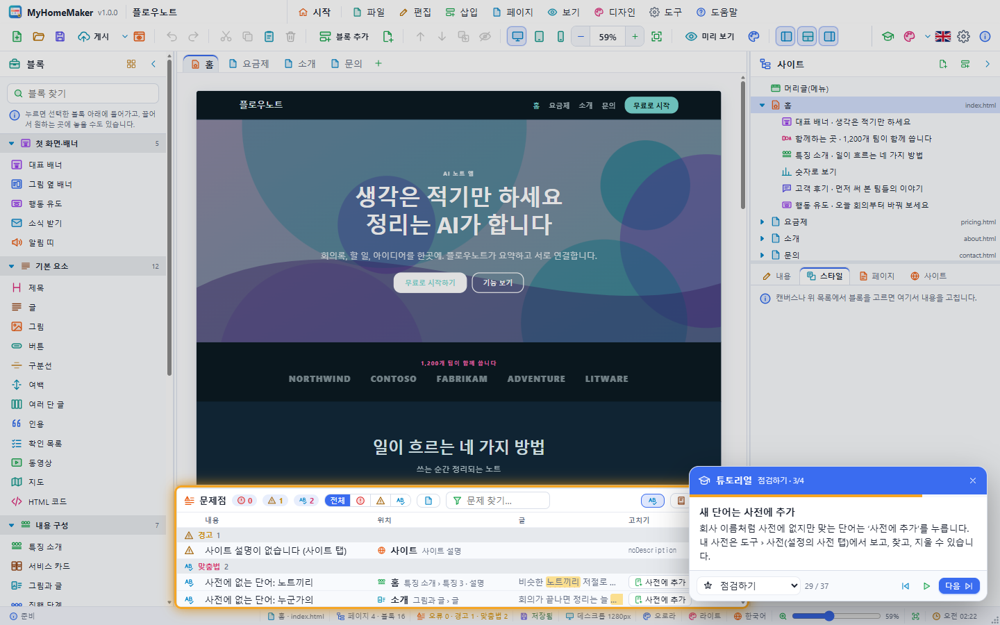

### 30. 검색엔진을 위한 설명

사이트 탭의 제목·설명·키워드는 검색 결과와 링크 미리 보기에 나옵니다. 설명을 넣자 마지막 경고까지 사라졌습니다. 그림의 대체 글도 검색과 접근성에 중요합니다.

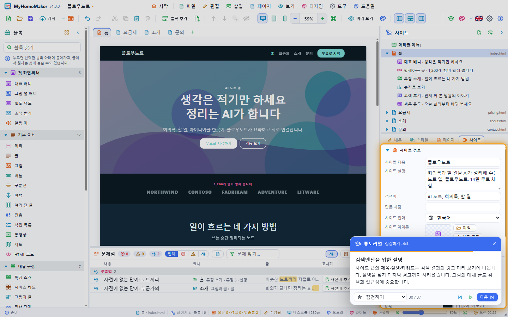

## 7. 게시하기

### 31. 저장

저장(Ctrl+S)하면 사이트 전체가 .myhome 파일 하나에 담깁니다. 나중에 다시 열어 이어서 고칩니다. 자주 쓰는 구성은 템플릿(.mhomt)으로 저장해 둡니다.

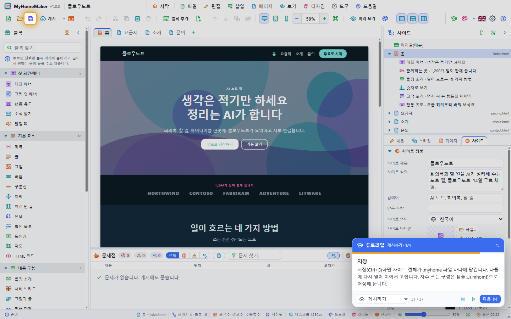

### 32. 게시하기

게시(Ctrl+Shift+P)는 페이지마다 HTML 파일, 스타일 시트 하나, 그림 폴더를 만듭니다. 폴더나 ZIP으로 받고, 게시 전에 문제점을 한 번 더 확인해 줍니다.

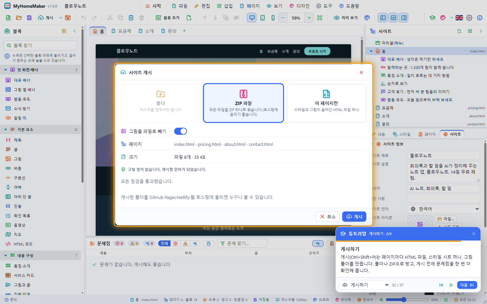

### 33. 브라우저에서 열어 보기

F5는 지금 사이트를 실제 브라우저에서 엽니다. 다른 브라우저와 실제 휴대폰에서도 열어 보세요.

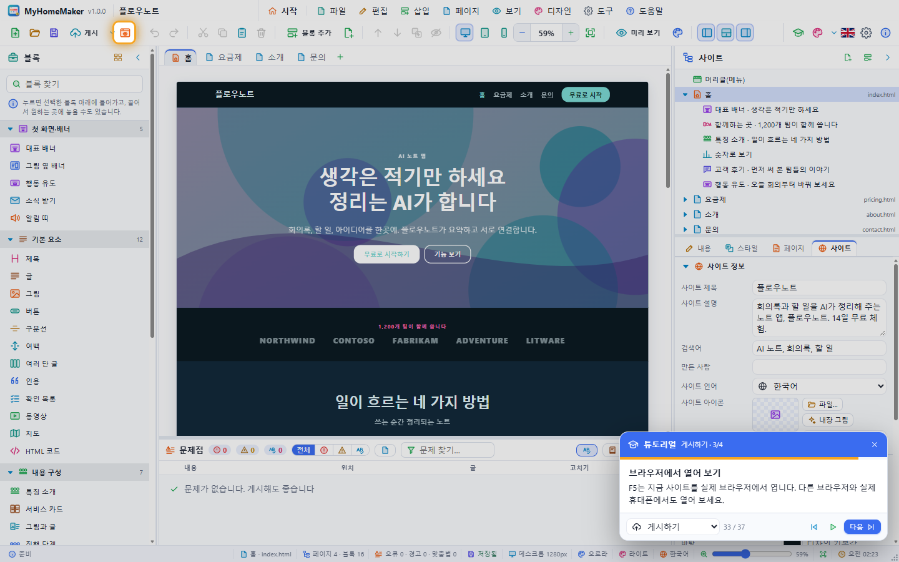

### 34. 인터넷에 올리기

게시한 폴더는 그대로 올리면 되는 정적 사이트라 빠르고 안전합니다. GitHub Pages, Netlify, Cloudflare Pages 같은 무료 호스팅에 폴더나 ZIP을 올리면 주소가 생깁니다.

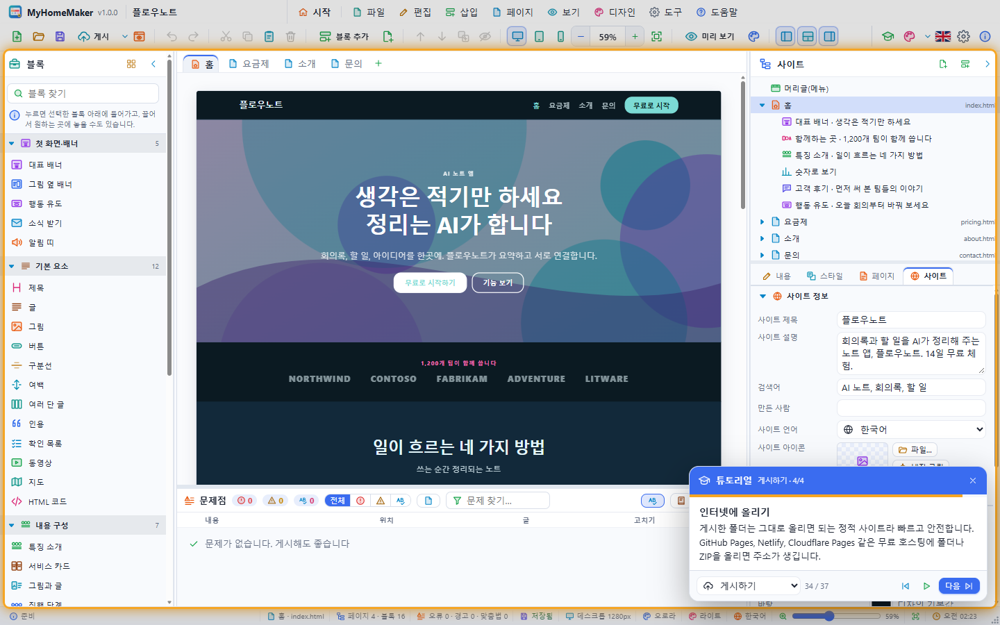

## 8. 마치며

### 35. 나에게 맞게

테마(밝은·어두운 40가지 이상), 언어, 글꼴, 시작 화면, 맞춤법과 내 사전을 설정에서 바꿉니다. 툴바의 테마 버튼은 무작위 테마, 옆 ▾는 목록입니다.

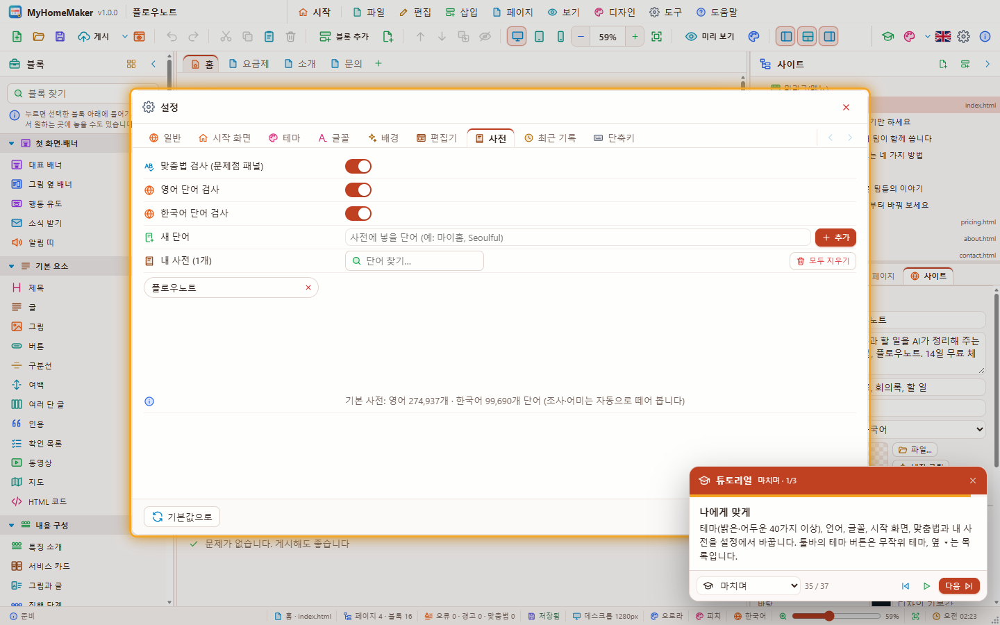

### 36. 도움말

도움말 › 사용 설명서와 튜토리얼 문서는 그림과 함께 모든 기능을 설명합니다. 단축키는 설정의 단축키 탭에 있습니다.

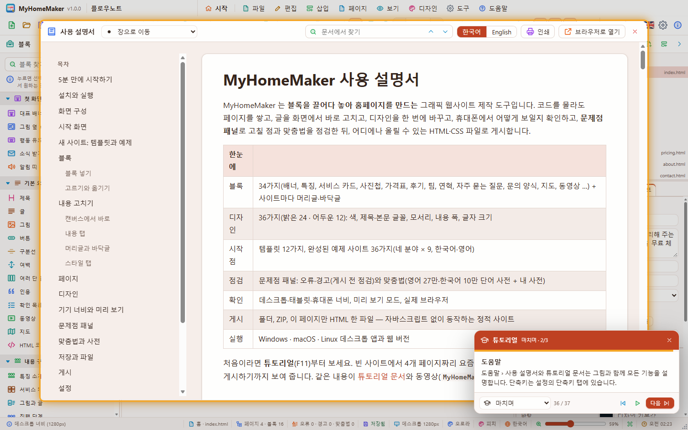

### 37. 완성!

빈 사이트에서 4개 페이지의 요즘 스타일 홈페이지를 만들어 점검하고 게시까지 했습니다. 이제 예제를 열어 보거나 나만의 사이트를 만들어 보세요. 튜토리얼은 툴바 버튼이나 F11로 다시 볼 수 있습니다.

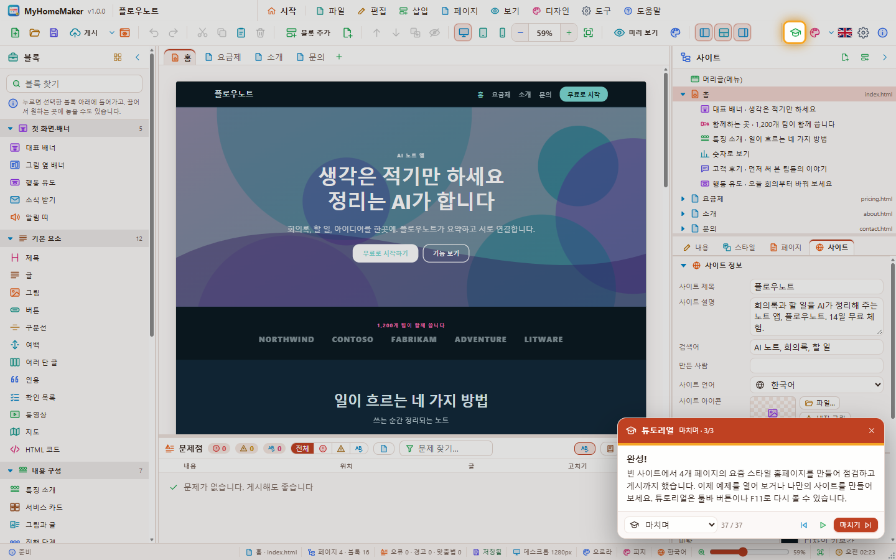

## 더 알아보기

- 모든 기능은 [사용 설명서](UsersGuide.md)에 있습니다.
- 예제 40가지(파일 › 예제 열기)를 열어 블록과 디자인이 어떻게 짜였는지 보세요.
