# MyHomeMaker 튜토리얼 — 첫 홈페이지 만들기

이 튜토리얼은 동네 카페 **"오늘의 커피"** 홈페이지를 처음부터 만들어 게시하는 과정을 따라 합니다. 30분쯤 걸립니다. 각 단계의 메뉴·단추 이름은 앱에 보이는 그대로입니다. 기능 전체는 [사용 설명서](UsersGuide.md)에 있습니다.

> 앱 안의 튜토리얼(**도움말 › 튜토리얼**, F11)은 같은 내용을 실제 화면을 움직이며 보여 줍니다. 이 문서는 직접 손으로 해 보는 실습서입니다.

## 1. 새 사이트 만들기

1. MyHomeMaker 를 실행하면 시작 화면이 나옵니다.
2. 툴바의 **새 사이트…** 단추(또는 **파일 › 새 사이트…**, Ctrl+N)를 누릅니다.
3. 왼쪽에서 **템플릿**을, 카드에서 **카페**를 고릅니다.
4. 아래 **사이트 이름** 칸에 `오늘의 커피` 라고 쓰고 **만들기**를 누릅니다.

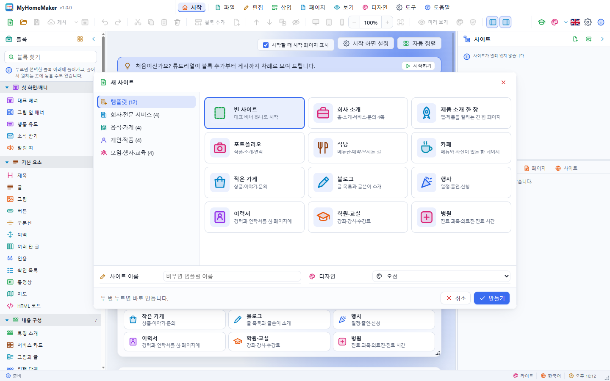

카페 템플릿에는 그림 옆 배너, 메뉴판, 사진첩, 문의 블록이 든 페이지 하나가 있습니다. 머리글에는 사이트 이름이 들어가 있습니다.

## 2. 화면 둘러보기

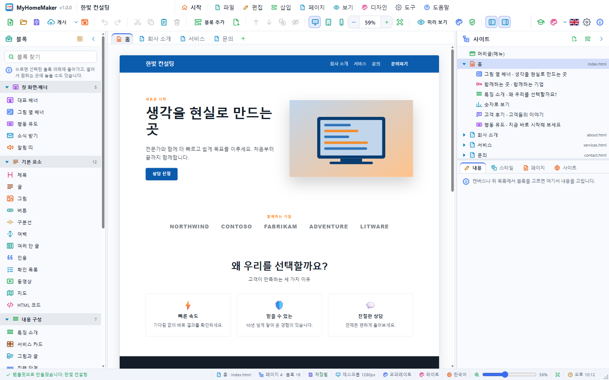

- 왼쪽 **블록 패널**: 넣을 수 있는 블록들
- 가운데 **페이지 탭과 캔버스**: 실제 사이트 모습
- 오른쪽 **사이트 패널**: 위는 머리글·페이지·블록·바닥글 목록, 아래는 **내용 · 스타일 · 페이지 · 사이트** 편집기

툴바의 **너비에 맞추기**(Ctrl+Shift+W)를 누르면 페이지 전체 폭이 캔버스에 맞게 보입니다.

## 3. 대표 문구 고치기

1. 캔버스 맨 위의 배너(그림 옆 배너)를 한 번 누릅니다. 파란 테두리와 이름표가 생깁니다.
2. 큰 제목 글자를 **한 번 더** 누르면 글자가 선택되고 바로 고칠 수 있습니다.
3. `향긋한 커피 한 잔으로 시작하는 하루` 라고 쓰고 **Enter** 를 누릅니다.

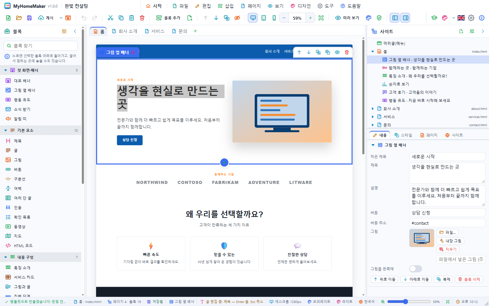

작은 제목·설명·버튼 글자도 같은 방법으로 고칩니다. 오른쪽 **내용** 탭에서도 같은 칸을 고칠 수 있습니다. 잘못 고쳤으면 **Ctrl+Z** 로 되돌립니다.

## 4. 그림 바꾸기

1. 배너의 그림을 **두 번 누르면** 파일 고르기 창이 열립니다. 카페 사진을 고르세요.
2. 사진이 없으면 오른쪽 **내용** 탭의 그림 칸에서 **내장 그림 › 카페**를 고릅니다.

큰 사진은 긴 변이 1920px 이 되도록 저절로 줄여서 넣습니다. 그림 파일을 선택한 블록 위로 끌어 놓아도 됩니다.

## 5. 메뉴판 고치기

1. **메뉴판** 블록을 누릅니다.
2. 오른쪽 **내용** 탭 아래의 **메뉴** 목록에서 항목마다 이름·설명·가격을 고칩니다.
3. **추가**를 눌러 `바닐라 라테 · 달콤한 바닐라 향 · 5,500` 을 넣습니다.
4. 항목의 ↑ ↓ 단추로 순서를 바꾸고, 휴지통으로 지웁니다.

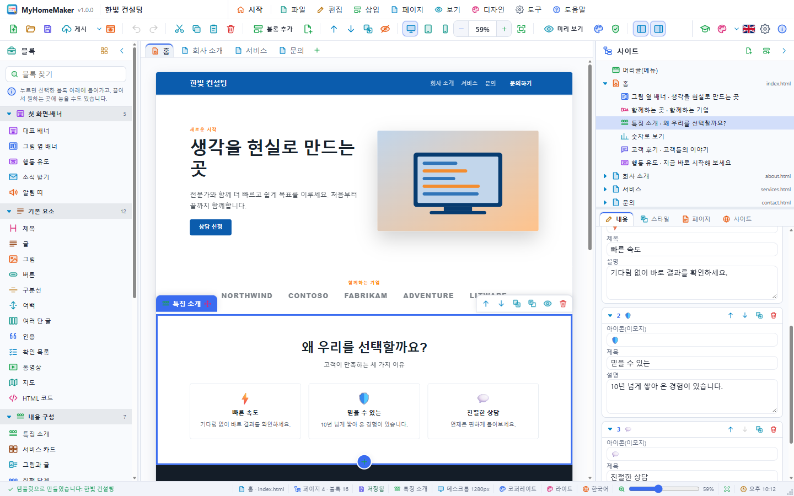

## 6. 블록 넣고 옮기기

1. 왼쪽 블록 패널의 **내용 구성 › 특징 소개**를 캔버스의 메뉴판 위로 끌어다 놓습니다. 파란 선이 놓일 자리를 보여 줍니다.
2. 특징 세 개를 `직접 볶은 원두`, `매일 굽는 빵`, `조용한 2층 자리` 로 고칩니다. 아이콘 칸에는 이모지(☕ 🥐 🪑)를 쓸 수 있습니다.
3. **소개·전시 › 고객 후기**를 눌러 넣습니다(선택한 블록 바로 아래에 들어갑니다).
4. 블록의 **이름표를 끌어** 원하는 자리로 옮기거나, 툴바의 **위로 이동 · 아래로 이동**(Ctrl+↑/↓)을 씁니다.

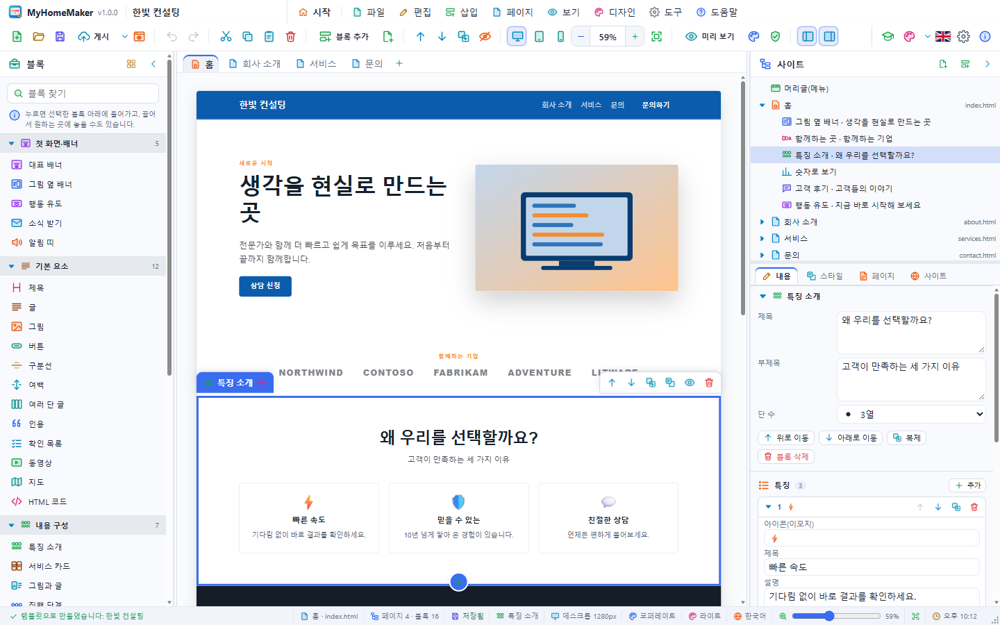

## 7. 블록 꾸미기

1. 고객 후기 블록을 고르고 오른쪽 **스타일** 탭을 엽니다.
2. **배경**을 **옅은 바탕**으로, **위 여백**과 **아래 여백**을 96px 로 바꿉니다.
3. **정렬**을 **가운데**로 둡니다.

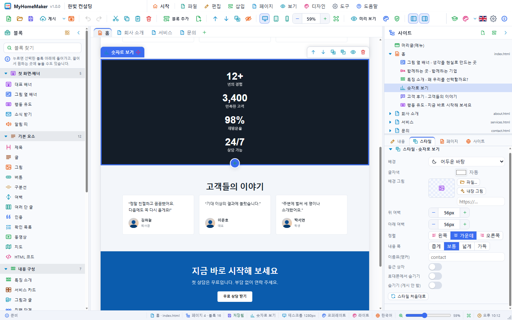

## 8. 페이지 추가하기

1. 탭 줄 끝의 **+**(또는 **페이지 › 페이지 추가…**)를 누릅니다.
2. 이름에 `오시는 길`, 시작 내용에 **문의**를 고르고 **확인**을 누릅니다.
3. 새 페이지의 **문의·연락처** 블록에서 주소·전화·운영 시간을 고치고, **지도 장소** 칸에 카페 주소를 씁니다.
4. 머리글 메뉴에 `오시는 길` 이 저절로 생긴 것을 확인합니다.

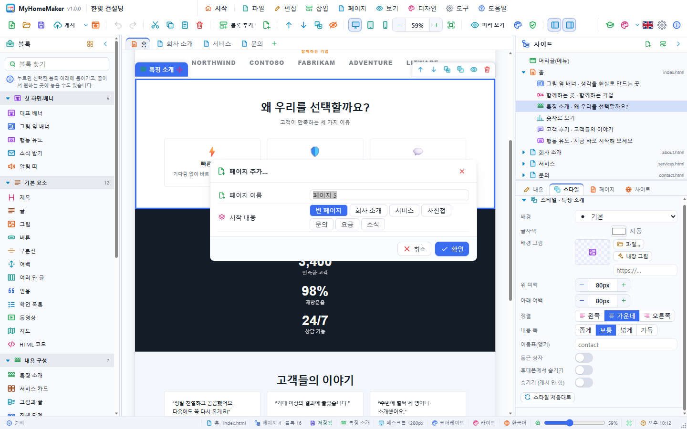

**페이지** 탭에서 파일 이름(`visit` → `visit.html`), 브라우저 제목, 검색용 설명을 정할 수 있습니다.

## 9. 디자인 바꾸기

1. **디자인 › 디자인 바꾸기…**(Ctrl+Shift+D)를 엽니다.
2. **밝은 디자인**에서 **우드**나 **피치**를 두 번 눌러 바로 적용합니다.
3. 마음에 들 때까지 다른 디자인도 눌러 봅니다. 내용은 그대로이고 색과 글꼴만 바뀝니다.
4. 더 다듬으려면 편집기의 **사이트** 탭에서 **주 색**이나 **제목 글꼴**을 바꿉니다.

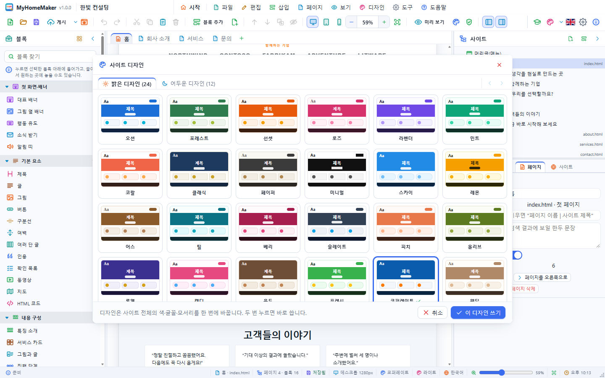

## 10. 휴대폰에서 확인하기

1. 툴바의 **휴대폰** 단추를 누릅니다. 캔버스가 390px 너비가 되고 메뉴가 ☰ 로 접힙니다.
2. 휴대폰에서 필요 없는 블록은 **스타일 › 휴대폰에서 숨기기**를 켭니다.
3. **데스크톱** 단추로 돌아옵니다.

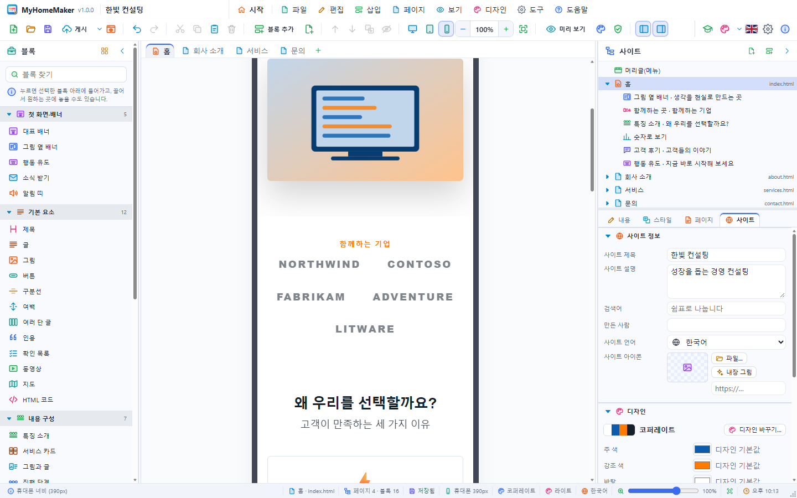

## 11. 미리 보기

1. **미리 보기**(Ctrl+E)를 누르면 편집 표시 없이 방문자 화면이 됩니다. 메뉴의 `오시는 길` 을 눌러 페이지가 바뀌는지 봅니다. **Esc** 로 돌아옵니다.
2. **브라우저에서 미리 보기**(F5)는 사이트를 시스템 브라우저로 엽니다.

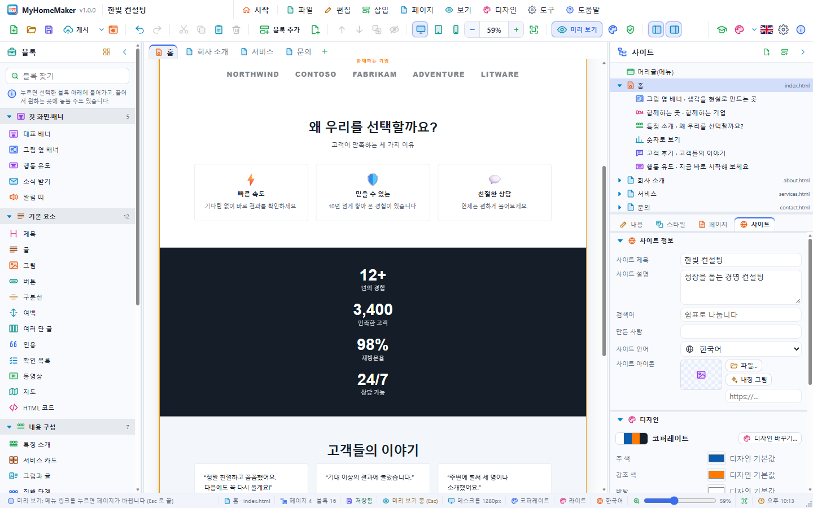

## 12. 사이트 정보와 저장

1. 블록 선택을 풀고(Esc) **사이트** 탭에서 **사이트 설명**에 `동네 카페 오늘의 커피 — 직접 볶은 원두와 매일 굽는 빵` 을 씁니다.
2. **저장**(Ctrl+S)을 눌러 `오늘의 커피.myhome` 으로 저장합니다. 그림까지 이 파일 하나에 들어갑니다.

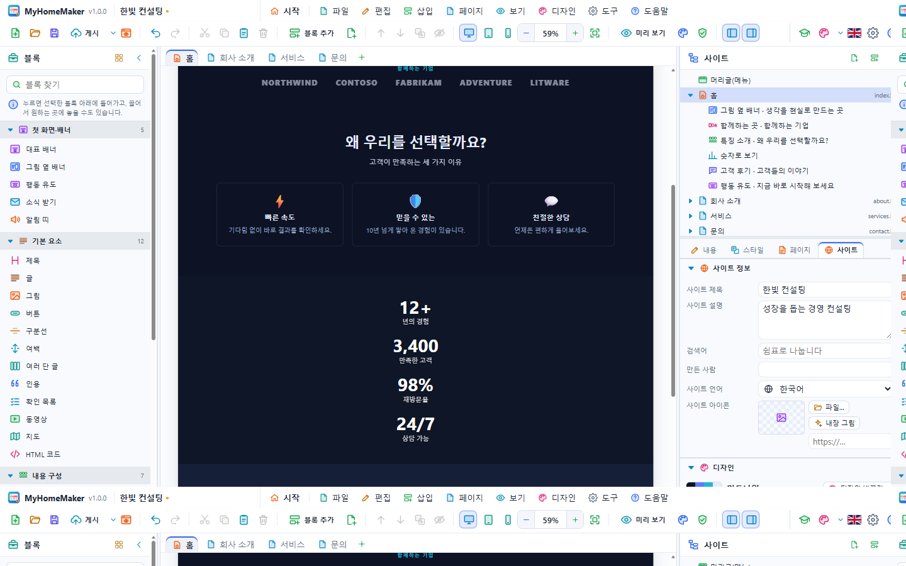

## 13. 점검하고 게시하기

1. **도구 › 사이트 점검**으로 고칠 점이 없는지 봅니다.
2. 툴바의 **게시**(Ctrl+Shift+P)를 누릅니다.
3. **폴더**(데스크톱) 또는 **ZIP 파일**을 고르고, **그림을 파일로 빼기**를 켠 채 **게시**를 누릅니다.
4. 폴더로 게시했다면 **브라우저로 보기**를 눌러 결과를 확인합니다.

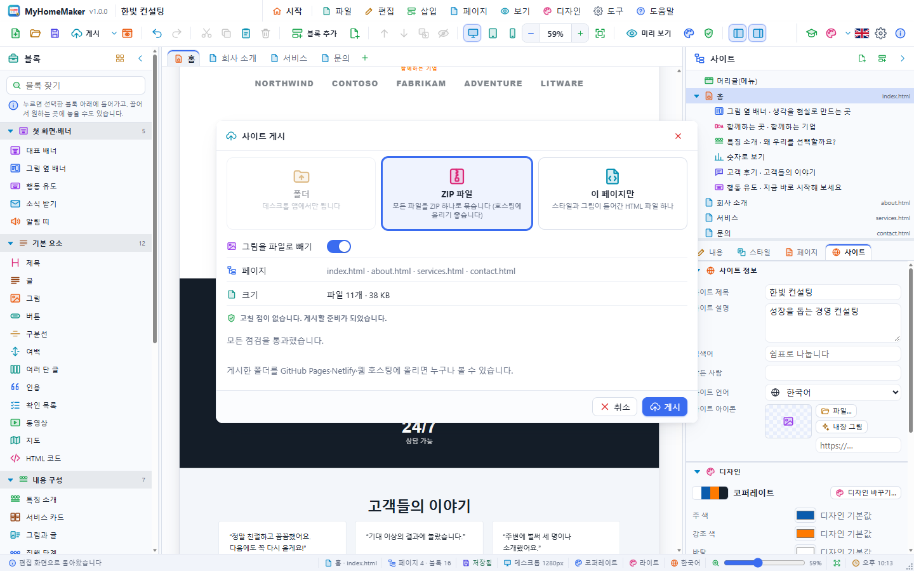

게시한 폴더에는 `index.html`, `visit.html`, `style.css`, `assets/` 가 있습니다.

## 14. 인터넷에 올리기

- **GitHub Pages**: 저장소를 만들고 게시한 파일을 올린 뒤 Settings › Pages 에서 켭니다.
- **Netlify**: app.netlify.com 의 Sites 에 폴더나 ZIP 을 끌어다 놓습니다.
- **웹 호스팅**: FTP 로 웹 루트(`public_html` 등)에 올립니다.

문의 양식이 메일로 오게 하려면 Formspree 같은 양식 서비스에서 주소를 받아 **문의·연락처** 블록의 **양식 보낼 주소**에 넣고 다시 게시합니다.

## 다음 단계

- **파일 › 예제 사이트 열기**의 예제 16가지를 열어 블록 구성을 살펴보세요.

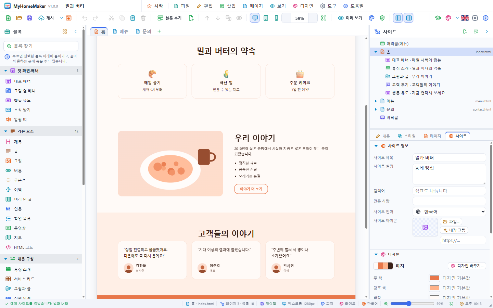

- 자주 쓰는 구성은 **파일 › 템플릿으로 저장…**으로 템플릿(.mhomt)을 만들어 두세요.
- 단축키는 **도움말 › 단축키 목록…**에 있습니다.
