# MyHomeMaker User's Guide

MyHomeMaker is a graphical website builder: **you make a homepage by dragging blocks onto pages**. Without writing code you stack pages, edit text right on the page, change the whole design at once, see how it looks on a phone, check what to fix and the spelling in the **Problems panel**, and publish HTML/CSS files you can put anywhere.

| At a glance | |
| --- | --- |
| Blocks | 34 kinds (heroes, features, service cards, galleries, price tables, reviews, team, timelines, FAQs, contact forms, maps, videos …) + one header and one footer per site |
| Designs | 36 (24 light · 12 dark): colours, heading and body fonts, corners, content width, text size |
| Starting points | 12 templates and 36 finished sample sites (four groups × 9, in Korean and English) |
| Checking | the Problems panel: errors and warnings (before publishing) and spelling (275,000 English and 100,000 Korean words + your own dictionary) |
| Seeing | desktop, tablet and phone widths, preview mode, your real browser |
| Publishing | a folder, a ZIP, or one page as a single HTML file — a static site that works without JavaScript |
| Runs on | Windows · macOS · Linux desktop apps and the web |

New here? Start with the **Tutorial** (F11). It builds a real, up-to-date four-page website from an empty site all the way to publishing. The same tour is in the [tutorial document](Tutorial.en.md) and in a video (`MyHomeMaker-Tutorial.mp4`).

## Getting started in five minutes

1. **New** (Ctrl+N): pick a template or a sample, give it a name, press **Create**.
2. **Click or drag** blocks from the Blocks panel onto the page.
3. **Click text on the canvas to edit it**; change links, pictures and items in the **Content** tab on the right.
4. **Change design** (Ctrl+Shift+D) changes colours and fonts at once.
5. Check narrow screens with the **phone** button of the toolbar.
6. Fix what is left in the **Problems panel**: errors, warnings, spelling.
7. **Save** (Ctrl+S), then **Publish** (Ctrl+Shift+P) a folder or a ZIP and upload it to a host.

## Installing and running

| For | File | Installing |
| --- | --- | --- |
| Windows | `MyHomeMaker-Setup-<version>.exe` | Run it, choose the language and install. An earlier installation is removed completely first, and you are asked whether to delete its user data. |
| macOS | `MyHomeMaker-<version>-<arch>.dmg` | Open it and drag the app to Applications. |
| Linux | `.deb` · `.rpm` · `.AppImage` | Install with your package manager or run the AppImage. |
| Web | `MyHomeMaker-Web-<version>.zip` | Unzip it on a web server and open `index.html`. |

After installing, `.myhome` site files and `.mhomt` templates open in MyHomeMaker (double-click or drop them on the window). Your **dictionary** stays when you install again.

The installers are built from the sources with these commands (Tauri builds only for the system it runs on):

```
npm install
npm run build:win      # Windows installer (NSIS)
npm run build:mac      # macOS (.app, .dmg)
npm run build:linux    # Linux (.deb, .rpm, .AppImage)
npm run build:webapp   # web version ZIP
npm run build:all      # web version + the installer of this system
```

The results are copied to `release/` and to the project folder. While developing, `npm start` runs the app.

## The window


1. **Menu bar row** — the app icon, name and version and the open site (● when there are unsaved changes), the **Start** button, the menus (File, Edit, Insert, Page, View, Design, Tools, Help), and minimize, maximize and close on the right. This row is the title bar: drag an empty part to move the window, double-click to maximize.
2. **Toolbar** — New, Open, Save, Publish (▾ ways to publish), Preview in browser / Undo, Redo / Cut, Copy, Paste, Delete / Add block, Add page / Up, Down, Duplicate, Hide / device width and zoom, fit width / Preview, Change design / **the three panels (Blocks · Problems · Site)**. On the right: Tutorial, Theme (random, ▾ list), Language (flag), Settings, About. The window's minimum width follows the toolbar, so no button is ever cut off.
3. **Blocks panel** (left) — the blocks in five groups with a search box.
4. **Page tabs and canvas** (middle) — one tab per page; the first tab is the home page (index.html). The canvas is drawn exactly like the published site.
5. **Problems panel** (bottom middle) — what to fix and the spelling. Open and fold it with the middle panel button of the toolbar or **Ctrl+J**.
6. **Site panel** (right) — top: the header, the blocks of each page, the footer. Bottom: the editor tabs (**Content · Style · Page · Site**).
7. **Status bar** — notices, the page and its file, page and block counts, **error · warning · spelling counts** (click to open the Problems panel), saved state, the selected block, device width, design, theme, language, zoom slider, clock.

Folded panels become a narrow strip of icons (Ctrl+Shift+1, Ctrl+Shift+2); drag the dividers between panels to change their width and height.

## Start page

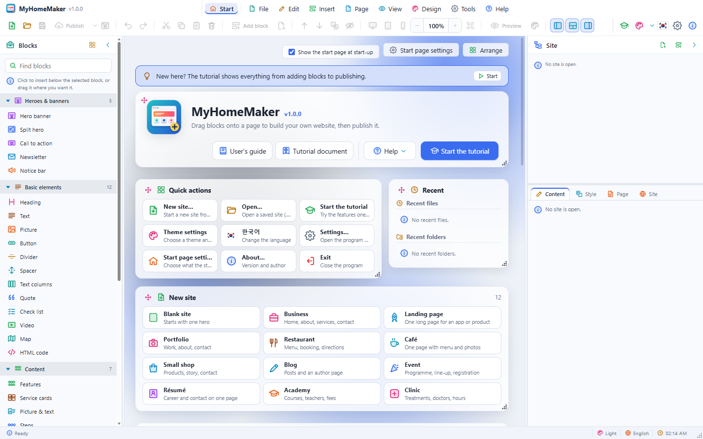

When the program starts (you can turn this off) you see cards on an animated background:

- **Shortcuts** — new site, open, tutorial, theme, language, settings, start page settings, about, exit
- **Recent** — recent files and folders (× removes one from the list)
- **New site** — the 12 templates
- **Sample sites** — four groups, nine samples each
- **Themes** and **Animated background** (20 kinds, random, speed, card transparency, change interval, background picture)

Move a card by its handle and resize it from its corner. **Auto arrange** puts them back. The **Start** button on the menu bar (Ctrl+Shift+H) switches between the start page and the editor.

## New site: templates and samples

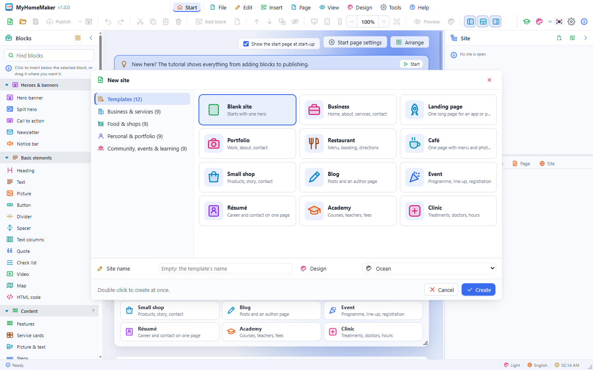

**File › New site…** (Ctrl+N): pick *Templates* or a sample group on the left, pick a card, set the site name and (for an empty site) the design, and press **Create**. A double-click on a card creates it at once. Templates and samples come with the design that suits them.

| Template | Contents |
| --- | --- |
| Blank | one hero |
| Business | Home, About, Services, Contact |
| Product page | one long page for an app or product |
| Portfolio | Work, About, Contact |
| Restaurant | menu, booking, how to find us |
| Café | one page with a menu and photos |
| Small shop | products, story, contact |
| Blog | posts and the author |
| Event | schedule, speakers, sign-up |
| Résumé | career and contacts on one page |
| School | courses, teachers, fees |
| Clinic | departments, doctors, hours |

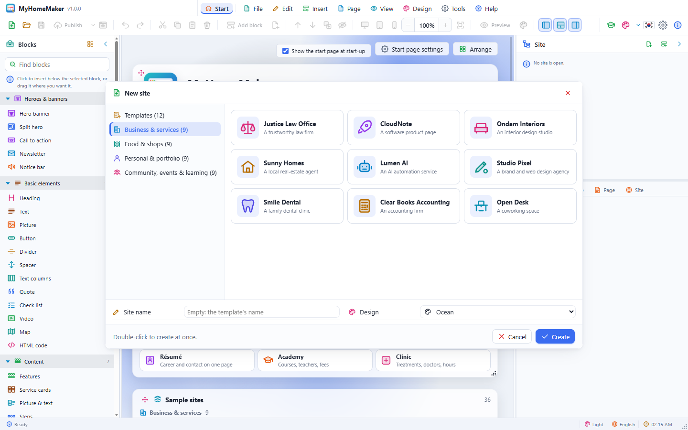

All 36 sample sites are finished sites with three pages: Home, About or Menu, and Contact. Open one to see how its blocks are put together, and make it your own (**File › Open sample**).

| Group | Samples |
| --- | --- |
| Business & services | Justice Law Office, CloudNote (software), Ondam Interiors, Sunny Homes, Lumen AI (AI automation), Studio Pixel (design agency), Smile Dental, Clear Books Accounting, Open Desk (coworking) |
| Food & shops | Flour & Butter (bakery), Bistro Luna, Bloom Studio, Green Acre Farm, Daily Roast (coffee roastery), Green Bowl (plant-based), Riverside Brewery (craft beer), Sweet Box (desserts to order), Dinner Tonight (meal kits) |
| Personal & portfolio | Hangyeol Photo, Drawing Days (illustration), dev.alex (developer), James ♥ Sophie (wedding), Mia Kim Design (UX portfolio), The Daybreak (indie band), Liam Choi Coaching, Olivia's Bookshelf (author), Travels with Jamie (travel creator) |
| Community, events & learning | Grace Community Church, Code Playground, Power Gym, Weekend Hikers, WebNext 2026 (developer conference), Breathe Yoga, One Book Night (book club), Helping Hands (volunteers), Speak Up English |

## Blocks

### Adding blocks

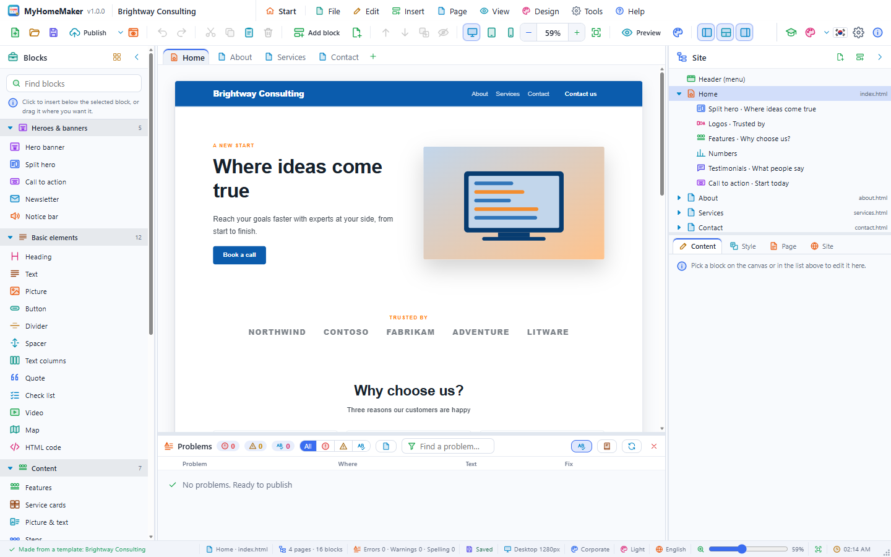

- **Click** a block in the Blocks panel: it goes right below the selected block (or at the end).
- **Drag** a block onto the canvas: a blue line shows where it lands.
- **Add block** on the toolbar (Ctrl+Shift+A), the **Insert** menu, the **+** button below the selected block and the empty-page hint do the same.

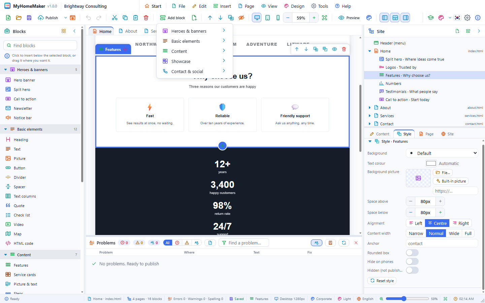

| Group | Blocks |
| --- | --- |
| Heroes & banners | Hero banner, Split hero, Call to action, Newsletter, Notice bar |
| Basic elements | Heading, Text, Picture, Button, Divider, Spacer, Text columns, Quote, Check list, Video (YouTube, Vimeo, mp4), Map, HTML code |
| Content | Features, Service cards, Picture & text, Steps, Timeline, Numbers, FAQ |
| Showcase | Gallery, Testimonials, Team, Logos, Pricing, Menu, Events, Blog posts |
| Contact & social | Contact (form and map), Social links |

### Selecting and moving

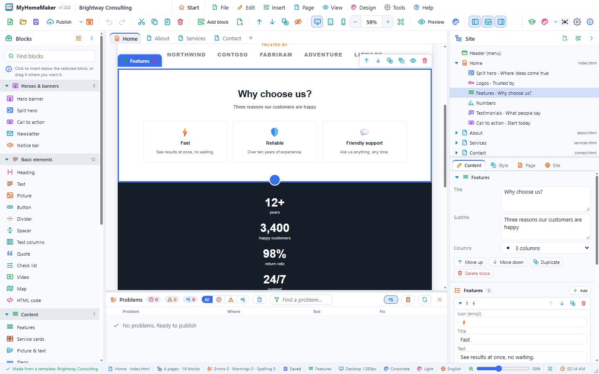

Click a block on the canvas: it gets a frame, a **name tab** and tool buttons (up, down, duplicate, style, hide, delete).

- **Drag the name tab** to another place, or move one step with ↑ ↓ or **Ctrl+↑/↓**.
- **Alt+↑/↓** (or ↑/↓) selects the next block; **Esc** clears the selection.
- **Duplicate** (Ctrl+D), **Cut · Copy · Paste** (Ctrl+X/C/V; also into another MyHomeMaker window; plain text becomes a Text block), **Delete**.
- **Hide** (Ctrl+H) — hidden blocks are dimmed and not published.
- A row in the Site panel list opens its page and selects the block.
- Everything can be **undone** (Ctrl+Z) and **redone** (Ctrl+Y).

## Editing content

### Right on the page

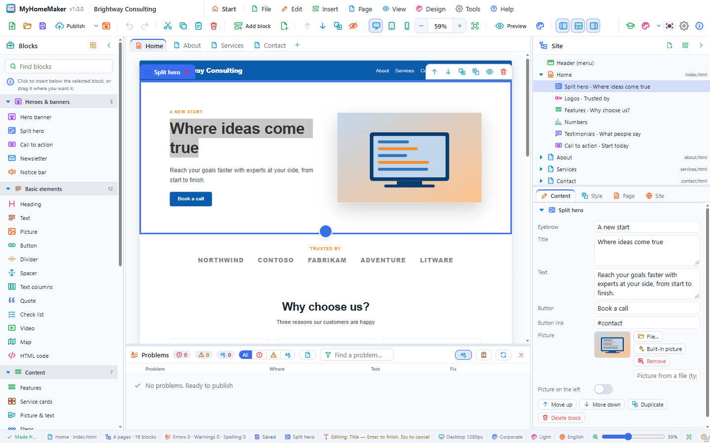

Click the text of the selected block once more (or double-click any text) to edit it in place. **Enter** finishes, **Esc** cancels, **Shift+Enter** starts a new line in multi-line fields.

- Double-click a picture to choose a picture file.
- Formatted text and HTML code open their field in the Content tab on a double-click.
- **Ctrl+click** a menu link of the header to go to that page.
- With the spelling check on, words that are not in the dictionary get a **wavy red underline** (in the editor only — never on the published site).

### Content tab

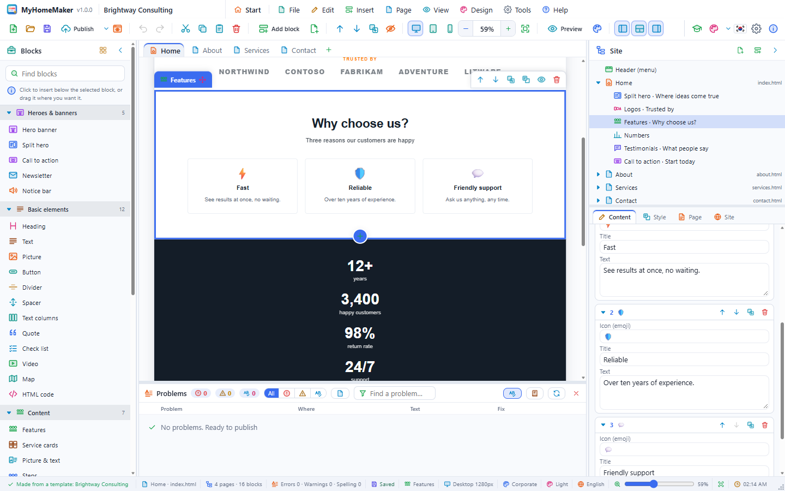

Every field of the selected block:

- **Formatted text** — `**bold**`, `*italic*`, `[link](address)`, a blank line for a new paragraph, `- ` lists, `1. ` numbered lists, `## ` small headings
- **Links** — another page (pick from the list), a block's anchor (`#features`), a web address, `mailto:`, `tel:`
- **Pictures** — **File…** (big photos are reduced to 1920 px on the long side), **Built-in picture** (16 kinds, drawn in the site's colours), **Remove**, or a picture address
- **Item lists** — features, cards, photos, plans, reviews, people, questions: **add · duplicate · up/down · delete**, ▸ folds an item
- Numbers have − + buttons, on/off settings are switches

### Header and footer

There is one of each per site, the same on every page. Click them on the canvas or use **Insert › Edit header / Edit footer**.

- **Header** — site name, logo, the button on the right (label and link), layout (logo left, centred), stick to the top. The menu lists every page with "Show in menu" on and folds into ☰ on phones.
- **Footer** — about text, address, phone, e-mail, links, copyright. Page links fill themselves in.

### Style tab

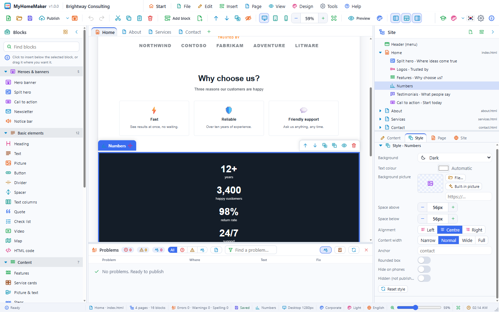

| Setting | Meaning |
| --- | --- |
| Background | none · surface · primary · accent · dark · footer colour · your own colour |
| Text colour | automatic (fits the background) or your own colour |
| Background picture | a picture behind the block, and how much to darken it (%) |
| Space above · below | 0–320 px (reduced to at most 64 px on phones) |
| Alignment / content width | left · centre · right / narrow · normal · wide · full |
| Anchor | `#name` links come to this block |
| Rounded box · hide on phones · hide | |

**Reset style** goes back to the block's default style.

## Pages

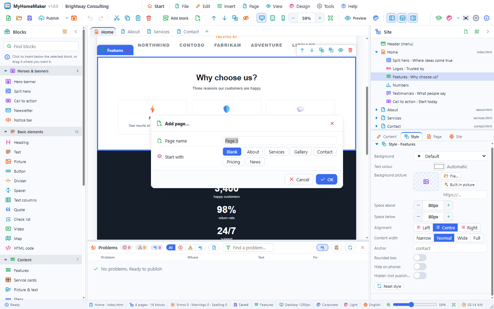

- **Add page…** (Ctrl+Shift+N, + on the tab row) — a name and what it starts with (empty, about, services, gallery, contact, pricing, news).
- Click a tab to open the page, double-click to rename (F2). Its right-click menu duplicates, deletes and moves.
- **Previous/next page** (Ctrl+PageUp/PageDown, Ctrl+Tab). The first tab is always `index.html`.

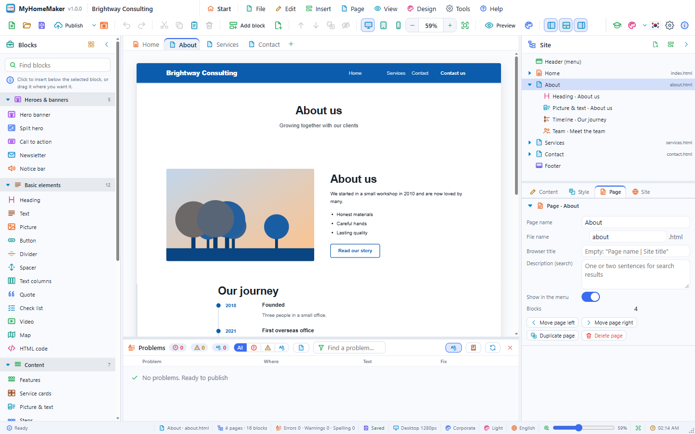

| Page tab | Meaning |
| --- | --- |
| Page name | the name on the tab and in the menu |
| File name | the file it is published as (`about` → `about.html`); common Korean names get an English file name |
| Browser title | empty: the page name, a bar and the site title (the home page: the site title) |
| Description (search) | a sentence or two for search results |
| Show in menu | off: left out of the header menu and the footer links |

## Design

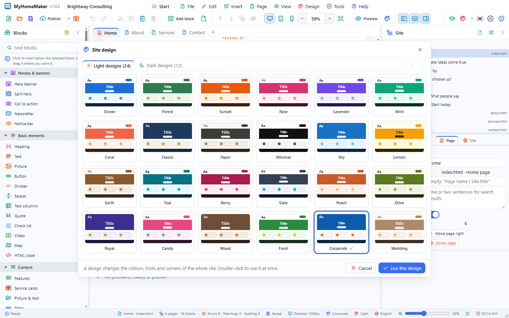

**Design › Change design…** (Ctrl+Shift+D) shows the 24 light and 12 dark designs as little page pictures. A design sets the primary and accent colours, background, text, header and footer colours, heading and body fonts, corners, content width and text size at once. In every design the text keeps enough contrast to read easily. Turn on *Keep my colours and fonts* to keep what you changed yourself.

- **Random design**, **Reset design** (the values changed in the Site tab go back to the design's)

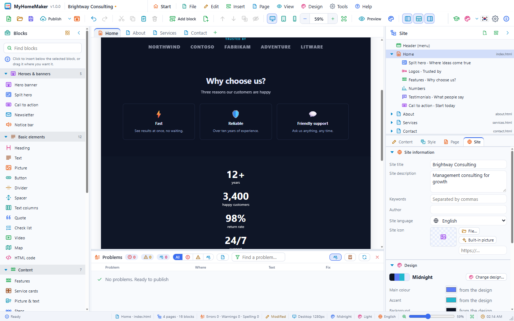

The **Site** tab of the editor:

- **Site information** — site title, description and keywords (search engines and link previews), author, site language (`<html lang>`), site icon
- **Design** — the current design and **Change design…**, colours, fonts, corners, width and text size; × next to a changed value takes the design's value back

The program's **theme** is the colour of the MyHomeMaker window, separate from the design of the site you make.

## Device widths and preview

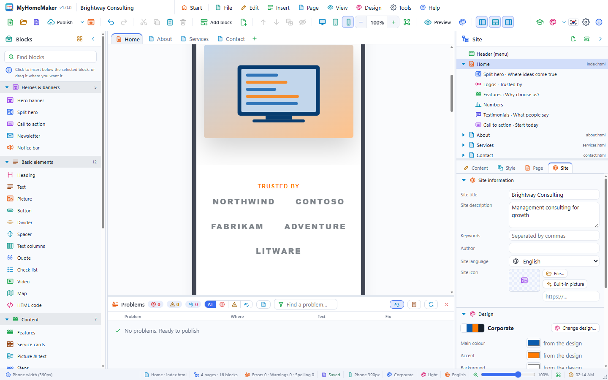

- **Desktop (1280 px) · Tablet (820 px) · Phone (390 px)** change the canvas width. Columns follow the width (two at 900 px or less, one at 600 px or less) and the menu folds into ☰.
- **Zoom** — − +, the zoom box, Ctrl+wheel, the status bar slider, **Fit width** (Ctrl+Shift+W).

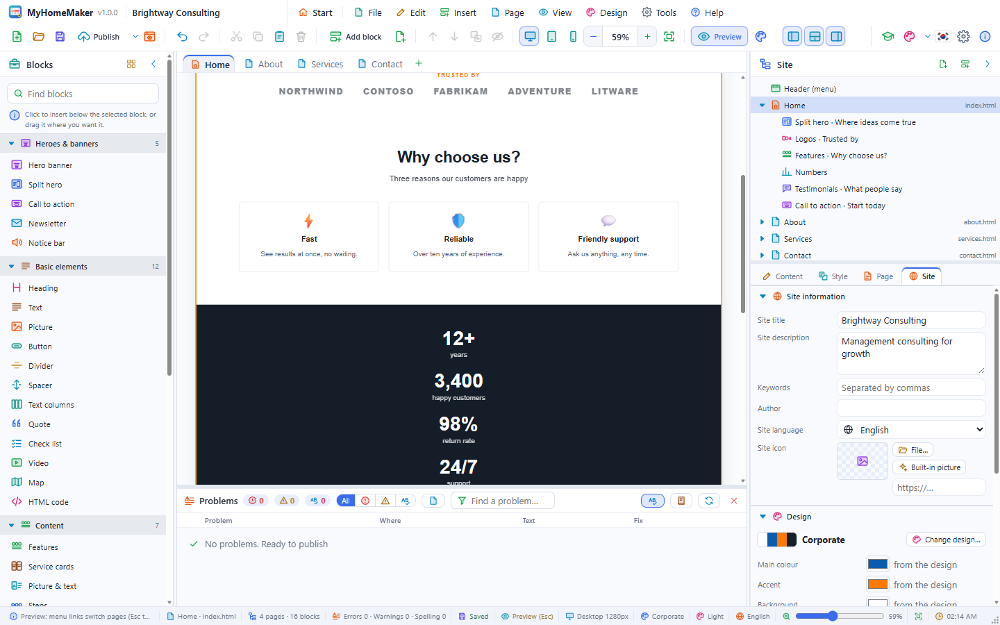

- **Preview mode** (Ctrl+E) — no editing marks, just what visitors see. Menu links switch pages and `#anchor` links scroll to their block. Esc ends it.
- **Preview in browser** (F5) — desktop: writes the whole site to a temporary folder and opens your browser. Web: opens the current page in a new tab.

## Problems panel

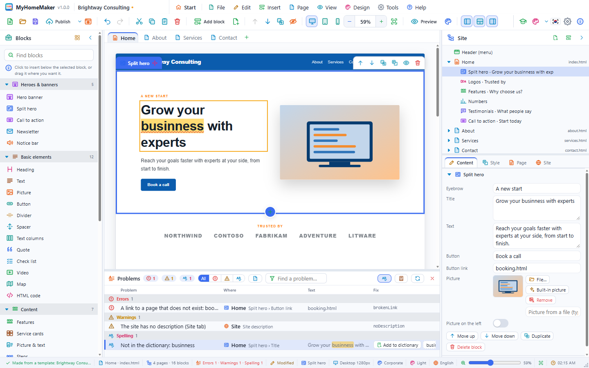

The **Problems** panel under the canvas checks the site again a moment after every change and lists what to fix. Open and fold it with the **Problems panel** button of the toolbar (between the Blocks and Site panel buttons) or **Ctrl+J**, and drag its top edge to change its height. The *errors · warnings · spelling* count in the status bar opens it too (**Tools › Show problems**, Ctrl+Shift+M).

| Kind | What is checked |
| --- | --- |
| Errors | links to pages that do not exist, links that run code (`javascript:`), contact forms with nowhere to send, pages without a name, pages with the same file name |
| Warnings | no site title or description, a title over 60 or a description over 160 characters, empty pages, pages whose blocks are all hidden, pictures without alt text, picture blocks without a picture, video addresses that are not YouTube or Vimeo |
| Spelling | words that are not in the English or Korean dictionary nor in your own |

- Each row shows the problem, **where** it is (page › block › field; the header and footer say *every page*), its kind, a piece of the text (the word marked) and fix buttons.
- **Click** a row: its page opens, the block is selected, the field flashes on the canvas and the word is marked in yellow.
- **Double-click** a row: the cursor goes to that field of the editor with the word selected, ready to fix (the site title and description in the Site tab, page settings in the Page tab).
- Keyboard: ↑ ↓ move through the rows (the place follows), **Enter** goes to the field.
- The header row: error, warning and spelling counts, **All / Errors / Warnings / Spelling** filters, **This page only**, a search box, **Spelling check** on/off, **Dictionary**, **Check now**, fold (×).

Before publishing, **Tools › Check site** and the Publish window show the same checks once more.

## Spelling and the dictionary

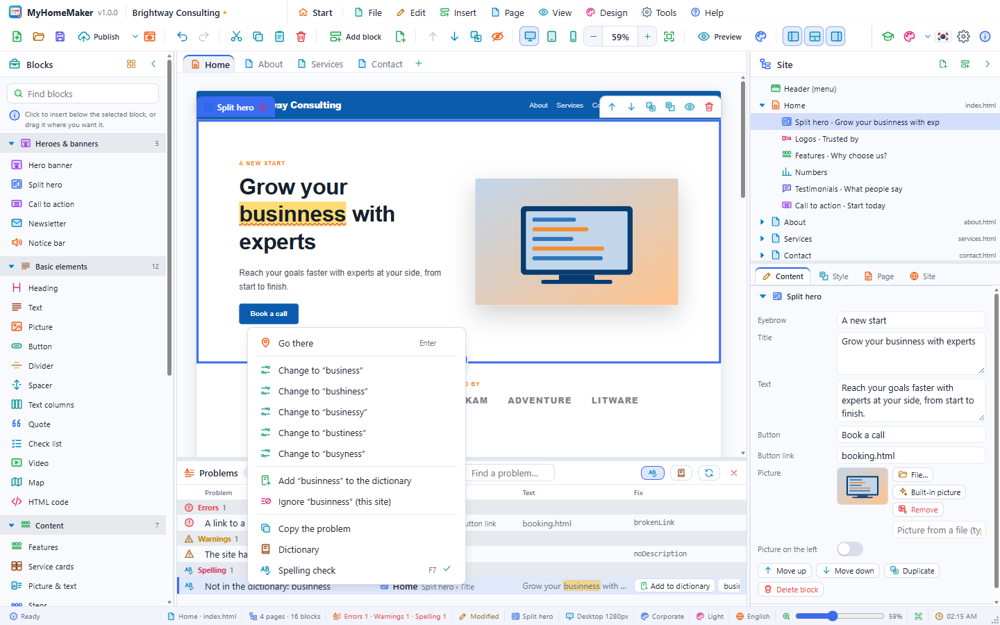

The spelling check reads every text of the site (site title, description and keywords, page names, titles and descriptions, the text and items of every block). Addresses, e-mail, phone numbers, code, words with digits (3D, 24h), names with capitals inside (`MyHomeMaker`) and short acronyms (FAQ, SNS) are not checked.

- **English** — about 275,000 words with their forms (plurals, past tenses …), contractions (`don't`, `we're`), possessives and accents (`café`).
- **Korean** — about 100,000 words (the Korean Hunspell dictionary). Particles (을·를·에서·으로·입니다 …) and endings (-습니다·-어요·-었습니다·-세요·-는·-ㄴ …) come off and the word is traced back to its dictionary form, irregular verbs included (‘만듭니다 → 만들다’, ‘새로운 → 새롭다’, ‘고마워요 → 고맙다’), as well as noun + 하다 (‘제작합니다’) and compound nouns written as one word (‘홈페이지제작’).
- Common loanwords and service names of the web, design, food and services (Instagram, brunch, 반응형 …) are added.

A spelling row has **Add to dictionary** in its fix column, and when the row is selected the **suggestions** appear as buttons (English: doubled, missing and swapped letters first; Korean: vowel slips such as ㅐ/ㅔ first). Its right-click menu:

- **Change to “…”** — replaces that word only (one undo step).
- **Add “…” to the dictionary** — goes into your dictionary and is not shown again in any site.
- **Ignore “…” (this site)** — hidden in this site until the program closes.
- **Go there**, **Copy the problem**, **Dictionary**, **Spelling check** (F7)

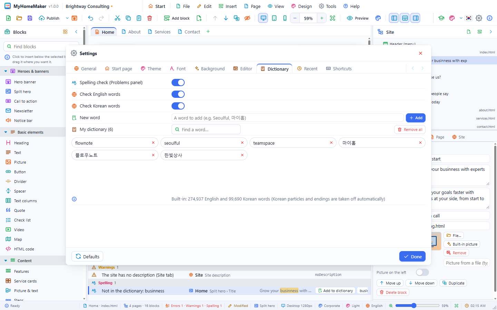

**Tools › Dictionary** (the **Dictionary** tab of Settings):

- **Spelling check** on/off (F7), **Check English words**, **Check Korean words**
- Type a **new word** and press **Add** (or Enter). Hangul or Latin letters only, up to 40. English words are stored ignoring capitals; Korean words are accepted with particles too (‘마이홈’ → ‘마이홈에서’).
- **My dictionary**: find, × removes a word, **Remove all**; 24 words a page.

Your dictionary is kept with the settings and survives a new installation.

## Saving and files

- **Save** (Ctrl+S) — a site is one `.myhome` file with its pages, blocks, pictures and design. A site made from a template or sample asks for a name the first time.
- **Save as** (Ctrl+Shift+S), **Save as template…** (`.mhomt`: opening it starts a new site)
- **Open…** (Ctrl+O), **Recent files…** (Ctrl+R), **Recent folders**, **Clear history**
- **Close site** (Ctrl+W) — asks about unsaved changes. Settings can **auto-save** every 1, 5, 10 or 30 minutes.
- Drop a site file on the window to open it; drop a picture to put it in the selected block.
- One window holds one site. Run the program again to work on several sites at once.

## Publishing

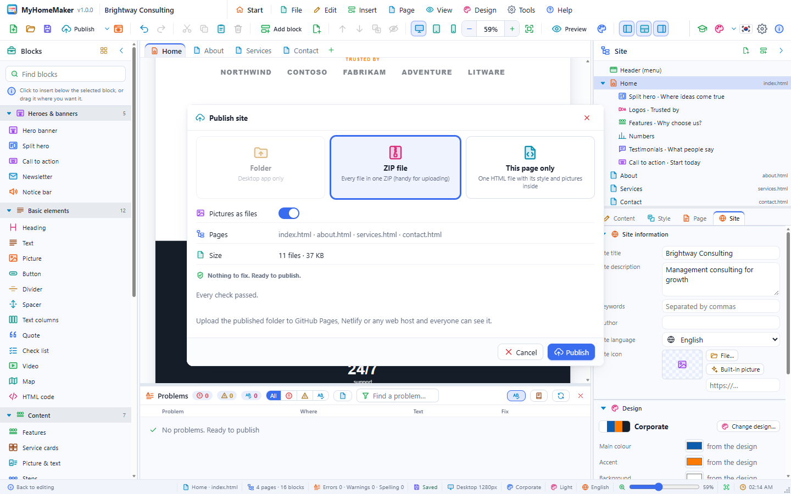

**File › Publish & export › Publish site…** (Ctrl+Shift+P, **Publish** on the toolbar):

| Way | Result |
| --- | --- |
| Folder (desktop) | a folder named after the site inside the folder you choose, with `index.html`, one `.html` per page, `style.css` and `assets/` |
| ZIP file | the same files in one ZIP, handy for hosting |
| This page only | one HTML file with its style and pictures inside (for e-mail and sharing) |

- **Extract pictures as files** writes the pictures to `assets/` so the pages stay light (each picture once).
- The window lists what is left to **check**. Fix it beforehand in the Problems panel.
- **Copy this page's HTML** puts the current page, as one HTML file, on the clipboard.

The published files are clean HTML and CSS without hidden blocks or editing marks (spelling underlines included), and they work without JavaScript (the phone menu and the FAQ too).

- **Putting it online** — upload the folder or the ZIP to GitHub Pages, Netlify, Cloudflare Pages or any web host.
- **Contact forms and newsletters** — a static site cannot send e-mail by itself. Put the address of a form service such as Formspree or Getform in *Form address* and it mails the messages to you. Left empty, the form opens the visitor's e-mail program (`mailto:`).

## Settings

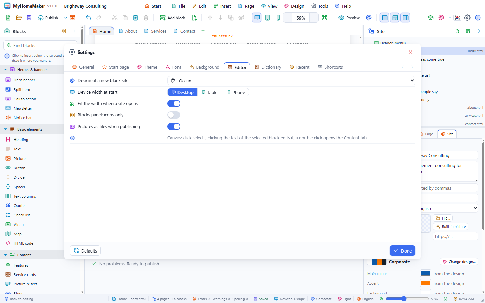

**Tools › Settings…** (Ctrl+,):

- **General** — language, reopen the last file, ask before deleting, status bar clock and visibility, auto-save, start the tutorial
- **Start page** — show at start, the welcome window, which cards and how many recent items
- **Theme** — 20 dark, 20 light and a custom theme (your own colours, with a contrast warning)
- **Font** — the program's font, size, weight, italic, zoom
- **Background** — animated, picture or none; kind, speed, random, interval; background picture, opacity and fit
- **Editor** — the design of new blank sites, the first device width, fit width on opening, icon-only Blocks panel, extract pictures when publishing
- **Dictionary** — the spelling check and your dictionary (see above)
- **Recent**, **Shortcuts**

**Defaults** resets the settings (recent files, the background picture and your dictionary stay).

## Shortcuts

| Keys | Action |
| --- | --- |
| Ctrl+N / Ctrl+O / Ctrl+S / Ctrl+Shift+S | New / Open / Save / Save as |
| Ctrl+W / Ctrl+R | Close site / Recent files |
| Ctrl+Z / Ctrl+Y | Undo / Redo |
| Ctrl+X / Ctrl+C / Ctrl+V / Ctrl+D / Delete | Cut / Copy / Paste / Duplicate / Delete a block |
| Ctrl+↑ / Ctrl+↓, Alt+↑ / Alt+↓ | Move a block up / down, select the previous / next block |
| Enter / Esc / Ctrl+H | Edit content / Clear selection / Hide |
| Ctrl+Shift+A / Ctrl+Shift+N / F2 | Add block / Add page / Rename page |
| Ctrl+PageUp / Ctrl+PageDown, Ctrl+Tab | Previous / next page |
| Ctrl+= / Ctrl+- / Ctrl+0 / Ctrl+Shift+W | Zoom in / out / 100 % / fit width |
| Ctrl+E / F5 | Preview mode / Preview in browser |
| Ctrl+Shift+P / Ctrl+Shift+D | Publish / Change design |
| Ctrl+Shift+1 / Ctrl+J / Ctrl+Shift+2 | Blocks panel / Problems panel / Site panel |
| Ctrl+Shift+M / F7 | Show problems / Spelling check on/off |
| Ctrl+Shift+L / Ctrl+Shift+B / Ctrl+Shift+H | Language / Change background / Start page |
| Ctrl+, / F11 / F1 | Settings / Tutorial / About |

## Tutorial and help

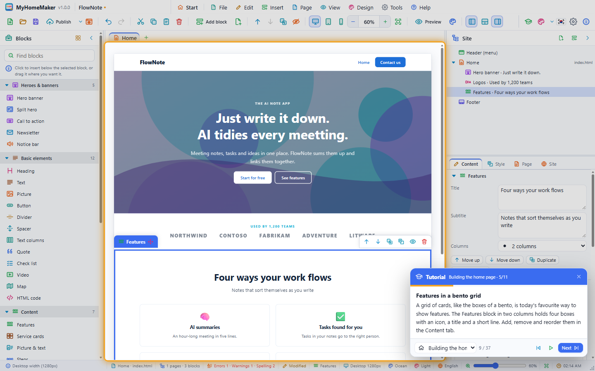

- **Tutorial** (F11) — 8 chapters, 37 steps. It builds four pages (Home, Pricing, About, Contact) for “FlowNote”, an AI note app, from an empty site: a bold first screen, a bento grid, trust, dark mode, a phone check, problems and spelling, publishing. Previous/next, auto play and a chapter list in its card; ✕ or Esc ends it. Whichever step you jump to shows the site as built up to there, and when it ends your open sites, settings and dictionary come back as they were.
- **Tutorial video** — `MyHomeMaker-Tutorial.mp4` (Korean, silent), in the project folder and in `doc/video/`.
- **Tutorial document** and **User's guide** — open in a window of their own with a table of contents (Korean and English).
- **Welcome**, **About** (F1)

When something goes wrong, the error window shows the details and **Copy** takes them as they are.

## File format

`.myhome` is UTF-8 JSON: `format: "myhomemaker"`, `meta` (title, description, language …), `design` (the design id and changed values), `layout` (header and footer), `pages` (names, file names, blocks). A block has a `type`, `props` (its content) and `style`. Pictures are stored as data URLs, so the one file is all you need to move.

## Troubleshooting

| Problem | Solution |
| --- | --- |
| A correct word is marked as a spelling problem | Press **Add to dictionary** on its row, or add it in **Tools › Dictionary**. Company and people's names often are. |
| Too many spelling rows | Use the **Errors**/**Warnings** filters or **This page only**, or check one language only (Settings › Dictionary). |
| A published site opened from disk shows broken pictures or links | Keep the folder together and open its `index.html`: the other pages and `assets/` must be in the same folder. |
| Maps and videos do not show on the canvas | They need an internet connection. |
| The contact form sends nothing | Put a form service address in the Contact block's *Form address*. |
| The web version shows an empty page when index.html is opened directly | Serve it from a web server (e.g. `npx vite preview`, or your host). |

## For developers

| Command | What it does |
| --- | --- |
| `npm start` | runs the app for development |
| `npm test` | every test: unit (js) · Rust · web (every feature, Korean and English) · desktop. `-- --quick` runs js and Rust only |
| `npm run build:dict` | builds the spelling dictionaries again (`public/dict/`) |
| `npm run guide:images` · `npm run build:docs` | the guide's pictures · the document pages |
| `npm run tutorial:docs` · `npm run tutorial:video` | the tutorial document (a picture per step) · the tutorial video |
| `npm run i18n:check` | checks the translation keys |

Spelling dictionaries: English from `an-array-of-english-words` (MIT), Korean from `dictionary-ko` (hunspell-dict-ko, MPL/GPL/LGPL). See `public/dict/LICENSES.txt`.
