# MyHomeMaker 사용 설명서

MyHomeMaker 는 **블록을 끌어다 놓아 홈페이지를 만드는** 그래픽 웹사이트 제작 도구입니다. 코드를 몰라도 페이지를 꾸미고, 디자인을 한 번에 바꾸고, 휴대폰에서 어떻게 보일지 확인한 뒤, 웹 서버에 올릴 HTML·CSS 파일로 게시할 수 있습니다.

- 블록 34가지(대표 배너, 특징, 서비스 카드, 사진첩, 가격표, 후기, 팀, 연혁, 자주 묻는 질문, 문의 양식, 지도, 동영상 …)와 사이트마다 하나씩 있는 머리글·바닥글
- 사이트 디자인 36가지(밝은 24 · 어두운 12): 색, 제목·본문 글꼴, 모서리, 내용 폭, 글자 크기
- 템플릿 12가지와 완성된 예제 사이트 16가지(한국어·영어)
- 캔버스에서 바로 글 고치기, 데스크톱·태블릿·휴대폰 너비, 미리 보기 모드, 브라우저 미리 보기
- 게시: 폴더(데스크톱), ZIP 파일, 이 페이지만 HTML 한 파일
- Windows · macOS · Linux 데스크톱 앱과 웹 버전

처음이라면 [튜토리얼](Tutorial.md)을 따라 해 보세요. 앱 안에서는 **도움말 › 튜토리얼**(F11)이 실제 화면을 움직이며 기능을 차례로 보여 줍니다.

## 설치와 실행

| 대상 | 파일 | 설치 |
|---|---|---|
| Windows | `MyHomeMaker-Setup-<버전>.exe` | 실행하면 언어를 고르고 설치합니다. 이전 설치가 있으면 완전히 지운 뒤 다시 설치하며, 이전 사용자 데이터를 지울지 묻습니다. |
| macOS | `MyHomeMaker-<버전>-<arch>.dmg` | 열어서 응용 프로그램 폴더로 끌어 놓습니다. |
| Linux | `.deb` · `.rpm` · `.AppImage` | 패키지 관리자로 설치하거나 AppImage 를 실행합니다. |
| 웹 | `MyHomeMaker-Web-<버전>.zip` | 압축을 풀어 웹 서버에 올리고 `index.html` 을 엽니다. |

`.myhome` 사이트 파일과 `.mhomt` 템플릿 파일은 설치 후 MyHomeMaker 로 열립니다(파일을 두 번 누르거나 창으로 끌어 놓기).

설치 파일은 소스에서 다음 명령으로 만듭니다(Tauri 는 자기 운영 체제용만 만듭니다).

```
npm install
npm run build:win      # Windows 설치 프로그램 (NSIS)
npm run build:mac      # macOS (.app, .dmg)
npm run build:linux    # Linux (.deb, .rpm, .AppImage)
npm run build:webapp   # 웹 버전 ZIP
npm run build:all      # 웹 버전 + 이 운영 체제의 설치 파일
```

만든 파일은 `release/` 와 프로젝트 루트에 복사됩니다. 개발 중에는 `npm start` 로 앱을 띄웁니다.

## 화면 구성

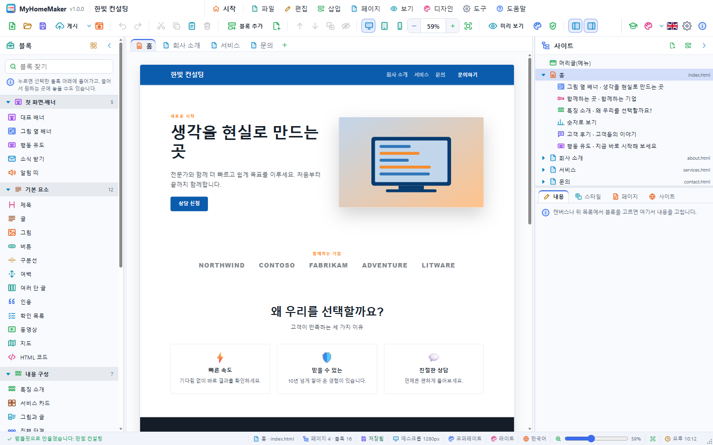

1. **메뉴 막대 줄** — 앱 아이콘·이름·버전과 열린 사이트 이름(저장하지 않은 변경이 있으면 ●), 홈 단추, 메뉴(파일·편집·삽입·페이지·보기·디자인·도구·도움말), 오른쪽 끝의 최소화·최대화·닫기. 이 줄이 제목 표시줄이라 빈 곳을 끌어 창을 옮기고 두 번 눌러 최대화합니다.
2. **툴바** — 새로 만들기, 열기, 저장, 게시(▾ 게시 방법), 브라우저 미리 보기 / 실행 취소·다시 실행 / 잘라내기·복사·붙여넣기·삭제 / 블록 추가·페이지 추가 / 위·아래로, 복제, 숨기기 / 기기 너비(데스크톱·태블릿·휴대폰)와 확대 비율, 너비에 맞추기 / 미리 보기, 디자인 바꾸기, 사이트 점검 / 패널. 오른쪽 끝: 튜토리얼, 테마(무작위 ▾ 목록), 언어(국기), 설정, 프로그램 정보. 창을 줄여도 툴바 단추가 가려지지 않도록 창의 최소 폭이 툴바에 맞춰집니다.
3. **블록 패널**(왼쪽) — 다섯 묶음의 블록 목록과 찾기 칸, 맨 아래에 머리글·바닥글 편집.
4. **페이지 탭과 캔버스**(가운데) — 탭마다 사이트의 페이지 하나, 맨 앞 탭이 첫 페이지(index.html)입니다. 캔버스는 실제 사이트와 똑같이 그려집니다.
5. **사이트 패널**(오른쪽) — 위: 머리글, 페이지별 블록, 바닥글의 목록. 아래: 편집기 탭(**내용 · 스타일 · 페이지 · 사이트**). 두 부분 사이 구분선을 끌어 높이를 바꿉니다.
6. **상태 표시줄** — 알림, 페이지와 파일 이름, 페이지·블록 수, 저장 상태, 선택한 블록, 기기 너비, 디자인, 테마, 언어, 확대 슬라이더, 시계.

패널은 접으면 아이콘만 남은 좁은 줄이 되고(Ctrl+Shift+1, Ctrl+Shift+2), 패널 사이 구분선을 끌어 너비를 바꿉니다.

## 시작 화면

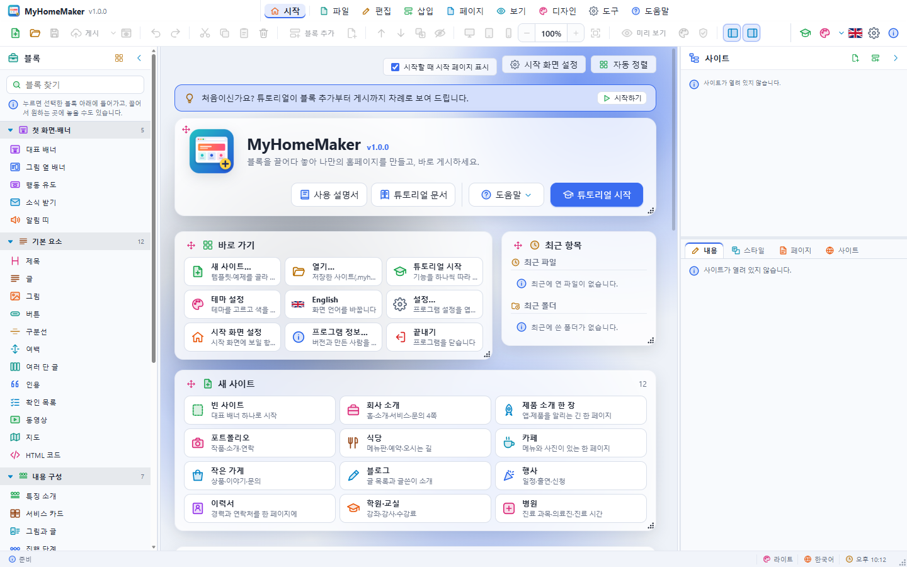

프로그램을 켜면(설정에서 끌 수 있음) 움직이는 배경 위에 카드들이 놓인 시작 화면이 나옵니다.

- **바로 가기** — 새 사이트, 열기, 튜토리얼, 테마 설정, 언어, 설정, 시작 화면 설정, 프로그램 정보, 끝내기
- **최근 항목** — 최근 파일과 최근 폴더(× 로 목록에서 빼기)
- **새 사이트** — 템플릿 12가지
- **예제 사이트** — 네 분야의 예제 16가지
- **테마** — 프로그램 테마(어두운·밝은)
- **움직이는 배경** — 20가지, 무작위, 속도, 카드 투명도, 자동으로 바꾸는 간격, 배경 그림

카드는 왼쪽 위 손잡이로 끌어 옮기고 오른쪽 아래 모서리로 크기를 바꿉니다. **자동 정렬**을 누르면 처음 배치로 돌아갑니다. 메뉴 막대의 **시작**(홈) 단추는 시작 화면과 편집 화면을 오갑니다(Ctrl+Shift+H).

## 사이트 만들기와 파일

### 새 사이트

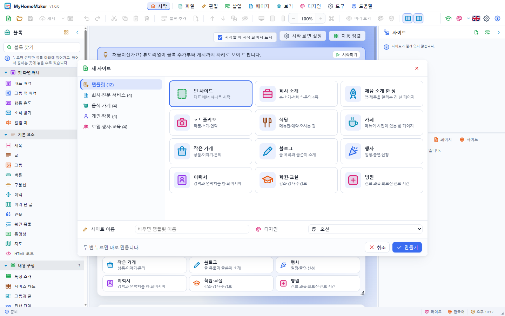

**파일 › 새 사이트…**(Ctrl+N)는 왼쪽에서 *템플릿* 또는 예제 분야를 고르고, 카드를 고른 뒤, 사이트 이름과(빈 사이트일 때) 디자인을 정해 **만들기**를 누릅니다. 카드를 두 번 누르면 바로 만들어집니다.

| 템플릿 | 들어 있는 것 |
|---|---|
| 빈 사이트 | 대표 배너 하나 |
| 회사 소개 | 홈·회사 소개·서비스·문의 4쪽 |
| 제품 소개 한 장 | 앱·제품을 알리는 긴 한 페이지 |
| 포트폴리오 | 작업·소개·연락 |
| 식당 | 메뉴판·예약·오시는 길 |
| 카페 | 메뉴와 사진이 있는 한 페이지 |
| 작은 가게 | 상품·이야기·문의 |
| 블로그 | 글 목록과 글쓴이 소개 |
| 행사 | 일정·출연·신청 |
| 이력서 | 경력과 연락처를 한 페이지에 |
| 학원·교실 | 강좌·강사·수강료 |
| 병원 | 진료 과목·의료진·진료 시간 |

**파일 › 템플릿으로 새로 만들기**와 **파일 › 예제 사이트 열기**는 같은 목록을 메뉴로 보여 줍니다. 예제는 회사·전문 서비스, 음식·가게, 개인·작품, 모임·행사·교육의 네 분야에 넷씩 있습니다.

### 저장과 열기

- **저장**(Ctrl+S) — 사이트는 `.myhome` 파일 하나에 페이지·블록·그림·디자인이 모두 들어갑니다. 템플릿·예제로 만든 사이트는 처음 저장할 때 이름을 묻습니다.
- **다른 이름으로 저장**(Ctrl+Shift+S), **템플릿으로 저장…**(`.mhomt`: 열면 새 사이트로 시작)
- **열기…**(Ctrl+O), **최근 파일…**(Ctrl+R), **최근 폴더**, **최근 파일·폴더 기록 모두 지우기**
- **사이트 닫기**(Ctrl+W) — 저장하지 않은 변경이 있으면 저장할지 묻습니다.
- 사이트 파일(.myhome)을 창으로 끌어 놓아도 열립니다. 그림 파일을 끌어 놓으면 선택한 블록의 그림이 됩니다.
- 한 창에는 사이트가 하나씩 열립니다. 여러 사이트를 함께 보려면 프로그램을 여러 번 실행하세요.
- 웹 버전은 브라우저의 파일 열기·저장 창(지원하는 브라우저) 또는 내려받기를 씁니다.

## 페이지

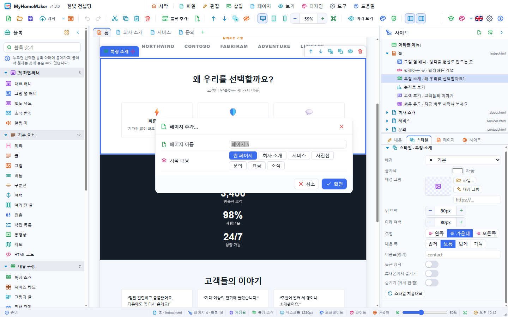

- **페이지 추가…**(Ctrl+Shift+N, 탭 줄의 +) — 이름과 시작 내용(빈 페이지·회사 소개·서비스·사진첩·문의·요금·소식)을 고릅니다.
- 탭을 누르면 그 페이지로, 두 번 누르면 이름 바꾸기(F2). 오른쪽 단추 메뉴에 복제·삭제·옮기기가 있습니다.
- **이전/다음 페이지**(Ctrl+PageUp/PageDown, Ctrl+Tab)
- 첫 탭은 언제나 첫 페이지 `index.html` 입니다. **페이지를 왼쪽으로/오른쪽으로**로 순서를 바꿉니다.

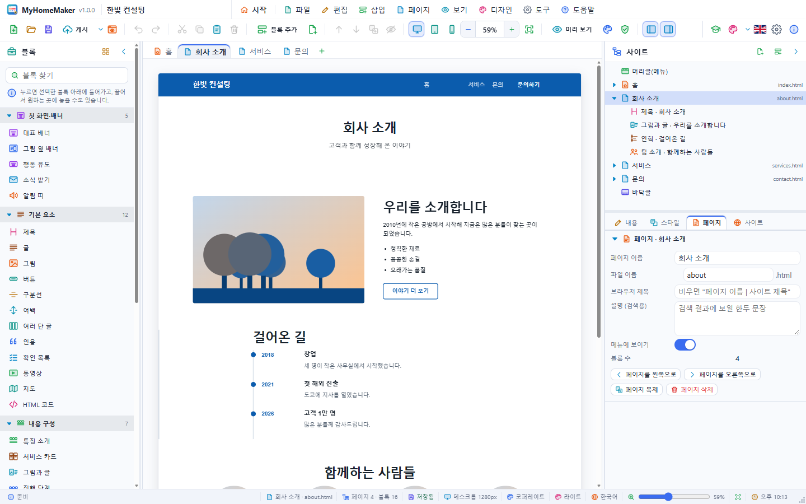

편집기의 **페이지** 탭에서 정합니다.

| 항목 | 뜻 |
|---|---|
| 페이지 이름 | 탭과 메뉴에 보이는 이름 |
| 파일 이름 | 게시할 때의 파일 이름(`about` → `about.html`). 한글 이름은 흔히 쓰는 것(소개·서비스·문의 …)이면 영어 파일 이름이 저절로 붙습니다. |
| 브라우저 제목 | 비우면 "페이지 이름 | 사이트 제목" |
| 설명 (검색용) | 검색 결과에 보일 한두 문장 |
| 메뉴에 보이기 | 끄면 머리글 메뉴와 바닥글 링크에서 빠집니다(탭 이름이 기울어 보임) |

## 블록

### 블록 넣기


- 블록 패널의 블록을 **누르면** 선택한 블록 바로 아래에(선택이 없으면 맨 끝에) 들어갑니다.
- 블록을 캔버스로 **끌면** 놓일 자리에 파란 선이 보이고, 놓은 곳에 들어갑니다.
- 툴바의 **블록 추가**(Ctrl+Shift+A), **삽입** 메뉴의 묶음별 하위 메뉴, 선택한 블록 아래의 **+** 단추, 빈 페이지 안내를 눌러도 됩니다.

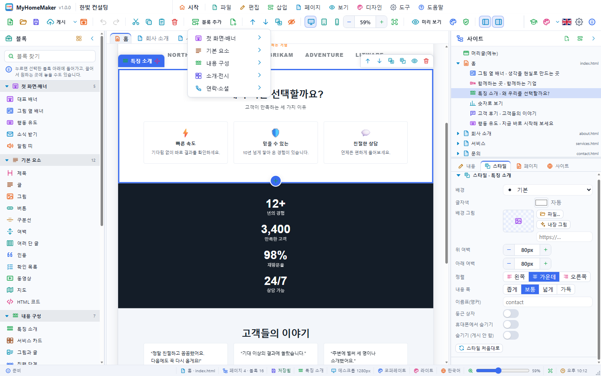

| 묶음 | 블록 |
|---|---|
| 첫 화면·배너 | 대표 배너, 그림 옆 배너, 행동 유도, 소식 받기, 알림 띠 |
| 기본 요소 | 제목, 글, 그림, 버튼, 구분선, 여백, 여러 단 글, 인용, 확인 목록, 동영상(YouTube·Vimeo·mp4), 지도, HTML 코드 |
| 내용 구성 | 특징 소개, 서비스 카드, 그림과 글, 진행 단계, 연혁, 숫자로 보기, 자주 묻는 질문 |
| 소개·전시 | 사진첩, 고객 후기, 팀 소개, 함께하는 곳(로고), 가격표, 메뉴판, 일정, 글 목록 |
| 연락·소셜 | 문의·연락처(양식·지도 포함), 소셜 링크 |

### 고르기와 옮기기

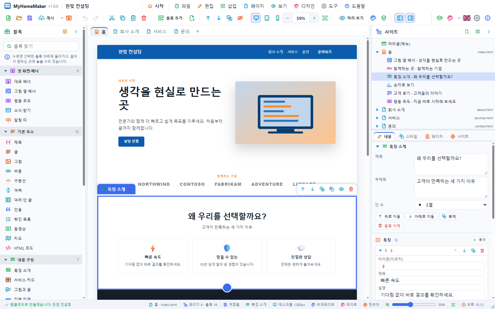

캔버스에서 블록을 누르면 테두리와 **이름표**, 도구 단추(위로·아래로·복제·스타일·숨기기·삭제)가 나타납니다. 마우스를 올리면 점선 테두리와 블록 이름이 보입니다.

- **이름표를 끌어** 다른 자리에 놓거나, ↑ ↓ 단추·**Ctrl+↑/↓**로 한 칸씩 옮깁니다.
- **Alt+↑/↓**(또는 ↑/↓)로 이웃 블록을 고르고, **Esc**로 선택을 풉니다.
- **복제**(Ctrl+D), **잘라내기·복사·붙여넣기**(Ctrl+X/C/V; 다른 MyHomeMaker 창에도 붙여 넣을 수 있고, 일반 글을 붙여 넣으면 글 블록이 됩니다), **삭제**(Delete)
- **숨기기**(Ctrl+H) — 숨긴 블록은 흐리게 보이고 게시되지 않습니다.
- 사이트 패널의 목록에서 줄을 눌러도 그 페이지가 열리고 블록이 선택됩니다.
- 모든 바꿈은 **실행 취소**(Ctrl+Z)·**다시 실행**(Ctrl+Y)할 수 있습니다.

## 내용 고치기

### 캔버스에서 바로

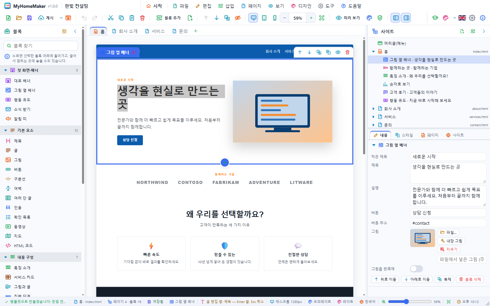

선택한 블록의 글을 **한 번 더 누르면**(또는 아무 글이나 두 번 누르면) 그 자리에서 고칩니다. **Enter** 로 끝내고 **Esc** 로 취소하며, 여러 줄 칸은 **Shift+Enter** 로 줄을 바꿉니다. 상태 표시줄에 고치고 있는 칸이 보입니다.

- 그림을 두 번 누르면 그림 파일을 고릅니다.
- 서식이 있는 글(글 블록, 여러 단 글)과 HTML 코드는 두 번 누르면 내용 탭의 그 칸이 열립니다.
- 머리글 메뉴의 링크를 **Ctrl+누르면** 그 페이지로 갑니다.

### 내용 탭

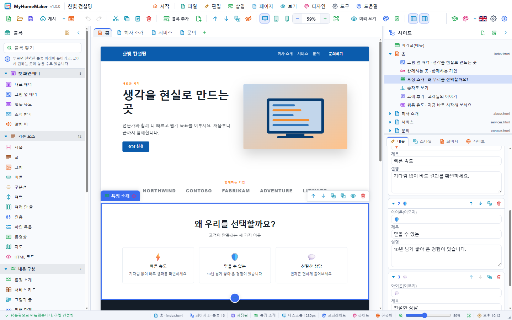

선택한 블록의 모든 칸이 나옵니다. 글은 칸을 떠나거나 Enter 를 누르면, 여러 줄 칸은 잠시 멈추면 캔버스에 반영됩니다.

- **글(서식)** — `**굵게**`, `*기울임*`, `[링크](주소)`, 빈 줄로 새 문단, 줄 앞 `- ` 로 목록, `1. ` 로 번호 목록, `## ` 로 작은 제목
- **주소** — 다른 페이지 파일(목록에서 고름), 블록의 앵커(`#contact`), 웹 주소, `mailto:`, `tel:`
- **그림** — **파일…**(큰 사진은 긴 변 1920px 로 줄여 넣음), **내장 그림**(풍경·도시·음식·인물 등 16가지, 사이트 색으로 그려짐), **지우기**, 또는 그림 주소(https://…)
- **항목 목록** — 특징·카드·사진·요금제·후기·사람·질문처럼 여러 개인 것은 목록으로 **추가 · 복제 · 위로/아래로 · 삭제**, ▸ 로 접기
- 숫자 칸은 − + 단추와 직접 입력, 켜기/끄기는 스위치

### 머리글과 바닥글

사이트마다 하나씩 있고 모든 페이지에 똑같이 나옵니다. 캔버스에서 누르거나 **삽입 › 머리글(메뉴) 편집 / 바닥글 편집**으로 고릅니다.

- **머리글** — 사이트 이름, 로고, 오른쪽 버튼(글자·주소), 배치(로고 왼쪽·가운데), 위에 고정. 메뉴에는 "메뉴에 보이기"가 켜진 페이지가 저절로 들어가고, 휴대폰에서는 ☰ 로 접힙니다.
- **바닥글** — 소개, 주소·전화·이메일, 링크 목록, 저작권 문구. 페이지 링크는 저절로 들어갑니다.

### 스타일 탭

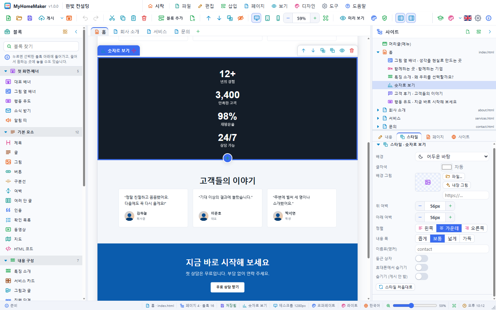

| 항목 | 뜻 |
|---|---|
| 배경 | 기본 · 옅은 바탕 · 주 색 · 강조 색 · 어두운 바탕 · 바닥글 색 · 직접 고른 색 |
| 글자색 | 자동(배경에 맞춤) 또는 직접 고른 색 |
| 배경 그림 | 블록 뒤의 그림과 그림 어둡게(%) |
| 위 여백 · 아래 여백 | 0–320px (휴대폰에서는 64px 까지로 줄어듦) |
| 정렬 | 왼쪽 · 가운데 · 오른쪽 |
| 내용 폭 | 좁게 · 보통 · 넓게 · 가득 |
| 이름표(앵커) | `#이름` 링크가 이 블록으로 옵니다 |
| 둥근 상자 · 휴대폰에서 숨기기 · 숨기기 | |

**스타일 처음대로**는 그 블록의 기본 스타일로 돌립니다.

## 디자인

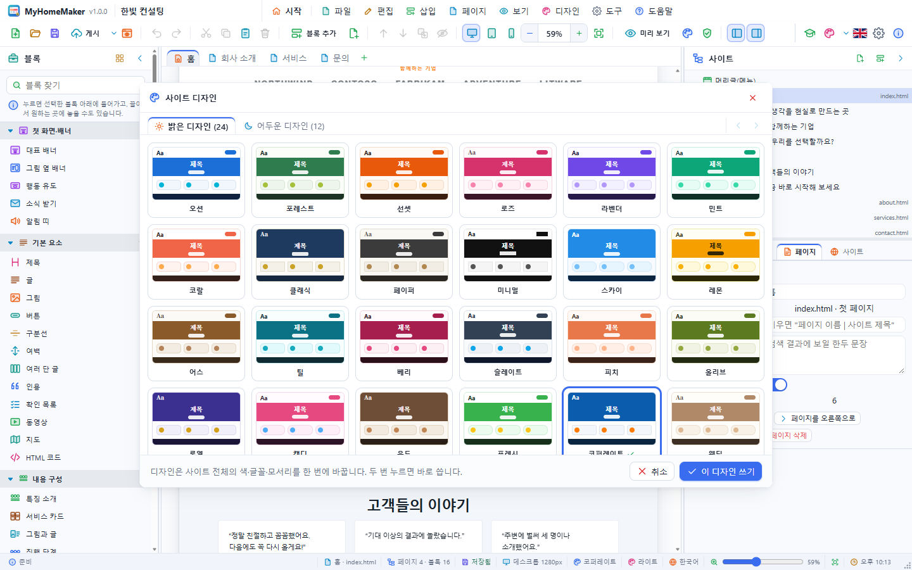

**디자인 › 디자인 바꾸기…**(Ctrl+Shift+D)는 밝은 디자인 24가지와 어두운 디자인 12가지를 작은 페이지 그림 카드로 보여 줍니다. 디자인은 사이트 전체의 주 색, 강조 색, 바탕, 글자, 머리글·바닥글 색, 제목·본문 글꼴, 모서리, 내용 폭, 글자 크기를 한 번에 정합니다. 두 번 누르면 바로 씁니다. 내가 바꾼 색·글꼴을 그대로 두려면 *내가 바꾼 색·글꼴은 그대로 두기*를 켭니다.

- **무작위 디자인** — 다른 디자인 하나를 골라 봅니다.
- **디자인 사용자 설정 지우기** — 사이트 탭에서 바꾼 값을 디자인 기본값으로 돌립니다.

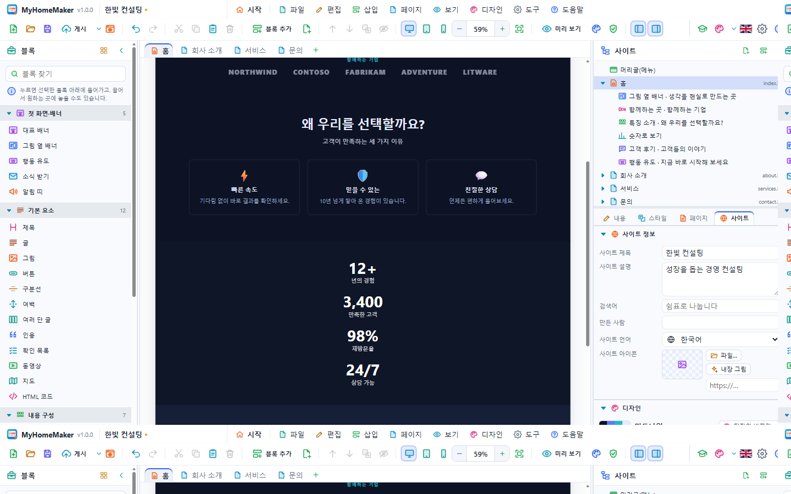

편집기의 **사이트** 탭:

- **사이트 정보** — 사이트 제목(머리글 이름과 브라우저 제목), 사이트 설명·검색어(검색 엔진과 공유 미리 보기), 만든 사람, 사이트 언어(`<html lang>`), 사이트 아이콘(favicon)
- **디자인** — 지금 디자인과 **디자인 바꾸기…**, 그리고 주 색·강조 색·바탕·옅은 바탕·글자·머리글 바탕·바닥글 바탕, 제목 글꼴·본문 글꼴(고딕·명조·둥근·고정폭·우아한·모던·손글씨), 모서리, 내용 폭, 글자 크기. 바꾼 값 옆의 × 로 디자인 값으로 돌립니다.

프로그램의 **테마**(툴바 오른쪽 팔레트)는 MyHomeMaker 창의 색이고, 만드는 사이트의 디자인과는 따로입니다.

## 기기 너비와 미리 보기

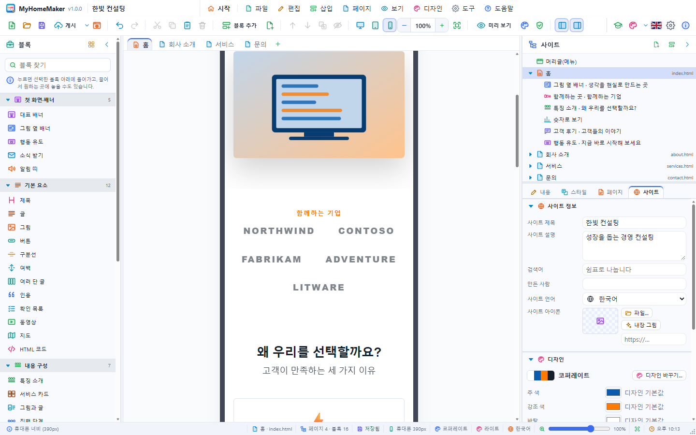

- 툴바의 **데스크톱(1280px) · 태블릿(820px) · 휴대폰(390px)** 단추로 캔버스 너비를 바꿉니다. 사이트는 너비에 맞춰 단이 줄고(900px 이하 2단, 600px 이하 1단) 메뉴가 ☰ 로 접힙니다.
- **확대/축소** — − +, 비율 칸, Ctrl+휠, 상태 표시줄 슬라이더. **너비에 맞추기**(Ctrl+Shift+W). 설정에서 사이트를 열 때 저절로 맞출지 정합니다.

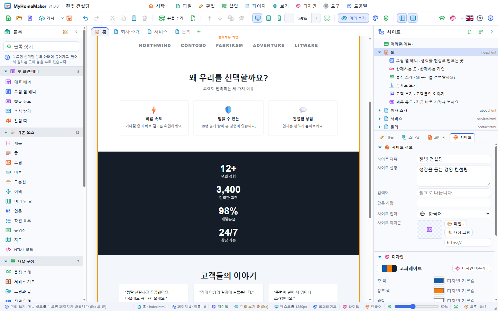

- **미리 보기 모드**(Ctrl+E) — 편집 표시가 없어지고 방문자가 보는 그대로 보입니다. 메뉴 링크를 누르면 페이지가 바뀌고 `#앵커` 링크는 그 블록으로 갑니다. Esc 로 끝냅니다.
- **브라우저에서 미리 보기**(F5) — 데스크톱: 사이트 전체를 임시 폴더에 써서 시스템 브라우저로 엽니다. 웹: 지금 페이지를 새 탭에 엽니다.

## 게시

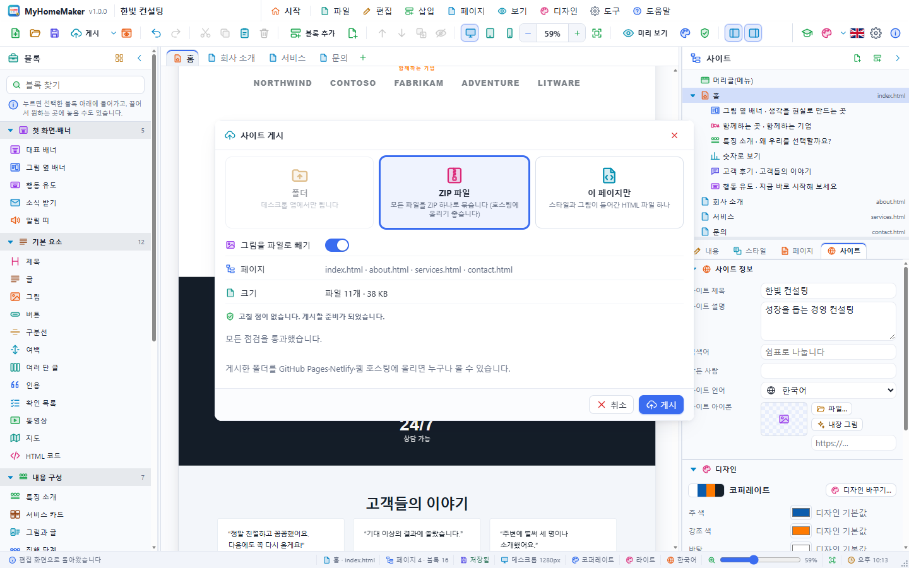

**파일 › 게시·내보내기 › 사이트 게시…**(Ctrl+Shift+P, 툴바의 **게시**):

| 방법 | 결과 |
|---|---|
| 폴더 (데스크톱) | 고른 폴더 안에 사이트 이름의 폴더를 만들고 `index.html`, 페이지마다 `.html`, `style.css`, `assets/` 를 씁니다. 끝나면 폴더나 브라우저로 열 수 있습니다. |
| ZIP 파일 | 같은 파일을 ZIP 하나로 묶습니다. 호스팅에 올리기 좋습니다. |
| 이 페이지만 | 스타일과 그림이 들어간 HTML 파일 하나(메일·공유용) |

- **그림을 파일로 빼기**를 켜면 사이트 안의 그림이 `assets/img-….png/jpg/svg` 파일이 되어 페이지가 가벼워집니다(같은 그림은 한 번만).
- 창 아래에 **확인할 점**(사이트 제목·설명 없음, 빈 페이지, 대체 글 없는 그림, 받는 곳 없는 문의 양식, 같은 파일 이름)이 보입니다. **도구 › 사이트 점검**으로 미리 확인할 수 있습니다.
- **이 페이지 HTML 복사**는 지금 페이지를 HTML 한 파일 내용으로 클립보드에 넣습니다.

게시한 파일은 숨긴 블록과 편집용 표시 없이 깔끔한 HTML·CSS 이며, 자바스크립트 없이 동작합니다(휴대폰 메뉴, 자주 묻는 질문 펼치기 포함).

### 인터넷에 올리기

게시한 폴더나 ZIP 의 내용을 GitHub Pages, Netlify, Cloudflare Pages 또는 웹 호스팅의 웹 루트에 올리면 누구나 볼 수 있습니다.

### 문의 양식과 소식 받기

정적 사이트는 스스로 메일을 보낼 수 없습니다. **문의·연락처** 블록의 *양식 보낼 주소*에 Formspree·Getform 같은 양식 서비스의 주소를 넣으면 그 서비스가 메일로 전해 줍니다. 비워 두면 방문자의 메일 프로그램이 열리는 `mailto:` 양식이 됩니다. **소식 받기** 블록도 같습니다.

## 설정

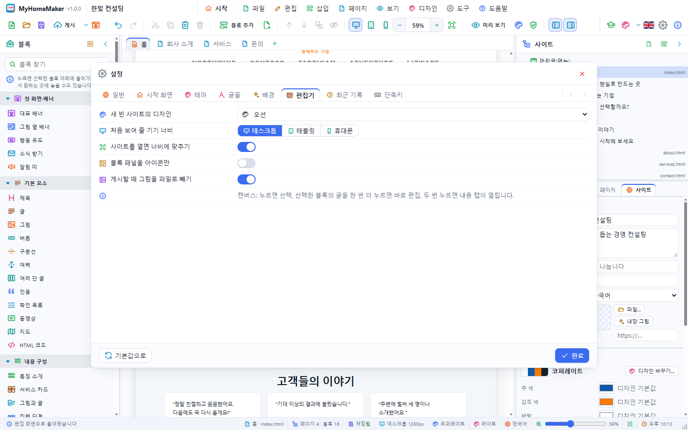

**도구 › 설정…**(Ctrl+,):

- **일반** — 언어, 시작할 때 지난번에 연 파일 다시 열기, 페이지 삭제 전에 묻기, 상태 표시줄 시계·표시, 자동 저장(1·5·10·30분), 튜토리얼 시작
- **시작 화면** — 시작할 때 보이기, 시작 안내 창, 보일 카드와 최근 항목 수
- **테마** — 어두운 테마·밝은 테마·사용자 테마(색을 직접 고르고 대비 경고)
- **글꼴** — 프로그램 글꼴·크기·굵기·기울임, 줄 높이, 화면 확대
- **배경** — 움직이는 배경·그림·없음, 종류·속도·무작위·간격, 배경 그림과 불투명도·맞춤
- **편집기** — 새 빈 사이트의 디자인, 처음 보여 줄 기기 너비, 사이트를 열면 너비에 맞추기, 블록 패널을 아이콘만, 게시할 때 그림을 파일로 빼기
- **최근 기록**, **단축키**

**기본값으로**는 모든 설정을 처음으로 돌립니다(최근 파일과 배경 그림은 남음).

## 단축키

| 키 | 동작 |
|---|---|
| Ctrl+N / Ctrl+O / Ctrl+S / Ctrl+Shift+S | 새 사이트 / 열기 / 저장 / 다른 이름으로 저장 |
| Ctrl+W / Ctrl+R | 사이트 닫기 / 최근 파일 |
| Ctrl+Z / Ctrl+Y | 실행 취소 / 다시 실행 |
| Ctrl+X / Ctrl+C / Ctrl+V / Ctrl+D / Delete | 블록 잘라내기 / 복사 / 붙여넣기 / 복제 / 삭제 |
| Ctrl+↑ / Ctrl+↓ | 블록을 위로 / 아래로 |
| Alt+↑ / Alt+↓ | 이전 / 다음 블록 선택 |
| Enter / Esc | 내용 편집 / 선택 해제 |
| Ctrl+H | 블록 숨기기·보이기 |
| Ctrl+Shift+A / Ctrl+Shift+N / F2 | 블록 추가 / 페이지 추가 / 페이지 이름 바꾸기 |
| Ctrl+PageUp / Ctrl+PageDown, Ctrl+Tab | 이전 / 다음 페이지 |
| Ctrl+= / Ctrl+- / Ctrl+0 / Ctrl+Shift+W | 확대 / 축소 / 100% / 너비에 맞추기 |
| Ctrl+E / F5 | 미리 보기 모드 / 브라우저에서 미리 보기 |
| Ctrl+Shift+P / Ctrl+Shift+D | 게시 / 디자인 바꾸기 |
| Ctrl+Shift+1 / Ctrl+Shift+2 | 블록 패널 / 사이트 패널 |
| Ctrl+Shift+L / Ctrl+Shift+B / Ctrl+Shift+H | 언어 / 배경 바꾸기 / 시작 화면 |
| Ctrl+, / F11 / F1 | 설정 / 튜토리얼 / 프로그램 정보 |

## 도움말

- **도움말 › 시작 안내 창** — 튜토리얼·예제·나중에
- **튜토리얼**(F11) — 앱 안에서 8개 장, 43단계로 기능을 보여 줍니다. 카드에서 앞뒤로, 자동 재생, 장 고르기, ✕ 로 끝내며, 끝나면 바꾼 설정과 열려 있던 사이트가 그대로 돌아옵니다.
- **튜토리얼 문서**, **사용 설명서** — 자기 창에서 목차·찾기와 함께 열립니다(한국어·영어).
- **프로그램 정보**(F1) — 버전, 빌드 정보, 제작자

오류가 나면 자세한 내용이 오류 창에 나오고 **복사**로 그대로 옮길 수 있습니다.

## 파일 형식

`.myhome` 은 UTF-8 JSON 입니다: `format: "myhomemaker"`, `meta`(제목·설명·언어 …), `design`(디자인 id 와 바꾼 값), `layout`(머리글·바닥글 블록), `pages`(이름·파일 이름·블록 목록). 블록은 `type`, `props`(내용), `style`(스타일)을 가집니다. 그림은 파일 안에 data URL 로 들어 있어 파일 하나만 옮기면 됩니다.

## 문제 해결

| 증상 | 해결 |
|---|---|
| 게시한 사이트를 디스크에서 열면 그림이나 링크가 이상함 | 폴더째로 두고 `index.html` 을 여세요. 다른 페이지 파일과 `assets/` 가 같은 폴더에 있어야 합니다. |
| 지도·동영상이 캔버스에서 안 보임 | 인터넷 연결이 필요합니다. 캔버스에서는 눌러도 동작하지 않게 되어 있습니다(미리 보기에서도 같음). |
| 문의 양식이 메일을 보내지 않음 | 문의 블록의 *양식 보낼 주소*에 양식 서비스 주소를 넣으세요. |
| 웹 버전에서 index.html 을 바로 열면 빈 화면 | 웹 서버로 여세요(예: `npx vite preview`, 또는 호스팅). |
