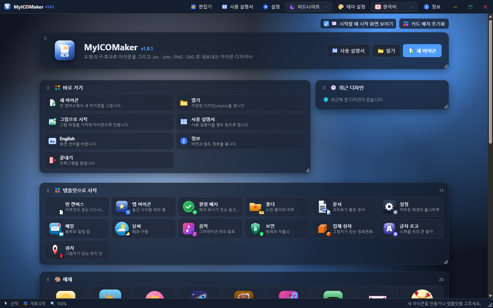
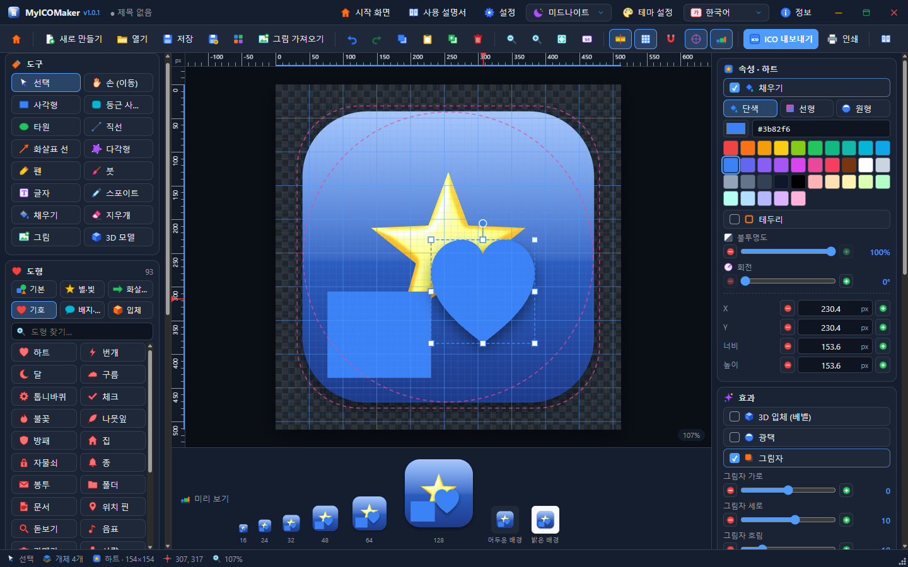

# MyICOMaker 사용 설명서 (요약)

전체 설명서는 프로그램의 **사용 설명서** 단추(별도 창)나 `public/docs/UsersGuide.html` 에 있습니다. English: `public/docs/UsersGuide.en.html`.

## 1. 시작
1. 시작 화면에서 **새 아이콘** 또는 템플릿(13종)을 고릅니다. **이어서 작업**은 마지막 디자인을 엽니다.
2. 카드는 손잡이(⋮⋮)로 옮기고 오른쪽 아래 모서리로 크기를 바꿉니다. **카드 배치 초기화**로 되돌립니다.

## 2. 편집기

- **왼쪽**: 도구 14종(단축키 V H R U O L A G P B T I K E), 도형 93종(분류·검색), 레이어(숨기기·잠그기·순서·삭제)
- **가운데**: 512×512 캔버스, 격자·맞추기·안내선, 휠 확대, Alt+끌기 이동, 아래쪽 크기별 미리 보기
- **오른쪽**: 속성(채우기·그러데이션·테두리·글자·위치·크기), 효과(3D·광택·그림자·빛번짐·흐림), 정렬·배치, 배경, 내보내기
- 선택한 개체: 8개 손잡이로 크기(Shift: 비율 유지), 위쪽 둥근 손잡이로 회전(Shift: 15°), 화살표 키로 1px(Shift 10px) 이동

## 3. 내보내기와 인쇄
- **ICO**(한 파일 / 크기별), **PNG 세트**, **ICNS**, **SVG**. 크기는 16 ~ 256 중에서 고르고 **기본값**으로 되돌립니다.
- **인쇄**(Ctrl+P): 별도 창에서 용지·방향·배치(크기별 견본, 크게 한 장, 스티커 시트)를 고르고 시스템 인쇄 창으로 인쇄하거나 PDF 로 저장합니다.

## 4. 파일
- 디자인은 `.myico`(Ctrl+S, 다른 이름으로 Ctrl+Shift+S). 가져온 그림도 함께 저장됩니다.
- 저장하지 않은 변경이 있으면 새로 만들기·열기·끝내기 전에 묻습니다.

## 5. 단축키
| 키 | 동작 |
|---|---|
| Ctrl+N / O / S / Shift+S | 새로 만들기 / 열기 / 저장 / 다른 이름으로 |
| Ctrl+Z / Ctrl+Y | 실행 취소 / 다시 실행 |
| Ctrl+C / V / D, Delete | 복사 / 붙여넣기 / 복제, 삭제 |
| Ctrl++ / Ctrl+− / Ctrl+0 | 확대 / 축소 / 맞춤 |
| Ctrl+E / Ctrl+P | ICO 내보내기 / 인쇄 |
| Esc | 선택 해제, 다각형 취소 |

## 6. 설치
`MyICOMaker-Setup-1.0.1.exe` 를 실행하면 먼저 **설치 언어(한국어 / English)** 를 고릅니다. 프로그램도 그 언어로 처음 시작합니다. 이전 설치가 있으면 다시 설치할지, 사용자 데이터를 지울지 묻고, 바로가기(바탕 화면 / 시작 메뉴 + 사용 설명서)를 고를 수 있습니다.
