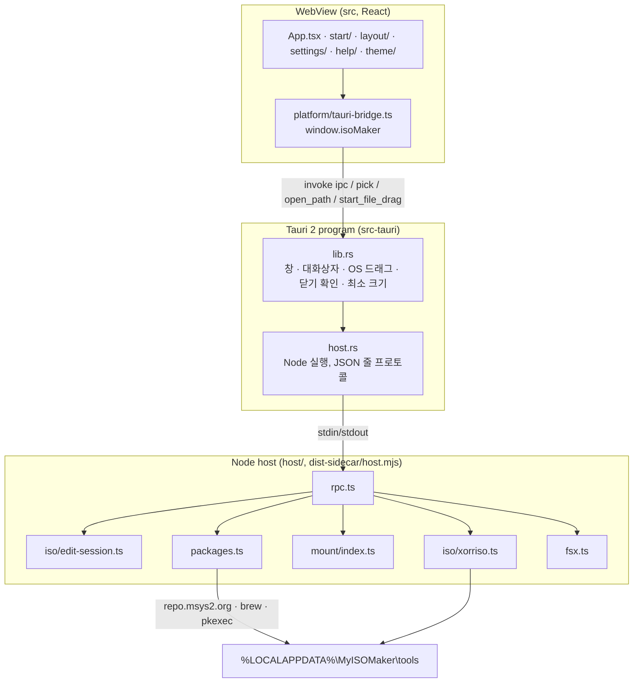

# Architecture — MyISOMaker

이 문서는 MyISOMaker(1.0.2)의 구성, 데이터 흐름, 패키지 설치, 패키징을 설명합니다. 1.0.2에서 Electron을 Tauri 2로 바꾸었습니다. 이미지 처리 코드는 그대로 Node 호스트로 옮겨 씁니다.

---

## 1. 전체 구성



- 페이지는 Electron 시절과 같은 `window.isoMaker` API를 씁니다. `tauri-bridge.ts`가 그 API를 Tauri 명령 위에 다시 만듭니다. 채널 이름(`session:open`, `iso:create` …)도 그대로입니다.
- Rust는 창과 OS 기능만 맡습니다: 파일 대화상자, `shell.openPath`, 트리 항목을 창 밖으로 끄는 OS 드래그(`drag` crate), 저장하지 않은 변경이 있을 때의 닫기 확인, 최소 크기 유지.
- 이미지 처리는 Node 호스트가 맡습니다: ISO9660 세션, xorriso, 마운트, AppImage/Docker tar, 패키지 설치, 탐색기 목록.

## 2. Node 호스트와 프로토콜

`host/rpc.ts` ↔ `src-tauri/src/host.rs`, 한 줄에 JSON 하나:

| 방향 | 메시지 |
|---|---|
| Tauri → host | `{ t:'req', id, m, a }` — m = 채널, a = 인자 배열 |
| host → Tauri | `{ t:'res', id, ok, v \| e }` |
| host → Tauri | `{ t:'emit', ch, p }` — 페이지 이벤트 (`job:progress`, `pkg:progress`) → `host-event` |

- 개발 · 디버그: `dist-sidecar/host.mjs`를 PATH의 Node로 실행합니다 (`npm run build:host`).
- 설치본: `resources/sidecar/host.mjs`와 함께 넣은 `node.exe`로 실행합니다 (`build-host.mjs --release`).
- 환경 변수: `ISOMAKER_RESOURCE_DIR`(vendor/xorriso), `ISOMAKER_USER_DATA`(시험용 설정 폴더, Tauri가 `ISOMAKER_CONFIG_DIR`에서 넘김), `ISOMAKER_TOOLS_DIR`(시험용 패키지 폴더), `ISOMAKER_MSYS_REPO`(저장소 주소), `ISOMAKER_NODE`.

## 3. 패키지 설치 (`host/packages.ts`)

| 패키지 | 용도 | 필수 |
|---|---|---|
| xorriso | ISO 생성, 부팅 ISO, 전체 추출 | 예 |
| squashfs-tools | AppImage 열기 · 저장 | 아니오 |

- **Windows**: `msys.db`(zstd tar)를 받아 `desc`에서 파일 이름 · 의존성 · SHA-256을 읽고, 루트 패키지와 의존성(`msys2-runtime`은 늘 포함, 셸 · filesystem은 제외)을 받아 확인한 뒤 `usr/bin`의 exe · dll만 `tools\msys\usr\bin`에 풉니다. `manifest.json`이 패키지별 파일을 기록해 제거할 때 다른 패키지가 쓰는 DLL은 남깁니다. zstd는 Node 22.15+의 `zlib.zstdDecompressSync`.
- **macOS**: `brew install|reinstall|uninstall`. **Linux**: `pkexec apt-get|dnf|pacman|zypper`.
- 시작할 때 필수 패키지가 없고 설정의 "자동 설치"가 켜져 있으면 설치합니다. 진행은 `pkg:progress` → 진행률 팝업(`packages/packages.tsx`).
- xorriso · unsquashfs를 찾는 순서: 프로그램이 설치한 것 → MSYS2/Cygwin → vendor → PATH.

## 4. 화면 (`src/`)

| 모듈 | 역할 |
|---|---|
| `App.tsx` | 상태, 탭(시작 · 내용 · 생성 · 부팅 · 마운트), 도구 모음 그룹, 우클릭 메뉴, 대화상자 |
| `Toolbar.tsx` | 제목 줄(아이콘 · 이름 · 버전 · 시작 … 패널 · 테마 · 언어 · 설정 · 도움말 · 정보 · 창 버튼)과 도구 줄. 아이콘은 모두 컬러 |
| `layout/` | `TitleBar`(프레임 없는 창의 끌기 · 최소/최대/닫기 · 국기), `Panel`(접고 펼치는 도킹 패널), `Explorer`, `InfoLog`, `WorkEmpty` |
| `start/` | 시작 화면: `startboard.ts`(MyImageViewer 카드 보드, 이름 카드 고정), `background.ts`(움직이는 배경 24개), `StartScreen.tsx` |
| `theme/` | 다크 20 · 라이트 20 · 사용자 테마(MyZipMaster), 앱 토큰(`--bg0` …)으로 적용, 테마 버튼 + 드롭다운 |
| `settings/` | 일반 · 테마 · 패키지 · 시작 화면 |
| `help/` | `doc/*.md`를 앱 안에서 보여 주는 도움말(작은 Markdown 렌더러) |
| `components/IsoTreeView.tsx` | 트리(연결선, 컬러 아이콘), 다중 선택, 드래그 인/아웃 |

OS에서 끌어 온 파일: Tauri가 창의 드롭을 받으므로 페이지에는 경로가 든 HTML5 drop이 오지 않습니다. 브리지가 `onDragDropEvent`를 `isomaker-native-drop` 창 이벤트(CSS 좌표)로 넘기고, 트리가 그 위치의 폴더를 찾습니다. 왼쪽 탐색기에서 끄는 것도 같은 이벤트를 씁니다.

## 5. 편집 세션 흐름

```
이미지 ──openIsoBlob──▶ IsoEditSession (host)
   │                    ├─ 트리 → IsoTreeView
   │                    ├─ 추가/삭제/새 폴더/이름 바꾸기 (dirty)
   │                    ├─ prepareDragOut → temp → start_file_drag (Rust)
   │                    └─ save → writer → 새 이미지
   └─ (선택) xorriso extract/create/bootable
```

닫기: 창의 CloseRequested를 Rust가 막고 호스트에 dirty를 묻습니다. dirty면 페이지에 `app:close-request` → 페이지 대화상자. 1.5초 안에 응답이 없으면 네이티브 메시지로 묻습니다.

## 6. 빌드 · 패키징

| 명령 | 결과 |
|---|---|
| `npm start` | `tauri dev` (Vite 5183 + 호스트 번들) |
| `npm run build:debug` | `src-tauri/target/debug/MyISOMaker.exe` (페이지 내장, `--features tauri/custom-protocol`) |
| `npm run build:win` | NSIS 설치 파일 → 프로젝트 루트 |
| `npm run build:mac` / `build:linux` / `build:all` | .app/.dmg, AppImage/.deb |

NSIS(`src-tauri/windows/hooks.nsh`, UTF-8 BOM): 설치 전에 기존 MyISOMaker와 Electron판 "ISO Maker"를 완전히 지우고, 저장된 데이터를 지울지 묻습니다. 제거할 때 `%LOCALAPPDATA%\MyISOMaker\tools`를 지웁니다.

## 7. 웹 모드

`web.html` + `vite.config.web.ts` (포트 5174). 브라우저에서 ISO를 열고 고쳐 새 ISO로 내려받습니다. 마운트 · xorriso · 패키지는 없습니다.

## 8. 검증

- `npm test` — 패키지 설치기(로컬 MSYS2의 msys.db와 캐시 패키지로 오프라인 확인), 시작 보드(이름 카드 고정), 테마 수, 배경 24개, 언어 키, 설명서 렌더러
- 데스크톱 확인: 디버그 exe를 `WEBVIEW2_USER_DATA_FOLDER`, `ISOMAKER_CONFIG_DIR`, `ISOMAKER_TOOLS_DIR`(임시 폴더), `WEBVIEW2_ADDITIONAL_BROWSER_ARGUMENTS=--remote-debugging-port=N`으로 띄워 CDP로 조작합니다. 패키지 실패 경로는 `ISOMAKER_MSYS_REPO=http://127.0.0.1:9`로 내려받기 없이 확인합니다.
