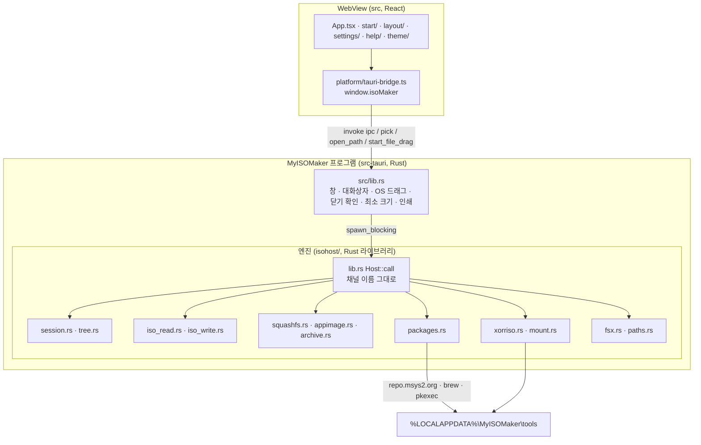

# Architecture — MyISOMaker

이 문서는 MyISOMaker(1.0.2)의 구성, 데이터 흐름, 패키지 설치, 패키징을 설명합니다. 1.0.2에서 Electron을 Tauri 2로 바꾸었고, 이미지 처리(예전 Node 호스트)는 모두 Rust로 옮겼습니다. 설치본에 Node.js는 들어가지 않습니다.

---

## 1. 전체 구성



- 페이지는 Electron 시절과 같은 `window.isoMaker` API를 씁니다. `tauri-bridge.ts`가 그 API를 Tauri 명령 위에 다시 만듭니다. 채널 이름(`session:open`, `iso:create` …)도 그대로입니다.
- `src-tauri/src/lib.rs`는 창과 OS 기능을 맡습니다: 파일 대화상자, `shell.openPath`, 트리 항목을 창 밖으로 끄는 OS 드래그(`drag` crate), 저장하지 않은 변경이 있을 때의 닫기 확인, 최소 크기 유지, 인쇄(`printing.rs`).
- 이미지 처리는 엔진 crate `src-tauri/isohost`가 같은 프로세스 안에서 맡습니다. `ipc` 명령이 `Host::call(채널, 인자)`를 `spawn_blocking`으로 부르고, 진행 이벤트는 `host-event`로 모든 창에 갑니다. 엔진은 Tauri에 의존하지 않아 따로 빌드 · 시험됩니다.

## 2. 엔진 (`src-tauri/isohost`)

| 파일 | 하는 일 |
|---|---|
| `lib.rs` | `Host::call` — 채널 → 함수, 작업 하나씩(`iso:cancel`로 취소), 패키지 작업 |
| `session.rs` | 편집 세션: 열기(ISO · IMG는 그 자리에서 읽고, AppImage · tar는 임시 폴더에 풂), 추가 · 삭제 · 새 폴더 · 이름 바꾸기, 내보내기, 드래그 임시 파일, 저장(.part 후 교체; 원본 위에 저장하면 새 파일로 다시 엶) |
| `tree.rs` | 트리 노드와 파일 바이트의 출처(이미지 안 extent · 디스크 파일 · 메모리 · 손상) |
| `iso_read.rs` | ISO 9660 + Joliet 읽기, 파티션 표 뒤의 ISO(.img), 다중 extent, 손상된 extent는 "읽을 수 없음" 파일로 |
| `iso_write.rs` | ISO 9660 + Joliet 쓰기 (3.2) |
| `squashfs.rs` | SquashFS 4.0 읽기 · 쓰기 (3.1) |
| `archive.rs` | AppImage · tar 구별(ELF 섹션 헤더 끝 = SquashFS 위치), 풀기, tar(.gz) 쓰기, AppImage 쓰기 |
| `appimage.rs` | 폴더 → AppImage (AppRun · .desktop · 아이콘 보충) |
| `xorriso.rs` | ISO 만들기 · 부팅 ISO · 전체 추출, MSYS 경로 변환, 진행 줄 |
| `mount.rs` | Windows `Mount-DiskImage` · macOS `hdiutil` · Linux `mount -o loop` / `fuseiso` |
| `packages.rs` | 패키지 상태 · 설치 · 재설치 · 제거 (3) |
| `fsx.rs`, `paths.rs` | 왼쪽 탐색기, 대화상자가 기억하는 폴더, 설정 · 도구 폴더 |
| `main.rs` | `isomaker-host`: 같은 엔진을 stdin/stdout JSON 줄로 — 시험용 |

`isomaker-host` 프로토콜(시험이 프로그램과 같은 코드를 부르는 길), 한 줄에 JSON 하나:

| 방향 | 메시지 |
|---|---|
| 시험 → 엔진 | `{ t:'req', id, m, a }` — m = 채널, a = 인자 배열 |
| 엔진 → 시험 | `{ t:'res', id, ok, v \| e }`, `{ t:'emit', ch, p }` (`job:progress`, `pkg:progress`), `{ t:'ready' }` |

환경 변수: `ISOMAKER_CONFIG_DIR`(프로그램; 시험용 설정 폴더), `ISOMAKER_USER_DATA`(`isomaker-host`), `ISOMAKER_TOOLS_DIR`(시험용 패키지 폴더), `ISOMAKER_MSYS_REPO`(저장소 주소), `ISOMAKER_APPIMAGE_RUNTIME` / `ISOMAKER_APPIMAGE_RUNTIME_URL`.

## 3. 패키지 설치 (`isohost/src/packages.rs`)

| 패키지 | 용도 | 필수 |
|---|---|---|
| xorriso | ISO 생성, 부팅 ISO, 전체 추출 | 예 |
| squashfs-tools | gzip · zstd가 아닌 AppImage 열기(unsquashfs) | 아니오 |

- **Windows**: `msys.db`(zstd tar)를 받아 `desc`에서 파일 이름 · 의존성 · SHA-256을 읽고, 루트 패키지와 의존성(`msys2-runtime`은 늘 포함, 셸 · filesystem은 제외)을 받아 확인한 뒤 `usr/bin`의 exe · dll만 `tools\msys\usr\bin`에 풉니다. `manifest.json`이 패키지별 파일을 기록해 제거할 때 다른 패키지가 쓰는 DLL은 남깁니다. zstd는 순수 Rust(`ruzstd`), 내려받기는 `ureq`(rustls), 확인은 `sha2`.
- **macOS**: `brew install|reinstall|uninstall`. **Linux**: `pkexec apt-get|dnf|pacman|zypper` (패키지 이름은 배포판마다: pacman은 `libisoburn`, zypper는 `squashfs`).
- 시작할 때 필수 패키지가 없고 설정의 "자동 설치"가 켜져 있으면 설치합니다. 진행은 `pkg:progress` → 진행률 팝업(`packages/packages.tsx`).
- xorriso · unsquashfs를 찾는 순서: 프로그램이 설치한 것 → MSYS2/Cygwin → Homebrew · 시스템 폴더 → PATH.

## 3.1 AppImage (`squashfs.rs`, `appimage.rs`, `archive.rs`)

- SquashFS 4.0 리더: gzip · zstd, fragment, 기본/확장 inode. 다른 압축은 unsquashfs로 넘깁니다. 실제 mksquashfs 이미지(`test/fixtures`)로 검증합니다.
- SquashFS 라이터: 128 KiB 블록(zlib, 이득 없으면 저장), fragment 없음, 메타데이터 비압축, id 1개. 연 AppImage의 권한 비트(AppRun 0755 …)를 저장할 때 그대로 씁니다.
- AppImage = 공식 type-2 런타임(캐시 또는 연 AppImage의 앞부분) + SquashFS. AppRun · .desktop · 아이콘이 없으면 이미지 안에 기본값을 넣습니다(아이콘은 프로그램에 내장).
- Docker 저장본 / tar(.tgz)는 `tar` crate로 풀고 씁니다(OS tar 불필요).

## 3.2 ISO 쓰기 (`iso_write.rs`, 웹판은 `src/iso9660/writer.ts`)

ECMA-119 + Joliet: 기술자 텍스트는 공백 채움, 날짜 17바이트 형식, 파일 구조 버전 1, M 경로표 위치는 big-endian, 경로표에 모든 디렉터리, 디렉터리 레코드는 섹터 경계를 넘지 않고 식별자 순, 8.3 이름 충돌은 ~N, Joliet 이름은 64자. 파일 데이터는 원래 자리(이미지 · 디스크)에서 읽어 바로 씁니다. xorriso 추출과 Windows 마운트로 검증합니다(`test/e2e-iso.test.mjs`). 웹판은 같은 규칙의 TypeScript 구현을 브라우저에서 씁니다.

## 4. 화면 (`src/`)

| 모듈 | 역할 |
|---|---|
| `App.tsx` | 상태, 탭(시작 · 내용 · 생성 · 부팅 · 마운트), 도구 모음 그룹, 우클릭 메뉴, 대화상자 |
| `Toolbar.tsx` | 제목 줄(아이콘 · 이름 · 버전 · 시작 … 패널 · 테마 · 언어 · 설정 · 도움말 · 정보 · 창 버튼)과 도구 줄. 아이콘은 모두 컬러 |
| `layout/` | `TitleBar`(프레임 없는 창의 끌기 · 최소/최대/닫기 · 국기), `Panel`(접고 펼치는 도킹 패널), `Explorer`, `InfoLog`, `WorkEmpty` |
| `start/` | 시작 화면: `startboard.ts`(MyImageViewer 카드 보드, 이름 카드 고정), `background.ts`(움직이는 배경 24개), `StartScreen.tsx` |
| `theme/` | 다크 20 · 라이트 20 · 사용자 테마(MyZipMaster), 앱 토큰(`--bg0` …)으로 적용, 테마 버튼 + 드롭다운 |
| `settings/` | 일반 · 테마 · 패키지 · 시작 화면 |
| `help/` | `doc/*.md`를 앱 안에서 보여 주는 도움말(작은 Markdown 렌더러) |
| `components/IsoTreeView.tsx` | 트리(연결선, 컬러 아이콘), 다중 선택, 드래그 인/아웃 |
| `tool/` | 도움말 · 설정 · 정보 창 (`tool.html#help`, `#settings[:탭]`, `#about`) |
| `thememenu/` | 테마 메뉴 창 (`thememenu.html`, 두 열, Rust가 화면 안으로 위치 조정) |
| `print/` | 공용 인쇄 창 (`print.html`, `printing.rs`로 바로 인쇄 / PDF) |

OS에서 끌어 온 파일: Tauri가 창의 드롭을 받으므로 페이지에는 경로가 든 HTML5 drop이 오지 않습니다. 브리지가 `onDragDropEvent`를 `isomaker-native-drop` 창 이벤트(CSS 좌표)로 넘기고, 트리가 그 위치의 폴더를 찾습니다. 왼쪽 탐색기에서 끄는 것도 같은 이벤트를 씁니다.

## 5. 편집 세션 흐름

```
이미지 ──open──▶ Session (isohost/session.rs)
   │              ├─ 트리 → IsoTreeView
   │              ├─ 추가/삭제/새 폴더/이름 바꾸기 (dirty)
   │              ├─ prepareDragOut → temp → start_file_drag (lib.rs)
   │              └─ save → iso_write / tar / AppImage → .part → 새 이미지
   └─ (선택) xorriso extract/create/bootable
```

닫기: 창의 CloseRequested를 Rust가 막고 엔진에 dirty를 묻습니다. dirty면 페이지에 `app:close-request` → 페이지 대화상자. 1.5초 안에 응답이 없으면 네이티브 메시지로 묻습니다. 창이 닫히면 `Host::shutdown`이 임시 폴더를 지웁니다.

## 6. 빌드 · 패키징

| 명령 | 결과 |
|---|---|
| `npm start` | `tauri dev` (Vite 5183, 엔진은 프로그램에 컴파일) |
| `npm run build:debug` | `src-tauri/target/debug/MyISOMaker.exe` (페이지 내장, `--features tauri/custom-protocol`) |
| `npm run build:win` | NSIS 설치 파일 → 프로젝트 루트 |
| `npm run build:mac` / `build:linux` / `build:all` | .app/.dmg, AppImage/.deb |

`src-tauri`는 Cargo 작업 공간입니다(프로그램 + `isohost`). 설치본에는 프로그램 하나만 들어갑니다.

NSIS(`src-tauri/windows/hooks.nsh`, UTF-8 BOM): 설치 언어(한국어 / English)를 고르게 하고, 설치 전에 기존 MyISOMaker와 Electron판 "ISO Maker"를 완전히 지우고, 저장된 데이터를 지울지 묻습니다. 고른 언어를 `installer-options.json`에 남겨 첫 실행이 그 언어로 열립니다(`take_installer_locale`). 제거할 때 `%LOCALAPPDATA%\MyISOMaker\tools`를 지웁니다.

## 7. 웹 모드

`web.html` + `vite.config.web.ts` (포트 5174). 브라우저에서 ISO를 열고 고쳐 새 ISO로 내려받습니다. 마운트 · xorriso · 패키지는 없습니다.

## 8. 검증

- `npm test` (영문 · 정렬 · 컬러 리포터 `test/reporter.mjs`, 파일 단위 순차 실행). 시험은 `isomaker-host`(엔진 그대로)를 `cargo build`로 만들어 띄웁니다:
  - `e2e-iso` — ISO 생성 → 열기 → 개별 파일 수정 → 저장 → 재열기 바이트 비교 → xorriso 추출 → 마운트해 드라이브에서 읽기
  - `features` — 탐색기, 경로 기억, 트리, 폴더 추가 · 이름 변경 · 다중 삭제, 내보내기, 드래그 임시 파일, 까다로운 이름, IMG, Docker tar, 부팅 ISO, 취소, 패키지, 웹 세션, 기본 이름
  - `appimage` — mksquashfs 픽스처를 AppImage로 열기, 폴더 → AppImage, AppImage 열기 · 편집 · 저장(권한 유지) (Linux CI에서는 실제 실행)
  - `rust` — `cargo test`: ISO 이름 규칙, SquashFS 리더(gzip · zstd 픽스처) · 라이터, MSYS2 저장소 · 의존성 · 압축 풀기(이 PC의 실제 msys.db 포함), 날짜, 경로
  - `ui` — 시작 보드 · 테마 · 배경 · 언어 키 · 설명서
- CI: `.github/workflows/myisomaker.yml` (Windows · macOS · Ubuntu)
- 데스크톱 확인: 디버그 exe를 `WEBVIEW2_USER_DATA_FOLDER`, `ISOMAKER_CONFIG_DIR`, `ISOMAKER_TOOLS_DIR`(임시 폴더), `WEBVIEW2_ADDITIONAL_BROWSER_ARGUMENTS=--remote-debugging-port=N`으로 띄워 CDP로 조작합니다. 패키지 실패 경로는 `ISOMAKER_MSYS_REPO=http://127.0.0.1:9`로 내려받기 없이 확인합니다.
