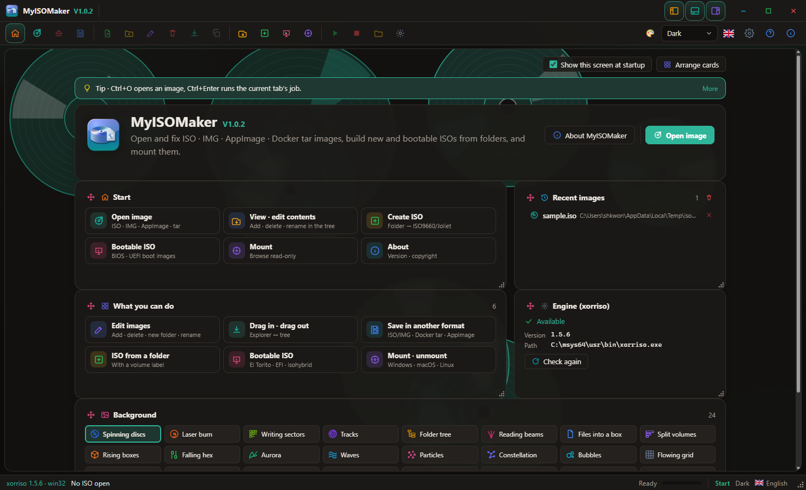
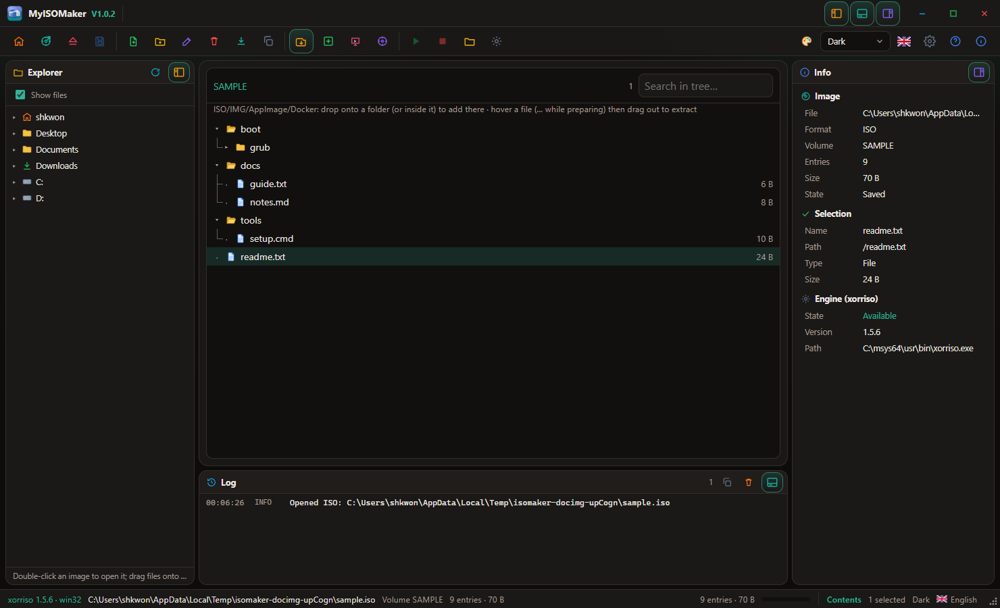
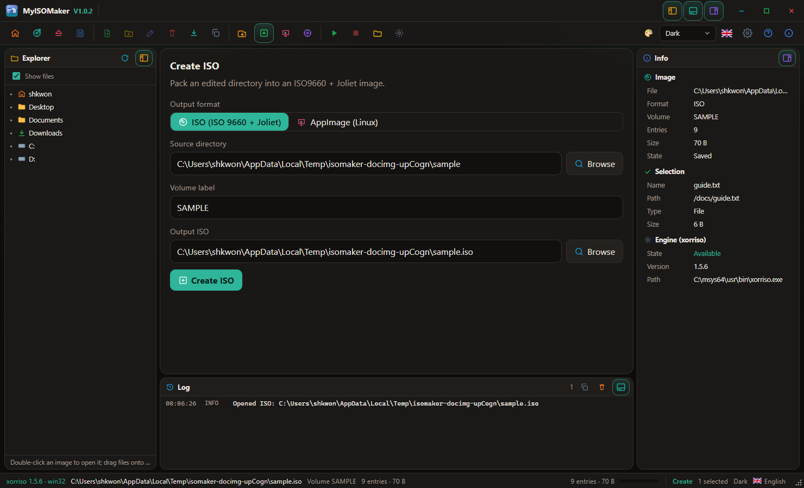
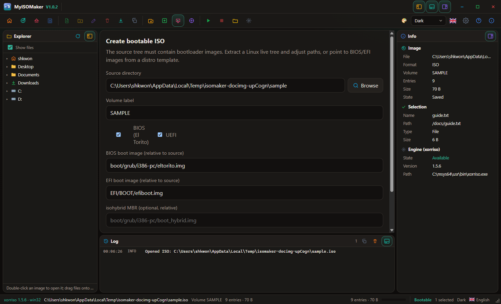

# MyISOMaker Tutorial

This tutorial walks a first-time user through the basic tasks in order. See the User's Guide for details.

## 0. Preparation

1. Start MyISOMaker.
2. If xorriso is missing, the automatic installation popup appears. Wait until it finishes.
3. When the **Engine (xorriso)** card on the start screen shows **Available**, you are ready.
4. Have one practice ISO file and one small folder to turn into an ISO.

## 1. Open an image

1. Click **Open image** on the toolbar or press Ctrl+O.
2. Choose the practice `.iso` file.
3. The tree appears on the **Contents** tab. Click the arrow in front of a folder to expand it.
4. Check the volume name and entry count in the status bar.

## 2. Add a file by dragging

1. Pick any text file in Explorer.
2. Drag it onto a folder in the tree and drop it.
3. The file is added to that folder, and the change log on the right records `Added → …`.
4. The title and status bar show **Modified**.

> The other way round, drag files from the tree to Explorer to extract them. For big files, wait until the `…` marker disappears.

## 3. Save as a new ISO

1. Click **Save** on the toolbar.
2. Keep the default name (original name + `-edited`) or change it. Choose the ISO format.
3. When it finishes, the status bar shows **Saved**.
4. The original ISO is untouched; the new file holds your changes.

## 4. Create an ISO from a folder

1. Open the **Create** tab on the toolbar.
2. Use **Browse** next to **Source directory** to choose your folder.
3. Enter a name in **Volume label** (for example `MYDATA`).
4. Choose the file name in **Output ISO**.
5. Click **Create ISO** or press Ctrl+Enter.
6. When it is done, open the new ISO with **Open image** to check it.

## 5. Make a bootable ISO

1. Unpack a bootable ISO (for example a Linux live ISO) into a folder. You can export entries from the tree with right-click › **Save outside…**.
2. Open the **Bootable** tab.
3. Choose that folder in **Source directory**.
4. Turn on **BIOS (El Torito)** and/or **UEFI** as needed.
5. Make the boot image paths match the real files in the folder. The defaults are `boot/grub/i386-pc/eltorito.img` and `EFI/BOOT/efiboot.img`.
6. Choose **Output ISO** and click **Create bootable ISO**.

## 6. Mount

1. Open the **Mount** tab.
2. Choose the ISO you just made.
3. Click **Mount**; it is attached as a drive and the location appears after **Mounted at:**.
4. Use **Open folder** on the toolbar to browse it.
5. Click **Unmount** when you are done.

> If mounting fails, the system may need administrator rights. See Troubleshooting in the User's Guide.

## Next steps

- Change the theme with the theme button and its ▾ dropdown.
- Install squashfs-tools in Settings › Packages to open and save AppImages too.
- Drag the start-screen cards to rearrange them, then restore them with **Arrange cards**.
