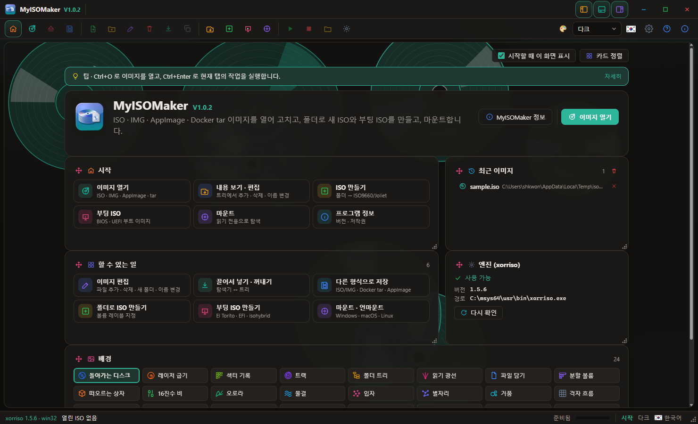
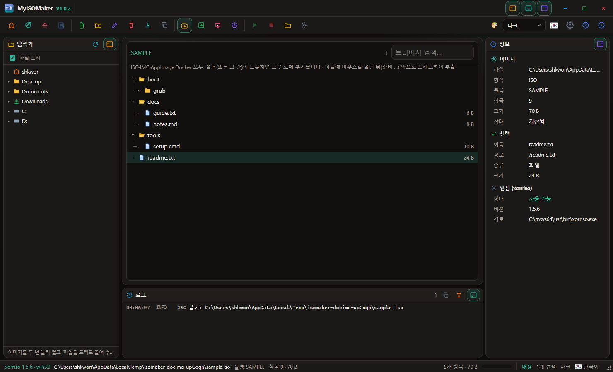
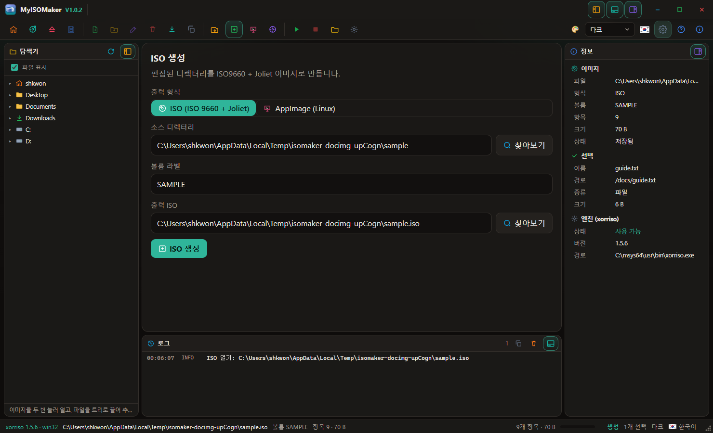
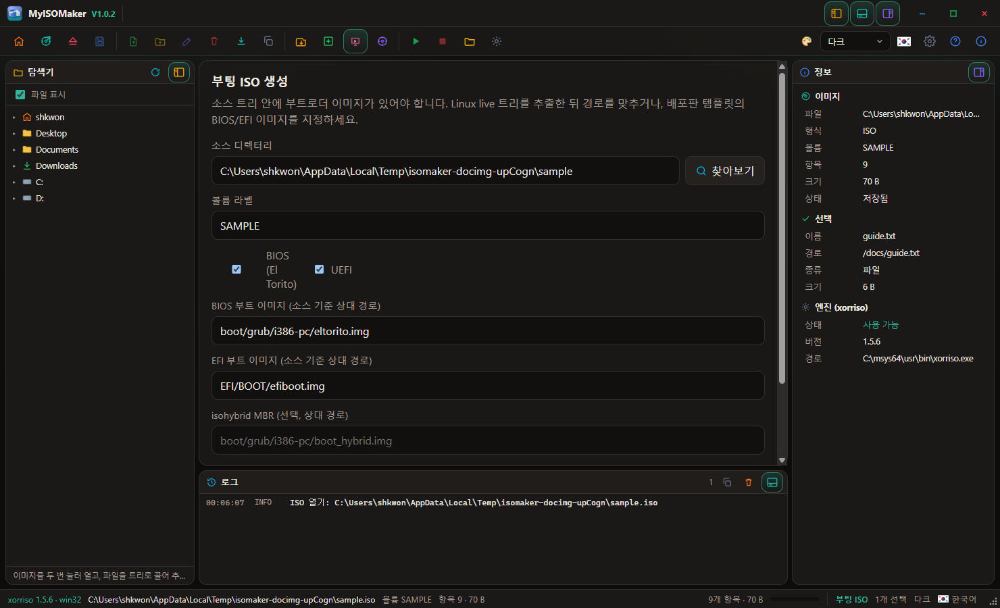

# MyISOMaker 튜토리얼

처음 쓰는 분을 위해 기본 작업을 순서대로 따라 해 봅니다. 자세한 내용은 사용 설명서를 참고하세요.

## 0. 준비

1. MyISOMaker를 실행합니다.
2. xorriso가 없으면 자동 설치 팝업이 뜹니다. 끝날 때까지 기다립니다.
3. 시작 화면의 **엔진 (xorriso)** 카드에 **사용 가능**이 보이면 준비가 끝난 것입니다.
4. 연습용 ISO 파일 하나와 ISO로 만들 작은 폴더 하나를 준비합니다.

## 1. 이미지 열기

1. 도구 모음의 **이미지 열기**를 누르거나 Ctrl+O를 누릅니다.
2. 연습용 `.iso` 파일을 고릅니다.
3. **내용** 탭에 트리가 나타납니다. 폴더 앞의 화살표를 눌러 펼쳐 봅니다.
4. 상태 표시줄에서 볼륨 이름과 항목 수를 확인합니다.

## 2. 끌어서 파일 추가

1. 탐색기에서 아무 텍스트 파일 하나를 고릅니다.
2. 그 파일을 트리의 폴더 위로 끌어다 놓습니다.
3. 파일이 그 폴더에 추가되고 오른쪽 변경 로그에 `추가 → …` 기록이 남습니다.
4. 제목과 상태 표시줄에 **변경됨**이 표시됩니다.

> 트리의 파일을 반대로 탐색기로 끌어 내면 바로 꺼낼 수 있습니다. 큰 파일은 `…` 준비 표시가 사라진 뒤 끄세요.

## 3. 새 ISO로 저장

1. 도구 모음의 **저장**을 누릅니다.
2. 기본 이름(원본 이름 + `-edited`)을 그대로 두거나 바꿉니다. 형식은 ISO를 고릅니다.
3. 저장이 끝나면 상태 표시줄에 **저장 완료**가 나옵니다.
4. 원본 ISO는 그대로이고 새 파일에 변경 내용이 들어 있습니다.

## 4. 폴더로 ISO 만들기

1. 도구 모음의 **생성** 탭을 엽니다.
2. **소스 디렉터리**의 **찾아보기**로 준비한 폴더를 고릅니다.
3. **볼륨 라벨**에 이름을 넣습니다 (예: `MYDATA`).
4. **출력 ISO**에 저장할 파일 이름을 고릅니다.
5. **ISO 생성**을 누르거나 Ctrl+Enter를 누릅니다.
6. 끝나면 **이미지 열기**로 만든 ISO를 열어 내용을 확인합니다.

## 5. 부팅 ISO 만들기

1. 부팅되는 ISO(예: Linux 라이브 ISO)를 폴더로 풀어 둡니다. 트리에서 항목을 골라 우클릭 › **외부로 저장…**으로 꺼낼 수 있습니다.
2. **부팅 ISO** 탭을 엽니다.
3. **소스 디렉터리**에 그 폴더를 고릅니다.
4. **BIOS (El Torito)**와 **UEFI**를 필요에 맞게 켭니다.
5. 부트 이미지 경로를 폴더 안의 실제 파일에 맞춥니다. 기본값은 `boot/grub/i386-pc/eltorito.img`와 `EFI/BOOT/efiboot.img`입니다.
6. **출력 ISO**를 고르고 **부팅 ISO 생성**을 누릅니다.

## 6. 마운트

1. **마운트** 탭을 엽니다.
2. 방금 만든 ISO를 고릅니다.
3. **마운트**를 누르면 드라이브로 연결되고 **현재 마운트:**에 위치가 나옵니다.
4. 도구 모음의 **폴더 열기**로 내용을 봅니다.
5. 다 보면 **언마운트**를 누릅니다.

> 마운트가 실패하면 관리자 권한이 필요한 시스템일 수 있습니다. 사용 설명서의 문제 해결을 참고하세요.

## 다음 단계

- 도구 모음의 테마 버튼과 ▾로 테마를 바꿔 봅니다.
- 설정 › 패키지에서 squashfs-tools를 설치하면 AppImage도 열고 저장할 수 있습니다.
- 시작 화면의 카드를 끌어 배치를 바꾸고, **카드 정렬**로 되돌려 봅니다.
