# MyISOMaker 사용 설명서

버전 1.0.2 · Windows / macOS / Linux

## 1. 개요

MyISOMaker는 디스크 이미지를 다루는 데스크톱 프로그램입니다. ISO · IMG · AppImage · Docker 저장본(tar) 이미지를 열어 내용을 트리로 보고 고친 뒤 같은 형식이나 다른 형식으로 저장할 수 있습니다. 폴더로 새 ISO를 만들고, BIOS/UEFI 부팅 ISO를 만들고, 이미지를 운영 체제 드라이브로 마운트할 수도 있습니다.

- 이미지 열기 · 트리 편집 · 저장: 프로그램 자체 ISO9660 리더/라이터로 처리하므로 별도 엔진 없이 동작합니다.
- ISO 생성 · 부팅 ISO · 전체 추출: xorriso 엔진을 사용합니다. 없으면 처음 실행할 때 자동으로 설치합니다.
- AppImage 열기 · 저장: squashfs-tools(unsquashfs / mksquashfs)를 사용합니다.
- 마운트: 운영 체제 기본 기능(Windows Mount-DiskImage, macOS hdiutil, Linux mount 또는 fuseiso)을 사용합니다.

프로그램은 Tauri 2 창과 React 화면으로 되어 있고, 이미지 처리는 함께 설치되는 Node 호스트가 맡습니다. 창의 최소 너비는 도구 모음 두 줄이 각각 한 줄에 모두 보이는 너비로 자동으로 맞춰집니다. 화면 언어는 한국어와 English 중에서 고를 수 있고 기본값은 한국어입니다.

## 2. 설치와 처음 실행

### 2.1 Windows 설치 프로그램

1. `MyISOMaker` 설치 파일(NSIS)을 실행합니다.
2. 이전에 설치된 MyISOMaker 또는 예전 이름인 "ISO Maker"가 있으면 먼저 완전히 제거합니다.
3. 이때 저장된 사용자 데이터(설정, 최근 목록 등)를 지울지 묻습니다. 남겨 두면 새 버전이 그대로 이어 씁니다.
4. 설치는 현재 사용자 기준으로 진행되며 관리자 권한이 필요 없습니다.
5. 설치가 끝나면 MyISOMaker를 실행합니다.

### 2.2 패키지 자동 설치

처음 실행할 때 xorriso를 찾지 못하면 프로그램이 자동으로 설치합니다. 작은 팝업 창에 진행 상황(내려받기 / 풀기, 백분율)이 표시되며 중간에 취소할 수 있습니다. 취소하거나 실패해도 이미지 열기 · 편집 · 저장은 그대로 쓸 수 있고, 나중에 설정 › 패키지에서 다시 설치하면 됩니다.

| 운영 체제 | 설치 방법 |
|---|---|
| Windows | repo.msys2.org에서 MSYS2 패키지(xorriso와 필요한 실행 라이브러리 몇 개)를 내려받아 `%LOCALAPPDATA%\MyISOMaker\tools`에 풉니다. MSYS2를 설치하지 않으며 관리자 권한도 필요 없습니다. |
| macOS | Homebrew로 `brew install xorriso squashfs`를 실행합니다. |
| Linux | 시스템 패키지 관리자(apt / dnf / pacman / zypper)를 pkexec로 실행합니다. 이때 암호를 묻습니다. |

> 프로그램이 직접 설치한 사본이 없으면 시스템에 이미 있는 xorriso(예: `C:\msys64`)를 찾아 사용합니다.

### 2.3 소스에서 실행 (개발자)

```
npm install
npm start
```

설치 파일 만들기:

| 명령 | 결과 |
|---|---|
| `npm run build:win` | Windows NSIS 설치 파일 |
| `npm run build:mac` | macOS 설치 파일 (macOS에서 실행) |
| `npm run build:linux` | Linux 설치 파일 |
| `npm run build:all` | 가능한 모든 플랫폼 |
| `npm run build:debug` | 디버그 빌드 |

만들어진 설치 파일은 프로젝트 루트로 복사됩니다.

### 2.4 웹 버전

```
npm run start:web
```

브라우저에서 포트 5174로 열립니다. 이미지를 열어 트리를 보고 편집한 뒤 내려받을 수 있습니다. 마운트와 xorriso 기능(ISO 생성, 부팅 ISO, 전체 추출)은 웹 버전에서 쓸 수 없습니다.

## 3. 화면 구성

창에는 운영 체제의 제목 표시줄이 없습니다. 맨 위 두 줄이 제목 표시줄과 도구 모음입니다.

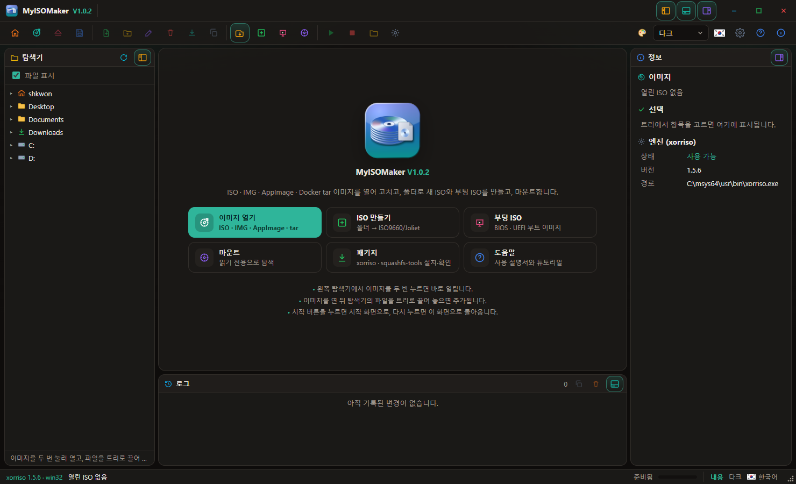

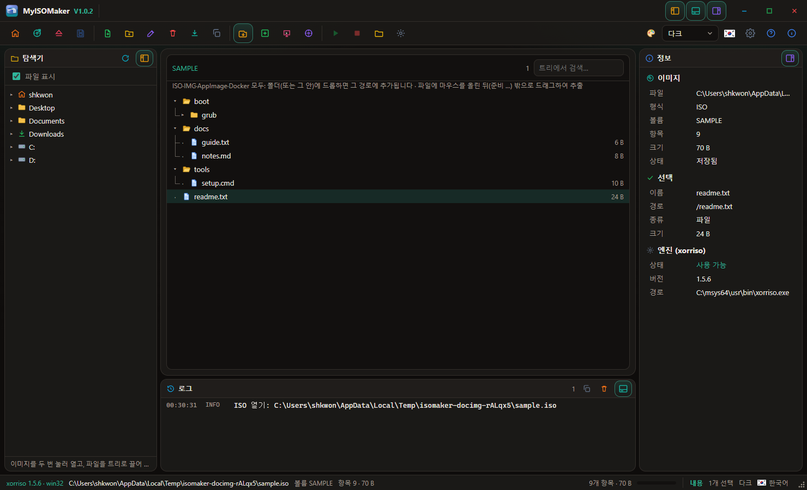

| 영역 | 설명 |
|---|---|
| 제목 줄 (첫째 줄) | 왼쪽에 프로그램 아이콘 · 이름 · 버전, 오른쪽 끝에 탐색기 · 로그 · 정보 패널 버튼과 최소화 · 최대화 · 닫기. 빈 곳을 끌면 창이 움직이고, 이름을 두 번 누르면 최대화됩니다 |
| 도구 줄 (둘째 줄) | 맨 왼쪽 **시작**, 이미지 열기 · 닫기 · 저장, 편집 도구, 작업 탭, 실행 · 중지 · 폴더 열기 · 엔진 확인. 오른쪽 끝에 테마 버튼(▾), 국기(언어), 설정 · 도움말 · 정보. 항상 한 줄입니다 |
| 탐색기 (왼쪽) | 컴퓨터의 폴더와 파일. 이미지를 두 번 누르면 열리고, 파일을 가운데 트리로 끌어 놓으면 추가됩니다 |
| 작업 영역 (가운데) | 이미지 트리(내용 탭) 또는 각 탭의 입력 칸. 이미지를 열지 않았을 때는 프로그램 아이콘, 설명, 작업 버튼이 보입니다 |
| 정보 (오른쪽) | 연 이미지(파일 · 형식 · 볼륨 · 항목 · 크기 · 상태), 트리에서 고른 항목, 엔진 상태 |
| 로그 (아래) | 열기 · 추가 · 삭제 · 끌기 · 저장 · 패키지 기록 |
| 상태 표시줄 | 맨 아래. 엔진 상태, 이미지 경로, 볼륨 이름, 항목 수, 변경됨 표시, 진행 메시지 |

탐색기 · 정보 · 로그 패널은 머리글 오른쪽 끝 버튼(도구 모음의 패널 버튼과 같은 모양)으로 접고 펼칩니다. 접힌 패널은 가는 막대로 남고, 그 막대를 누르면 다시 펼쳐집니다. 패널 가장자리를 끌면 크기가 바뀌며, 상태와 크기는 다음 실행 때도 유지됩니다.

### 3.1 도구 모음

도구 버튼은 아이콘만 보이고, 마우스를 올리면 이름이 나옵니다. 테마 버튼만 테마 이름을 함께 보여 줍니다.

| 버튼 | 설명 |
|---|---|
| 시작 | 시작 화면을 엽니다. 시작 화면에서 다시 누르면 작업 화면으로 돌아갑니다 |
| 이미지 열기 | ISO/IMG, AppImage, Docker 저장본(.tar)을 열어 트리에 표시합니다 (Ctrl+O) |
| 이미지 닫기 | 연 이미지를 닫습니다. 저장하지 않은 변경이 있으면 먼저 묻습니다 |
| 저장 | 변경된 내용을 ISO/IMG/AppImage/tar 등으로 저장합니다 |
| 파일 추가 · 새 폴더 · 이름 바꾸기 · 삭제 | 트리에서 고른 위치 또는 항목에 적용합니다 |
| 선택 항목 꺼내기 · 경로 복사 | 고른 파일을 디스크로 꺼내거나 이미지 안 경로를 복사합니다 |
| 내용 · 생성 · 부팅 ISO · 마운트 | 작업 탭을 바꿉니다 |
| 실행 · 중지 · 폴더 열기 | 현재 탭의 작업 실행(Ctrl+Enter), 중지, 관련 폴더 열기 |
| 엔진 다시 확인 | xorriso를 다시 찾습니다 |
| 탐색기 · 로그 · 정보 패널 | 각 패널을 접고 펼칩니다 |
| 테마 (▾) | 같은 계열의 다음 테마로 바꿉니다. ▾를 누르면 모든 테마가 보입니다 |
| 국기 | 화면 언어를 한국어 / English로 바꿉니다 (지금 언어의 국기가 보입니다) |
| 설정 · 도움말 · 정보 | 설정 창, 이 설명서, 버전과 저작권 |

### 3.2 우클릭 메뉴

| 위치 | 메뉴 |
|---|---|
| 트리의 항목 | 외부로 저장, 파일 추가, 새 폴더, 이름 바꾸기, 삭제, 정보 패널에서 보기, 경로 복사 |
| 트리의 빈 곳 | 파일 추가, 새 폴더, 이미지 닫기 |
| 탐색기의 이미지 | 이미지 열기, 마운트 탭에서 열기, 열린 이미지에 추가, 기본 프로그램으로 열기, 경로 복사 |
| 탐색기의 폴더 | 펼치기/접기, 이 폴더로 ISO 만들기, 선택한 이미지 항목을 여기로 꺼내기, 열린 이미지에 추가, 폴더 열기, 경로 복사, 새로 고침 |
| 탐색기의 빈 곳 | 새로 고침, 모두 접기, 파일 표시/숨기기 |
| 정보 패널 | 값 복사, 모두 복사 |
| 로그 | 이 줄 복사, 로그 모두 복사, 로그 지우기, 패널 접기 |
| 시작 화면의 최근 이미지 | 이미지 열기, 마운트 탭에서 열기, 폴더 열기, 경로 복사, 목록에서 빼기 |

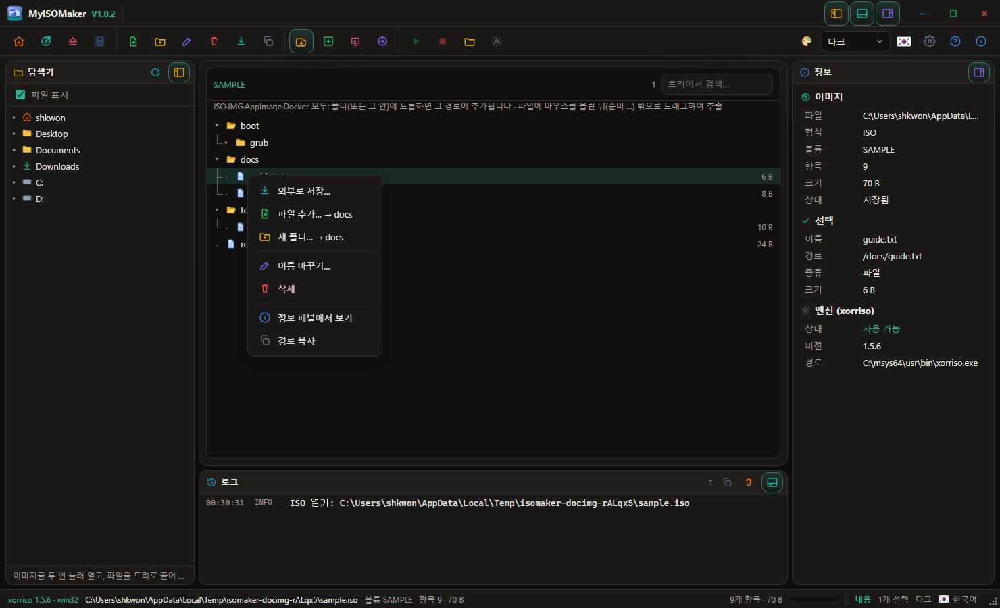

## 4. 시작 화면

도구 모음의 **시작**을 누르면 시작 화면이 창 전체에 열립니다(탐색기 · 정보 · 로그 패널은 숨겨집니다). 다시 **시작**을 누르면 작업 화면이 다시 그려집니다. 맨 위에는 팁 배너가 있으며 **자세히**를 누르면 설명이 더 나옵니다. 그 아래는 카드 보드입니다.

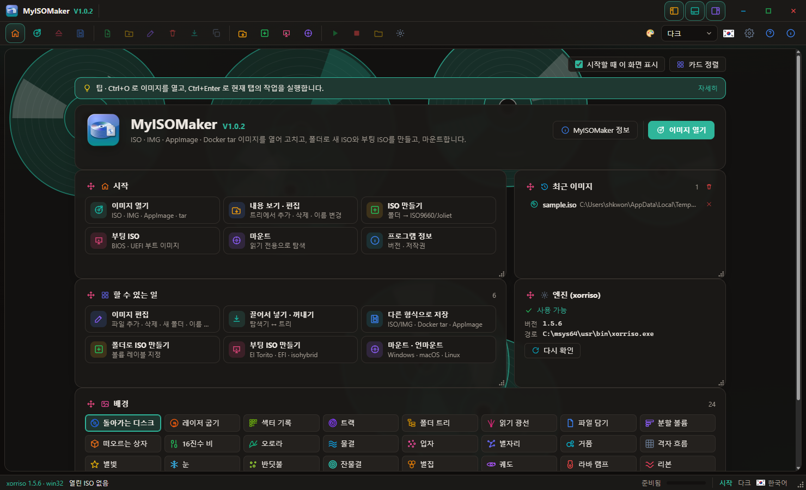

| 카드 | 내용 |
|---|---|
| 프로그램 이름 카드 | 아이콘, 이름, 버전, 설명, 정보 · 이미지 열기 버튼 (고정: 옮기거나 크기를 바꿀 수 없음) |
| 시작 | 이미지 열기, 내용 보기 · 편집, ISO 만들기, 부팅 ISO, 마운트, 프로그램 정보 타일 6개 |
| 최근 이미지 | 최근에 연 이미지 목록. 누르면 바로 엽니다. 목록에서 빼기, 최근 목록 비우기 가능 |
| 할 수 있는 일 | 이미지 편집, 끌어서 넣기 · 꺼내기, 다른 형식으로 저장, 폴더로 ISO 만들기, 부팅 ISO 만들기, 마운트 · 언마운트 |
| 엔진 (xorriso) | 사용 가능 여부, 버전, 경로, **다시 확인** 버튼 |
| 배경 | 한 줄 전체를 쓰는 카드. 움직이는 배경 24가지와 속도 · 선명도 · 자동 변경 |

### 4.1 카드 옮기기와 크기 바꾸기

- 맨 위의 프로그램 이름 카드는 고정되어 있어 옮기거나 크기를 바꿀 수 없습니다.
- 다른 카드는 분홍색 네 방향 화살표 손잡이를 끌어 옮깁니다.
- 카드 오른쪽 아래의 점선 모서리를 끌어 크기를 바꿉니다.
- 점선 모서리를 두 번 누르면 카드가 내용에 맞는 크기가 됩니다.
- **카드 정렬**을 누르면 모든 카드가 기본 배치로 돌아갑니다.
- **시작할 때 이 화면 표시**를 끄면 다음 실행부터 바로 작업 화면이 열립니다.

### 4.2 배경

배경 카드에서 움직이는 배경 24가지 중 하나를 고릅니다. 앞쪽에는 디스크를 주제로 한 배경(디스크, 굽기, 섹터, 트랙, 폴더 트리, 빛줄기)이 있고, 그 뒤에 오로라, 물결, 별밭, 눈 같은 일반 배경이 이어집니다.

배경 카드 아래 한 줄에 다음이 있습니다.

| 항목 | 설명 |
|---|---|
| 속도 (− 슬라이더 +) | 배경이 움직이는 빠르기. 0이면 멈춥니다 |
| 선명도 (− 슬라이더 +) | 배경이 보이는 정도 |
| 자동 변경 | 켜면 고른 간격(10초 ~ 5분)마다 배경을 바꿉니다 |

같은 설정은 설정 › 시작 화면에도 있습니다.

## 5. 이미지 열기

1. 도구 모음의 **이미지 열기**를 누르거나 Ctrl+O를 누릅니다. 시작 화면의 최근 이미지에서 골라도 됩니다.
2. 파일을 고르면 **내용** 탭에 트리가 표시됩니다.
3. 상태 표시줄에 볼륨 이름과 항목 수가 나옵니다.
4. 트리 위의 검색 칸(트리에서 검색…)에 글자를 넣으면 이름으로 걸러 볼 수 있습니다.

### 5.1 지원 형식

| 형식 | 확장자 | 열기 | 저장 | 필요한 도구 |
|---|---|---|---|---|
| ISO 이미지 | `.iso` | 가능 | 가능 (ISO9660 + Joliet) | 없음 |
| 디스크 이미지 | `.img` | 가능 (파티션 안의 ISO9660 영역을 찾음) | 가능 (ISO9660) | 없음 |
| AppImage | `.AppImage` | 가능 (내부 squashfs를 풂) | 가능 (원본 런타임 + 새 squashfs) | unsquashfs / mksquashfs |
| Docker 저장본 | `.tar`, `.tgz`, `.tar.gz`, `.docker` | 가능 (`docker save` 결과) | 가능 (tar 또는 gzip tar) | 운영 체제 tar |

> 4 GB가 넘는 큰 ISO도 열 수 있습니다. 큰 파일은 트리를 읽고 저장하는 데 시간이 걸리니 상태 표시줄과 변경 로그를 확인하세요.

## 6. 트리 편집

이미지를 고쳐도 저장하기 전까지 원본 파일은 바뀌지 않습니다. 변경이 생기면 제목과 상태 표시줄에 **변경됨**이 표시됩니다.

### 6.1 선택

- 클릭: 하나만 선택
- Ctrl(macOS는 ⌘) + 클릭: 선택에 넣거나 뺌
- Shift + 클릭: 범위 선택
- 선택한 개수는 도구 모음 오른쪽에 나옵니다.

### 6.2 우클릭 메뉴

| 항목 | 설명 |
|---|---|
| 외부로 저장… | 파일 하나는 다른 이름으로 저장, 여러 개는 폴더를 골라 한꺼번에 저장 (내보내기) |
| 파일 추가… | 고른 폴더(또는 고른 항목의 부모 폴더)에 파일을 추가 |
| 새 폴더… | 그 위치에 새 폴더를 만듦 |
| 이름 바꾸기… | 하나만 골랐을 때 이름을 바꿈 |
| 삭제 | 고른 항목을 삭제. 삭제 확인 창이 뜸 |
| 경로 복사 | 이미지 안의 경로를 클립보드에 복사 |

트리의 빈 곳을 우클릭하면 루트에 파일을 추가하거나 새 폴더를 만들 수 있습니다. 도구 모음의 **파일 추가**도 같은 일을 합니다. 트리에서 폴더를 고른 상태라면 그 폴더에 추가됩니다.

## 7. 끌어서 넣기 · 꺼내기

### 7.1 탐색기에서 트리로

- 탐색기(Finder)의 파일이나 폴더를 트리의 폴더 위에 놓으면 그 폴더에 추가됩니다.
- 파일 위에 놓으면 그 파일이 있는 폴더에 들어갑니다.
- 트리 빈 곳에 놓으면 루트에 추가됩니다.

### 7.2 트리에서 탐색기로

- 트리의 파일을 탐색기로 끌어 내면 바로 꺼낼 수 있습니다.
- 끌기 전에 임시 파일을 준비합니다. 파일에 마우스를 올리면 준비가 시작되고 준비 중에는 `…`가 표시됩니다. 큰 파일은 준비가 끝난 뒤 다시 끄세요.
- 여러 항목을 Ctrl/Shift로 고른 뒤 그중 하나를 끌면 함께 나갑니다.
- 폴더 전체를 꺼낼 때는 우클릭 › 외부로 저장…을 사용합니다.

## 8. 저장과 형식

1. 도구 모음의 **저장**을 누릅니다.
2. 저장 대화상자에서 파일 이름과 형식을 고릅니다. 기본 이름은 원본 이름 뒤에 `-edited`가 붙습니다.
3. 저장이 끝나면 상태 표시줄에 **저장 완료**가 나오고 변경 로그에 기록됩니다.

| 저장 형식 | 동작 |
|---|---|
| `.iso` / `.img` | 순수 ISO9660(+Joliet) 데이터 이미지로 씀 |
| `.tar` / `.tgz` / `.docker` | 현재 트리를 tar(또는 gzip tar)로 묶음. Docker 저장본을 고친 뒤 다시 저장할 때 사용 |
| `.AppImage` | 원본 AppImage 런타임 + 새 squashfs. AppImage를 열었을 때만 가능하며 mksquashfs가 필요 |

> ISO로 저장하면 부팅 정보는 보존되지 않을 수 있습니다. 부팅되는 ISO가 필요하면 부팅 ISO 탭에서 다시 만드세요.

### 8.1 저장하지 않은 변경

변경된 상태에서 다른 이미지를 열거나 창을 닫으면 저장하지 않은 변경 창이 뜹니다.

- 저장 후 열기 / 저장 후 종료: 먼저 저장하고 계속합니다.
- 저장 안 함: 변경을 버리고 계속합니다.
- 취소: 아무것도 하지 않고 돌아갑니다.

## 9. ISO · AppImage 생성 (폴더 → 이미지)

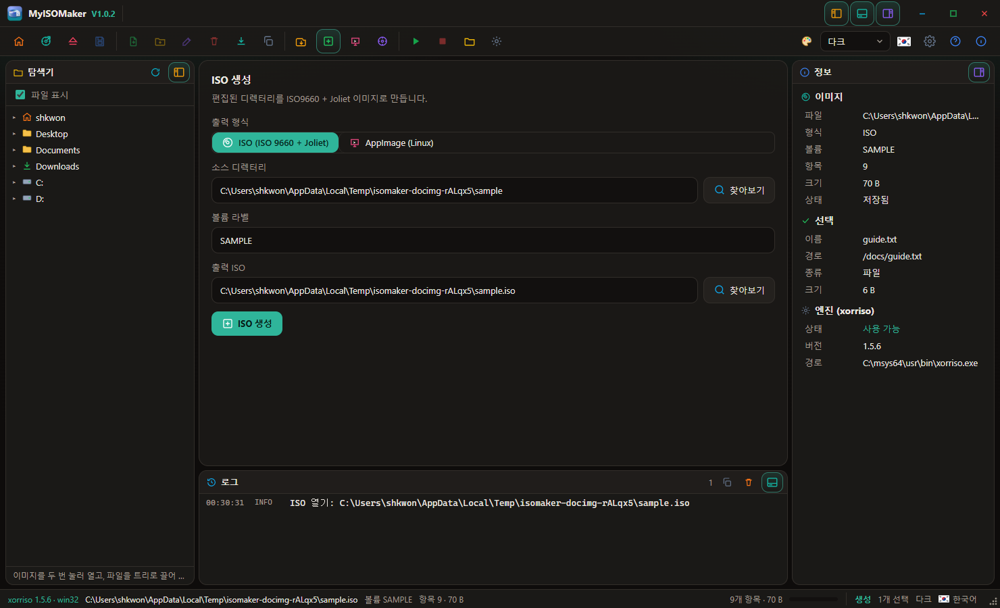

1. 도구 모음의 **생성** 탭을 엽니다.
2. **출력 형식**에서 **ISO** 또는 **AppImage**를 고릅니다.
3. **소스 디렉터리**에 이미지로 만들 폴더를 고릅니다 (찾아보기, 또는 탐색기에서 폴더를 우클릭 › **이 폴더로 ISO 만들기**).
4. 출력 파일 이름과 볼륨 라벨(ISO) / 앱 이름(AppImage)은 폴더 이름으로 자동으로 채워집니다. 직접 고치면 그 값이 유지됩니다.
5. **ISO 생성** / **AppImage 생성**을 누르거나 Ctrl+Enter를 누릅니다.

ISO는 ISO9660 + Joliet(긴 이름) 이미지이며 xorriso가 필요합니다. 진행 중에는 **중지**로 멈출 수 있습니다.

### 9.1 AppImage 만들기와 열기

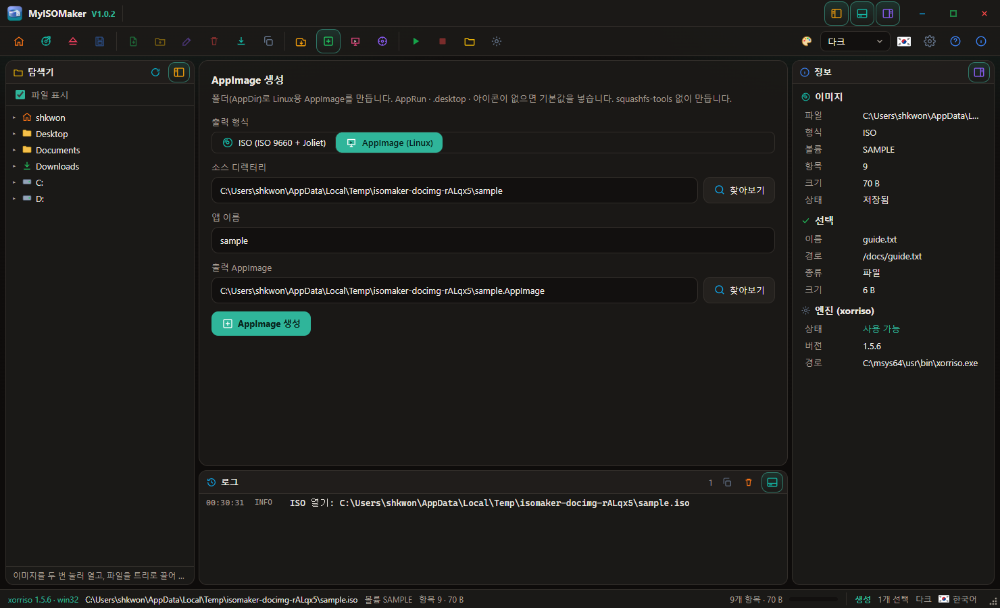

AppImage는 Linux용 실행 파일 하나짜리 앱입니다. MyISOMaker는 squashfs-tools 없이 AppImage를 만듭니다. 공식 AppImage 런타임(type 2) 뒤에 프로그램이 직접 쓴 SquashFS 이미지를 붙이는 방식입니다.

- 폴더(AppDir) 최상위에 **AppRun**, **.desktop** 파일, 아이콘이 없으면 기본값이 이미지 안에 들어갑니다. 원래 폴더는 바뀌지 않습니다. 기본 AppRun은 `usr/bin`에 있는 프로그램을 실행합니다.
- 런타임은 처음 한 번만 인터넷에서 받아 프로그램 폴더에 보관합니다. 이미 연 AppImage를 다시 저장할 때는 그 파일의 런타임을 그대로 씁니다.
- AppImage를 열 때도 squashfs-tools가 필요 없습니다(gzip · zstd 압축). xz · lz4 등 다른 압축을 쓴 AppImage만 unsquashfs를 사용합니다.
- 연 AppImage는 ISO와 똑같이 트리에서 고치고 **저장**으로 다시 AppImage로 만들 수 있습니다.

## 10. 부팅 ISO

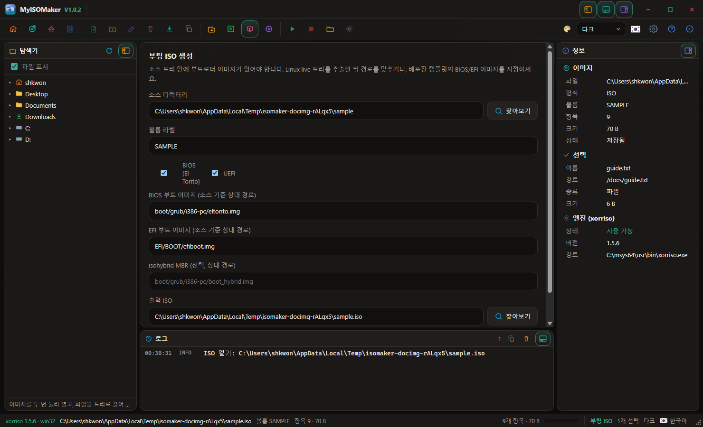

소스 폴더 안에 부트로더 이미지가 있어야 합니다. 보통은 기존 부팅 ISO를 폴더로 추출해 고친 뒤 다시 만듭니다.

1. **부팅 ISO** 탭을 엽니다.
2. **소스 디렉터리**에 부팅 파일이 포함된 폴더를 고릅니다.
3. **볼륨 라벨**을 넣습니다.
4. **BIOS (El Torito)**와 **UEFI** 중 필요한 것을 켭니다. 하나 이상 켜야 합니다.
5. 경로 칸을 소스 폴더 기준 상대 경로로 맞춥니다.
6. **출력 ISO**를 고르고 **부팅 ISO 생성**(또는 부팅 ISO 실행, Ctrl+Enter)을 누릅니다.

| 칸 | 기본값 / 예 | 설명 |
|---|---|---|
| BIOS 부트 이미지 (소스 기준 상대 경로) | `boot/grub/i386-pc/eltorito.img` | El Torito no-emulation 부트 이미지. 부트 카탈로그는 `boot.catalog`로 만들어집니다 |
| EFI 부트 이미지 (소스 기준 상대 경로) | `EFI/BOOT/efiboot.img` | UEFI용 FAT 이미지 (El Torito 대체 부트 항목) |
| isohybrid MBR (선택, 상대 경로) | `boot/grub/i386-pc/boot_hybrid.img` | USB 메모리에 써도 부팅되는 하이브리드 ISO용 MBR. 비우면 UEFI는 GPT 방식으로 처리 |

> 지정한 파일이 소스 폴더에 없으면 오류가 납니다. 경로의 대소문자와 구분자(/)를 확인하세요.

## 11. 마운트

1. **마운트** 탭을 엽니다.
2. 마운트할 ISO를 고릅니다. 비워 두면 현재 연 이미지를 사용합니다.
3. **마운트**(또는 마운트 실행, Ctrl+Enter)를 누릅니다. 연결된 위치가 **현재 마운트:**에 표시됩니다.
4. **폴더 열기**로 마운트된 위치를 엽니다.
5. 다 쓰면 **언마운트**를 누릅니다.

| 운영 체제 | 방식 | 연결 위치 |
|---|---|---|
| Windows | Mount-DiskImage | 가상 CD/DVD 드라이브 문자 (예: `E:\`) |
| macOS | hdiutil attach -readonly | `/Volumes/…` |
| Linux | mount -o loop,ro, 안 되면 fuseiso | 임시 폴더 |

마운트는 읽기 전용입니다. 이미지를 고치려면 내용 탭에서 편집한 뒤 저장하세요.

## 12. 테마와 사용자 테마

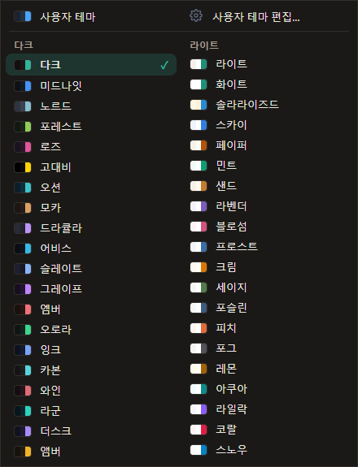

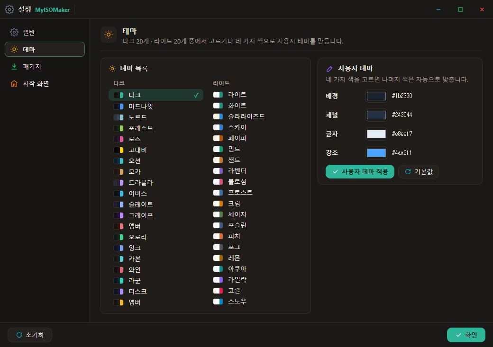

어두운 테마 20개, 밝은 테마 20개, 사용자 테마 1개가 있습니다.

- 도구 모음의 팔레트 버튼을 누르면 같은 계열의 다음 테마로 바로 바뀝니다.
- 팔레트 오른쪽의 테마 이름(▾)을 누르면 테마 메뉴가 열립니다. 맨 위에 **사용자 테마**와 **사용자 테마 편집…**, 그 아래 왼쪽에 다크 20개, 오른쪽에 라이트 20개가 있습니다. 메뉴는 별도 창이라 메인 창 밖으로 나올 수 있고, 화면 밖으로는 나가지 않습니다.
- 사용자 테마는 설정 › 테마에서 배경, 패널, 글자, 강조 색 네 가지를 골라 만듭니다.
- 테마를 바꾸면 도움말 · 설정 · 정보 · 인쇄 창까지 모든 창이 바로 같은 테마로 바뀝니다.

고른 테마와 언어는 다음 실행 때도 그대로 유지됩니다.

## 13. 설정

설정 · 도움말 · 프로그램 정보는 각각 독립된 창입니다. 제목 줄(아이콘 · 제목 · 최소화 · 최대화 · 닫기)이 있고, 메인 창과 따로 옮기거나 크기를 바꿀 수 있습니다. 설정 창에서 바꾼 값은 메인 창에 바로 반영됩니다.

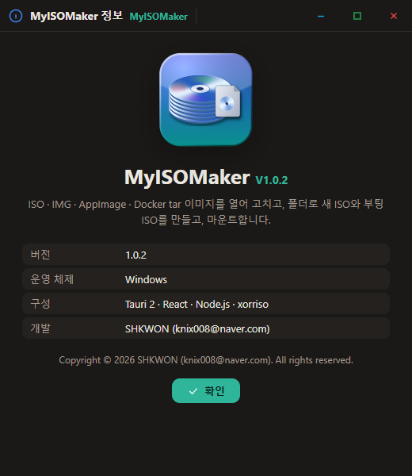

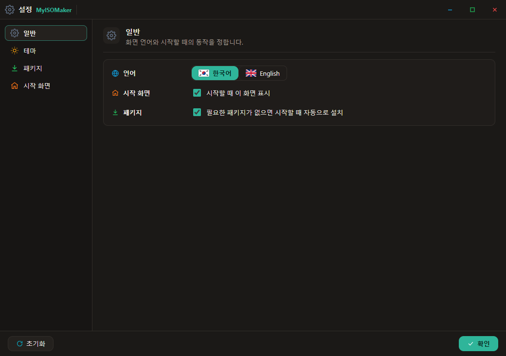

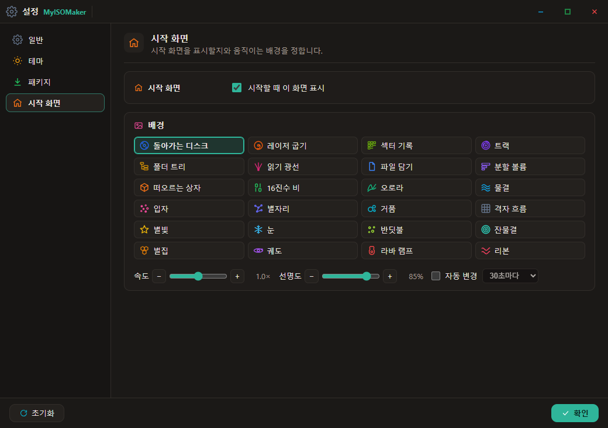

도구 모음의 **설정**을 누르면 설정 창이 열립니다. 왼쪽에서 탭을 고르면 오른쪽에 그 탭의 제목과 설명, 그리고 항목들이 한 줄씩 정렬되어 나옵니다. 설정 창은 모든 탭의 내용이 다 보이는 크기로 열리므로 스크롤 막대가 없습니다.

| 탭 | 내용 |
|---|---|
| 일반 | 화면 언어(한국어 · English), 시작할 때 시작 화면 표시, 필요한 패키지 자동 설치 |
| 테마 | 왼쪽에 다크 20 · 라이트 20 목록, 오른쪽에 사용자 테마(배경 · 패널 · 글자 · 강조 색) |
| 패키지 | xorriso, squashfs-tools 상태 확인과 설치 · 다시 설치 · 제거 |
| 시작 화면 | 시작 화면 표시, 배경 24가지, 속도 · 선명도 · 자동 변경 |

아래쪽의 버튼:

- **초기화**: 모든 설정을 처음 설치했을 때로 되돌립니다 (한국어, 다크 테마, 기본 사용자 테마 색, 시작 화면 표시, 기본 배경, 자동 설치 켬).
- **확인**: 설정 창을 닫습니다. 바꾼 값은 고르는 즉시 저장되고 메인 창에 반영됩니다.

### 13.1 도움말과 인쇄

도구 모음의 **도움말**은 이 설명서와 튜토리얼을 프로그램 안에서 보여 줍니다. 위쪽 막대에서 설명서의 언어(국기), 글자 크기(A− · 현재 px · A+, 가운데 숫자를 누르면 기본 크기), **인쇄**를 고릅니다.

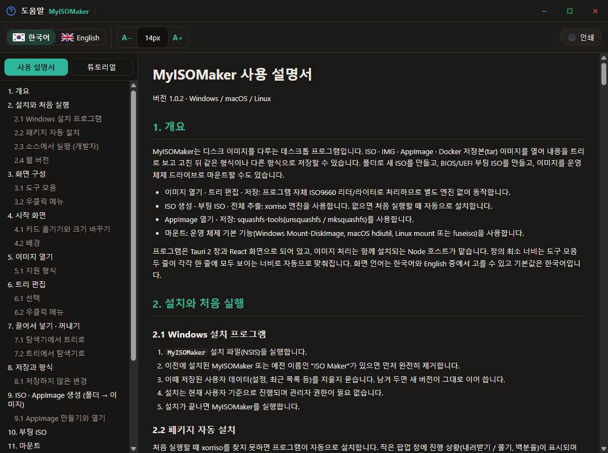

**인쇄**를 누르면 인쇄 창이 열립니다. 인쇄가 필요한 곳은 모두 같은 인쇄 창을 씁니다. 인쇄 창은 별도 창이라 메인 창 밖으로 옮길 수 있고, 테마를 바꾸면 바로 같은 테마로 바뀝니다.

| 항목 | 설명 |
|---|---|
| 프린터 | 설치된 프린터 목록. 기본 프린터가 표시됩니다 |
| 매수 · 용지 · 방향 · 여백 · 배율 · 색 | 페이지 설정. 다음 인쇄 때도 기억합니다 |
| 미리 보기 | 실제로 인쇄될 쪽들. 확대 · 축소 · 창에 맞춤 |
| 인쇄 | 시스템 대화상자 없이 고른 프린터로 바로 인쇄합니다. 파일로 저장하는 프린터(Microsoft Print to PDF 등)는 저장 위치를 먼저 묻습니다 |
| PDF로 저장 | 같은 쪽들을 PDF 파일로 저장합니다 |

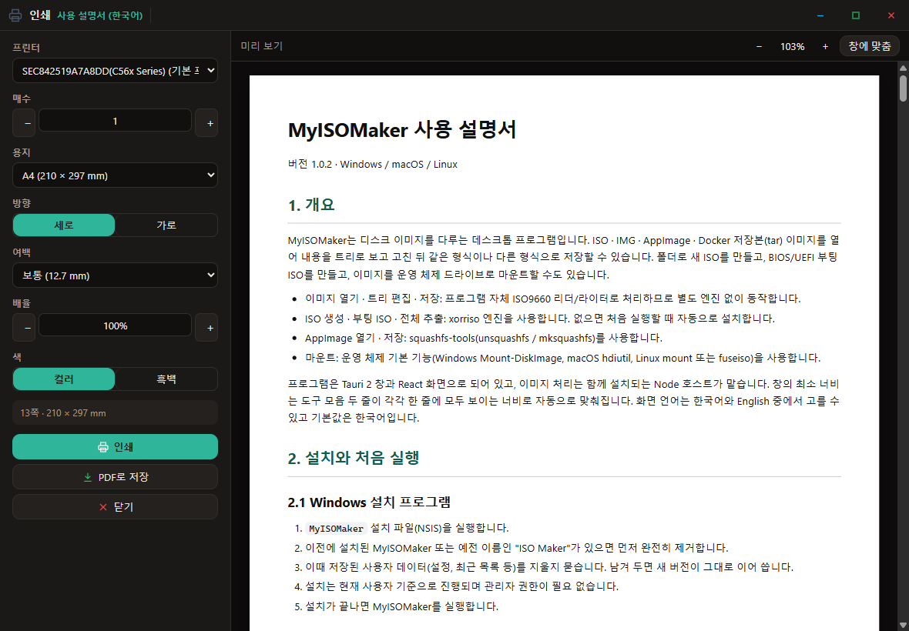

## 14. 패키지

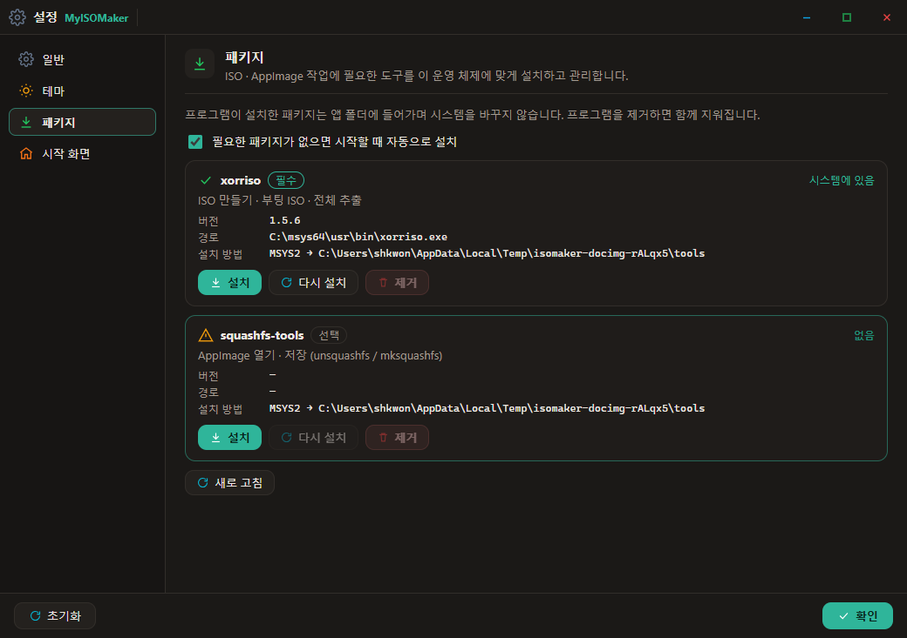

| 패키지 | 쓰는 곳 |
|---|---|
| xorriso | ISO 생성, 부팅 ISO, 전체 추출 (필수) |
| squashfs-tools (unsquashfs / mksquashfs) | xz · lz4 등으로 압축된 AppImage 열기, 더 작은 AppImage 저장 (선택) |

필요한 패키지는 운영 체제마다 그 OS에 맞는 방법으로 설치됩니다.

| 운영 체제 | 설치 방법 | xorriso | squashfs-tools |
|---|---|---|---|
| Windows | MSYS2 패키지를 받아 프로그램 폴더 `%LOCALAPPDATA%\MyISOMaker\tools`에 풂 (관리자 권한 · MSYS2 설치 불필요) | xorriso | squashfs-tools |
| macOS | Homebrew (`brew install`) | xorriso | squashfs |
| Linux (Debian · Ubuntu) | apt-get (pkexec로 암호 확인) | xorriso | squashfs-tools |
| Linux (Fedora) | dnf | xorriso | squashfs-tools |
| Linux (Arch) | pacman | libisoburn | squashfs-tools |
| Linux (openSUSE) | zypper | xorriso | squashfs |

설정 › 패키지에서 각 패키지의 상태(프로그램이 설치함 / 시스템에서 찾음 / 없음), 경로, 버전을 보고 **설치**, **다시 설치**, **제거**를 할 수 있습니다. 설치할 때는 진행률 팝업이 뜨며 취소할 수 있습니다. Windows에서 프로그램이 설치한 패키지는 프로그램을 제거하면 함께 지워집니다. macOS에서 Homebrew가 없으면 brew.sh 안내에 따라 먼저 설치하세요.

## 15. 단축키

| 키 | 동작 |
|---|---|
| Ctrl+O (macOS ⌘+O) | 이미지 열기 |
| Ctrl+Enter (macOS ⌘+Enter) | 현재 탭의 작업 실행 (생성 · 부팅 ISO · 마운트) |
| Ctrl(⌘) + 클릭 | 트리 항목 선택 토글 |
| Shift + 클릭 | 트리 범위 선택 |
| ← / → (분할 막대에 초점) | 변경 로그 패널 너비 조절 |

## 16. 문제 해결

| 증상 | 확인할 것 |
|---|---|
| xorriso 없음 / 엔진을 찾을 수 없음 | 설정 › 패키지에서 xorriso를 설치합니다. 시작 화면 엔진 카드의 **다시 확인**으로 상태를 다시 봅니다. 열기 · 편집 · 저장은 엔진 없이도 됩니다 |
| 자동 설치가 실패함 | 인터넷 연결과 repo.msys2.org 접속을 확인한 뒤 설정 › 패키지에서 **다시 설치**를 누릅니다 |
| AppImage를 열 수 없음 | squashfs-tools(unsquashfs)가 필요합니다. 설정 › 패키지에서 설치합니다 |
| AppImage로 저장할 수 없음 | mksquashfs가 필요하며, AppImage를 열어 편집한 경우에만 AppImage로 저장할 수 있습니다 |
| Docker 저장본(.tar)을 열 수 없음 | 운영 체제의 tar 명령이 필요합니다 |
| 추출 중 심볼릭 링크 경고 (Windows) | Linux 이미지의 심볼릭 링크는 Windows에서 만들 수 없는 경우가 많아 건너뜁니다. 나머지 파일은 정상으로 추출됩니다 |
| 마운트 실패 | 일부 시스템에서는 관리자 권한이 필요합니다. Linux에서는 권한 있는 사용자로 실행하거나 fuseiso를 설치합니다 |
| 끌어 내기가 안 됨 | 준비 표시(`…`)가 사라진 뒤 다시 끕니다. 폴더는 우클릭 › 외부로 저장…을 사용합니다 |
| 저장한 ISO가 부팅되지 않음 | 일반 저장은 부팅 정보를 보장하지 않습니다. 부팅 ISO 탭에서 다시 만듭니다 |
| 부팅 ISO 생성 오류 | BIOS/EFI 이미지 경로가 소스 폴더 기준으로 맞는지 확인합니다 |
| 데스크톱 연결(Tauri)을 찾지 못함 | 프로그램을 종료한 뒤 다시 실행합니다 |

오류 창의 **복사** 버튼으로 메시지를 복사해 두면 원인을 찾는 데 도움이 됩니다.

## 17. 데이터 위치 (Windows)

| 위치 | 내용 |
|---|---|
| `%APPDATA%\MyISOMaker` | 마지막으로 쓴 폴더 등 프로그램이 기억하는 값 |
| `%LOCALAPPDATA%\com.shkwon.myisomaker` | WebView 저장소 (언어, 테마, 시작 화면 배치, 최근 목록 등) |
| `%LOCALAPPDATA%\MyISOMaker\tools` | 프로그램이 설치한 xorriso와 실행 라이브러리 |

## 18. 제거

- Windows: 설정 › 앱 또는 제어판에서 MyISOMaker를 제거합니다. 프로그램이 설치한 도구 폴더(`%LOCALAPPDATA%\MyISOMaker\tools`)도 함께 지워집니다.
- 사용자 데이터를 완전히 지우려면 위 데이터 위치의 폴더를 지웁니다. 새 버전을 설치할 때 설치 프로그램이 지울지 묻기도 합니다.
- macOS / Linux에서 Homebrew나 패키지 관리자로 설치한 xorriso, squashfs-tools는 시스템 패키지이므로 따로 제거합니다.

Copyright © SHKWON (knix008@naver.com). All rights reserved.
