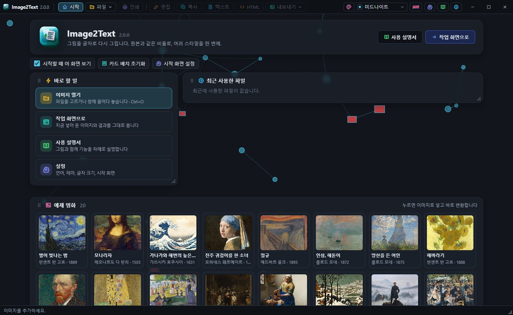

# Image2Text

이미지를 텍스트 아트로 바꾸는 데스크톱 프로그램입니다. 화면은 JavaScript로 만들고, 창과 저장 대화상자는 [Tauri 2](https://v2.tauri.app/)가 담당합니다. Windows, macOS, Linux에서 같은 화면으로 동작합니다.

변환된 텍스트 덩어리의 가로세로 비율은 원본 이미지와 같게 맞춥니다. 글자 칸은 세로로 더 길기 때문에, 선택한 글꼴에서 칸의 가로와 세로를 잰 다음 행 수를 정합니다. 한 번의 변환으로 이미지마다, 스타일마다 결과를 만들고, 그중에서 저장할 것을 고릅니다.

## 기능

- 시작 화면에서 이미지를 열거나, 최근 파일을 다시 열거나, 유명 명화 예제 20점(퍼블릭 도메인) 중 하나를 눌러 바로 변환해 봅니다. 툴바의 **시작**으로 언제든 다시 엽니다.
- PNG, JPEG, GIF, BMP, WebP, ICO, SVG, AVIF, HEIC, HEIF, JPEG XL, TIFF, QOI, TGA, HDR, PNM을 한 번에 여러 장 열 수 있습니다.
- 상세, 문자, 세밀, 숫자, 기호, 도형, 블록, 음영, 점자, 문장과 사용자 문자 집합을 한 번에 만들 수 있습니다. 기본으로는 10개가 선택됩니다.
- 밝기, 대비, 밝기 반전, 윤곽선 강조, 컬러 출력을 지원합니다.
- 변환 글꼴은 이 컴퓨터에 설치된 글꼴 중에서 고릅니다.
- 고른 결과는 텍스트, HTML로 저장하거나, PNG · JPEG · WebP · BMP · TIFF · SVG 이미지로 내보내거나, 인쇄하거나, 클립보드에 복사할 수 있습니다. 변환 칸의 **해상도**(10–100%)는 입력 이미지를 비율을 유지한 채 줄인 뒤 변환해, 글자 수와 내보낸 그림 크기도 같은 비율로 줄입니다. 결과 카드를 오른쪽 클릭하면 그 결과만 저장하거나 인쇄합니다. 카드가 화면 폭을 넘으면 목록 좌우의 < 와 > 로 이동합니다.
- **인쇄** 버튼은 따로 열리는 인쇄 창을 엽니다. 프린터 · 매수, 용지 8종, 방향, 여백(프리셋과 네 방향 각각), 가로·세로 정렬, 크기, 색, 제목 · 원본 · 날짜를 한 열에서 고르면 미리보기가 바로 바뀌고, **인쇄**는 시스템 인쇄 창 없이 고른 프린터로 바로 인쇄합니다(Windows 데스크톱). 파일 프린터는 PDF로 저장합니다.
- 설정 · 정보 · 인쇄 · 설명서 · 저장 확인은 데스크톱에서 메인 창 밖으로 옮길 수 있는 고정 크기의 독립 창이며, 설정은 모든 창에 바로 적용됩니다.
- 사용 설명서(그림 포함, 한국어·English)를 프로그램 안의 창으로 봅니다(툴바 **설명서**, Shift+F1).
- 고른 텍스트는 직접 고칠 수 있습니다.
- 저장하지 않은 변환 결과가 있을 때 창을 닫으면 저장할지를 묻습니다.
- 마지막 설정은 앱 안에 기억됩니다.
- 제목 표시줄에는 아이콘, 이름, 버전과 최소화, 최대화, 닫기 버튼이 있습니다. 그 아래 툴바는 한 줄입니다.
- 툴바의 파일 버튼에서 이미지를 열고, 변환 결과를 폴더에 저장하고, 최근 사용한 파일 10개를 다시 열거나 지웁니다.
- 툴바의 테마 버튼은 다음 테마로 바꾸고, 오른쪽 목록에서 다크 20개, 라이트 20개, 사용자 테마를 바로 고릅니다.
- 설정 버튼 왼쪽의 언어 버튼으로 한국어와 English를 바꿉니다. 한글 화면에는 영국 국기, 영어 화면에는 한국 국기가 표시됩니다.
- 설정 창은 일반, 화면, 테마 탭으로 나뉩니다. 설정 창과 프로그램 정보 창은 크기가 고정입니다.
- 프로그램 정보에서 제작자, 버전, 라이선스, 빌드, 실행 환경, 지원하는 입력 형식을 확인합니다.

GIF, WebP, AVIF, HEIC처럼 장면이 여러 개인 파일은 첫 장면만 사용합니다.

## 요구 사항

- Node.js 20 이상
- Rust 1.77 이상과 Cargo
- Windows에서는 [WebView2](https://developer.microsoft.com/microsoft-edge/webview2/)와 Visual Studio C++ 빌드 도구
- macOS에서는 Xcode 명령줄 도구
- Linux에서는 Tauri가 요구하는 WebKitGTK 개발 패키지

## 개발 실행

이 폴더에서 실행합니다.

```bash
npm install
npm test
npm start
```

`npm start`는 데스크톱 앱만 실행합니다. 브라우저용 웹 서버는 켜지 않습니다. `npm run start:web`은 앱 창 없이 브라우저만 엽니다. 웹 주소는 `http://localhost:5173/`이고, 저장은 브라우저 다운로드를 사용합니다. 두 명령은 따로 실행할 수 있습니다.

정리와 문서용 명령은 아래와 같습니다.

| 명령 | 하는 일 |
| --- | --- |
| `npm run clean` | 빌드 결과(`dist/`, `src-tauri/target/`, `src-tauri/gen/`, `release/`), 생성 파일, Vite 캐시, 루트의 설치 파일과 로그를 지웁니다. |
| `npm run clean:all` | 위에 더해 `node_modules/`도 지웁니다. 다시 쓰려면 `npm install`. |
| `npm run clean -- --dry-run` | 지울 목록과 크기만 보여 줍니다. |
| `npm run docs:shots` | 사용 설명서 그림(`doc/images/`)을 실제 화면으로 다시 찍고, 인쇄 출력과 최소 창 크기를 함께 점검합니다(Edge 또는 Chrome 필요). |
| `npm run check:desktop` | 데스크톱 디버그 빌드(`src-tauri/target/e2e`)를 띄워 독립 창 · 프린터 목록 · 인쇄 결과(PDF)를 점검합니다. 실제 프린터로는 보내지 않습니다. |
| `npm run fetch:examples` | 시작 화면 예제 명화를 Wikimedia Commons에서 다시 받습니다(`public/examples/`). |

clean은 git이 추적하는 파일(소스, 예제 그림, 설명서 그림)과 앱 설정은 건드리지 않습니다.

## 배포용 빌드

이 컴퓨터의 운영체제용 설치 파일을 만듭니다. 데스크톱 설치 파일은 그 운영체제에서만 만들 수 있습니다.

```bash
npm run build:web
npm run build:windows
npm run build:linux
npm run build:macos
```

결과물은 모두 `release/`에 모입니다. 프로젝트 루트에는 설치 파일 하나만 복사됩니다. Windows는 `.exe`, macOS는 `.dmg`, Linux는 이 컴퓨터의 배포판에 맞는 `.deb` 또는 `.rpm`입니다. 루트에 있던 이전 설치 파일은 지워집니다. 웹 빌드는 루트에 `.zip` 하나를 둡니다.

- **Web** — `dist/`를 `Image2Text-2.0.0-web.zip`으로 묶습니다. 브라우저에서 열고, 언어는 화면의 언어 버튼으로 바꿉니다.
- **Windows** — NSIS 설치 파일입니다. 처음에 한국어와 English 중에서 설치 언어를 고르고, 다음 화면에서 바탕화면 바로가기와 시작 메뉴 바로가기를 각각 만들지를 고릅니다.
- **Linux** — deb, rpm, AppImage입니다. deb와 rpm은 설치 중에 같은 언어와 바로가기를 묻습니다. AppImage는 같은 폴더의 `Image2Text-2.0.0-linux-setup.sh`로 설치합니다.
- **macOS** — 앱과 `Install Image2Text.command`가 들어 있는 DMG입니다. 설치 언어, 바탕화면 별칭, Dock 바로가기를 고릅니다. macOS의 시작 메뉴 항목은 Dock입니다.

설치 파일, 실행 중인 프로그램, 바로가기는 모두 `public/icon.svg`와 같은 아이콘을 씁니다. 아이콘만 다시 만들려면 `npm run build:icons`를 실행합니다.

## 화면

왼쪽에서 이미지를 넣고 변환하고, 오른쪽에서 결과를 고릅니다.

```
┌──────────────────────────────────────────────────────────┐
│ [icon] Image2Text  2.0.0                          — □ ✕ │
│ 시작 파일 인쇄 │ 편집 복사 텍스트 HTML 내보내기 테마 언어 설정 설명서 정보 │
├────────────────┬─────────────────────────────────────────┤
│ 1 이미지        │ 3 고른 결과                              │
│ 2 변환          │ 원본              텍스트               │
│ 스타일 · 열 수  ├─────────────────────────────────────────┤
│ [한번에 변환]   │ 결과 카드                                │
│ 상태 메시지                          선택한 결과          │
└──────────────────────────────────────────────────────────┘
```



사용 방법은 [UserGuide.md](UserGuide.md)(English: [UserGuide.en.md](UserGuide.en.md))에 있습니다.

## 예제 그림

시작 화면의 예제 20점은 작가 사후 100년이 넘은 퍼블릭 도메인 작품이며, Wikimedia Commons의 960픽셀 축소본입니다. 작품명, 작가, 연도, 라이선스, 원본 페이지는 `public/examples/examples.json`에 있습니다.

## 이전 버전에서 바뀐 점

이 프로그램은 .NET Windows Forms 앱을 대체합니다. 설치 패키지는 WiX MSI 대신 Tauri 번들을 사용합니다. PDF와 Word 내보내기 대신 HTML과 이미지(PNG, JPEG, WebP, BMP, TIFF, SVG)를 저장합니다. PDF는 **인쇄** 창에서 **인쇄**를 누른 뒤 PDF 프린터를 골라 남길 수 있습니다.

## 라이선스

MIT
