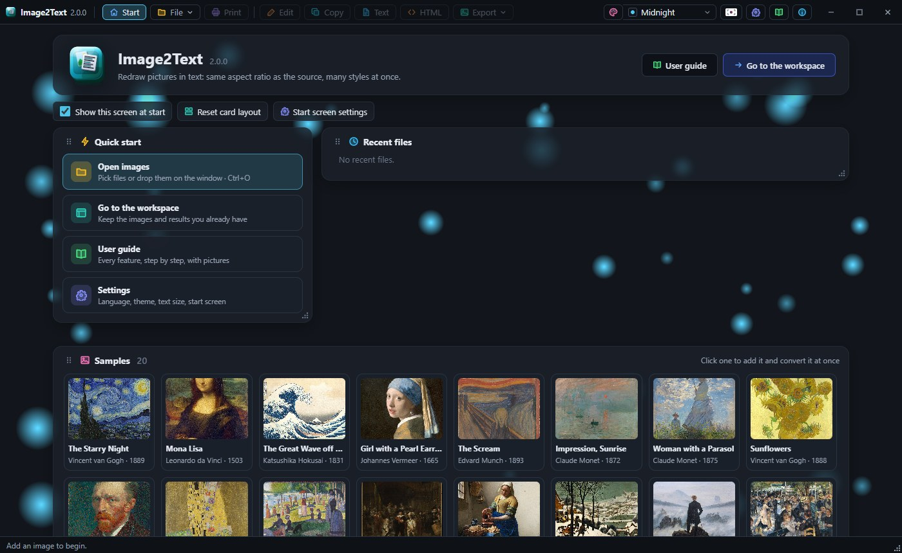
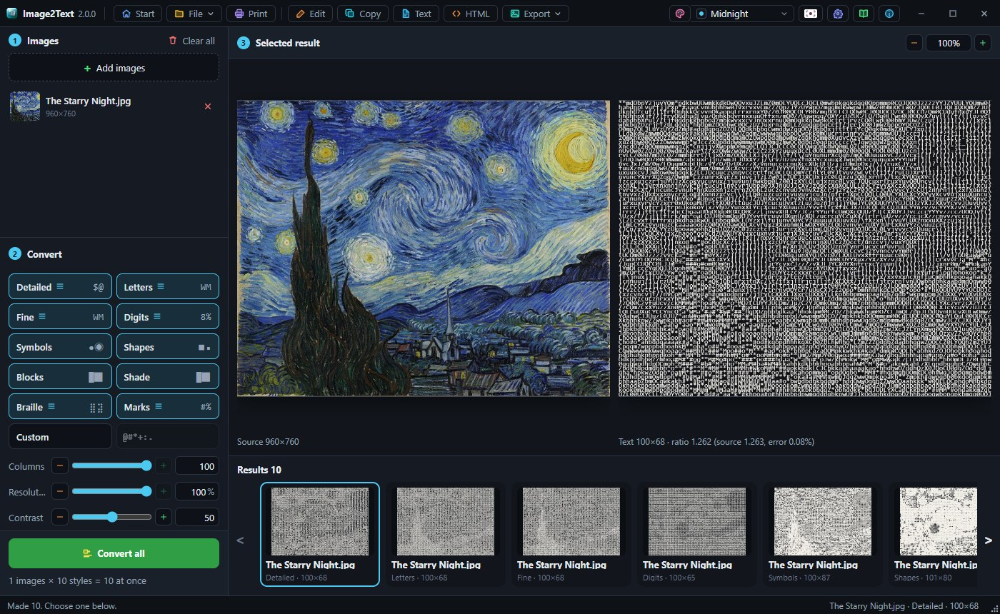
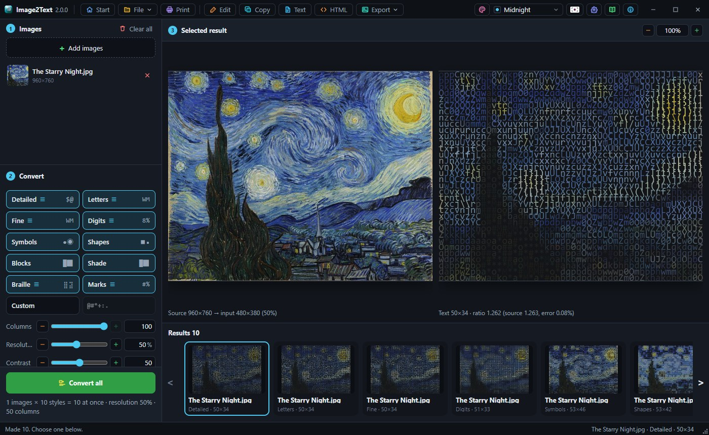
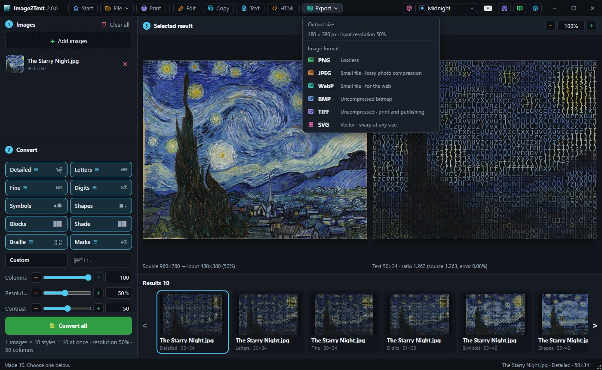
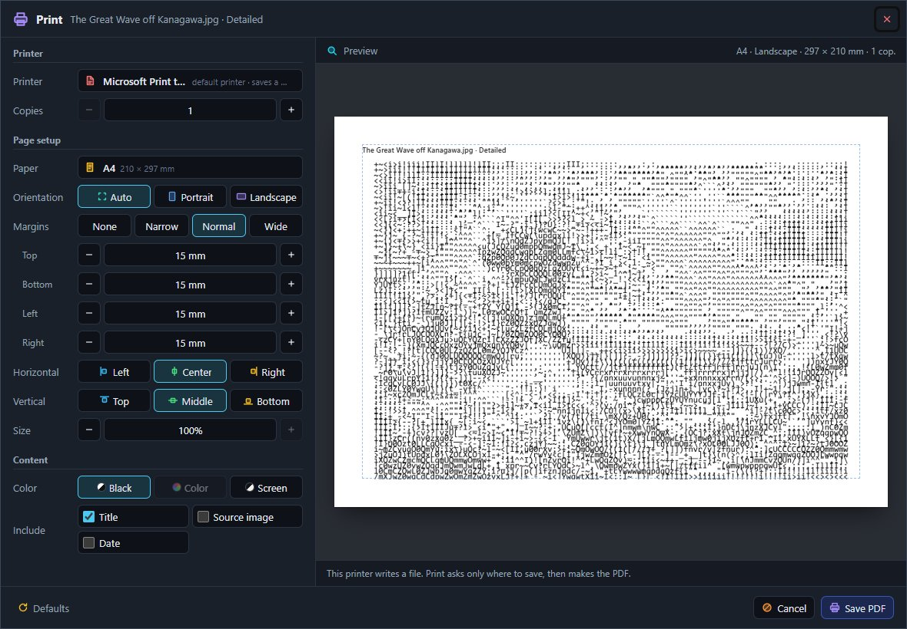
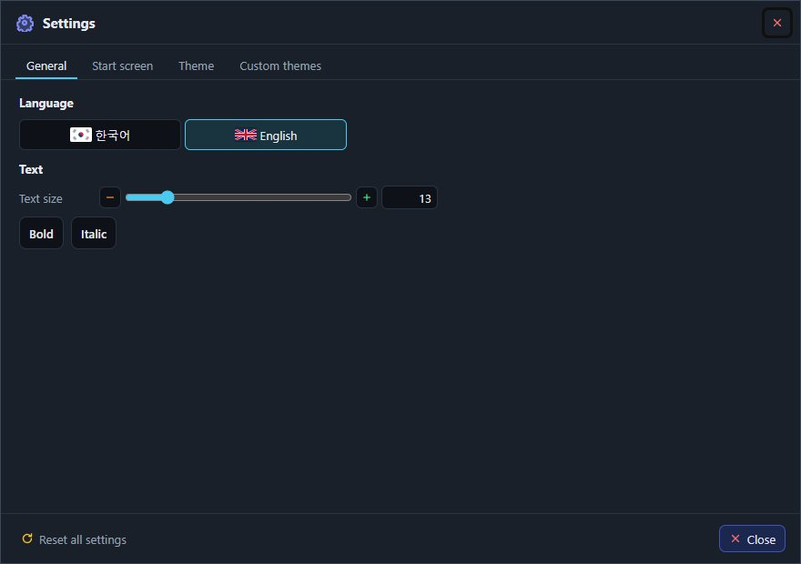
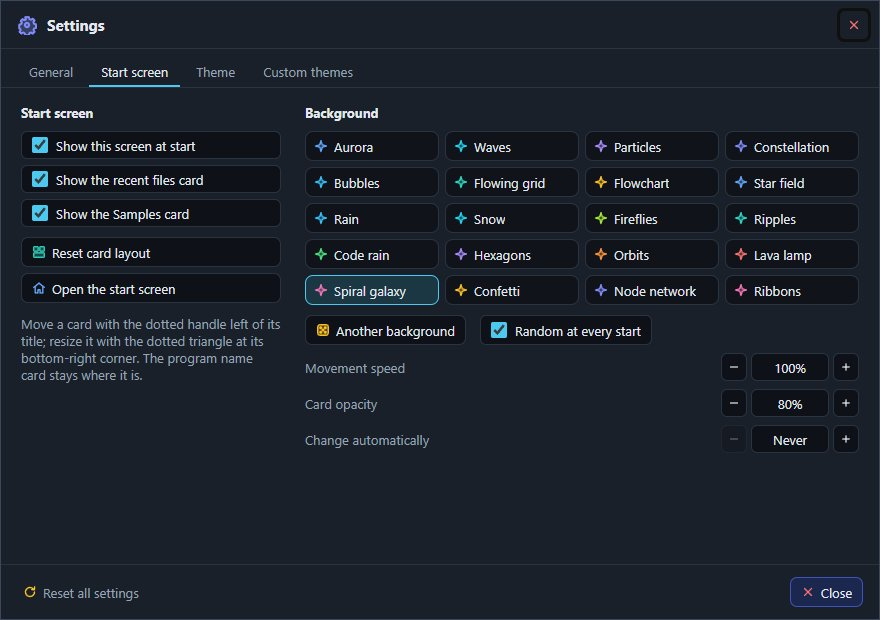
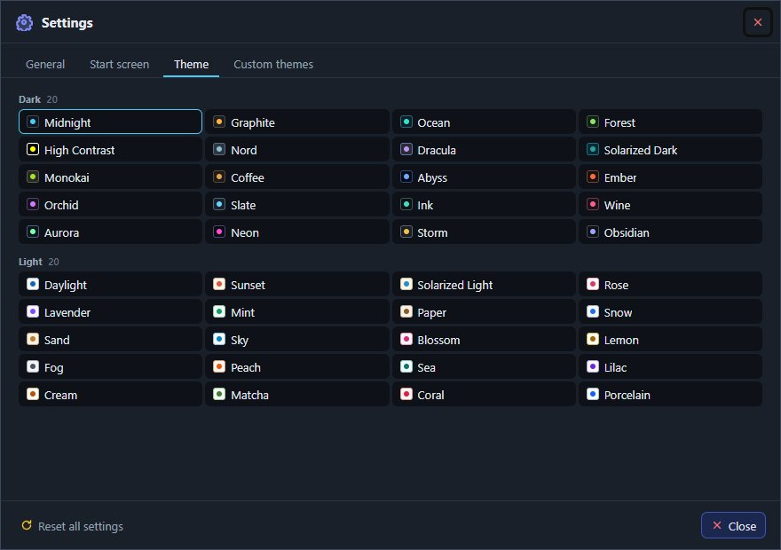
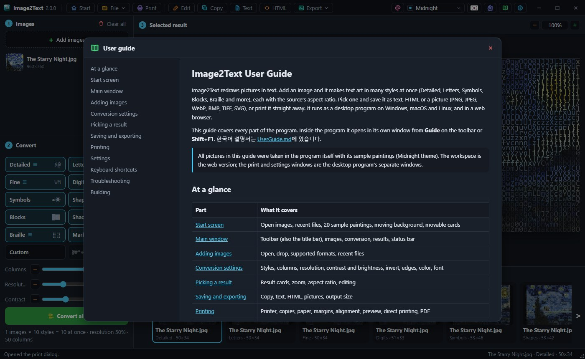

# Image2Text User Guide

Image2Text redraws pictures in text. Add an image and it makes text art in many styles at once (Detailed, Letters,
Symbols, Blocks, Braille and more), each with the source's aspect ratio. Pick one and save it as text, HTML or a
picture (PNG, JPEG, WebP, BMP, TIFF, SVG), or print it straight away. It runs as a desktop program on Windows, macOS
and Linux, and in a web browser.

This guide covers every part of the program. Inside the program it opens in its own window from **Guide** on the
toolbar or **Shift+F1**. 한국어 설명서는 [UserGuide.md](UserGuide.md)에 있습니다.

> All pictures in this guide were taken in the program itself with its sample paintings (Midnight theme). The
> workspace is the web version; the print and settings windows are the desktop program's separate windows.

## At a glance

| Part | What it covers |
| --- | --- |
| [Start screen](#start-screen) | Open images, recent files, 20 sample paintings, moving background, movable cards |
| [Main window](#main-window) | Toolbar (also the title bar), images, conversion, results, status bar |
| [Adding images](#adding-images) | Open, drop, supported formats, recent files |
| [Conversion settings](#conversion-settings) | Styles, columns, resolution, contrast and brightness, invert, edges, color, font |
| [Picking a result](#picking-a-result) | Result cards, zoom, aspect ratio, editing |
| [Saving and exporting](#saving-and-exporting) | Copy, text, HTML, pictures, output size |
| [Printing](#printing) | Printer, copies, paper, margins, alignment, preview, direct printing, PDF |
| [Settings](#settings) | Language, text size, start screen, themes, custom themes |
| [Reference](#keyboard-shortcuts) | Keyboard shortcuts, troubleshooting, building |

## Start screen

The start screen opens when the program starts. A moving background (Aurora, Waves, Particles, Constellation,
Bubbles and 15 more) runs behind see-through cards.

- **Program card** (top, fixed): icon, name, version and a one-line description, with **User guide** and
  **Go to the workspace**. This card cannot be moved or resized.
- **Tools line**: **Show this screen at start** (a check box), **Reset card layout**, **Start screen settings**
  (the Start screen tab of the settings window).
- **Quick start**: Open images (Ctrl+O), Go to the workspace, User guide, Settings.
- **Recent files**: click a name to add that file again (desktop program).
- **Samples**: 20 famous paintings such as Van Gogh's *The Starry Night*, Leonardo's *Mona Lisa*, Hokusai's
  *The Great Wave off Kanagawa*, Vermeer's *Girl with a Pearl Earring*, Munch's *The Scream* and Kim Hong-do's
  *Ssireum*. Click one to add it and convert it at once with the ticked styles. All are public-domain works from
  Wikimedia Commons.
- **Background** (below the samples): the 20 backgrounds, **Another background**, **Random at every start**,
  **Movement speed** (0–300%), **Card opacity** (20–100%) and **Change automatically** (never, every 15 s, 30 s,
  1 min, 2 min, 5 min), all on one line.

Move a card with the dotted handle left of its title; resize it with the dotted triangle at its bottom-right corner
(double-click it to fit the content). Other cards make room, and the layout is remembered. **Start** on the toolbar
(Ctrl+Shift+H) opens the start screen at any time and goes back on a second click; **Esc** goes back too.

## Main window

There is no system title bar: the toolbar is the title bar. Drag an empty spot to move the window; double-click it to
maximize.

- **Toolbar, left**: program icon, name and version, then **Start**, **File** (open, save, recent files),
  **Print**, **Edit**, **Copy**, **Text**, **HTML**, **Export**.
- **Toolbar, right**: **Theme** (next theme) and the drop-down next to it (the current theme's name; click for the
  theme menu), **Language** (a flag), **Settings**, **Guide**, **About**, and at the far right minimize, maximize and
  close.
- Every toolbar button shows its name and shortcut in a tooltip. Every icon is drawn in its command's color.
- **1 Images · 2 Convert** (left), **3 Selected result** (middle), **result cards** (bottom) and the **status bar**
  (with the dotted resize triangle at its right end).

The window cannot be smaller than 1340 × 720, so the toolbar's buttons and labels are never cut off. Closing with
unsaved results opens a separate window that asks whether to save (**Save**, **Don't save**, **Cancel**).

## Adding images

- **File** › **Open** on the toolbar, **Add images** on the left, **Open images** on the start screen, or **Ctrl+O**.
  Several files can be picked at once; the dialog opens in the folder you last used.
- Drop files on the window.
- A sample painting on the start screen.

Supported formats: PNG, JPEG, GIF, BMP, WebP, ICO, SVG, AVIF, HEIC, HEIF, JPEG XL, TIFF, QOI, TGA, HDR and PNM. Only
the first frame of animated files is used; transparent areas are placed on white.

Added images are listed on the left. **×** removes one and **Clear all** empties the list (result cards stay). The 10
most recent files are in the **File** menu and on the start screen; **×** or **Clear all** in the File menu forgets them.

## Conversion settings

Settings apply to the next conversion. Every number has the same line: name, **−**, bar, **+**, number box. Type a
value in the box and press Enter (or leave the box); it snaps to the bar's range and step.

| Item | Range | What it does |
| --- | --- | --- |
| Styles | 11 | Every ticked style makes one result; see the table below. |
| Columns | 24–100 | Characters per line. The number of rows follows the source's aspect ratio. |
| Resolution | 10–100% | Shrinks the input image to this size (keeping its aspect ratio) before converting. The number of characters shrinks by the same share, so the result is less detailed and its exported picture smaller. |
| Contrast, brightness | 0–100 | 50 leaves the source as it is. |
| Invert | on/off | Swaps dark and light cells; good for a dark drawing on white. |
| Edges | on/off | Gives edges darker characters. |
| Color | on/off | Picks the character by brightness and colors it with the source pixels. |
| Font | installed fonts | Sets the proportions of a character cell. |

For example, 100 columns at 50% resolution shrinks a 960 × 760 source to 480 × 380 and makes 50 columns. The line
under **Convert all** and the source caption (`Source 960×760 → input 480×380 (50%)`) show it.

| Style | Characters | Good for |
| --- | --- | --- |
| Detailed | about 70 letters and symbols | the default closest to the photo |
| Letters | upper case to lower case | letters only |
| Fine | a long ramp in another order | faces, busy pictures |
| Digits | digits of different weight, like `8`, `0`, `1` | a numeric texture |
| Symbols | symbols such as `●○◆■★` | crisp outlines |
| Shapes | filled squares, circles, triangles | simple shapes |
| Blocks | `█▓▒░` and partial blocks | sharp cells |
| Shade | blocks mixed with symbols | soft shading |
| Braille | braille cells ranked by dot count | fine dots |
| Marks | `#%&@` and punctuation | thin lines and symbols |
| Custom | your own characters | exactly the characters you want (dark on the left, the trailing space is the lightest) |

**Convert all** (F5) makes `images × ticked styles` results. Styles marked **≡** use only ASCII or only braille, so
their lines line up in any text editor.

## Picking a result

- Click a **result card** below, or use **←** **→**. When there are more cards than fit, **<** **>** scroll them.
- The middle shows the source on the left and the text on the right. Both always show **the same zoom and the same spot**.
- **−**, the **zoom value** and **+** at the right of the result header zoom from 25% to 400%; click the value for 100%.
  The mouse wheel zooms too, and a zoomed picture is dragged (both boxes move together). Double-click for 100%.
- **Edit** (Ctrl+E) lets you change the selected text. Editing drops the color information.

Character cells are usually taller than wide, so the program measures the font and picks the number of rows that makes
`(columns × character width) / (rows × line height) = source width / source height`. If rounding is off by more than
0.5%, it adds a few columns and says so, for example `cols 100→112`.

## Saving and exporting

| Action | How | What you get |
| --- | --- | --- |
| Copy | **Copy** · Ctrl+C | the selected text |
| Text | **Text** · Ctrl+S | UTF-8 (BOM) `.txt` with CRLF line ends |
| HTML | **HTML** | a file for the browser; color results keep their colors |
| Picture | **Export** › a format | PNG, JPEG, WebP, BMP, TIFF, SVG |
| Save all | **File** › **Save** | every result as `.txt` in a folder |

**Output size** at the top of the **Export** menu is the size of the picture you will get: the size of the input image.
For a smaller picture, lower **Resolution** in [Conversion settings](#conversion-settings) and convert again. A
character cell is never narrower than 4 pixels. Right-clicking a result card gives the same save and print menu.

## Printing

**Print** on the toolbar, **Ctrl+P**, or right-click a result card › **Print** opens the print window in its own
window. It can be moved outside the main window and has a fixed size. All settings are in one column on the left; the
preview of the page is on the right and follows every change. The dashed line shows the margins.

| Group | Item | What it does |
| --- | --- | --- |
| Printer | Printer | This computer's printers (the default is marked), including printers that write a file (such as Microsoft Print to PDF). |
| | Copies | 1–99 |
| Page setup | Paper | A4, A3, A5, B4, B5, Letter, Legal, Tabloid |
| | Orientation | Auto (follows the picture), Portrait, Landscape |
| | Margins | None, Narrow (8 mm), Normal (15 mm), Wide (25 mm), and top, bottom, left and right one by one (0–50 mm) |
| | Horizontal / Vertical | Left, Center, Right / Top, Middle, Bottom |
| | Size | 20–100%; 100% fills the space inside the margins |
| Content | Color | Black (black on white), Color (results converted in color), Screen (dark background) |
| | Include | Title (file name and style), Source image (beside or above the text), Date (at the bottom) |

**Print** prints **straight to the chosen printer** without the system print dialog (desktop program on Windows). When
the chosen printer writes a file, the button becomes **Save PDF**: it asks only where to save, then makes the same page as
a PDF. **Defaults** resets every item; your choices are kept for next time. A web browser cannot pick a printer itself,
so there the browser's print dialog opens.

## Settings

**Settings** (Ctrl+,) opens the settings window in its own window, with a fixed size and no scroll bars. Changes apply
at once to the main window and every other window, and every window always has the main window's theme.

- **General**
  - **Language**: **한국어** and **English** buttons with flags. Menus, style names, the status bar and this guide
    change with it. The flag button on the toolbar switches too (the Korean screen shows the British flag, the English
    screen the Korean flag).
  - **Text**: **Text size** (12–18; the number box takes typed values), **Bold**, **Italic**, for all text of the program.
- **Start screen**: show this screen at start, show the recent files card, show the samples card, reset card layout,
  open the start screen, and the background (20 kinds, another background, random at every start, movement speed,
  card opacity, change automatically).
- **Theme**: the 20 dark and 20 light themes in four columns; click one to switch at once.
- **Custom themes**: make a theme and set its name, dark or light, and the background, panel, text, accent and status
  bar colors.

The theme drop-down on the toolbar shows the custom themes and **Custom theme settings** at the top, then Dark and then
Light, each in two columns. The close button (✕) of every window turns red under the pointer. **Reset all settings**
resets language, theme, text, start screen and print settings too (result cards are never removed).

**Guide** (Shift+F1) shows this guide in its own window. Click an entry on the left to jump to it; the chapter you are
reading is highlighted. **About** (F1) shows the name, version, author, license, build, runtime and input formats;
**Copy info** copies them.

## Keyboard shortcuts

| Key | Action |
| --- | --- |
| Ctrl+O | Open images |
| F5 | Convert all |
| ← / → | Previous / next result (outside input fields) |
| Ctrl+E | Edit on / off |
| Ctrl+C | Copy the selected text (or the text you dragged over on screen) |
| Ctrl+S | Save as a text file |
| Ctrl+P | Print window |
| Ctrl+Shift+H | Open / close the start screen |
| Ctrl+, | Settings |
| Shift+F1 | User guide |
| F1 | About |
| Esc | Close the start screen, a menu or a separate window |
| Mouse wheel · double-click | Zoom the result · back to 100% |

## Troubleshooting

| Problem | Fix |
| --- | --- |
| Blocks or symbols show as boxes | Switch the font to NSimSun or MS Gothic and convert again. |
| The result is too detailed | Lower **Resolution** or **Columns** on the left and convert again. |
| Exported pictures are too large | A lower **Resolution** makes the picture smaller by the same share. |
| Colors look inverted | Turn on **Invert** and convert again. |
| The result looks taller than the source | Click the zoom value for 100% before comparing. Edited results can lose the ratio. |
| Print says Save PDF | The chosen printer writes a file. Pick a paper printer in the list. |
| The print has no background | Only **Screen** has a background; the desktop program prints it. |
| A file cannot be opened | Check the **Input formats** in the About window (up to 80 MB per file). |
| The start screen appears every time | Untick **Show this screen at start**. |

## Building

- Desktop, while developing: `npm start` · web only: `npm run start:web` (`http://localhost:5173/`).
- Installers: `npm run build:windows`, `build:macos`, `build:linux`, `build:web`. Results go to `release/` and the
  project root. The installers ask first for the installation language (한국어 or English), then for the desktop and
  Start menu shortcuts.
- Cleaning: `npm run clean` (build output, caches, installers in the root), `npm run clean:all` (also
  `node_modules/`), `npm run clean -- --dry-run` (list only).
- Tests: `npm test` (units, guide, print layout, start screen, Rust). The summary table shows pass, fail and skip per
  category; no test is skipped.
- Screen checks and guide pictures: `npm run docs:shots` (web screens, minimum window width), `npm run check:desktop`
  (the desktop program's separate windows, the printer list and the printed page as a PDF; build first with
  `CARGO_TARGET_DIR=src-tauri/target/e2e npx tauri build --debug --no-bundle`).
- Download the sample paintings again: `npm run fetch:examples`.
