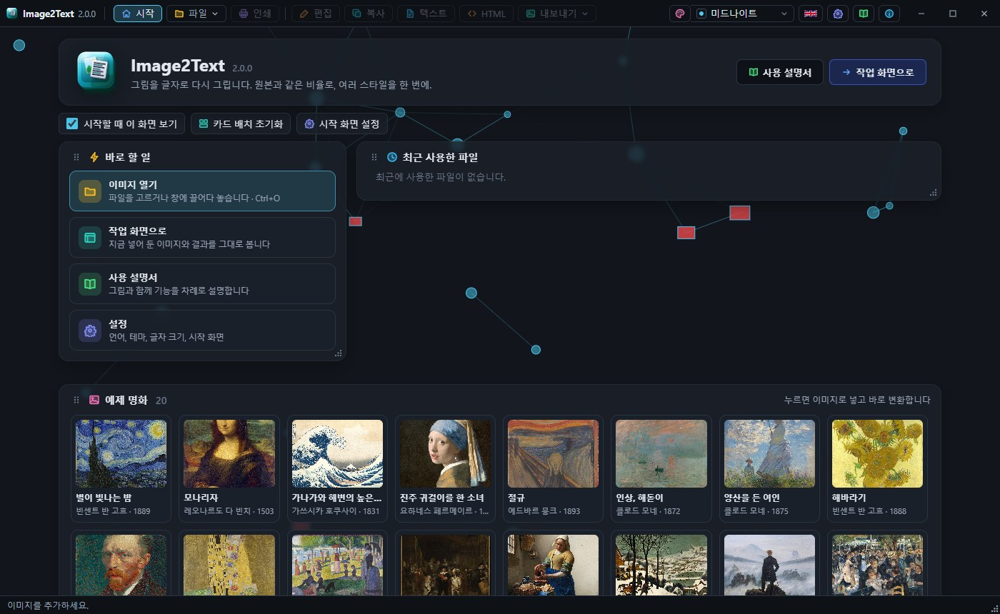
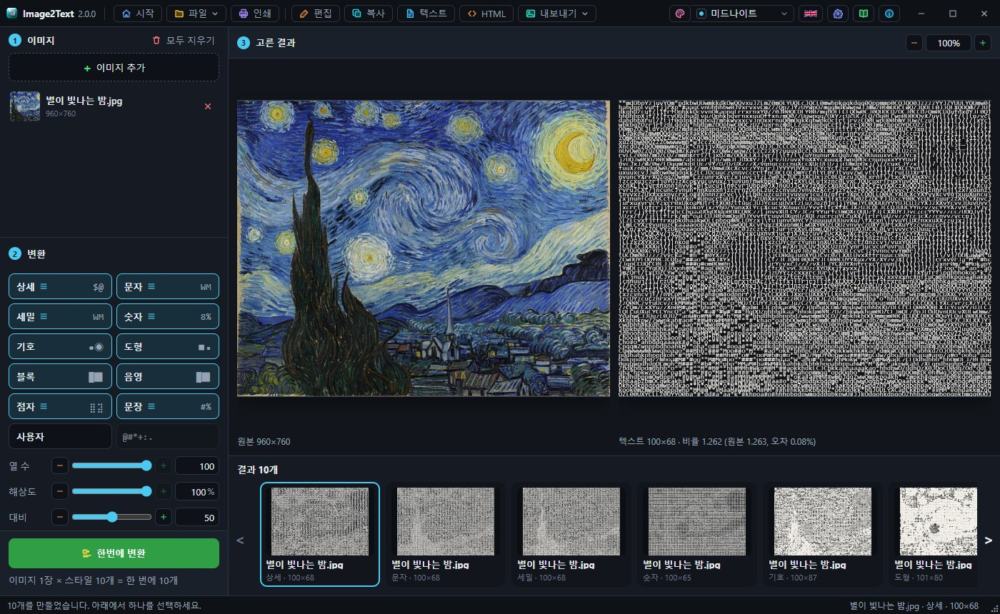
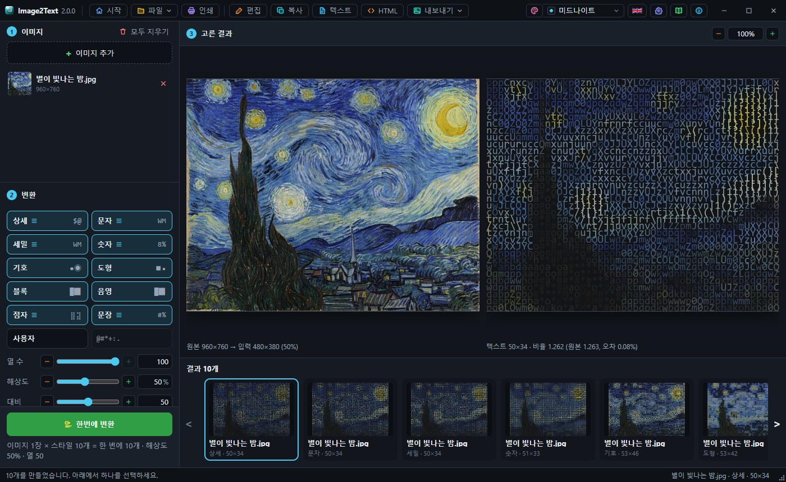
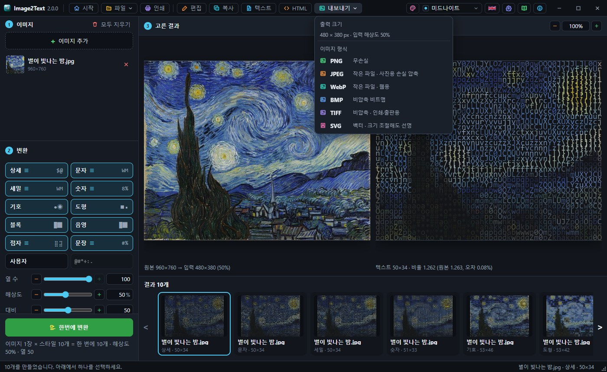
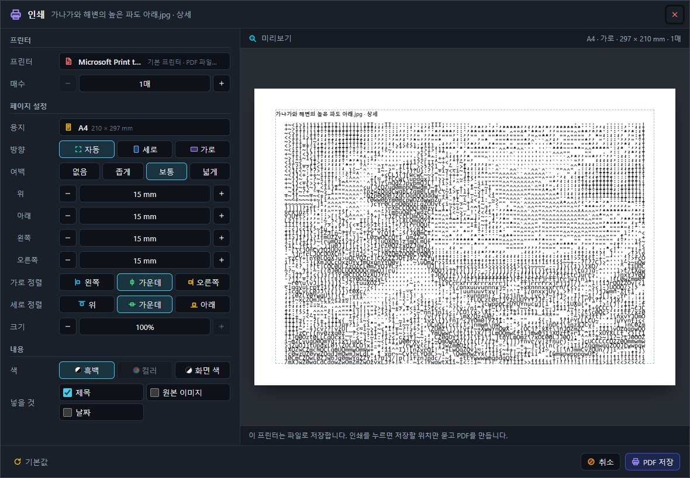
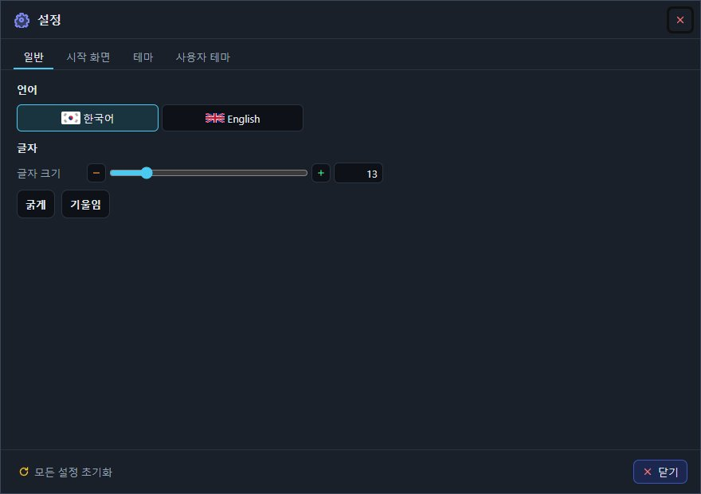
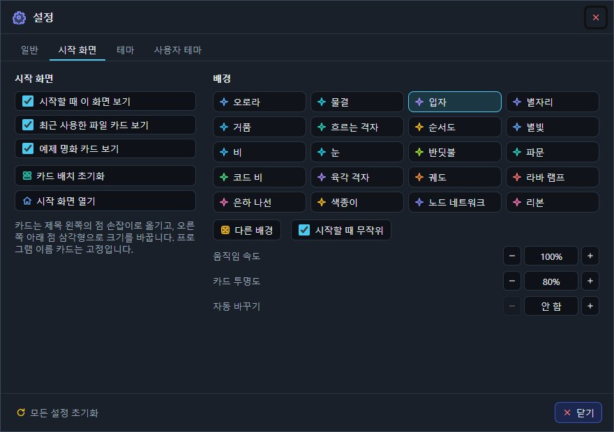
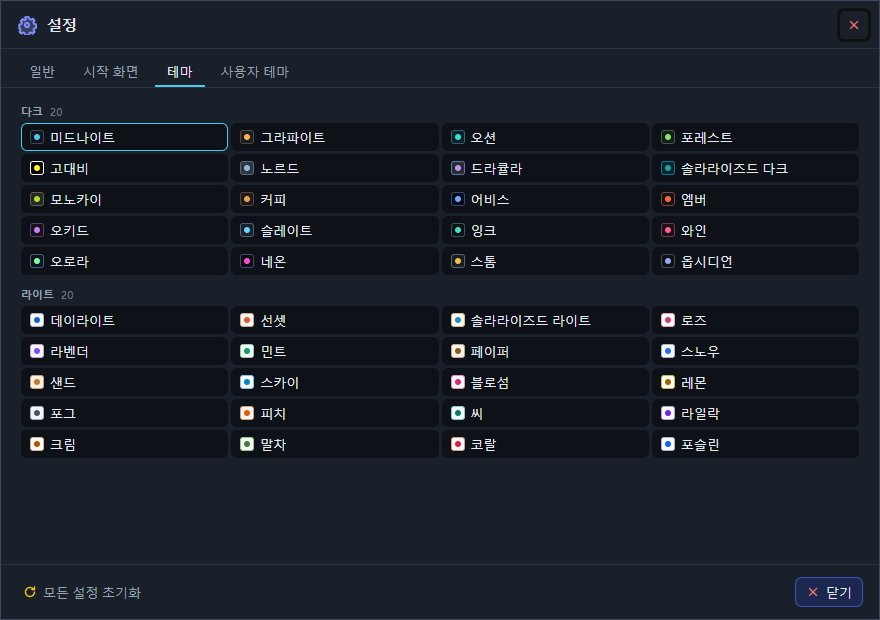
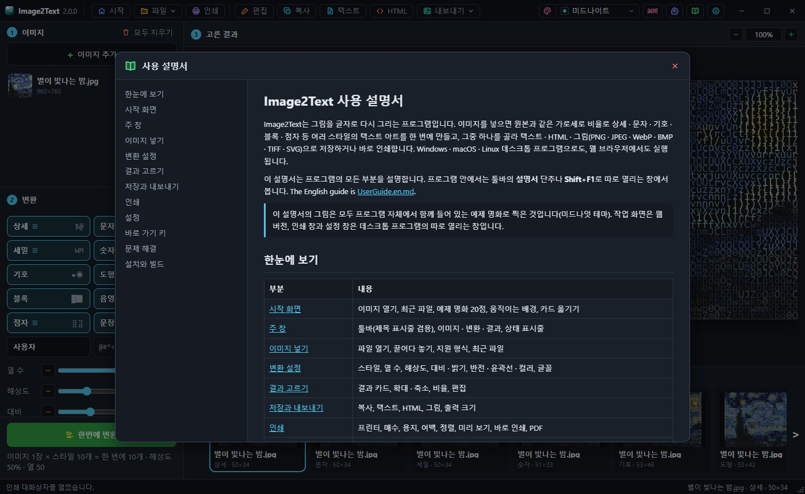

# Image2Text 사용 설명서

Image2Text는 그림을 글자로 다시 그리는 프로그램입니다. 이미지를 넣으면 원본과 같은 가로세로 비율로 상세 · 문자 ·
기호 · 블록 · 점자 등 여러 스타일의 텍스트 아트를 한 번에 만들고, 그중 하나를 골라 텍스트 · HTML · 그림(PNG ·
JPEG · WebP · BMP · TIFF · SVG)으로 저장하거나 바로 인쇄합니다. Windows · macOS · Linux 데스크톱 프로그램으로도,
웹 브라우저에서도 실행됩니다.

이 설명서는 프로그램의 모든 부분을 설명합니다. 프로그램 안에서는 툴바의 **설명서** 단추나 **Shift+F1**로 따로 열리는
창에서 봅니다. The English guide is [UserGuide.en.md](UserGuide.en.md).

> 이 설명서의 그림은 모두 프로그램 자체에서 함께 들어 있는 예제 명화로 찍은 것입니다(미드나잇 테마). 작업 화면은
> 웹 버전, 인쇄 창과 설정 창은 데스크톱 프로그램의 따로 열리는 창입니다.

## 한눈에 보기

| 부분 | 내용 |
| --- | --- |
| [시작 화면](#시작-화면) | 이미지 열기, 최근 파일, 예제 명화 20점, 움직이는 배경, 카드 옮기기 |
| [주 창](#주-창) | 툴바(제목 표시줄 겸용), 이미지 · 변환 · 결과, 상태 표시줄 |
| [이미지 넣기](#이미지-넣기) | 파일 열기, 끌어다 놓기, 지원 형식, 최근 파일 |
| [변환 설정](#변환-설정) | 스타일, 열 수, 해상도, 대비 · 밝기, 반전 · 윤곽선 · 컬러, 글꼴 |
| [결과 고르기](#결과-고르기) | 결과 카드, 확대 · 축소, 비율, 편집 |
| [저장과 내보내기](#저장과-내보내기) | 복사, 텍스트, HTML, 그림, 출력 크기 |
| [인쇄](#인쇄) | 프린터, 매수, 용지, 여백, 정렬, 미리 보기, 바로 인쇄, PDF |
| [설정](#설정) | 언어, 글자 크기, 시작 화면, 테마, 사용자 테마 |
| [참고](#바로-가기-키) | 바로 가기 키, 문제 해결, 설치와 빌드 |

## 시작 화면

프로그램을 열면 시작 화면이 나옵니다. 뒤에서는 움직이는 배경(오로라 · 물결 · 입자 · 별자리 · 거품 등 20가지)이
흐르고, 그 위에 반투명 카드가 놓입니다.

- **프로그램 카드**(맨 위, 고정): 아이콘 · 이름 · 버전 · 한 줄 소개, **사용 설명서**와 **작업 화면으로** 단추.
  이 카드는 옮기거나 크기를 바꿀 수 없습니다.
- **도구 줄**: **시작할 때 이 화면 보기**(체크 상자), **카드 배치 초기화**, **시작 화면 설정**(설정 창의 시작 화면 탭).
- **바로 할 일**: 이미지 열기(Ctrl+O), 작업 화면으로, 사용 설명서, 설정.
- **최근 사용한 파일**: 이름을 누르면 그 파일을 다시 넣습니다(데스크톱 프로그램).
- **예제 명화**: 반 고흐 「별이 빛나는 밤」, 다 빈치 「모나리자」, 호쿠사이 「가나가와 해변의 높은 파도 아래」,
  페르메이르 「진주 귀걸이를 한 소녀」, 뭉크 「절규」, 김홍도 「씨름」 등 20점. 누르면 이미지로 넣고 체크한 스타일로
  바로 변환합니다. 모두 퍼블릭 도메인 작품이며 Wikimedia Commons에서 가져왔습니다.
- **배경**(예제 아래): 배경 20가지, **다른 배경**, **시작할 때 무작위**, **움직임 속도**(0–300%), **카드 투명도**
  (20–100%), **자동 바꾸기**(안 함 · 15초 · 30초 · 1분 · 2분 · 5분마다)가 한 줄에 있습니다.

카드는 제목 왼쪽의 점 손잡이로 끌어 옮기고, 오른쪽 아래의 점 삼각형으로 크기를 바꿉니다(두 번 누르면 내용에 맞춤).
옮기면 다른 카드가 자리를 비켜 주고, 배치는 기억됩니다. 툴바의 **시작**(Ctrl+Shift+H)은 언제든 시작 화면을 열고,
다시 누르면 작업 화면으로 돌아갑니다. **Esc**도 작업 화면으로 돌아갑니다.

## 주 창

운영체제의 제목 표시줄은 없습니다. 툴바가 제목 표시줄을 겸해서, 단추가 없는 곳을 끌면 창이 옮겨지고 두 번 누르면
최대화됩니다.

- **툴바 왼쪽**: 프로그램 아이콘 · 이름 · 버전, 그다음 **시작**, **파일**(열기 · 저장하기 · 최근 파일), **인쇄**,
  **편집**, **복사**, **텍스트**, **HTML**, **내보내기**.
- **툴바 오른쪽**: **테마**(다음 테마) 단추와 그 옆 드롭다운(지금 테마 이름, 누르면 테마 메뉴), **언어**(국기),
  **설정**, **설명서**, **정보**, 그리고 맨 오른쪽 끝에 최소화 · 최대화 · 닫기.
- 툴바의 모든 단추는 마우스를 올리면 이름과 바로 가기 키가 툴팁으로 나옵니다. 모든 아이콘은 기능별 색으로 그려집니다.
- **1 이미지 · 2 변환**(왼쪽), **3 고른 결과**(가운데), **결과 카드**(아래), **상태 표시줄**(맨 아래, 오른쪽 끝에 창 크기를
  바꾸는 점 삼각형).

창의 최소 크기는 1340 × 720입니다. 그보다 줄이지 못하므로 툴바의 단추와 글자가 가려지지 않습니다. 저장하지 않은
결과가 있는데 창을 닫으면 저장할지를 묻는 창이 따로 열립니다(**저장** · **저장 안 함** · **취소**).

## 이미지 넣기

- 툴바 **파일** › **파일 열기**, 왼쪽의 **이미지 추가**, 시작 화면의 **이미지 열기**, 또는 **Ctrl+O**. 여러 장을 함께
  고를 수 있고, 대화상자는 마지막으로 연 폴더에서 열립니다.
- 창 안으로 파일을 끌어다 놓기.
- 시작 화면의 예제 명화.

지원 형식은 PNG, JPEG, GIF, BMP, WebP, ICO, SVG, AVIF, HEIC, HEIF, JPEG XL, TIFF, QOI, TGA, HDR, PNM입니다. 장면이
여러 개인 파일은 첫 장면만 쓰고, 투명한 부분은 흰 배경 위에 올려 변환합니다.

넣은 이미지는 왼쪽 목록에 나옵니다. **×**로 한 장을 빼고 **모두 지우기**로 목록을 비웁니다(만든 결과 카드는 남습니다).
최근에 쓴 파일 10개는 **파일** 메뉴와 시작 화면에 있고, 파일 메뉴에서 **×**나 **모두 지우기**로 기록을 지웁니다.

## 변환 설정

설정은 다음 변환부터 적용됩니다. 숫자 항목은 모두 같은 모양으로 한 줄에 맞춰져 있습니다: 이름 · **−** · 막대 · **+** ·
숫자 칸. 숫자 칸에 값을 직접 입력하고 Enter를 누르거나 칸을 벗어나면 막대의 범위와 간격에 맞춰 적용됩니다.

| 항목 | 범위 | 설명 |
| --- | --- | --- |
| 스타일 | 11가지 | 체크한 스타일마다 결과가 하나씩 만들어집니다. 아래 표 참고. |
| 열 수 | 24–100 | 가로로 쓸 글자 수. 세로 글자 수는 원본 비율에 맞게 계산합니다. |
| 해상도 | 10–100% | 입력 이미지를 비율을 유지한 채 이 크기로 줄인 뒤 변환합니다. 글자 수도 같은 비율로 줄어 덜 세밀해지고, 내보낸 그림도 작아집니다. |
| 대비 · 밝기 | 0–100 | 50이 원본 그대로입니다. |
| 밝기 반전 | 켬/끔 | 어두운 칸과 밝은 칸을 바꿉니다. 흰 바탕의 로고처럼 밝은 그림에 유용합니다. |
| 윤곽선 | 켬/끔 | 경계가 더 진한 글자를 받습니다. |
| 컬러 | 켬/끔 | 글자 모양은 밝기로, 색은 원본 픽셀로 정합니다. |
| 글꼴 | 설치된 글꼴 | 고른 글꼴로 글자 칸의 가로세로 비율을 잽니다. |

예를 들어 열 수 100, 해상도 50%이면 960 × 760 원본을 480 × 380으로 줄여 50열로 만듭니다. **한번에 변환** 아래 줄과
원본 설명(`원본 960×760 → 입력 480×380 (50%)`)에 그 값이 나옵니다.

| 스타일 | 문자 | 쓸 때 |
| --- | --- | --- |
| 상세 | 영문과 기호 약 70단계 | 사진에 가장 가까운 기본 |
| 문자 | 대문자에서 소문자로 이어지는 명암 | 글자만으로 볼 때 |
| 세밀 | 상세와 다른 순서의 긴 명암 | 얼굴, 복잡한 그림 |
| 숫자 | `8`, `0`, `1`처럼 굵기가 다른 숫자 | 숫자 질감 |
| 기호 | `●○◆■★` 같은 기호 | 윤곽이 또렷한 그림 |
| 도형 | 채워진 네모, 원, 세모 | 형태를 단순하게 볼 때 |
| 블록 | `█▓▒░`와 부분 블록 | 칸이 또렷한 그림 |
| 음영 | 블록과 기호를 섞은 명암 | 부드러운 명암 |
| 점자 | 점 개수로 밝기를 나눈 점자 | 작은 점으로 볼 때 |
| 문장 | `#%&@`와 문장 부호 | 가는 선과 기호 |
| 사용자 | 직접 입력 | 원하는 문자만 쓸 때 (왼쪽이 어두운 칸, 맨 끝 공백이 가장 밝은 칸) |

**한번에 변환**(F5)은 `이미지 수 × 체크한 스타일 수`만큼 결과를 만듭니다. 이름 옆에 **≡**가 있는 스타일은 ASCII나
점자만 써서 어느 텍스트 편집기에서도 줄이 맞습니다.

## 결과 고르기

- 아래 **결과 카드**를 누르거나 **←** **→**로 고릅니다. 카드가 화면보다 많으면 **<** **>**로 넘깁니다.
- 가운데 왼쪽은 원본, 오른쪽은 텍스트입니다. 두 칸은 언제나 **같은 배율, 같은 위치**를 보여 줍니다.
- 결과 줄 오른쪽의 **−** · **배율** · **+**로 25%부터 400%까지 확대 · 축소합니다. 가운데 숫자를 누르면 100%로 돌아갑니다.
  그림 위에서 마우스 휠을 돌려도 되고, 커진 그림은 끌어서 옮깁니다(두 칸이 함께 움직입니다). 두 번 누르면 100%.
- **편집**(Ctrl+E)은 고른 텍스트를 직접 고칩니다. 고치면 색 정보는 빠집니다.

글자 칸은 보통 세로가 깁니다. 그래서 프로그램은 글꼴의 글자 폭과 줄 높이를 재고
`(열 수 × 글자 폭) / (행 수 × 줄 높이) = 원본 가로 / 원본 세로`가 되도록 행 수를 고릅니다. 오차가 0.5%를 넘으면 열 수를
조금 늘리고 `열 100→112`처럼 알려 줍니다.

## 저장과 내보내기

| 동작 | 방법 | 내용 |
| --- | --- | --- |
| 복사 | **복사** · Ctrl+C | 고른 텍스트 |
| 텍스트 | **텍스트** · Ctrl+S | UTF-8(BOM) `.txt`, 줄바꿈 CRLF |
| HTML | **HTML** | 브라우저용 파일. 컬러 결과는 글자 색 포함 |
| 그림 | **내보내기** › 형식 | PNG · JPEG · WebP · BMP · TIFF · SVG |
| 모두 저장 | **파일** › **저장하기** | 모든 결과를 폴더에 `.txt`로 |

**내보내기** 메뉴 맨 위의 **출력 크기**는 만들어질 그림의 크기입니다. 그림 크기는 입력 이미지 크기와 같습니다. 그래서
더 작은 그림이 필요하면 [변환 설정](#변환-설정)의 **해상도**를 낮춰 다시 변환합니다. 글자 한 칸은 가로 4픽셀보다
작아지지 않습니다. 결과 카드를 오른쪽 클릭해도 같은 저장 · 인쇄 메뉴가 나옵니다.

## 인쇄

툴바의 **인쇄**, **Ctrl+P**, 결과 카드의 오른쪽 클릭 › **인쇄**는 따로 열리는 인쇄 창을 엽니다. 인쇄 창은 메인 창
밖으로도 옮길 수 있고 크기는 고정입니다. 왼쪽 한 열에 모든 설정이, 오른쪽에 인쇄될 쪽의 미리 보기가 있습니다.
설정을 바꾸면 미리 보기가 바로 바뀌고, 점선은 여백입니다.

| 묶음 | 항목 | 설명 |
| --- | --- | --- |
| 프린터 | 프린터 | 이 컴퓨터의 프린터 목록(기본 프린터 표시). 파일로 저장하는 프린터(Microsoft Print to PDF 등)도 있습니다. |
| | 매수 | 1–99매 |
| 페이지 설정 | 용지 | A4 · A3 · A5 · B4 · B5 · Letter · Legal · Tabloid |
| | 방향 | 자동(그림 모양에 맞춤) · 세로 · 가로 |
| | 여백 | 없음 · 좁게(8mm) · 보통(15mm) · 넓게(25mm), 그리고 위 · 아래 · 왼쪽 · 오른쪽을 따로(0–50mm) |
| | 가로 · 세로 정렬 | 왼쪽 · 가운데 · 오른쪽 / 위 · 가운데 · 아래 |
| | 크기 | 20–100%. 100%는 여백 안을 꽉 채웁니다. |
| 내용 | 색 | 흑백(흰 종이에 검은 글자) · 컬러(컬러로 변환한 결과만) · 화면 색(어두운 바탕) |
| | 넣을 것 | 제목(파일 이름 · 스타일), 원본 이미지(텍스트 옆이나 위), 날짜(아래쪽) |

**인쇄**를 누르면 시스템 인쇄 창 없이 고른 프린터로 **바로 인쇄**합니다(데스크톱 프로그램, Windows). 고른 프린터가
파일로 저장하는 프린터이면 단추가 **PDF 저장**으로 바뀌고, 저장할 위치만 물은 뒤 같은 쪽을 PDF로 만듭니다. **기본값**은
모든 항목을 처음 값으로 되돌리고, 고른 값은 다음에도 그대로입니다. 웹 브라우저에서는 프린터를 직접 고를 수 없어
브라우저의 인쇄 창이 열립니다.

## 설정

툴바의 **설정**(Ctrl+,)은 따로 열리는 설정 창을 엽니다. 크기는 고정이고 스크롤바가 없습니다. 설정 창에서 바꾼 값은
메인 창과 다른 모든 창에 바로 적용됩니다. 창의 테마는 언제나 메인 창과 같습니다.

- **일반**
  - **언어**: 국기가 있는 **한국어** · **English** 단추. 메뉴, 스타일 이름, 상태 표시줄, 이 설명서가 함께 바뀝니다.
    툴바의 국기 단추로도 바꿉니다(한글 화면에는 영국 국기, 영어 화면에는 한국 국기).
  - **글자**: **글자 크기**(12–18, 숫자 칸에 직접 입력 가능), **굵게**, **기울임**. 프로그램 전체의 글자에 적용됩니다.
- **시작 화면**: 시작할 때 이 화면 보기, 최근 사용한 파일 카드 보기, 예제 명화 카드 보기, 카드 배치 초기화,
  시작 화면 열기, 그리고 배경(20가지, 다른 배경, 시작할 때 무작위, 움직임 속도, 카드 투명도, 자동 바꾸기).
- **테마**: 다크 20개와 라이트 20개를 4열로 보여 주고, 누르면 바로 바뀝니다.
- **사용자 테마**: 새 테마를 만들고 이름, 다크/라이트, 배경 · 패널 · 글자 · 강조 · 상태 표시줄 색을 정합니다.

툴바의 테마 드롭다운 메뉴에는 맨 위에 사용자 테마와 **사용자 테마 설정** 단추가, 그 아래에 다크와 라이트가 차례로
두 줄씩 나옵니다. 모든 창의 닫기(✕) 단추는 마우스를 올리면 빨간색이 됩니다. **모든 설정 초기화**는 언어 · 테마 ·
글자 · 시작 화면 · 인쇄 설정까지 처음으로 되돌립니다(만든 결과 카드는 지우지 않습니다).

**설명서**(Shift+F1)는 이 설명서를 따로 열리는 창에서 보여 줍니다. 왼쪽 목차를 누르면 그 장으로 가고, 지금 읽는 장이
강조됩니다. **정보**(F1)는 이름, 버전, 제작자, 라이선스, 빌드, 실행 환경, 입력 형식을 보여 주고 **정보 복사**로 복사합니다.

## 바로 가기 키

| 키 | 하는 일 |
| --- | --- |
| Ctrl+O | 이미지 열기 |
| F5 | 한번에 변환 |
| ← / → | 이전 / 다음 결과 (입력 칸 밖에서) |
| Ctrl+E | 편집 켜기 / 끄기 |
| Ctrl+C | 고른 텍스트 복사 (화면에서 끌어 고른 글자가 있으면 그것) |
| Ctrl+S | 텍스트 파일로 저장 |
| Ctrl+P | 인쇄 창 |
| Ctrl+Shift+H | 시작 화면 열기 / 닫기 |
| Ctrl+, | 설정 |
| Shift+F1 | 사용 설명서 |
| F1 | 프로그램 정보 |
| Esc | 시작 화면 · 메뉴 · 따로 열린 창 닫기 |
| 마우스 휠 · 두 번 누르기 | 결과 확대 · 축소 · 100% |

## 문제 해결

| 증상 | 해결 |
| --- | --- |
| 블록 문자나 기호가 네모로 보입니다 | 글꼴을 NSimSun이나 MS Gothic으로 바꾸고 다시 변환하세요. |
| 결과가 너무 세밀합니다 | 왼쪽의 **해상도**나 **열 수**를 낮춰 다시 변환하세요. |
| 내보낸 그림이 너무 큽니다 | **해상도**를 낮추면 그림도 같은 비율로 작아집니다. |
| 색이 사진과 반대로 보입니다 | **밝기 반전**을 켜고 다시 변환하세요. |
| 결과가 원본보다 길어 보입니다 | 결과 줄의 가운데 배율을 눌러 100%로 맞춘 뒤 비교하세요. 편집한 결과는 비율이 달라질 수 있습니다. |
| 인쇄 단추가 PDF 저장으로 나옵니다 | 고른 프린터가 파일 프린터입니다. 프린터 목록에서 종이 프린터를 고르세요. |
| 인쇄물에 배경색이 없습니다 | **화면 색**만 배경이 있습니다. 데스크톱 프로그램은 배경을 함께 인쇄합니다. |
| 파일을 열 수 없다고 나옵니다 | 정보 창의 **입력 형식**에 있는 형식인지 확인하세요(파일 하나 80MB까지). |
| 시작 화면이 매번 나옵니다 | **시작할 때 이 화면 보기**를 끄세요. |

## 설치와 빌드

- 데스크톱 개발 실행: `npm start` · 웹만: `npm run start:web`(`http://localhost:5173/`).
- 설치 파일: `npm run build:windows` · `build:macos` · `build:linux` · `build:web`. 결과는 `release/`와 루트에 모입니다.
  설치 프로그램은 처음에 설치 언어(한국어 · English)를, 다음에 바탕화면 · 시작 메뉴 바로가기를 묻습니다.
- 정리: `npm run clean`(빌드 결과 · 캐시 · 루트 설치 파일), `npm run clean:all`(여기에 `node_modules/`까지),
  `npm run clean -- --dry-run`(지울 목록만).
- 테스트: `npm test`(단위 · 설명서 · 인쇄 배치 · 시작 화면 · Rust). 결과는 분류별 통과 · 실패 · 건너뜀 표로 요약되며,
  건너뛰는 테스트는 없습니다.
- 화면 점검과 설명서 그림: `npm run docs:shots`(웹 화면, 최소 창 폭 점검), `npm run check:desktop`(데스크톱 프로그램의
  따로 열리는 창 · 프린터 목록 · 인쇄 결과 PDF 점검, 먼저 `CARGO_TARGET_DIR=src-tauri/target/e2e npx tauri build --debug --no-bundle`).
- 예제 명화 다시 받기: `npm run fetch:examples`.
