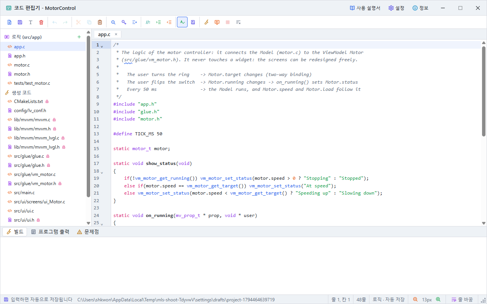
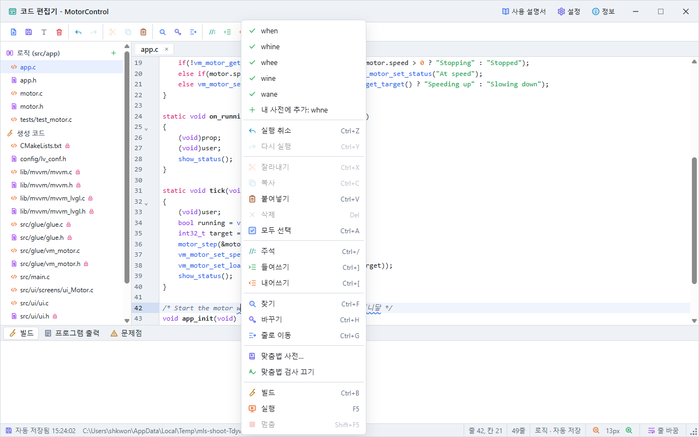
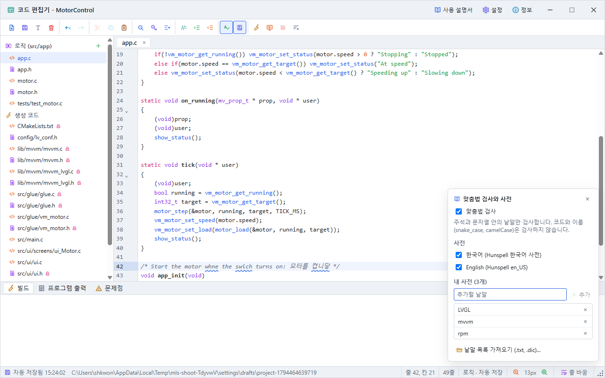

# Code Editor Guide

The code editor is a window of its own for editing, building and running the logic code, which is kept apart from the screens (GUI), and the code made from the design. Open it with the code editor button of the main window's toolbar, **View > Code editor**, or Ctrl+E. It works alongside the main window and can be resized.

## 1. The Window



| Part | Contents |
|---|---|
| Title bar | The project's name, build or run state, **User guide** (F1), **Settings**, **About**, the window buttons |
| Toolbar | Icon buttons (point at one for its name and key): new file, save, rename, delete / undo, redo / cut, copy, paste / find, replace, go to line / comment, indent, outdent / spell checking, spelling dictionary / build, run, stop, clean build |
| File list, left | **Logic (src/app)**: the files you write. **Generated code**: the files made from the design (a lock means read only) |
| Centre | The tabs of the open files, and the editing area |
| Status line | Save state and logic folder, line and column, characters selected, number of lines, kind of file, font size (smaller, bigger), **word wrap**, and at the right end the size grip (drag it to resize the window) |
| Bottom | **Build** (build output), **Program output** (`printf`), **Problems** (problems of the code) |

## 2. Logic Files and Automatic Saving

The logic lives in the `src/app/` folder. It is kept apart from the GUI: however much the screens change and the code is generated again, the app never overwrites or deletes it.

- What you type is saved automatically 0.4 s later. The logic is saved even when the GUI project is not. The status line shows when and where.
- A saved project keeps it in `src/app/` of the project folder.
- A project not saved yet (a sample too) keeps it in a folder of its own under `drafts` in the app's data folder, which goes to `src/app/` when the project is first saved. Draft folders never saved are cleared after a week.
- Manage files with **New file** (+), **Rename** and **Delete** (press twice). Subfolders work too, like `tools/util.c`. Every `.c` and `.cpp` file is built, except those in subfolders, so tests can live there.
- Logic files edited in another editor are read again when you come back to the app.

The logic includes only the generated `glue.h`, and exchanges values with the screens through the ViewModel's functions.

```c
#include "app.h"
#include "glue.h"

void app_init(void)   /* called once, after ui_init() */
{
    vm_main_set_speed(1200);
}
```

## 3. Editing

- **An undo history for each file:** switching tabs keeps each file's undo and redo.
- **Completion:** typing suggests ViewModel functions (`vm_`), binding library functions (`mv_`) and C words. Choose with the arrow keys and press Enter. Ctrl+Space opens it at any time.
- **Find and replace:** Ctrl+F, Ctrl+H, with match case, by word and regular expressions.
- **Go to line:** Ctrl+G.
- **Comments, indenting:** Ctrl+/ comments lines in and out; Ctrl+] and Ctrl+[ indent and outdent.
- **Also:** matching brackets, brackets closed as you type, code folding, several selections (Alt+drag), the same word highlighted.
- **Problems shown:** a line using a ViewModel name the design does not have, or with a build error, is marked beside its number; point at the mark to read it.

## 4. Spell Checking

The spelling button of the toolbar turns it on and off. Only the words of comments and strings are checked, never the code or names (`motor_speed`, `camelCase`). A word the dictionaries do not know gets a wavy underline.



- **Correcting:** right-click an underlined word: the corrections come first in the menu. Press one to use it.
- **Add to my dictionary:** **Add to my dictionary** in the same menu: that word is not marked again.
- **Dictionaries:** Korean (Hunspell Korean) and English (Hunspell en_US) come with the app. The spelling dictionary button of the toolbar, or **Spelling dictionary** in the right-click menu, chooses the dictionaries, adds and removes words of your own, and imports a word list (.txt, one word a line, or a Hunspell .dic).



The spelling settings and your own words are kept in the app's settings, for every project.

## 5. Editing Generated Code

Edits of the generated files that hold the design go into the design, so they survive the next generation. A project with a folder is saved automatically too, and undo in the main window takes the edits back.

| File | What you edit |
|---|---|
| `src/ui/screens/ui_<screen>.c` | Widgets and their properties |
| `src/ui/ui.c` | The theme colours |
| `src/main.c` | The screen size |
| `config/lv_conf.h` | LVGL settings |
| `src/ui/ui_bindings.c` | The `mv_bind` lines: the bindings of widgets to ViewModels (direction, converter, format) |
| `src/glue/vm_<name>.c` | The `mv_prop_init_*` lines: the name, type, initial value and range of each ViewModel property |

The binding library (`lib/mvvm/`), `glue.h`, `glue.c`, the ViewModel headers, `ui.h`, the event files and `CMakeLists.txt` are made from other files, so they are read only; the status line says where to change them.

## 6. Building and Running

| Button | Key | What it does |
|---|---|---|
| **Build** | Ctrl+B | Saves everything, even what was just typed, and only builds with gcc. |
| **Run** | F5 | Saves, builds and runs it in a window of its own (native run). |
| **Stop** | Shift+F5 | Stops the build or the program. |
| **Clean build** | | Deletes the native build of this LVGL version; the next build compiles LVGL again too. |

In the build output, an error with a file and a line goes to that line when pressed. What the program prints with `printf` shows in the **Program output** tab. The main window's run window (F5) uses the built-in engine and does not run the logic, so run the logic from this window.

## 7. Right-Click Menus

- **Code:** on an underlined word, its corrections and add to my dictionary; then undo, redo, cut, copy, paste, delete, select all, comment, indent, outdent, find, replace, go to line, spelling dictionary, spell checking on or off, build, run, stop. On a `vm_` name, open that ViewModel's file.
- **File list and tabs:** open, rename, delete, new file, copy path.

## 8. Keyboard Shortcuts

| Key | What it does |
|---|---|
| Ctrl+S | Save |
| Ctrl+Z, Ctrl+Y | Undo, redo |
| Ctrl+X, Ctrl+C, Ctrl+V, Ctrl+A | Cut, copy, paste, select all |
| Ctrl+F, Ctrl+H, Ctrl+G | Find, replace, go to line |
| Ctrl+/, Ctrl+], Ctrl+[ | Comment, indent, outdent |
| Ctrl+Space | Open completion |
| Ctrl+B, F5, Shift+F5 | Build, run, stop |
| F1 | This guide |

Esc closes the search panel or the completion list, never the editor window.

## 9. Troubleshooting

- **A logic file is not saved:** if the status line shows an error, check that the folder can be written to. A sample opened straight from the installation folder cannot be saved there; open samples from the start screen's sample list.
- **The build says a ViewModel function is missing:** if a ViewModel or a property was renamed, the Problems tab gives the new name. Rename it in the logic too.
- **An edit of generated code shows an error:** check the line number in the status line. The design takes the edit only once the error is fixed.
