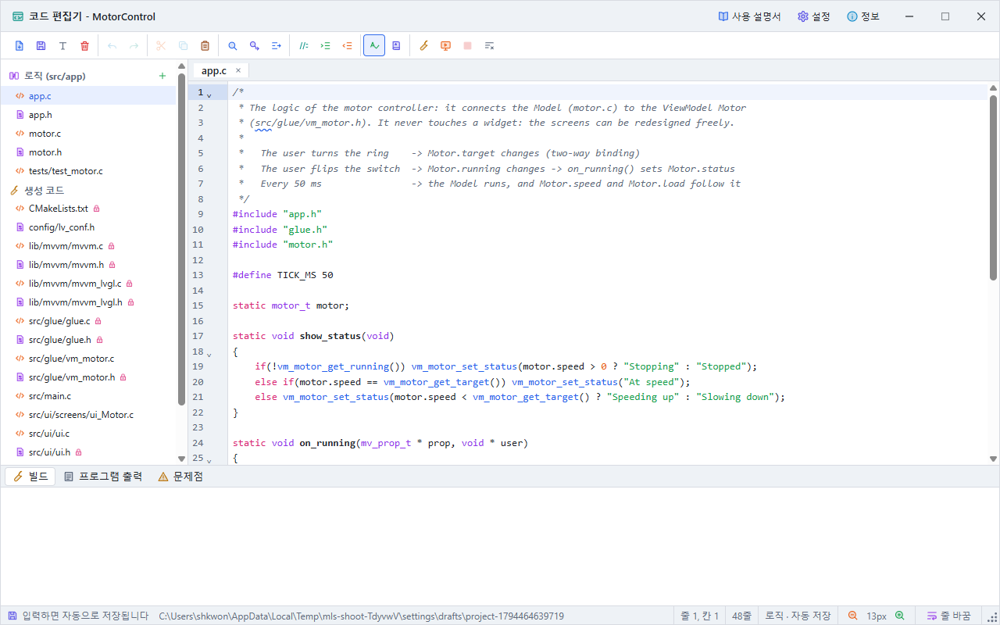
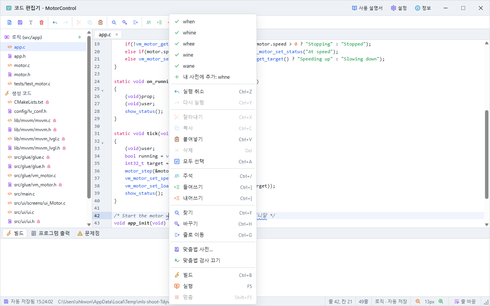
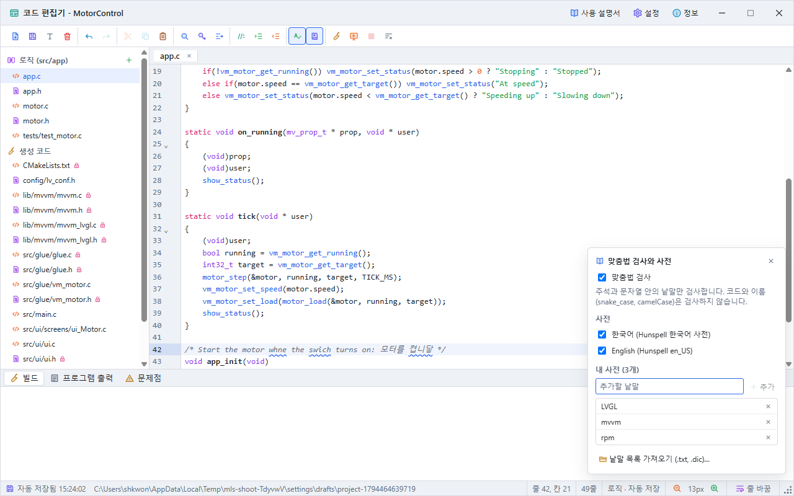

# 코드 편집기 사용 설명서

코드 편집기는 화면(GUI)과 분리된 로직 코드와, 설계에서 만들어지는 코드를 편집하고 빌드하고 실행하는 별도의 창입니다. 메인 창의 도구 모음에 있는 코드 편집기 단추, **보기 > 코드 편집기**, 또는 Ctrl+E로 엽니다. 메인 창과 함께 쓸 수 있고, 창의 크기를 바꿀 수 있습니다.

## 1. 창 구성



| 부분 | 내용 |
|---|---|
| 제목 줄 | 프로젝트 이름, 빌드나 실행 상태, **사용 설명서**(F1), **설정**, **정보**, 창 단추 |
| 도구 모음 | 아이콘 단추(마우스를 올리면 이름과 단축키): 새 파일, 저장, 이름 바꾸기, 삭제 / 실행 취소, 다시 실행 / 잘라내기, 복사, 붙여넣기 / 찾기, 바꾸기, 줄로 이동 / 주석, 들여쓰기, 내어쓰기 / 맞춤법 검사, 맞춤법 사전 / 빌드, 실행, 멈춤, 빌드 정리 |
| 왼쪽 파일 목록 | **로직 (src/app)**: 직접 작성하는 파일. **생성 코드**: 설계에서 만들어지는 파일(자물쇠는 읽기 전용) |
| 가운데 | 열린 파일의 탭과 편집 영역 |
| 상태 줄 | 저장 상태와 로직 폴더, 줄과 칸, 선택한 글자 수, 줄 수, 파일 종류, 글자 크기(작게, 크게), **줄 바꿈**, 오른쪽 끝의 크기 조절 표시(끌어서 창 크기 변경) |
| 아래 | **빌드**(빌드 출력), **프로그램 출력**(`printf`), **문제점**(코드 문제) |

## 2. 로직 파일과 자동 저장

로직은 `src/app/` 폴더에 둡니다. 이 폴더는 GUI와 분리되어 있어서, 화면을 아무리 바꾸고 코드를 다시 만들어도 앱이 덮어쓰거나 지우지 않습니다.

- 입력하면 0.4초 뒤 자동으로 저장됩니다. GUI 프로젝트를 저장하지 않아도 로직은 저장됩니다. 상태 줄에 저장 시각과 폴더가 나옵니다.
- 저장된 프로젝트는 프로젝트 폴더의 `src/app/`에 저장합니다.
- 아직 저장하지 않은 프로젝트(샘플 포함)는 앱 데이터 폴더의 `drafts` 아래 별도 폴더에 저장하고, 프로젝트를 처음 저장할 때 `src/app/`으로 함께 옮깁니다. 저장하지 않은 작업 폴더는 일주일 뒤 지워집니다.
- **새 파일**(+), **이름 바꾸기**, **삭제**(두 번 누름)로 파일을 관리합니다. `tools/util.c`처럼 하위 폴더도 만들 수 있습니다. `.c`와 `.cpp` 파일은 모두 빌드되지만 하위 폴더의 파일은 빌드되지 않으므로 시험 코드를 둘 수 있습니다.
- 다른 편집기에서 고친 로직 파일은 앱으로 돌아오면 다시 읽습니다.

로직은 생성된 `glue.h`만 include 하고, 뷰모델의 함수로 화면과 값을 주고받습니다.

```c
#include "app.h"
#include "glue.h"

void app_init(void)   /* ui_init() 다음에 한 번 호출됩니다 */
{
    vm_main_set_speed(1200);
}
```

## 3. 편집

- **파일마다 따로 있는 실행 취소 기록:** 탭을 바꿔도 각 파일의 실행 취소와 다시 실행이 남습니다.
- **자동 완성:** 입력하면 뷰모델 함수(`vm_`), 바인딩 라이브러리 함수(`mv_`), C 낱말이 제안됩니다. 위아래 화살표로 고르고 Enter로 넣습니다. Ctrl+Space로 직접 열 수 있습니다.
- **찾기와 바꾸기:** Ctrl+F, Ctrl+H. 대소문자 구분, 낱말 단위, 정규식을 고를 수 있습니다.
- **줄로 이동:** Ctrl+G.
- **주석, 들여쓰기:** Ctrl+/로 주석을 넣고 빼며, Ctrl+]와 Ctrl+[로 들여쓰고 내어씁니다.
- **그 밖에:** 괄호 짝 표시, 괄호 자동 닫기, 코드 접기, 여러 곳 선택(Alt+끌기), 같은 낱말 강조.
- **문제 표시:** 설계에 없는 뷰모델 이름이나 빌드 오류가 있는 줄은 줄 번호 옆에 표시되고, 마우스를 올리면 내용이 보입니다.

## 4. 맞춤법 검사

도구 모음의 맞춤법 단추로 켜고 끕니다. 주석과 문자열 안의 낱말만 검사하며, 코드와 이름(`motor_speed`, `camelCase`)은 검사하지 않습니다. 사전에 없는 낱말에는 물결 밑줄이 그어집니다.



- **고치기:** 밑줄 친 낱말을 오른쪽 클릭하면 맨 위에 고칠 낱말이 나옵니다. 누르면 바뀝니다.
- **내 사전에 추가:** 같은 메뉴의 **내 사전에 추가**를 누르면 그 낱말은 다시 표시되지 않습니다.
- **사전:** 한국어(Hunspell 한국어 사전)와 English(Hunspell en_US) 사전이 들어 있습니다. 도구 모음의 맞춤법 사전 단추나 오른쪽 클릭 메뉴의 **맞춤법 사전**에서 쓸 사전을 고르고, 내 사전의 낱말을 추가하거나 지우고, 낱말 목록 파일(.txt, 한 줄에 한 낱말, 또는 Hunspell .dic)을 가져옵니다.



맞춤법 설정과 내 사전은 앱 설정에 저장되어 모든 프로젝트에서 쓰입니다.

## 5. 생성 코드 편집

설계를 담는 생성 파일은 편집하면 설계에 반영되므로, 다시 생성해도 사라지지 않습니다. 프로젝트 폴더가 있으면 프로젝트도 자동으로 저장되고, 메인 창의 실행 취소로 되돌릴 수 있습니다.

| 파일 | 편집하는 내용 |
|---|---|
| `src/ui/screens/ui_<화면>.c` | 위젯과 속성 |
| `src/ui/ui.c` | 테마 색 |
| `src/main.c` | 화면 크기 |
| `config/lv_conf.h` | LVGL 설정 |
| `src/ui/ui_bindings.c` | `mv_bind` 줄: 위젯과 뷰모델의 연결(방향, 변환기, 형식) |
| `src/glue/vm_<이름>.c` | `mv_prop_init_*` 줄: 뷰모델 속성의 이름, 형식, 초깃값, 범위 |

바인딩 라이브러리(`lib/mvvm/`), `glue.h`, `glue.c`, 뷰모델 헤더, `ui.h`, 이벤트 파일, `CMakeLists.txt`는 다른 파일에서 만들어지므로 읽기 전용이며, 상태 줄에 어디서 바꾸는지 나옵니다.

## 6. 빌드와 실행

| 단추 | 키 | 동작 |
|---|---|---|
| **빌드** | Ctrl+B | 입력 중인 내용까지 저장한 뒤 gcc로 빌드만 합니다. |
| **실행** | F5 | 저장한 뒤 빌드해서 별도 창에서 실행합니다(네이티브 실행). |
| **멈춤** | Shift+F5 | 빌드나 실행을 멈춥니다. |
| **빌드 정리** | | 이 LVGL 버전의 네이티브 빌드 결과를 지웁니다. 다음 빌드는 LVGL부터 다시 컴파일합니다. |

빌드 출력에서 파일과 줄이 있는 오류를 누르면 그 줄로 갑니다. 프로그램이 `printf`로 출력한 내용은 **프로그램 출력** 탭에 나옵니다. 메인 창의 실행 화면(F5)은 내장 엔진이라 로직이 실행되지 않으므로, 로직은 이 창에서 실행합니다.

## 7. 오른쪽 클릭 메뉴

- **코드:** 밑줄 친 낱말이면 고칠 낱말과 내 사전에 추가, 그리고 실행 취소, 다시 실행, 잘라내기, 복사, 붙여넣기, 삭제, 모두 선택, 주석, 들여쓰기, 내어쓰기, 찾기, 바꾸기, 줄로 이동, 맞춤법 사전, 맞춤법 검사 켜기·끄기, 빌드, 실행, 멈춤. 커서가 `vm_` 이름 위에 있으면 그 뷰모델의 파일을 엽니다.
- **파일 목록과 탭:** 열기, 이름 바꾸기, 삭제, 새 파일, 경로 복사.

## 8. 단축키

| 키 | 동작 |
|---|---|
| Ctrl+S | 저장 |
| Ctrl+Z, Ctrl+Y | 실행 취소, 다시 실행 |
| Ctrl+X, Ctrl+C, Ctrl+V, Ctrl+A | 잘라내기, 복사, 붙여넣기, 모두 선택 |
| Ctrl+F, Ctrl+H, Ctrl+G | 찾기, 바꾸기, 줄로 이동 |
| Ctrl+/, Ctrl+], Ctrl+[ | 주석, 들여쓰기, 내어쓰기 |
| Ctrl+Space | 자동 완성 열기 |
| Ctrl+B, F5, Shift+F5 | 빌드, 실행, 멈춤 |
| F1 | 이 설명서 |

Esc는 찾기 창이나 자동 완성만 닫고, 편집기 창은 닫지 않습니다.

## 9. 문제 해결

- **로직 파일이 저장되지 않음:** 상태 줄에 오류가 나오면 폴더에 쓸 권한이 있는지 확인하세요. 설치 폴더 안의 샘플을 직접 열면 저장할 수 없으므로, 샘플은 시작 화면의 샘플 목록에서 엽니다.
- **빌드할 때 뷰모델 함수가 없다는 오류:** 뷰모델이나 속성의 이름을 바꾸었으면 문제점 탭이 새 이름을 알려 줍니다. 로직의 이름도 바꾸세요.
- **생성 코드를 고쳤는데 오류가 남음:** 상태 줄의 줄 번호를 확인하세요. 오류를 고칠 때까지 설계에는 반영되지 않습니다.
