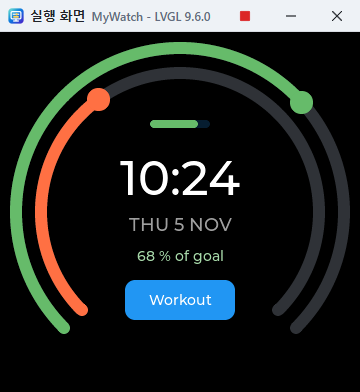

# My LVGL Studio Tutorial

You will build the GUI of a smart watch with a round LCD from the start: a watch face with activity rings and the time, a workout screen with the heart rate, and buttons to go between them. It takes about 20 minutes.

For guidance inside the app, choose **Help > Tutorial**. Doing the tasks of a step ticks them off, and if you get stuck, press **Do It for Me**. Below are the same steps to do without the guide.

## 1. Choose a Round Screen

Smart watch LCDs are often round, about 240 to 480 pixels across. With a round screen the corners are cut off as on the device, and the **Problems** tab warns about controls that leave the circle.

1. Choose **File > New Project** and enter `MyWatch` as the name.
2. Choose **360×360 round** as the screen size and press **Create**. You can change it later with the screen size button on the toolbar.
3. Open **Project Settings** on the toolbar, turn on **Dark LVGL theme** and close the window.
4. In the screen's **Attributes**, set **Background** to `#000000` and the **Name** to `Face`.

An OLED watch only spends power on lit pixels, so a black background saves battery.

## 2. Two Activity Rings

Drag **Arc** from **Controls** onto the screen, or double-click it. Place two and set them as follows.

| Attribute | Outer ring | Inner ring |
|---|---|---|
| Width, Height | 340 | 290 |
| Align | CENTER | CENTER |
| X, Y | 0 | 0 |
| Value | 68 | 45 |
| Indicator colour | `#66bb6a` | `#ff7043` |

With the centre alignment, X and Y are the distance from the middle of the screen, the easiest way to lay out a round screen.

## 3. Time, Date and Goal

Place three **Labels**. All have Align set to CENTER and X set to 0.

| Attribute | Time | Date | Goal |
|---|---|---|---|
| Text | `10:24` | `THU 5 NOV` | `68 % of goal` |
| Font size | 48 | 18 | as it is |
| Text colour | `#ffffff` | `#9e9e9e` | `#a5d6a7` |
| Y | -34 | 12 | 44 |

## 4. The Battery

Place a **Bar** and set Width `60`, Height `8`, Align CENTER, X `0`, Y `-88`, Value `80` and Indicator colour `#66bb6a`. A round screen narrows towards the top and bottom, so keep it inside the rings rather than at the edge.

## 5. Add Motion

Controls can move together without writing code.

1. Select the outer ring and press **Add Event** under **Events** in the attributes.
2. Set the action to **Show the value as text**, the target to the goal Label, and the text to `%d %% of goal`. `%d` is the value and `%%` is a `%` sign.
3. Select the inner ring and set **Sweep by itself** to `8000`. The value goes up for 8 seconds and down for 8 seconds. On a real watch a sensor value would take its place.

## 6. The Workout Screen

A watch is small, so each function gets a screen of its own.

1. Add a screen with the **+** button at the right of the tab row, then set its name to `Workout` and its Background to `#000000`.
2. Place an **Arc** and set Width and Height `320`, Align CENTER, X and Y `0`, Minimum `60`, Maximum `200`, Value `120` and Indicator colour `#ef5350`.
3. Place a **Label** and set Text `120`, Font size `48`, Text colour `#ffffff`, Align CENTER, X `0` and Y `-20`.
4. Place another **Label** and set Text `BPM`, Text colour `#ef9a9a`, Align CENTER, X `0` and Y `28`.
5. Add an event to the Arc: **Show the value as text**, on the first Label, with the text `%d`.

## 7. Buttons Between the Screens

1. Place a **Button** on the Workout screen and set Text `Back`, Width `110`, Height `44`, Align CENTER, X `0` and Y `90`.
2. Add an event with the trigger **Clicked**, the action **Load screen**, and the target `Face`.
3. Return to the Face tab, place a **Button** and set Text `Workout`, Width `110`, Height `40`, Align CENTER, X `0` and Y `88`.
4. Add an event with the trigger **Clicked**, the action **Load screen**, and the target `Workout`.

## 8. Run It

Press **F5**. The design surface holds still while you edit; things move when run.

- Drag the outer ring and the goal text changes.
- The inner ring moves by itself.
- Press **Workout**, drag the heart rate ring, and come back with **Back**.

## 9. Code and Graphics

The code button on the toolbar opens the code beside the design surface. Choose the Face screen's file in the tabs above it.

- Change `10:24` to `10:30` in the code and the time on the design surface changes.
- Drag a Label and the numbers in the code change.
- A mistake shows its line number and reason below the code, and the screen stays as it was until you fix it.

## 10. Check the Problems

The **Problems** tab lists controls outside the circle, overlapping controls, characters a font lacks and build errors. As a trial, set a Button's Y to `170` and a warning about the circle appears. Set it back afterwards.

## 11. Showing Other Languages

The built-in font Montserrat is Latin only. To write the date in Korean, for example:

1. Under **Tools > Fonts**, press **Add Font File** and choose a font with those characters, such as Noto Sans CJK or Malgun Gothic.
2. Set its language. A font with a face per language, such as Noto Sans CJK, uses that face.
3. Set **Default font** to the font you just added.

A font file takes up the watch's storage, so check its size on a real device.

## 12. Fit the Memory

A watch chip has little memory. **Tools > LVGL Settings** shows `lv_conf.h` as a window.

- `LV_MEM_SIZE` sets the memory LVGL uses.
- The options starting with `LV_USE_` turn off features you do not use.

## 13. Put It on the Watch

1. **Ctrl+S** writes the `.mylvgl` file and the C code to the project folder.
2. **Shift+F5** downloads LVGL and builds and runs it as a native program on the PC.
3. Copy the `src/ui` folder and `config/lv_conf.h` into your firmware.
4. Initialize the display and touch drivers, then call `ui_init()`.

## 14. More to Try

- **Samples:** Open and run Smart Watch, Fitness Rings and Compass from the start screen or **File > Samples**.
- **More screens:** Add notification, settings or music screens and connect them with buttons.

See the [User Guide](UsersGuide.en.md) for details.
