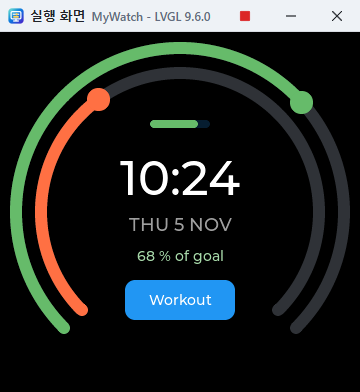

# My LVGL Studio 튜토리얼

둥근 LCD를 쓰는 스마트워치의 GUI를 처음부터 만듭니다. 활동 링과 시계가 있는 시계 화면, 심박수를 보여 주는 운동 화면, 그리고 둘 사이를 오가는 단추입니다. 약 20분 걸립니다.

앱 안에서 안내를 받으려면 **도움말 > 튜토리얼**을 고릅니다. 각 단계의 할 일을 하면 저절로 체크되고, 막히면 **대신 해 주기**를 누르면 됩니다. 아래는 같은 내용을 안내 없이 해 보는 순서입니다.

## 1. 둥근 화면 고르기

스마트워치 LCD는 지름 240~480 픽셀쯤의 원형이 많습니다. 화면을 원형으로 하면 모서리가 잘려 보이고, 원 밖으로 나가는 콘트롤은 **문제점** 탭에 경고가 나옵니다.

1. **파일 > 새 프로젝트**를 고르고 이름에 `MyWatch`를 넣습니다.
2. 화면 크기는 **360×360 원형**을 고르고 **만들기**를 누릅니다. 나중에는 툴바의 화면 크기 단추로 바꿀 수 있습니다.
3. 툴바의 **프로젝트 설정**에서 **어두운 LVGL 테마**를 켜고 창을 닫습니다.
4. 화면의 **속성**에서 **배경색**을 `#000000`으로, **이름**을 `Face`로 합니다.

OLED 시계는 켜진 픽셀만 전력을 쓰므로 검은 배경이 배터리에 유리합니다.

## 2. 두 개의 활동 링

**콘트롤**에서 **Arc**를 끌어다 놓거나 더블 클릭합니다. 두 번 놓고 다음과 같이 합니다.

| 속성 | 바깥 링 | 안쪽 링 |
|---|---|---|
| 너비, 높이 | 340 | 290 |
| 정렬 | CENTER | CENTER |
| X, Y | 0 | 0 |
| 값 | 68 | 45 |
| 표시부 색 | `#66bb6a` | `#ff7043` |

가운데로 정렬하면 X와 Y는 화면 가운데에서 떨어진 거리가 됩니다. 원형 화면은 이렇게 배치하는 것이 가장 편합니다.

## 3. 시각, 날짜, 목표

**Label**을 세 번 놓습니다. 모두 정렬은 CENTER, X는 0입니다.

| 속성 | 시각 | 날짜 | 목표 |
|---|---|---|---|
| 텍스트 | `10:24` | `THU 5 NOV` | `68 % of goal` |
| 글꼴 크기 | 48 | 18 | 그대로 |
| 글자색 | `#ffffff` | `#9e9e9e` | `#a5d6a7` |
| Y | -34 | 12 | 44 |

## 4. 배터리

**Bar**를 놓고 너비 `60`, 높이 `8`, 정렬 CENTER, X `0`, Y `-88`, 값 `80`, 표시부 색 `#66bb6a`로 합니다. 원형 화면은 위아래로 갈수록 폭이 좁으므로 가장자리 대신 링 안쪽에 둡니다.

## 5. 움직임 넣기

코드를 쓰지 않아도 콘트롤끼리 함께 움직이게 할 수 있습니다.

1. 바깥 링을 선택하고 속성의 **이벤트**에서 **이벤트 추가**를 누릅니다.
2. 동작을 **값을 글자로 표시**로, 대상을 목표 Label로, 글자를 `%d %% of goal`로 합니다. `%d`가 값이고 `%%`는 `%` 글자입니다.
3. 안쪽 링을 선택하고 **자동 왕복**을 `8000`으로 합니다. 값이 8초 동안 올라갔다가 8초 동안 내려옵니다. 실제 시계라면 센서 값이 이 자리를 대신합니다.

## 6. 운동 화면

시계는 화면이 작아서 기능마다 화면을 나눕니다.

1. 탭 줄 오른쪽의 **+** 단추로 화면을 추가하고, 이름을 `Workout`, 배경색을 `#000000`으로 합니다.
2. **Arc**를 놓고 너비와 높이 `320`, 정렬 CENTER, X와 Y `0`, 최솟값 `60`, 최댓값 `200`, 값 `120`, 표시부 색 `#ef5350`으로 합니다.
3. **Label**을 놓고 텍스트 `120`, 글꼴 크기 `48`, 글자색 `#ffffff`, 정렬 CENTER, X `0`, Y `-20`으로 합니다.
4. **Label**을 하나 더 놓고 텍스트 `BPM`, 글자색 `#ef9a9a`, 정렬 CENTER, X `0`, Y `28`로 합니다.
5. Arc에 이벤트를 추가해 **값을 글자로 표시**를 첫 번째 Label에 `%d`로 연결합니다.

## 7. 화면 사이를 오가는 단추

1. Workout 화면에 **Button**을 놓고 텍스트 `Back`, 너비 `110`, 높이 `44`, 정렬 CENTER, X `0`, Y `90`으로 합니다.
2. 이벤트를 추가해 시점을 **클릭**, 동작을 **화면 전환**, 대상을 `Face`로 합니다.
3. Face 탭으로 돌아와 **Button**을 놓고 텍스트 `Workout`, 너비 `110`, 높이 `40`, 정렬 CENTER, X `0`, Y `88`로 합니다.
4. 이벤트를 추가해 시점을 **클릭**, 동작을 **화면 전환**, 대상을 `Workout`으로 합니다.

## 8. 실행하기

**F5**를 누릅니다. 설계 화면은 편집 중이어서 움직이지 않으며, 실행해야 움직입니다.

- 바깥 링을 끌면 목표 글자가 바뀝니다.
- 안쪽 링은 저절로 움직입니다.
- **Workout**을 누르고 심박수 링을 끈 뒤 **Back**으로 돌아옵니다.

## 9. 코드와 그래픽

툴바의 코드 버튼을 누르면 설계 화면 옆에 코드가 열립니다. 위쪽 탭에서 Face 화면의 파일을 고릅니다.

- 코드에서 `10:24`를 `10:30`으로 고치면 설계 화면의 시각이 바뀝니다.
- Label을 끌어 옮기면 코드의 숫자가 바뀝니다.
- 잘못 쓰면 코드 창 아래에 줄 번호와 이유가 나오고, 고칠 때까지 화면은 그대로입니다.

## 10. 문제점 확인

**문제점** 탭에는 원 밖으로 나간 콘트롤, 겹치는 콘트롤, 글꼴에 없는 글자, 빌드 오류가 나옵니다. 시험 삼아 Button의 Y를 `170`으로 바꾸면 원 밖이라는 경고가 나타납니다. 확인한 뒤에는 되돌려 둡니다.

## 11. 한글 표시하기

내장 글꼴 Montserrat에는 한글이 없습니다. 날짜를 `11월 5일 목요일`처럼 쓰려면 다음과 같이 합니다.

1. **도구 > 글꼴**에서 **글꼴 파일 추가**를 눌러 한글이 있는 글꼴을 고릅니다. 예: Noto Sans CJK, 맑은 고딕.
2. 언어를 **한국어**로 합니다. Noto Sans CJK처럼 언어별 면이 있는 글꼴은 그 면을 씁니다.
3. **기본 글꼴**을 방금 추가한 글꼴로 합니다.

글꼴 파일은 시계의 저장 공간을 차지하므로, 실제 기기에서는 크기를 확인합니다.

## 12. 메모리에 맞추기

시계 칩은 메모리가 작습니다. **도구 > LVGL 설정**에서 `lv_conf.h`의 설정을 창으로 바꿉니다.

- `LV_MEM_SIZE`로 LVGL이 쓸 메모리를 정합니다.
- `LV_USE_`로 시작하는 항목으로 쓰지 않는 기능을 끕니다.

## 13. 시계에 올리기

1. **Ctrl+S**로 저장하면 프로젝트 폴더에 `.mylvgl` 파일과 C 코드가 만들어집니다.
2. **Shift+F5**는 LVGL을 내려받아 PC에서 네이티브 프로그램으로 빌드해 실행합니다.
3. `src/ui` 폴더와 `config/lv_conf.h`를 펌웨어에 복사합니다.
4. 디스플레이와 터치 드라이버를 초기화한 뒤 `ui_init()`을 부릅니다.

## 14. 더 해 보기

- **샘플 프로젝트:** 시작 화면이나 **파일 > 샘플 프로젝트**의 스마트워치, 운동 링, 나침반을 열어 실행해 보세요.
- **화면 늘리기:** 알림, 설정, 음악 화면을 추가하고 단추로 이어 보세요.

자세한 내용은 [사용 설명서](UsersGuide.md)에 있습니다.
