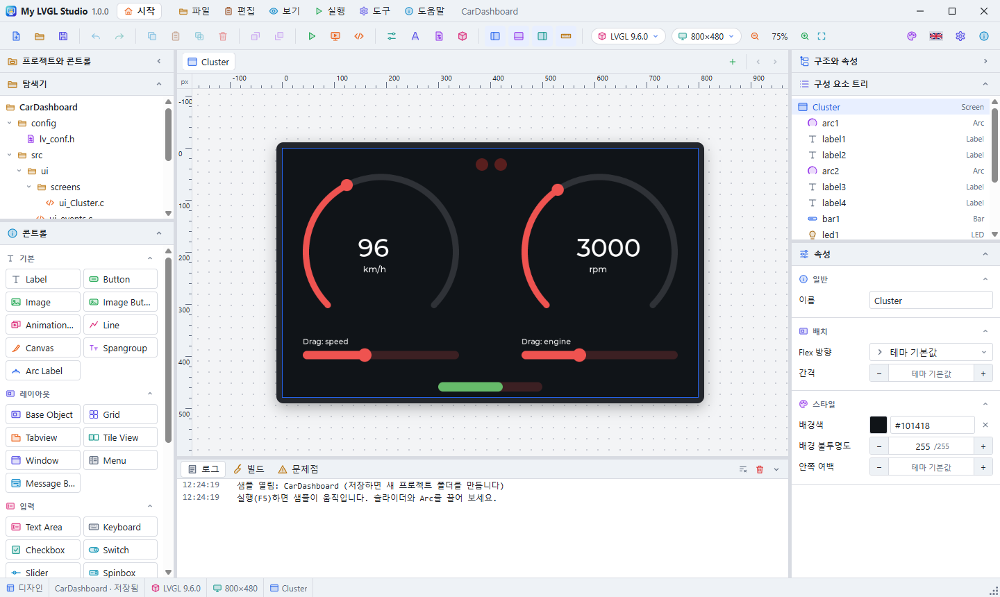
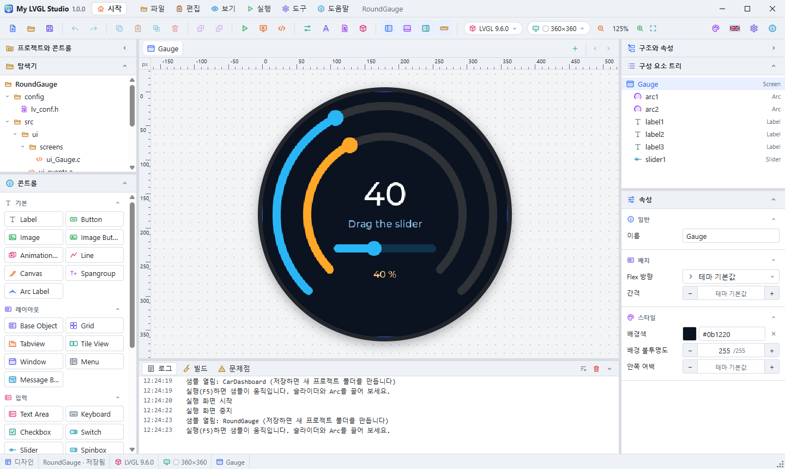
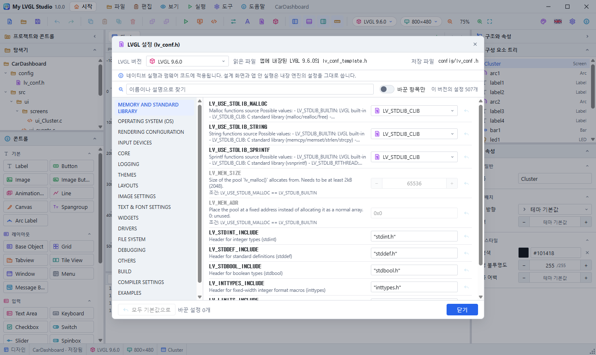
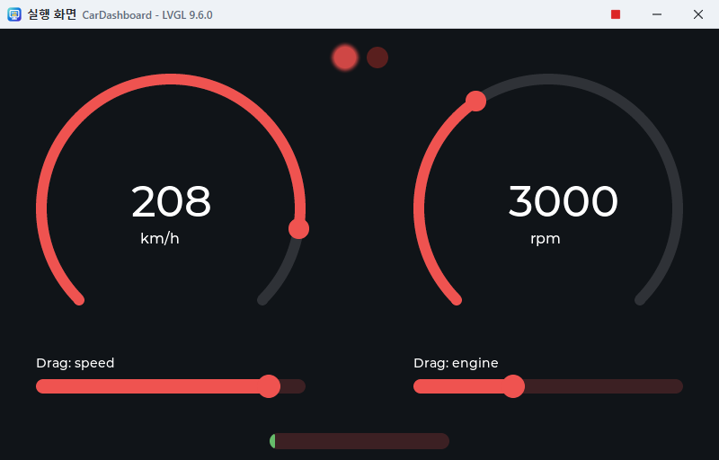

# My LVGL Studio User Guide

This tool lets you design LVGL screens graphically, run them, and get them as C code. Inside the app, press **F1** or choose **Help > User Guide** to read this document. If you are new, start with the [tutorial](Tutorial.en.md).



## Dialogs

Dialogs such as the settings, the user guide and the program information are all windows of their own. Drag the title bar to move one anywhere, also outside the program's window. While a dialog is open, the program's window takes no input. Close one with Esc or its close button.

The user guide window can stay open while you work. It does not block the program's window and has its own taskbar button. Minimize or close it with the buttons on its top bar, and drag the dots in its bottom-right corner to resize it.

If you exit or open another project with unsaved changes, a window lets you choose **Save**, **Don't Save** or **Cancel**. The same goes for closing with Alt+F4 or from the taskbar. A project that has never been saved asks for its folder first.

## Tutorial

When the app starts, a window asks whether you want to take the tutorial. Press **Start the Tutorial** and you build the GUI of a smart watch with a round LCD yourself. Each step lists what to do, and doing it ticks it off. If you get stuck, press **Do It for Me**. Drag the card by its title to move it, and press Esc to end it.

- Turn off **Ask about the tutorial at every start** in that window and it will not ask again.
- You can turn it back on with the same option under **Tools > Preferences > General**, and **Start the Tutorial** next to it starts the tutorial straight away.
- You can restart it at any time with the **Take the Tutorial** button on the start screen, or **Help > Tutorial**. If you have unsaved changes, it checks with you first.
- The question appears on the start screen only. It is not asked when you started by double-clicking a project file, when **Reopen the last project at startup** is on, or when the start screen is set not to show. Moving to another screen closes it.

## 1. Window Layout

| Location | Contents |
|---|---|
| Top | Menus (File, Edit, View, Run, Tools, Help) and the window buttons. Drag an empty area to move the window. |
| Top right | Press the flag button to change the language. Korean shows the British flag and English shows the Korean flag. The first start uses the language chosen in the installer. |
| Toolbar | Frequently used commands. Hover over an icon to see its name and shortcut. |
| Upper left | Explorer: the structure and files of the project folder |
| Lower left | Controls: the LVGL widgets you can add |
| Centre | Screen tabs, the design surface and the code view |
| Upper right | Component Tree: the widget hierarchy of the current screen |
| Lower right | Attributes: the settings of the selected widget |
| Bottom | Log and build output |
| Very bottom | Status bar. Use the grip at its right end to resize the window. |

The left and right panels run down to the status bar, and the log and build output sit below the design surface. Collapse and expand panels with the arrow in a panel's title or with the panel buttons on the toolbar. The left panel is titled **Project and Controls** and the right panel **Structure and Attributes**. The ruler button on the toolbar turns the pixel rulers on and off. Drag the border between panels to resize them. Right-click anywhere for a menu that suits that spot. You can also move the border between the Component Tree and Attributes, and its position is kept for the next run.

## 2. Start Screen

The start screen opens when the app starts. Use the house button at the left end of the toolbar or **View > Start Screen** to switch between it and the design surface.

| Card | Contents |
|---|---|
| Title | App information, New Project, Open |
| Menu | Tiles for frequently used actions |
| Recent projects | Click to open. The bin icon removes an item from the list, and **Clear All** empties the list. An item whose file has gone is dropped from the list when you try to open it. |
| Theme | Click a tile to apply it at once. Create your own theme in **Theme Settings**. |
| Background | 24 backgrounds, an automatic change every 20 seconds, speed, card opacity |

Drag the dotted handle at the top left of a card to move it, and drag its bottom right corner to resize it (double-click to fit its content). **Auto Arrange** at the top restores the default arrangement. The arrangement is kept for the next run.

## 3. Preferences and Themes

Under **Tools > Preferences** you can change the following.

- **General:** language, showing the start screen at startup, reopening the last project at startup, the default LVGL version, screen size and location for new projects, rulers, drag step (px), clearing recent projects
- **Theme:** 20 light themes, 20 dark themes, your own themes. The theme button at the right of the toolbar shows the colours and name of the theme now, and each press moves on to the next theme. The ▾ beside it opens your own themes with the **Custom theme settings** button at the top, and the dark and light themes below. The start screen has no theme card: themes are chosen here.
- **Start Screen:** the start screen's card options and backgrounds, restoring defaults

### Custom Themes

1. Press **New theme from the current one** to create a theme of your own that copies the current theme.
2. Change its name, its kind (light or dark) and its ten colours. Changed colours apply to the window at once.
3. If you no longer need it, remove it with **Delete Theme**. It asks for confirmation first.

You can create up to 24 themes of your own.

## 4. Starting a Project

To start from a sample, pick one on the **Sample Projects** card of the start screen or under **File > Sample Projects**. A sample opens as an unnamed copy, and saving it creates a new project folder. If the sample's LVGL version is not installed, the app asks whether to download it. The design surface and the run window do not need it, so you can download it later.

1. Under **File > New Project**, set the name, location, LVGL version and screen size, and the folder `location/name` is created. When you first open the app, an unnamed empty project is ready, and the first save asks for a name and location.
2. You can change the LVGL version, screen size and LVGL theme at any time under **Tools > Project Settings**.
3. **File > Save** (Ctrl+S) saves the project file and the C code together in the project folder.

Open a project with **File > Open**. In the installed version you can also double-click a `.mylvgl` file. A new project folder can only be created where no folder exists or in an empty folder, so existing files are never overwritten.

### Changing the LVGL Version

Press the **LVGL version** button on the toolbar to open the list of versions. When you pick one, the design surface's engine, the controls in the left panel and the generated code change to suit that version straight away. You can reverse this with Undo. A control that the version does not have stays in the document but is left out of the screen and the code, and the **Problems** tab opens to tell you.

### Project File Association

Installing the app registers the `.mylvgl` extension with the system. File Explorer shows the project file icon, double-clicking opens the file in this app, and uninstalling removes the registration. If you have personally set this extension to open with another program, Windows keeps that choice. In that case, change it with the file's **Open with**.

### Explorer

The **Explorer** at the top of the left **Project and Controls** panel shows the structure of the project folder created when you save. For a project not yet saved, it shows exactly the structure that saving will create.

Press a file to open it in the code view. Pressing a screen file also takes you to that screen. The project file (`.mylvgl`) opens read-only, images show as pictures, and fonts show their file information and list of faces. Press a folder to collapse it, and use the divider bar between the Explorer and Controls to resize them.

### Mouse Pointer

The pointer shape on the design surface shows what will happen if you press now.

| Location and situation | Shape |
|---|---|
| Empty screen | Default arrow |
| Over an unselected control | Finger (press to select) |
| Over a selected control, or while dragging to move | Move |
| Over a resize handle, or while resizing | Directional resize |
| An item in the control list | Grab |
| While dragging a control in | Copy over the screen, not allowed elsewhere |
| Over a divider bar, or while dragging it | Horizontal or vertical resize |
| Over the design surface with Ctrl held down | Zoom in |

While you drag, the shape stays the same even if the pointer passes over something else.

### Zooming In and Out

**Ctrl+mouse wheel** zooms the design surface in and out around the pointer position. **Ctrl++**, **Ctrl+-** and **Ctrl+0** (fit to the window) also work, and pressing the zoom value on the toolbar lets you choose from 25% to 800%.

### Round Screen



Turn on **Round Screen** with the screen size button on the toolbar or in the project settings. You can also pick a round size (240, 360, 466, 480). A round screen has equal width and height, the design surface and the run window show it as a circle, and the simulator window blacks out the area outside the circle. Controls that reach outside the circle are listed in the **Problems** tab.

### Value Links and Animation

When you link values between controls, they move together without any code.

- **Pass the value:** when the value of a slider, Arc, Bar, Spinbox, Drop-Down, Roller, switch or checkbox changes, it changes the value of the target control. Targets are slider, Bar, Arc, Spinbox, Meter, LED (brightness), Drop-Down, Roller and image (rotation), and the value is converted to fit each one's range.
- **Show the value as text:** writes the value as the text of a target such as a Label. The value goes where `%d` is in the format. Example: `%d km/h`.
- **Sweep by itself:** an attribute of slider, Bar, Arc and Meter. The value travels between the minimum and maximum over each given time (ms), and linked controls move with it. It moves only when running and stays still on the design surface.

### Collapsing Panels

- The Component Tree and Attributes each collapse with the button in their title line. When collapsed, the icon, the title and the expand button remain.
- The **>** button on the **Structure and Attributes** line at the top of the right panel collapses the whole panel. The toolbar button does this too.
- The attribute categories (General, Layout, Content, Style, Behaviour, Events) and the control categories (Common, Layout, Input, Display) also collapse and expand when you press their title line. The collapsed state is kept the next time you open the app.

### Fonts

Add font files (TTF, OTF, TTC, OTC) under **Tools > Fonts**. On saving, the files are copied to the project's `assets/fonts`, and the design surface, the run window and native runs all draw with the same files.

- **Language:** for a font with a face per language in one file, such as Noto Sans CJK, choose Korean, Japanese, Chinese Simplified or Chinese Traditional. The same Chinese character is then drawn in the shape right for that language. If the app is showing Korean, the Korean face is chosen at first.
- **Face:** you can also choose a face directly, whatever the language. **Characters in it** shows which languages' characters that face really contains.
- **Default font:** used for every control that has not been given its own font. A control given only a size also uses the default font at that size.
- **Per-control font:** choose it under **Font** in the Attributes panel. The built-in Montserrat has fixed sizes only, but an added font can be used at any size from 6 to 200 pixels.
- **Missing characters:** characters a font lacks do not show, and the **Problems** tab tells you which ones. LVGL symbols that are not in the font file, such as the keyboard symbols, are drawn with the built-in font.

At startup, the code reads the font files and draws them with LVGL's TinyTTF. Firmware without a file system must set `UI_FONT_DIR` or, in `src/ui/fonts/ui_fonts.c`, change `ui_font_read` to read from memory. CJK fonts are tens of MB and use RAM when drawing characters, so they may not suit devices with little memory.

### LVGL Settings (lv_conf.h)



**Tools > LVGL Settings** builds its window by reading the `lv_conf_template.h` of the project's LVGL version. The options differ by version (about 240 in 8.4, about 500 in 9.6), so the window changes when you change the version. **Read from** at the top of the window names the file actually read. If the version is installed, the installed file is read; if not, the file built into the app is read; if neither exists, the file of the nearest version is used and the window says so.

- Each option appears in the form that suits it: on/off, a list, a number, a colour or text input. The descriptions are that file's comments.
- An option inside `#if` can only be used when that condition is on, and the condition is shown with it.
- Only the values you changed are saved in the project, and they go into `config/lv_conf.h`. Editing `lv_conf.h` in the code view changes the same settings.
- Turning off a control or font used in the design makes the build impossible, so the **Problems** tab shows it as an error.
- **These apply to native runs and firmware code.** The design surface and in-app runs use a prebuilt built-in engine, so they do not follow these settings.
- The desktop simulator shows only colour depths 16, 24 and 32. Depths 1 and 8 can be used only on firmware.

### Project Settings

- **LVGL version:** choose the version the firmware uses. "Built-in engine" in the list means that version's render engine is included in the app.
- **Screen size:** pick from the list or type the width and height (32 to 4096). The screen size button on the toolbar does the same and can also swap width and height. When creating a new project, choose **Custom** to type the size yourself.
- **Dark LVGL theme, Primary colour, Secondary colour:** values passed to the LVGL default theme. They are separate from the app's own theme.

If you choose a version with no built-in engine, the design surface draws with the nearest engine, and the settings window and the status bar say so. Native runs and generated code use the chosen version as it is.

## 5. Designing Screens

### Adding Widgets

- Drag a widget from the palette onto the design surface. Drop it on a container and it becomes that container's child.
- Double-click a palette item to add it to the selected container or the current screen.

### Selecting, Moving and Resizing

- Click a widget to select it. You can also select it in the Component Tree.
- Drag to move it, and drag the handles on the selection border to resize it.
- Drag a widget onto another container and it moves into that container, keeping its position on the screen.
- The arrow keys move it by 1 pixel and Shift+arrow keys by 10 pixels.

### Attributes

Changing a value in the Attributes panel shows on the design surface at once. An item left empty uses the LVGL theme's default.

- **Width and Height:** `120` (pixels), `50%` (of the parent), `content` (fit the content)
- **Colour:** click the colour box or type `#rrggbb`.
- **Flex flow:** arranges children automatically across or down, on screens and containers. LVGL then decides the children's X and Y.
- **Name:** becomes the variable name in the generated code. For example, `button1` becomes `ui_button1`.

### Images

1. Drop **Image** from the palette and a hatched placeholder appears.
2. Use **Import Image** in the Attributes panel to choose a PNG, JPG, BMP, GIF, WebP or SVG file (up to 2048×2048). Pick an image you have already imported from the list.
3. Set **Rotation** (degrees) and **Scale** (%).

On saving, the originals go into `assets/images/` and the C arrays into `src/ui/images/`. The project's image list and deletion are in **Project Settings**. When you delete an image, widgets that used it become empty.

### Data Widgets

| Widget | How to enter data |
|---|---|
| List | One item per line. A line starting with `#` is a title. |
| Table | Lines are rows and commas separate columns. Example: `Name,Value` |
| Chart | One series per line, with commas between values. The type is line or bar. |
| Tabview | One tab per line |
| Button Matrix | Lines are rows and commas separate buttons. |
| Line | Points in the form `x,y x,y`, separated by spaces. |
| Keyboard | Choose a text input widget under **Input target**. |

### Grid

**Grid** in Controls is a layout that places children in rows and columns. Write columns and rows separated by commas. `80` means pixels, `1fr` a share of the remaining space, and `content` a size that fits the content. Widgets inside a Grid show Grid column, row and span settings, and if you leave them empty the widget goes into the next cell.

### Adding Screens

Add a screen with the **+** to the right of the screen tabs and delete one with the **×** on its tab. The last remaining screen cannot be deleted.

### Events

Select a widget, press **Add Event** in the Attributes panel, then choose when (Clicked, Pressed, Released, Value changed) and what to do.

| Action | Contents |
|---|---|
| Load screen | Shows the given screen |
| Set text | Changes the text of the given widget |
| Toggle visible, Show, Hide | Shows or hides the given widget |
| Write to log | Writes a message to the log panel (in native runs, through standard output to the log panel) |

### Screens Apart from Logic (MVVM, Data Binding)

This keeps the screens (GUI) and the logic completely apart, as MVVM does in WPF. The screens are bound only to the properties of **ViewModels**, and the logic only reads and writes those properties. The logic lives in `src/app/`. The app writes the files of that folder once, when they are missing, and never changes or deletes them afterwards. However much you change the screens and regenerate the code, the logic stays.

| Layer | Folder | Made by |
|---|---|---|
| Screens (View) | `src/ui/` | The app (overwritten on every save) |
| ViewModels | `src/glue/` | The app (overwritten on every save) |
| Binding library | `lib/mvvm/` | The app (the same code as the design engine) |
| Logic and Model | `src/app/` | You (the app writes it once, only when missing) |

1. In the Attributes panel, press the link button beside the property to bind (value, selection, checked, text, hidden, disabled). A property with the widget's current value and range appears in the screen's data context ViewModel (`Main` is made when there is none), and it is bound at once.
2. The bound property shows a binding editor instead. Choose the ViewModel property, the direction (ViewModel → screen, two-way, screen → ViewModel, once at the start), a converter (scale, invert true/false) and a text format (e.g. `%d rpm`). Widgets the user can change (sliders, arcs, switches, drop-downs, text areas and so on) bind two-way by default. The unbind button brings the plain input back.
3. In the **ViewModels** tab at the bottom, add ViewModels and properties, and change their names, types (integer, true/false, text), initial values and ranges. Renaming carries the bindings along. Each property lists the widgets bound to it; press one to select it.
4. Select a screen to choose its **Data context** in the Attributes panel: the ViewModel its bindings use by default.
5. While running (F5) the ViewModels tab shows the **Now** values. Change one and the bound widgets follow as if the logic had set it, so bindings can be tried without any logic.

The logic includes only the generated `glue.h`. `glue.h` does not include `lvgl.h`, so the logic also compiles, and can be unit-tested, on a PC without LVGL.

```c
#include "app.h"
#include "glue.h"

static void on_running(mv_prop_t * prop, void * user)
{
    vm_main_set_status(mv_get_bool(prop) ? "Running" : "Stopped");
}

void app_init(void)   /* called once, after ui_init() */
{
    vm_main_set_speed(1200);                              /* every bound widget follows */
    mv_observe(vm_main_prop_running(), on_running, NULL); /* called when the user changes it */
}
```

- For each property `speed` of the ViewModel `Main`, `vm_main_get_speed()`, `vm_main_set_speed()` and `vm_main_prop_speed()` are generated. Observers hear only of real changes.
- Periodic work uses `mv_timer_start(period_ms, function, NULL)`, again without `lvgl.h`.
- Every `.c` and `.cpp` file in `src/app/` is built (subfolders are not, so tests can live there). C++ works too.
- A native run builds with the `src/app/` of the saved project. The Run window (F5) uses the built-in engine, so your logic does not run there.
- Save As copies `src/app/` to the new folder. A sample's logic is copied when it is first saved.
- Rename or delete a ViewModel or a property, and the Problems tab at once lists, as errors, the places in the logic (`src/app/`) that still use the old name, before any build. For a rename it gives the new name too (the renames are kept in the project file, so it still knows after reopening). The app does not change the logic. The code button of an entry opens that line in the code editor. Edited in another editor, they are read again when you come back to the app.
- The `MotorControl` sample shows a Model (`motor.c`), logic (`app.c`) and a unit test without LVGL (`tests/test_motor.c`).

## Sample Projects

Open a copy from the start screen or from **File > Sample Projects**. All of them have something you can drag to move. The design surface stays still, so choose **Run (F5)** and try dragging.



| Sample | Contents |
|---|---|
| `HomeControl` | Smart Home Control: Arc, slider, switch, and screen change events |
| `LoginForm` | Login Form: Text Areas with a linked Keyboard |
| `DataDashboard` | Data Dashboard: Chart, Table, Bar, Arc (800×480) |
| `GridLayout` | Grid Layout: A calculator keypad made with Grid |
| `ImageGallery` | Image Gallery: Image, Image Button, Animation Image |
| `SettingsTabs` | Settings Screen: Tabview, List, Spinbox, Button Matrix |
| `ScrollMenu` | Vertical Scroll Menu: A menu that goes on below the display; drag to scroll |
| `MediaPlayer` | Music Player: Cover image, slider, and play button events |
| `WeatherStation` | Weather Station: Large fonts, line Chart, forecast Table |
| `CarDashboard` | Car Dashboard: Drag the sliders below: the gauges and numbers follow (800×480) |
| `FactoryPanel` | Factory Panel: Cards in a Grid, status bars, stop button |
| `CalendarPlanner` | Calendar Planner: Calendar with an agenda List |
| `SmartWatch` | Smart Watch: A watch face on a round display (240×240): drag the ring |
| `RoundGauge` | Round Gauge: A round display (360×360) with a ring moved by a slider |
| `Thermostat` | Thermostat: A round display (360×360): turn the ring, the number and the light follow |
| `FitnessRings` | Fitness Rings: A round display (466×466): drag each of the three rings |
| `CompassDial` | Compass: A round display (360×360): drag the ring, the needle's picture turns |
| `AudioMixer` | Audio Mixer: Six vertical faders: drag them, levels and numbers follow (800×480) |
| `BatteryMonitor` | Battery Monitor: Drag one slider: bar, arc, LED and number move together |
| `LightDimmer` | Light Dimmer: Sliders that set the brightness of LEDs |
| `WashingMachine` | Washing Machine: Roll the program, drag the time, the drum turns by itself |
| `Greenhouse` | Greenhouse: Arcs and sliders move together, switches light LEDs (800×480) |
| `LoadingGallery` | Animation Gallery: Arcs, bars and spinners that move by themselves (800×480) |
| `ElevatorPanel` | Elevator Panel: Drag the car between floors, call it with the Grid buttons |
| `AppWindows` | Windows and Menus: Window, Menu, Tile View, Message Box |
| `Typography` | Text and Drawing: Spangroup, Canvas, Line, font sizes |
| `ModernScale` | LVGL 9 Instruments: Scale, Barcode, QR Code, Arc Label |
| `LegacyMeter` | LVGL 8 Gauges: Meter, Color Wheel (LVGL 8.4) |
| `MotorControl` | Motor Control (MVVM): screens apart from logic, ViewModel bindings, logic and a unit test in `src/app` |

## 6. Running

### Run Window (F5)

The project runs in a separate run window. Mouse input reaches LVGL, so you can operate buttons and sliders. To end the run, press the red square in the run window, the red square on the toolbar, or F5 again. The run window shows the project as it was when you pressed Run, and you can keep editing on the design surface. PC keyboard input is not passed on yet.

### Native Run (Shift+F5)

This builds the generated C code and runs it in a separate window. It needs gcc, CMake, Ninja and SDL2. On Windows the app installs them automatically in a folder of its own when it starts (about a 290 MB download), in a progress window that lists what is being installed and what it is for, with the progress of each item, the download speed and the time left. You can keep using the app meanwhile. **Continue in the Background** closes the window, and the progress in the status bar opens it again. If the server stops answering, the window says so and tries again after 30 seconds. If you turn off **Install the compiler automatically when needed** in **Tools > Preferences > General**, they are installed at the first native run. Nothing else on the PC changes, including PATH, and uninstalling the app removes them. If the project's LVGL version is not installed, the app asks whether to download it.

The first build of each version compiles all of LVGL, so it takes time. Build results are kept, so after that only changed files are recompiled. Progress appears in the **Build** tab at the bottom. To end the run, press the stop button on the toolbar or close the run window.

## 7. LVGL Manager

Under **Tools > LVGL Manager** you can install and remove versions and check the status of the build tools.

- **Install:** downloads that version's source from GitHub into the data folder. A progress window shows how far it is, the download speed and the estimated time left; you can keep using the app or cancel. GitHub does not say the size in advance, so the size and time are estimates. It is marked as installed only if this finishes completely. All downloaded sources are removed when the app is uninstalled.
- **Remove:** deletes that version's source and build results.
- **Install Compiler:** becomes available when build tools are missing. It shows what will be installed first and installs once you confirm. Windows installs into a folder of the app's own (`%LOCALAPPDATA%\MyLVGLStudio\toolchain`). macOS uses Homebrew and Linux uses apt, which install on the system.
- If GitHub cannot be reached, only known versions are shown.

If something that was downloaded seems damaged, **Tools > Preferences > Downloads** has **Download Again** for each package (the compiler and build tools, SDL2) and each LVGL version. The new copy replaces the old one only once it is complete, so if this fails or is cancelled, what you have stays as it is. The build results concerned are removed, and the next native run compiles them again.

Designing screens and running inside the app do not need the source to be installed.

| OS | Data folder |
|---|---|
| Windows | `%APPDATA%\MyLVGLStudio` |
| macOS | `~/Library/Application Support/MyLVGLStudio` |
| Linux | `~/.config/MyLVGLStudio` |

## 8. Problems, Log and Build Results

The **Problems** tab lists conflicts and problems in the design and compiler messages from native builds. The number on the tab is the count of errors and warnings. The list is recalculated every time you edit.

| Type | Contents |
| --- | --- |
| Error | A control this LVGL version does not have, an image not in the project, an event with no target, compile errors |
| Warning | No image chosen, name clashes, Grid children sharing a cell, a cell outside the Grid, partly overlapping controls, controls outside the screen, invalid ranges and values, compile warnings |
| Info | A version with no built-in engine, LVGL not installed |

Press an item to select its control. The buttons in the **Go to** column on the right take you to the control or the code, and the code button opens the code view and shows that line. A compiler message goes to its file and line when it is in a project file. Positions decided by a layout (Flex, Grid) or by content size are known only to LVGL, so they are left out of the overlap and off-screen checks.


The button at the right of the bottom panel clears the contents of the current tab (log or build output). The bin button deletes the native build results of the project's LVGL version after asking for confirmation. The next native run compiles LVGL again, and the project and the LVGL source are not deleted.

## 9. Using the Code

The buttons at the upper right of the centre area switch between the **Design, Split, Code** views. In the Split view, drag the divider bar between the code and the graphics to resize them. The file tabs sit in one line above the code. When there are many tabs, roll the mouse wheel over them or use the **<** and **>** buttons on the right to move along.

The code and the graphics follow each other. Change the graphics and the code is regenerated; edit the code and the graphics change a moment later. Undo works across both.

| File | What you can edit |
|---|---|
| `src/ui/screens/ui_*.c` | Adding and deleting controls, and every attribute in the design, such as name, order, parent, position, size, colour, text and value |
| `src/main.c` | `#define WIDTH`, `#define HEIGHT` (screen size) |
| `src/ui/ui.c` | The colours and the dark theme value of `lv_theme_default_init` |
| `src/ui/ui_bindings.c` | The `mv_bind` lines: the bindings of widgets to ViewModels |
| `src/glue/vm_<name>.c` | The `mv_prop_init_*` lines: the name, type, initial value and range of each ViewModel property |
| Other files | Read only. They are generated automatically from the design. |

- Code that cannot be turned into the design (your own functions, `if` statements and so on) and syntax errors are shown below the code window with line numbers, and the graphics stay as they are until you fix them. Press such a line to go to it.
- The code is tidied into the design's format. Comments and line formatting disappear when you leave the input area, and `lv_obj_set_pos` becomes `lv_obj_set_x` and `lv_obj_set_y`.
- Change screen names and events in the Attributes panel, not in the code.
- Generated code edited in an editor outside the app is not read, and saving overwrites it. The logic (`src/app/`) can be edited in any editor.

Saving creates the following files in the project folder.

| Path | Purpose |
|---|---|
| `<name>.mylvgl` | The project file. It holds all of your editing. |
| `src/ui/` | The screens you designed. This is the folder to put into your firmware. |
| `src/ui/ui.h`, `ui.c` | Object declarations and `ui_init()` |
| `src/ui/ui_events.h`, `ui_events.c` | Event actions |
| `src/ui/screens/ui_<screen>.c` | One file per screen |
| `src/ui/images/ui_img_<image>.c` | One file per image |
| `src/ui/ui_bindings.c` | The bindings between widgets and ViewModel properties |
| `src/glue/` | The ViewModels: `glue.h`, and `vm_<name>.h`, `.c` for each ViewModel |
| `lib/mvvm/` | The binding library (`mvvm.h` works without LVGL) |
| `src/app/` | Your logic. Written once, when missing, and never overwritten. |
| `assets/images/` | The original imported images |
| `src/main.c`, `CMakeLists.txt`, `config/lv_conf.h` | Files for running on the desktop |

If you delete a screen, an image or a ViewModel and save, `src/ui/screens/`, `src/ui/images/` and `src/glue/` lose its files too. Keep the files you write yourself in `src/app/`, not in these folders.

The image C files of an LVGL v8 project hold data for both 32-bit and 16-bit colour depths (including `LV_COLOR_16_SWAP`). In v9 they are stored as ARGB8888 and LVGL converts them for display.

In your firmware, put the `src/ui/`, `src/glue/`, `lib/mvvm/` and `src/app/` folders into the project and add them to the include path. After initialising LVGL and the display, call `ui_init()` and then `app_init()` once.

```c
#include "ui.h"
#include "app.h"

lv_init();
/* Initialise the board's display and input drivers */
ui_init();
app_init();   /* the logic in src/app */
```

If you edit generated files other than the project file directly, saving again overwrites them. `ui.h` declares a `ui_<name>` variable for each widget, and you reach the widget through it.

In the firmware's `lv_conf.h`, the fonts (`LV_FONT_MONTSERRAT_*`) and widgets you use must be turned on. The generated `lv_conf.h` is for PC simulation, so do not use it as it is on a board with little memory.

### Code Editor (Ctrl+E)

Edit the logic and the generated code in a window of its own, and run it from there. Open it with the code editor button of the toolbar, **View > Code editor**, or Ctrl+E. It works alongside the main window and can be resized.

| Part | Contents |
|---|---|
| Title bar | **User guide** (F1, the code editor's own guide), **Settings**, **About** |
| Left, **Logic (src/app)** | Your logic files. New file (+), rename, delete (press twice). Subfolders work too (`tools/util.c`). |
| Left, **Generated code** | The files made from the design. Those with a lock are read only. |
| Centre | A CodeMirror editor: line numbers, C/C++ colours, matching brackets, code folding, several selections (Alt+drag). Each file has its own undo history, kept when you switch tabs. Typing completes ViewModel functions, library functions and C words (arrow keys, Enter, Esc, Ctrl+Space). A line with a problem is marked beside its number; point at it to read the problem. |
| Top, toolbar | New file, save, rename, delete / undo, redo / cut, copy, paste / find, replace, go to line / comment, indent, outdent / **Build** (Ctrl+B: saves and only builds), **Run** (F5: saves everything, even what was just typed, builds with gcc and runs it in a window of its own), **Stop** (Shift+F5), **Clean build** (deletes the native build of this LVGL version; the next run builds everything again, LVGL too). Editing buttons are off in a read-only file. |
| Right-click | Code: undo, redo, cut, copy, paste, delete, select all, comment, indent, outdent, find, replace, go to line, run, stop, and, on a `vm_` name, open that ViewModel's file. File list and tabs: open, rename, delete, new file, copy path. |
| Bottom, status line | Save state and logic folder, line and column, characters selected, font size (smaller, bigger) and word wrap. Font size and word wrap are remembered. |
| Bottom, **Build**, **Program output**, **Problems** | The build output, what the program prints with `printf`, and the problems of the code. An entry with a file and a line goes to that line. |

- **Saved automatically:** a logic file is saved to the logic folder as you type (0.4 s after). The logic folder is saved apart from the GUI: the logic is saved even when the GUI project is not. The status line shows when and where.
- **Logic folder:** for a saved project, `src/app/` of its folder. A project not saved yet (a sample too) keeps it in a folder of its own under `drafts` in the app's data folder, which goes to `src/app/` when the project is first saved. Draft folders never saved are cleared after a week.
- **Editing generated code:** the generated files that hold the design (screen files, `ui.c`, `main.c`, `lv_conf.h`, the bindings file `src/ui/ui_bindings.c` and the ViewModel files `src/glue/vm_<name>.c`) take edits into the design, so they survive the next generation. A project with a folder is saved automatically too. Undo in the main window takes the edits back.
- **Bindings file:** each `mv_bind` line is one binding. Add or delete lines, and change the direction (`MV_ONE_WAY` and so on), the converter (`MV_CONV_RANGE`, `MV_CONV_INVERT`) and the format.
- **ViewModel files:** each `mv_prop_init_int`, `_bool` or `_string` line is one property. Change its name, type, initial value and range, or add and delete lines. A name changed in its place keeps its bindings, and the logic is told the new name.
- **Read-only generated files:** the binding library (`lib/mvvm/`), `glue.h`, `glue.c`, the ViewModel headers, `ui.h`, the event files and `CMakeLists.txt` are made from other files, so they cannot be edited; the status line says where to change them.

## 10. Keyboard Shortcuts

| Key | Action |
|---|---|
| Ctrl+N, Ctrl+O | New Project, Open |
| Ctrl+S, Ctrl+Shift+S | Save, Save As |
| Ctrl+Z, Ctrl+Y | Undo, Redo |
| Ctrl+X, Ctrl+C, Ctrl+V, Ctrl+D | Cut, Copy, Paste, Duplicate |
| Del | Delete |
| Arrow keys, Shift+arrow keys | Move by 1 pixel, 10 pixels |
| F5, Shift+F5 | Run inside the app, native run |
| Ctrl+B | Build only (without running) |
| Ctrl+E | Code editor (in it: F5 run, Shift+F5 stop, Ctrl+S save, Ctrl+Z / Ctrl+Y undo / redo, Ctrl+F find, Ctrl+H replace, Ctrl+G go to line, Ctrl+/ comment, Ctrl+] / Ctrl+[ indent / outdent; Esc never closes the window) |

## 11. Troubleshooting

| Symptom | What to check |
|---|---|
| Korean text does not appear on the LVGL screen | The built-in fonts have no Korean characters. Add a font that has them in **Tools > Fonts** and make it the default font. |
| A "tools are missing" message | Check the build tool status at the bottom of the LVGL Manager and install the missing tools. |
| LVGL download fails | Check your internet connection. The error appears in the State column of that version. |
| Native build fails | Check the compiler messages in the **Build** tab at the bottom. |
