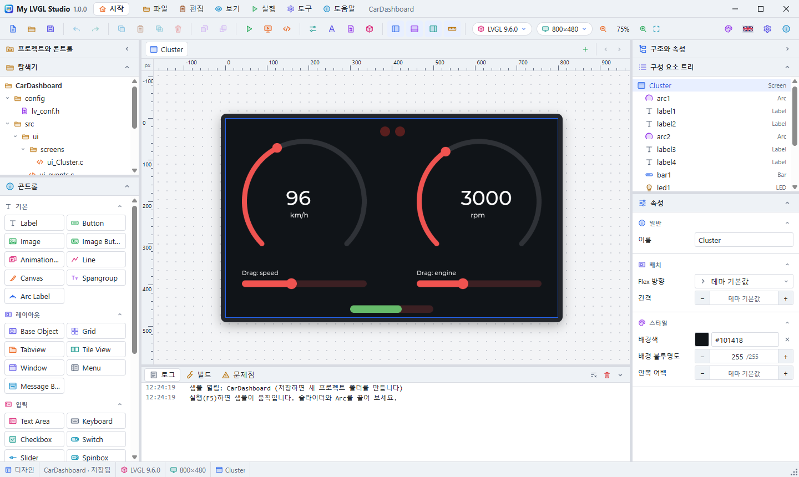
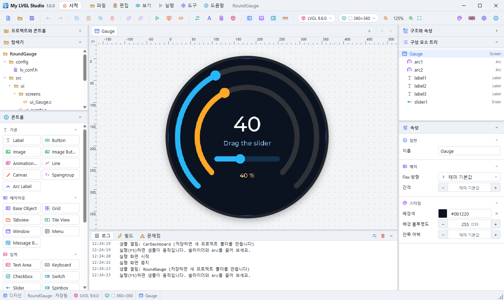
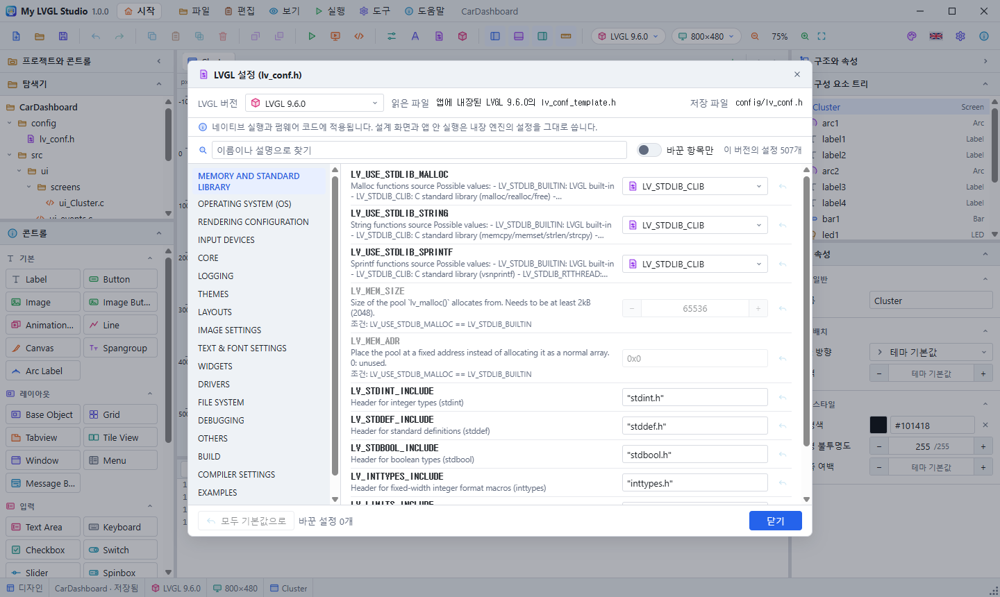
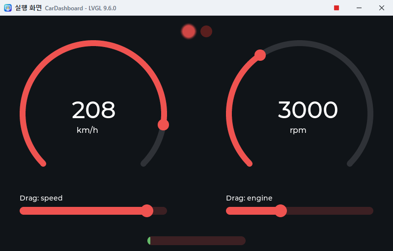

# My LVGL Studio 사용 설명서

LVGL 화면을 그래픽으로 설계하고, 실행하고, C 코드로 얻는 도구입니다. 앱 안에서는 **F1**이나 **도움말 > 사용 설명서**로 이 문서를 보며, 창 위쪽에서 글자 크기와 언어(한국어, English)를 바꿀 수 있습니다. 처음이라면 [튜토리얼](Tutorial.md)부터 따라 해 보세요.



## 대화상자

설정, 사용 설명서, 프로그램 정보 같은 대화상자는 모두 독립된 창입니다. 제목 줄을 끌어 어디로든 옮길 수 있고, 프로그램 창 밖에도 놓을 수 있습니다. 대화상자가 열려 있는 동안 프로그램 창은 입력을 받지 않습니다. Esc나 닫기 버튼으로 닫습니다.

사용 설명서 창은 작업하면서 함께 볼 수 있습니다. 프로그램 창을 막지 않고, 작업 표시줄에 따로 나타나며, 위쪽 막대의 단추로 최소화하거나 닫고, 오른쪽 아래의 점 표시를 끌어 크기를 바꿉니다.

저장하지 않은 변경 사항이 있을 때 프로그램을 끝내거나 다른 프로젝트를 열면 **저장**, **저장 안 함**, **취소** 중에서 고르는 창이 뜹니다. Alt+F4나 작업 표시줄로 닫을 때도 같습니다. 아직 저장한 적이 없는 프로젝트는 저장할 폴더를 먼저 묻습니다.

## 튜토리얼

앱을 시작하면 튜토리얼을 진행할지 묻는 창이 뜹니다. **튜토리얼 시작**을 누르면 둥근 LCD를 쓰는 스마트워치의 GUI를 직접 만듭니다. 각 단계에 할 일이 나오고, 그대로 하면 저절로 체크됩니다. 막히면 **대신 해 주기**를 누릅니다. 안내 카드는 제목을 끌어 옮길 수 있고, Esc로 끝냅니다.

- 그 창의 **시작할 때마다 튜토리얼 묻기**를 끄면 다음부터 묻지 않습니다.
- **도구 > 환경 설정 > 일반**의 같은 항목에서 다시 켤 수 있고, 옆의 **튜토리얼 시작**으로 바로 시작할 수 있습니다.
- 시작 화면의 **튜토리얼 보기** 버튼이나 **도움말 > 튜토리얼**로 언제든 다시 시작합니다. 저장하지 않은 변경이 있으면 먼저 확인합니다.
- 이 질문은 시작 화면에서만 나옵니다. 프로젝트 파일을 더블 클릭해 시작했거나, **시작할 때 마지막 프로젝트 열기**가 켜져 있거나, 시작 화면을 표시하지 않도록 설정했으면 묻지 않습니다. 다른 화면으로 넘어가면 창은 닫힙니다.

## 1. 화면 구성

| 위치 | 내용 |
|---|---|
| 맨 위 | 메뉴(파일, 편집, 보기, 실행, 도구, 도움말)와 창 버튼. 빈 곳을 끌면 창이 움직입니다. |
| 맨 위 오른쪽 | 국기 버튼을 누르면 언어가 바뀝니다. 한국어에서는 영국 국기, 영어에서는 태극기가 보입니다. 처음 실행할 때는 설치할 때 고른 언어로 시작합니다. |
| 도구 모음 | 자주 쓰는 명령. 아이콘에 마우스를 올리면 이름과 단축키가 나옵니다. |
| 왼쪽 위 | 탐색기: 프로젝트 폴더의 구조와 파일 |
| 왼쪽 아래 | 콘트롤: 추가할 수 있는 LVGL 위젯 |
| 가운데 | 화면 탭과 설계 화면, 코드 보기 |
| 오른쪽 위 | 구성 요소 트리: 현재 화면의 위젯 계층 |
| 오른쪽 아래 | 속성: 선택한 위젯의 설정 |
| 아래 | 로그와 빌드 출력 |
| 맨 아래 | 상태 표시줄. 오른쪽 끝 손잡이로 창 크기를 바꿉니다. |

왼쪽과 오른쪽 패널은 상태 표시줄까지 이어지고, 로그와 빌드 출력은 설계 화면 아래에 있습니다. 패널 제목의 화살표나 도구 모음의 패널 버튼으로 접고 펼칩니다. 왼쪽 패널의 제목은 **프로젝트와 콘트롤**, 오른쪽 패널의 제목은 **구조와 속성**입니다. 도구 모음의 눈금자 버튼은 픽셀 단위 눈금자를 켜고 끕니다. 패널 사이의 경계선을 끌면 패널 크기가 바뀝니다. 어디서든 오른쪽 버튼을 누르면 그 위치에 맞는 메뉴가 나옵니다. 구성 요소 트리와 속성 사이의 경계선도 옮길 수 있으며, 위치는 다음 실행에도 유지됩니다.

## 2. 시작 화면

앱을 시작하면 시작 화면이 열립니다. 도구 모음 왼쪽 끝의 집 모양 버튼이나 **보기 > 시작 화면**으로 설계 화면과 전환합니다.

| 카드 | 내용 |
|---|---|
| 제목 | 앱 정보, 새 프로젝트, 열기 |
| 메뉴 | 자주 쓰는 동작의 타일 |
| 최근 프로젝트 | 클릭해서 열기. 휴지통으로 목록에서 제거하고, **모두 지우기**로 비웁니다. 파일이 없어진 항목은 열려고 할 때 목록에서 빠집니다. |
| 테마 | 타일을 클릭하면 바로 적용됩니다. **테마 설정**에서 내 테마를 만듭니다. |
| 배경 | 24종의 배경, 20초마다 자동 변경, 속도, 카드 불투명도 |

카드 왼쪽 위의 점 모양 핸들을 끌면 카드가 옮겨지고, 오른쪽 아래 모서리를 끌면 크기가 바뀝니다(두 번 클릭하면 내용에 맞춤). 위쪽의 **자동 정렬**은 기본 배치로 되돌립니다. 배치는 다음 실행에도 유지됩니다.

## 3. 환경 설정과 테마

**도구 > 환경 설정**에서 다음을 바꿉니다.

- **일반:** 언어, 시작할 때 시작 화면 표시, 시작할 때 마지막 프로젝트 열기, 새 프로젝트의 기본 LVGL 버전과 화면 크기와 위치, 눈금자, 끌기 이동 간격(px), 최근 프로젝트 지우기
- **테마:** 라이트 20종, 다크 20종, 내 테마
- **시작 화면:** 시작 화면 카드의 옵션과 배경, 기본값으로 되돌리기

### 사용자 정의 테마

1. **현재 테마로 새 테마 만들기**를 누르면 지금 테마를 복사한 내 테마가 만들어집니다.
2. 이름, 종류(밝음 또는 어두움), 색 10가지를 바꿉니다. 바뀐 색은 창에 바로 적용됩니다.
3. 필요 없으면 **테마 삭제**로 지웁니다. 지우기 전에 확인을 묻습니다.

내 테마는 최대 24개까지 만들 수 있습니다.

## 4. 프로젝트 시작하기

샘플로 시작하려면 시작 화면의 **샘플 프로젝트** 카드나 **파일 > 샘플 프로젝트**에서 고릅니다. 샘플은 이름 없는 복사본으로 열리고, 저장하면 새 프로젝트 폴더를 만듭니다. 샘플의 LVGL 버전이 설치되어 있지 않으면 내려받을지 묻습니다. 설계와 실행 화면에는 필요 없으므로 나중에 받아도 됩니다.

1. **파일 > 새 프로젝트**에서 이름, 위치, LVGL 버전, 화면 크기를 정하면 `위치/이름` 폴더가 만들어집니다. 앱을 처음 열면 이름 없는 빈 프로젝트가 준비되어 있으며, 처음 저장할 때 이름과 위치를 묻습니다.
2. **도구 > 프로젝트 설정**에서 언제든 LVGL 버전, 화면 크기, LVGL 테마를 바꿀 수 있습니다.
3. **파일 > 저장**(Ctrl+S)은 프로젝트 파일과 C 코드를 프로젝트 폴더에 함께 저장합니다.

프로젝트는 **파일 > 열기**로 열며, 설치본에서는 `.mylvgl` 파일을 더블 클릭해도 열립니다. 새 프로젝트 폴더는 없는 폴더나 빈 폴더에만 만들 수 있어서 기존 파일을 덮어쓰지 않습니다.

### LVGL 버전 바꾸기

툴바의 **LVGL 버전** 버튼을 누르면 버전 목록이 열립니다. 고르면 설계 화면의 엔진, 왼쪽 패널의 콘트롤, 생성 코드가 곧바로 그 버전에 맞게 바뀝니다. 실행 취소로 되돌릴 수 있습니다. 그 버전에 없는 콘트롤은 문서에 남지만 화면과 코드에서 빠지고, **문제점** 탭이 열려 알려 줍니다.

### 프로젝트 파일 연결

설치하면 `.mylvgl` 확장자가 시스템에 등록됩니다. 탐색기에서 프로젝트 파일 아이콘으로 보이고, 더블 클릭하면 이 앱으로 열리며, 제거하면 등록도 지워집니다. 사용자가 이 확장자를 다른 프로그램으로 열도록 직접 지정해 두었다면 Windows는 그 선택을 유지합니다. 이때는 파일의 **연결 프로그램**에서 바꿉니다.

### 탐색기

왼쪽 **프로젝트와 콘트롤** 패널 위쪽의 **탐색기**는 저장했을 때 만들어지는 프로젝트 폴더의 구조를 보여 줍니다. 아직 저장하지 않은 프로젝트도 저장하면 생길 구조를 그대로 보여 줍니다.

파일을 누르면 코드 보기에서 열립니다. 화면 파일을 누르면 그 화면으로도 이동합니다. 프로젝트 파일(`.mylvgl`)은 읽기 전용으로, 이미지는 그림으로, 글꼴은 파일 정보와 면 목록으로 보여 줍니다. 폴더를 누르면 접히고, 탐색기와 콘트롤 사이의 구분 바로 크기를 바꿉니다.

### 마우스 포인터

설계 화면의 포인터 모양은 지금 누르면 어떤 일이 일어나는지를 보여 줍니다.

| 위치와 상황 | 모양 |
|---|---|
| 빈 화면 | 기본 화살표 |
| 선택되지 않은 콘트롤 위 | 손가락 (누르면 선택) |
| 선택된 콘트롤 위, 끌어서 옮기는 중 | 이동 |
| 크기 조절 점 위, 크기를 바꾸는 중 | 방향별 크기 조절 |
| 콘트롤 목록의 항목 | 잡기 |
| 콘트롤을 끌어 오는 중 | 화면 위에서는 복사, 그 밖에서는 놓을 수 없음 |
| 구분 바 위, 끄는 중 | 좌우 또는 상하 크기 조절 |
| Ctrl을 누른 채 설계 화면 위 | 확대 |

끄는 동안에는 포인터가 다른 곳을 지나가도 모양이 유지됩니다.

### 확대와 축소

설계 화면은 **Ctrl+마우스 휠**로 포인터 위치를 중심으로 확대·축소합니다. **Ctrl++**, **Ctrl+-**, **Ctrl+0**(창에 맞춤)도 쓸 수 있고, 툴바의 배율을 누르면 25%에서 800%까지 고를 수 있습니다.

### 원형 화면



툴바의 화면 크기 버튼이나 프로젝트 설정의 **원형 화면**을 켭니다. 원형 크기(240, 360, 466, 480)를 고를 수도 있습니다. 원형 화면은 너비와 높이가 같으며, 설계 화면과 실행 화면이 원으로 표시되고 시뮬레이터 창은 원 바깥을 검게 가립니다. 원 밖으로 나가는 콘트롤은 **문제점** 탭에 나옵니다.

### 값 연결과 애니메이션

콘트롤끼리 값을 연결하면 코드를 쓰지 않아도 함께 움직입니다.

- **값 전달:** 슬라이더, Arc, Bar, Spinbox, Drop-Down, Roller, 스위치, 체크박스의 값이 바뀌면 대상 콘트롤의 값을 바꿉니다. 대상은 슬라이더, Bar, Arc, Spinbox, Meter, LED(밝기), Drop-Down, Roller, 이미지(회전)이고, 서로의 범위에 맞춰 환산합니다.
- **값을 글자로 표시:** 값을 Label 같은 대상의 글자로 씁니다. 형식의 `%d` 자리에 값이 들어갑니다. 예: `%d km/h`.
- **자동 왕복:** 슬라이더, Bar, Arc, Meter의 속성입니다. 값이 주어진 시간(ms)마다 최솟값과 최댓값 사이를 오가고, 연결된 콘트롤도 함께 움직입니다. 실행할 때만 움직이며 설계 화면에서는 멈춰 있습니다.

### 패널 접기

- 구성 요소 트리와 속성은 제목 줄의 버튼으로 각각 접습니다. 접어도 아이콘과 제목, 펼치기 버튼은 남습니다.
- 오른쪽 패널 맨 위 **구조와 속성** 줄의 **>** 버튼은 패널 전체를 접습니다. 툴바의 버튼으로도 접을 수 있습니다.
- 속성의 분류(일반, 배치, 내용, 스타일, 동작, 이벤트)와 콘트롤의 분류(기본, 레이아웃, 입력, 표시)도 제목 줄을 눌러 접고 펼칩니다. 접은 상태는 다음에 앱을 열 때도 유지됩니다.

### 글꼴

**도구 > 글꼴**에서 글꼴 파일(TTF, OTF, TTC, OTC)을 추가합니다. 파일은 저장할 때 프로젝트의 `assets/fonts`에 복사되고, 설계 화면과 실행 화면, 네이티브 실행이 모두 같은 파일로 그립니다.

- **언어:** Noto Sans CJK처럼 한 파일에 언어별 면이 들어 있는 글꼴은 한국어, 일본어, 중국어 간체, 번체 중에서 고릅니다. 같은 한자라도 언어에 맞는 모양으로 그립니다. 앱이 한국어로 표시 중이면 처음에 한국어 면을 고릅니다.
- **글꼴 면:** 언어와 상관없이 면을 직접 고를 수도 있습니다. **들어 있는 글자**는 그 면에 실제로 어떤 언어의 글자가 있는지 보여 줍니다.
- **기본 글꼴:** 자기 글꼴을 지정하지 않은 모든 콘트롤에 쓰입니다. 크기만 지정한 콘트롤도 기본 글꼴을 그 크기로 씁니다.
- **콘트롤별 글꼴:** 속성 창의 **글꼴**에서 고릅니다. 내장 Montserrat는 정해진 크기만 있지만, 추가한 글꼴은 6~200 픽셀의 어떤 크기든 쓸 수 있습니다.
- **없는 글자:** 글꼴에 없는 글자는 표시되지 않으며 **문제점** 탭에 어떤 글자인지 나옵니다. 키보드의 기호처럼 글꼴 파일에 없는 LVGL 기호는 내장 글꼴로 그립니다.

코드는 프로그램이 시작할 때 글꼴 파일을 읽어 LVGL의 TinyTTF로 그립니다. 파일 시스템이 없는 펌웨어는 `UI_FONT_DIR`을 지정하거나 `src/ui/fonts/ui_fonts.c`의 `ui_font_read`를 메모리에서 읽도록 바꿔야 합니다. CJK 글꼴은 수십 MB이고 글자를 그릴 때 RAM을 쓰므로, 메모리가 작은 장치에는 맞지 않을 수 있습니다.

### LVGL 설정 (lv_conf.h)



**도구 > LVGL 설정**은 프로젝트의 LVGL 버전에 있는 `lv_conf_template.h`를 읽어 창을 만듭니다. 버전마다 항목이 다르므로(8.4는 약 240개, 9.6은 약 500개) 버전을 바꾸면 창도 바뀝니다. 창 위쪽의 **읽은 파일**이 실제로 읽은 파일입니다. 그 버전이 설치되어 있으면 설치된 파일을, 아니면 앱에 내장된 파일을 읽고, 둘 다 없으면 가장 가까운 버전의 파일을 쓰면서 그 사실을 표시합니다.

- 켜기/끄기, 목록, 숫자, 색, 글자 입력 중 알맞은 형태로 표시합니다. 설명은 그 파일의 주석입니다.
- `#if` 안의 항목은 그 조건을 켜야 쓸 수 있고, 조건이 함께 표시됩니다.
- 바꾼 값만 프로젝트에 저장되고 `config/lv_conf.h`에 들어갑니다. 코드 보기에서 `lv_conf.h`를 고쳐도 같은 설정이 바뀝니다.
- 설계에 쓰인 콘트롤이나 글꼴을 끄면 빌드할 수 없으므로 **문제점** 탭에 오류로 나옵니다.
- **네이티브 실행과 펌웨어 코드에 적용됩니다.** 설계 화면과 앱 안 실행은 미리 빌드된 내장 엔진이라 이 설정을 따르지 않습니다.
- 데스크톱 시뮬레이터는 색 깊이 16, 24, 32만 표시합니다. 1과 8은 펌웨어에서만 쓸 수 있습니다.

### 프로젝트 설정

- **LVGL 버전:** 펌웨어가 쓰는 버전을 고릅니다. 목록의 "내장 엔진" 표시는 그 버전의 렌더 엔진이 앱에 들어 있다는 뜻입니다.
- **화면 크기:** 목록에서 고르거나 너비와 높이를 직접 입력합니다(32~4096). 툴바의 화면 크기 버튼에서도 같은 일을 하며 가로·세로를 맞바꿀 수 있습니다. 새 프로젝트를 만들 때는 **사용자 지정**을 고르면 크기를 직접 입력할 수 있습니다.
- **어두운 LVGL 테마, 기본 색, 보조 색:** LVGL 기본 테마에 넘기는 값입니다. 앱 자체의 테마와는 별개입니다.

내장 엔진이 없는 버전을 고르면 설계 화면은 가장 가까운 엔진으로 그리고, 설정 창과 상태 표시줄에 그 사실을 표시합니다. 네이티브 실행과 생성 코드는 고른 버전을 그대로 사용합니다.

## 5. 화면 설계하기

### 위젯 추가

- 팔레트의 위젯을 설계 화면으로 끌어다 놓습니다. 컨테이너 위에 놓으면 그 컨테이너의 자식이 됩니다.
- 팔레트 항목을 두 번 클릭하면 선택한 컨테이너나 현재 화면에 추가됩니다.

### 선택, 이동, 크기 조절

- 위젯을 클릭하면 선택됩니다. 구성 요소 트리에서 선택해도 됩니다.
- 끌면 이동하고, 선택 테두리의 핸들을 끌면 크기가 바뀝니다.
- 위젯을 다른 컨테이너 위로 끌어 놓으면 그 컨테이너로 옮겨 가고, 화면상의 위치는 유지됩니다.
- 화살표 키는 1픽셀, Shift+화살표는 10픽셀씩 움직입니다.

### 속성

속성 패널의 값을 바꾸면 설계 화면에 바로 반영됩니다. 비워 둔 항목은 LVGL 테마의 기본값을 사용합니다.

- **너비와 높이:** `120`(픽셀), `50%`(부모 대비), `content`(내용에 맞춤)
- **색:** 색상 칸을 클릭하거나 `#rrggbb`를 입력합니다.
- **Flex 방향:** 화면과 컨테이너에서 자식을 가로나 세로로 자동 배치합니다. 이때 자식의 X, Y는 LVGL이 정합니다.
- **이름:** 생성 코드의 변수 이름이 됩니다. 예를 들어 `button1`은 `ui_button1`이 됩니다.

### 이미지

1. 팔레트의 **이미지**를 놓으면 빗금 친 자리 표시가 나타납니다.
2. 속성 패널의 **이미지 가져오기**로 PNG, JPG, BMP, GIF, WebP, SVG 파일을 고릅니다(최대 2048×2048). 이미 가져온 이미지는 목록에서 고릅니다.
3. **회전**(도)과 **배율**(%)을 정합니다.

저장하면 원본은 `assets/images/`에, C 배열은 `src/ui/images/`에 들어갑니다. 프로젝트의 이미지 목록과 삭제는 **프로젝트 설정**에 있습니다. 이미지를 삭제하면 그 이미지를 쓰던 위젯은 비어 있는 상태가 됩니다.

### 데이터 위젯

| 위젯 | 입력 방법 |
|---|---|
| 리스트 | 줄마다 항목 하나. `#`으로 시작하면 제목입니다. |
| 표 | 줄이 행, 쉼표가 열입니다. 예: `이름,값` |
| 차트 | 줄마다 계열 하나, 쉼표로 값을 나눕니다. 종류는 선 또는 막대입니다. |
| 탭 뷰 | 줄마다 탭 하나 |
| 버튼 매트릭스 | 줄이 행, 쉼표가 버튼입니다. |
| 선 | 좌표를 `x,y x,y` 형식으로 공백으로 나눕니다. |
| 키보드 | **입력 대상**에서 텍스트 입력 위젯을 고릅니다. |

### Grid

콘트롤의 **Grid**는 자식을 행과 열에 배치하는 레이아웃입니다. 열과 행은 쉼표로 나누어 적습니다. `80`은 픽셀, `1fr`은 남은 공간의 비율, `content`는 내용에 맞춘 크기입니다. Grid 안의 위젯에는 Grid 열, 행, 병합 설정이 나타나며, 비워 두면 다음 칸에 들어갑니다.

### 화면 추가

화면 탭 오른쪽의 **+** 로 화면을 추가하고 탭의 **×** 로 삭제합니다. 마지막 남은 화면은 삭제할 수 없습니다.

### 이벤트

위젯을 선택하고 속성 패널의 **이벤트 추가**를 누른 뒤, 언제(클릭, 누름, 뗌, 값 변경) 무엇을 할지 고릅니다.

| 동작 | 내용 |
|---|---|
| 화면 전환 | 지정한 화면을 표시 |
| 텍스트 변경 | 지정한 위젯의 텍스트를 변경 |
| 표시 전환, 표시, 숨기기 | 지정한 위젯을 보이거나 숨김 |
| 로그 출력 | 로그 패널(네이티브 실행은 표준 출력을 거쳐 로그 패널)에 문구 출력 |

## 샘플 프로젝트

시작 화면이나 **파일 > 샘플 프로젝트**에서 복사본으로 엽니다. 모두 끌어서 움직이는 조작이 있습니다. 설계 화면은 멈춰 있으니 **실행(F5)** 해서 끌어 보세요.



| 샘플 | 내용 |
|---|---|
| `HomeControl` | 스마트 홈 제어: Arc, 슬라이더, 스위치와 화면 전환 이벤트 |
| `LoginForm` | 로그인 입력: Text Area와 연결된 Keyboard |
| `DataDashboard` | 데이터 대시보드: Chart, Table, Bar, Arc (800×480) |
| `GridLayout` | Grid 레이아웃: Grid로 만든 계산기 자판 |
| `ImageGallery` | 이미지 갤러리: Image, Image Button, Animation Image |
| `SettingsTabs` | 설정 화면: Tabview, List, Spinbox, Button Matrix |
| `ScrollMenu` | 수직 스크롤 메뉴: 화면 아래로 이어지는 메뉴를 끌어서 스크롤 |
| `MediaPlayer` | 음악 플레이어: 표지 이미지, 슬라이더, 재생 버튼 이벤트 |
| `WeatherStation` | 날씨 스테이션: 큰 글꼴, 선 Chart, 예보 Table |
| `CarDashboard` | 자동차 계기판: 아래 슬라이더를 끌면 속도계와 숫자가 함께 움직임 (800×480) |
| `FactoryPanel` | 공장 제어 패널: Grid 안의 카드, 상태 Bar, 정지 버튼 |
| `CalendarPlanner` | 일정 플래너: Calendar와 일정 List |
| `SmartWatch` | 스마트워치: 원형 화면(240×240)의 시계, 링을 끌면 숫자가 바뀜 |
| `RoundGauge` | 원형 계기판: 원형 화면(360×360), 슬라이더로 움직이는 링 |
| `Thermostat` | 온도 조절기: 원형 화면(360×360), 링을 돌리면 온도와 표시등이 바뀜 |
| `FitnessRings` | 운동 링: 원형 화면(466×466), 세 링을 각각 끌기 |
| `CompassDial` | 나침반: 원형 화면(360×360), 링을 끌면 바늘 그림이 회전 |
| `AudioMixer` | 오디오 믹서: 세로 페이더 6개, 끌면 레벨과 숫자가 움직임 (800×480) |
| `BatteryMonitor` | 배터리 모니터: 하나를 끌면 Bar, Arc, LED, 숫자가 함께 움직임 |
| `LightDimmer` | 조명 조절: 슬라이더로 LED 밝기 조절 |
| `WashingMachine` | 세탁기: Roller로 코스 선택, 시간 끌기, 저절로 도는 드럼 |
| `Greenhouse` | 온실 제어: Arc와 슬라이더 연동, 스위치로 LED 켜기 (800×480) |
| `LoadingGallery` | 애니메이션 모음: 저절로 움직이는 Arc, Bar, Spinner (800×480) |
| `ElevatorPanel` | 엘리베이터 패널: 세로 슬라이더로 층 이동, Grid 버튼으로 호출 |
| `AppWindows` | 창과 메뉴: Window, Menu, Tile View, Message Box |
| `Typography` | 글자와 그림: Spangroup, Canvas, Line, 글꼴 크기 |
| `ModernScale` | LVGL 9 계기판: Scale, Barcode, QR Code, Arc Label |
| `LegacyMeter` | LVGL 8 계기판: Meter, Color Wheel (LVGL 8.4) |

## 6. 실행하기

### 실행 화면 (F5)

분리된 실행 창에서 프로젝트가 동작합니다. 마우스 입력이 LVGL로 전달되어 버튼과 슬라이더를 조작할 수 있습니다. 실행 창의 빨간 사각형, 도구 모음의 빨간 사각형, 또는 다시 F5를 누르면 끝납니다. 실행 창은 실행을 누른 시점의 프로젝트를 보여 주며, 설계 화면은 계속 편집할 수 있습니다. PC 키보드 입력은 아직 전달되지 않습니다.

### 네이티브 실행 (Shift+F5)

생성한 C 코드를 빌드해 별도 창에서 실행합니다. gcc, CMake, Ninja, SDL2가 필요합니다. Windows에서는 앱을 실행하면 이 도구들을 앱 전용 폴더에 자동으로 설치하며(약 290MB 다운로드), 진행 창에 설치할 항목과 용도, 항목별 진행률, 다운로드 속도, 남은 시간이 나옵니다. 설치하는 동안에도 앱을 그대로 쓸 수 있습니다. **백그라운드에서 계속**을 누르면 진행 창이 닫히고, 상태 표시줄의 진행률을 누르면 다시 열립니다. 서버가 응답하지 않으면 그렇게 표시하고 30초 뒤 다시 시도합니다. **도구 > 환경 설정 > 일반**의 **필요한 컴파일러 자동 설치**를 끄면 처음 네이티브 실행할 때 설치합니다. PC의 다른 프로그램이나 PATH는 바뀌지 않고, 앱을 제거하면 함께 지워집니다. 프로젝트의 LVGL 버전이 설치되어 있지 않으면 내려받을지 묻습니다.

버전별 첫 빌드는 LVGL 전체를 컴파일하므로 시간이 걸립니다. 빌드 결과는 보관되므로 다음부터는 바뀐 파일만 다시 컴파일합니다. 진행 내용은 아래쪽 **빌드** 탭에 나옵니다. 실행을 끝내려면 도구 모음의 중지 버튼을 누르거나 실행 창을 닫습니다.

## 7. LVGL 관리자

**도구 > LVGL 관리자**에서 설치, 삭제, 빌드 도구 상태를 확인합니다.

- **설치:** GitHub에서 해당 버전의 소스를 내려받아 데이터 폴더에 넣습니다. 끝까지 완료된 경우에만 설치됨으로 표시됩니다.
- **삭제:** 그 버전의 소스와 빌드 결과를 지웁니다.
- **컴파일러 설치:** 빌드 도구가 부족하면 활성화됩니다. 설치할 내용을 먼저 보여 주고, 확인하면 설치합니다. Windows는 앱 전용 폴더(`%LOCALAPPDATA%\MyLVGLStudio\toolchain`)에 설치합니다. macOS는 Homebrew, Linux는 apt로 시스템에 설치합니다.
- GitHub에 연결할 수 없으면 알려진 버전만 표시합니다.

화면 설계와 앱 안에서 실행에는 소스 설치가 필요 없습니다.

| OS | 데이터 폴더 |
|---|---|
| Windows | `%APPDATA%\MyLVGLStudio` |
| macOS | `~/Library/Application Support/MyLVGLStudio` |
| Linux | `~/.config/MyLVGLStudio` |

## 8. 문제점, 로그와 빌드 결과

**문제점** 탭은 설계의 충돌과 문제, 네이티브 빌드의 컴파일러 메시지를 목록으로 보여 줍니다. 탭의 숫자는 오류와 경고의 개수입니다. 목록은 편집할 때마다 다시 계산합니다.

| 종류 | 내용 |
| --- | --- |
| 오류 | 이 LVGL 버전에 없는 콘트롤, 프로젝트에 없는 이미지, 대상이 없는 이벤트, 컴파일 오류 |
| 경고 | 지정하지 않은 이미지, 이름 충돌, 같은 셀을 차지한 Grid 자식, Grid 밖의 셀, 일부가 겹치는 콘트롤, 화면 밖으로 나간 콘트롤, 잘못된 범위와 값, 컴파일 경고 |
| 정보 | 내장 엔진이 없는 버전, 설치되지 않은 LVGL |

항목을 누르면 해당 콘트롤을 선택합니다. 오른쪽 **이동** 칸의 버튼으로 콘트롤이나 코드로 갈 수 있고, 코드 버튼은 코드 보기를 열어 그 줄을 표시합니다. 컴파일러 메시지는 프로젝트 파일에 있을 때 그 파일과 줄로 이동합니다. 레이아웃(Flex, Grid)이나 내용 크기로 정해지는 위치는 LVGL만 알 수 있으므로 겹침과 화면 밖 검사에서 제외합니다.


아래쪽 패널 오른쪽의 버튼으로 현재 탭의 내용(로그 또는 빌드 출력)을 지웁니다. 휴지통 버튼은 프로젝트 LVGL 버전의 네이티브 빌드 결과를 확인 후 삭제합니다. 다음 네이티브 실행 때 LVGL을 다시 컴파일하며, 프로젝트와 LVGL 소스는 지워지지 않습니다.

## 9. 코드 사용하기

가운데 위쪽 오른편의 버튼으로 **디자인, 분할, 코드** 보기를 전환합니다. 분할 보기에서는 코드와 그래픽 사이의 구분 바를 끌어 크기를 바꿉니다. 파일 탭은 코드 위쪽에 한 줄로 있습니다. 탭이 많으면 탭 위에서 마우스 휠을 굴리거나 오른쪽의 **<**, **>** 버튼으로 이동합니다.

코드와 그래픽은 서로를 따라갑니다. 그래픽을 바꾸면 코드가 다시 만들어지고, 코드를 고치면 잠시 뒤 그래픽이 바뀝니다. 실행 취소도 함께 동작합니다.

| 파일 | 고칠 수 있는 내용 |
|---|---|
| `src/ui/screens/ui_*.c` | 콘트롤의 추가·삭제·이름·순서·부모·위치·크기·색·글자·값 등 설계에 있는 모든 속성 |
| `src/main.c` | `#define WIDTH`, `#define HEIGHT` (화면 크기) |
| `src/ui/ui.c` | `lv_theme_default_init`의 색과 어두운 테마 값 |
| 그 밖의 파일 | 읽기 전용. 설계에서 자동으로 만들어집니다. |

- 설계로 옮길 수 없는 코드(직접 만든 함수, `if` 문 등)나 문법 오류는 코드 창 아래에 줄 번호와 함께 표시되고, 고칠 때까지 그래픽은 그대로입니다. 그 줄을 누르면 해당 줄로 이동합니다.
- 코드는 설계 형식으로 정리됩니다. 주석과 줄 형식은 입력란을 벗어나면 사라지고, `lv_obj_set_pos`는 `lv_obj_set_x`와 `lv_obj_set_y`로 바뀝니다.
- 화면 이름과 이벤트는 코드가 아니라 속성 창에서 바꿉니다.
- 앱 밖의 편집기에서 고친 코드는 읽지 않으며, 저장하면 덮어씁니다.

저장하면 프로젝트 폴더에 다음 파일이 만들어집니다.

| 경로 | 용도 |
|---|---|
| `<이름>.mylvgl` | 프로젝트 파일. 편집 내용 전체가 들어 있습니다. |
| `src/ui/` | 설계한 화면. 펌웨어에 넣는 폴더입니다. |
| `src/ui/ui.h`, `ui.c` | 객체 선언과 `ui_init()` |
| `src/ui/ui_events.h`, `ui_events.c` | 이벤트 동작 |
| `src/ui/screens/ui_<화면>.c` | 화면마다 한 파일 |
| `src/ui/images/ui_img_<이미지>.c` | 이미지마다 한 파일 |
| `assets/images/` | 가져온 이미지 원본 |
| `src/main.c`, `CMakeLists.txt`, `config/lv_conf.h` | 데스크톱에서 실행하기 위한 파일 |

화면이나 이미지를 삭제하고 저장하면 `src/ui/screens/`와 `src/ui/images/`에서 해당 `.c` 파일도 지워집니다. 직접 작성한 파일을 이 두 폴더에 두지 마세요.

LVGL v8 프로젝트의 이미지 C 파일은 32비트와 16비트 색 깊이(`LV_COLOR_16_SWAP` 포함)의 데이터를 함께 담습니다. v9는 ARGB8888로 저장하고 LVGL이 표시할 때 변환합니다.

펌웨어에서는 `src/ui/` 폴더를 프로젝트에 넣고, 이 폴더를 include 경로에 추가합니다. LVGL과 디스플레이를 초기화한 뒤 `ui_init()`을 한 번 호출합니다.

```c
#include "ui.h"

lv_init();
/* 보드의 디스플레이와 입력 장치 드라이버 초기화 */
ui_init();
```

프로젝트 파일을 뺀 생성 파일을 직접 고치면 다시 저장할 때 덮어쓰입니다. 위젯은 `ui.h`에 선언된 `ui_<이름>` 변수로 접근합니다.

펌웨어의 `lv_conf.h`에서는 사용한 글꼴(`LV_FONT_MONTSERRAT_*`)과 위젯을 켜 두어야 합니다. 생성된 `lv_conf.h`는 PC 시뮬레이션용이므로 메모리가 작은 보드에는 그대로 쓰지 마세요.

## 10. 단축키

| 키 | 동작 |
|---|---|
| Ctrl+N, Ctrl+O | 새 프로젝트, 열기 |
| Ctrl+S, Ctrl+Shift+S | 저장, 다른 이름으로 저장 |
| Ctrl+Z, Ctrl+Y | 실행 취소, 다시 실행 |
| Ctrl+X, Ctrl+C, Ctrl+V, Ctrl+D | 잘라내기, 복사, 붙여넣기, 복제 |
| Del | 삭제 |
| 화살표, Shift+화살표 | 1픽셀, 10픽셀 이동 |
| F5, Shift+F5 | 앱 안에서 실행, 네이티브 실행 |

## 11. 문제 해결

| 증상 | 확인할 내용 |
|---|---|
| 한글이 LVGL 화면에 보이지 않음 | 내장 글꼴에 한글이 없습니다. **도구 > 글꼴**에서 한글이 있는 글꼴을 추가하고 기본 글꼴로 지정합니다. |
| "도구가 없습니다" 메시지 | LVGL 관리자 아래쪽의 빌드 도구 상태를 확인하고, 없는 도구를 설치합니다. |
| LVGL 다운로드 실패 | 인터넷 연결을 확인합니다. 오류 내용은 해당 버전의 상태 칸에 표시됩니다. |
| 네이티브 빌드 실패 | 아래쪽 **빌드** 탭의 컴파일러 메시지를 확인합니다. |
