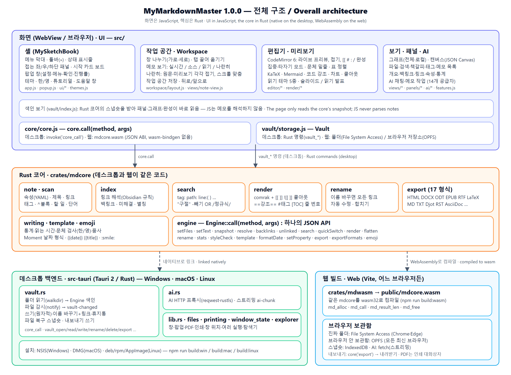

# MyMarkdownMaster 구조 (Architecture)

개발자를 위한 문서입니다. 무엇이 어디에 있고, 데이터가 어떻게 흐르는지 설명합니다. 사용법은 [doc/UsersGuide.md](doc/UsersGuide.md)를 보세요.

원본 그림: [doc/images/architecture.svg](doc/images/architecture.svg) (PNG는 `sharp`로 다시 만듭니다: `node -e "require('sharp')('doc/images/architecture.svg',{density:144}).png().toFile('doc/images/architecture.png')"`).

## 1. 한눈에

MyMarkdownMaster은 Obsidian식 Markdown 지식 보관함입니다. **화면은 JavaScript(Vite, 프레임워크 없음), 핵심은 Rust**입니다.

| 층 | 위치 | 하는 일 |
| --- | --- | --- |
| 셸 | `src/app.js`, `src/popup.js`, `src/ui/*`, `src/themes.js`, `src/styles.css`, `src/shell.css`, `src/app.css` | MySketchBook의 창 구성: 메뉴 막대(제목 표시줄 겸용), 접히는 툴바, 접히는 좌·우·아래 패널, 상태 표시줄, 카드 보드 시작 화면, OS 창 팝업, 테마, 한/영, 튜토리얼 |
| 작업 공간 | `src/workspace/layout.js`, `src/views/note-view.js` | 창 나누기 트리와 탭, 메모 보기 4가지(실시간·소스·읽기·나란히), 나란히 보기의 양쪽 접기와 스크롤 맞춤 |
| 편집기 | `src/editor/*` | CodeMirror 6: 라이브 프리뷰, 접기, `[[` `#` `:` `/` 완성, 집중·타자기 모드, 문체 밑줄, 표 정렬, HTML 붙여넣기 → Markdown |
| 미리보기 | `src/render/*` | Rust가 만든 HTML을 정리(DOMPurify)하고 KaTeX, Mermaid, highlight.js, 차트, 콜아웃 접기, 링크 미리보기, 읽기 테마, 슬라이드·읽기 발표 |
| 보기·패널 | `src/views/graph*.js`, `src/views/canvas*.js`, `src/panels/panels.js` | 그래프(Barnes-Hut 힘 배치), 캔버스(JSON Canvas 1.0), 파일·검색·책갈피·태그·메모 목록·개요·백링크·속성·통계 |
| 기능 | `src/features.js` | 새 메모·폴더·캔버스, 이름 바꾸기·옮기기·삭제·복제, 일일·고유 메모, 템플릿, 메모 합치기·나누기, 책갈피, 작업 공간, 첨부, 녹음, 파일 복구 |
| AI | `src/ai/*`, `src-tauri/src/ai.rs` | 공급자 14종(OpenAI·Anthropic·Gemini·Azure·Mistral·Groq·DeepSeek·xAI·OpenRouter·Perplexity·Together·Ollama·LM Studio·사용자 지정), 스트리밍, 채팅 패널, 메모 작업 20가지 |
| 다리 | `src/core/core.js`, `src/vault/storage.js`, `src/vault/index.js` | 코어 호출(데스크톱 `invoke` / 웹 WebAssembly), 보관함 파일 작업, 코어 스냅숏의 읽기 전용 보기 |
| **Rust 코어** | `crates/mdcore` | 메모 해석, 색인과 링크 해석, 검색, 렌더링, 이름 바꾸기와 링크 수정, 템플릿과 날짜, 글쓰기 통계·문체 검사, 17가지 내보내기 |
| 웹용 Rust | `crates/mdwasm` → `public/mdcore.wasm` | 같은 mdcore를 wasm32로. wasm-bindgen 없이 JSON ABI 4개 함수 |
| **데스크톱 백엔드** | `src-tauri` | Tauri 2. 보관함(스캔·감시·파일 작업·스냅숏·내보내기 쓰기), AI 프록시, 창·팝업·인쇄·PDF·창 위치·여러 실행 |

## 2. Rust 코어 — `crates/mdcore`

모든 플랫폼이 같은 코드로 메모를 이해합니다. 외부에는 `engine::Engine::call(method, args)` 하나의 JSON API만 보입니다.

| 모듈 | 내용 |
| --- | --- |
| `scan.rs` | 줄 분류(속성 영역, 코드, 수식, `%% %%` 주석), 인라인 코드·주석 지우기(열 위치 유지) |
| `note.rs` | `parse_note`: 속성(YAML → JSON), 제목, `[[ ]]`·`` 링크와 임베드, `#태그`(중첩), 별칭, `^블록`, 할 일, 절, 단어 수(한글 어절·CJK). 속성 쓰기 `set_property`, `subpath_range`(#제목, #^블록) |
| `index.rs` | `VaultIndex`: 파일·폴더·메모. 링크 해석(상대 경로 → 정확한 경로 → 원본 폴더 기준 → 경로 끝 → 이름(가장 가까운 폴더, 짧은 경로) → 별칭), 백링크, 연결되지 않은 언급, 태그, 속성 종류, 스냅숏 |
| `search.rs` | 검색 언어: 낱말·"구절"·OR·-빼기·( )·/정규식/, `file:` `path:` `content:` `tag:` `line:()` `block:()` `section:()` `task:` `task-todo:` `task-done:` `match-case:` `ignore-case:` `[속성]` `[속성:값]`. 빠른 전환용 퍼지 점수 |
| `render.rs` | comrak(CommonMark+GFM, 각주, 수식, 알림) 위에 Obsidian 문법: 위키 링크(해석·미해결 표시), 임베드(메모·절·블록 재귀 3단계, 그림 `\|폭`, 소리, 영상, PDF, 캔버스), 콜아웃(접기 `+`/`-`), `==강조==`, `#태그`, `^블록` 앵커, `%%주석%%` 제거, `[TOC]`, `:이모지:`. 블록마다 `data-line`(원본 줄)을 달아 나란히 보기 스크롤을 맞춥니다 |
| `rename.rs` | `plan_rename`: 파일·폴더 이름 바꾸기·옮기기 시 모든 링크를 원래 형식(위키/Markdown, 부분 경로, 별칭, 임베드)대로 고치고, 옮겨진 메모 안의 상대 링크도 고침. 메모 합치기의 링크 돌려놓기에도 씀 |
| `template.rs` | Moment.js 날짜 형식(YYYY, MMMM, Do, dddd, ww …, 한국어 요일·오전/오후), `{{title}}` `{{date}}` `{{time}}` `{{date:형식}}` `{{yesterday}}` `{{tomorrow}}` |
| `writing.rs` | 통계(단어·글자·문장·문단·읽는/말하는 시간), 문체 검사(군더더기·겹친 표현·상투어·흐리는 말·수동태·긴 문장·반복·겹친 공백, 한/영), 품사 강조(부사·접속사) |
| `export/*` | 17가지: HTML(스타일·그림 data URI)·HTML 무서식·Markdown·텍스트·DOCX·ODT·EPUB 3·RTF·LaTeX·Djot·reStructuredText·AsciiDoc·MediaWiki·Textile·OPML·Org·JSON. `ir.rs`가 comrak AST를 공통 트리로 바꾸고 각 형식이 씁니다. 목차·제목 번호·각주·표 정렬·알림·그림 크기 |
| `engine.rs` | JSON 디스패치, `flatten`(내보내기용: 임베드 풀기, 위키 링크 → Markdown 링크, 콜아웃 → GitHub 알림, 주석 제거), 웹용 `export`(그림 base64 입력, 결과 base64) |
| `base64.rs`, `emoji.rs`, `options.rs` | base64, `:코드:` 이모지 표, comrak 공통 옵션 |

시간·시간대가 없는 WebAssembly를 위해 "지금"은 항상 화면이 넘깁니다(`now`, `offset`).

## 3. 데스크톱 — `src-tauri`

- `vault.rs` — 열린 보관함은 하나(`VaultState`). `vault_open`이 walkdir로 훑어 모든 메모를 Engine에 읽고, `notify` 감시자가 다른 프로그램의 변경을 250 ms 묶어 Engine에 반영한 뒤 `vault-changed` 이벤트를 보냅니다. 파일 쓰기는 임시 파일 + 이름 바꾸기(원자적). `vault_rename`은 디스크에서 옮긴 뒤 `plan_rename`의 수정본을 씁니다. 삭제는 시스템 휴지통(`trash`) · 보관함 `.trash` · 영구 삭제. 파일 복구 스냅숏은 앱 데이터 폴더(`recovery/<보관함 해시>/<경로>/<시각>.md`). `vault_export`는 Engine으로 flatten하고 보관함에서 그림을 읽어 `mdcore::export`로 파일을 씁니다. 예제 보관함은 `samples/`에 새로 만듭니다. 테스트는 `MYMARKDOWN_DATA_DIR`로 이 폴더들을 다른 곳으로 돌립니다.
- `explorer.rs` — 왼쪽 패널 탐색기: `explorer_places`(홈·바탕 화면·문서·다운로드·사진, Windows 드라이브 / macOS·Linux `/`와 볼륨), `explorer_list`(한 폴더의 항목: 폴더 먼저, 이름순, 숨김 파일 선택). 이름·크기·시각만 읽고 내용은 읽지 않습니다. 즐겨찾기는 설정(`favorites`)에 저장됩니다.
- `ai.rs` — `ai_request`: reqwest(rustls)로 요청하고 응답을 UTF-8 경계를 지켜 `ai-chunk` 이벤트로 흘려보냄, `ai_cancel`로 중단. 브라우저 CORS 제한이 없습니다.
- `lib.rs` — 창(프레임 없는 주 창, 팝업 OS 창, 문서 창, PDF/인쇄용 렌더 창), 앱 정보, 글꼴, 클립보드, 배경 그림, 창 끌기, 종료. `files.rs` · `printing.rs`(WebView2 PDF·직접 인쇄, Windows) · `window_state.rs`(창 위치, 설치 직후 초기화·언어) · `instance.rs`(여러 실행).
- 팝업은 모두 독립 창입니다: 설정·정보·내보내기·인쇄뿐 아니라 메뉴와 드롭다운(테마 ▾, AI ▾), 명령 팔레트·빠른 전환·고르기 목록(`suggest`), 이름 묻기(`prompt`)도 `POPUP_KINDS`의 OS 창(`popup-<종류>`)으로 뜹니다. 웹에서는 같은 페이지가 떠 있는 iframe 창으로 열립니다(`src/platform/popups.js`의 PopupHost). 목록 항목은 주 창이 Rust 코어에 물어 `suggest-items` 메시지로 보냅니다(`src/ui/palette.js`).
- 인쇄: 인쇄 창(`popup-print`, `src/print/printwin.js`)이 프린터 목록(`list_printers`)·용지·방향·여백·범위를 고르고 paged.js로 쪽을 나눈 미리보기를 보여 줍니다. **인쇄** 단추는 주 창의 `runPrint`가 숨은 렌더 창에서 WebView2 `PrintAsync`로 고른 프린터에 바로 보냅니다(시스템 대화상자 없음, Windows). 파일 프린터(PDF·XPS)는 PDF로 저장, 그 밖의 OS는 시스템 대화상자.
- 다른 보관함을 열 때는 화면이 먼저 열린 메모를 저장하고(`beforeSwitch`), 새 보관함이 백엔드를 차지한 뒤에는 옛 보관함의 닫기가 백엔드를 건드리지 않습니다.

## 4. 웹

- `npm run build:web`은 먼저 `scripts/build-wasm.mjs`로 `crates/mdwasm`을 `wasm32-unknown-unknown`으로 빌드해 `public/mdcore.wasm`(약 2.4 MB)을 만듭니다(Rust 소스가 바뀌지 않았으면 건너뜀).
- `core/core.js`가 wasm을 불러 `md_alloc` → 요청 JSON 복사 → `md_call` → `md_result_len` → 결과 읽기 → `md_free`.
- 보관함: 실제 폴더(File System Access, Chromium) 또는 브라우저 저장소(OPFS, 모든 최신 브라우저). 열 때 모든 메모를 읽어 wasm Engine에 넣습니다. 이름 바꾸기는 Engine의 계획대로 파일을 옮기고 링크를 고칩니다. 스냅숏은 IndexedDB.
- 내보내기: `core('export')`의 base64를 내려받기로, PDF·인쇄는 숨은 iframe의 인쇄 대화상자.

## 5. 화면 쪽 데이터 흐름

1. 보관함을 열면 Engine 스냅숏(`{ files, folders, notes: { path: meta } }`)을 받아 `VaultIndex`(src/vault/index.js)에 넣습니다. 패널·그래프·편집기 완성은 이것을 바로 읽습니다. **JS는 메모를 해석하지 않습니다**.
2. 메모를 열면 텍스트는 `docs`(경로 → `{ text, saved, dirty }`)에 하나만 있고 그 메모를 보여 주는 모든 탭이 나눠 씁니다.
3. 입력하면 400 ms 뒤 `core('setText')` → 스냅숏 갱신(백링크·태그·개요가 저장 전에도 따라옴), `autosaveDelay`(기본 1.2초) 뒤 파일 쓰기, 1분마다 파일 복구 스냅숏.
4. 읽기·나란히 보기는 `core('render')`의 HTML을 `render/preview.js`가 꾸밉니다. 데스크톱은 그림 주소를 asset 프로토콜 접두어로, 웹은 Blob URL로 채웁니다.
5. 이름 바꾸기·옮기기는 `vault.rename` → Rust가 링크를 고친 파일 목록을 돌려주고 열린 문서·탭·설정(책갈피, 고정, 목표)이 새 경로를 따라갑니다.

## 6. 설정과 저장 위치

- 설정: `localStorage['mymarkdown.settings.v1']`(`src/domain/settings.js`), 팝업 창과 공유하며 `storage` 이벤트로 따라감. AI 키도 여기(이 컴퓨터에만).
- 보관함별 상태: `mymarkdown.vaultPrefs.v1` — 펼친 폴더, 정렬, 책갈피, 작업 공간, 마지막 배치, 고정, 목표, 그래프 옵션, 최근 파일.
- 최근 보관함: `mymarkdown.recentVaults.v1`. AI 대화 기록: `mymarkdown.aiHistory.<보관함>`.

## 7. 테스트 — `npm test`

| 범주 | 내용 |
| --- | --- |
| unit | `test/unit/*.test.js` (90개): `helpers/core.mjs`가 **실제 Rust 코어(wasm)** 를 Node에서 불러 씀 — 예제 보관함 6종×2개 언어의 링크·속성·렌더, 색인 보기, API(검색·렌더·이름 바꾸기·내보내기·날짜); 그래프·캔버스·편집기·미리보기·AI·레이아웃 순수 모듈; 아이콘 |
| i18n | `scripts/i18n-check.mjs`: 쓰는 키가 한/영 모두 있는지, 두 사전의 키가 같은지 |
| rust | `cargo test` — `crates/mdcore`(39개: 해석·색인·검색·렌더·이름 바꾸기·템플릿·글쓰기·엔진·17 형식 내보내기) + `src-tauri --lib`(26개: 보관함·AI 프록시·파일·창) |
| web | 헤드리스 Edge + 자체 Vite: 시작 화면, 보관함, 네 보기와 접기, 수식·다이어그램·차트·임베드, 링크 열기·만들기, 입력 → 백링크·자동 저장, 이름 바꾸기 링크 수정, 창 나누기·탭 옮기기, 검색 연산자, 빠른 전환·팔레트, 그래프·패널, 템플릿·문체 검사, 캔버스, 17 형식 내보내기, AI 패널, 설정 탭 + **모든 명령 한 번씩** |
| tutorial | 튜토리얼 모든 단계 |
| desktop | `--desktop`: 디버그 exe + WebView2 CDP, 격리된 데이터 폴더로 같은 사례를 실제 데스크톱 앱(디스크 보관함, 네이티브 Rust)에서 |

## 8. 빌드

| 명령 | 결과 |
| --- | --- |
| `npm start` | 데스크톱 개발 실행(Vite + tauri dev) |
| `npm run dev` | 웹 개발 서버 |
| `npm run build:wasm` | `public/mdcore.wasm` |
| `npm run build:web` | `dist/` (wasm 포함) |
| `npm run build:win` / `build:mac` / `build:linux` | 설치 프로그램(NSIS / DMG / deb·rpm·AppImage) |
| `npm run build:docs` | `doc/`와 `public/doc/`의 사용 설명서·튜토리얼 HTML |

## 9. 새 기능을 더할 때

- **명령**: `src/app.js`의 `commands`에 `{ icon, label, key, enabled, checked, run }`, 메뉴(`MENUS`/`SUBMENUS`)·툴바(`TOOLBAR`), 단축키(`SHORTCUTS`, popup.js `SHORTCUT_LIST`, 사용 설명서 표), 텍스트는 `src/i18n/app-texts.js`, 아이콘은 `src/icons-app.js`. 웹 E2E의 "모든 명령" 사례가 자동으로 실행해 봅니다.
- **메모를 이해하는 일**(새 문법, 검색 연산자, 내보내기 형식)은 `crates/mdcore`에 넣고 `engine.rs`에 메서드를 열어 줍니다 — 데스크톱과 웹이 함께 얻습니다. `cargo test`와 `npm run build:wasm`.
- **파일을 만지는 일**은 `src-tauri/src/vault.rs`(데스크톱)와 `src/vault/storage.js`(웹) 양쪽에.
