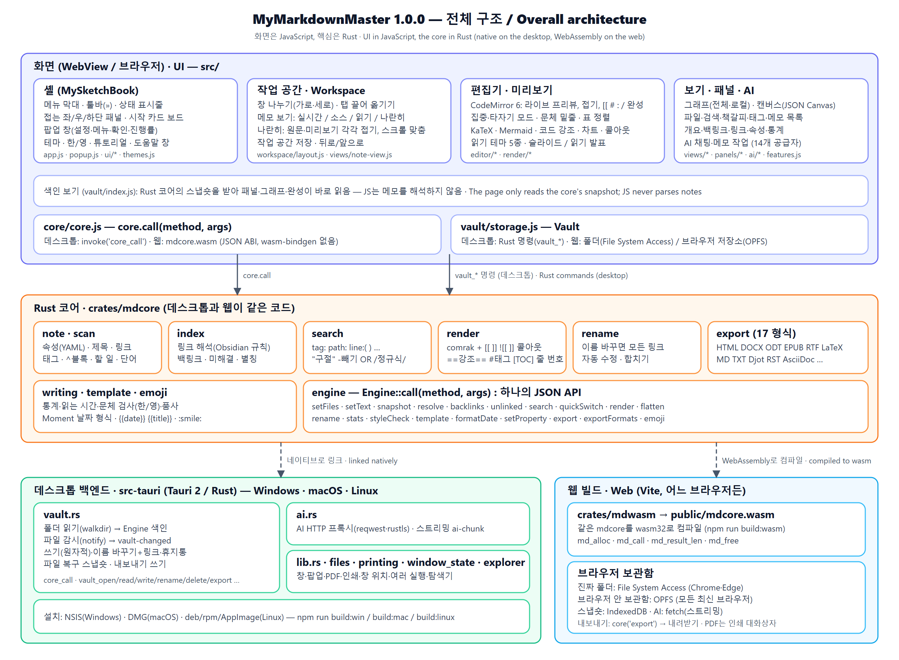

# MyMarkdownMaster 1.0.0

Obsidian식 Markdown 지식 보관함 — Windows · macOS · Linux 데스크톱 앱(Tauri 2)과 웹 앱.
화면 구성은 MySketchBook과 같고(메뉴 막대·툴바·접히는 패널·카드 보드 시작 화면·팝업 창), 핵심은 Rust입니다.

An Obsidian-style Markdown knowledge base for Windows, macOS, Linux (Tauri 2) and the web, in MySketchBook's window layout, with a Rust core.


## 기능 / Features

- **보관함(vault)**: 폴더 하나 = 보관함. Obsidian 보관함도 그대로 열림. 웹은 실제 폴더(Chrome·Edge) 또는 브라우저 보관함.
- **링크**: `[[링크]]`·`[[메모#제목]]`·`[[메모#^블록]]`·별칭, `![[임베드]]`, 백링크와 연결되지 않은 언급, 이름 바꾸면 모든 링크 자동 수정.
- **보기**: 실시간(라이브 프리뷰) · 소스 · 읽기 · **나란히(원문+미리보기, 양쪽 접기·펼치기, 스크롤 맞춤)**, 창 나누기·탭 끌기·작업 공간.
- **Markdown**: 콜아웃, 속성(YAML), 태그, 각주, 수식(KaTeX), Mermaid, 차트, 코드 강조, `==강조==`, `%%주석%%`, `[TOC]`, 이모지, 할 일.
- **찾기**: 검색 연산자(tag: path: line:() task-todo: [속성:값] /정규식/ …), 빠른 전환, 명령 팔레트, 그래프·로컬 그래프, 개요, 태그 트리, 메모 목록(Bear식).
- **메모 기능**: 일일 메모, 템플릿, 고유 번호 메모, 캔버스(JSON Canvas), 책갈피, 고정·보관, 메모 합치기·나누기, 녹음, 파일 복구.
- **글쓰기**(iA Writer · Typora · Ulysses · Bear · MarkText): 집중 모드, 타자기 스크롤, 문체 검사(한/영), 품사 강조, 글쓰기 목표, 통계·읽는 시간, 슬라이드·읽기 발표, 읽기 테마 5종, 표 정렬, `/` 빠른 넣기, 그림 붙여넣기.
- **AI**: OpenAI · Anthropic Claude · Google Gemini · Azure OpenAI · Mistral · Groq · DeepSeek · xAI · OpenRouter · Perplexity · Together · Ollama · LM Studio · 사용자 지정 — 채팅 패널과 메모 작업 20가지(요약·다듬기·번역·태그 …).
- **내보내기 17+1 형식**(Markdific 참고): PDF · HTML · Word · ODT · EPUB · RTF · LaTeX · Markdown · 텍스트 · Djot · reStructuredText · AsciiDoc · MediaWiki · Textile · OPML · Org · JSON, 다시 내보내기, Markdown으로 복사, 인쇄.

## 구조 / Architecture



자세한 내용: [ARCHITECTURE.md](ARCHITECTURE.md) · 사용법: [doc/UsersGuide.md](doc/UsersGuide.md) ([English](doc/UsersGuide.en.md))

## 개발 / Development

```bash
npm install
npm start               # 데스크톱 개발 실행 (Vite + tauri dev)
npm run dev             # 웹 개발 서버
npm test                # unit · i18n · rust · web · tutorial  (--desktop 으로 데스크톱 E2E 추가)
npm run build:web       # dist/ (Rust 코어를 WebAssembly로 포함)
npm run build:win       # Windows 설치 프로그램 (build:mac, build:linux, build:all)
npm run build:docs      # 사용 설명서·튜토리얼 HTML
npm run clean           # git 이 보관하지 않는 것을 모두 삭제: 빌드 결과(crates/*/target 포함)·설치 파일·생성 파일·시험 결과·캐시 (--dry-run 으로 목록만)
npm run clean:all       # 위 + node_modules 삭제 (node_modules에서 실행 중인 Vite·esbuild·tauri dev 는 먼저 종료). 다시 npm install
```

git 에는 소스만 올라갑니다. `public/mdcore.wasm`(Rust 코어의 WebAssembly)과 `public/doc/`(설명서 HTML)은 만들어지는 파일이라 git 에 없고, `npm start` · `npm run dev` · `npm test` · `npm run build:*` 가 `scripts/prepare.mjs` 로 먼저 만듭니다. `clean` 뒤에는 git 이 보관하지 않는데 남은 것을 목록으로 보여 줍니다(지우지는 않음).

필요: Node 22+, Rust(stable) + `rustup target add wasm32-unknown-unknown`, 각 OS의 Tauri 2 준비물.

© SHKWON (`knix008@naver.com`)
