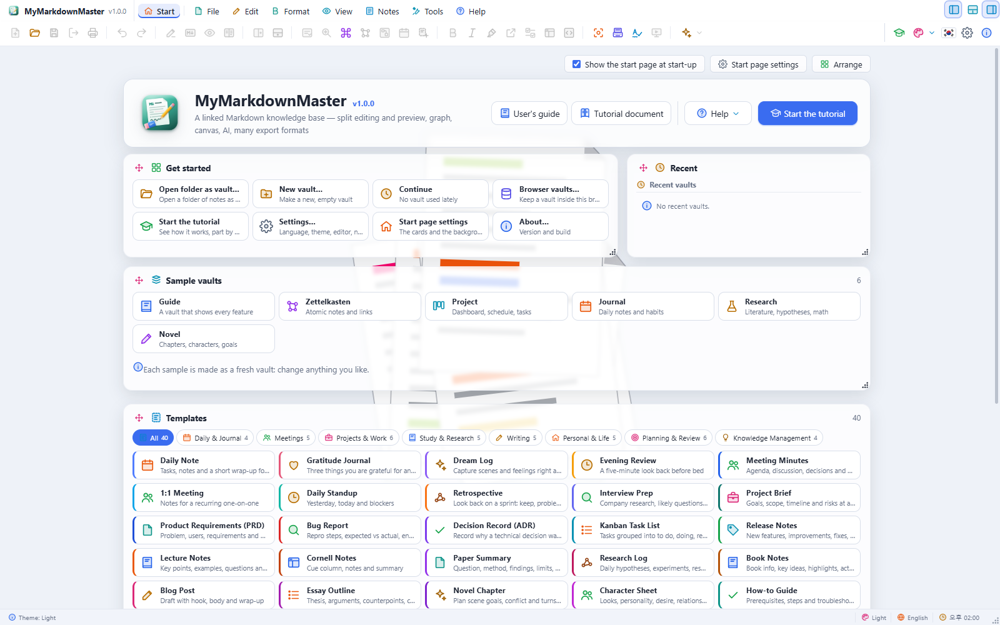
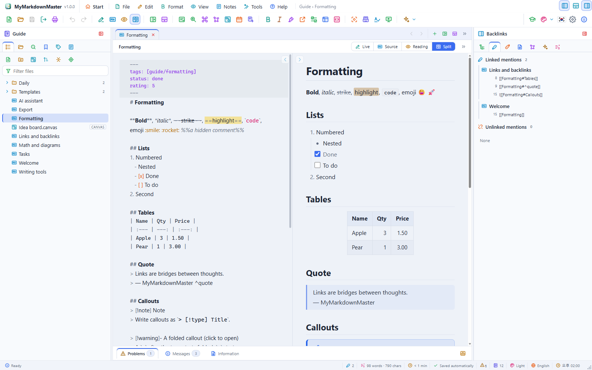
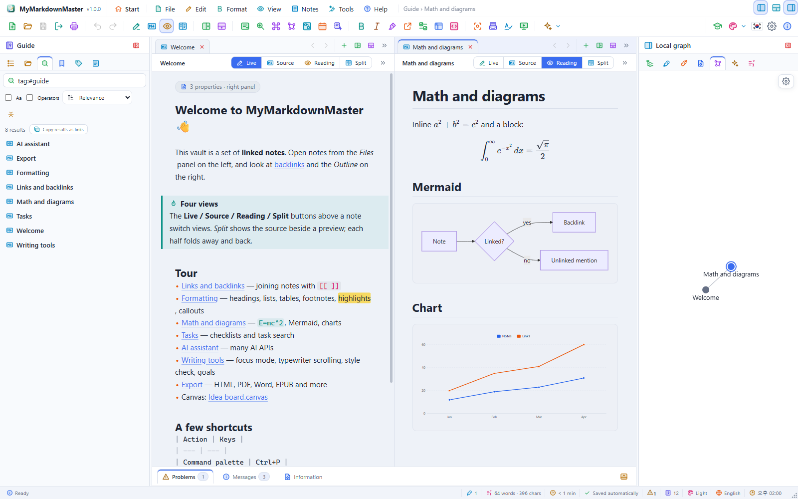
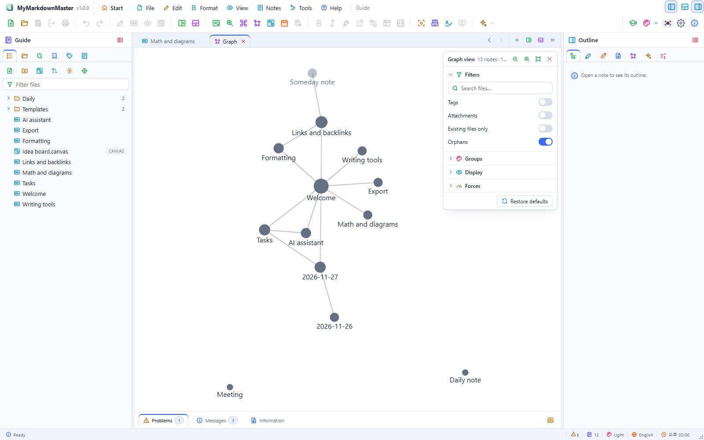
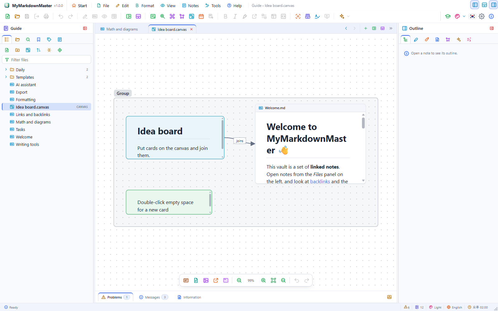
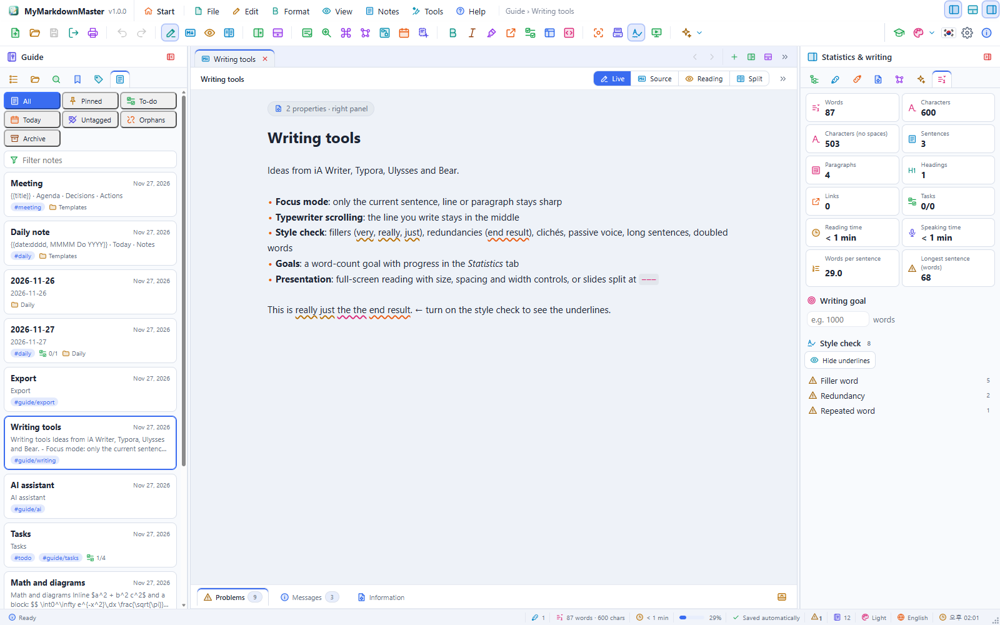
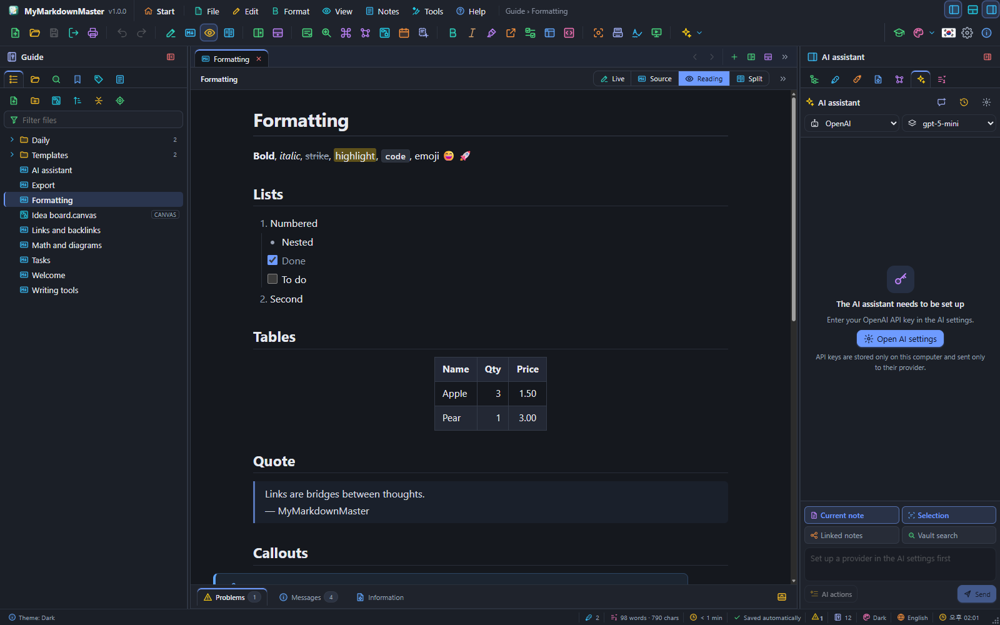
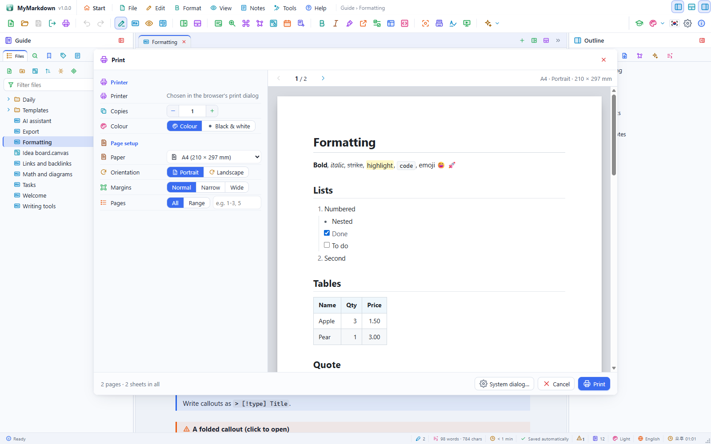

# MyMarkdownMaster User's Guide

MyMarkdownMaster 1.0.0 treats a folder as a **vault**: it joins the Markdown notes inside with `[[links]]`, lets you explore them with backlinks, the graph, canvases and search, and write with split editing and preview. The Windows, macOS and Linux desktop apps and the web app have the same features. The core (parsing notes, links, search, rendering, export) is Rust: native on the desktop, WebAssembly on the web.



## 1. The window

| Part | What it does |
| --- | --- |
| Menu bar | Home · File · Edit · Format · View · Notes · Tools · Help; panel switches and window buttons at the right |
| Toolbar | Frequent commands. In a narrow window the groups that do not fit go into the » menu |
| Left panel | Files · Search · Bookmarks · Tags · Notes. Fold it with ‹ to a strip of icons |
| Centre | The workspace: panes split side by side or one above the other, with tabs |
| Right panel | Outline · Backlinks · Outgoing links · Properties · Local graph · AI assistant · Statistics & writing |
| Bottom panel | Problems (links to missing notes, property errors, style check) · Messages · Information (Ctrl+J) |
| Status bar | Backlinks, words and characters, reading time, goal progress, line and column, save state, problems, theme, language, clock |

Every panel folds away and back; drag its edge to resize it.

### Explorer and Favorites

The left panel's **Explorer** tab shows the computer's folders (desktop app).

- **Favorites**: right-click a folder or note › **Add to Favorites** (in the file list and in the Explorer).
- **Home**: the home folder with Desktop, Documents, Downloads and Pictures. **Drives**: C:, D: … on Windows; / and mounted volumes on macOS and Linux.
- Click a folder to expand it; double-click it or right-click › **Open as vault** to make it the vault. Click a note to open it (a note elsewhere opens its folder as the vault).
- Buttons on top: refresh, show all files (off: notes, pictures and folders only), show hidden files, collapse all. On the web only the open vault's favorites are shown.

The menu bar's **Start** button toggles between the start page and the main window. With nothing open the middle shows the program's icon and name above the common actions. The bottom panel folds to its header with its fold button (Ctrl+J); the View menu turns each panel on or off and picks its tab. Every left- and right-panel button is the same size, lined up in columns. The window's minimum width is the whole toolbar's, so no toolbar button is ever hidden.

## 2. Vaults

- **Open folder as vault** (Ctrl+Shift+O): open a folder of notes. Obsidian vaults open as they are.
- **New vault**: name it and pick a place; a new folder with a first note is made.
- **Sample vaults**: the samples on the start page (Guide, Zettelkasten, Project, Journal, Research, Novel) are made as fresh vaults — change anything.
- **On the web**: Chrome and Edge open real folders; every modern browser can keep a *browser vault* in its own storage.
- When another program changes files (a sync tool …), the desktop app notices and updates.
- Folders starting with a dot (.git, .obsidian, .trash) are hidden.

## 3. Viewing a note — Live · Source · Reading · Split

Use the buttons above the note or Ctrl+1 / 2 / 3 / 4 (Ctrl+E toggles editing and reading).

| View | |
| --- | --- |
| Live | Write with the formatting shown; only the line with the cursor shows its Markdown marks |
| Source | The Markdown as it is |
| Reading | The finished note: math, diagrams, charts, callouts and checkboxes work |
| Split | Source on the left, preview on the right, scrolling together |

In the **split view** drag the divider (double-click for half and half) and fold either side away with ‹ › above it; click the strip to bring it back.



### Panes and tabs

- **Split right** (Ctrl+\\), **split down** (Ctrl+Shift+\\).
- Drag a tab onto another pane's tab strip, or onto a pane's edge (left, right, top, bottom) for a new split.
- ‹ › at the right of the tab bar move to the previous / next tab (Ctrl+Tab / Ctrl+Shift+Tab).
- Pin tabs, close other tabs, go back and forward (Alt+←/→).
- **Workspaces**: save the arrangement under a name and load it again. The last one is kept per vault.



## 4. Writing

- Type `[[` to complete note names. `[[Note#Heading]]`, `[[Note#^block]]`, `[[Note|shown text]]`.
- `![[Note]]` embeds another note (or one heading of it); `![[picture.png|300]]` shows a picture 300 wide.
- `#tags`, nested `#parent/child`.
- Callouts: `> [!note] Title`, `> [!warning]- folded callout`.
- `==highlight==`, `%%hidden comment%%`, footnotes `[^1]`, math `$…$` · `$$…$$`, Mermaid and chart (```chart) blocks, `[TOC]`, `:smile:` emoji.
- Type `/` at a line start for the insert menu (headings, tasks, tables, callouts, math, diagrams, templates …).
- Pasted or dropped pictures are saved in the attachment folder and linked **where you drop them**. A picture dragged from a web page becomes `` (web build).
- **Picture size and position** (live view): hover a picture for its toolbar (25% · 50% · 100% · original, left · center · right) and the corner handle. Drag the handle to resize, drag the picture to move it elsewhere in the note. The text reads `![[picture.png|center|300]]`; reading view and exports use the same alignment (left and right let the text flow around). Ctrl+Z undoes each step.
- Folding: headings, lists, code blocks and callouts fold from the margin; Fold all / Unfold all (Edit › Folding).
- Autosave (Settings › General) and file recovery (Notes › File recovery): snapshots at intervals you can restore.

### Properties (YAML)

The properties between the `---` lines at the top are shown and edited in the **right panel's Properties tab** (View › Properties), never above the document. In live view they fold into one line, `3 properties · right panel`; move the cursor onto it for the YAML. The tab also lists every property in the vault.

### Templates (40)

The start page's **Templates** card has 40 templates in 8 groups (daily & journal, meetings, projects & work, study & research, writing, life, planning & reviews, knowledge). Click one to make a new note from it in the open vault, with the date and title filled in. Notes › **Insert template** / **New note from template** offer them next to the vault's own templates.

## 5. Finding and connecting

- **Quick switcher** (Ctrl+O): open a note by name; Ctrl+Enter for a new tab.
- **Command palette** (Ctrl+P): every command by name.
- **Search** (Ctrl+Shift+F): `tag:#todo`, `path:folder`, `file:name`, `content:`, `line:( a b )`, `section:( )`, `block:( )`, `task:`, `task-todo:`, `task-done:`, `[property:value]`, `"phrase"`, `-exclude`, `a OR b`, `/regex/`, `match-case:`.
- **Backlinks**: the notes linking here and *unlinked mentions*; one click turns a mention into a link.
- **Graph** (Ctrl+G): drag, zoom, filters, group colours, forces; the local graph in the right panel.
- **Rename and move**: every link follows automatically (Settings › Files & links).
- **Note composer**: merge into another note; extract a selection into a new note (leaving a link or an embed).



## 6. Note features

- **Today's note** (Alt+D), previous and next daily note. Folder, date format and template in Settings › Notes & templates.
- **Templates** (Alt+T): `{{title}}`, `{{date}}`, `{{time}}`, `{{date:dddd, MMMM Do YYYY}}`, `{{yesterday}}`, `{{tomorrow}}`.
- **Unique notes** (Zettelkasten), **random note**, **bookmarks**, **pin**, **archive**.
- **Notes list** (left): newest first with excerpts; filters All · Pinned · To-do · Today · Untagged · Orphans · Archive.
- **Canvas**: an endless board of cards, notes, pictures and links joined by lines (JSON Canvas). Double-click empty space for a card.
- **Audio recorder**: records into an attachment and links it.



## 7. Writing tools

- **Focus mode** (F8): only the current line, sentence or paragraph stays sharp.
- **Typewriter scrolling** (F9): the line you write stays in the middle.
- **Style check** (F7): fillers, redundancies, clichés, hedges, passive voice (English), long sentences, doubled words, double spaces — Korean and English.
- **Syntax highlight** (English): adverbs and conjunctions coloured.
- **Smart punctuation**: straight → curly quotes, `--` → —, `...` → ….
- **Writing goal**: a word-count goal with progress (status bar, Statistics tab); a `goal: 1000` property is a goal too.
- **Statistics**: words, characters, sentences, paragraphs, reading and speaking time, words per sentence.
- **Presentation**: slides (F5, split at `---`) · reading presentation (Shift+F5: text size, spacing, width, contrast).
- **Reading themes**: follow the app · original · dark · creamy · solarized · high contrast; fonts and padding.



## 8. AI assistant

In Settings › **AI** pick a provider and enter its API key: OpenAI, Anthropic (Claude), Google Gemini, Azure OpenAI, Mistral, Groq, DeepSeek, xAI, OpenRouter, Perplexity, Together, Ollama, LM Studio or a custom OpenAI-compatible one. *Test connection* and *Load models* help.

- Chat in the **AI** tab on the right (Ctrl+Shift+A). Add the current note, the selection, linked notes or a vault search as context.
- Insert an answer at the cursor, replace the selection, append it to the note or make a new note.
- The AI ▾ toolbar menu and the editor's right-click menu: summarize, continue, improve, fix spelling, shorter or longer, tone, translate (Korean ↔ English), explain, generate tags, suggest a title, outline, make a table, brainstorm, extract action items …
- Keys stay on this computer (in this browser). The desktop app sends requests through its Rust backend: no browser CORS limits.



## 9. Export and print

File › Export (the toolbar's export button) and pick a format. The Rust core writes it.

PDF · HTML (styled or plain) · Word (.docx) · OpenDocument (.odt) · EPUB · RTF · LaTeX · Markdown (links and embeds resolved) · plain text · Djot · reStructuredText · AsciiDoc · MediaWiki · Textile · OPML · Org · JSON.

- Settings › Export: contents, numbered headings, embedded pictures, paper.
- **Export again** (Ctrl+Alt+E), **Copy as Markdown**.
- On the web files are downloaded; for PDF choose "Save as PDF" in the print dialog.

### The print window

**Print** (Ctrl+Shift+P, the printer button on the toolbar, the File menu, and the right-click menus of the file list, tabs and empty space) opens a separate print window: choose on the left, see the note laid out in pages on the right.

- **Printer**: the installed printers (the default first), copies, colour or black & white.
- **Page setup**: paper (A4, A3, A5, B5, Letter, Legal …), orientation (portrait/landscape), margins (normal/narrow/wide), pages (all, or a range such as `1-3, 5`).
- Turn pages with ‹ › above the preview; the page and sheet count is at the bottom.
- **Print** sends the note straight to the chosen printer with no system dialog (Windows desktop). On other systems and on the web the system print dialog opens; **System dialog…** is always there.



## 10. Settings

Settings (Ctrl+,) is a window with its tabs in a column at the left (everything fits without scrolling). Tabs: General · Editor · Reading · Files & links · Notes & templates · Writing · Export · AI · Theme · Font · Start page · Background · Recent · Shortcuts.

## 11. Keyboard shortcuts

| Keys | Action |
| --- | --- |
| Ctrl+N | New note |
| Ctrl+O | Quick switcher |
| Ctrl+P | Command palette |
| Ctrl+Shift+O | Open folder as vault |
| Ctrl+S / Ctrl+Alt+S | Save / Save all |
| Ctrl+Shift+F | Search the vault |
| Ctrl+F / Ctrl+H | Find / Find and replace |
| Ctrl+G | Graph view |
| Ctrl+1 / 2 / 3 / 4 | Live / Source / Reading / Split |
| Ctrl+E | Toggle editing / reading |
| Ctrl+\\ / Ctrl+Shift+\\ | Split right / down |
| Ctrl+W | Close tab |
| Alt+D / Alt+T | Today's note / Insert template |
| Ctrl+B / Ctrl+I / Ctrl+K | Bold / Italic / Link |
| Ctrl+L | Task |
| F2 | Rename |
| F5 / Shift+F5 | Slides / Reading presentation |
| F7 / F8 / F9 | Style check / Focus mode / Typewriter scrolling |
| F11 | Full screen |
| Ctrl+Shift+A | AI assistant |
| Ctrl+J | Bottom panel |
| Ctrl+Shift+1 / 2 | Left / right panel |
| Shift+F1 / F1 | Tutorial / About |

## 12. Installing

- Windows: the installer (NSIS). An installed MyMarkdownMaster is removed first, then installed fresh.
- macOS: DMG; Linux: deb · rpm · AppImage.
- Web: put `dist/` from `npm run build:web` on any static web server.
- Build it yourself: `npm run build:win`, `build:mac`, `build:linux` (needs Rust and Node).
