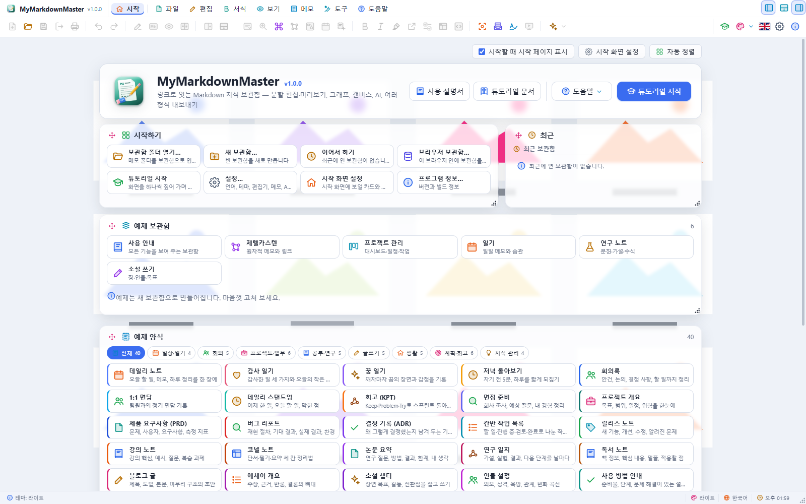
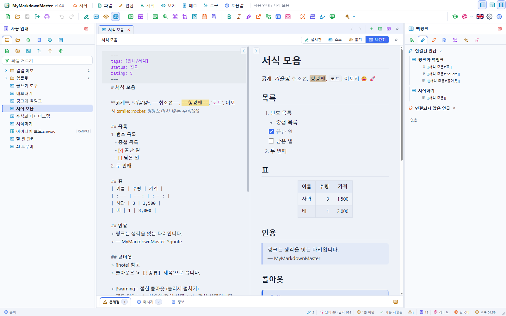
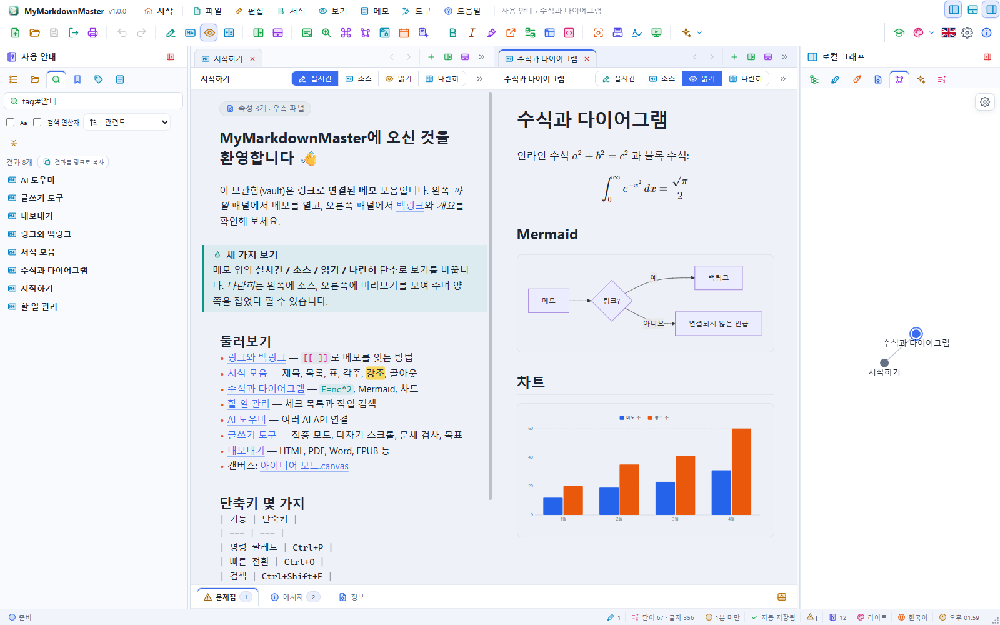
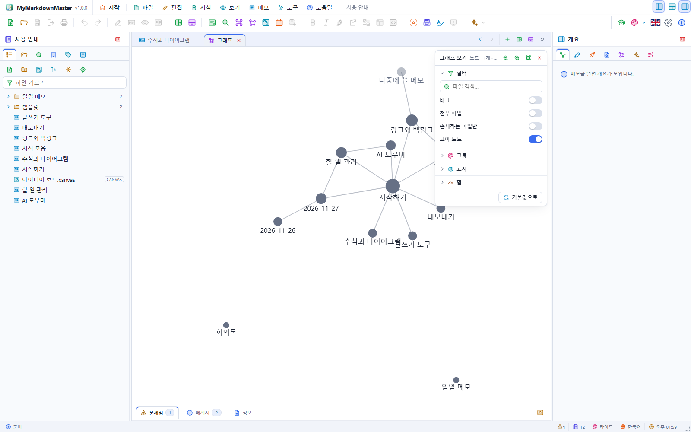
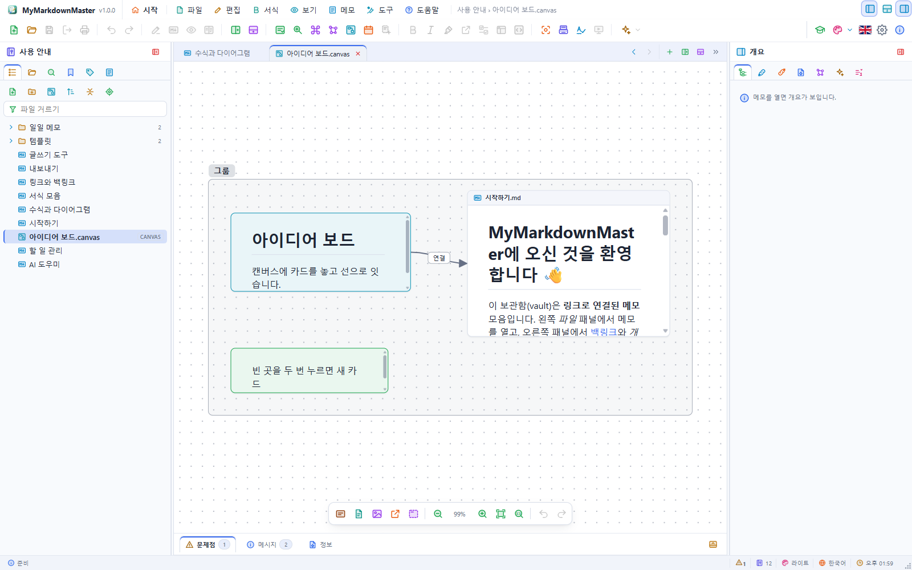
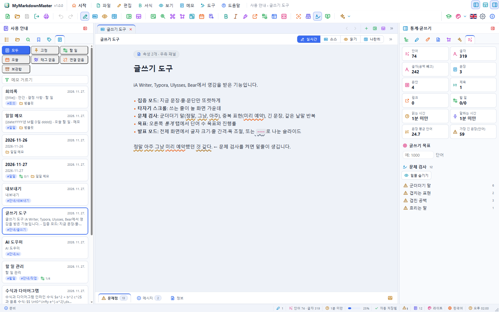
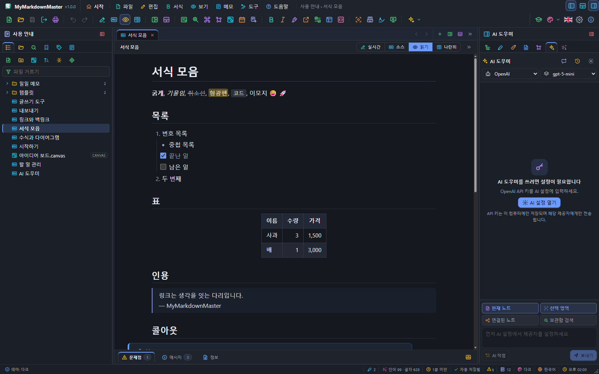
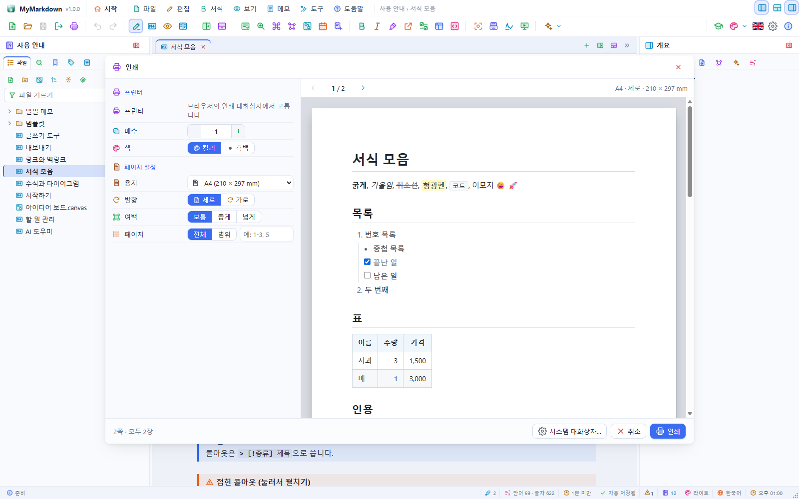

# MyMarkdownMaster 사용 설명서

MyMarkdownMaster 1.0.0은 폴더 하나를 **보관함(vault)** 으로 삼아 그 안의 Markdown 메모를 `[[링크]]`로 잇고, 백링크·그래프·캔버스·검색으로 둘러보며, 분할 편집과 미리보기로 쓰는 프로그램입니다. Windows, macOS, Linux 데스크톱 앱과 웹 앱이 같은 기능을 가집니다. 핵심(메모 해석, 링크, 검색, 렌더링, 내보내기)은 Rust로 만들어 데스크톱에서는 네이티브로, 웹에서는 WebAssembly로 돌아갑니다.



## 1. 화면 구성

| 부분 | 하는 일 |
| --- | --- |
| 메뉴 막대 | 시작 · 파일 · 편집 · 서식 · 보기 · 메모 · 도구 · 도움말, 오른쪽 끝에 패널 단추와 창 단추. **시작**은 시작 화면과 메인 창을 오가는 토글입니다 |
| 툴바 | 자주 쓰는 명령(아이콘). 창의 최소 폭이 툴바 전체 폭이라 창을 줄여도 단추가 가려지지 않습니다 |
| 왼쪽 패널 | 파일 · 탐색기 · 검색 · 책갈피 · 태그 · 메모 목록. 단추는 모두 같은 크기로 세로 줄이 맞습니다. ‹ 단추로 접으면 아이콘 줄만 남습니다 |
| 가운데 | 작업 공간: 창을 가로·세로로 나누고 탭을 둡니다 |
| 오른쪽 패널 | 개요 · 백링크 · 나가는 링크 · 속성 · 로컬 그래프 · AI 도우미 · 통계와 글쓰기 |
| 아래 패널 | 문제(아직 없는 메모로 가는 링크, 속성 오류, 문체 검사) · 메시지 · 정보. 오른쪽 ⌄ ⌃ 단추(Ctrl+J)로 머리줄만 남기고 접었다 폅니다 |
| 상태 표시줄 | 백링크 수, 단어·글자, 읽는 시간, 목표 진행률, 줄·칸, 저장 상태, 문제 수, 테마, 언어, 시계 |

모든 패널은 접었다 펼 수 있고, 경계선을 끌어 폭과 높이를 바꿉니다. 보기 메뉴에서 왼쪽·오른쪽·아래 패널을 켜고 끄며 각 패널의 탭을 고릅니다. 메모가 하나도 없을 때 가운데에는 프로그램 아이콘·이름과 자주 쓰는 단추가 보입니다.

### 탐색기와 즐겨찾기

왼쪽 패널의 **탐색기** 탭은 컴퓨터의 폴더를 보여 줍니다(데스크톱 앱).

- **즐겨찾기**: 폴더나 메모를 오른쪽 클릭 › **즐겨찾기에 추가**로 모아 둡니다. 파일 목록과 탐색기의 오른쪽 클릭 메뉴 모두에 있습니다.
- **사용자 홈**: 홈 폴더와 바탕 화면 · 문서 · 다운로드 · 사진.
- **드라이브**: Windows는 C: D: …, macOS·Linux는 / 와 연결된 볼륨.
- 폴더를 누르면 펼쳐지고, 두 번 누르거나 오른쪽 클릭 › **보관함으로 열기**로 보관함이 됩니다. 메모를 누르면 열립니다(다른 폴더의 메모는 그 폴더를 보관함으로 엽니다).
- 위 단추: 새로 고침, 모든 파일 보기(끄면 메모·그림·폴더만), 숨김 파일 보기, 모두 접기.
- 웹에서는 컴퓨터의 폴더를 볼 수 없어 열린 보관함의 즐겨찾기만 보입니다.

## 2. 보관함

- **보관함 폴더 열기** (Ctrl+Shift+O): 메모가 든 폴더를 엽니다. Obsidian 보관함도 그대로 열립니다.
- **새 보관함**: 이름을 정하고 위치를 고르면 시작 메모가 든 새 폴더를 만듭니다.
- **예제 보관함**: 시작 화면의 예제(사용 안내·제텔카스텐·프로젝트·일기·연구·소설)는 새 보관함으로 만들어지므로 마음껏 고쳐도 됩니다.
- **웹에서**: Chrome·Edge는 실제 폴더를 열 수 있고, 모든 최신 브라우저는 *브라우저 보관함*(브라우저 안의 저장소)을 쓸 수 있습니다.
- 다른 프로그램이 파일을 바꾸면(동기화 도구 등) 데스크톱 앱이 감지해 화면을 고칩니다.
- 점(.)으로 시작하는 폴더(.git, .obsidian, .trash)는 보이지 않습니다.

## 3. 메모 보기 — 실시간 · 소스 · 읽기 · 나란히

메모 위의 단추나 Ctrl+1 / 2 / 3 / 4로 바꿉니다(Ctrl+E는 편집과 읽기 사이를 오갑니다).

| 보기 | 설명 |
| --- | --- |
| 실시간 | 서식을 보면서 씁니다. 커서가 있는 줄만 Markdown 기호가 드러납니다 |
| 소스 | Markdown 원문 그대로 |
| 읽기 | 다 만든 모습. 수식·다이어그램·차트·콜아웃·체크 상자가 동작합니다 |
| 나란히 | 왼쪽 원문, 오른쪽 미리보기. 스크롤이 맞춰집니다 |

**나란히 보기**에서는 가운데 선을 끌어 폭을 바꾸고(두 번 누르면 반반), 각 쪽 위의 ‹ › 단추로 한쪽을 접었다가 세로 띠를 눌러 다시 펼칩니다.



### 창 나누기와 탭

- **오른쪽으로 나누기** (Ctrl+\\), **아래로 나누기** (Ctrl+Shift+\\).
- 탭을 끌어 다른 창의 탭 줄에 놓거나, 창의 가장자리(왼·오른·위·아래)에 놓으면 새 창으로 나뉩니다.
- 탭 줄 오른쪽의 ‹ › 단추로 이전·다음 탭으로 옮깁니다(Ctrl+Tab / Ctrl+Shift+Tab). 탭이 많으면 고른 탭이 보이도록 줄이 움직입니다.
- 탭 고정, 다른 탭 닫기, 뒤로·앞으로(Alt+←/→).
- **작업 공간**: 지금 배치를 이름을 붙여 저장하고 다시 불러옵니다. 마지막 배치는 보관함마다 기억됩니다.



## 4. 쓰기

- `[[` 를 치면 메모 이름이 자동 완성됩니다. `[[메모#제목]]`, `[[메모#^블록]]`, `[[메모|보일 글]]`.
- `![[메모]]`는 다른 메모(또는 그 제목 아래)를 끼워 넣고, `![[그림.png|300]]`은 그림을 폭 300으로 보입니다.
- `#태그`, `#부모/자식` 중첩 태그.
- 콜아웃: `> [!note] 제목`, `> [!warning]- 접힌 콜아웃`.
- `==형광펜==`, `%%보이지 않는 주석%%`, 각주 `[^1]`, 수식 `$…$` · `$$…$$`, Mermaid · 차트(```chart) 코드 블록, `[TOC]` 목차, `:smile:` 이모지.
- 줄 맨 앞에서 `/` 를 치면 빠른 넣기 메뉴(제목, 할 일, 표, 콜아웃, 수식, 다이어그램, 템플릿 …).
- 그림을 붙여넣거나 끌어 놓으면 첨부 폴더에 저장되고 **놓은 자리에** 링크가 들어갑니다. 웹 페이지의 그림을 끌어 놓으면 ``가 들어갑니다(웹판).
- **그림 크기와 위치**(실시간 보기): 그림 위에 마우스를 올리면 도구 줄(25% · 50% · 100% · 원래 크기, 왼쪽 · 가운데 · 오른쪽)과 오른쪽 아래 모서리 손잡이가 나옵니다. 손잡이를 끌면 폭이 바뀌고, 그림 자체를 끌면 메모의 다른 자리로 옮겨집니다. 원문에는 `![[그림.png|center|300]]`처럼 적히며 읽기 보기와 내보내기에도 같은 정렬이 쓰입니다(왼쪽·오른쪽은 글이 둘러쌉니다). 모두 Ctrl+Z로 되돌릴 수 있습니다.
- 접기: 제목·목록·코드 블록·콜아웃 왼쪽의 표시로 접고, 모두 접기/펴기(편집 › 접기).
- 자동 저장(설정 › 일반)과 파일 복구(메모 › 파일 복구): 일정 간격으로 스냅숏을 남겨 되돌릴 수 있습니다.

### 속성(YAML)

메모 맨 위 `---` 사이의 속성은 **오른쪽 패널의 속성 탭**에서 보고 고칩니다(보기 › 속성). 문서 위에는 표가 따로 그려지지 않고, 실시간 보기에서는 `속성 3개 · 우측 패널` 한 줄로 접혀 있다가 그 줄로 커서를 옮기면 원문이 보입니다. 속성 탭은 이 메모의 속성과 보관함 전체 속성 목록을 보여 줍니다.

### 예제 양식(템플릿 40개)

시작 화면의 **예제 양식** 카드에 40개의 양식이 8가지 분류(일상·일기, 회의, 프로젝트·업무, 공부·연구, 글쓰기, 생활, 계획·회고, 지식 관리)로 있습니다. 누르면 열린 보관함에 그 이름의 새 메모가 날짜 등이 채워진 채 만들어집니다. 메모 › **템플릿 넣기** / **양식에서 새 메모**에서도 보관함의 템플릿과 함께 고를 수 있습니다.

## 5. 찾기와 연결

- **빠른 전환** (Ctrl+O): 메모 이름으로 열기. Ctrl+Enter는 새 탭.
- **명령 팔레트** (Ctrl+P): 모든 명령을 이름으로.
- **검색** (Ctrl+Shift+F): `tag:#할일`, `path:폴더`, `file:이름`, `content:`, `line:( a b )`, `section:( )`, `block:( )`, `task:`, `task-todo:`, `task-done:`, `[속성:값]`, `"구절"`, `-빼기`, `a OR b`, `/정규식/`, `match-case:`.
- **백링크**: 이 메모를 가리키는 메모와 *연결되지 않은 언급*. 언급은 단추 하나로 링크가 됩니다.
- **그래프** (Ctrl+G): 끌기·확대·필터·그룹 색·힘 조절, 오른쪽 패널의 로컬 그래프.
- **이름 바꾸기·옮기기**: 모든 링크가 자동으로 고쳐집니다(설정 › 파일·링크).
- **메모 합치기·나누기**: 다른 메모에 합치기, 선택한 글을 새 메모로(링크 또는 임베드를 남김).



## 6. 메모 기능

- **오늘의 메모** (Alt+D), 이전·다음 일일 메모. 폴더·날짜 형식·템플릿은 설정 › 메모·템플릿.
- **템플릿** (Alt+T): `{{title}}`, `{{date}}`, `{{time}}`, `{{date:YYYY년 M월 D일 dddd}}`, `{{yesterday}}`, `{{tomorrow}}`.
- **고유 번호 메모**(제텔카스텐), **아무 메모 열기**, **책갈피**, **고정**, **보관 폴더로**.
- **메모 목록**(왼쪽): 발췌와 함께 최근 순, 필터(모두·고정·할 일·오늘·태그 없음·연결 없음·보관함).
- **캔버스**: 카드·메모·그림·링크를 놓고 선으로 잇는 무한 보드(JSON Canvas). 빈 곳을 두 번 누르면 새 카드.
- **녹음**: 녹음한 소리를 첨부 파일로 저장하고 메모에 넣습니다.



## 7. 글쓰기 도구

- **집중 모드** (F8): 지금 줄·문장·문단만 또렷하게.
- **타자기 스크롤** (F9): 쓰는 줄이 늘 화면 가운데.
- **문체 검사** (F7): 군더더기 말, 겹치는 표현, 상투적 표현, 흐리는 말, 수동태(영어), 긴 문장, 같은 낱말 반복, 겹친 공백. 한국어·영어.
- **품사 강조**(영어): 부사·접속사에 색.
- **똑똑한 문장부호**: 곧은 따옴표 → 둥근 따옴표, `--` → —, `...` → ….
- **글쓰기 목표**: 단어 수 목표와 진행률(상태 표시줄, 통계 탭). 속성 `goal: 1000`도 목표가 됩니다.
- **통계**: 단어, 글자, 문장, 문단, 읽는 시간, 말하는 시간, 문장 평균 길이.
- **발표**: 슬라이드(F5, `---`로 나눈 장) · 읽기 발표(Shift+F5: 글자 크기·줄 간격·폭·대비 조절).
- **읽기 테마**: 프로그램 테마 따르기 · 기본 · 어둡게 · 크림 · 솔라라이즈드 · 고대비, 글꼴, 여백.



## 8. AI 도우미

설정 › **AI**에서 공급자를 고르고 API 키를 넣습니다: OpenAI, Anthropic(Claude), Google Gemini, Azure OpenAI, Mistral, Groq, DeepSeek, xAI, OpenRouter, Perplexity, Together, Ollama, LM Studio, 사용자 지정(OpenAI 호환). *연결 시험*과 *모델 불러오기* 단추가 있습니다.

- 오른쪽 **AI** 탭(Ctrl+Shift+A)에서 대화합니다. 지금 메모·선택한 글·연결된 메모·보관함 검색을 문맥으로 넣을 수 있습니다.
- 답은 커서 자리에 넣기, 선택 글 바꾸기, 메모 끝에 붙이기, 새 메모로 만들기.
- 툴바의 AI ▾ 메뉴와 편집기 오른쪽 클릭: 요약, 이어 쓰기, 다듬기, 맞춤법, 줄이기·늘리기, 어조, 번역(한↔영), 설명, 태그 만들기, 제목 제안, 개요, 표로, 아이디어, 할 일 뽑기 …
- 키는 이 컴퓨터(이 브라우저)에만 저장됩니다. 데스크톱 앱은 Rust 백엔드를 통해 요청하므로 브라우저의 CORS 제한이 없습니다.



## 9. 내보내기와 인쇄

파일 › 내보내기(툴바의 내보내기 단추)에서 형식을 고릅니다. Rust 코어가 만듭니다.

PDF · HTML(스타일 포함/없음) · Word(.docx) · OpenDocument(.odt) · EPUB · RTF · LaTeX · Markdown(링크·임베드 풀기) · 일반 텍스트 · Djot · reStructuredText · AsciiDoc · MediaWiki · Textile · OPML · Org · JSON.

- 설정 › 내보내기: 목차, 제목 번호, 그림 넣기, 용지.
- **다시 내보내기** (Ctrl+Alt+E), **Markdown으로 복사**.
- 웹에서는 파일이 내려받기로 저장되고, PDF는 인쇄 대화상자에서 "PDF로 저장"을 고릅니다.

### 인쇄 창

**인쇄**(Ctrl+Shift+P, 툴바의 프린터 단추, 파일 메뉴, 파일 목록·탭·빈 곳의 오른쪽 클릭 메뉴)는 별도의 인쇄 창을 엽니다. 왼쪽에서 고르고, 오른쪽에서 쪽으로 나뉜 모습을 바로 봅니다.

- **프린터**: 설치된 프린터 목록(기본 프린터가 먼저), 매수, 컬러/흑백.
- **페이지 설정**: 용지(A4·A3·A5·B5·Letter·Legal …), 방향(세로/가로), 여백(보통/좁게/넓게), 페이지(전체 또는 `1-3, 5` 같은 범위).
- 미리보기 위의 ‹ › 로 쪽을 넘기고, 아래에 전체 쪽수와 장수가 나옵니다.
- **인쇄** 단추를 누르면 시스템 대화상자 없이 고른 프린터로 바로 출력됩니다(Windows 데스크톱). 다른 운영체제와 웹에서는 시스템 인쇄 대화상자가 열립니다. **시스템 대화상자…** 로 언제든 시스템 창을 쓸 수 있습니다.



## 10. 설정

설정(Ctrl+,)은 왼쪽에 탭이 세로로 늘어선 창입니다(스크롤 없이 모든 항목이 보입니다). 탭: 일반 · 편집기 · 읽기 · 파일·링크 · 메모·템플릿 · 글쓰기 · 내보내기 · AI · 테마 · 글꼴 · 시작 화면 · 배경 · 최근 기록 · 단축키.

## 11. 단축키

| 단축키 | 기능 |
| --- | --- |
| Ctrl+N | 새 메모 |
| Ctrl+O | 빠른 전환 |
| Ctrl+P | 명령 팔레트 |
| Ctrl+Shift+O | 보관함 폴더 열기 |
| Ctrl+S / Ctrl+Alt+S | 저장 / 모두 저장 |
| Ctrl+Shift+F | 보관함 검색 |
| Ctrl+F / Ctrl+H | 찾기 / 찾아 바꾸기 |
| Ctrl+G | 그래프 보기 |
| Ctrl+1 / 2 / 3 / 4 | 실시간 / 소스 / 읽기 / 나란히 |
| Ctrl+E | 편집·읽기 전환 |
| Ctrl+\\ / Ctrl+Shift+\\ | 오른쪽 / 아래로 나누기 |
| Ctrl+W | 탭 닫기 |
| Alt+D / Alt+T | 오늘의 메모 / 템플릿 넣기 |
| Ctrl+B / Ctrl+I / Ctrl+K | 굵게 / 기울임 / 링크 |
| Ctrl+L | 할 일 |
| F2 | 이름 바꾸기 |
| F5 / Shift+F5 | 슬라이드 / 읽기 발표 |
| F7 / F8 / F9 | 문체 검사 / 집중 모드 / 타자기 스크롤 |
| F11 | 전체 화면 |
| Ctrl+Shift+A | AI 도우미 |
| Ctrl+J | 아래 패널 |
| Ctrl+Shift+1 / 2 | 왼쪽 / 오른쪽 패널 |
| Shift+F1 / F1 | 튜토리얼 / 프로그램 정보 |

## 12. 설치

- Windows: 설치 프로그램(NSIS). 이미 설치된 MyMarkdownMaster은 지우고 새로 설치합니다.
- macOS: DMG, Linux: deb · rpm · AppImage.
- 웹: `npm run build:web`의 `dist/`를 아무 정적 웹 서버에 올립니다.
- 직접 만들기: `npm run build:win`, `build:mac`, `build:linux` (Rust·Node 필요).
