# MyMechanics Tutorial

This tutorial is a hands-on walk-through for your first session with MyMechanics. Starting from an empty window you will build a first part — sketch, dimensions, extrude, fillet, hole and pattern — and then try a sweep, sheet metal, an assembly with mates, a motion study, a drawing with a section view and a bill of materials, and a static simulation. Every step has a picture of the screen at that moment; the red numbers show where to click or what to look at.

The whole tutorial takes about an hour. The lessons stand on their own, except that lessons 1–4 build the same part and lesson 9 makes its drawing. The **user's guide** (F1) explains every command in detail.

## Lesson 1. A first sketch — a rectangle and its dimensions

Every part starts from a 2D sketch on a plane: draw the lines, then fix their size and position with relations and dimensions.

1. Click **New part** on the start page, or press Ctrl+N. An empty part opens with the Front, Top and Right planes and the origin in the tree.
2. On the **Features** tab of the CommandManager, click **Sketch**. When the sketch PropertyManager appears on the left, choose **Top Plane**. Clicking the plane in the graphics area works too.

   

3. The view turns to face the Top plane and the CommandManager switches to the **Sketch** tab. Click **Center Rectangle**, click the origin first, then click a corner further out. When the pointer snaps to the origin an orange ring appears and a coincident relation is added by itself.

   

4. The lines are still blue: their size is not fixed yet, so they can move. Click **Smart Dimension** (D), click the horizontal line and enter `80`, then the vertical line and enter `50`. When every line turns black and the status bar says **Fully defined**, you are done.

   

5. Click **Exit Sketch**. **Sketch1** appears in the tree.

> Double-click a dimension's text to change its value. Number boxes accept arithmetic and units, such as `100/3` or `25.4in`.

## Lesson 2. Extrude — from sketch to solid

1. With Sketch1 selected, click **Features › Extruded Boss**.
2. Enter `20` for the depth in the PropertyManager. A yellow preview shows in the graphics area; tick the reverse box to flip it.
3. Press ✔ (Enter). **Boss-Extrude1** appears in the tree with Sketch1 under it.

   

> Turn the view with a left drag, move it with a right drag and zoom with the wheel. F fits everything on the screen; Ctrl+7 is the isometric view.

## Lesson 3. Fillets and a hole

### Rounding the edges

1. Click **Fillet**.
2. Click the vertical edges of the block one by one. The picked edges collect in the pink selection box; turn the view to reach the one at the back. Clicking a face adds all of its edges at once.
3. Enter a radius of `5` and press ✔.

   

### A counterbored hole

1. Click **Hole Wizard**.
2. Choose **Counterbore** as the hole type and **M8** as the size. The clearance diameter and the counterbore for the screw head are filled in from the standard table.
3. Click the top face of the block to the right of the origin (about 15 mm along X). The red preview is the hole. Leave the end condition at **Through All**.
4. Press ✔. The hole position is kept in a **Hole position** sketch, so you can add dimensions to it later to place it exactly.

   

## Lesson 4. Patterns — four holes

Instead of drawing more holes, copy the first one with a pattern: when you change the original, the copies follow.

1. Click **Hole1** in the tree to select it.
2. Click **Circular Pattern**. Hole1 is already in the list of features to pattern.
3. Set the axis to **Y**, the total angle to `360`, the number of instances to `4`, and tick **Equal spacing**.
4. Press ✔: four holes now sit around the origin.

   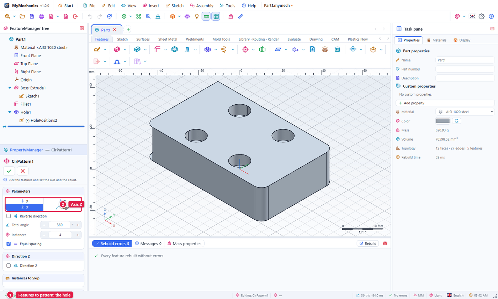

5. Save with Ctrl+S. Parts, assemblies and drawings all go into one `.mymech` file.

The tree lists the features in the order they were made. Double-click one to edit it again; change a dimension early in the tree and the fillets, hole and pattern after it are all rebuilt on the new shape. Drag the blue **rollback bar** at the bottom of the tree upwards to leave out the features below it for a while.

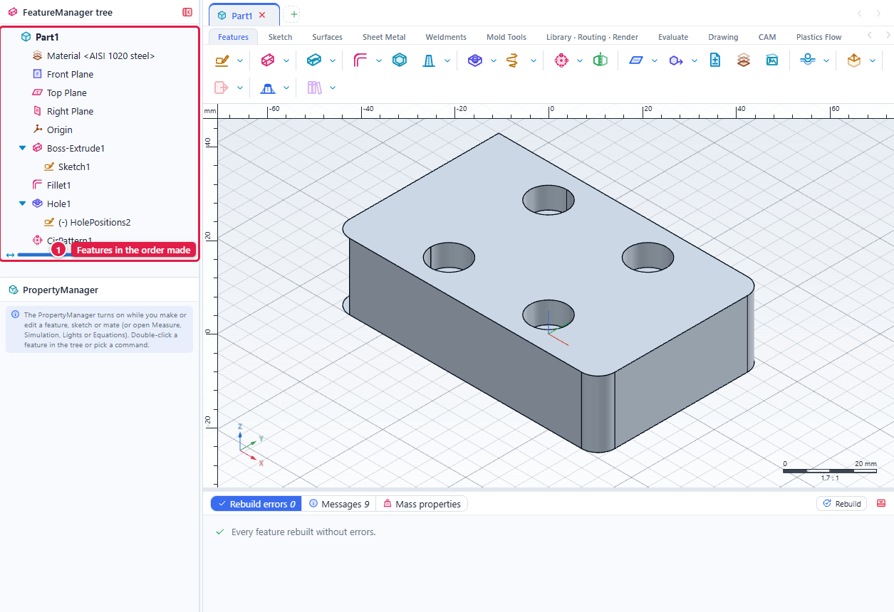

## Lesson 5. Sweep — a tube along a path

A sweep moves a closed profile along a path. Use it for bent tubes, handles and springs.

1. Open a new part (Ctrl+N).
2. Open a sketch on the **Top Plane** and draw two circles centred on the origin. Diameters `16` and `12` make the section of a tube with a 2 mm wall. Exit the sketch and rename it **Profile** (F2).
3. Open a sketch on the **Front Plane** and draw **lines** from the origin: 60 mm up, then up and to the right at a slant, then level. An open chain is fine. Exit the sketch and rename it **Path**.

   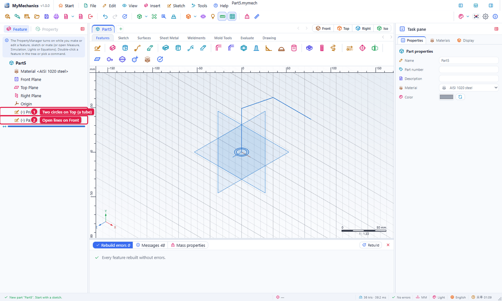

4. Click **Swept Boss**. Pick the **Profile** sketch as the profile and the **Path** sketch as the path. The profile must lie at the start of the path, square to it.

   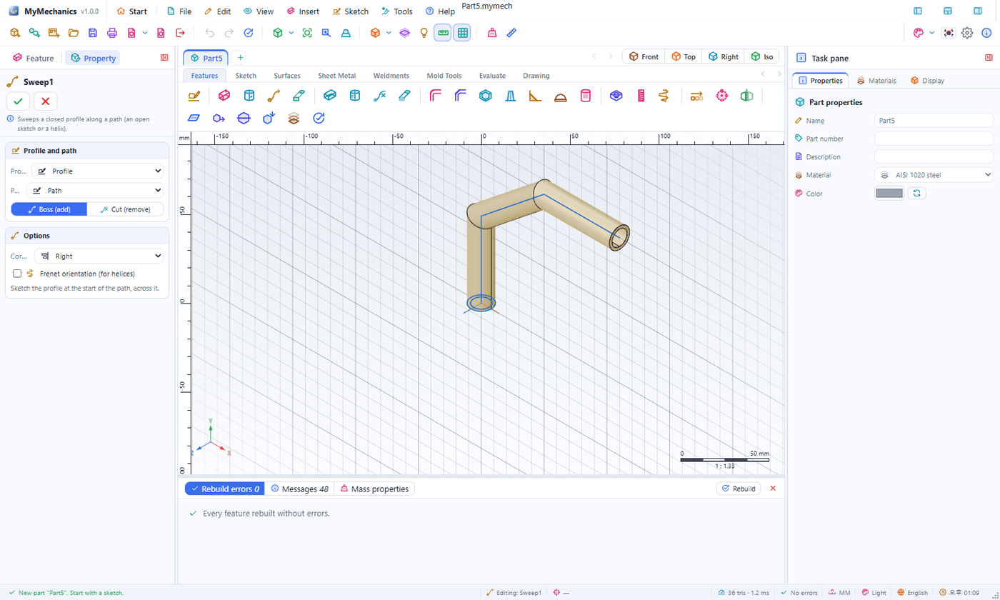

5. Press ✔: the tube follows the bends of the path.

   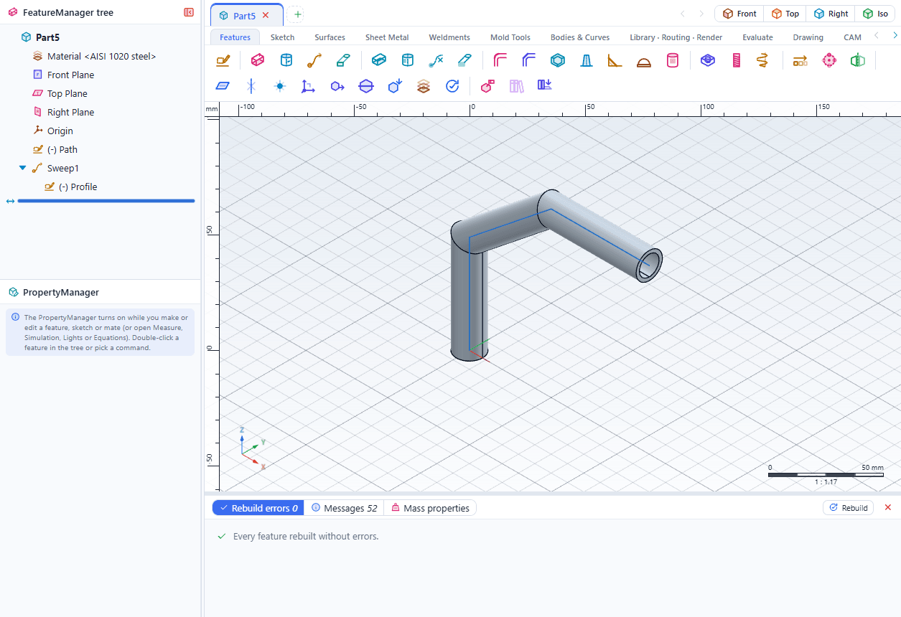

> With a **Helix** (Features › Helix) as the path and **Frenet orientation** turned on, the same command makes a spring. Open the **Compression spring** sample to see one.

## Lesson 6. Sheet metal — flanges and the flat pattern

A sheet metal part is a plate of constant thickness bent into shape. You can switch between the formed part and its flat pattern.

1. Open a new part, sketch a 120 × 70 rectangle on the **Top Plane** and exit the sketch.
2. On the CommandManager's **Sheet Metal** tab, click **Base Flange**. Check the thickness, bend radius and K-factor, then press ✔.

   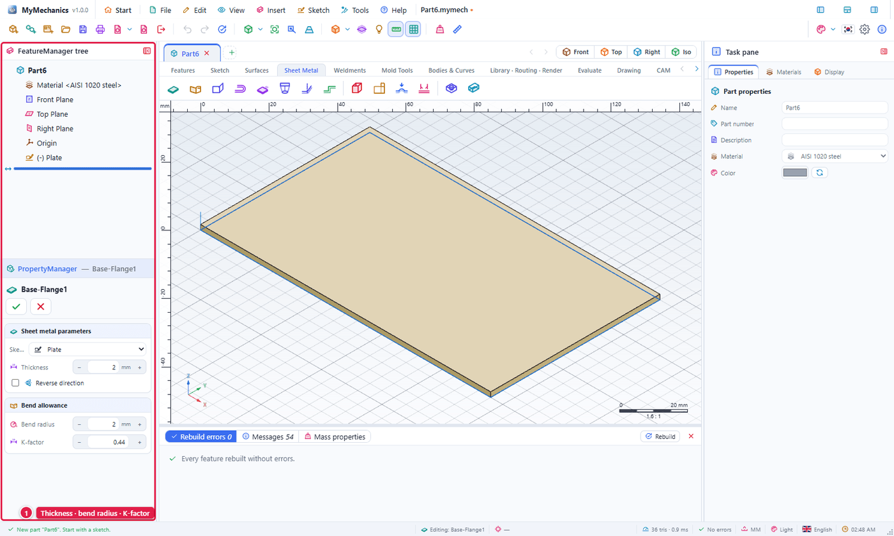

3. Click the short edge on the right of the sheet's top face to select it, then click **Edge Flange**. With an angle of `90` and a length of `35` the preview appears. ✔.

   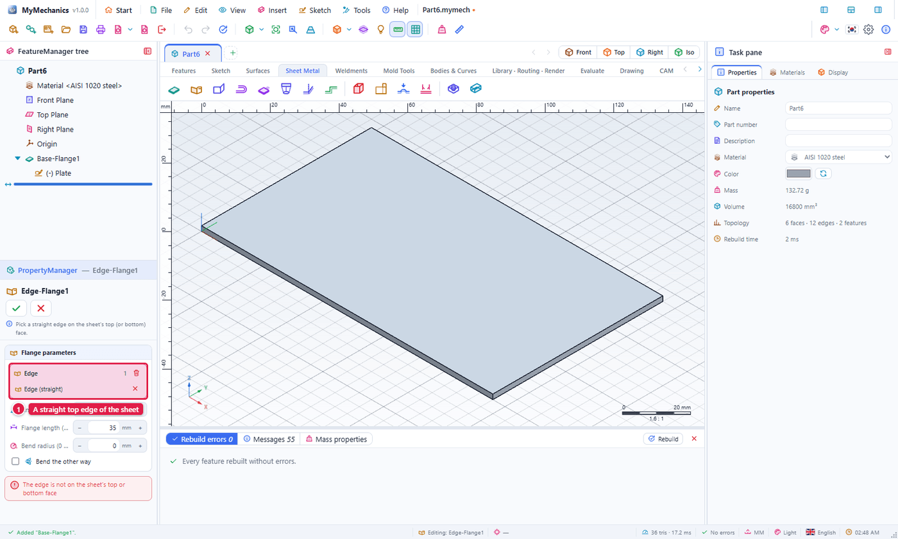

4. Click **Flatten**. The flat pattern appears, worked out with the bend allowance (angle × (radius + K × thickness)). Click it again to fold the part back.

   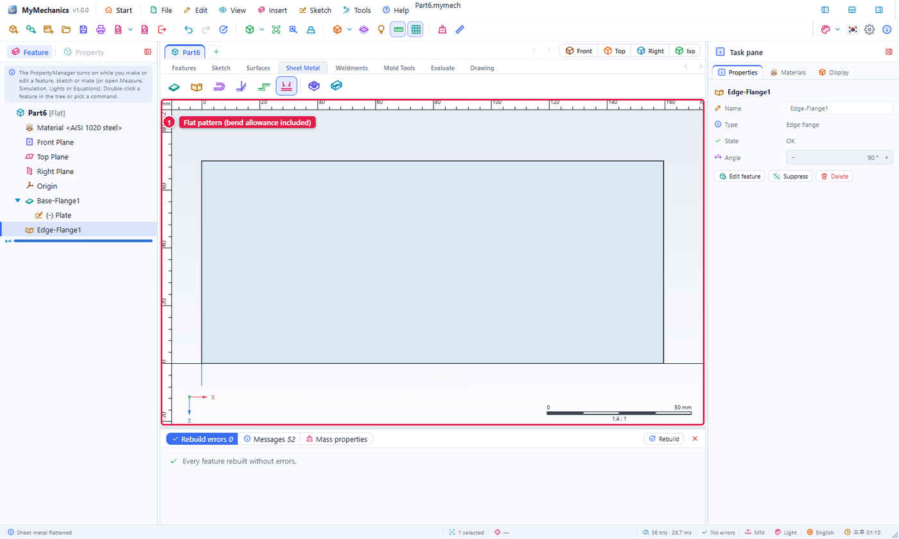

> Hems, sketched bends and jogs are on the same tab. The **Sheet metal chassis** sample uses all of them.

## Lesson 7. An assembly with mates

An assembly holds parts that are placed by **mates** — relations between their faces.

1. Click **New assembly**. The left panel lists the project's parts and the sample parts; click one to put it into the graphics area. The first part is fixed at the origin (`(f)`).

   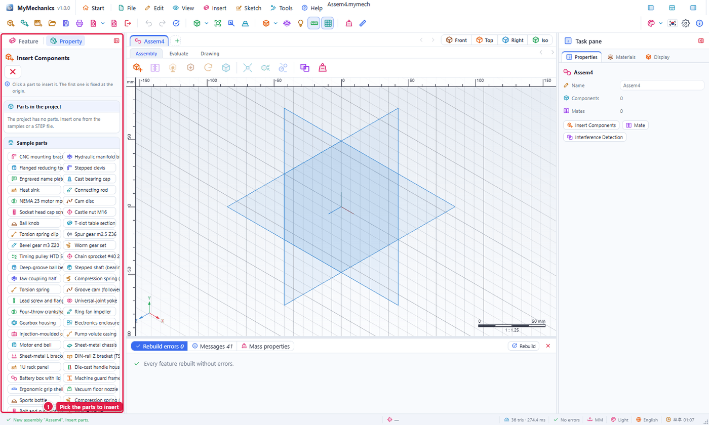

2. Insert a second part with **Assembly › Insert Components**. A component that has no mates yet can move freely and gets a `(-)`.
3. Click **Mate** and click a cylindrical face on each part. For two cylinders **Concentric** is suggested first, and the part moves into place at once. Press ✔. Pick two flat faces next and **Coincident** is suggested.

   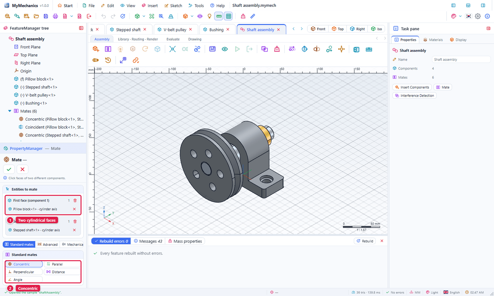

4. The mates collect in the **Mates** folder of the tree. Components whose position is fully set lose their `(-)`; mates that cannot all be met turn red.

   

> Open the **Shaft assembly** and **Two-stage gear reducer** samples to see finished mates. The **Advanced** and **Mechanical** buttons of the mate PropertyManager hold width and limit mates, and gear, rack-and-pinion, screw and hinge mates.

## Lesson 8. A motion study

Components linked by gear, screw or rack-and-pinion mates move together, driven by a single motor.

1. Open the **Two-stage gear reducer** sample (start page › Samples › Assemblies).
2. Click **Assembly › Motion Study**. This sample already has a rotary motor on its input shaft; to add a motor, click a cylindrical face of a component (rotary motors in rpm, linear motors in mm/s).
3. Press **Play**, or drag the time slider to any moment. As the input shaft turns, the intermediate and output shafts follow through the gear mates at the gear ratio.

   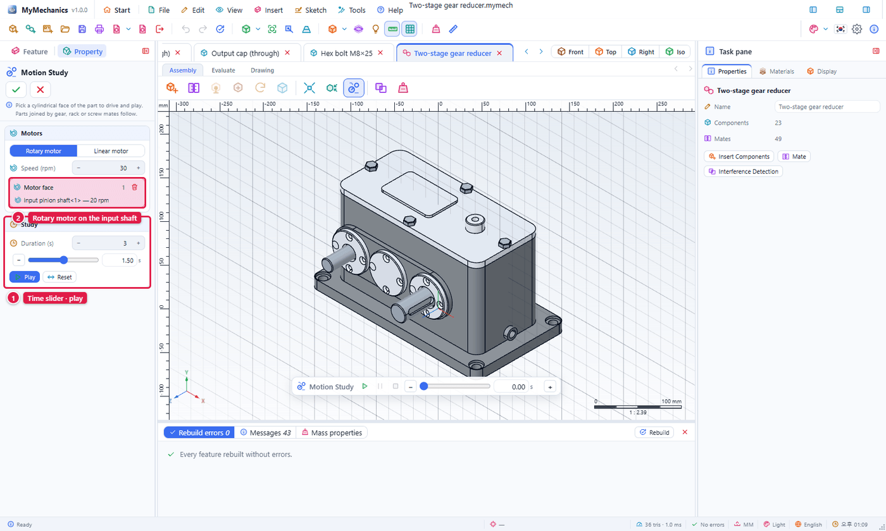

4. **Exploded View** spreads the components outward; click it again to put them back.
5. Every part sample moves too. Open the sample **Connecting rod** (Basic parts): it opens on a scene with a crank and a crosshead, and **▶** (play) over the graphics area runs it as a slider-crank. The connecting rod part itself is in the document tabs, ready to edit.

   

## Lesson 9. Drawings — a section view and a bill of materials

1. Go back to the tab of the part from lessons 1–4 and click **Drawing › Make drawing**. The front, top and right views and an isometric view are placed on an A3 sheet at a scale chosen to fit. Change the sheet size, scale and projection in the task pane on the right.

   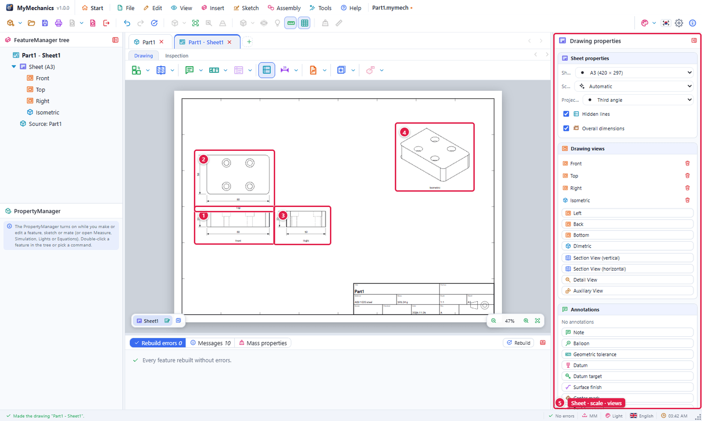

2. Click the front view to select it and click **Section View**. Section **A-A**, cut through the middle and hatched, is placed on the sheet, and the cutting line and arrows are drawn on the front view.
3. **Detail View** adds detail **B**, the chosen area at twice the scale. Drag views to move them.

   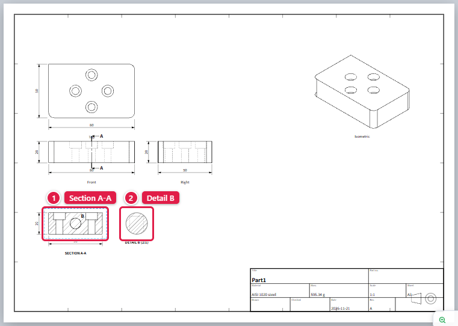

4. Make a drawing of an assembly and click **BOM**: a table of item numbers, names, materials and quantities is placed above the title block.

   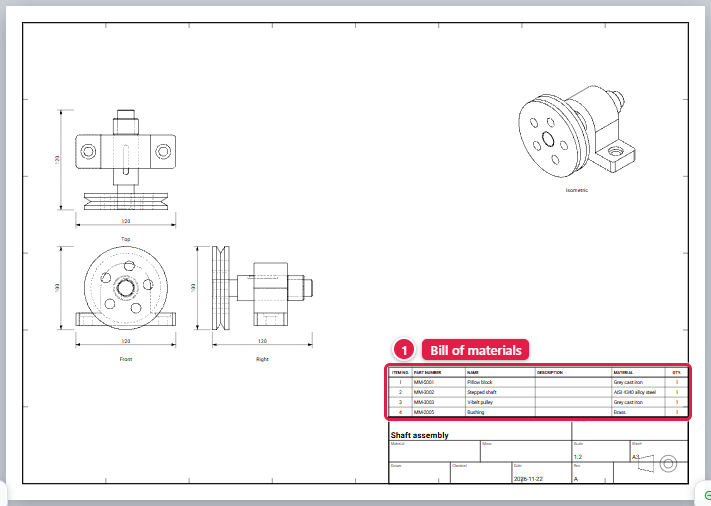

5. Export to **DXF** or **SVG**, or print with Ctrl+P. Geometric tolerances, datums, surface finish symbols and balloons are added with the annotation buttons of the Drawing tab.

## Lesson 10. A static simulation

1. Open the part to analyse and click **Evaluate › Simulation**. The study type is **Static**; the material's elastic modulus and yield strength are shown in the PropertyManager.
2. Click the **Fixed faces** box and click the face to hold (the one against the wall). Then click the **Loaded faces** box and click the face that takes the force.
3. Enter a force of `200` N and choose the direction **−Y**. A higher resolution is more accurate but takes longer.

   

4. Click **Run**. The body is colored by von Mises stress (blue → red), and the maximum stress, maximum displacement and minimum factor of safety are listed. A factor of safety below 1 means the part yields. Turn on **Show deformed shape** to see the bending, exaggerated.

   

> Switch the study type to **Thermal** for a temperature distribution, or to **Frequency** for natural frequencies and mode shapes. See chapter 8 of the user's guide.

## Where next

You have now been through the main workflow of MyMechanics. Open the 75 **samples** on the start page (basic parts, machine elements, housings, advanced, assemblies and drawings) and double-click their features in the tree one by one to see how each command was used. Every command and option is described in the **user's guide**.
