# MyMechanics tutorial — building a six-axis articulated robot

This tutorial builds a six-axis articulated robot from start to finish. You model nine parts (base, waist J1, upper arm J2, forearm J3, wrist yoke J4, wrist pitch J5, tool flange J6, gripper body, gripper finger) from sketches and features, assemble a gripper sub-assembly and the robot with mates, give every joint a motor and watch it move, and finish with an exploded view and an assembly drawing with a bill of materials. Units are millimetres. Each lesson's result is on the start page under Samples › **Tutorial — six-axis robot**, so you can pick up at any lesson.

A video of the same steps: `doc/video/MyMechanics-Tutorial.en.mp4` (Help › Tutorial).

## Lesson 1. Base — the revolved body

Turn one section round to make the base body.

1. On the start page make a new part; in the task pane name it "Robot base", material cast iron, part number RB-100.
2. Sketch on the Front plane and draw half the body's section as a closed outline: (0, 0) → (110, 0) → (110, 18) → (78, 18) → (72, 140) → (0, 140). Add a vertical centreline through the origin.
3. Press Revolved Boss: the centreline becomes the axis and the section turns 360°, giving a Ø220 flange and a tapered column. Press ✔.

   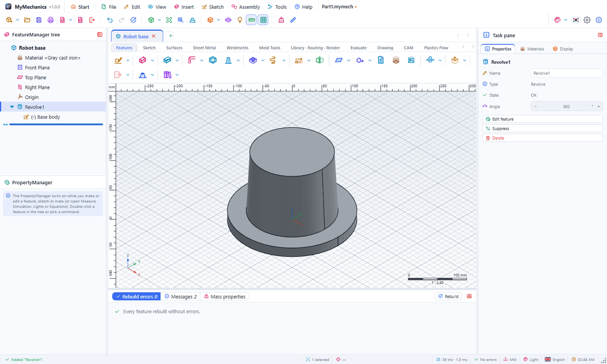

> This lesson's result: start page › Samples › Tutorial — six-axis robot › **Lesson 1**

## Lesson 2. Base — ribs and a circular pattern

Draw one rib and repeat it six times round.

1. On the Front plane draw the rib's section as a triangle: (76, 18), (106, 18), (73, 90).
2. Extruded Boss with end condition Mid Plane, thickness 10: the rib grows 5 to each side of the sketch.
3. Circular Pattern: the rib as the seed, the Z axis (vertical), 6 instances — six ribs, 60° apart.

   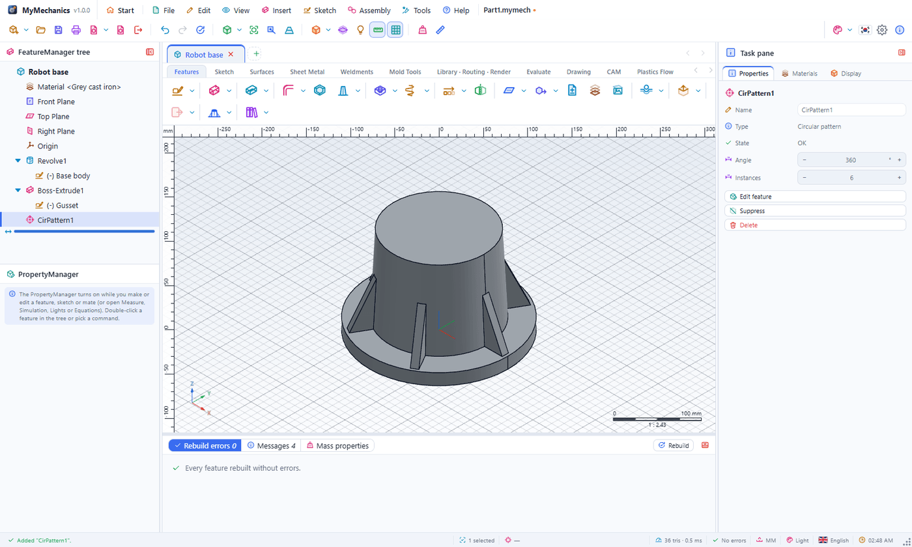

> This lesson's result: start page › Samples › Tutorial — six-axis robot › **Lesson 2**

## Lesson 3. Base — holes and the bearing seat

Holes on offset planes, and the J1 bearing seat cut in the top.

1. Reference plane: 18 above the Top plane (the flange's top). On it put a point at (82.3, 47.5) — radius 95, at 30°.
2. Hole Wizard: counterbore, Ø13, counterbore Ø20 × 4 deep, through all. A Circular Pattern (Z axis, 6) gives six anchor holes.
3. A plane 140 above Top, a Ø60 circle on it, cut 32 deep: the bearing seat for the J1 shaft.
4. On a plane 80 from Front put a point at (0, 60) and make a Ø30 × 40 hole for the cable entry. Chamfer the flange and the column top edges by 2.

   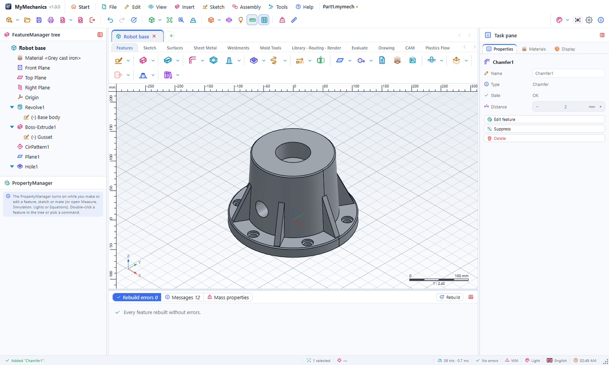

> This lesson's result: start page › Samples › Tutorial — six-axis robot › **Lesson 3**

## Lesson 4. Waist (J1) — turntable and column

Extrude up and down, then raise a square column.

1. New part "Waist (J1)", aluminium 6061, RB-110.
2. On Top a Ø160 circle → extrude 25 (the turntable). On Top again a Ø60 circle → extrude 30 the other way (the J1 shaft).
3. On a plane 25 up draw a centre rectangle 110 × 100 → extrude 205 for the column; fillet its four vertical edges with radius 20.

   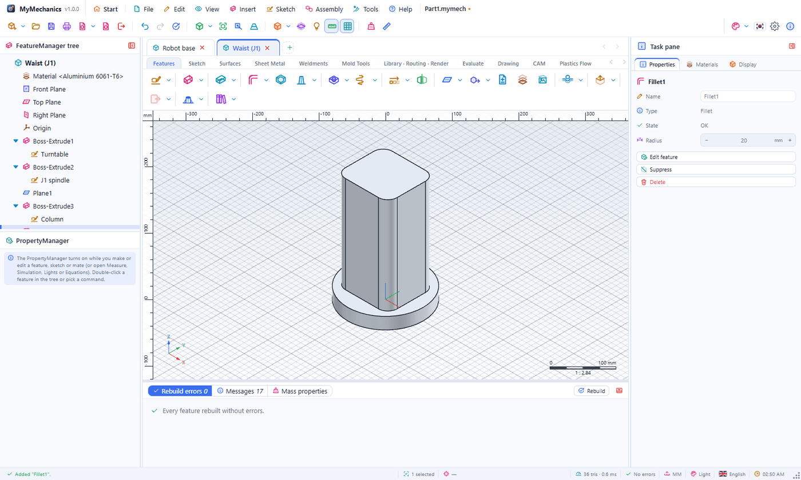

> This lesson's result: start page › Samples › Tutorial — six-axis robot › **Lesson 4**

## Lesson 5. Waist (J1) — J2 housing and holes

The housing and bearing bore of the shoulder joint J2.

1. On a plane 50 from Front (the column's side) a Ø120 circle centred at (0, 180) → extrude 12: the J2 housing.
2. On the housing's face (62) a Ø50 × 45 hole (the J2 bearing), then a Ø6.8 × 12 screw hole at radius 48, patterned 8 times round the bearing axis.
3. On the Right plane a Ø36 circle at (0, 100), cut through both ways (the cable passage). On the turntable's top a counterbored hole Ø9 / Ø15 × 5 at (72, 0), patterned 4 times.

   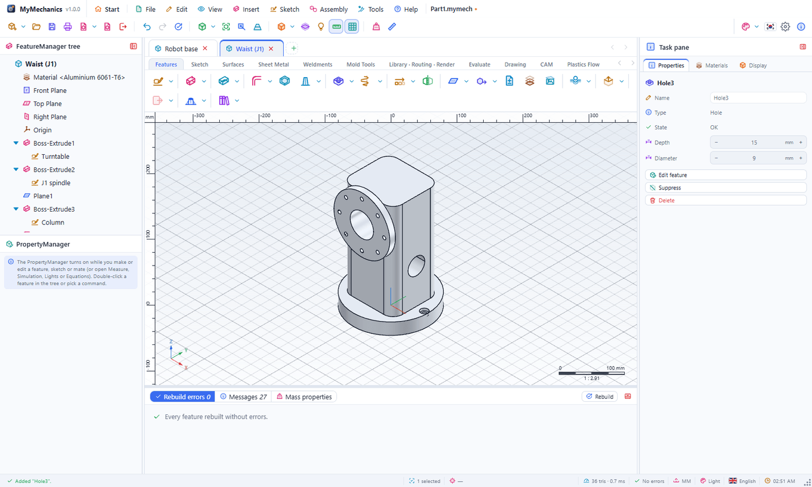

> This lesson's result: start page › Samples › Tutorial — six-axis robot › **Lesson 5**

## Lesson 6. Upper arm (J2)

The arm between two joints: web, hubs, lightening pockets.

1. New part "Upper arm (J2)", aluminium 7075, RB-120. On Front a Ø50 circle → extrude 40 backwards (the J2 shaft).
2. On Front a rectangle (-40, 0)–(40, 400) → extrude 40 (the web); two circles — Ø120 at (0, 0), Ø100 at (0, 400) — → extrude 40 (the joint hubs).
3. On the web's face (40) two slots (x = ±17, y 90–310, radius 12) → cut 25 deep: pockets that leave a centre rib.
4. At (0, 400) a Ø90 × 10 J3 housing, a Ø40 × 45 bearing bore, six Ø5 screw holes at radius 36 (circular pattern), a Ø16 cable hole from the Right plane, a 1.5 chamfer on the housing's rim.

   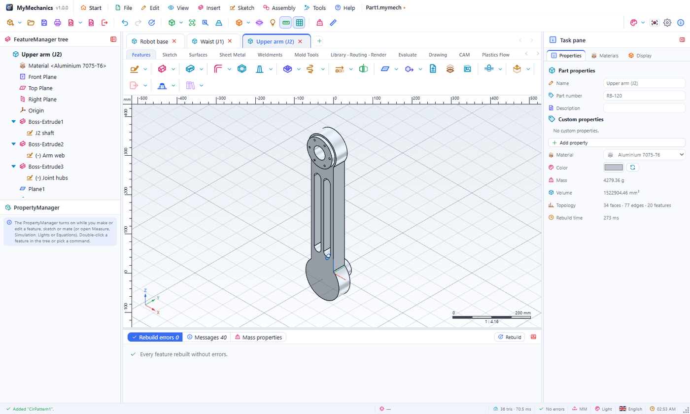

> This lesson's result: start page › Samples › Tutorial — six-axis robot › **Lesson 6**

## Lesson 7. Forearm (J3)

A tube from the joint hub to the wrist, and the motor housing.

1. New part "Forearm (J3)", aluminium 7075, RB-130. On Front Ø40 → 40 backwards (the J3 shaft), Ø100 → 80 (the hub).
2. On the Right plane a Ø70 circle at the hub's mid-height (40) → extrude 300: the arm tube.
3. On a plane 10 from Front a rectangle (-35, 30)–(35, 75) → extrude 60 (the wrist motor housing); fillet its four top edges, radius 6.
4. At the tube's end (300 from Right) a Ø40 × 30 J4 bearing bore and six Ø4.2 screw holes (circular pattern); a Ø16 cable hole in the housing's top.

   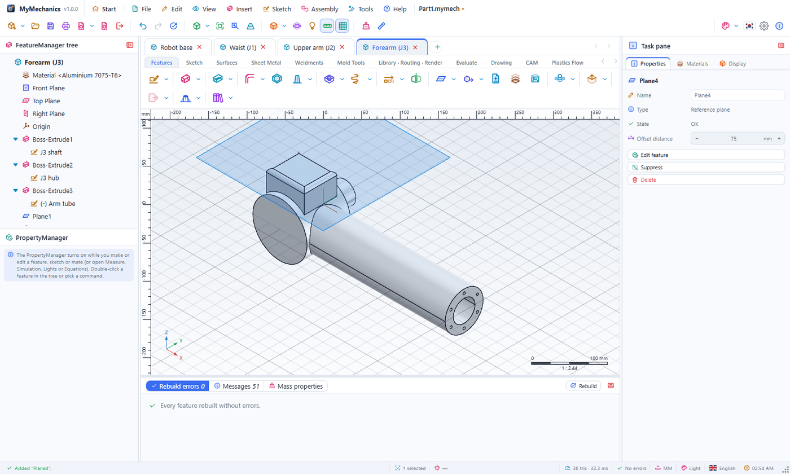

> This lesson's result: start page › Samples › Tutorial — six-axis robot › **Lesson 7**

## Lesson 8. Wrist yoke (J4)

Draw the yoke plate with lines and an arc, then mirror it.

1. New part "Wrist yoke (J4)", aluminium 7075, RB-140. On Right Ø40 → 30 backwards (the J4 shaft), Ø70 → 40 (the roll housing).
2. On a plane 20 from Front the yoke plate: lines (80, 30)→(30, 30)→(0, 0)→(30, -30)→(80, -30), closed by an arc centred at (80, 0), radius 30. Extrude 12.
3. Mirror: copy the plate about the Front plane for the second prong; on Front a Ø20 circle at (80, 0) → cut through both ways (the J5 bore); chamfer the shaft end by 1.5.

   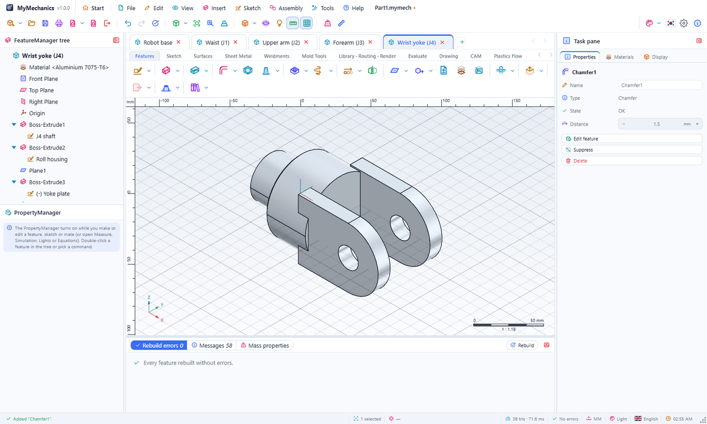

> This lesson's result: start page › Samples › Tutorial — six-axis robot › **Lesson 8**

## Lesson 9. Wrist pitch (J5) and tool flange (J6)

Mid-plane extrudes and the ISO 9409 flange holes.

1. New part "Wrist pitch (J5)", steel 4340, RB-150. On Front Ø56 → mid plane 40 (the hub), Ø20 → mid plane 64 (the J5 trunnion).
2. On Right Ø36 → extrude 70 (the nose); in its end a Ø25 × 25 J6 bearing bore; a 1 chamfer on the trunnion rims.
3. New part "Tool flange (J6)", steel 4340, RB-160. On Right Ø25 → 20 backwards (the J6 shaft), Ø63 → 12 (the flange).
4. On the flange face a Ø31.5 × 6 locating bore, a Ø6.6 through hole at (0, 25) patterned 4 times round X (ISO 9409-1-50-4-M6), a 1 chamfer.

   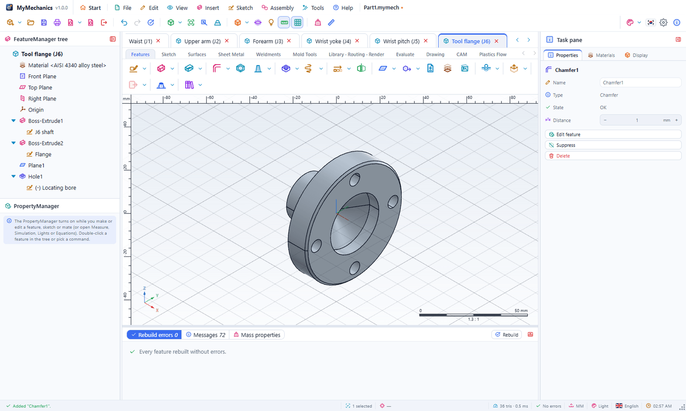

> This lesson's result: start page › Samples › Tutorial — six-axis robot › **Lesson 9**

## Lesson 10. Gripper body and finger

The gripper's two parts.

1. New part "Gripper body", aluminium 6061, RB-210. On Right Ø31.5 → 6 backwards (the spigot), Ø63 → 8 (the mount plate).
2. On a plane 8 out a centre rectangle 40 × 76 → extrude 50 (the actuator body); fillet the four long edges, radius 4; on the end face (58) a rectangle (-8, -34)–(8, 34) → cut 6 deep (the finger slot).
3. Four Ø6.6 × 8 screw holes in the mount plate (circular pattern); two Ø5 × 12 air ports on a plane 38 above Top.
4. New part "Gripper finger", steel 4340, RB-220. On Front (0, 0)–(6, 12) → mid plane 16 (the slide), (6, 0)–(70, 8) → mid plane 20 (the finger), a V-jaw triangle cut through both ways, a 1.5 chamfer on the tip.

   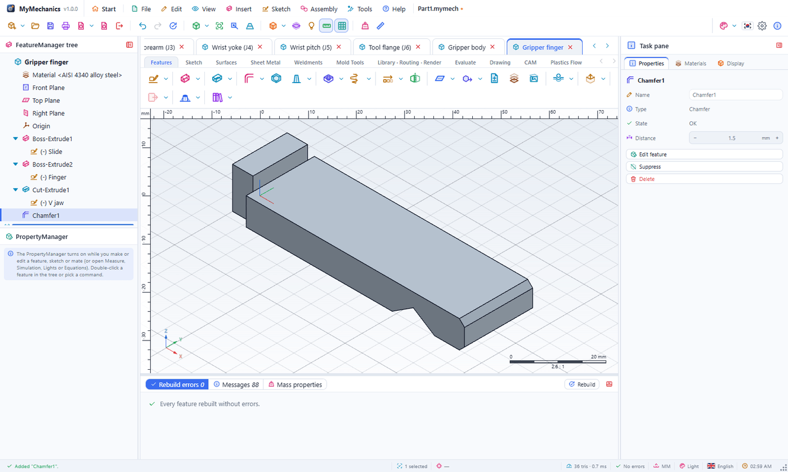

> This lesson's result: start page › Samples › Tutorial — six-axis robot › **Lesson 10**

## Lesson 11. Gripper sub-assembly

Two fingers that open and close together about the centre.

1. Make a new assembly "Two-finger gripper"; insert the gripper body (fixed at the origin) and two fingers, the second turned 180° about X.
2. For each finger: its slide's end face coincident with the body's end face (52), and a width mate centring its sides between the slot's sides.
3. A width mate between the fingers' outer faces and the body's upper and lower faces makes them move together; limit the distance between their inner faces to 12–50.
4. Motion study: a linear motor on the first finger (amplitude 6, period 2 s); play it — the other finger follows through the width mate.

   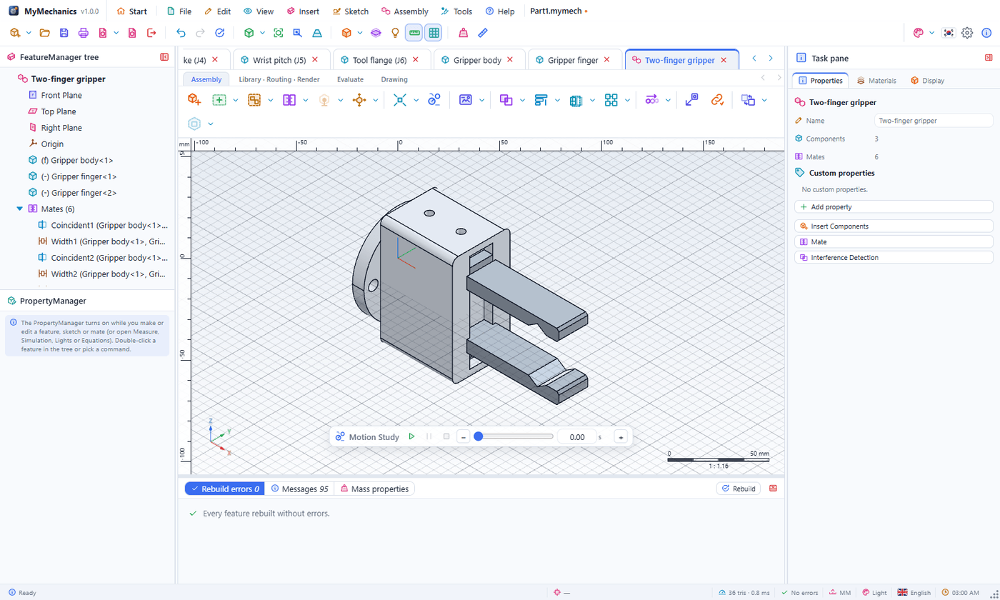

> This lesson's result: start page › Samples › Tutorial — six-axis robot › **Lesson 11**

## Lesson 12. Robot assembly — J1

Fix the base and turn the waist on a hinge.

1. In a new assembly "Six-axis articulated robot" insert the base (fixed at the origin) and the waist.
2. Hinge mate: the base's seat and the waist's J1 shaft (cylinders), the base's top and the turntable's underside (faces). One freedom is left: turning about J1.
3. Put a rotary motor on the J1 shaft (amplitude 45°, period 6 s) and play.

   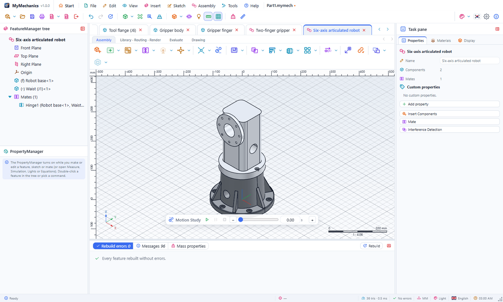

> This lesson's result: start page › Samples › Tutorial — six-axis robot › **Lesson 12**

## Lesson 13. Robot assembly — J2 and J3

Raise the arm and set its range with limit angles.

1. Insert the upper arm and the forearm.
2. J2: a hinge between the waist's bearing bore and the upper arm's shaft, the angle between the column's top and the arm's web limited to 30–150°. J3: a hinge at the upper arm's end bearing and the forearm's shaft, angle 20–160°.
3. Motors on J2 (20°, 6 s) and J3 (25°, 3 s). Each is mounted on the link below it (the waist, the upper arm), so it turns wherever the joints below have taken it.

   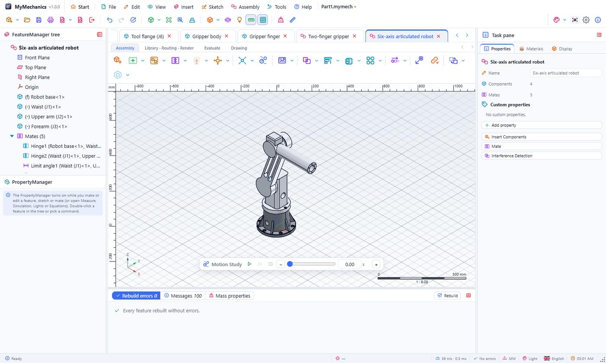

> This lesson's result: start page › Samples › Tutorial — six-axis robot › **Lesson 13**

## Lesson 14. Robot assembly — wrist J4, J5, J6

Join the wrist's three axes.

1. Insert the wrist yoke, the wrist pitch and the tool flange.
2. J4: a hinge at the forearm's end bearing and the yoke's shaft. J5: a hinge at the yoke's bore and the pitch trunnion, angle 0–110°. J6: a hinge at the nose bearing and the flange's shaft.
3. Swinging motors on J4 (60°, 4 s) and J5 (30°, 3 s), and a motor turning J6 round at 20 rpm.

   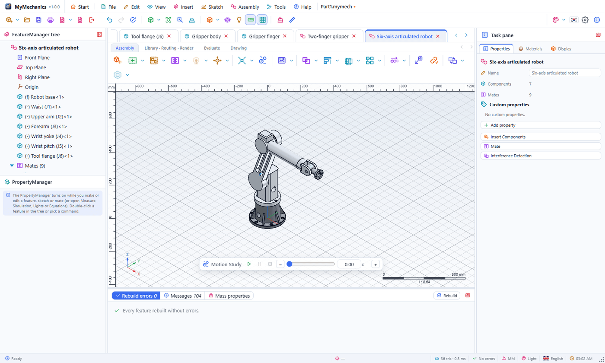

> This lesson's result: start page › Samples › Tutorial — six-axis robot › **Lesson 14**

## Lesson 15. The gripper on, and the whole motion

Insert the sub-assembly like one component.

1. Insert Component: the "Two-finger gripper" sub-assembly.
2. The gripper's mount plate coincident with the flange face, the spigot concentric with the locating bore, and one screw hole concentric with one of the flange's.
3. Play the motion study: all six joints move together, and the gripper plays its own motion (the fingers opening and closing).

   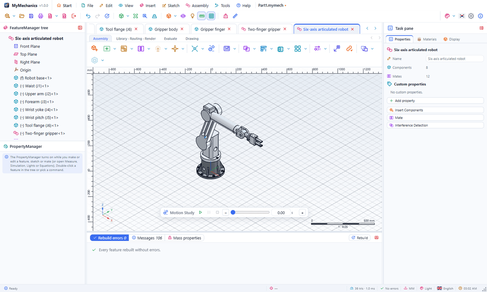

> This lesson's result: start page › Samples › Tutorial — six-axis robot › **Lesson 15**

## Lesson 16. Exploded view

Spread the parts out in assembly order.

1. In the explode editor make seven steps: gripper → flange → pitch → yoke (towards +X), forearm → upper arm (forwards), then everything above J1 upwards.
2. Explode Animation plays the steps out one after the other, and back.

   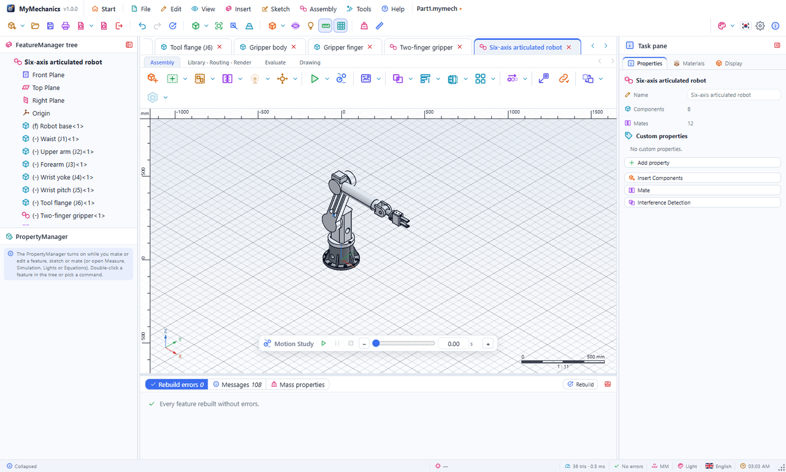

> This lesson's result: start page › Samples › Tutorial — six-axis robot › **Lesson 16**

## Lesson 17. Assembly drawing

An assembly drawing with a bill of materials and balloons.

1. Make Drawing from the assembly: a front view and an isometric view on an A2 sheet.
2. Turn the bill of materials on, place item balloons round the isometric view and write the notes (reducers, tool flange standard, cable routing). Export DXF, DWG or PDF, or print.

   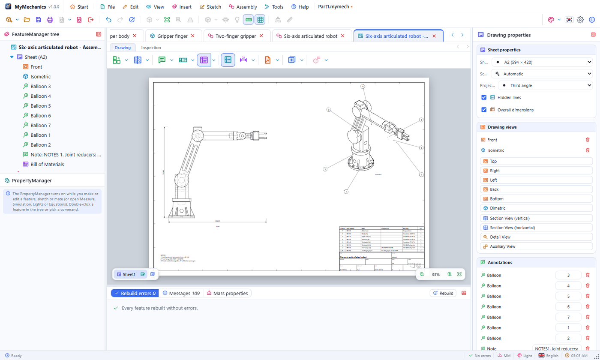

> This lesson's result: start page › Samples › Tutorial — six-axis robot › **Lesson 17**

## Wrapping up

Done. Open one of the robot's parts and change a dimension: the assembly and the drawing follow. Try other amplitudes and periods in the motion study, or run Interference Detection (Assembly menu) to check that nothing collides as the joints move.
