# MyMechanics 튜토리얼

이 튜토리얼은 MyMechanics를 처음 여는 분을 위한 따라 하기 안내입니다. 빈 화면에서 시작해 스케치 → 치수 → 돌출 → 필렛 → 구멍 → 패턴으로 첫 부품을 만들고, 이어서 스윕, 판금, 어셈블리와 메이트, 모션 스터디, 단면도와 부품표가 들어간 도면, 정적 해석까지 차례로 해 봅니다. 단계마다 그 순간의 화면을 넣었습니다. 빨간 번호는 눌러야 할 곳이나 살펴볼 곳입니다.

전체를 따라 하는 데 한 시간쯤 걸립니다. 각 과는 따로 해도 되지만, 1–4과는 같은 부품을 이어서 만들고 9과에서 그 부품의 도면을 그립니다. 기능 하나하나의 자세한 설명은 **사용 설명서**(F1)에 있습니다.

## 1과. 첫 스케치 — 사각형과 치수

모든 부품은 평면 위의 2D 스케치에서 시작합니다. 스케치에 선을 그리고, 구속 조건과 치수로 크기와 위치를 정해 둡니다.

1. 시작 화면의 **새 부품**을 누르거나 Ctrl+N을 누릅니다. 트리에 정면·윗면·우측면과 원점이 있는 빈 부품이 열립니다.
2. CommandManager의 **피처** 탭에서 **스케치**를 누릅니다. 왼쪽에 스케치 PropertyManager가 나오면 **윗면**을 고릅니다. 그래픽 영역에서 평면을 클릭해도 됩니다.

   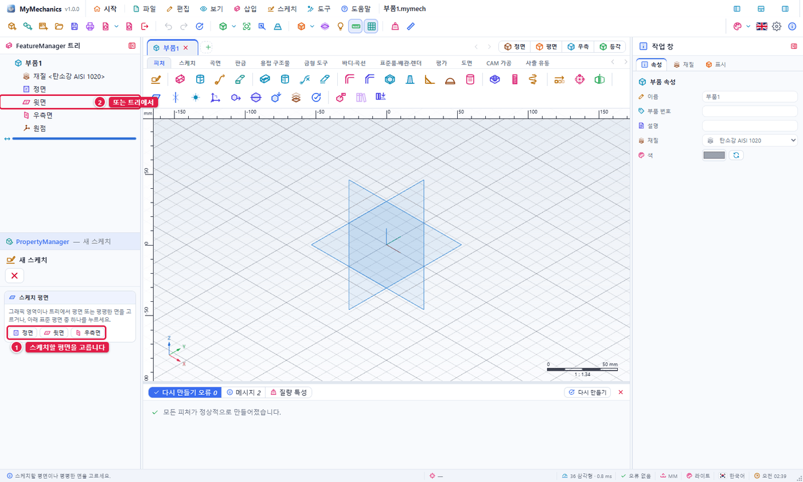

3. 보기가 윗면에 수직으로 바뀌고 CommandManager가 **스케치** 탭으로 넘어갑니다. **중심 사각형**을 누르고, 먼저 원점을 클릭한 다음 바깥쪽에서 모서리를 클릭합니다. 원점에 붙으면 주황 원이 보이고 일치 구속이 저절로 들어갑니다.

   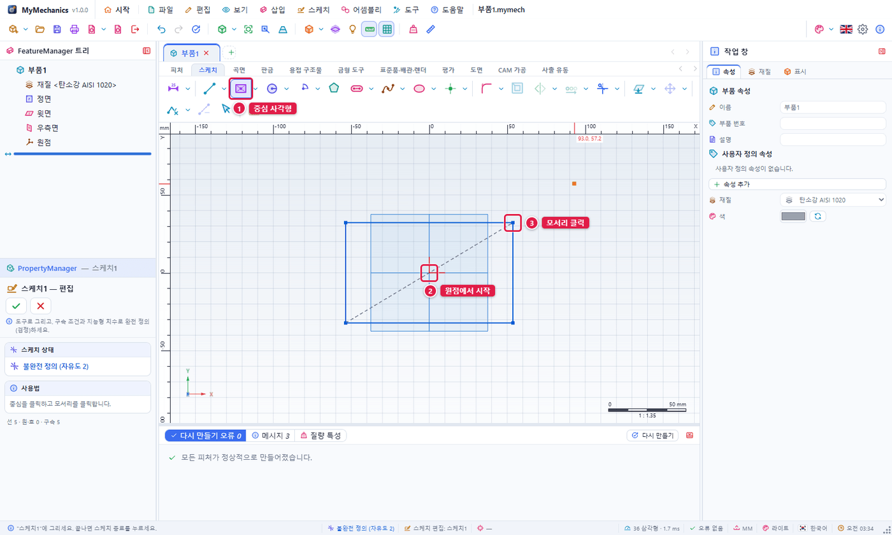

4. 아직 선이 파란색입니다. 크기가 정해지지 않아 움직일 수 있다는 뜻입니다. **지능형 치수**(D)를 누르고 가로선을 클릭해 `80`, 세로선을 클릭해 `50`을 넣습니다. 선이 모두 검은색이 되고 상태 표시줄에 **완전 정의됨**이 나오면 성공입니다.

   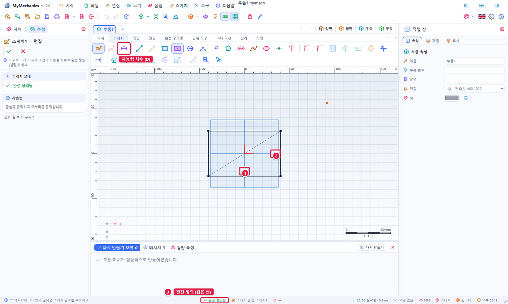

5. **스케치 종료**를 누릅니다. 트리에 **스케치1**이 생깁니다.

> 치수 글자를 두 번 클릭하면 값을 바꿀 수 있습니다. 숫자 입력란에는 `100/3`, `25.4in`처럼 계산식과 단위도 쓸 수 있습니다.

## 2과. 돌출 — 스케치를 입체로

1. 스케치1을 고른 채 **피처 › 돌출 보스**를 누릅니다.
2. PropertyManager의 깊이에 `20`을 넣습니다. 그래픽 영역에 노란 미리보기가 나옵니다. 방향을 바꾸려면 반대 방향 확인란을 켭니다.
3. ✔(Enter)를 누릅니다. 트리에 **보스-돌출1**이 생기고, 그 아래에 스케치1이 들어갑니다.

   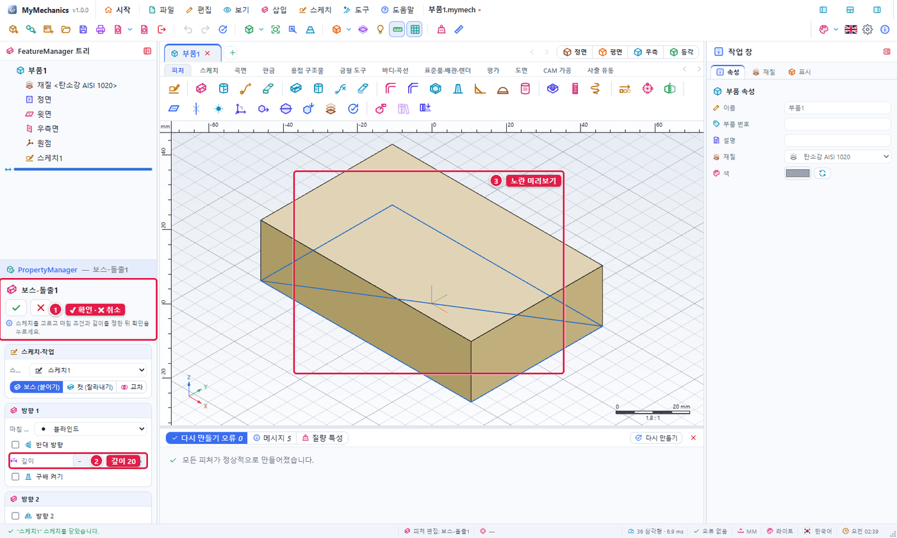

> 보기는 왼쪽 끌기로 돌리고, 오른쪽 끌기로 옮기고, 휠로 확대·축소합니다. F를 누르면 전체가 화면에 맞춰집니다. Ctrl+7은 등각 보기입니다.

## 3과. 필렛과 구멍

### 모서리 둥글게 하기

1. **필렛**을 누릅니다.
2. 블록의 세로 모서리를 하나씩 클릭합니다. 고른 모서리는 분홍 선택 상자에 쌓입니다. 뒤쪽 모서리는 보기를 돌려서 고르세요. 면을 클릭하면 그 면의 모든 모서리가 한 번에 들어갑니다.
3. 반지름 `5`를 넣고 ✔를 누릅니다.

   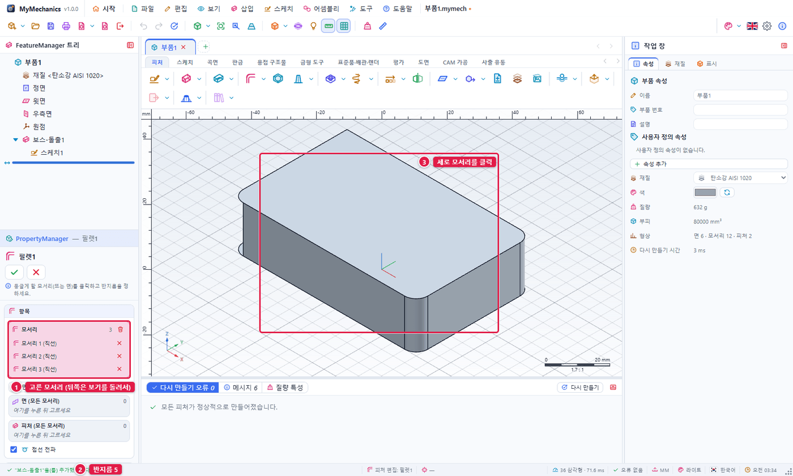

### 카운터보어 구멍

1. **구멍 가공 마법사**를 누릅니다.
2. 구멍 유형에서 **카운터보어**를, 크기에서 **M8**을 고릅니다. 볼트가 지나갈 구멍 지름과 머리가 들어갈 자리 크기가 표준 값으로 채워집니다.
3. 블록 윗면에서 원점 오른쪽(X 15 mm쯤)을 클릭합니다. 빨간 미리보기가 구멍입니다. 마침 조건은 **관통**으로 둡니다.
4. ✔를 누릅니다. 구멍 위치는 **구멍위치** 스케치로 저장되므로 나중에 치수를 넣어 정확히 옮길 수 있습니다.

   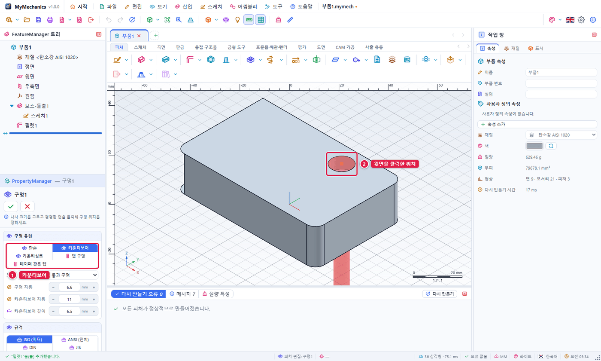

## 4과. 패턴 — 구멍 네 개

구멍을 하나 더 그리는 대신 패턴으로 복사하면, 원본 구멍을 고칠 때 복사본도 함께 바뀝니다.

1. 트리에서 **구멍1**을 클릭해 고릅니다.
2. **원형 패턴**을 누릅니다. 패턴할 피처 목록에 구멍1이 들어 있습니다.
3. 축은 **Y**, 전체 각도 `360`, 인스턴스 수 `4`, **동등 간격**을 켭니다.
4. ✔를 누르면 원점을 중심으로 구멍 네 개가 생깁니다.

   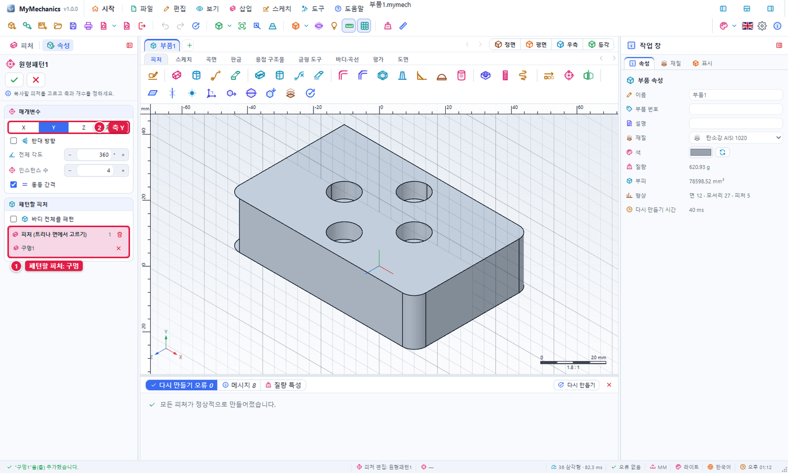

5. Ctrl+S로 저장합니다. 부품·어셈블리·도면이 모두 `.mymech` 파일 하나에 들어갑니다.

트리에는 피처가 만든 순서대로 쌓여 있습니다. 피처를 두 번 클릭하면 다시 편집할 수 있고, 앞의 치수를 바꾸면 뒤의 필렛·구멍·패턴이 새 형상에 맞춰 모두 다시 만들어집니다. 트리 맨 아래 파란 **롤백 바**를 위로 끌면 그 아래 피처를 잠시 빼고 볼 수 있습니다.

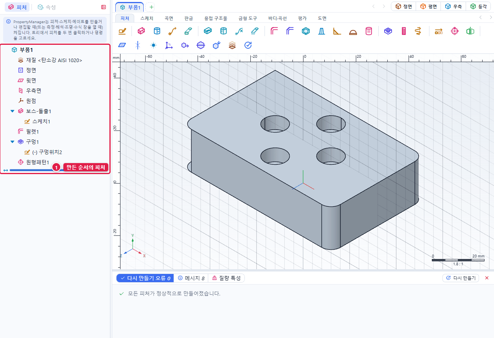

## 5과. 스윕 — 경로를 따라 관 만들기

스윕은 닫힌 윤곽을 경로를 따라 쓸어서 입체를 만듭니다. 휘어진 관이나 손잡이, 스프링을 만들 때 씁니다.

1. 새 부품을 엽니다(Ctrl+N).
2. **윗면**에 스케치를 열고 원점을 중심으로 원 두 개를 그립니다. 지름 `16`과 `12`를 넣으면 두께 2 mm의 관 단면이 됩니다. 스케치를 종료하고 이름을 **윤곽**으로 바꿉니다(F2).
3. **정면**에 스케치를 열고 원점에서 위로 60 mm, 비스듬히 오른쪽 위로, 다시 수평으로 이어지는 **선**을 그립니다. 열린 선이어도 됩니다. 스케치를 종료하고 이름을 **경로**로 바꿉니다.

   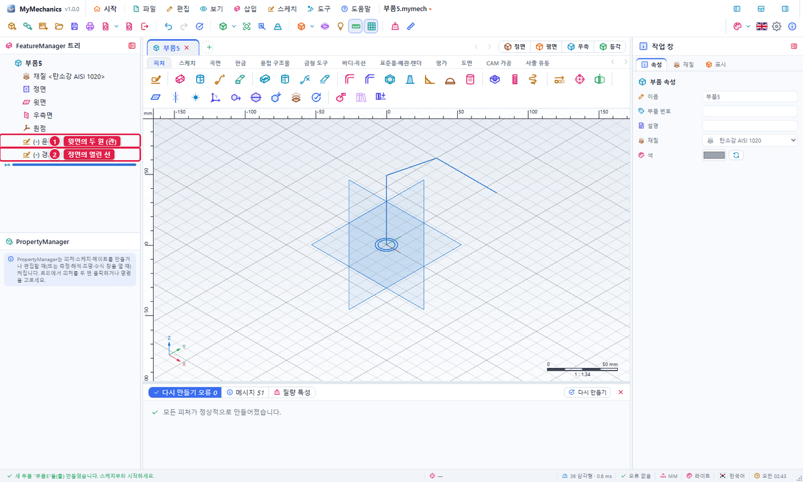

4. **스윕 보스**를 누릅니다. 윤곽에 **윤곽** 스케치, 경로에 **경로** 스케치를 고릅니다. 윤곽은 경로의 시작점에서 경로와 직각인 평면에 있어야 합니다.

   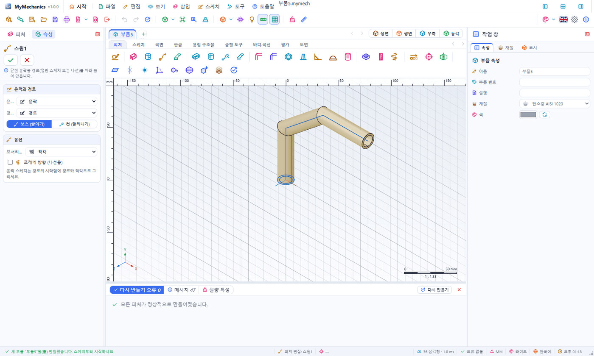

5. ✔를 누르면 경로를 따라 굽은 관이 만들어집니다.

   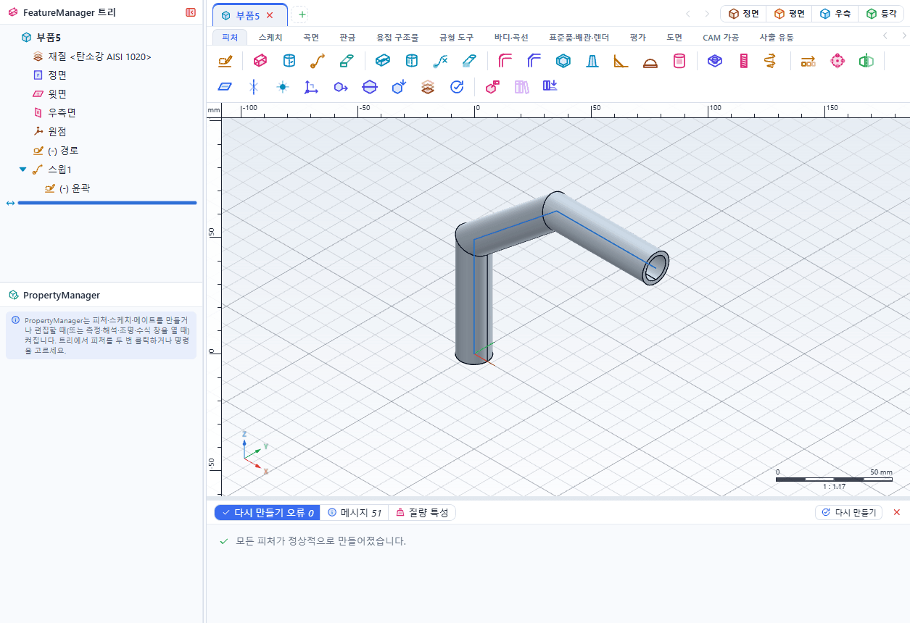

> 경로로 **나선**(피처 › 나선)을 쓰고 **프레네 방향**을 켜면 스프링이 됩니다. 예제 **압축 스프링**을 열어 보세요.

## 6과. 판금 — 플랜지와 전개도

판금 부품은 두께가 일정한 판을 굽혀 만듭니다. 굽힌 모양과 펼친 모양(전개도)을 오가며 볼 수 있습니다.

1. 새 부품을 열고 **윗면**에 120 × 70 사각형 스케치를 그린 뒤 종료합니다.
2. CommandManager의 **판금** 탭에서 **베이스 플랜지**를 누릅니다. 두께, 굽힘 반지름, K 계수를 확인하고 ✔를 누릅니다.

   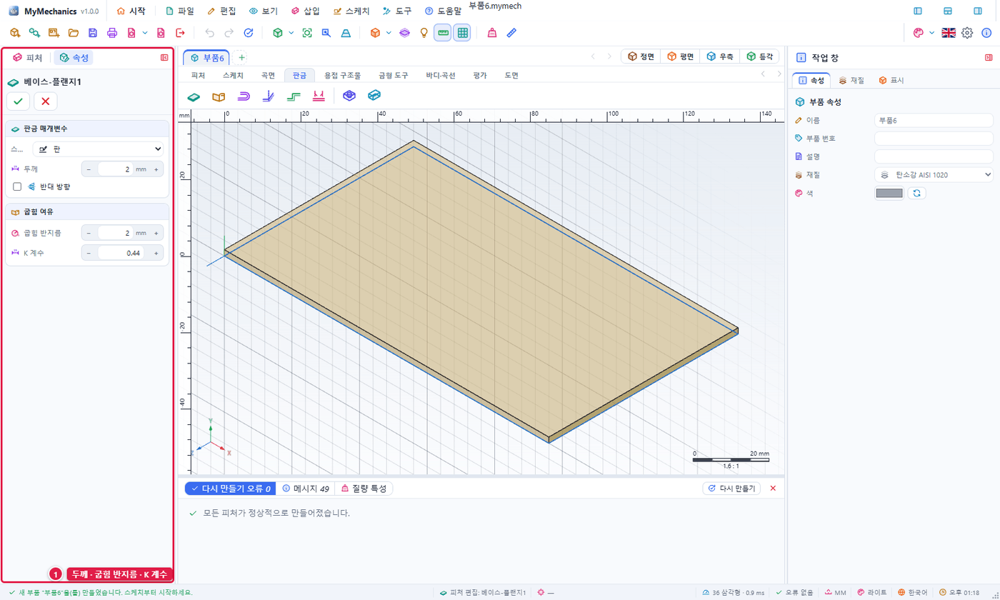

3. 판 윗면의 오른쪽 짧은 모서리를 클릭해 고르고 **모서리 플랜지**를 누릅니다. 각도 `90`, 길이 `35`를 넣으면 미리보기가 나옵니다. ✔.

   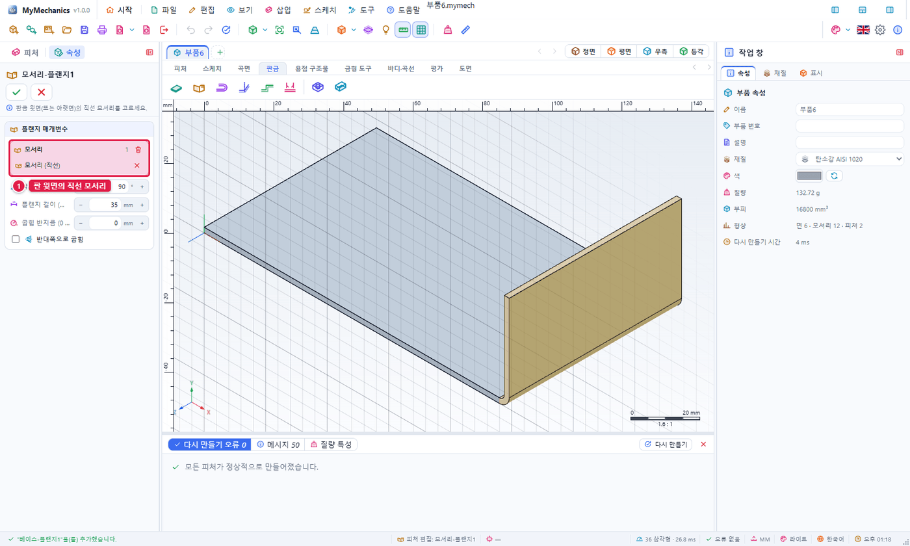

4. **펼치기**를 누릅니다. 굽힘 여유(각도 × (반지름 + K × 두께))를 넣어 계산한 전개도가 나옵니다. 다시 누르면 접힌 모양으로 돌아갑니다.

   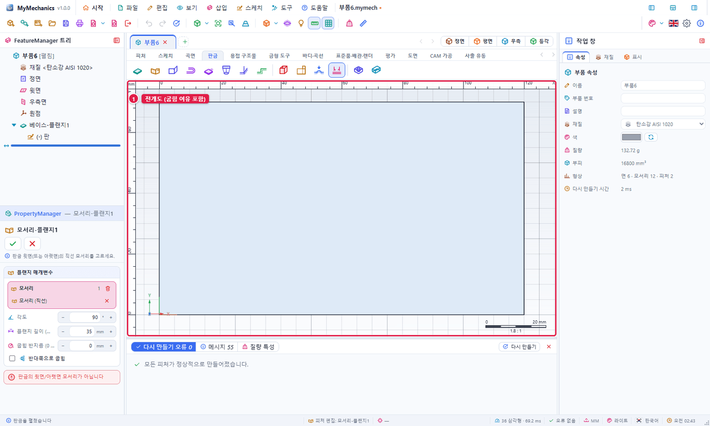

> 헴(되접기), 스케치 굽힘, 조그도 같은 탭에 있습니다. 예제 **판금 섀시 케이스**에 모두 들어 있습니다.

## 7과. 어셈블리와 메이트

어셈블리는 부품을 넣고 **메이트**(면과 면의 관계)로 위치를 정합니다.

1. **새 어셈블리**를 누릅니다. 왼쪽에 프로젝트의 부품과 예제 부품 목록이 나옵니다. 넣을 부품을 클릭하면 그래픽 영역에 들어갑니다. 첫 부품은 원점에 고정(`(f)`)됩니다.

   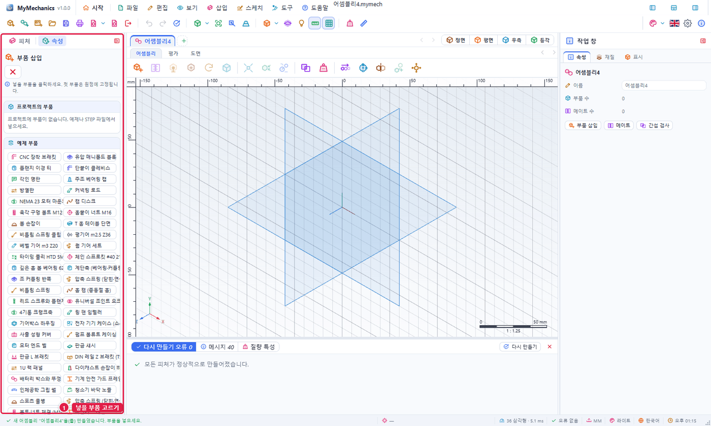

2. **어셈블리 › 부품 삽입**으로 두 번째 부품을 넣습니다. 아직 메이트가 없어 자유롭게 움직이는 부품에는 `(-)`가 붙습니다.
3. **메이트**를 누르고 두 부품의 원통면을 차례로 클릭합니다. 원통면 두 개는 **동심**이 먼저 제안되고, 부품이 바로 그 자리로 움직입니다. ✔를 누릅니다. 이어서 평평한 면 두 개를 고르면 **일치**가 제안됩니다.

   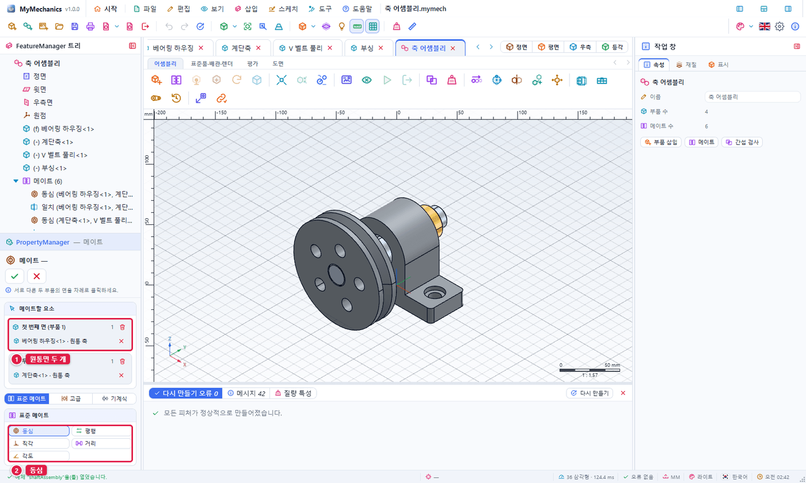

4. 메이트는 트리의 **메이트** 폴더에 쌓입니다. 위치가 모두 정해진 부품은 `(-)`가 없어지고, 서로 맞지 않는 메이트는 빨간색이 됩니다.

   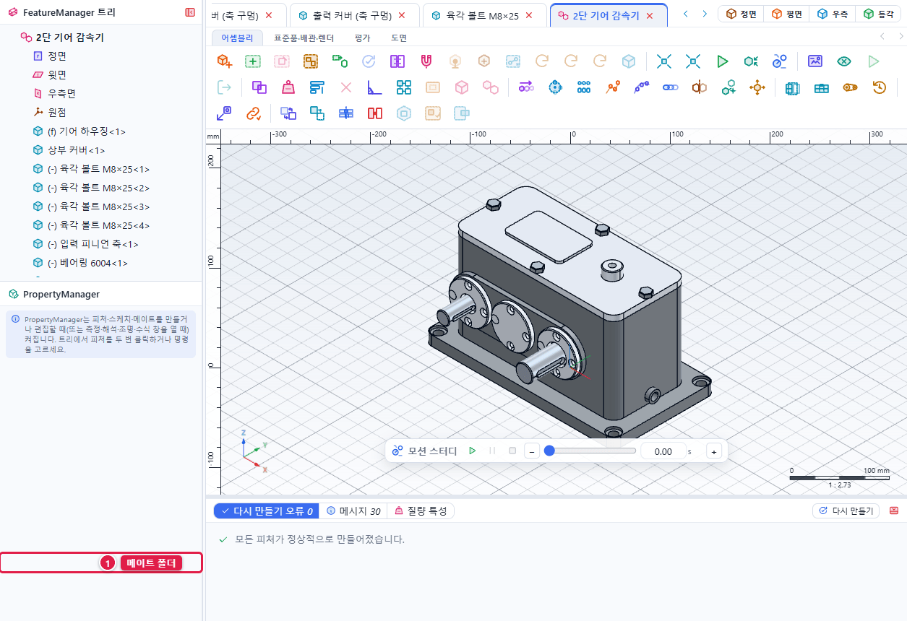

> 예제 **축 어셈블리**와 **2단 기어 감속기**를 열면 완성된 메이트를 볼 수 있습니다. 메이트 PropertyManager의 **고급**·**기계식** 버튼에는 폭·거리 제한, 기어·랙 피니언·나사·힌지 메이트가 있습니다.

## 8과. 모션 스터디

기어·나사·랙 피니언 메이트로 이어진 부품은 모터 하나로 함께 움직입니다.

1. 예제 **2단 기어 감속기**를 엽니다(시작 화면 › 예제 › 어셈블리).
2. **어셈블리 › 모션 스터디**를 누릅니다. 이 예제에는 입력축에 회전 모터가 이미 달려 있습니다. 새 모터는 부품의 원통면을 클릭해 답니다(회전 모터 rpm, 직선 모터 mm/s).
3. **재생**을 누르거나 시간 막대를 끌어 원하는 순간을 봅니다. 입력축이 돌면 기어 메이트로 이어진 중간축과 출력축이 기어비대로 따라 돕니다.

   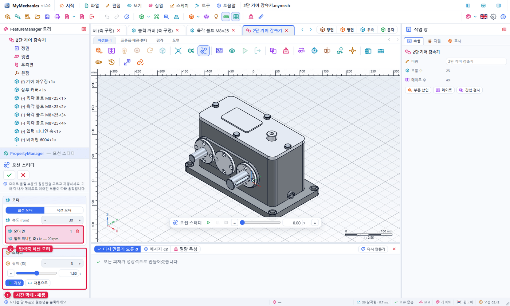

4. **분해도**를 누르면 부품이 바깥으로 벌어집니다. 다시 누르면 접힙니다.

   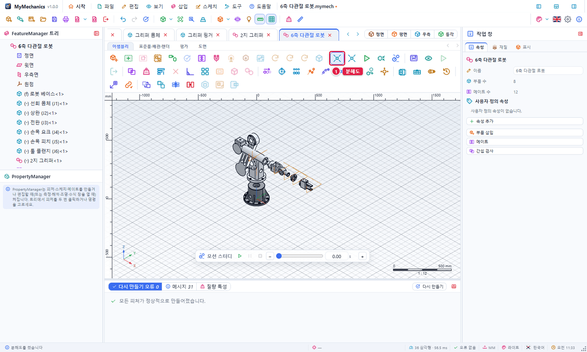

## 9과. 도면 — 단면도와 부품표

1. 1–4과에서 만든 부품의 탭으로 돌아가 **도면 › 도면 만들기**를 누릅니다. A3 시트에 정면도·평면도·우측면도와 등각 보기가 놓이고, 척도는 시트에 맞게 자동으로 정해집니다. 오른쪽 작업 창에서 시트 크기·척도·투상법을 바꿉니다.

   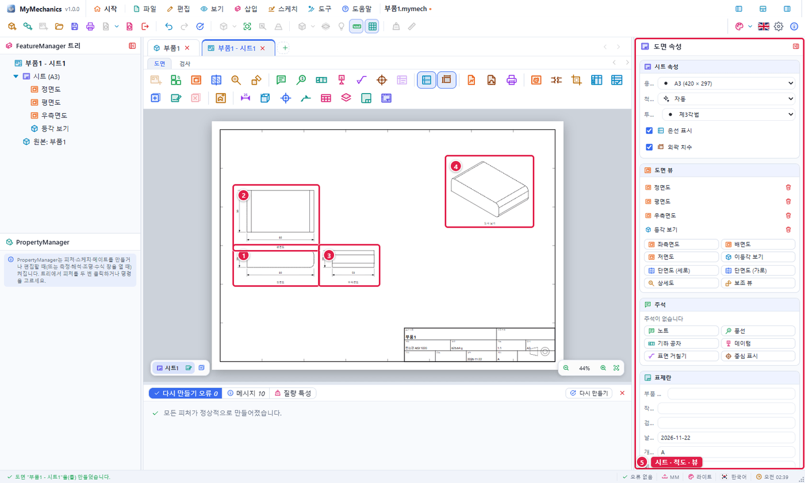

2. 정면도를 클릭해 고르고 **단면도**를 누릅니다. 가운데를 자른 단면도 **A-A**가 해칭과 함께 놓이고, 정면도에 절단선과 화살표가 그려집니다.
3. **상세도**를 누르면 고른 부분을 2배로 키운 상세도 **B**가 생깁니다. 뷰는 끌어서 옮길 수 있습니다.

   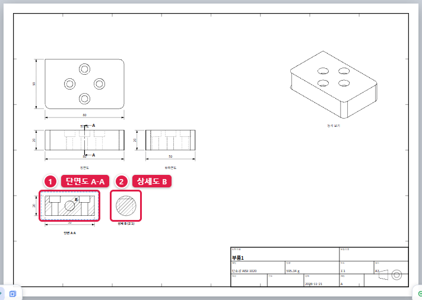

4. 어셈블리에서 도면을 만들고 **BOM**을 누르면 표제란 위에 부품 번호·이름·재질·수량 표가 놓입니다.

   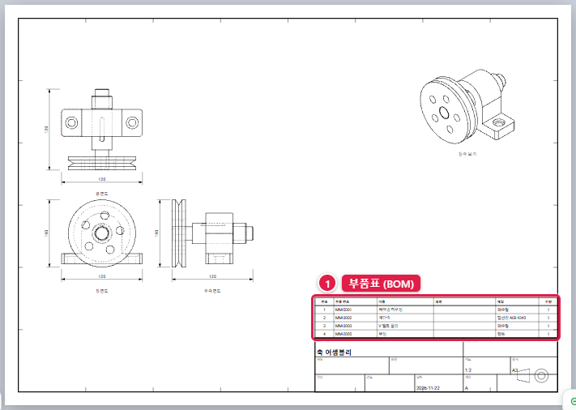

5. **DXF**나 **SVG**로 내보내거나 Ctrl+P로 인쇄합니다. 기하 공차·데이텀·표면 거칠기·풍선은 도면 탭의 주석 버튼으로 넣습니다.

## 10과. 정적 해석

1. 해석할 부품을 열고 **평가 › 해석**을 누릅니다. 해석 종류는 **정적**입니다. 재질의 탄성 계수와 항복 강도가 PropertyManager에 나옵니다.
2. **고정 면** 상자를 누르고 고정할 면(벽에 붙은 쪽)을 클릭합니다. 다음에 **하중 면** 상자를 누르고 힘을 받을 면을 클릭합니다.
3. 힘 `200` N, 방향 **−Y**를 고릅니다. 해상도는 클수록 정확하지만 오래 걸립니다.

   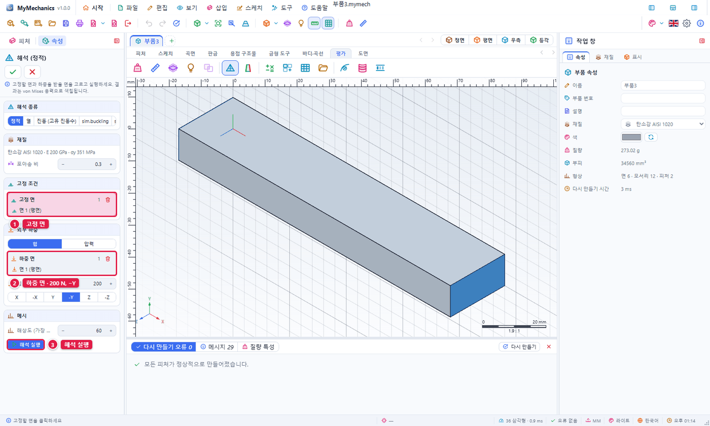

4. **해석 실행**을 누릅니다. 바디가 von Mises 응력으로 칠해지고(파랑 → 빨강), 최대 응력·최대 변위·최소 안전율이 나옵니다. 안전율이 1보다 작으면 항복한다는 뜻입니다. **변형 형상**을 켜면 휜 모양을 과장해서 보여 줍니다.

   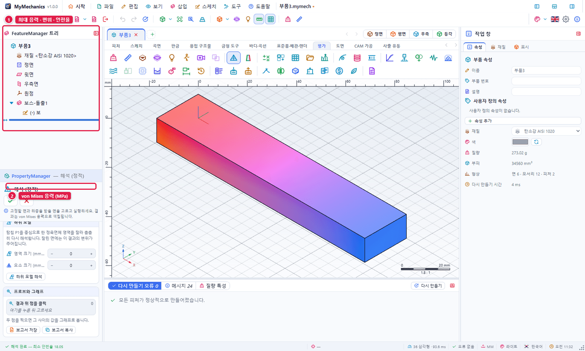

> 해석 종류를 **열**로 바꾸면 온도 분포를, **진동**으로 바꾸면 고유 진동수와 모드 형상을 구합니다. 사용 설명서 8장을 보세요.

## 마치며

여기까지 왔다면 MyMechanics의 주요 흐름을 모두 해 본 셈입니다. 시작 화면의 **예제** 75개(기본 부품, 기계 요소, 하우징, 고급, 어셈블리·도면)를 열어 트리의 피처를 하나씩 두 번 클릭해 보면, 각 기능이 실제로 어떻게 쓰였는지 볼 수 있습니다. 모든 명령과 옵션은 **사용 설명서**에 정리되어 있습니다.
