# MyMechanics 튜토리얼 — 6축 다관절 로봇 만들기

이 튜토리얼은 6축 다관절 로봇을 처음부터 끝까지 만듭니다. 부품 9개(베이스, 선회 몸체 J1, 상완 J2, 전완 J3, 손목 요크 J4, 손목 피치 J5, 툴 플랜지 J6, 그리퍼 몸체, 그리퍼 핑거)를 스케치와 피처로 만들고, 그리퍼 서브 어셈블리와 로봇 어셈블리를 메이트로 조립해 관절마다 모터를 달아 움직인 뒤, 분해도와 부품표가 있는 조립 도면으로 마칩니다. 단위는 mm입니다. 각 과의 결과는 시작 화면 › 예제 › **튜토리얼 — 6축 로봇**에 들어 있어, 아무 과에서나 이어서 할 수 있습니다.

같은 과정을 담은 동영상: `doc/video/MyMechanics-Tutorial.mp4`(도움말 › 튜토리얼).

## 1과. 베이스 — 회전 몸체

단면 하나를 돌려 받침 몸체를 만듭니다.

1. 시작 화면에서 새 부품을 만들고, 작업 창에서 이름 "로봇 베이스", 재질 회주철, 부품 번호 RB-100을 넣습니다.
2. 정면에 스케치하고 몸체의 반단면을 닫힌 선으로 그립니다: (0, 0) → (110, 0) → (110, 18) → (78, 18) → (72, 140) → (0, 140). 원점을 지나는 세로 중심선도 넣습니다.
3. 회전 보스를 누릅니다. 중심선이 축으로 잡히고 360° 돌아 지름 220의 플랜지와 원뿔 기둥이 생깁니다. ✔를 누릅니다.

   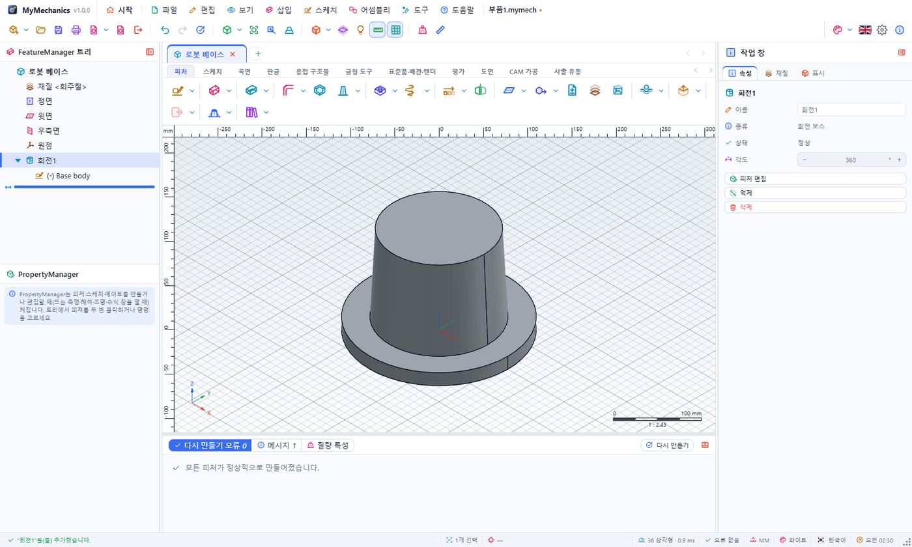

> 이 과의 결과: 시작 화면 › 예제 › 튜토리얼 — 6축 로봇 › **1과**

## 2과. 베이스 — 리브와 원형 패턴

리브 하나를 그려 둘레에 여섯 개로 늘립니다.

1. 정면에 리브 단면을 삼각형으로 그립니다: (76, 18), (106, 18), (73, 90).
2. 돌출 보스에서 끝 조건을 "중간 평면", 두께 10으로 합니다. 리브가 스케치 양쪽으로 5씩 나옵니다.
3. 원형 패턴: 방금 만든 리브를 시드로, 축은 Z(세로 축), 개수 6. 리브 여섯 개가 60°마다 놓입니다.

   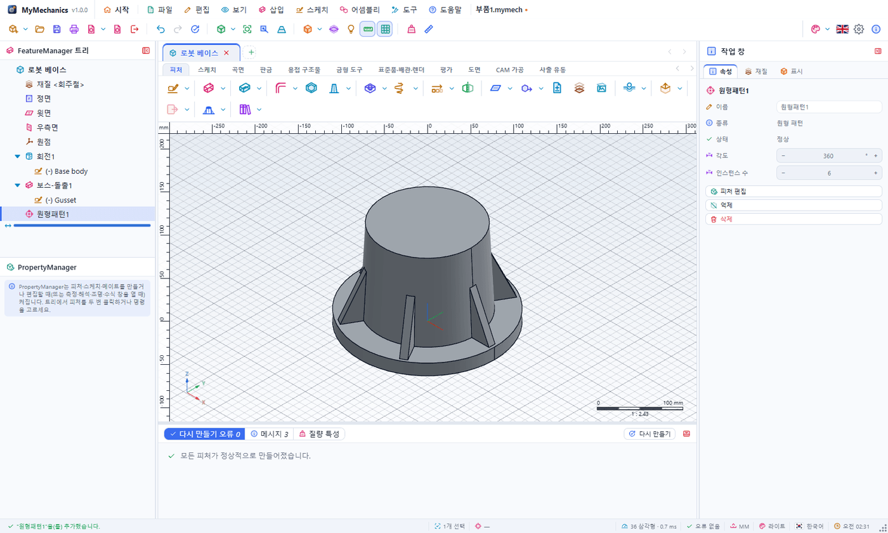

> 이 과의 결과: 시작 화면 › 예제 › 튜토리얼 — 6축 로봇 › **2과**

## 3과. 베이스 — 구멍과 베어링 자리

오프셋 평면에 구멍을 내고 위쪽에 J1 베어링 자리를 팝니다.

1. 참조 평면: 윗면에서 18 위(플랜지 윗면 높이). 그 평면에 점 하나를 (82.3, 47.5) — 반지름 95, 30° — 에 찍습니다.
2. 구멍 가공 마법사: 카운터보어, 지름 13, 카운터보어 지름 20 깊이 4, 관통. 원형 패턴(축 Z, 6개)으로 앵커 구멍 여섯 개를 만듭니다.
3. 윗면에서 140 위에 평면을 만들고 지름 60 원을 그려 깊이 32로 잘라냅니다: J1 축이 들어갈 베어링 자리입니다.
4. 정면에서 80 떨어진 평면에 점(0, 60)을 찍고, 지름 30 깊이 40 구멍으로 케이블 입구를 냅니다. 플랜지와 기둥 윗가장자리를 2 모따기합니다.

   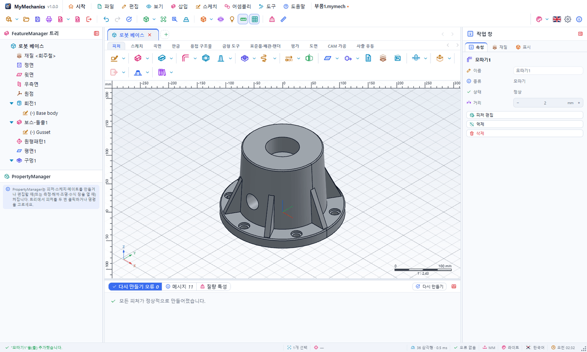

> 이 과의 결과: 시작 화면 › 예제 › 튜토리얼 — 6축 로봇 › **3과**

## 4과. 선회 몸체 (J1) — 턴테이블과 기둥

위아래로 돌출하고 사각 기둥을 세웁니다.

1. 새 부품 "선회 몸체 (J1)", 알루미늄 6061, RB-110.
2. 윗면에 지름 160 원 → 25 돌출(턴테이블). 다시 윗면에 지름 60 원 → 반대 방향으로 30 돌출(J1 축).
3. 25 위 평면에 중심 사각형 110 × 100 → 205 돌출해 기둥을 세우고, 세로 모서리 네 개를 반지름 20으로 필렛합니다.

   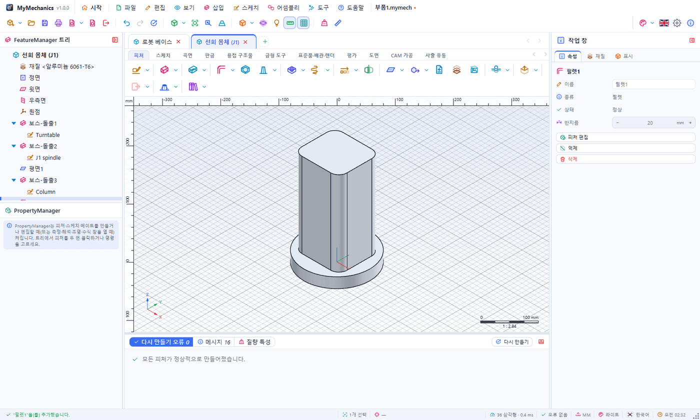

> 이 과의 결과: 시작 화면 › 예제 › 튜토리얼 — 6축 로봇 › **4과**

## 5과. 선회 몸체 (J1) — J2 하우징과 구멍

어깨 관절 J2의 하우징과 베어링 구멍을 만듭니다.

1. 정면에서 50 떨어진 평면(기둥 옆면)에 (0, 180)을 중심으로 지름 120 원 → 12 돌출: J2 하우징.
2. 하우징 바깥면(62)에 지름 50 깊이 45 구멍(J2 베어링), 반지름 48 위치에 지름 6.8 깊이 12 나사 구멍을 내고 베어링 축 둘레로 8개 원형 패턴합니다.
3. 우측면에 (0, 100) 지름 36 원을 그려 양방향 관통 잘라내기(케이블 통로). 턴테이블 윗면에 카운터보어 구멍 지름 9/15 × 5를 (72, 0)에 내고 4개 원형 패턴.

   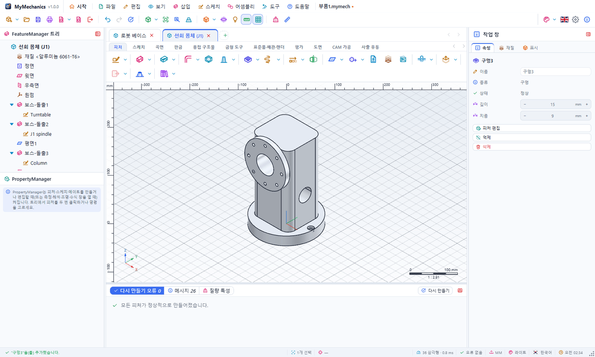

> 이 과의 결과: 시작 화면 › 예제 › 튜토리얼 — 6축 로봇 › **5과**

## 6과. 상완 (J2)

두 관절 사이의 팔: 웨브, 허브, 가벼운 포켓.

1. 새 부품 "상완 (J2)", 알루미늄 7075, RB-120. 정면에 지름 50 원 → 반대로 40 돌출(J2 축).
2. 정면에 사각형 (-40, 0)–(40, 400) → 40 돌출(웨브), 원 두 개 — (0, 0) 지름 120, (0, 400) 지름 100 — → 40 돌출(관절 허브).
3. 웨브 윗면(40)에 슬롯 두 개 (x = ±17, y 90–310, 반지름 12) → 깊이 25 잘라내기: 가운데 리브가 남는 포켓.
4. (0, 400)에 지름 90 × 10 J3 하우징, 지름 40 깊이 45 베어링 구멍, 반지름 36의 지름 5 나사 구멍 6개 원형 패턴, 우측면 지름 16 케이블 구멍, 하우징 가장자리 1.5 모따기.

   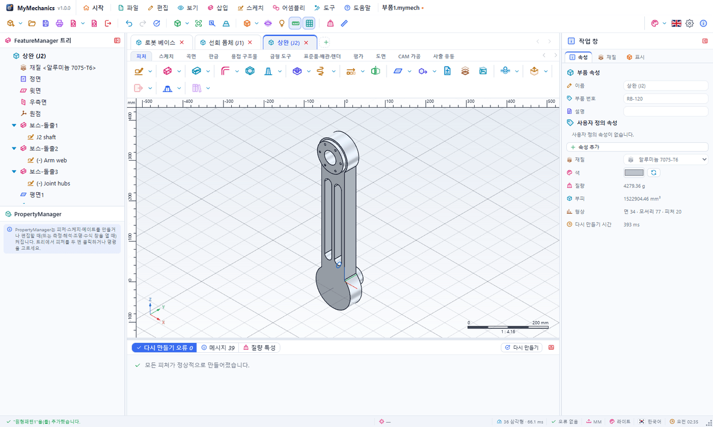

> 이 과의 결과: 시작 화면 › 예제 › 튜토리얼 — 6축 로봇 › **6과**

## 7과. 전완 (J3)

관절 허브에서 손목까지 뻗는 튜브와 모터 하우징.

1. 새 부품 "전완 (J3)", 알루미늄 7075, RB-130. 정면에 지름 40 → 반대로 40(J3 축), 지름 100 → 80(허브).
2. 우측면에 지름 70 원을 허브 가운데 높이(40)에 그려 300 돌출: 팔 튜브.
3. 정면에서 10 떨어진 평면에 사각형 (-35, 30)–(35, 75) → 60 돌출(손목 모터 하우징), 윗모서리 네 개 반지름 6 필렛.
4. 튜브 끝(우측면에서 300)에 지름 40 깊이 30 J4 베어링 구멍, 지름 4.2 나사 구멍 6개 원형 패턴, 모터 하우징 윗면에 지름 16 케이블 구멍.

   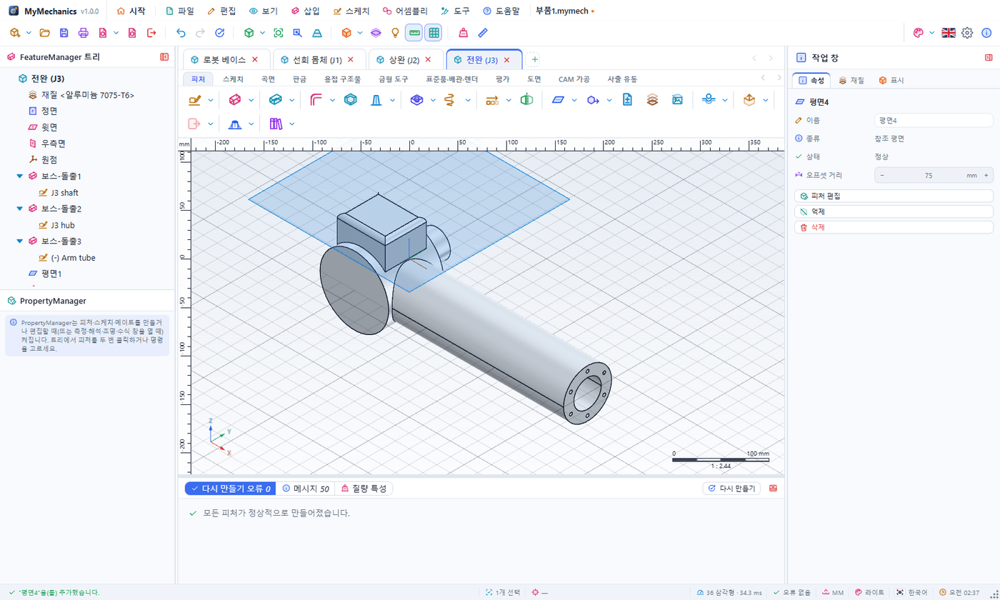

> 이 과의 결과: 시작 화면 › 예제 › 튜토리얼 — 6축 로봇 › **7과**

## 8과. 손목 요크 (J4)

선과 호로 요크 판을 그리고 대칭 복사합니다.

1. 새 부품 "손목 요크 (J4)", 알루미늄 7075, RB-140. 우측면에 지름 40 → 반대로 30(J4 축), 지름 70 → 40(롤 하우징).
2. 정면에서 20 떨어진 평면에 요크 판: 선 (80, 30)→(30, 30)→(0, 0)→(30, -30)→(80, -30), 끝을 중심 (80, 0) 반지름 30 호로 닫습니다. 12 돌출.
3. 대칭 복사: 판을 정면 평면에 대해 복사해 두 갈래를 만들고, 정면에 (80, 0) 지름 20 원 → 양방향 관통 잘라내기(J5 구멍), 축 끝 1.5 모따기.

   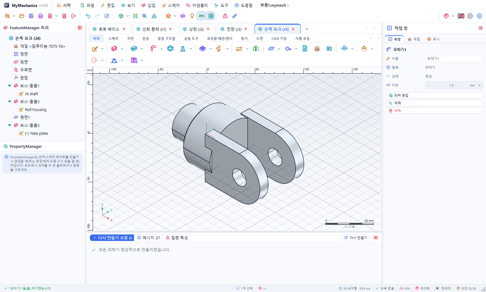

> 이 과의 결과: 시작 화면 › 예제 › 튜토리얼 — 6축 로봇 › **8과**

## 9과. 손목 피치 (J5)와 툴 플랜지 (J6)

중간 평면 돌출과 ISO 9409 플랜지 구멍.

1. 새 부품 "손목 피치 (J5)", 강 4340, RB-150. 정면에 지름 56 → 중간 평면 40(허브), 지름 20 → 중간 평면 64(J5 트러니언).
2. 우측면에 지름 36 → 70 돌출(노즈), 끝면에 지름 25 깊이 25 J6 베어링 구멍, 트러니언 가장자리 1 모따기.
3. 새 부품 "툴 플랜지 (J6)", 강 4340, RB-160. 우측면에 지름 25 → 반대로 20(J6 축), 지름 63 → 12(플랜지).
4. 플랜지 면에 지름 31.5 깊이 6 위치 결정 구멍, (0, 25)에 지름 6.6 관통 구멍을 내고 X축 둘레 4개 원형 패턴(ISO 9409-1-50-4-M6), 1 모따기.

   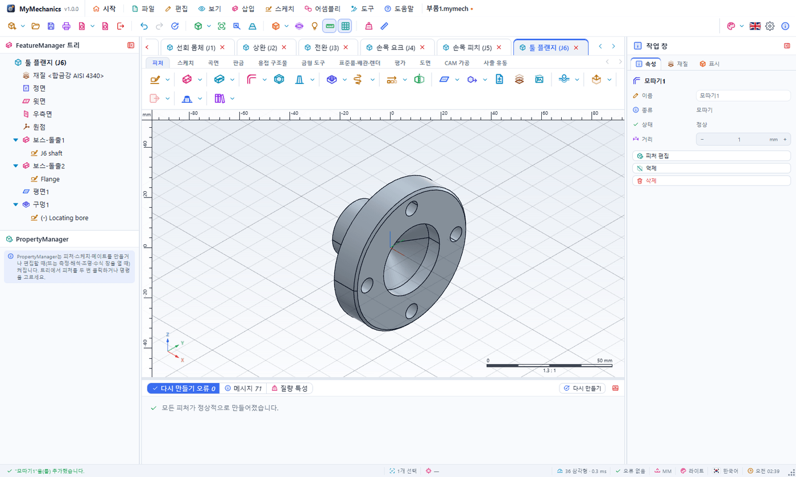

> 이 과의 결과: 시작 화면 › 예제 › 튜토리얼 — 6축 로봇 › **9과**

## 10과. 그리퍼 몸체와 핑거

그리퍼의 두 부품을 만듭니다.

1. 새 부품 "그리퍼 몸체", 알루미늄 6061, RB-210. 우측면에 지름 31.5 → 반대로 6(스피곳), 지름 63 → 8(장착판).
2. 8 떨어진 평면에 중심 사각형 40 × 76 → 50 돌출(액추에이터 몸체), 긴 모서리 네 개 반지름 4 필렛, 끝면(58)에 (-8, -34)–(8, 34) 사각형 → 깊이 6 잘라내기(핑거 홈).
3. 장착판에 지름 6.6 깊이 8 나사 구멍 4개(원형 패턴), 윗면에서 38 위 평면에 지름 5 깊이 12 공기 구멍 두 개.
4. 새 부품 "그리퍼 핑거", 강 4340, RB-220. 정면에 (0, 0)–(6, 12) → 중간 평면 16(슬라이드), (6, 0)–(70, 8) → 중간 평면 20(핑거), V 홈 삼각형 양방향 잘라내기, 끝 1.5 모따기.

   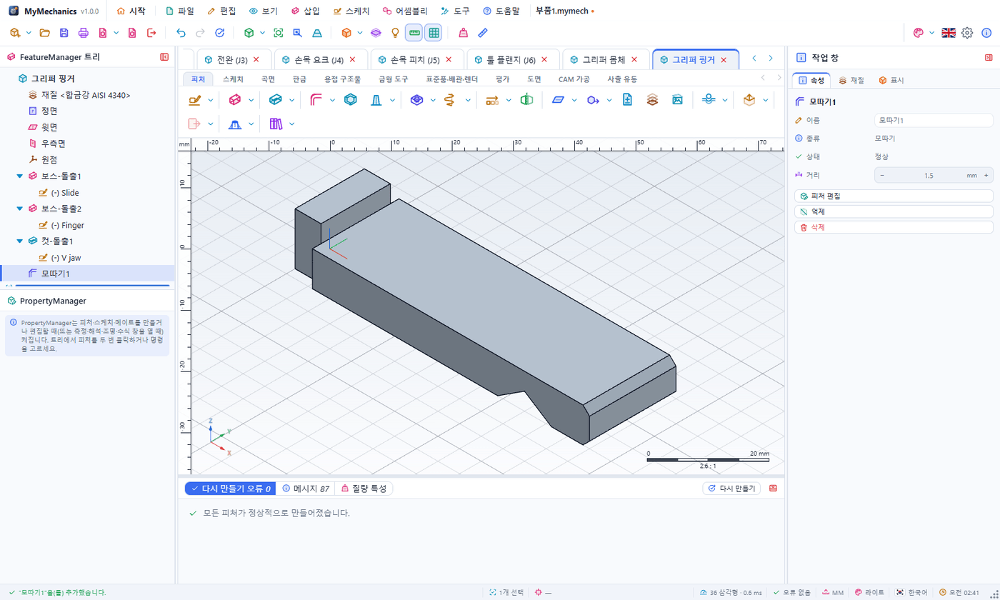

> 이 과의 결과: 시작 화면 › 예제 › 튜토리얼 — 6축 로봇 › **10과**

## 11과. 그리퍼 서브 어셈블리

핑거 두 개가 가운데를 중심으로 함께 열리고 닫힙니다.

1. 새 어셈블리 "2지 그리퍼"를 만들고 그리퍼 몸체(원점 고정)와 핑거 두 개를 넣습니다. 두 번째 핑거는 X축으로 180° 돌려 넣습니다.
2. 각 핑거: 슬라이드 끝면을 몸체 끝면(52)에 일치, 핑거 양옆을 홈 양옆과 폭 메이트로 가운데에 맞춥니다.
3. 두 핑거의 바깥면을 몸체 위아래 면에 폭 메이트로 묶어 함께 움직이게 하고, 핑거 안쪽 면 사이 거리를 12–50으로 제한합니다.
4. 모션 스터디: 첫 번째 핑거에 직선 모터(진폭 6, 주기 2초)를 달고 재생합니다. 다른 핑거가 폭 메이트로 따라 움직입니다.

   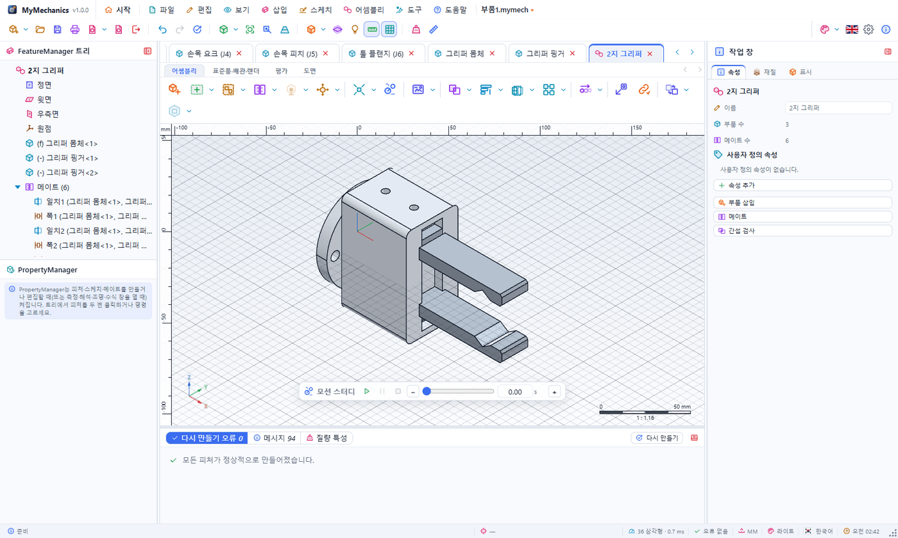

> 이 과의 결과: 시작 화면 › 예제 › 튜토리얼 — 6축 로봇 › **11과**

## 12과. 로봇 어셈블리 — J1

베이스를 고정하고 선회 몸체를 힌지로 돌립니다.

1. 새 어셈블리 "6축 다관절 로봇"에 베이스(원점 고정)와 선회 몸체를 넣습니다.
2. 힌지 메이트: 베이스의 베어링 자리 원통면과 선회 몸체의 J1 축 원통면, 베이스 윗면과 턴테이블 아랫면. 남은 자유도는 J1 회전 하나입니다.
3. J1 축에 회전 모터(진폭 45°, 주기 6초)를 달고 재생합니다.

   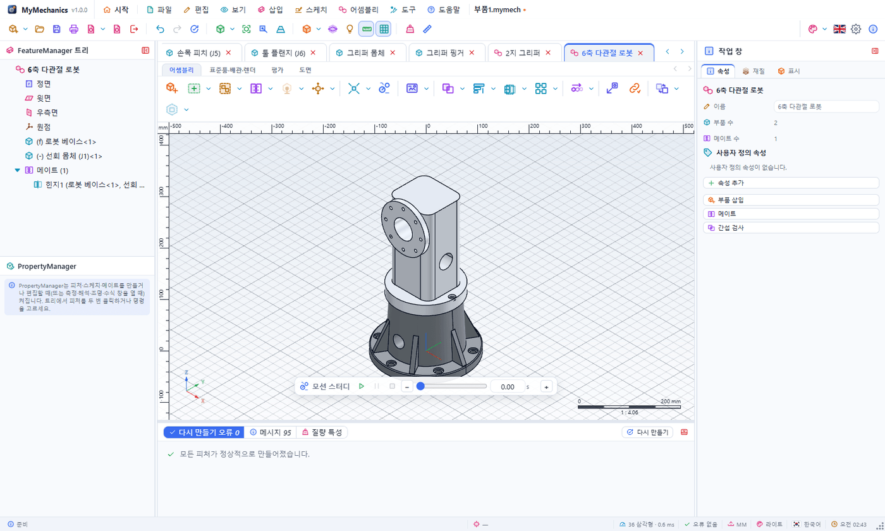

> 이 과의 결과: 시작 화면 › 예제 › 튜토리얼 — 6축 로봇 › **12과**

## 13과. 로봇 어셈블리 — J2·J3

팔을 올리고 각도 제한으로 움직임 범위를 정합니다.

1. 상완과 전완을 넣습니다.
2. J2: 선회 몸체 베어링 구멍과 상완 축에 힌지, 기둥 윗면과 상완 웨브 사이 각도를 30–150°로 제한. J3: 상완 끝 베어링과 전완 축에 힌지, 각도 20–160°.
3. J2(진폭 20°, 6초)와 J3(25°, 3초)에 모터를 답니다. 각 모터는 그 아래 관절의 부품(선회 몸체, 상완)에 달려 있어, 아래 관절이 움직인 자리에서 돕니다.

   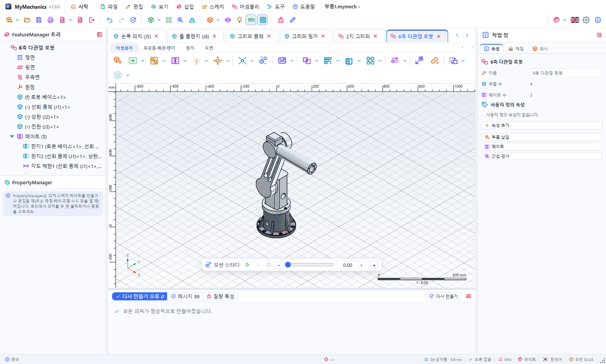

> 이 과의 결과: 시작 화면 › 예제 › 튜토리얼 — 6축 로봇 › **13과**

## 14과. 로봇 어셈블리 — 손목 J4·J5·J6

손목 세 축을 잇습니다.

1. 손목 요크, 손목 피치, 툴 플랜지를 넣습니다.
2. J4: 전완 끝 베어링과 요크 축에 힌지. J5: 요크 구멍과 피치 트러니언에 힌지, 각도 0–110°. J6: 피치 노즈 베어링과 플랜지 축에 힌지.
3. J4(60°, 4초), J5(30°, 3초) 진동 모터와 J6 연속 회전 모터(20 rpm)를 답니다.

   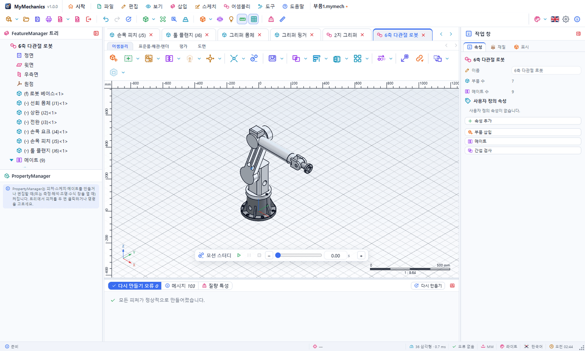

> 이 과의 결과: 시작 화면 › 예제 › 튜토리얼 — 6축 로봇 › **14과**

## 15과. 그리퍼 장착과 전체 모션

서브 어셈블리를 부품 하나처럼 넣습니다.

1. 부품 삽입에서 "2지 그리퍼" 서브 어셈블리를 넣습니다.
2. 그리퍼 장착판 뒷면을 플랜지 면에 일치, 스피곳과 위치 결정 구멍을 동심, 나사 구멍 하나끼리 동심으로 묶습니다.
3. 모션 스터디를 재생합니다. 여섯 관절이 함께 움직이고, 그리퍼는 자기 모션(핑거 열고 닫기)을 함께 재생합니다.

   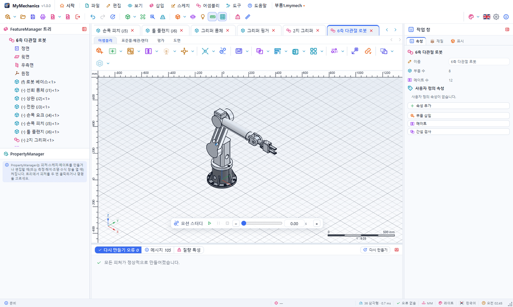

> 이 과의 결과: 시작 화면 › 예제 › 튜토리얼 — 6축 로봇 › **15과**

## 16과. 분해도

조립 순서대로 부품을 벌립니다.

1. 분해도 편집기에서 단계 7개를 만듭니다: 그리퍼 → 플랜지 → 피치 → 요크 (+X 방향), 전완 → 상완 (앞쪽), 마지막으로 J1 위 전체를 위로.
2. 분해 애니메이션으로 단계가 차례로 벌어지고 다시 모이는 것을 봅니다.

   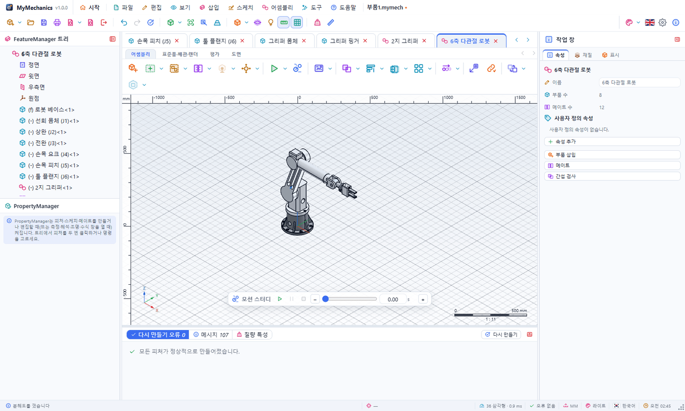

> 이 과의 결과: 시작 화면 › 예제 › 튜토리얼 — 6축 로봇 › **16과**

## 17과. 조립 도면

부품표와 풍선이 있는 조립도를 만듭니다.

1. 어셈블리에서 도면 만들기: A2 시트에 정면도와 등각 보기를 놓습니다.
2. 부품표(BOM)를 켜고 등각 보기 둘레에 품번 풍선을 놓은 뒤, 주기(감속기, 툴 플랜지 규격, 케이블 경로)를 씁니다. DXF·DWG·PDF로 내보내거나 인쇄합니다.

   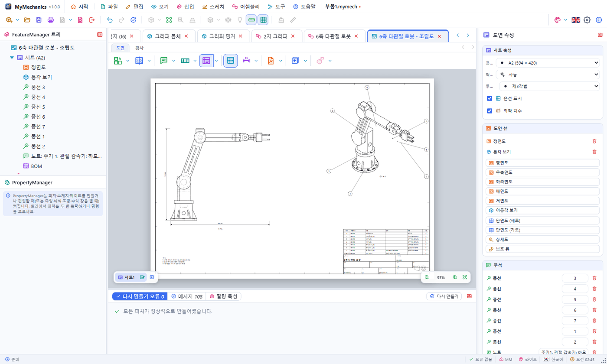

> 이 과의 결과: 시작 화면 › 예제 › 튜토리얼 — 6축 로봇 › **17과**

## 마치며

완성입니다. 로봇의 부품을 하나 열어 치수를 바꾸면 어셈블리와 도면이 함께 바뀝니다. 모션 스터디의 모터 진폭·주기를 바꾸거나, 간섭 검사(어셈블리 메뉴)로 관절이 움직이는 동안 부딪히는 곳이 없는지 확인해 보세요.
