# MyMechanics User's Guide

MyMechanics is a feature-based parametric 3D mechanical design program. Put relations and dimensions on 2D sketches, stack features (extrude, revolve, fillet, holes …) into parts, join parts with mates into assemblies, and send them out as 2D drawings. The geometry is computed by the OpenCASCADE B-rep kernel. It runs with the same features on Windows, macOS and Linux desktops and in a web browser.

New to the program? Follow the **tutorial document** first (Help › Tutorial document, or the **Tutorial** button on the start page). It walks from a first part through a sweep, sheet metal, an assembly, a motion study, a drawing and a simulation, with a screen for every step.

## 1. The window

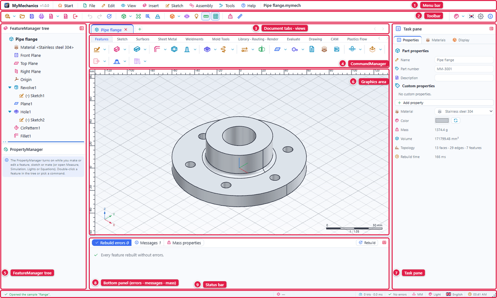

| Area | What it holds |
|---|---|
| Menu bar | File · Edit · View · Insert · Sketch · Assembly · Tools · Help. Every command is in the menus (the CommandManager’s ▾ families are submenus of the same name). **Start** next to the program name goes back to the start page. On the desktop this row is the window's title bar. |
| Toolbar | New (a click makes a part; ▾ for an assembly, a drawing or a project part), open, save, print, export, undo, rebuild, view orientation (▾ for front, top, right, isometric …), display style, section view, mass properties, measure, theme, language, settings. |
| Document tabs | The parts, assemblies and drawings of the project. Click to switch, **+** adds a part. |
| CommandManager | Command buttons in Features · Sketch · Evaluate · Assembly · Drawing tabs (only the tabs that fit the document). Commands that do the same job (the kinds of fillet, the patterns, the ways to draw a rectangle, section and detail views …) share one button: the **▾** beside it lists them all, and the one you pick stays on the button for next time. Commands the toolbar always shows (rebuild, section view, mass properties, print …) are not repeated in the tabs. |
| FeatureManager tree (left) | The part's material, the standard planes (Front, Top, Right), the origin and the features in build order. A feature's sketch sits under it. Failed features are red, under-defined sketches get `(-)`. Drag the blue **rollback bar** at the bottom to leave out the features below it for a while. |
| PropertyManager (bottom left) | The lower section of the left panel (the FeatureManager tree is above it; drag the line between them to share the height). It shows the options while a feature, sketch or mate is being made or edited, and only a hint when nothing is. ✔ (OK, Enter) / ✖ (Cancel, Esc) at the top. Pink selection boxes take the edges and faces picked in the graphics area. |
| Graphics area | The model, planes and sketches; the triad at the lower left (X red · Y green · Z blue). |
| Task pane (right) | Properties (name, part number, material, color, mass), the material list, display settings. For drawings: sheet, views and title block. |
| Bottom panel | Rebuild errors (failed features and how to fix them), messages, mass properties. The **collapse** button at the right of its header (Ctrl+J) leaves a thin bar with the tab names and an **expand** button; clicking a tab name opens the panel on that tab. |
| Status bar | Hints, the sketch's definition state, pointer coordinates, error count, unit (click to switch mm · cm · in), theme, language, clock. |

### Mouse and view

* **Left drag or middle drag**: rotate (free, about the screen axes — the model can be laid down or turned over) · **middle drag on an edge**: turn about that edge (a circular edge: about its axis) · **middle drag on a face**: turn about that point · **Alt+drag**: roll about the view centre · **right drag / Shift+left / Ctrl+middle**: pan · **wheel**: zoom at the pointer
* **Arrow keys**: rotate 15° (set in the settings) about the screen axes · **Shift+arrows**: 90° · **Alt+←/→**: roll · **Ctrl+arrows**: pan. Set **Rotation** under Settings › Navigation to **Turntable** to keep Z always up.
* **F**: zoom to fit · **Space**: view orientation menu · **Ctrl+1…7**: front, back, left, right, top, bottom, isometric · **Ctrl+8**: normal to
* **K**: next display style (shaded with edges → shaded → hidden lines removed → hidden lines visible → wireframe)
* Faces, edges and planes under the pointer turn orange, selected ones blue. Ctrl or Shift+click selects several.

## 2. Start page

Cards can be dragged and resized from their lower-right corner (**Arrange** puts them back). They hold **Quick actions** (open, import STEP, continue the last work, settings …), **Recent items**, **New project** (part in mm or inches, assembly, drawing), 92 **samples** (five groups of 15, and the tutorial's 17 lesson results — each card shows a picture of its model) and the **moving background**. Whether the page shows at start is set by the check box at the top left or in Settings › Start page.

**Every sample moves.** Opening a sample opens an assembly in which its part is at work, with a motion study; the ▶ play bar over the graphics area plays it. Machined parts tilt and turn on a two-axis trunnion table, gears mesh with a mating gear, the connecting rod drives a crank and crosshead (a slider-crank), the cams lift flat and roller followers, a nut runner backs bolts, nuts and the bottle cap off and runs them on again, the sheet-metal chassis and the bottle ride a roller conveyor, and the bicycle frame's wheels turn while its fork steers. The stage's own parts (bases, shafts, bearing blocks …) are grey and marked as stage parts; the sample part's feature tree is still there to open and edit from the document tabs. A drawing sample opens on its sheet, with an assembly in which its part moves in the same project. Each sample card's note ends with what moves.

## 3. Making a part — step by step

1. Click **New part** (Ctrl+N).
2. Click **Features › Sketch** and choose the **Top Plane** (in the tree, the graphics area or the PropertyManager buttons). The view turns normal to the plane and a grid appears.

   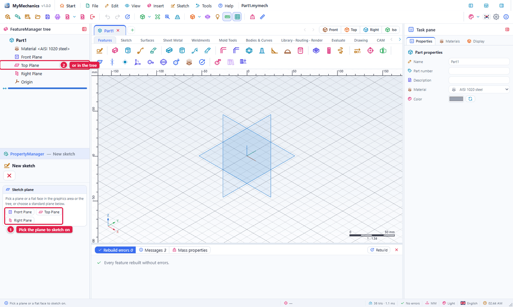
3. With **Sketch › Center Rectangle**, click the origin, then a corner. Ends snapping to a point (orange ring) get a coincident relation automatically.

   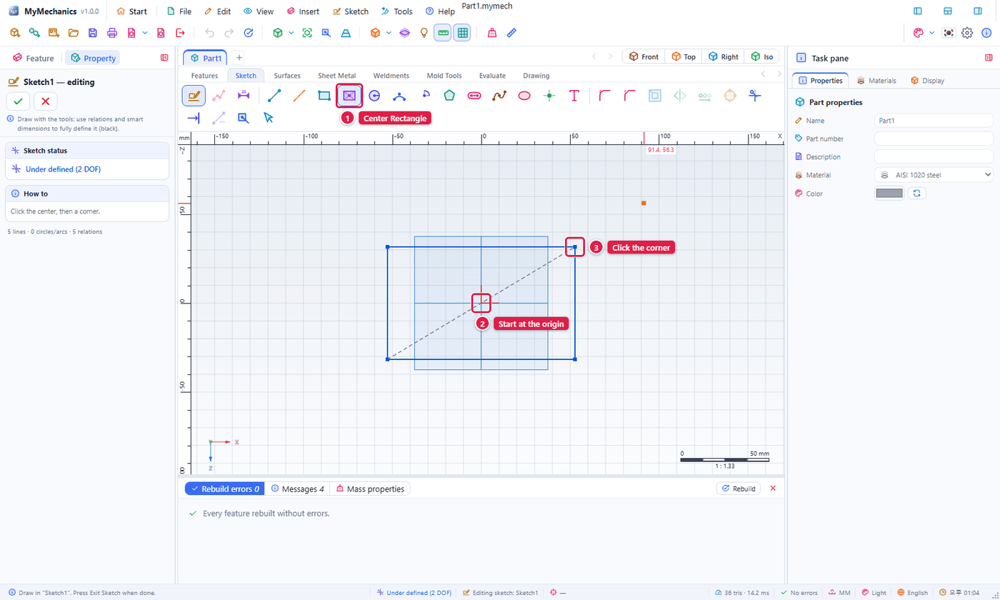
4. With **Smart Dimension** (D), click the top line and enter `80`, the right line and enter `50`. Black lines are fully defined (blue = can still move, red = over defined).

   
5. Click **Exit Sketch**.
6. Click **Extruded Boss**, enter a depth of `20` and press ✔.

   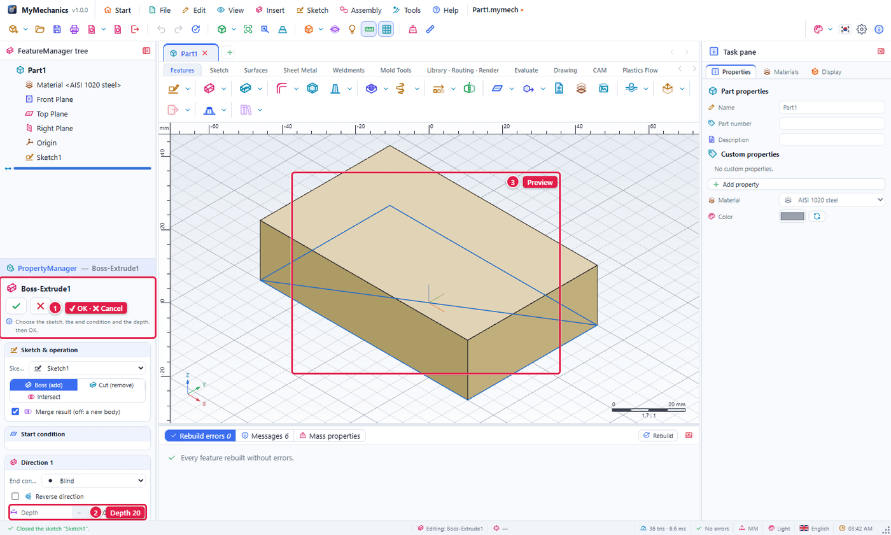
7. Click **Fillet**, click the four vertical edges, radius `5`, ✔.

   
8. Click **Hole Wizard**, choose size `M8` and type **Counterbore**, then click the top face where the hole goes (about 15 mm along X from the origin). More clicks on the same face add more holes. The red preview is the hole. ✔.

   
9. Select **Hole1** in the tree, click **Circular Pattern**, axis `Y`, `4` instances, ✔.

   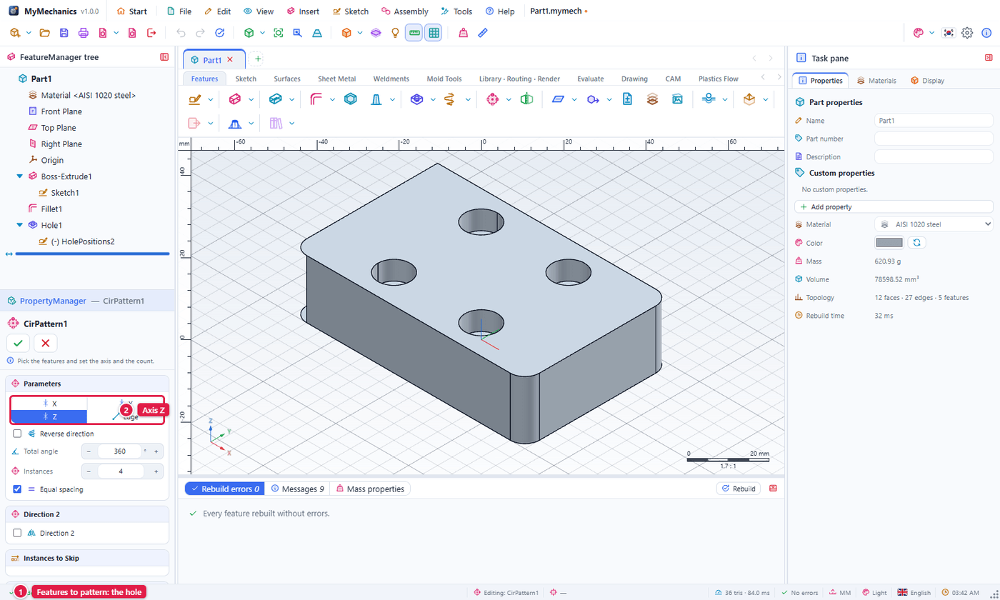
10. Save (Ctrl+S). One `.mymech` file holds the whole project.

To change a dimension or a feature's values, double-click the feature in the tree (or right-click › Edit feature). A sketch opens again for editing and every feature after it rebuilds on the new shape. The edges and faces picked for fillets, chamfers and shells are remembered by their geometry: when an earlier dimension changes, the nearest edge is found again.

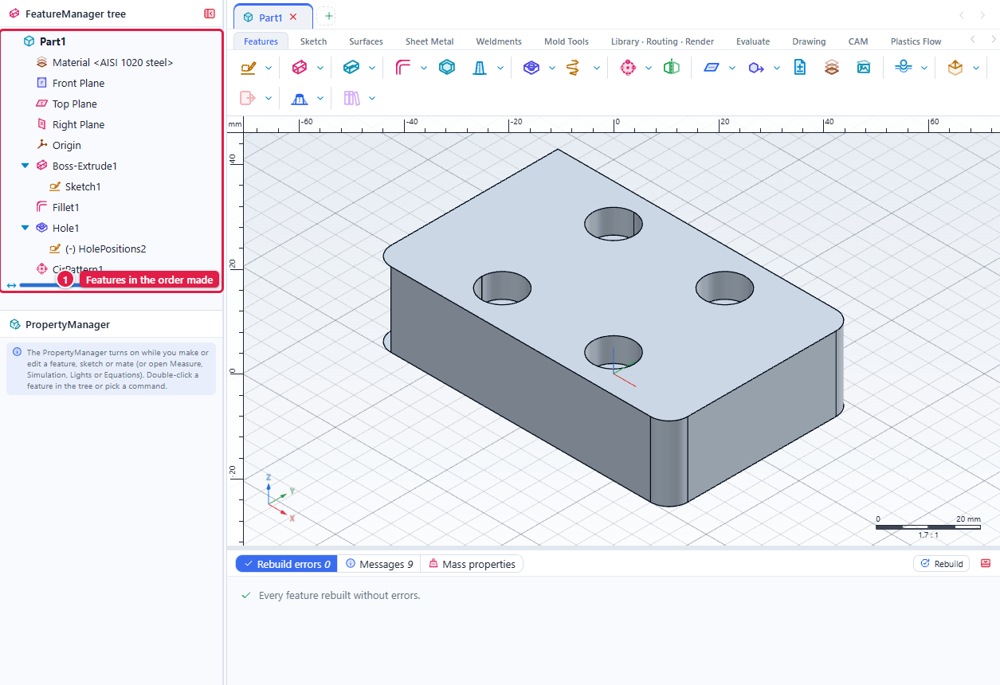

## 4. Sketches

| Tool | Key | How |
|---|---|---|
| Line | L | Click, click … to chain lines; click an existing point or press Esc to finish. Nearly horizontal or vertical lines get that relation. |
| Centerline | | A construction line (dashed): an axis of revolution or symmetry. |
| Corner / Center Rectangle | R | Two clicks; horizontal and vertical relations come with it. |
| 3 point corner rectangle / 3 point center rectangle | | A rectangle at an angle: the two ends of the first side and a point for the width / the centre, the middle of one side and a point for the other size. Perpendicular and parallel relations are added (horizontal and vertical when drawn level). |
| Parallelogram | | Click three corners. The opposite sides get parallel relations. |
| Circle | C | Center, a point on the circle. |
| Perimeter circle | | Three points on the circle. Clicking existing points holds them on it. |
| 3 Point / Centerpoint Arc | A | Start, end, a point on the arc / center, start, end. |
| Tangent arc | | Click the end of a line or an arc, then the end of the arc. It continues tangent to that curve with a tangent relation (straight on, it is a collinear line). |
| Polygon | P | Center, a vertex; the number of sides is in the PropertyManager. |
| Straight Slot | | Both end centers, then the width. |
| Point | | Hole positions and the like. |
| Smart Dimension | D | One line = length, a circle = diameter, an arc = radius, two lines = distance (parallel) or angle, two points = distance. Double-click a dimension to change it. A dimension that would over define the sketch becomes a reference (driven) one, shown in brackets. |
| Spline | S | Click points in turn; Enter or Esc finishes, clicking the first point closes it. The curve passes through every point. With a spline selected, each point can get a **tangent handle** (its direction and weight), and **Show curvature comb** draws how much and which way it bends along its length. |
| Style Spline | | One Bézier curve of degree 3, 5 or 7 on its control polygon (shown dashed): click degree + 1 control points; the curve passes through the first and the last, the others pull its shape. |
| Ellipse | E | Centre, end of the major axis, a point for the minor axis. |
| Partial ellipse | | Centre, end of the major axis, a point for the minor axis, the start and the end (counter-clockwise). The ends are held on the ellipse. Selected, its radii and angle are changed in the PropertyManager. |
| Parabola | | Focus, apex, then the start and the end of the parabola. It is built as an exact parabola (a rational Bézier curve). |
| Conic | | Start, end, the top vertex where the end tangents meet, and a shoulder point the curve passes. The shoulder point sets rho (0.5 = parabola, less = ellipse, more = hyperbola); selected, rho is changed in the PropertyManager. |
| Equation driven curve | | In the PropertyManager, enter `y = f(x)` or parametric `x(t)`, `y(t)` and the range, then **Add the curve**. Angles are in radians; `sin cos tan asin acos atan atan2 sinh cosh tanh sqrt abs exp ln log min max pow`, `pi`, `e` and `^` can be used. If the equation cannot be evaluated over the range, the reason is shown. The ends are fixed where the equation puts them, and the curve follows the equation within 1 µm. |
| Sketch Fillet / Chamfer | | Click the corner where two lines meet; radius / distance in the PropertyManager. The chamfer is **equal distance**, **distance-distance** (one along each line) or **angle-distance** (a distance along the first line and the chamfer's angle to it); **Flip direction** swaps the lines. |
| Offset Entities | O | Opens a page: distance, **Reverse**, **Bi-directional** (both sides) with the ends of an open chain **capped** by arcs or lines, **Select chain** (the whole chain of a picked curve), and the base or the offset made **construction**; **Apply** makes it. Chains of lines and arcs stay joined: pieces are trimmed or extended to meet, or joined by a round where they open apart. A closed chain goes outward, an open one to the left of the way it runs. |
| Mirror Entities | | Select entities and a centerline: mirrored copies with symmetric relations. |
| Dynamic Mirror | | Select a centerline and turn it on: everything you draw from then on is mirrored about it as you make it (points on the line are shared and held on it, the others symmetric). Click again to turn it off. |
| Linear / Circular Sketch Pattern | | Copies the selection by spacing and count (linear) or count and angle (circular, about the selected point). |
| Trim Entities | T | Removes the clicked piece between crossings (a curve nothing crosses is deleted); a circle becomes an arc. |
| Extend Entities | X | Grows a line to the next entity. |
| Split entities | | Click on a curve to split it there (lines stay collinear, conics tangent). Circles and ellipses take two clicks and become two arcs. Splines are not split (that would change their shape). |
| Stretch entities | | Moves the selection by dx, dy while keeping the relations, so joined entities stretch; what is not selected stays where it is as far as the relations allow. If the relations do not allow it, nothing changes. |
| Silhouette Entities | | The outline of the part's body seen square to the sketch plane, as exact lines, arcs and circles (the hidden-line projection: sharp edges and the outlines of curved faces). **External** gives the outer outline only, **internal** also the holes seen end on. |
| Auto Trace | | With a sketch picture in the sketch: follows the outlines of its dark (or light) shapes and makes them lines, arcs and circles where the picture is (threshold, fit tolerance in pixels, smallest shape). |
| Repair Sketch | | A page listing the small gaps, duplicate curves, overlapping collinear lines, tiny curves, open ends and points where three or more curves meet, with the gap tolerance. **Repair** joins the gaps, removes the duplicates and tiny curves and merges the overlaps; **Show open ends** selects what needs you. |
| Baseline Dimension | | Select the base (a line or a point) first, then the others: a dimension from the base to each (horizontal ones from a vertical base, vertical ones from a horizontal base). |
| Fully define sketch | | Adds horizontal / vertical relations to lines drawn almost so, then line lengths, circle diameters, arc radii and the horizontal / vertical positions of the points from the origin until nothing can move. Nothing over-defining is added, and every dimension takes the current value, so the shape does not change. |
| Text | | Places text where clicked (Roboto font, height in the PropertyManager); extrude, cut or wrap it to engrave or emboss. |
| 3D Sketch | | A path in space: click while switching between the Front, Top and Right planes, or type coordinates in the table. Lines or a smooth spline, open or closed; used for sweep paths, structural members and filled surfaces. **Relations and dimensions**: pick segments or points (the chips in the PropertyManager) and add along X / Y / Z, parallel to the XY / YZ / ZX plane, parallel, perpendicular, equal, fix, coincident, or a length, a distance, an angle, an X / Y / Z coordinate; the path is solved with the smallest move and the freedoms left are shown. A dimension that over-defines it becomes a driven one. |
| For construction | | Turns the selected lines and circles into construction geometry and back (construction geometry is not part of a profile). |

* With **Select** (S), drag points or lines: the relations are kept.
* Inside a sketch, **Undo** (Ctrl+Z) and **Redo** (Ctrl+Y) step through the sketch's own steps (drawing, dimensions, relations).
* With one point selected, **Pierce** lists the curves of the sketches before this one and the 3D curves: the point is held where the curve passes through this sketch's plane, and follows it when the part rebuilds (a sweep profile on its path).
* With entities selected, the PropertyManager lists their **existing relations** (removable) and **add relation** buttons (horizontal, vertical, parallel, perpendicular, equal, tangent, concentric, coincident, midpoint, symmetric, collinear, fix).
* A dimension in the existing relations list can be made **driven** (a reference: it shows what it measures and imposes nothing) and driving again. A distance to a circle or arc measures from its **centre**, its **nearest** (min) or its **farthest** (max) point.
* When the sketch is over defined, its status lists the **conflicting** relations (removing one lets it solve) and the **redundant** ones (already set by the others), each with Delete and, for dimensions, Make driven.
* Number boxes take units and arithmetic: `25.4in`, `100/3`, `2*15`. A dimension value like `=W` links it to a global variable (shown with Σ).
* Only closed contours make features; a closed contour inside another is a hole.

## 5. Features

| Feature | Notes |
|---|---|
| Extruded Boss / Cut | End conditions: Blind (depth), Through All, Through All - Both, Mid Plane. Direction 2 extrudes the other way too. A cut goes into the material by default. |
| Revolved Boss / Cut | Turns the sketch around its centerline (or a chosen line). 0.1–360°. |
| Fillet / Chamfer | Click edges, or click a face to add all of its edges. Chamfer types: distance, distance-distance, angle-distance, **offset face** (the faces offset by the two distances meet at the chamfer's corner — on any edge, also where the angle between curved faces changes along it), vertex (three distances) and **face-face** (two faces, next to each other or not: what lies between them goes). |
| Fillet: profiles, setback, keep features | **Conic** (rho) and **curvature continuous** profiles work on any edge: on straight edges between planes and on circular edges exactly, elsewhere the rolling ball is solved on the real faces at sections along the edge. **Setback**: click a vertex where three or more filleted edges meet and set a distance along each edge; the corner is blended from there by one smooth surface tangent to the fillets. **Keep features** (fillet and chamfer): the chosen earlier bosses and cuts are not eaten by the round — it is made without them and they are added or cut again. **Overflow type**: where the round is larger than its faces, *Keep surface* carries it on and trims the neighbouring face, *Keep edge* stops it at its own faces so the neighbour's edge stays (on straight edges between planes the round is then built from the planes themselves, where the kernel's fillet cannot go). |
| Library features | **Save to Library** keeps the selected feature with its sketch. **Insert Library Feature**: pick the item, change its **size parameters** (the dimensions of its sketch; the sketch is solved with them), set the **placement** — at the clicked point or the face's centre, moved by X / Y and turned by an angle in the face — then click a planar face. |
| Shell | Pick the faces to open and the thickness; inward or outward, or no face removed (a hollow body). **Multi-thickness**: faces with a wall of their own thickness — flat or curved (a cylinder's round wall, a sphere …). |
| Hole Wizard | Hole, counterbore, countersink; ISO M3–M20 clearance sizes; through or blind (118° drill point). Click a flat face to place holes; the positions are kept in a "HolePositions" sketch. Standards: ISO, ANSI inch, **DIN** (DIN EN 20273 / DIN 974-1 / ISO 15065), **JIS** (JIS B 1001 classes 1–3) and **GB** (GB/T 5277 / 152.3 / 152.2): clearance by fit, socket head counterbores, 90° countersinks. Positions can also come from a **3D sketch**: a hole at each of its points, square to the face it lies on — several faces at once. |
| Advanced Hole | At each point of a point sketch, a hole of near-side elements stacked from the face (counterbore · countersink · straight · tapped · taper, with diameter, depth, angle) and far-side elements stacked back from the far face. A last near element of depth 0 runs through to the far elements. |
| Intersect | Lists the closed regions that bodies, surfaces and planes make together; check the regions to leave out, and choose Merge result and Consume the bodies used. |
| Mate Reference | Keeps a part's primary, secondary and tertiary faces with the mate type and alignment of each, under a name. Inserted next to a part with a mate reference of the same name, the part mates itself. |
| Move Face | Moves faces of the body: **Offset**, **Translate** (along an axis or an edge) or **Rotate** (about an axis or an edge, by an angle). A planar face takes the moved plane and the faces around it extend or trim to follow; a cylinder face (a hole or a boss) changes its radius with Offset. |
| Save Bodies | Each body of a multi-body part becomes a part of its own (it inserts that body of the original, so it stays linked), with an assembly of them. |
| Linear Pattern | Direction (X, Y, Z or an edge), spacing, count; Direction 2 for a grid. Copies features or the whole body. |
| Circular Pattern | Axis (X, Y, Z, or a circular or straight edge), total angle, count, equal spacing. |
| Mirror | About a standard plane, a reference plane or a flat face; features or the whole body. |
| Pattern instances · variable pattern | Linear and circular patterns and Mirror have **Geometry pattern (fast copy)**: on, the seed's shape is copied; off, each instance is the seed feature built again in its place, so its end conditions (up to next, up to surface …) are worked out there. A linear pattern can **vary the dimensions** of its first seed's sketch: a step per instance along direction 1 and along direction 2 (the sketch is solved again for each instance). Mirror body with **Merge result** off keeps the mirror image as a body of its own. |
| Reference Plane | Offset from a plane or a face; used as a sketch plane. |
| Reference point · centre of mass | A reference point at coordinates, a face centre, an arc centre, along an edge, or the **Center of mass** (the volume centroid of the bodies built so far; it follows the model). |
| Split line | Splits faces of the body into separate faces (for draft, parting, decals or different colours), three ways: **Projection** — a sketch projected along its plane's normal; **Silhouette** — where the faces turn away from the normal of a chosen plane (their normal square to it: cylinders, spheres and cones exactly, any other curved face along its computed silhouette); **Intersection** — where chosen planes, surface bodies or faces meet them. With no faces picked, every face. |
| Bounding box | **Insert › Reference Geometry › Bounding Box**: the smallest box around the bodies, drawn as its 12 edges, with its length, width and thickness in the PropertyManager. **Best fit** takes the least volume among OCCT's optimal oriented box and boxes square to the part's planar faces; **Square to a plane** is the exact box square to the chosen plane. |
| Intersect extrude · drafted extrude | Set an extrude's operation to **Intersect** to keep only the overlap. **Draft on** tapers a blind extrude's sides. |
| Merge result | With **Merge result** off, a boss extrude or revolve makes a body of its own instead of joining the existing body (even where they overlap): for multi-body parts, the mating body of a snap hook groove, and tool bodies of Combine and Indent. |
| Swept Boss / Cut | Sweeps a closed profile along a path (an open sketch or a helix). Sketch the profile at the start of the path, across it; turn on **Frenet** for helices. |
| Sweep: guides, tangency, solid sweep | **Guide curves**: one guide scales the profile evenly; with two or more the profile is stretched and turned at each place along the path so that it passes through every guide, and the sections are lofted. **Start tangency** *Square to the path* turns a profile not drawn square to the path before sweeping. **Solid sweep**: a revolved tool body (for example a cylinder or ball-end cutter made as a separate body) moved along the path with its axis held cuts exactly the volume it sweeps — moves in planes square to the axis, straight ramps and plunges (the Minkowski sum of the tool and the move) and curved ramps (split into short straight moves); the tool body is used up. |
| Lofted Boss / Cut | Joins closed profiles on several planes in the order chosen. Ruled option. |
| Loft: face conditions, connectors | Start / end constraint **Tangent to face** and **Curvature to face**: a profile drawn on a face of the body makes the loft leave as the body's side faces go on (their direction, and their bending for curvature), measured under each point of the profile. **Connectors**: for each profile choose the start vertex (V1 …) and **Reverse direction**; the sections are joined from those points (Automatic pairs them with the least twist). |
| Draft | Pick the neutral plane, then the faces to taper (0–45°). |
| Draft on a curved parting line | With a parting line that is curved (a circle, a spline …) or a curved face next to it, each face is replaced by the ruled surface from the parting curve whose rulings stand at the draft angle to the pull direction (square to the curve): a cylinder drafted above a circular parting line becomes an exact cone. Positive angles narrow the face away from the parting line, negative ones widen it. |
| Rib | Fills a plate of the given thickness from an open line drawn between walls toward the material. |
| Dome | A spherical cap of the given height on a planar face (or a dish). Spherical, elliptical or continuous; **Direction**: normal to the face, an axis or an edge — the dome then rises leaning along it (the same height above the face and the same volume). |
| Helix | A helix by plane, radius, pitch and revolutions; use it as a sweep path for springs. |
| Spline on Surface | Click a face, then points on it: a spline through them that lies on the face along its whole length (made in the face's own parameters; across the seam of a cylinder or a sphere the short way). The points can be edited in the table; it can be closed. A sweep path, or a curve for patterns and projections. |
| Thread | Cuts a 60° V thread at a shaft end or hole rim (external / internal found automatically, M3–M24 pitches). A **cosmetic thread** only draws lines. Forms: ISO metric (exact ISO 68-1 / 965-1 profile), UN 60°, ISO 2904 trapezoidal, 7°/45° buttress and 55° Whitworth pipe (rounded crests and roots) — every one an exact screw sweep of its profile, with several starts, left hand, a **start offset** along the axis (a negative one starts at the edge) and **trim with end face** (off: a blind tapped hole's thread runs its full length). Ending inside material, a thread fades out over its runout. |
| Wrap | Embosses / debosses a sketch from a plane beside a cylinder or a flat face (projected onto it). |
| Wrap on any curved face | On cones and spline faces too: the sketch is laid on by arc length — its y along the face's v line through the point straight under the sketch's origin, its x along the u line of each row it lands on — then raised, sunk or scribed. |
| Deform | **Point**: pushes the body near a point along a direction with a smooth fall-off. **Curve to curve**: pairs of initial and target curves — each initial curve's points move to the target curve at the same fraction of its length and the body follows within the radius. **Surface push**: a tool body (a separate body) pressed in along a direction dents the body to its shape, the surroundings easing off; the tool body is used up. The result is a faceted body. |
| Freeform | Reshapes one face by a grid of control points (points along U and V): give each inner point a distance along the face's normal; the border rows stay put so the face still meets its neighbours (two rows with *Tangent* continuity). A face bounded by its parameter rectangle becomes an exact B-spline face sewn back into the body; others are reshaped on a fine mesh. |
| Move/Copy Bodies · Scale · Split | Moves (ΔX, ΔY, ΔZ) and turns the body about X, Y and Z through a rotation centre — laid down or turned over — (or copies it), scales it, or splits it by a plane keeping one side or both (two bodies). |
| OpenSCAD feature | **Insert › Bodies › OpenSCAD feature**: a body made by OpenSCAD code. The PropertyManager's **Customizer** lists the variables at the top of the program by their `/* [Tab] */` groups (`// [min:max]` gives a slider, `// [a, b]` a list, `/* [Hidden] */` hides), and a changed value rebuilds the preview. The code is edited in place and applied when you leave the field or press Ctrl+Enter (Tab indents). The code is coloured (keywords, built-in modules and functions, numbers, strings, comments, $ variables) and completes the word at the caret — keywords, built-ins with their arguments and the program's own modules, functions and variables (two letters or Ctrl+Space; ↑ ↓, Enter or Tab, Esc). echo output and warnings show below; a message that names a line selects that line in the code when clicked. Include files that were not found are taken in with **Choose the folder**. **Animation** sets `$t` (Time, or the frame slider), FPS and Steps; **Play** runs through the frames, **Dump pictures** saves every frame as frame00000.png … in a ZIP. **Export the result** writes what the program made: STL, OFF, AMF, 3MF for a solid, SVG, DXF, PDF (1:1 on A4) for a 2D result, and its **CSG tree** (.csg: modules, loops and variables resolved into group() and multmatrix() with every argument). The program, its values, its files and the solid it made are saved in the project. |
| Mounting boss | **Insert › Fastening Feature › Mounting Boss**: a round boss on a planar face (at its centre, typed coordinates or a reference point, projected onto the face). Height, outer diameter at the top, outer draft (wider toward the base), a hole (diameter, depth from the top, hole draft, or through all) or a pin (diameter, height), and fins (count, length, thickness, height, first angle; triangular or rectangular). |
| Snap hook | A cantilever hook on a planar face: arm height, width and thickness, lip depth and height, insertion angle (the slope on top of the lip; a slope longer than the lip makes it a triangle) and the lip's direction. |
| Snap hook groove | The chosen snap hook's shape grown by the clearance is cut from another body, where the hook latches (that body is a separate one, e.g. an extrude with Merge result off). |
| Vent | From a sketch on a wall: the largest closed contour is cut through the wall; lines inside it stay as ribs (width) and other closed contours as spars (width). |
| Lip/Groove | Pick the top (rim) face of a shelled wall: a strip of the given width along its inner (or outer) edge is raised by the height (lip) or cut that deep (groove, wider by the clearance). The inner strip keeps a constant distance from the edge, round at the corners. |
| Insert Part · Cavity | Adds another part of the project to this one, subtracts it (a cavity for molds) or keeps the overlap. |
| Mirror Part | A new part: the active one mirrored about the Front, Top or Right plane (the opposite-hand part), with its material. It is an Insert Part with a mirror plane, so it follows the original whenever that changes; Insert Part has the same **Mirror** option. |

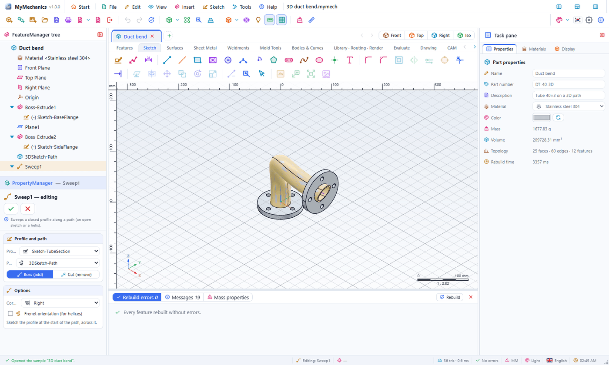

Tree right-click menu: edit feature, rename (F2), suppress / unsuppress, roll back to here, delete (features that use it go too). A failed feature turns red and the bottom panel's **Rebuild errors** says why and how to fix it; the other features still build.

**Reorder** features by dragging them in the tree: dropped on a feature, the dragged one (with its own sketch) goes before it; a move that would put a feature before one it refers to (its sketch, planes, seeds, paths …) is refused with the reason. **Add to New Folder** (right-click) groups features that sit next to each other into a folder that opens and closes; drop a feature on a folder to move it in; a folder is renamed or dissolved from its right-click menu.

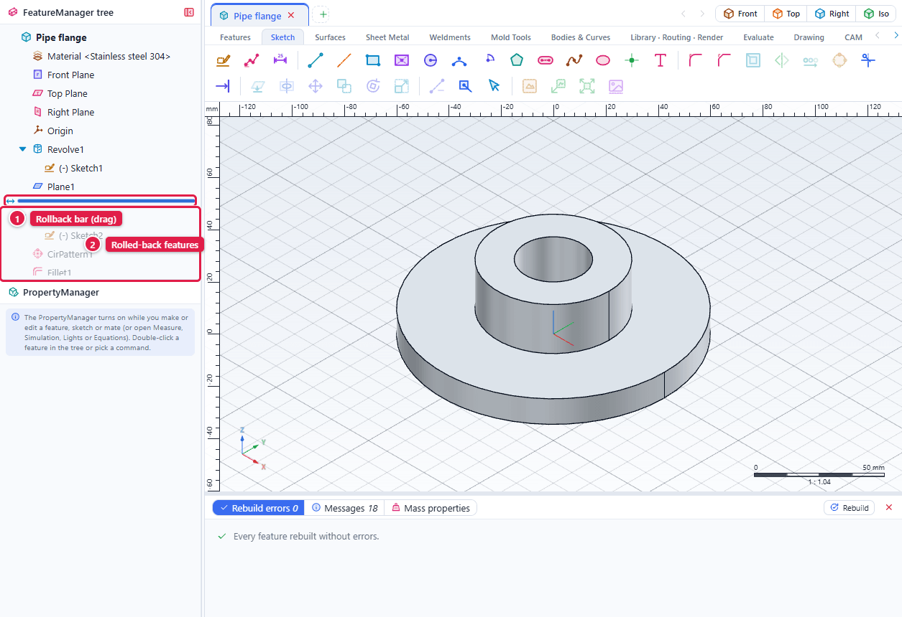

## 6. Surfaces, sheet metal, weldments and mold tools

* **Surfaces** tab: extruded, revolved, planar and lofted surfaces, **Boundary Surface** (smooth between closed profiles, or bounded by open curves), **Filled Surface** (a patch over a hole's edges or a closed 3D sketch), offset faces, **Trim Surface** (cut by a plane or another surface, keeping one side), Knit (a closed set becomes a solid). **Thicken** turns a surface into a solid (side 1, side 2 or both). Surfaces show translucent teal.
* **Boundary boss / cut**: set the Boundary Surface's operation to **Boss** or **Cut** to add or remove the solid between its closed profiles. **Thicken** with the cut operation is the thickened cut.
* **Boundary options**: **Direction 2** curves cross the profiles and the skin follows them; **End conditions** at the first and last profile — normal to profile, tangent to face, curvature to face — with an **Influence** (how far the condition reaches); a patch of open curves can be **Tangent (G1)** or **Curvature (G2)** to the faces of the body its curves lie on. **Fill Surface**: the same continuity (contact, tangent, curvature) to the faces around the hole, and **constraint curves** inside the boundary that the patch passes through.
* **Surface sweep / surface loft** take the solid ones' options: twist, start tangency, one or several guide curves (an open profile too: with two guides at its ends, the sheet's edges are the guides), circular profile; guide curves, centre line, start / end conditions and connectors for the loft. The result is the open sheet, without end caps.
* **Surface Fillet** (Surfaces tab): pick two surface bodies that cross; each is cut where the other crosses it, the side you choose of each is kept (*Keep the other side* flips it) and the two are joined by a round of the radius into one surface body.
* **Swept Surface**: the profile sketch's curves (an open chain too) swept along a path as a surface (corner transition, Frenet frame).
* **Cut With Surface**: a surface crossing the body splits it and the material on the side of the surface's normal is removed (flip for the other side).
* **Delete Hole · Untrim Surface**: a surface's holes are filled back with the surface itself (pick hole edges for just those). Untrim with **Natural edges** opens the surface to its natural parameter range (a whole turn of a cylinder, a whole B-spline patch, for a plane the rectangle around the face).
* **Mid-Surface**: a surface half way between each pair of facing planar faces of a thin wall (picked, or found automatically up to a largest wall thickness), sewn together.
* **Radiate Surface**: from a chain of edges in a plane parallel to the reference plane, a surface spread outward (or inward) in that plane by a distance (e.g. for mould parting surfaces).
* **Flatten Surface**: one face laid out flat. Planes, cylinders and cones are developed exactly (boundary lengths and area kept, holes included); spheres, tori, B-splines and other faces are laid out by least-squares conformal mapping of a mesh, scaled to their area, with the range of area ratios (the distortion) shown.

   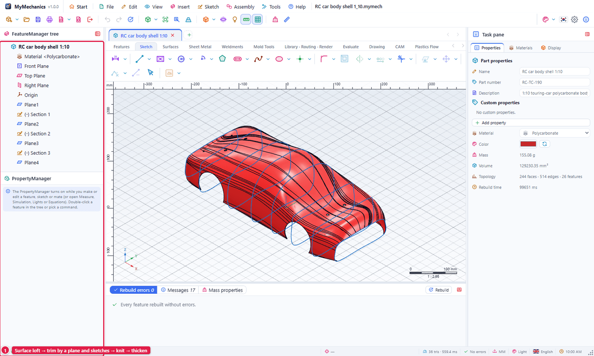
* **Sheet Metal** tab: **Base Flange** (closed sketch + thickness, bend radius, K-factor) → **Edge Flange** (pick a straight edge on the sheet's top face, angle, length) → **Hem** (the edge folded back 180°, closed or open) · **Sketched Bend** (bent by an angle along a line drawn on the sheet) · **Jog** (the far side raised by a height with two bends) → **Flatten** shows the flat pattern. Bend allowance = angle × (radius + K × thickness).
* **Flat pattern to DXF / DWG**: **File › Export › Export flat pattern as DXF/DWG** (also on the Sheet Metal tab) saves the blank of the active sheet metal part straight from the part: the outline and holes on layer OUTLINE, each bend line on BEND_UP or BEND_DOWN (the side it turns to when formed) and a note per bend (direction, angle, inner radius, allowance) on BEND_NOTES, in millimetres in the sheet plane.
* **Edge flange position, length and width**: **Bend outside** (the bend beyond the edge), **Material outside** (the flange's inner face on the edge), **Material inside** (its outer face on the edge) or **Bend from virtual sharp**; the sheet is cut back where the bend moves in. The length is measured from the bend tangent, the outer virtual sharp or the inner virtual sharp, and the flange can be narrower than its edge (offsets from the start and the end). **Edit flange profile** turns its straight part into a polygon edited point by point (U along the edge, V along the flange) for tapers, notches and tabs. The flat pattern follows.
* **Custom forming tool**: in **Forming Tool** choose *Custom tool*, the **punch part** (any part of the project), its **stop face** (a planar face) and any **faces to remove**. The stop face sits on the sheet's far face, the punch rises through the sheet, and the sheet wraps over it as thick as the sheet (rounded outside the punch's convex edges), hollow and open underneath; faces to remove are punched through.
* **Normal cut**: an extruded cut in a sheet metal part has the option *Normal cut (square to the sheet)*: where the cut's outline lands on the sheet face it enters through — flats and bends — the hole goes straight through the sheet along the face normal (radially in a bend), as if it had been cut in the flat and folded.
* **Gauge table and bend calculation** (Base Flange, Convert to Sheet Metal): a **gauge table** — steel (standard gauge), galvanized, stainless, aluminium (B&S), metric thicknesses, or a custom table of your own rows (name, thickness, radius, K) — sets the thickness, the bend radius (one of the radii the gauge offers) and K. The **bend calculation** lays bends out flat by the **K-factor**, a **K table** by r/t, **DIN 6935**, a **bend allowance table** or a **bend deduction table** (rows of angle, radius and value, interpolated between them; *Fill from K* starts one). The flat pattern and the drawing's bend table use it.

   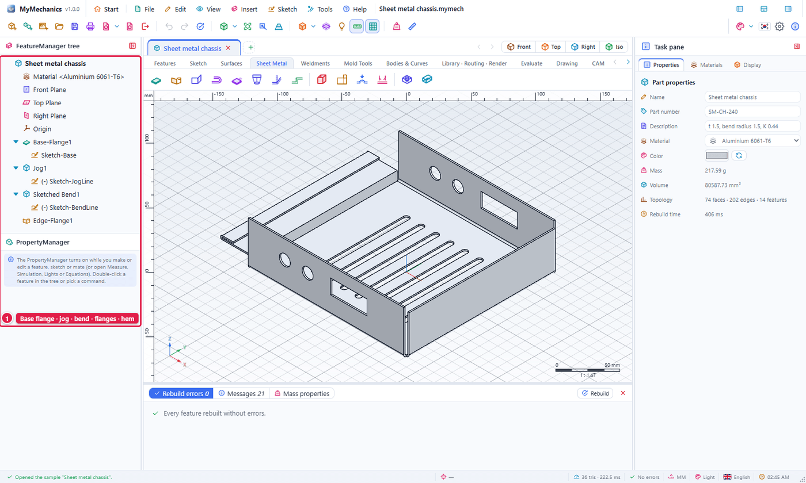

   
* **Sheet metal from a solid:** **Convert to Sheet Metal** turns a solid's fixed face into the sheet's base and, at each chosen edge, the face beyond into a wall (thickness · inside or outside · bend radius · K-factor; where walls meet, **Overlap** — one wall runs over the other's end with the rip gap between — or **Open**). **Insert Bends** does it on a thin-walled solid such as a shell: the thickness is read from the walls and every sharp edge of the fixed face becomes a bend. **Rip** cuts a gap along the edge where two walls meet so they can unfold (on the bisector or along one wall).
* **Sheet metal — cuts across bends:** put **Unfold** in the tree and from there to the next **Fold** the part is built flat. A cut made in between is wrapped over the bends when it folds (on a bend it is wound onto the bend, on a flange it turns with the flange) and lands in the formed part. Not for sheets with a jog or a lofted bend.
* **Sheet metal — more:** **Cross Break** (the X of a stiffening break on a flat panel; the shape does not change) · **Welded Corner** (the gap between two edge flanges filled with weld, its volume and length shown; not in the flat pattern) · **Tab and Slot** (with two separate bodies: tabs on one body's edge, slots larger by the clearance in the body whose face it stands on).
* **Weldments** tab: put **Structural Members** (square / rectangular tube, pipe, round / square bar, angle, channel, I-beam, tee, any size) on a sketch of lines; **Cut List** gives each member's length and the total.
* **Structural member options**: a **custom profile** drawn in a sketch (its origin sits on the path; save the sketch with **Save to Library** and insert it in other parts to reuse it as a profile library); **corner treatment** where two members meet — overlap, **mitre** (both cut on the bisecting plane) or **butt** (one runs through, the other stops at its face). The cut list (and the drawing's cut list table) gives each member's cut length and its end cut angles.

   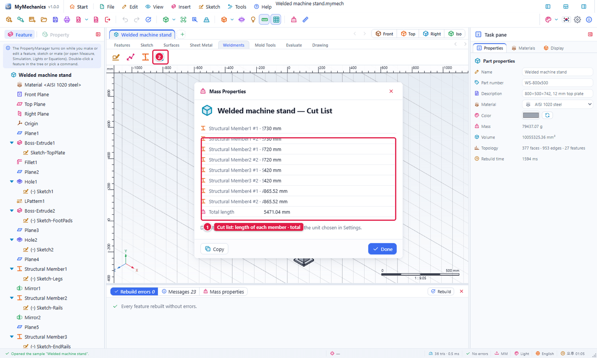
* **Mold Tools** tab: **Draft Analysis** (pull direction = the selected plane / face normal, Y by default: green positive draft, red negative, yellow insufficient), Draft, **Parting Line** (the edges where faces turn from facing the pull direction to facing away), **Tooling Split** (a mold block around the part split at the parting height, the part's shape taken out, pulled apart to be seen), **Shrinkage Scale**, Split, **Cavity**.
* **Core (side core)**: after the tooling split, sketch the outline of a side action or lifter and extrude it (through all or blind, with a draft angle) through the tooling: what it passes of the core and cavity becomes a body of its own and leaves them; the moulded part stays as it is.

   

   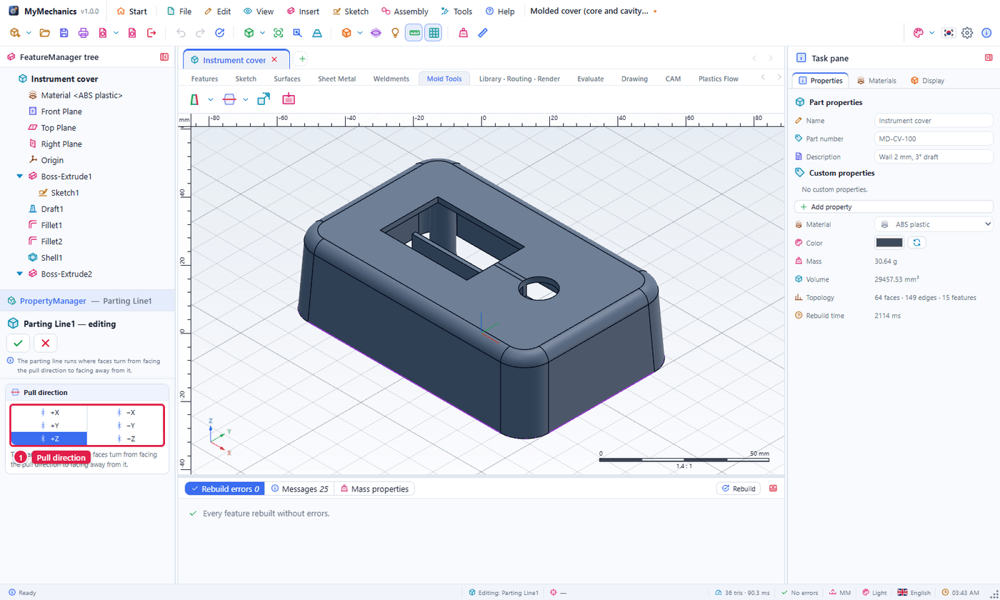

   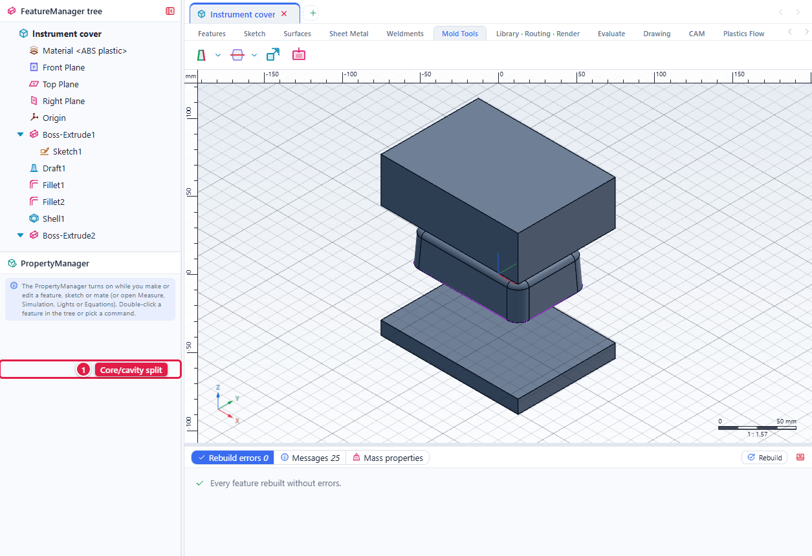

### Injection moulding: flow, mould cooling, fiber orientation and warpage

The **Plastics Flow Study** on the **Injection Flow** tab fills and packs the part from a resin (Cross-WLF viscosity, Tait PVT data), the process settings and the gates (click on the part or let it suggest one), and colours the part by fill time, pressure, flow-front temperature, frozen layer, packing pressure, shrinkage and sink, with weld lines and air traps marked. Three more steps can be added in the PropertyManager; they run after the fill in the same background job.

**Runners, multi-cavity and family moulds** (the last group of the plastics flow study): set the number of **Cavities** (1–8) and tick other parts of the project to add them as a **family mould**. Cavities sit in two rows either side of the primary runner (along x through the sprue); a branch runner runs along y to each cavity's gate (that part's first gate, or the suggested one). Runners are round channels (Hagen–Poiseuille conductance πr⁴/8L) in the same flow graph as the cavities, all filled from the sprue. Set the **Primary runner diameter**, **Gate diameter** (0 = 0.6 × its branch) and **Cavity clearance**, then **Run mould**: a table of each cavity's fill time, filled share and branch diameter, the **Fill imbalance** ((max − min) / max), the sprue pressure and the runner's volume and scrap share are listed, and the cavity boxes, runner and gates are drawn on the model. **Balance runners** repeats the fill, widening the branches of late cavities and narrowing those of early ones, until the imbalance is under 3 %, and keeps the branch diameters it found.

**Gas assist and insert moulding** (plastics flow study): with **Pick insert faces** click the part faces a metal insert touches and set the **Insert temperature**; the walls by them cool to the insert's temperature instead of the mould's — a cold insert freezes the melt there sooner (more pressure, a short-shot risk), a preheated one later — in the main fill. **Run gas assist** injects the **Melt shot** (%) only, then gas from the gas pin (the first gate, or one clicked with **Gas pin position**) runs down the thick channels of least resistance hollowing their cores between the frozen skins, and the melt it pushes out fills the rest along the melt front. The gas keeps out of walls thinner than the set multiple of the nominal wall. The results say filled, short shot or blow-through (the gas breaking through the front), with the gas volume (weight saved), the penetration and the gas nodes, which are shown as violet points.

* **Fiber orientation**: with a glass fiber content (%) and aspect ratio, the orientation tensor during filling is computed with the Folgar–Tucker equation (hybrid closure) in layers through the wall. Near the walls (skin) the shear lines the fibers up with the flow; at the middle (core) a spreading flow turns them across. Colour the part by the alignment, the skin or the core.
* **Mould cooling**: serpentine channels are laid out in both mould halves (diameter, flow per channel, inlet temperature, pitch, cavity-to-axis distance, coolant, mould material), and the cycle-averaged heat transfer gives the mould wall temperature and the cooling time at each place. Each channel lists its Reynolds number (turbulent or not), the heat it removes, the coolant outlet temperature and the pressure drop, with warnings when the flow is not turbulent, the coolant warms more than 3 °C or a channel is too close to the cavity. The channels are drawn in the graphics area.
* **Warpage**: the part is meshed with tetrahedra and its free (3-2-1 held) deformation is solved from the initial strains left by differential shrinkage, differential cooling and orientation (fiber or molecular). The warpage of each cause and in total (after the even size change and the rigid motion are taken out) and the main cause are listed; **Show deformed shape** and **Deformation scale** exaggerate it.

The report (HTML) has tables for these steps too.

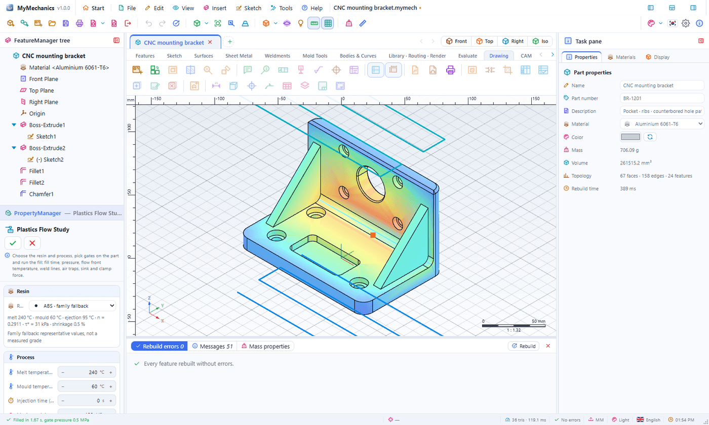

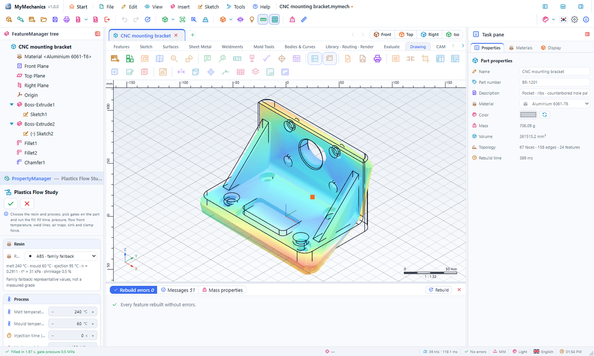

## 7. Equations, configurations and design tables

* **Evaluate › Equations**: make global variables (`W = 120`, `H = W / 2`). Type `=H - 5` in a feature's value box to drive it. Functions `sin cos tan sqrt abs min max round iif(condition, then, else)`, `pi`, other features' values (`Boss-Extrude1.depth`) and sketch dimensions (`D1@Sketch1`) can be used.

   
* **Evaluate › Configurations**: each configuration has its own variable values and suppression states; suppressing while a configuration is active affects only it. The tree's top row shows the active configuration.

   
* **Design table**: export the configurations × variables (and `$STATE@Feature`) table as CSV, edit it in a spreadsheet and import it to make configurations.

### CAM (CAM tab › CAM Manager)

The **CAM Manager** has these tabs:

- **Setup**: the machine (mill or lathe), the stock (automatic margins or your own), the work offset and the post (Fanuc, Haas, LinuxCNC, ISO; Fanuc and LinuxCNC lathe).
- **Tools**: flat, ball and bull-nose end mills, face mills, drills, spot drills, taps, and turning, boring, grooving and threading inserts.
- **Features**: recognises faces, pockets, slots, bosses, steps, holes and freeform areas.
- **Operations**: facing, pocket and adaptive roughing, contour, slot, helical boring, spot, drill, peck, chip break, tap, Z-level, parallel, scallop, waterline, and the turning operations. **Plan all** makes the operations for every recognised feature.
- **Multi-axis**: **4-Axis Rotary Finishing** turns the part about X (A axis) under a vertical tool; the axis passes through the part's YZ centre, the pattern is lines along X per A angle or rings around per X, and the post writes A words. **5-Axis Simultaneous Finishing** follows the 3-axis parallel path's ball centres with a ball end mill, its axis along the surface normal leaned along the cut, within the **Maximum tilt**, so the ball cuts with its side rather than its centre (zero cutting speed) and short tools reach steep walls; the post writes G43.4 (tool centre point) with table-table A and C, C kept continuous past ±180°. A row starting off the part rapids only to above the stock's top and feeds in below. **Mill-Turn Face Drilling** drills the off-axis holes with a live tool on the lathe, positioned by the C axis (angle, radius) (G83); **Mill-Turn Radial Drilling** drills an evenly spaced pattern of radial holes from the outside toward the axis (G87). The stock simulation replays 5-axis paths with the vertical tool at the same ball centres; rotary and mill-turn paths are left out, and it says so.
- **Simulation**: simulates material removal with a gouge check and works out the cycle time.
- **G-code**: previews and saves the G-code and the set-up sheet.

A milling operation's **Edit toolpath** (under its parameters) is laid over the generated path. Changing the operation's parameters and making the path again keeps the edits.

- **Lead-in and lead-out**: an arc (radius, angle) or a line (length), approaching from the left or the right.
- **Linking between passes**: up to the clearance plane, a minimum retract, or staying down at feed when the next pass starts within a set distance at the same level.
- **Order**: as generated, or nearest next.
- **Direction and feed**: reverse every pass, or set a feed factor.
- **Trim to a window**: keep only what is inside, or outside, an X/Y window.
- **Pass list**: delete or restore, reverse, or set a feed factor for each pass.

**Clear all edits** goes back to the generated path. Edited paths are what the simulation and the G-code use.

## 8. Materials, mass properties and simulation

In the task pane's **Materials** tab (or by double-clicking Material in the tree) choose one of 16 materials: steels, aluminium, brass, titanium, plastics and more. The density gives the mass and the color changes (the Properties tab can set a color of its own). **Evaluate › Mass Properties** shows the mass, volume, surface area, center of mass and bounding box. **Measure** gives the length, area or diameter of one face or edge, and the minimum distance and angle between two. **Section view** cuts the model with a plane; change its axis and position in the task pane's Display tab.

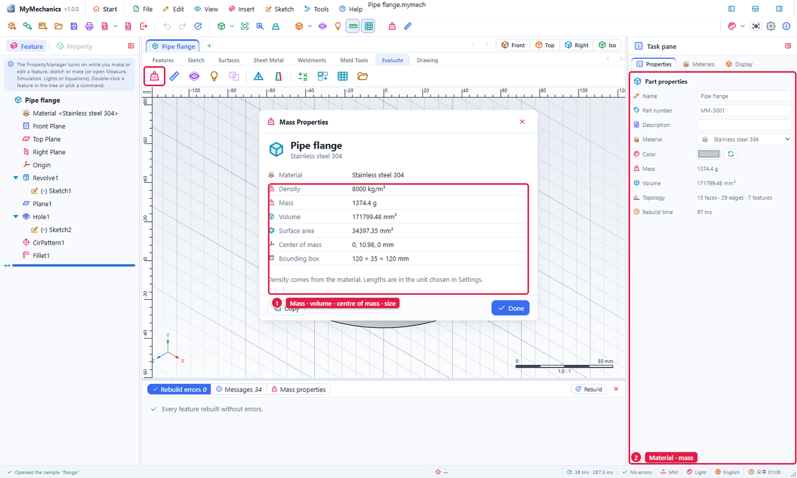

**Evaluate › Section Properties** cuts the part with a plane — Front, Top or Right, or a clicked planar face or reference plane — moved by an offset; the section shows on the ghosted part and the PropertyManager lists its area, centroid, second moments of area Iu, Iv and the product Iuv about the centroid, the principal moments with the angle of the principal axis, the polar moment and the radii of gyration.

**Decals** (Features tab) put images — labels, logos — on faces of the part: click a face and choose the image. Each decal has a width (its height from the image), a horizontal and vertical offset from the face's centre, a turn and an opacity, and is **projected** along the face's normal or **wrapped** round a cylinder or cone by arc length. Decals are saved with the part.

**Evaluate › Simulation (Static)** is a linear static stress analysis. Click the faces to fix and the loaded faces, give a force (N, along ±X, Y or Z) or a pressure (MPa) and **Run**. The body is coloured by von Mises stress (blue → red) and the maximum stress, maximum displacement and minimum factor of safety (yield ÷ stress) are listed; the deformed shape can be shown exaggerated. Set the study to **Thermal** for a steady-state temperature field (fixed-temperature faces, and faces with convection — film coefficient and ambient — radiation — emissivity and ambient: εσ(T⁴ − T∞⁴), solved by Newton steps — or heat power in W), or to **Frequency** for the natural frequencies and mode shapes with the fixed faces (pick a mode with its button). The analysis uses cube (voxel) elements, so a higher resolution is more accurate, and local stresses at corners can come out higher than real.

**Fixture kinds**: besides fixed, roller / symmetry and elastic support there are the **fixed hinge** (a pin hole held radially and axially, free to turn about its axis), **on cylindrical faces** (the face's axis is found; the checked components — radial, circumferential, axial — are held at their values), **prescribed displacement** (the checked X / Y / Z components, in mm) and **cyclic symmetry** (pick a sector's two cut faces in turn: one moves as the other turned by the sector angle about the line they meet on — a whole disc or impeller solved as one slice). **Load kinds**: besides force, pressure, torque and gravity there are the **bearing load** (a cosine radial pressure on the half of a cylindrical face the force points to, adding up to exactly that force), the **remote load** (a force and moment at a point off the faces, carried by the picked faces like a rigid link — exactly that force and moment), the **remote mass** (the weight of a mass on the faces, optionally with its centre at a point), **centrifugal** (direction = spin axis, size = rpm, a point on the axis; every element takes ρω²r) and **thermal** (a temperature change ΔT of the whole part with its material's expansion coefficient; negative cools it).  In an assembly contact study, parts that overlap to begin with (a press or shrink fit) are solved from the overlap alone, with no other load; the contact follows the quadratic elements’ curved faces and agrees with Lamé’s solution within a few per cent.

**Connectors** (static and assembly studies): between two faces (of two parts, or of one) add a **bolt** (shank stiffness E·A/L from its diameter, preload — the result is the bolt's axial force and shear), a **spring** (axial and shear stiffness), a **pin** (moving together, turning freely about each other), a **rigid** link (translation and rotation tied), a **spot weld** (ties what lies within its diameter of the point clicked on face A) or a **bearing** (radial stiffness about the cylinder's axis). Choose the kind, click face A then face B, give the values and press **Add connector**. Each face stands for the area-weighted mean translation and rotation of its nodes; after the run each connector's force is listed.

**Adaptive meshing** (part static study): in the mesh group turn on **Adaptive meshing** and set the **Target error** (%) and **Maximum passes**. After each solve every element's error is estimated (its stress against the smooth recovered stress, in the energy norm — Zienkiewicz–Zhu), the mesh is made finer only around the elements with large errors, and the study is solved again, until the estimated error is under the target. A pass close to the target refines a little, one far from it more; it stops past 80,000 elements. The results list each pass's elements, estimated error and peak stress, in the report as well. A stress concentration such as a hole is resolved with fewer elements than a uniform mesh of the same accuracy.

**p-adaptive**: with the adaptive method set to **p-adaptive (linear → quadratic, then hp)** the same mesh is solved with linear and then quadratic tetrahedra; the change of the strain energy measures the linear solution's error and the quadratic one is judged by its recovered-stress estimate — still over the target, the quadratic mesh is refined where the error is (hp). The pass table shows each pass's element order (p). **Mixed mesh** (assembly study): in the component list choose each component's **Element kind**: solid, shell or beam. A shell component becomes its mid-surface (the faces facing its thinnest direction), a beam component its longest axis with its box section, solved in one system with the solid tetrahedra; shell and beam nodes touching a solid's surface are tied rigidly to the solid nodes around them (RBE2), coincident shell and beam nodes on all six degrees of freedom — linear, bonded. The results are coloured on each component.

**Shell elements** (part static study): for thin-walled parts such as sheet metal and plates, turn on **Shell elements (thin walls)** in the mesh group and pick the **Faces on one side of the wall** (all of that side, the bends' cylinders too). Moved inwards by half the thickness they become the mid-surface; a **Shell thickness** of 0 measures it to the opposite face. The mid-surface is split by longest-edge bisection down to the element size (0 = a 40th of its extent, not below the thickness) and solved with triangular shells (DKT bending + CST membrane, three translations and three rotations per node). Fixtures and loads move to the mid-surface nodes on their faces: fixed, hinge (→ pin) and roller supports, forces, pressure (on a shell face its elements, on another face its force pressure × area) and gravity; others are reported as not used. The result is the coloured mid-surface (deformed if shown so) inside the see-through part; the stress is the larger von Mises of the top and bottom surfaces (membrane ± bending). Thin walls that need several tetrahedra through the thickness are solved with far less computing.

**Submodel** (part static study): solve the whole part on a coarse mesh, pick probe **P1** on the result, and in the **Submodel** group set the **Region size** (a cube about P1; 0 = a quarter of the part) and the **Element size**, then press **Solve submodel**. The region is cut out of the part and solved on a fine mesh, its cut faces taking the global displacements (the cut-boundary displacement method). Fixtures and loads on its faces carry over; a force or torque on a face is split by the share of the face inside the region. Loads tied to several faces (remote, mass, bearing) that reach into the region are reported as not carried over. The result is painted on the model in the same colour scale, and the submodel's peak stress, the global peak inside the region, the elements, the cut faces and the **Cut-face stress match** (the mean von Mises of the submodel over the global one on the cuts) are listed. When the match is more than 15 % off 100 %, the cuts are too close to the stress concentration: enlarge the region.

**Beam Study (frame)** (Weldments tab): the structural members as 3D beam elements (six degrees of freedom per joint). Section properties (area, second moments, principal axes, torsion constant: Bredt's formula for closed tubes, Σbt³/3 for open shapes) come from the built-in or drawn profile, and each member lies along its section's centroid line. Members are split where other members end on them, and a member end that meets another at its face (centre lines apart) is tied to the nearest member within the sections' reach by a rigid link. Pick joints in the list or on the model, give free, pinned or fixed supports and forces (N) and moments (N·m), switch on the self weight and run: the members are coloured by stress with the deformed shape (adjustable scale), with the largest stress and deflection, a table of each member's length, stress, axial force and factor of safety, and the support reactions (CSV). Supports and loads are kept with the part.

**Stress linearisation (pressure-vessel check).** On a static result, pick one wall surface and then the opposite one with the **probes**: along the line between them (the stress classification line) the stress is split into membrane (Pm), bending (Pb), membrane + bending, peak (F) and total, each as stress intensity (Tresca) and von Mises in MPa. Enter the **allowable stress S** below it (default: yield ÷ 1.5) to see the checks Pm ≤ S, Pm + Pb ≤ 1.5 S and total ≤ 3 S; a row that fails is red. If the line leaves the model you are asked to pick two points across a wall.

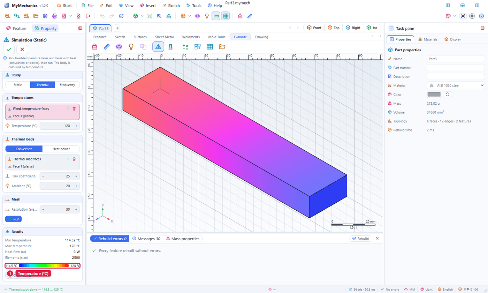

The **flow study** (external or internal) uses the lattice Boltzmann method for drag, lift, pressure drop and streamlines. External flow can add **local refinement around the body**, 1 to 3 levels: each level nests a block of half-size cells around the body, and the blocks and the grid outside exchange their solutions both ways until the drag changes by less than 0.5 %. The results list the blocks and the coupling sweeps, and say so when a block diverged because the grid outside is too coarse for the Reynolds number (use more cells). **Maximum iterations per grid** shortens the run. With **Rotating body** on, the body's walls move about the chosen axis (through its middle) at the given rpm (a frozen rotor: moving-wall bounce-back), and the results give the torque about the axis and the shaft power — for propellers, impellers and rollers.

**Particle study** (the flow study's last group): after the flow is computed, set the **Particle diameter** (µm), **density**, **Particles tracked**, **mass flow** and **Gravity**, and press **Track particles**. Particles enter at the inlet with its mean speed and move through the computed flow under Schiller–Naumann drag (integrated exactly over each step on their relaxation time), gravity and buoyancy; at a wall they bounce (restitution 0.6 normal, 0.9 tangential) and erode it the Finnie way — K·|v|ⁿ·f(α) per kg of particles with the ductile angle function f(α) = sin 2α − 3 sin²α up to 18.4°, cos² α / 3 above (steel by sand: K = 2×10⁻⁹, n = 2.6 by default). The trajectories (brown), impacts (orange) and the worst erosion (red) are drawn; the escaped / trapped / lost counts, the impacts, the worst and total erosion rates (kg/s), the Stokes number and the relaxation time are listed.

**Fluid model** (flow study): **Compressible gas (Euler)** solves an ideal gas of the given **Mach number**, static pressure and temperature by finite volumes (HLL fluxes, second-order MUSCL), subsonic to supersonic; the section can show the Mach number, pressure and temperature, and the results give the largest Mach number, the stagnation pressure on the front against the theoretical pitot pressure (behind a normal shock, Rayleigh, when supersonic), whether a bow shock stands ahead, the drag and its coefficient. For incompressible flow (lattice Boltzmann) the **Turbulence model** is LES (Smagorinsky), mixing length (RANS: ν_t = l²|S|, l = min(κ·wall distance, 0.09·δ)) or laminar / DNS; the **Viscosity model** Newtonian, power law (K, n) or Carreau (μ₀, μ∞, λ, n) — a non-Newtonian fluid's viscosity follows each cell's shear rate. In external flow **Body as a porous medium** lets the fluid through the body against the Darcy–Forchheimer resistance (permeability K, inertial coefficient C_F) and lists the pressure drop across it (filters, foams, packed beds).

**Goals and parametric studies** (under the flow study): choose the goals to report — global (drag, lift, side force, drag coefficient, pressure drop, largest velocity, heat to the fluid, Nusselt number, torque, shaft power, Strouhal number), surface (mean, largest and smallest pressure on picked faces, and their pressure force along the flow, lift and side axes) and volume (mean and largest speed, mean pressure, mean and largest temperature of the fluid in a box). After a run the goal table gives each value and whether it settled (the change between the means of the last two windows); with **Stop a steady run when its goals settle** the run ends on its goals (an oscillating force settles on its mean). A **parametric study** runs the study once per value of the inlet velocity, inlet temperature, rotation speed or a global variable of the part (rebuilt each time; surface goals find their faces again by signature), between a start and an end value, and shows the goals as a table and a plot, saved as CSV.

**Free Surface** (part › Evaluate) treats the part as a container (a tank, a cup): the space it encloses at the sides and below is filled with water, oil or glycerine up to a level (over part of its length only, like a dam, if wanted), and the free-surface lattice Boltzmann method shows how the liquid moves while the vessel stands still or accelerates along +x (sloshing). The liquid is a blue surface in the see-through part; step through the frames or play them, with each frame's time, highest liquid (the run-up at the walls), centre-of-mass shift and mass change. A dam break's front was checked against Martin & Moyce's experiment.

**Electronics Cooling** (assembly › Evaluate) gives each component a role: heat source (power W, junction-to-case resistance θjc, allowed temperature), board (in-plane and through-thickness conductivity — the thinnest direction is the thickness), conducting part (its material's conductivity), enclosure (the air passage) or left out. The air is forced (axis, velocity), natural convection (buoyancy over a slight 0.05 m/s draft) or a fan (its curve from the maximum flow and maximum pressure; a first run gives the system curve and the study runs again at the operating point; it needs an enclosure). Flow and heat are solved together on the lattice (conjugate heat transfer); steady runs give the solids the air's heat capacity so they settle quickly (steady temperatures do not depend on it). The components are coloured by temperature, and a table lists each one's power, maximum, mean and junction temperature (case maximum + θjc × power) against its limit, a row over the limit in red. Very small parts are only a cell or two on the grid: a higher resolution is more accurate.

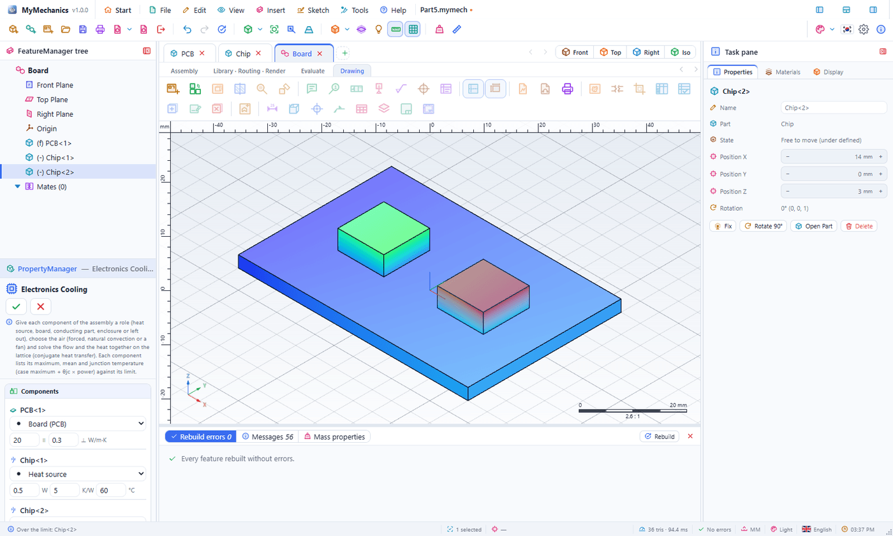

## 9. Assemblies

1. Click **New assembly**. The PropertyManager lists the project's parts and the sample parts. The first part is fixed at the origin (`(f)`).
2. **Assembly › Insert Components** adds more parts (STEP files too).
3. Click **Mate** and click faces of two different components. Two cylinders suggest **Concentric**, two planes **Coincident**; distance, angle, parallel, perpendicular and aligned / anti-aligned are there too. ✔.

   
4. All mates are solved together. Fully positioned components have no prefix, those that can still move get `(-)`, conflicting mates turn red.

   
5. **Interference Detection** lists overlapping pairs and the overlapping volume.

Double-click a component to open its part tab. When a part changes, the assembly is solved again.

* **Rotating components**: select a component and choose **Rotate 90° about X / Y / Z** (context menu, toolbar) to lay it down or stand it up.
* **Move Component** (Assembly › Move Component): **drag a component with the mouse** to slide it in the screen plane (**Move**) or turn it about its origin on the screen axes (**Rotate** — lay it down or turn it over any way). Alt+drag uses the other one; Shift+drag adds the component to the ones moved. The ±X/±Y/±Z buttons move or turn by a set distance or angle. With collision detection on, a drag that ends in contact is put back. One drag is one undo step.
* **Component patterns**: besides linear, circular and mirror copies there are **Pattern driven** (following another part's linear or circular pattern feature, e.g. a bolt in every hole), **Sketch driven** (at every point of a part's sketch; the original at the first point), **Curve driven** (along a curve, equally or every spacing, optionally turned with the tangent; the original at the curve's start) and **Chain** (links placed so each next pin is the point of the path a pitch in a straight line from the previous one, turned along that chord). The copies are fixed and follow their original.

* **Cam mate**: pick the cam's flat face (its outline is the cam profile) and the follower's plane, cylinder or point; the follower stays on the cam profile (turn the cam in a motion study).
* **Advanced mates**: width (centred between two faces), symmetric (about a plane), limit distance / limit angle (free within a range), lock, linear/linear coupler (one moves a ratio of the other's move), profile centre, and **path** — click an edge of one component near its corner (that vertex) and edges of another one (the path; more edges extend it): the vertex stays on the path, anywhere, at a distance or a percentage along it (from either end), optionally turned along the path (pitch/yaw). **Mechanical mates**: gear (ratio), rack pinion (pitch radius), screw (distance per revolution), hinge, slot (free, centred, at a distance or percentage) and universal joint.
* **Magnetic mates**: give parts **Connection Points** (Part › Connection Point: a planar face's centre and normal, or a pin's end; a name, offset and flip). In an assembly, **Magnetic Mates** snaps the connection points of components that are within the snap distance (Settings) and face each other: the points meet and face each other; the turn about them stays free. Switch with the Standard / Advanced / Mechanical buttons in the mate PropertyManager.
* **Sub-assemblies**: the Insert Components list also shows the project's other assemblies; they mate as one component and take one BOM row. **Flexible Sub-assembly** (context menu) lets the parts inside keep their freedoms: they are solved in this assembly, so a mate or a motor here moves a part inside it (the sub-assembly document itself is not changed).
* **Assembly configurations**: Configurations on an assembly keeps, per configuration, which components are suppressed or hidden, the part configuration each instance uses and which mates are used.
* **Exploded view**: Explode spreads the components outward from the centre; click again to collapse, **Delete Explode** removes the steps. **Exploded View Editor** adds steps of your own: pick components, then a **regular** step (a direction, a distance and a turn about X / Y / Z through each part's centre) or a **radial** one (straight out from an axis through their middle). Steps are listed and edited (distance, angle) or deleted; **explode lines** (dashed) show the paths the parts travel; **Animate Explode / Collapse** plays the steps one after the other.
* **Clearance Verification** lists the pairs of components closer than the minimum clearance (Settings), with the smallest gap of each; with components selected, only them against the rest. Touching pairs can be left to Interference Detection.
* **Assembly Visualization** ranks the components by mass, volume, surface area, density or quantity and colours them on a blue (low) to red (high) scale; **Turn Visualization Colours Off** restores the colours.
* **Assembly Weld Bead**: pick edges of one component that stand on a face of another, and that face; a fillet bead (leg = weld size) runs along the edges (straight edges and full circles). The weld table on the same page lists the welds with their length.
* **Simplified representation** (context menu): a sub-assembly shown as its **bounding box** or with **outer parts only** (parts inside others and tiny ones left out) draws faster; mass properties, interference and drawings still use every part. **Full Representation** shows it all again.
* **Top-down design**: **New Part in Context** adds an empty part at the assembly origin and opens it with the other components shown see-through around it; **Edit Part in Context** does the same for a chosen part. A sketch can be put on a face of another component — an **external reference**: when the assembly changes, **Update External References** (also done when you enter the context) moves those sketches to where the faces are. **External References** lists them; a locked one stays where it is, a broken one becomes a fixed plane. **Exit In-Context Editing** returns to the assembly.
* **Layout-based design**: **New Layout** adds a layout part (a sketch on Top) fixed at the assembly origin and opens it in context; draw the layout there with **blocks** (Sketch › Make Block / Insert Block). **Make Part from Block** makes a part for each block (its first sketch is the block) and puts a linked component on every instance, on its plane, position and turn. When instances move or blocks change, **Update from Layout** (also done when you leave in-context editing) moves the components and updates the parts.

   

* **Replace Components**: the chosen instances (or every instance of their part) use another part. Mate references are found again on the new part (the nearest face of the same kind and direction); mates that find none are suppressed and marked. The PropertyManager says how many will not be found before you press OK.
* **Copy with Mates**: copies a component and repeats its mates; for each one choose **Repeat** (the same face of the other component), **New reference** (click another face of it) or **Leave out**.
* **Hole Alignment**: finds holes of different components that meet along their axis and overlap but whose axes are further apart than the tolerance (Settings › Hole alignment tolerance, 0.01 mm by default), and lists them.
* **Envelope**: makes the selected components reference envelopes: drawn see-through, left out of the BOM, mass properties and interference. **Select Inside Envelope / Select Crossing Envelope** select the components inside its box or crossing it.

### Standard parts library and smart fasteners

The **Standard Parts Library** on the **Library · Routing · Render** tab makes bolts, nuts, washers, bearings, pins, rings, keys, gears, pulleys and pipe fittings from the standards' size tables. Each item shows its standard number (for example ISO 4017 M8×30); threads are cosmetic or modelled.

Next to the ISO items there are **DIN** items; where DIN differs from ISO, they are made to DIN.

| DIN | Item | Differs from ISO in |
|---|---|---|
| DIN 933 / 931 | Hex bolt (fully / part threaded) | across flats M10 17, M12 19 (ISO 16, 18), head height; 931 thread length b = 2d + 6 (L ≤ 125), 2d + 12 (L ≤ 200) |
| DIN 934 | Hex nut | across flats as DIN 933, height m = 0.8 d |
| DIN 439 B | Thin hex nut | DIN across flats |
| DIN 912 | Socket head cap screw | same dimensions as ISO 4762 |
| DIN 7991 | Countersunk socket screw | head diameter (M10 20, ISO 10642 22.4) |
| DIN 7984 | Low head socket cap screw | head height (M10 6, ISO 4762 10) |
| DIN 125 A | Plain washer | same dimensions as ISO 7089 |

**Smart Fasteners** put bolts, washers and nuts of the right size and length into an assembly's holes; the DIN items can be chosen as the bolt and nut kinds too.

**Pipe ISO / Spools** (same tab): on a part with a pipe or tube route (or an assembly holding one) it makes a new drawing with the route's isometric piping drawing (ISO): the centre line, elbows, tees and other fittings, reducers, flanges (double bars), shop welds as dots, field welds (FW), the centre-to-centre length of every straight, spool numbers, the elevation of the ends (EL) and a north arrow. Three tables come with it: the spools (pipe sizes and cut lengths, fittings, shop welds, weight), the bill of materials and the weld list. A spool is the shop-made piece between field welds: one longer than the **Maximum spool length** gets a field weld in the middle of its longest straight; pipe longer than the **Pipe stock length** counts its shop splices. Shop welds are one per fitting end (elbow 2, tee 3, cross 4, lateral / Y 3, reducer 2, weld-neck flange 1). The sheet follows the route (with auto update off, an Update button), and when a table grows the tables are laid out afresh so none overlaps or leaves the sheet.

**Your own routing components**: in a part's **Connection Point** feature (Features tab, the reference geometry ▾) set the **Routing component** to pipe, tube or cable with its size (a pipe DN or an outside diameter) and its role: a **connection point (CPoint)**, where a route starts or ends, or a **route point (RPoint)** it passes through. With the part (a valve, a pump, a connector …) in an assembly, a pipe / tube / cable route lists the matching **Routing component points**: **Start here** takes the size and leaves along the point's direction by a stub of 1.5 outside diameters, **End here** enters along it by a stub and ends the route, **Add route point** puts the point into it.
* **Motion study**: put a rotary (rpm) or linear (mm/s) motor on a component's cylindrical face and play. Components joined by gear, rack and screw mates follow; the time slider shows any moment. A motor with an amplitude and a period swings back and forth over that range (one-way: out from 0 to the amplitude and back — a lid opened and closed, a nut backed off and run on), and a motor mounted on another component (its parent) turns wherever that component has gone, so a chain of joints like a robot arm moves all at once. A sub-assembly with a motion study of its own (the robot sample's gripper) plays along. In the robot sample joints J1–J6 all move and the gripper opens and closes.

   

   The study type buttons switch between **Basic motion** (motors drive the mates), **Animation** and **Motion analysis**:
   * **Animation** (keyframes): a key at 0 s is made when you choose it. Move components, set the time and **Add key**; between keys the placements are interpolated (linear or eased), turns the short way round.
   * **Motion analysis** (physics): components move as rigid bodies with their real mass, centre of mass and inertia (from the parts' solids and materials) under **gravity** (direction and value), **springs and dampers** (pick faces of two components; stiffness N/mm, damping N·s/mm, free length) and **motors**, held by the mates. **Contacts** between two components stop them going into each other and make them bounce with a restitution (0 … 1). **Calculate**, then play; the plot shows a component's displacement, velocity or acceleration, a spring's force, a mate's reaction force, a motor's torque (N·mm) or force, or a contact force, with its peak.

## 10. Drawings

From a part or an assembly, **Drawing › Make drawing** (or Standard 3 View) puts the front, top and right views and an isometric view on an A3 sheet (third-angle projection; first angle in Settings). The scale is chosen from the standard scales to fit the sheet. Hidden lines (dashed), overall dimensions and a title block (title, part number, material, mass, scale, drawn, checked, date, revision) are included. Drag views to move them; in the task pane set the sheet size (A4–A0, Letter, Tabloid), scale and projection, and add or remove views. Export **DXF** (layers VISIBLE, HIDDEN, BORDER, HATCH, NOTES, DIMENSIONS, BREAKS, TABLES — everything the sheet shows, hole and revision tables and break lines included), **DWG** (R2004, or R2000 in Settings) or **SVG**, or print (Ctrl+P).

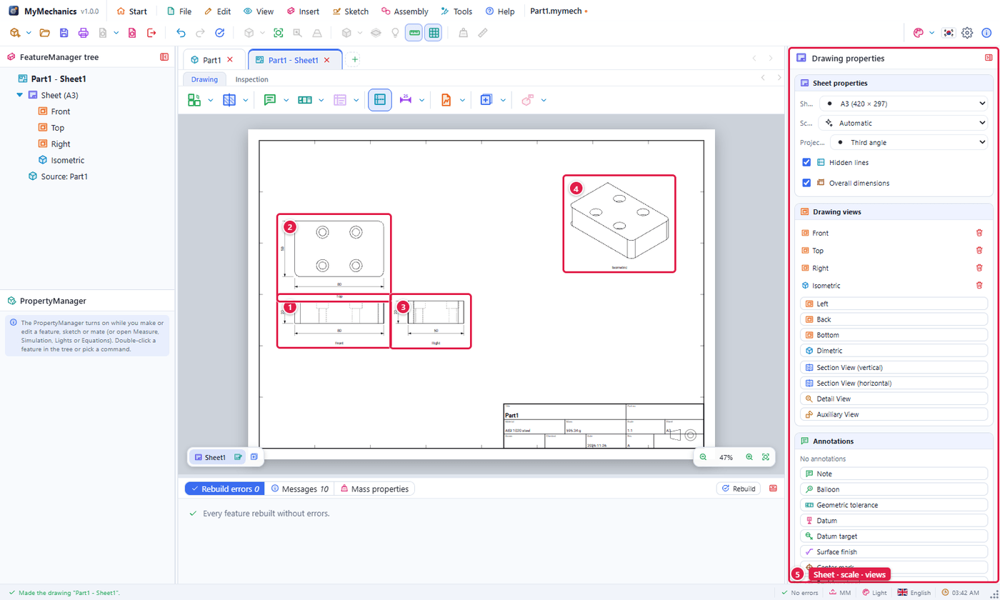

* **Section views** (vertical / horizontal): the selected view cut through its middle, hatched, with the cutting line, arrows and letters (A-A). **Detail view**: a circled area enlarged 2× (B). **Auxiliary view**: seen from any direction (x, y, z).

   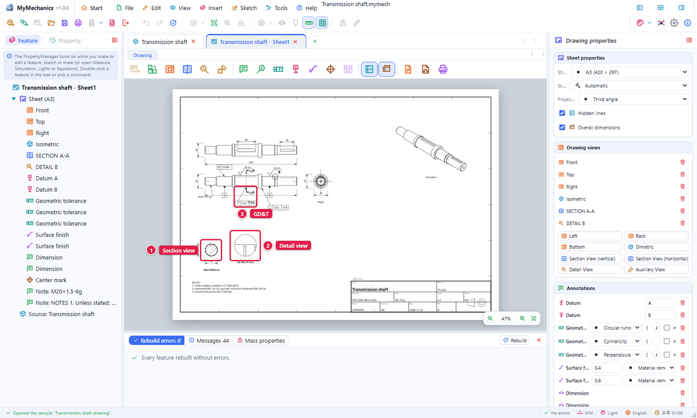
* **Annotations**: note, balloon, geometric tolerance (14 symbols such as flatness, perpendicularity, position; ⌀, M / L modifiers, datums), datum, surface finish, center mark. Pick the command and click on the sheet, drag to move, edit in the task pane.
* **Smart Dimension** (drawing): pick edges and vertices in a view — horizontal, vertical, aligned, radius, diameter, angle, chamfer, arc length, and the point-by-point sets: **Ordinate** (coordinates from the first point), **Baseline** (linear dimensions, each from the first point, stacked away from the view) and **Chain** (linear dimensions end to end on one line), along X or Y. Keep clicking points to add them to the set; precision and tolerances apply to every value of it.
* **BOM**: on an assembly drawing, a table of item, part number, name, material and quantity above the title block.

   
* **Aligned Section View**: cuts the selected view along a bent cutting line (one leg up from the centre, the other down and turned 30°) and turns the second leg's side into the first leg's plane, so both show as one section. The parent view shows the bent cutting line with its arrows.
* **Flat Pattern View** (drawing of a sheet metal part): the flat blank seen from above with its bend lines (bend up: dash-dot, bend down: dashed). **Bend Table** places a table of each bend's direction, angle, inner radius, K-factor and allowance. Cross breaks show as an X in the views.
* **Weld Table** (Annotations): a table of the drawing's weld symbols (alike ones counted together) and of the model's weld beads — a part's Weld Bead features or an assembly's welds — one row per size: fillet zN, total length, bead count and deposited volume. Running it again replaces the table.
* **Alternate Position View** (assembly drawing): draws the exploded position (or, without explode steps, the end of the motion study) over the selected view in phantom lines; press it again to remove it.
* **Revision cloud** (size, arc length, revision mark), **Datum target** (an X for a point, a circle for an area; size above, label below) and **Area hatch** (ANSI31 · ANSI37 · steel · solid, spacing and angle) are placed by clicking the sheet and edited in the right panel. All of them go into the DXF too (phantom and bend lines on layers of their own).

## 11. View, lights and start page

* **Rulers**: screen-aligned scales along the top and left of the graphics area (1-2-5 steps) with the pointer's place marked in red and its values. In the front, top and right views the rulers say which axis (X, Y, Z) they run along.
* **Coordinates**: Z is up. Top = XY, Front = XZ (seen from −Y), Right = YZ (seen from +X). Dragging turns the view freely about the screen axes, so the model can be laid down or turned over any way (the settings offer a turntable that keeps Z up). Files made before (Y up) are turned to Z up when they are opened.
* **Grid**: fixed on the chosen plane — Top (XY, the default), Front (XZ) or Right (YZ). When zooming, its spacing is redrawn in 1-2-5 steps once the lines get too dense or too sparse on screen; every fifth line is darker (5 × 5 cells). Turn it on or off and choose its plane in View › Show.
* **Scale bar**: the bar at the lower right shows a length on screen and the screen scale (1 : n at 96 dpi). Drag it with the mouse to put it anywhere.

   
* **Lights** (Evaluate tab or the View menu): ambient light (color, ground color, intensity), a camera light that follows the view (on/off, color, intensity), and directional, point and spot lights you add, each with color, intensity, position, target and cone angle. While the Lights page is open, drag a light's handle (the small sphere) in the graphics area to move it. Lights are saved in the project.
* **Sun** light: give the latitude, longitude, date, local time, time zone and which way north points (turned from +Y); the light shines from the sun's place then (azimuth and elevation are shown) and is off while the sun is below the horizon.
* **Walkthrough** (Evaluate tab or View menu): walk through the model in first person. W/S or ↑/↓ walk, A/D or ←/→ step sideways, Shift runs, and a drag in the graphics area looks round. With **Gravity** on the eye stays at its height above the floor — it steps up onto anything lower than 40 % of the eye height and falls off edges; with it off you fly where you look and Q/E go down and up. With **Collision** on you stop in front of walls and slide along them. Walking speed and eye height are fields on the page. OK leaves an ordinary view of what you were looking at; Cancel goes back to the view from before.
* **Record Video** (Evaluate tab or View menu): saves the graphics area as an MP4 (H.264) or WebM video. What to record: a **Turntable** (the camera orbiting about Z the given number of turns, over the given length), the **Motion study** (the assembly's motion study played from start to end) or the **Live view** (whatever happens on screen — orbiting, walking — from Start to Stop; the Walkthrough page's record button does the same). Pick the frame rate, the size (window, 1280 × 720, 1920 × 1080) and the format. Frames are fed on the clock, so on a computer that draws slowly the video still has its real length and speed — only fewer frames.

   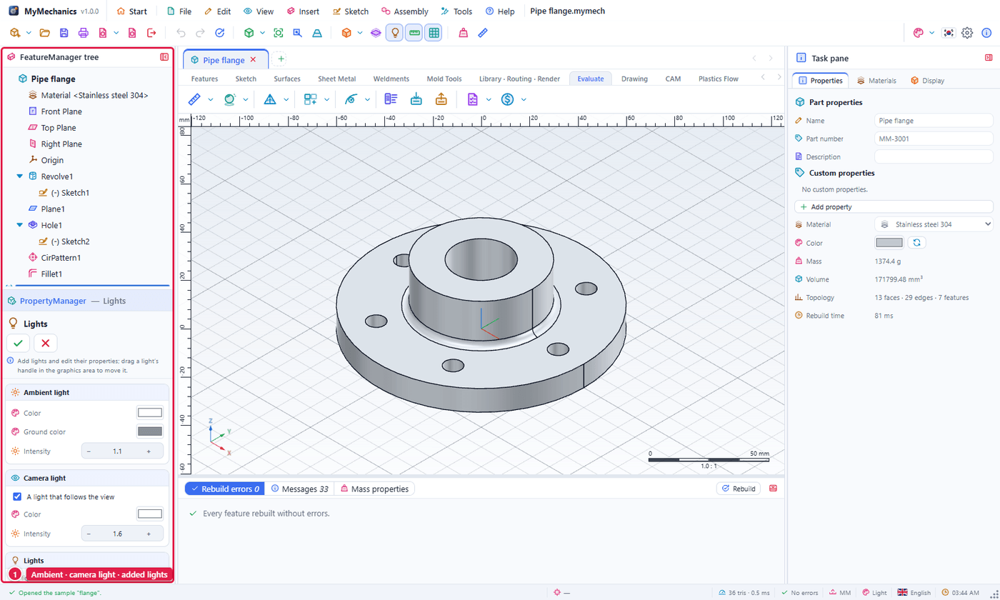
* **Collapsing panels**: the left, bottom and right panels collapse with the button in their header and open again from the expand button of the collapsed bar (the View › Show menu and the shortcuts do the same).
* **Start page**: the program information at the top is fixed (it cannot be moved or resized). The cards below are dragged to move and resized from their corner; **Arrange** lines them up in rows and columns keeping their sizes. There are 15 samples in each group; the Tutorial group holds the result of each lesson of the six-axis robot tutorial (17).

## 12. Files

| Format | Use |
|---|---|
| `.mymech` | The project (all parts, assemblies and drawings, JSON). On the desktop double-click it to open. |
| STEP (`.step`, `.stp`) | Import (features can be added on the imported body) and export (assemblies keep each part's name and color). |
| STL | Export for 3D printing; import. |
| IGES (`.igs`, `.iges`) | Import (surfaces sewn into a solid) and export (mm or in). |
| OBJ · PLY · glTF/GLB · 3MF · VRML · OFF · AMF | Mesh import (a closed mesh becomes a solid) and export (part colors kept). USDZ export only. |

**Scan to Solid** (Surfaces tab): rebuilds a scanned body imported from STL or another mesh (or any body whose faces are triangle facets) as a solid of analytic surfaces. The mesh is split into planar regions (grown over neighbouring triangles whose corners stay within the tolerance) and curved regions (grown over smooth normals); planes, cylinders and spheres are fitted by least squares, and the vertices are moved onto the fitted surfaces (onto the line of two planes, the point of three or more). Triangles of one plane become one face, and full-turn cylinders become exact cylinders (holes cut, bosses fused, a blind hole's floor kept); what fits nothing stays free-form. Set the **Tolerance** a little above the scan noise (0 = 0.05 % of the size). **Analyse** lists the regions and their fits (radius, full turn, RMS); **Make Solid** adds the result as a new part of the project (the scan part stays as it was).

**Recognize Features** (Surfaces tab): turns a body imported from STEP, IGES, Parasolid … (an Import feature) into a feature tree you can edit. Full-turn cylindrical holes along X, Y or Z become hole cuts (a blind hole keeps its floor); the body with them filled is cut along the axis with the most planar area at each of its planar faces' heights, and each run of equal sections becomes a reference plane, a sketch (the kernel section's lines, arcs and circles as they are) and a boss extrude. The features go in only when they rebuild the same volume; the Import feature stays above them, suppressed. A body that is not a 2.5D prismatic part is reported as not recognizable.
| Parasolid XT (`.x_t`, `.x_b`, `.xmt_txt`, `.xmt_bin`) | Import (text and binary, including newer releases with an embedded schema; a solid's voids stay hollow) and export (**File › Export › Export Parasolid text (.x_t) / binary (.x_b)**, or the part's context menu). Written in metres. Exported files are checked by reading them back with an independent Parasolid reader (parasolid-kit). |
| IDF 2.0 and 3.0 (`.emn` / `.brd` board, `.emp` / `.lib` library) | **File › Import IDF**: pick the board file together with its library (on the desktop, opening a board file finds the library of the same name next to it). You get an assembly: the board (outline, arcs, cutouts and holes as a sketch extruded by the thickness, FR-4) and a part per package (its outline extruded by its height), placed by reference designator (U1, C1 …) on the top or bottom (turned over) with their rotation and mounting offset. mm and THOU units; components missing from the library are listed in the notice. **File › Export IDF** writes the board (the part itself, or the FR-4 part of an assembly: top outline, cutouts, round holes, thickness) and, from an assembly, the other components' placement (side, rotation, offset) and package outlines and heights, as IDF 3.0 `.emn` and `.emp`. |
| DWG (R2000–R2018) · DXF | 2D drawing import: model-space lines, circles, arcs, polylines, splines, ellipses and block inserts are flattened into **a sketch on the Top plane of a new part** (scaled to mm by INSUNITS; dimension blocks and text skipped). Drawings export as DXF and **DWG (R2004 — R2000 in Settings › Modeling › DWG save version)**. Saved DWG files are checked by reading them back with LibreDWG, an independent implementation. |
| Sketch → DXF · DWG | **File › Export › Export sketch as DXF/DWG** saves the sketch being edited (else the active part's last sketch) in sketch-plane coordinates, mm. |
| OpenSCAD (`.scad`) | Import: runs the program with the language of OpenSCAD 2021.01 (variables, functions, modules, children, list comprehensions, function literals, include/use, echo/assert) and its geometry rules ($fn / $fa / $fs fragments, linear_extrude twist and scale, rotate_extrude, offset, hull, minkowski, projection, text, import, surface), with the newer additions: object() values (o.name, o["name"], for over the names, is_object, has_key), textmetrics() / fontmetrics() and roof() (method "straight": a straight skeleton, every face at 45°; "voronoi": the height is the distance to the outline, round at concave corners), and makes an **OpenSCAD feature** (a 2D result becomes a sketch on the Top plane). include, use and import files are looked for next to the program, then in OPENSCADPATH, the user library folder (Documents\OpenSCAD\libraries) and the installed OpenSCAD's libraries. Export: **File › Export › OpenSCAD (.scad)** — each body a polyhedron() with its colour. |
| SVG | Drawing export. |
| CSV | Design table export and import. |
| PNG | A picture of the graphics area. |

In a browser with the File System Access API, files are saved straight back; otherwise they are downloaded.

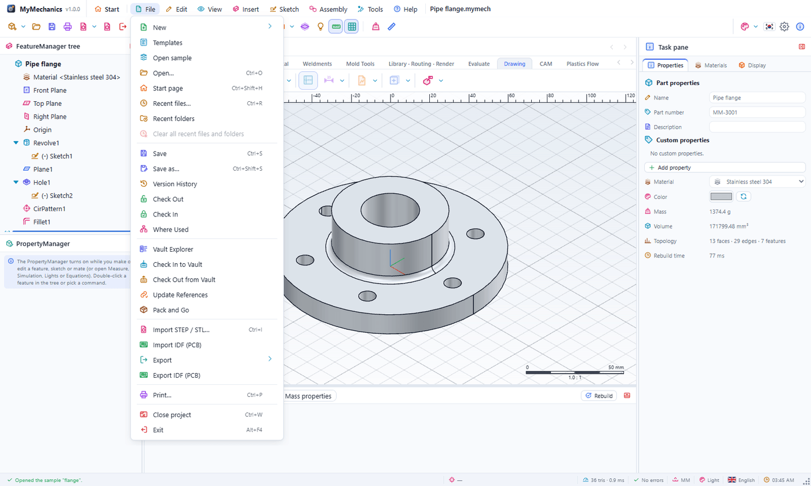

## 13. Settings

Settings (Ctrl+,): General (language …), Start page, Theme (dark, light and your own), Font, Background, **Modeling** (length unit, decimal places, snap to grid, dimension entry, drawing projection, DWG save version (R2004 · R2000), display style, planes / origin / sketches shown, perspective, curved surface quality), Recent items and Shortcuts.

## 14. Shortcuts

| Keys | Command |
|---|---|
| Ctrl+N / O / S / Shift+S | New part / open / save / save as |
| Ctrl+I · Ctrl+P | Import STEP · print |
| Ctrl+Z / Y | Undo / redo |
| Ctrl+B | Rebuild |
| Enter / Esc | PropertyManager OK / Cancel |
| Delete · F2 | Delete · rename |
| F · Space · Ctrl+1–8 · K | Zoom to fit · view orientation menu · standard views · display style |
| L R C A P D T S | Sketch: line · rectangle · circle · arc · polygon · dimension · trim · select |
| E X O · Enter | Sketch: ellipse · extend · offset · finish spline |
| Ctrl+Shift+L · Ctrl+Shift+H · Ctrl+, · F1 | Language · start page · settings · user's guide |

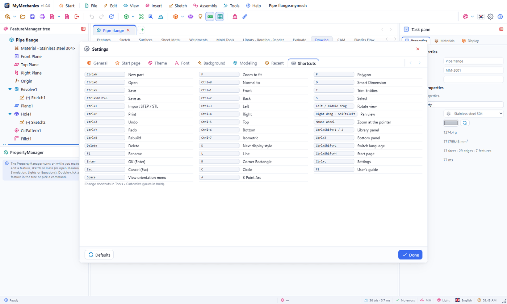

### Customize (Tools › Customize)

* **Keyboard**: find a command, press its keyboard button, then press the key you want — that is its shortcut now (Esc gives up). Keys with Ctrl, Alt or Shift, function keys and single keys (outside text fields only) can be used; a key in use already moves over from its command. Default shortcuts can be turned off with ×, and **Default shortcuts** puts everything back. Settings › Shortcuts lists your shortcuts too, in bold.
* **Toolbar**: put commands on the **My tools** tab (the first CommandManager tab) or in a group of your own on the toolbar, move them up and down and remove them. **Tabs shown** hides CommandManager tabs you do not use.
* **Mouse gestures**: when on, hold the right button, drag one way and let go to run that direction's command. While dragging, the eight directions' commands show round the pointer with the one pointed at picked out. Choose a command for each direction (by default: up top, down front, left / right the side views, up-right isometric, up-left normal to, down-right zoom to fit, down-left undo); a right click still opens the context menu. With gestures on, pan with Ctrl+left drag.
* **Templates** (File › Templates): saving an open part or assembly as a template keeps the whole project (features, material, properties, units); saving a drawing keeps the sheet, projection, scale, title block (company, drawn by …), notes, layers and the standard view layout. From the list: **New** from it, ★ **default** (File › New starts from it; new drawings get the drawing template), **Export** (a .mymechtpl file), **Import** and delete.

## 15. Vault (product data management)

A vault is a file store several people share. Only the person who checked a file out can change it, every check-in keeps a version, and files are released through approval. **File › Vault Explorer** (or the Evaluate tab) opens the vault explorer on the right of the work area; it works with no document open.

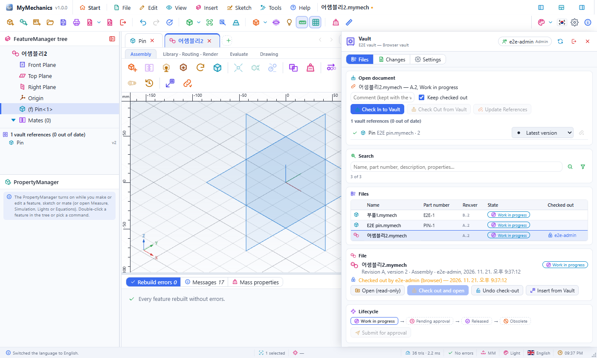

### Making a vault and logging in

- Desktop: **Open vault folder…** opens an existing vault, **New vault in folder…** makes one. A local folder or one on a shared drive both work. The folder gets `vault.json` (the index), `files/` (latest copies), `history/` (every version) and `.locks/` (lock files).
- Web: the vault is kept in the browser (IndexedDB). Type a name and press **Create**.
- Whoever makes the vault is its first admin and sets a user name and a password (4 characters or more). Passwords are stored only as PBKDF2-SHA-256 hashes.
- You log in each time you open a vault; check-outs, approvals and change orders carry the logged-in name. Log out with the button in the header or on the Settings tab.
- Admins add users (name, password, role), change roles, reset passwords and disable users on the **Settings** tab. Users can change their own password.

| Role | Can |
|---|---|
| Viewer | look at and open files |
| Editor | add files, check out / in, submit for approval, raise change requests |
| Approver | what editors do + approve or reject files and change orders |
| Admin | everything + break locks, set users, revision scheme and data cards |

### Check-in and check-out

1. With a document open, **Add to vault** puts it in as version 1, Work in progress, the first revision (A or 01). The document records its vault file, so a local copy opened later is still known as that vault document.
2. A vault document is read-only until you check it out. **Check out and open** (or **Check Out from Vault**) creates a lock file; nobody else can check the file out.
3. **Check In to Vault** makes a new version (no change, no new version). With **Keep checked out** you go on working.
4. **Ctrl+S** on a vault document asks: check in (keep checked out / release) or **Save local copy**. A document not checked out to you can only be saved as a local copy.
5. **Undo check-out** releases the lock without checking in. An admin can break someone else's lock.

### Versions, revisions and lifecycle

- The version goes up with every check-in (1, 2, 3 …); the revision (A, B, C … or 01, 02 …) only when a released file is revised. The revision scheme can change on the Settings tab until something is released.
- Work in progress → Pending approval → Released → Obsolete. **Submit for approval** needs the required data card fields (part number, description); **Approve** is done by an approver other than the submitter, once every file the file uses is released. Released files cannot be checked out; to **Revise** one, an approved change order with that file is needed.
- **Changes** tab: raise a change request (ECR); once approved, **Make change order** turns it into a change order (ECO). An order is submitted and needs the set number of approvals from other approvers. It closes when all its files are released again at a new revision.
- **Team** tab: what waits for you (files to approve, change requests to decide, your orders to send), what is checked out and by whom, and the vault’s activity (check-ins, transitions, changes, comments). The vault is read again at the chosen interval (off, 15 s, 1 min, 5 min): others’ work comes up as notices and the open document’s out-of-date references are marked again. Files have a **Discussion** sub-tab and change orders take comments. Several people work on a vault kept in a shared folder (a network drive or a cloud-synced folder) at the same time; file and index locks keep them from colliding.

### References: using parts and assemblies of other files

- Open an assembly, pick a file in the explorer and press **Insert from Vault**: its part (or sub-assembly) comes in as a **reference**. The vault stores only the reference; opening the document reads the referenced file's content. A sub-assembly brings its parts along, but Where used / Contains list them only through that sub-assembly.
- Each reference follows the **Latest version**, the **Released version** or a **Fixed** version (Open document › vault references list).
- When a referenced file (or a file it uses) changes, the **vault references** list under the FeatureManager tree and the explorer show ⚠. **Update References** brings in the new content (undoable).
- A document that came in by reference cannot be changed here: check out its own file to change it.

### Managing files

- The **Where used** and **Contains** tabs show the files that use a file and the files it uses, as trees.
- **Rename** also updates the reference names in the files that use it, as new versions (refused while one of them is checked out).
- **Copy tree** copies a file and the files it uses as new files that point at each other.
- **Pack and Go** collects a file and what it uses (optionally the drawings too) into a folder or a ZIP. References point at the new names, every file is filled in so it opens without the vault, and a `packandgo.json` list goes with them. Existing files are never overwritten.
- The **History** tab compares two versions, opens an old version read-only, or rolls back to it (checked in as a new version).
- The **BOM** tab shows an indented BOM and a parts-only BOM (total quantities), with part numbers, revisions and states from the vault files.
- **Search** finds text in names, part numbers, descriptions, materials and properties; the filter button searches by part number, description, material, state and kind.
- **Data cards**: part number, description, material, project, vendor, cost, finish, due date, critical part (drawings also sheet size and checked by). Admins add fields on the Settings tab.

## 16. Tools: illustrations, electrical schematics, design checker, task scheduler, macros, markup

### Technical illustrations

**Tools › Technical illustration** makes exploded views and assembly instructions from an assembly. Each view keeps its camera, explode distance and hidden parts; the views play one into the next, and item balloons are placed automatically. Export a single SVG picture or one HTML file that steps through the views.

### Electrical schematics

**Tools › Electrical schematic** opens an A3 sheet over the graphics area. Pick a symbol in the palette (connector, terminal block, switch, push button, relay coil and contact, fuse, lamp, motor, resistor, diode, supply, ground) and click the sheet to place it on the 5 mm grid. The **Wire** tool joins pin to pin with an orthogonal wire. Dragging a symbol moves its wires with it, R turns it 90°, Delete removes, Esc cancels. The wheel zooms, a middle or right drag pans and F shows the whole sheet. Supplies of the same name and all grounds are one net, and wires are numbered per net. The check list shows open pins, duplicate tags and dangling wires; export SVG, a from–to list (CSV) and a parts list (CSV). Undo works as everywhere.

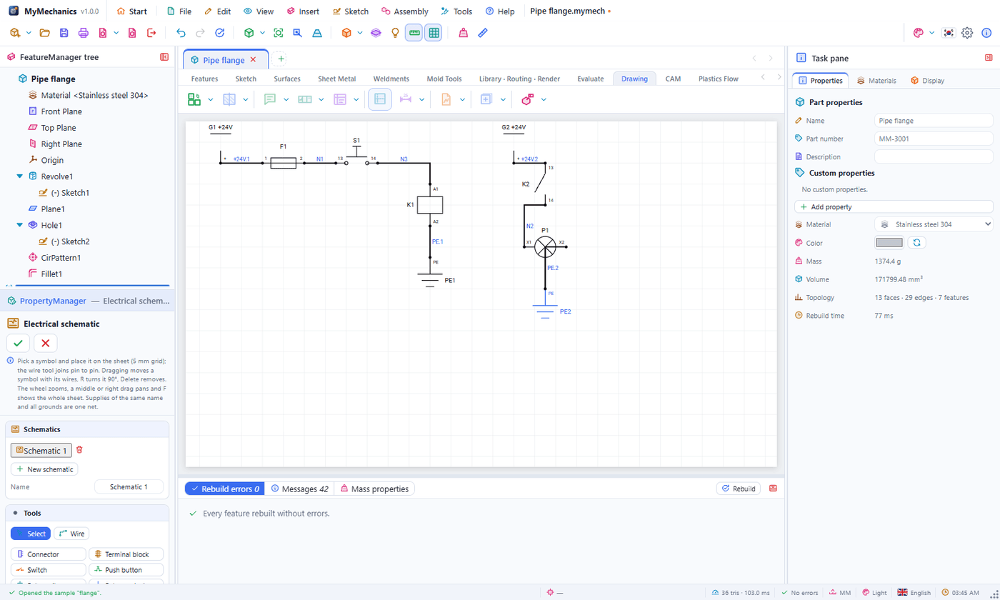

**3D harness link.** When a part of the project has an electrical harness route, the schematic PropertyManager lists it under **3D harness link**. A symbol whose tag is the name of a harness connector (connectors such as X1 and X2, devices such as M1) is an end of the harness, its pins mapping in the symbol's pin order (connectors by number). Each net that joins two such pins is one harness wire, with the wire number, colour (a code such as RD or BU, or a word such as red) and size (1.5, 1,5 mm² or AWG 18 → the nearest standard size) from the schematic. The list shows wires missing from the harness, wires not in the schematic and wires whose colour or size differ, as well as nets that need a splice (three or more pins) and connectors the harness does not have. **Send to harness** sets the harness route's wires from the schematic (keeping the clips each wire passes) and rebuilds the part. **Lengths from harness** writes the routed 3D lengths on the schematic wires: the wire properties and the from–to list (the Length column of the CSV) show them. The other way round, **Wires from schematic** in the wire table of the harness route does the same while you edit the route.

### Design checker

**Tools › Design checker** compares the project with a standard (a set of rules). The rules cover the document (units, names), parts (required properties, material, suppressed features, rolled back, rebuild errors, sketch definition, default feature names, smallest fillet, standard hole sizes), assemblies (a fixed component, mate errors) and drawings (drafting standard and projection, sheet size, title block, revision and date formats, standard scales, dimension precision, overridden dimensions, text height, dangling annotations). Turn rules on or off and click a rule's name to change its severity (error, warning, info) and values. **Learn from project** makes a standard from the open project; **Save… / Load…** share it as a `.mmstd` file. **Check** lists the findings by severity; click one to open its document and select the item. Items marked 🔧 are corrected one by one or with **Correct all** (one undo step), and **Report (HTML)…** saves the result.

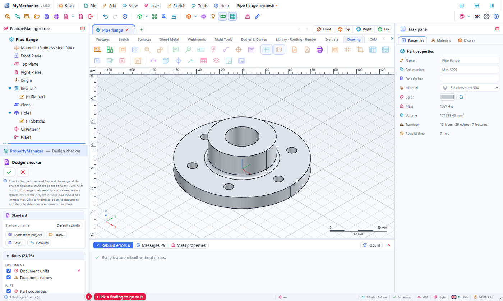

### Task scheduler

**Tools › Task scheduler** runs batch jobs over many files, now or on a schedule. Jobs: **Export** (parts and assemblies to STEP, IGES, STL, 3MF, GLB, OBJ; drawings to DXF, SVG), **Import** (model files to `.mymech`), **Update properties** (part and drawing properties, always or only where empty; values may use `{file}` `{name}` `{project}` `{date}`), **Design check** (an HTML report per file and a summary CSV), **Rebuild** (failed features logged, saved in the current format) and **Create drawings** (an ISO or ANSI drawing with the standard views for every part that has none). The files are a list, a folder (desktop: sub-folders and a name pattern) or the open document. Outputs go beside the sources or into a chosen folder, named like `{name} - {doc}`. Schedules are manual, once, daily, weekly (weekdays) or every N minutes; they run while the application is open, and a time missed while it was closed runs once when it next opens. The open document stays as it is during a run; every step is logged and the log exports as CSV.

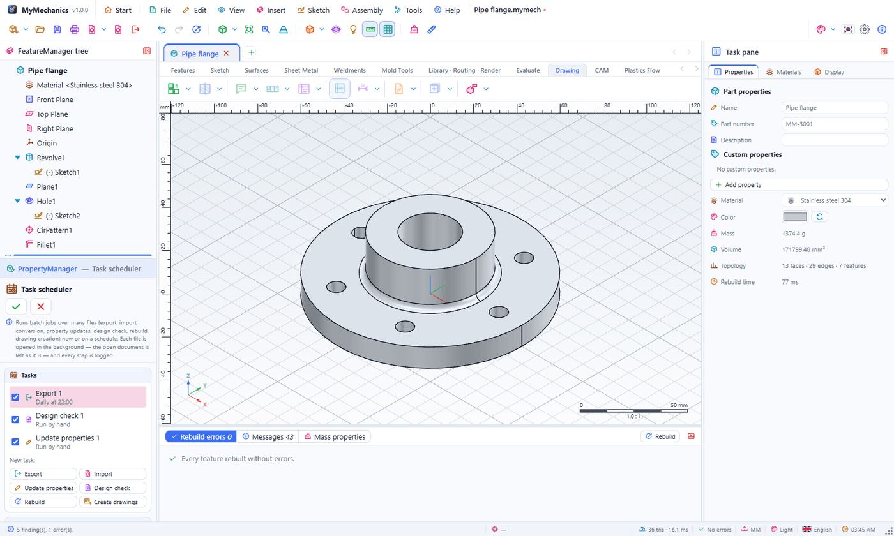

### Macros

Choose **Tools › Macros › Record macro** and work as usual: commands, picks in the graphics area, PropertyManager input, tree selection, document switches and sketch contents are recorded (● REC in the status bar). **Stop macro** turns the recording into JavaScript — lines of `await mm.…(…)` — and opens it in the **Macro editor** window. There you edit it, **Run** it (Ctrl+Enter), **Stop** it and **Open… / Save…** it (`.mmjs`). The console below shows the log and errors (click one to go to its line), and its prompt evaluates an expression at once. Hand-written macros can use loops and variables, read the model with `mm.parts()`, `mm.feature(name)`, `mm.project` and `mm.massProperties()`, change it with `mm.setParam(feature, key, value)`, `mm.setVariable`, `mm.setProperty`, `mm.run(command)` and `mm.set/field/toggle/pm/accept`, and use `mm.log` and `mm.wait`. **Run macro…** picks a file and runs it.

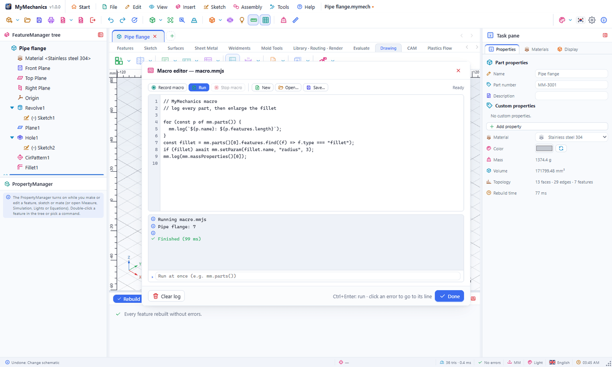

**Building models from a macro.** A macro can make and read the model directly, without going through the screen. Every call is one undo step; a call that fails stops the macro with the reason and the line.

| Area | Functions |
|---|---|
| Building parts | `mm.sketch(plane, shapes, { name })` — the plane is 'front', 'top', 'right' or a plane feature's name; shapes are `{ rect: [width, height, cx, cy] }`, `{ circle: [cx, cy, diameter] }`, `{ line }`, `{ arc }`, `{ polygon }`, `{ slot }`, `{ polyline: [[x, y]…] }`, `{ axis }` (construction); `mm.plane`, `mm.extrude(sketch, depth)`, `mm.cut(sketch, 'through')`, `mm.revolve`, `mm.fillet(radius, edge test)`, `mm.chamfer`, `mm.shell`, `mm.hole`, `mm.feature(type, values)` |
| Geometry | `mm.edges(test)`, `mm.faces(test)` — chosen by type, midpoint, direction and length (faces: centre, normal, area); `mm.boundingBox()`, `mm.massProperties()` |
| Feature tree | `mm.features()`, `mm.suppress`, `mm.renameFeature`, `mm.deleteFeature`, `mm.errors()` |
| Configurations, properties | `mm.configurations()`, `mm.addConfiguration`, `mm.useConfiguration`; `mm.properties()`, `mm.customProperty`, `mm.setCustomProperty` |
| Documents, assemblies | `mm.documents()`, `mm.addPart`, `mm.addAssembly`, `mm.document`, `mm.components()`, `mm.insertComponent(part, [x, y, z])`, `mm.moveComponent`, `mm.interference()` |
| Events | `mm.on('change' · 'selection' · 'document', fn)`, `mm.off`, `mm.events()` — handlers stay until removed; a handler's error is logged in the console |

**Custom properties.** In the task pane's Properties tab, parts and assemblies take custom properties (name and value): add, edit and delete them there (the same data as `mm.setCustomProperty` in a macro).

### Markup

**Tools › Markup** draws review notes over the graphics area of a part or assembly. The tools are navigate (turn the model without drawing), select and move, pen, highlighter, line, arrow (Shift snaps to 45°), rectangle, ellipse, revision cloud, text box and eraser, with eight colours, a line width and a text size. Drawing starts a markup on the current view; it is saved in the document with that view (the camera), its author and date. Choosing a markup in the list brings its view back with the drawing. Turn the view away and the drawing hides until you choose **Back to the markup view**. The select tool drags items, Delete removes them, and a double-click edits a text box. Each markup has a name, a status (open or resolved) and comments (author and time), and exports as a **PNG picture** (the view rendered at twice the size with the drawing on top) or a **Review document (HTML)** with the pictures, status and comments of all markups. Every edit can be undone.

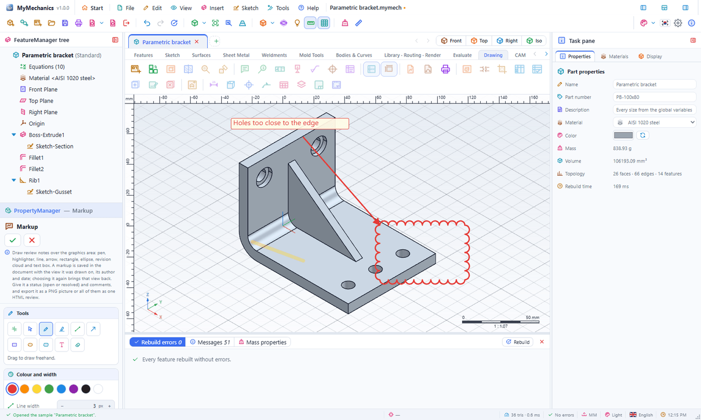
