# MyMechanics User's Guide

MyMechanics is a feature-based parametric 3D mechanical design program. Put relations and dimensions on 2D sketches, stack features (extrude, revolve, fillet, holes …) into parts, join parts with mates into assemblies, and send them out as 2D drawings. The geometry is computed by the OpenCASCADE B-rep kernel. It runs with the same features on Windows, macOS and Linux desktops and in a web browser.

New to the program? Follow the **tutorial document** first (Help › Tutorial document, or the **Tutorial** button on the start page). It walks from a first part through a sweep, sheet metal, an assembly, a motion study, a drawing and a simulation, with a screen for every step.

## 1. The window

| Area | What it holds |
|---|---|
| Menu bar | File · Edit · View · Insert · Sketch · Tools · Help. **Start** next to the program name goes back to the start page. On the desktop this row is the window's title bar. |
| Toolbar | New part / assembly / drawing, open, save, print, export, undo, rebuild, view orientation, display style, section view, mass properties, measure, panels, theme, language, settings. |
| Document tabs | The parts, assemblies and drawings of the project. Click to switch, **+** adds a part. Front, top, right and isometric view buttons sit on the right. |
| CommandManager | Big command buttons in Features · Sketch · Evaluate · Assembly · Drawing tabs (only the tabs that fit the document). |
| FeatureManager tree (left) | The part's material, the standard planes (Front, Top, Right), the origin and the features in build order. A feature's sketch sits under it. Failed features are red, under-defined sketches get `(-)`. Drag the blue **rollback bar** at the bottom to leave out the features below it for a while. |
| PropertyManager (bottom left) | The lower section of the left panel (the FeatureManager tree is above it; drag the line between them to share the height). It shows the options while a feature, sketch or mate is being made or edited, and only a hint when nothing is. ✔ (OK, Enter) / ✖ (Cancel, Esc) at the top. Pink selection boxes take the edges and faces picked in the graphics area. |
| Graphics area | The model, planes and sketches; the triad at the lower left (X red · Y green · Z blue). |
| Task pane (right) | Properties (name, part number, material, color, mass), the material list, display settings. For drawings: sheet, views and title block. |
| Bottom panel | Rebuild errors (failed features and how to fix them), messages, mass properties. |
| Status bar | Hints, the sketch's definition state, pointer coordinates, error count, unit (click to switch mm · cm · in), theme, language, clock. |

### Mouse and view

* **Left drag or middle drag**: rotate · **right drag / Shift+left / Ctrl+middle**: pan · **wheel**: zoom at the pointer
* **F**: zoom to fit · **Space**: view orientation menu · **Ctrl+1…7**: front, back, left, right, top, bottom, isometric · **Ctrl+8**: normal to
* **K**: next display style (shaded with edges → shaded → hidden lines removed → hidden lines visible → wireframe)
* Faces, edges and planes under the pointer turn orange, selected ones blue. Ctrl or Shift+click selects several.

## 2. Start page

Cards can be dragged and resized from their lower-right corner (**Arrange** puts them back). They hold **Quick actions** (open, import STEP, continue the last work, settings …), **Recent items**, **New project** (part in mm or inches, assembly, drawing), 18 **samples** and the **moving background**. Whether the page shows at start is set by the check box at the top left or in Settings › Start page.

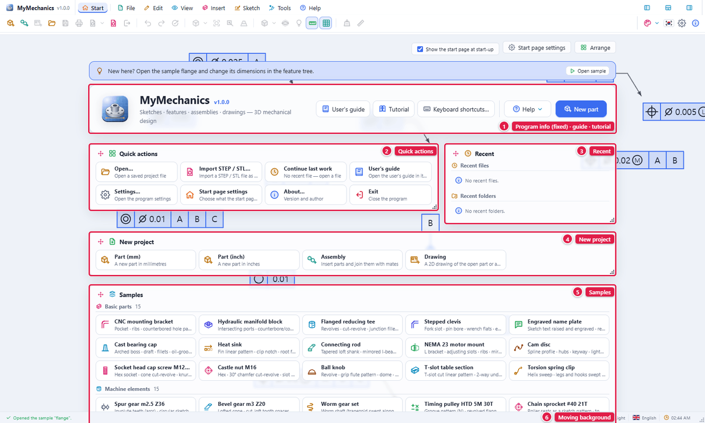

## 3. Making a part — step by step

1. Click **New part** (Ctrl+N).
2. Click **Features › Sketch** and choose the **Top Plane** (in the tree, the graphics area or the PropertyManager buttons). The view turns normal to the plane and a grid appears.

   
3. With **Sketch › Center Rectangle**, click the origin, then a corner. Ends snapping to a point (orange ring) get a coincident relation automatically.

   
4. With **Smart Dimension** (D), click the top line and enter `80`, the right line and enter `50`. Black lines are fully defined (blue = can still move, red = over defined).

   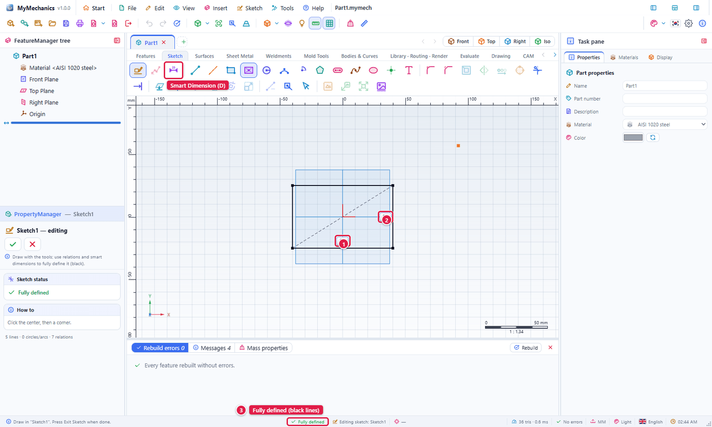
5. Click **Exit Sketch**.
6. Click **Extruded Boss**, enter a depth of `20` and press ✔.

   
7. Click **Fillet**, click the four vertical edges, radius `5`, ✔.

   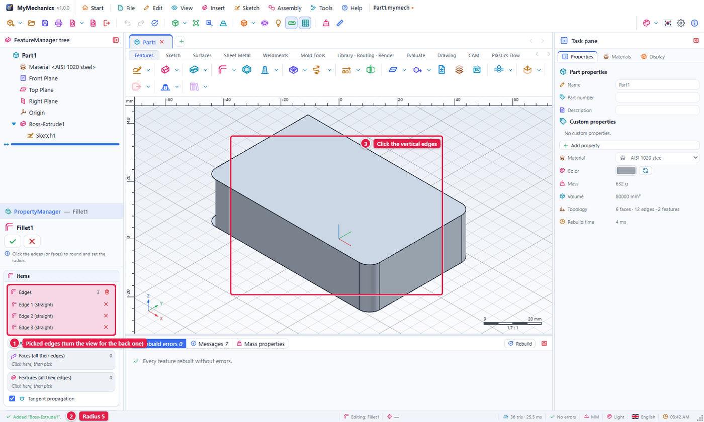
8. Click **Hole Wizard**, choose size `M8` and type **Counterbore**, then click the top face where the hole goes (about 15 mm along X from the origin). More clicks on the same face add more holes. The red preview is the hole. ✔.

   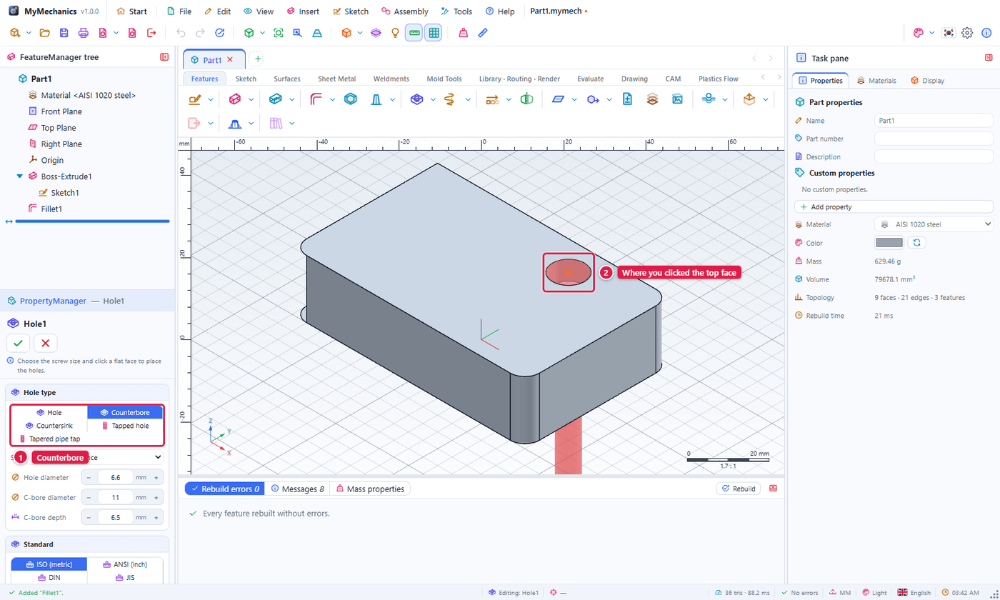
9. Select **Hole1** in the tree, click **Circular Pattern**, axis `Y`, `4` instances, ✔.

   
10. Save (Ctrl+S). One `.mymech` file holds the whole project.

To change a dimension or a feature's values, double-click the feature in the tree (or right-click › Edit feature). A sketch opens again for editing and every feature after it rebuilds on the new shape. The edges and faces picked for fillets, chamfers and shells are remembered by their geometry: when an earlier dimension changes, the nearest edge is found again.

## 4. Sketches

| Tool | Key | How |
|---|---|---|
| Line | L | Click, click … to chain lines; click an existing point or press Esc to finish. Nearly horizontal or vertical lines get that relation. |
| Centerline | | A construction line (dashed): an axis of revolution or symmetry. |
| Corner / Center Rectangle | R | Two clicks; horizontal and vertical relations come with it. |
| Circle | C | Center, a point on the circle. |
| 3 Point / Centerpoint Arc | A | Start, end, a point on the arc / center, start, end. |
| Polygon | P | Center, a vertex; the number of sides is in the PropertyManager. |
| Straight Slot | | Both end centers, then the width. |
| Point | | Hole positions and the like. |
| Smart Dimension | D | One line = length, a circle = diameter, an arc = radius, two lines = distance (parallel) or angle, two points = distance. Double-click a dimension to change it. A dimension that would over define the sketch becomes a reference (driven) one, shown in brackets. |
| Spline | S | Click points in turn; Enter or Esc finishes, clicking the first point closes it. The curve passes through every point. |
| Ellipse | E | Centre, end of the major axis, a point for the minor axis. |
| Sketch Fillet / Chamfer | | Click the corner where two lines meet; radius / distance in the PropertyManager. |
| Offset Entities | O | Copies the selected lines, arcs and circles at a distance; joined lines stay joined. |
| Mirror Entities | | Select entities and a centerline: mirrored copies with symmetric relations. |
| Linear / Circular Sketch Pattern | | Copies the selection by spacing and count (linear) or count and angle (circular, about the selected point). |
| Trim Entities | T | Removes the clicked piece between crossings (a curve nothing crosses is deleted); a circle becomes an arc. |
| Extend Entities | X | Grows a line to the next entity. |
| Text | | Places text where clicked (Roboto font, height in the PropertyManager); extrude, cut or wrap it to engrave or emboss. |
| 3D Sketch | | A path in space: click while switching between the Front, Top and Right planes, or type coordinates in the table. Lines or a smooth spline, open or closed; used for sweep paths, structural members and filled surfaces. |
| For construction | | Turns the selected lines and circles into construction geometry and back (construction geometry is not part of a profile). |

* With **Select** (S), drag points or lines: the relations are kept.
* With entities selected, the PropertyManager lists their **existing relations** (removable) and **add relation** buttons (horizontal, vertical, parallel, perpendicular, equal, tangent, concentric, coincident, midpoint, symmetric, collinear, fix).
* Number boxes take units and arithmetic: `25.4in`, `100/3`, `2*15`. A dimension value like `=W` links it to a global variable (shown with Σ).
* Only closed contours make features; a closed contour inside another is a hole.

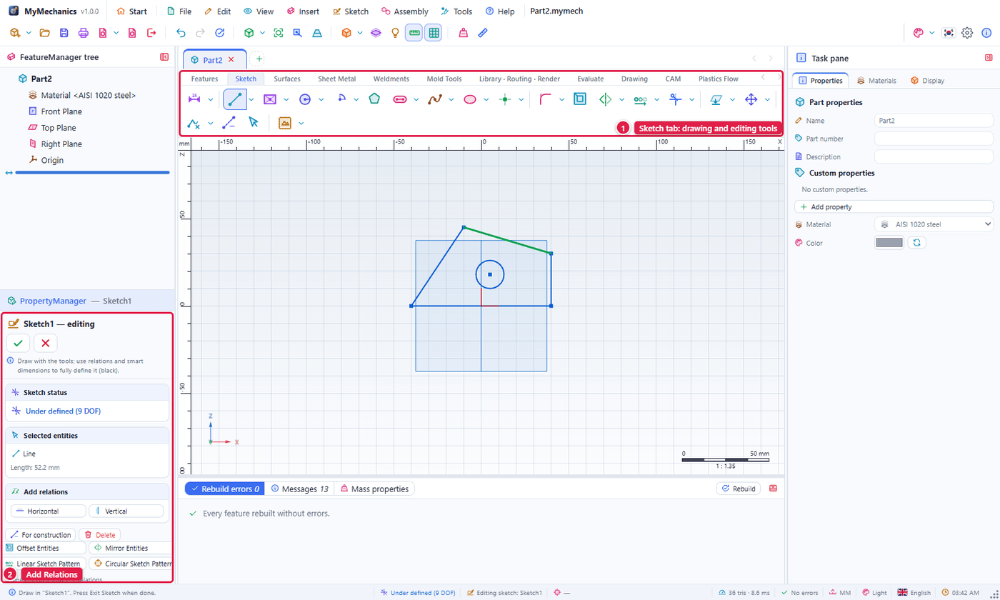

## 5. Features

| Feature | Notes |
|---|---|
| Extruded Boss / Cut | End conditions: Blind (depth), Through All, Through All - Both, Mid Plane. Direction 2 extrudes the other way too. A cut goes into the material by default. |
| Revolved Boss / Cut | Turns the sketch around its centerline (or a chosen line). 0.1–360°. |
| Fillet / Chamfer | Click edges, or click a face to add all of its edges. |
| Shell | Pick the faces to open and the thickness. |
| Hole Wizard | Hole, counterbore, countersink; ISO M3–M20 clearance sizes; through or blind (118° drill point). Click a flat face to place holes; the positions are kept in a "HolePositions" sketch. |
| Linear Pattern | Direction (X, Y, Z or an edge), spacing, count; Direction 2 for a grid. Copies features or the whole body. |
| Circular Pattern | Axis (X, Y, Z, or a circular or straight edge), total angle, count, equal spacing. |
| Mirror | About a standard plane, a reference plane or a flat face; features or the whole body. |
| Reference Plane | Offset from a plane or a face; used as a sketch plane. |
| Intersect extrude · drafted extrude | Set an extrude's operation to **Intersect** to keep only the overlap. **Draft on** tapers a blind extrude's sides. |
| Swept Boss / Cut | Sweeps a closed profile along a path (an open sketch or a helix). Sketch the profile at the start of the path, across it; turn on **Frenet** for helices. |
| Lofted Boss / Cut | Joins closed profiles on several planes in the order chosen. Ruled option. |
| Draft | Pick the neutral plane, then the faces to taper (0–45°). |
| Rib | Fills a plate of the given thickness from an open line drawn between walls toward the material. |
| Dome | A spherical cap of the given height on a planar face (or a dish). |
| Helix | A helix by plane, radius, pitch and revolutions; use it as a sweep path for springs. |
| Thread | Cuts a 60° V thread at a shaft end or hole rim (external / internal found automatically, M3–M24 pitches). A **cosmetic thread** only draws lines. |
| Wrap | Embosses / debosses a sketch from a plane beside a cylinder or a flat face (projected onto it). |
| Move/Copy Bodies · Scale · Split | Moves (or copies) the body, scales it, or splits it by a plane keeping one side or both (two bodies). |
| Insert Part · Cavity | Adds another part of the project to this one, subtracts it (a cavity for molds) or keeps the overlap. |

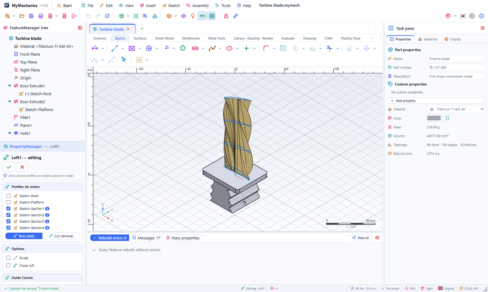

Tree right-click menu: edit feature, rename (F2), suppress / unsuppress, roll back to here, delete (features that use it go too). A failed feature turns red and the bottom panel's **Rebuild errors** says why and how to fix it; the other features still build.

## 6. Surfaces, sheet metal, weldments and mold tools

* **Surfaces** tab: extruded, revolved, planar and lofted surfaces, **Boundary Surface** (smooth between closed profiles, or bounded by open curves), **Filled Surface** (a patch over a hole's edges or a closed 3D sketch), offset faces, **Trim Surface** (cut by a plane or another surface, keeping one side), Knit (a closed set becomes a solid). **Thicken** turns a surface into a solid (side 1, side 2 or both). Surfaces show translucent teal.

   
* **Sheet Metal** tab: **Base Flange** (closed sketch + thickness, bend radius, K-factor) → **Edge Flange** (pick a straight edge on the sheet's top face, angle, length) → **Hem** (the edge folded back 180°, closed or open) · **Sketched Bend** (bent by an angle along a line drawn on the sheet) · **Jog** (the far side raised by a height with two bends) → **Flatten** shows the flat pattern. Bend allowance = angle × (radius + K × thickness).

   

   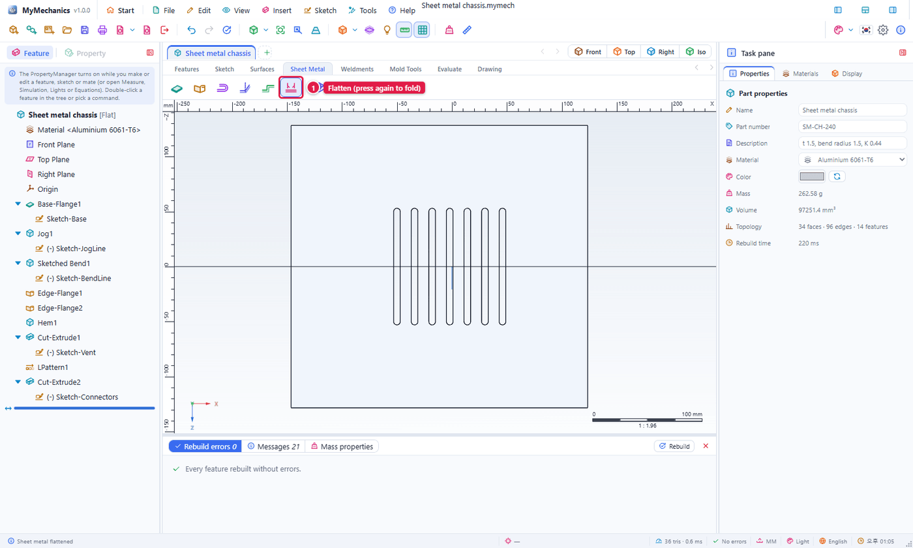
* **Weldments** tab: put **Structural Members** (square / rectangular tube, pipe, round / square bar, angle, channel, I-beam, tee, any size) on a sketch of lines; **Cut List** gives each member's length and the total.

   
* **Mold Tools** tab: **Draft Analysis** (pull direction = the selected plane / face normal, Y by default: green positive draft, red negative, yellow insufficient), Draft, **Parting Line** (the edges where faces turn from facing the pull direction to facing away), **Tooling Split** (a mold block around the part split at the parting height, the part's shape taken out, pulled apart to be seen), **Shrinkage Scale**, Split, **Cavity**.

   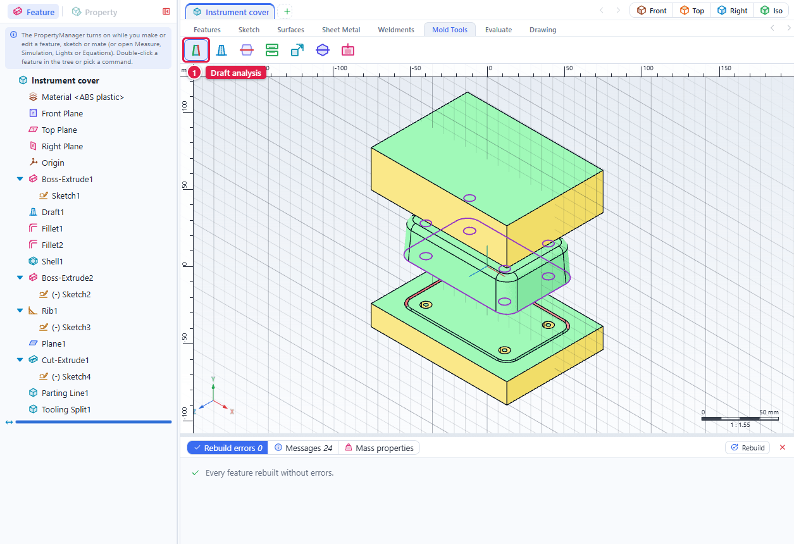

   

   

## 7. Equations, configurations and design tables

* **Evaluate › Equations**: make global variables (`W = 120`, `H = W / 2`). Type `=H - 5` in a feature's value box to drive it. Functions `sin cos tan sqrt abs min max round iif(condition, then, else)`, `pi`, other features' values (`Boss-Extrude1.depth`) and sketch dimensions (`D1@Sketch1`) can be used.

   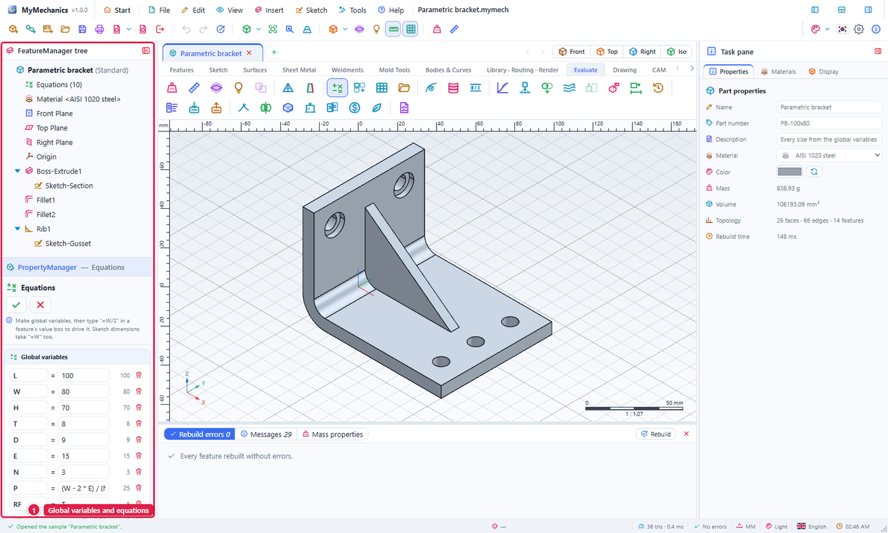
* **Evaluate › Configurations**: each configuration has its own variable values and suppression states; suppressing while a configuration is active affects only it. The tree's top row shows the active configuration.

   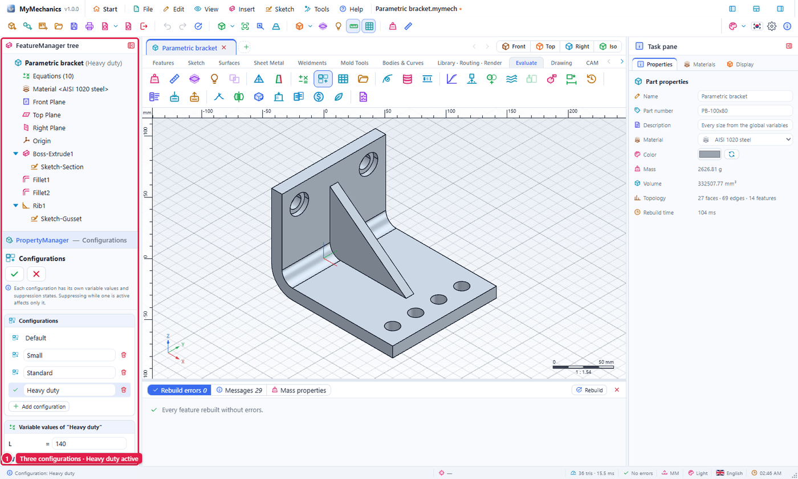
* **Design table**: export the configurations × variables (and `$STATE@Feature`) table as CSV, edit it in a spreadsheet and import it to make configurations.

## 8. Materials, mass properties and simulation

In the task pane's **Materials** tab (or by double-clicking Material in the tree) choose one of 16 materials: steels, aluminium, brass, titanium, plastics and more. The density gives the mass and the color changes (the Properties tab can set a color of its own). **Evaluate › Mass Properties** shows the mass, volume, surface area, center of mass and bounding box. **Measure** gives the length, area or diameter of one face or edge, and the minimum distance and angle between two. **Section view** cuts the model with a plane; change its axis and position in the task pane's Display tab.

**Evaluate › Simulation (Static)** is a linear static stress analysis. Click the faces to fix and the loaded faces, give a force (N, along ±X, Y or Z) or a pressure (MPa) and **Run**. The body is coloured by von Mises stress (blue → red) and the maximum stress, maximum displacement and minimum factor of safety (yield ÷ stress) are listed; the deformed shape can be shown exaggerated. Set the study to **Thermal** for a steady-state temperature field (fixed-temperature faces, and faces with convection — film coefficient and ambient — or heat power in W), or to **Frequency** for the natural frequencies and mode shapes with the fixed faces (pick a mode with its button). The analysis uses cube (voxel) elements, so a higher resolution is more accurate, and local stresses at corners can come out higher than real.

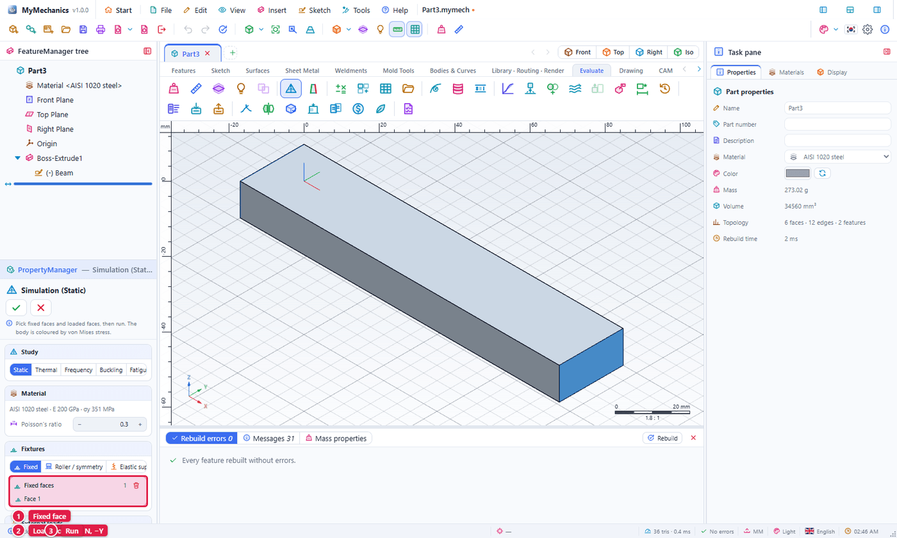

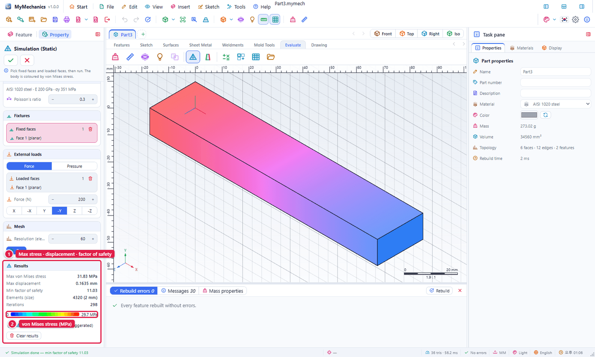

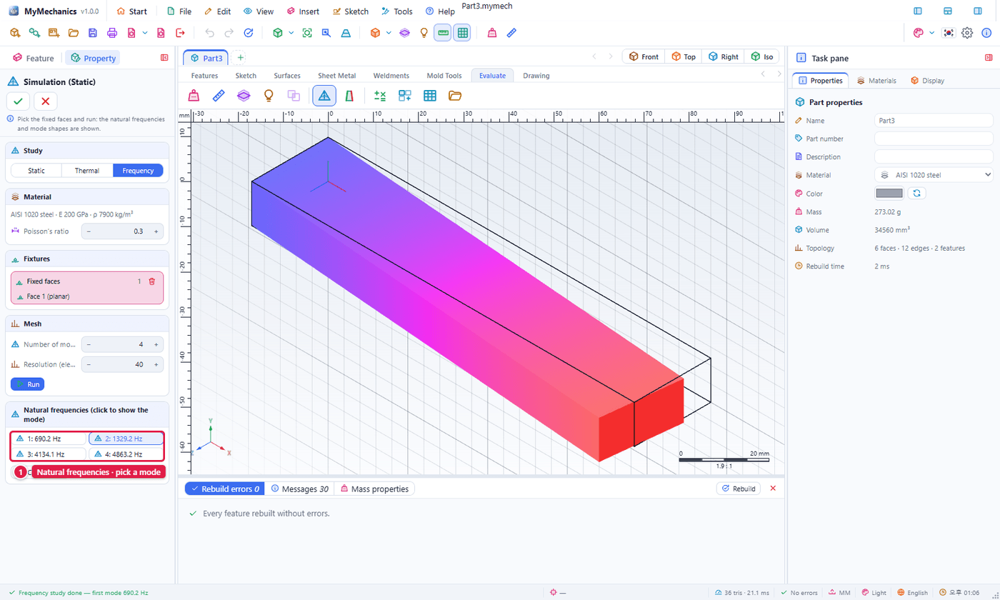

## 9. Assemblies

1. Click **New assembly**. The PropertyManager lists the project's parts and the sample parts. The first part is fixed at the origin (`(f)`).
2. **Assembly › Insert Components** adds more parts (STEP files too).
3. Click **Mate** and click faces of two different components. Two cylinders suggest **Concentric**, two planes **Coincident**; distance, angle, parallel, perpendicular and aligned / anti-aligned are there too. ✔.

   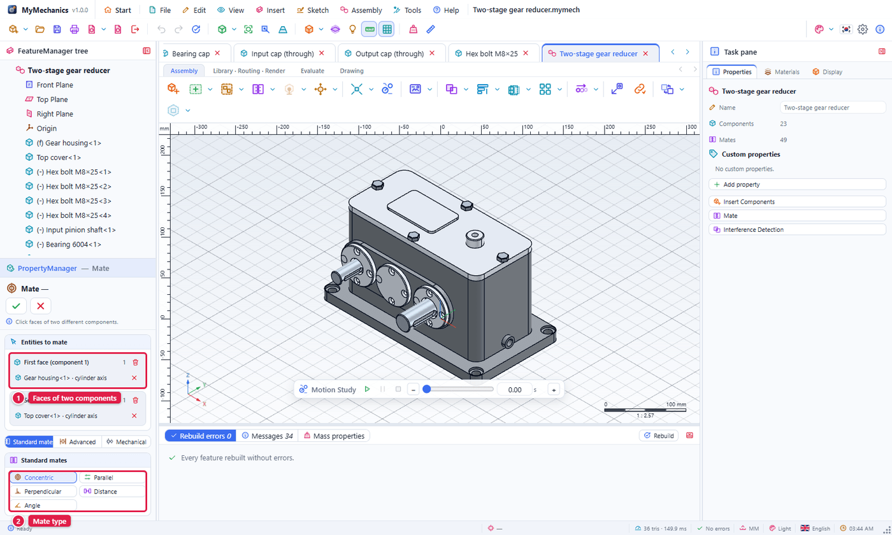
4. All mates are solved together. Fully positioned components have no prefix, those that can still move get `(-)`, conflicting mates turn red.

   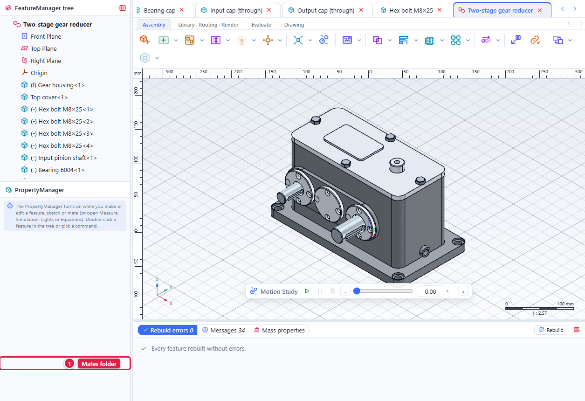
5. **Interference Detection** lists overlapping pairs and the overlapping volume.

Double-click a component to open its part tab. When a part changes, the assembly is solved again.

* **Cam mate**: pick the cam's flat face (its outline is the cam profile) and the follower's plane, cylinder or point; the follower stays on the cam profile (turn the cam in a motion study).
* **Advanced mates**: width (centred between two faces), symmetric (about a plane), limit distance / limit angle (free within a range), lock. **Mechanical mates**: gear (ratio), rack pinion (pitch radius), screw (distance per revolution), hinge. Switch with the Standard / Advanced / Mechanical buttons in the mate PropertyManager.
* **Sub-assemblies**: the Insert Components list also shows the project's other assemblies; they mate as one component and take one BOM row.
* **Exploded view**: spreads the components outward from the centre; click again to collapse, **Delete Explode** removes the steps.

   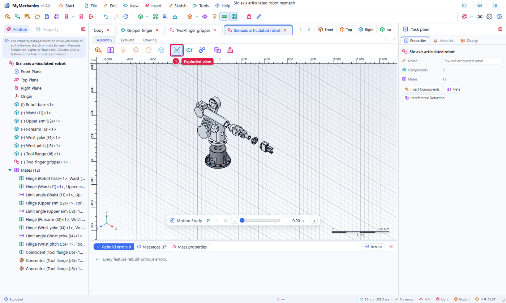
* **Motion study**: put a rotary (rpm) or linear (mm/s) motor on a component's cylindrical face and play. Components joined by gear, rack and screw mates follow; the time slider shows any moment.

   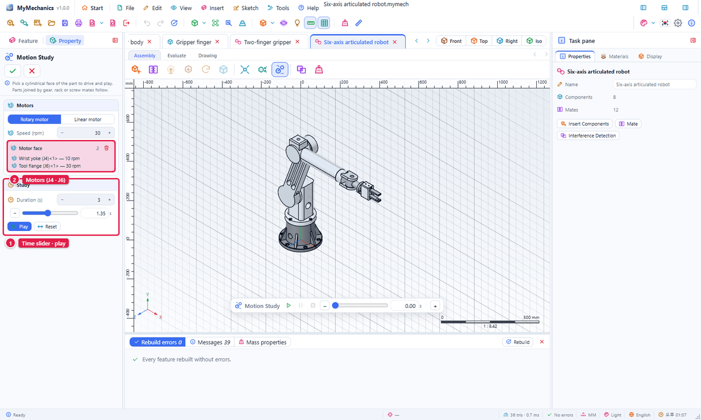

## 10. Drawings

From a part or an assembly, **Drawing › Make drawing** (or Standard 3 View) puts the front, top and right views and an isometric view on an A3 sheet (third-angle projection; first angle in Settings). The scale is chosen from the standard scales to fit the sheet. Hidden lines (dashed), overall dimensions and a title block (title, part number, material, mass, scale, drawn, checked, date, revision) are included. Drag views to move them; in the task pane set the sheet size (A4–A0, Letter, Tabloid), scale and projection, and add or remove views. Export **DXF** (layers VISIBLE, HIDDEN, BORDER, HATCH, NOTES) or **SVG**, or print (Ctrl+P).

* **Section views** (vertical / horizontal): the selected view cut through its middle, hatched, with the cutting line, arrows and letters (A-A). **Detail view**: a circled area enlarged 2× (B). **Auxiliary view**: seen from any direction (x, y, z).

   
* **Annotations**: note, balloon, geometric tolerance (14 symbols such as flatness, perpendicularity, position; ⌀, M / L modifiers, datums), datum, surface finish, center mark. Pick the command and click on the sheet, drag to move, edit in the task pane.
* **BOM**: on an assembly drawing, a table of item, part number, name, material and quantity above the title block.

   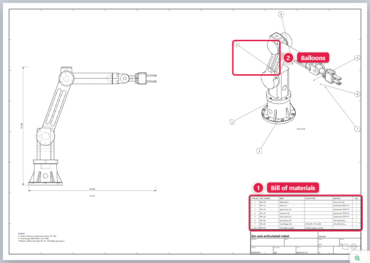

## 11. View, lights and start page

* **Rulers**: screen-aligned scales along the top and left of the graphics area (1-2-5 steps) with the pointer's place marked in red and its values. In the front, top and right views the rulers say which axis (X, Y, Z) they run along.
* **Coordinates**: Z is up. Top = XY, Front = XZ (seen from −Y), Right = YZ (seen from +X). Dragging to rotate is a turntable about Z, so the view never turns upside down. Files made before (Y up) are turned to Z up when they are opened.
* **Grid**: fixed on the chosen plane — Top (XY, the default), Front (XZ) or Right (YZ). When zooming, its spacing is redrawn in 1-2-5 steps once the lines get too dense or too sparse on screen; every fifth line is darker (5 × 5 cells). Turn it on or off and choose its plane in View › Show.
* **Scale bar**: the bar at the lower right shows a length on screen and the screen scale (1 : n at 96 dpi). Drag it with the mouse to put it anywhere.

   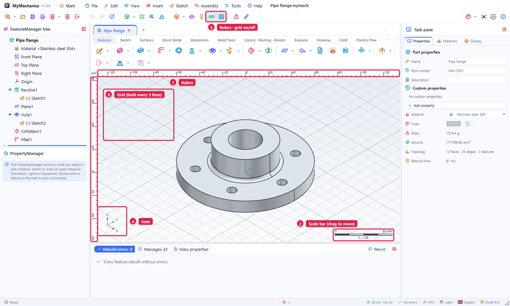
* **Lights** (Evaluate tab or the View menu): ambient light (color, ground color, intensity), a camera light that follows the view (on/off, color, intensity), and directional, point and spot lights you add, each with color, intensity, position, target and cone angle. While the Lights page is open, drag a light's handle (the small sphere) in the graphics area to move it. Lights are saved in the project.

   
* **Panel buttons**: the left, bottom and right panel toggles sit just left of the window's minimize button.
* **Start page**: the program information at the top is fixed (it cannot be moved or resized). The cards below are dragged to move and resized from their corner; **Arrange** lines them up in rows and columns keeping their sizes. There are 15 samples in each group.

## 12. Files

| Format | Use |
|---|---|
| `.mymech` | The project (all parts, assemblies and drawings, JSON). On the desktop double-click it to open. |
| STEP (`.step`, `.stp`) | Import (features can be added on the imported body) and export (assemblies keep each part's name and color). |
| STL | Export for 3D printing; import. |
| DXF · SVG | Drawing export. |
| CSV | Design table export and import. |
| PNG | A picture of the graphics area. |

In a browser with the File System Access API, files are saved straight back; otherwise they are downloaded.

## 13. Settings

Settings (Ctrl+,): General (language …), Start page, Theme (dark, light and your own), Font, Background, **Modeling** (length unit, decimal places, snap to grid, dimension entry, drawing projection, display style, planes / origin / sketches shown, perspective, curved surface quality), Recent items and Shortcuts.

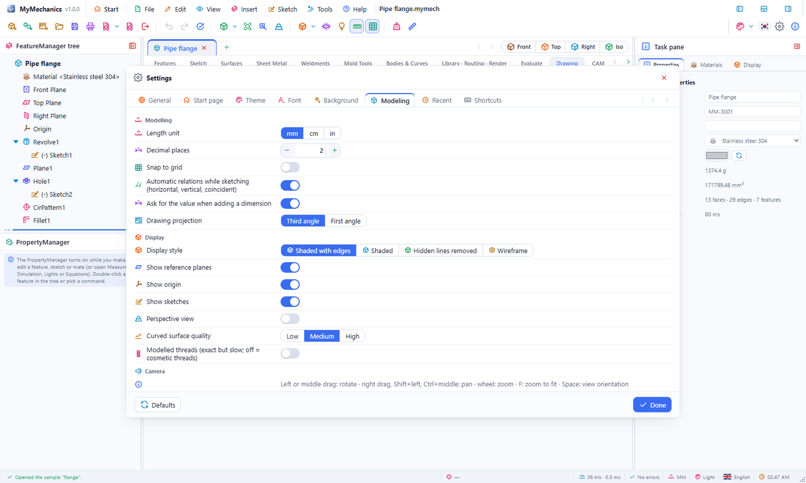

## 14. Shortcuts

| Keys | Command |
|---|---|
| Ctrl+N / O / S / Shift+S | New part / open / save / save as |
| Ctrl+I · Ctrl+P | Import STEP · print |
| Ctrl+Z / Y | Undo / redo |
| Ctrl+B | Rebuild |
| Enter / Esc | PropertyManager OK / Cancel |
| Delete · F2 | Delete · rename |
| F · Space · Ctrl+1–8 · K | Zoom to fit · view orientation menu · standard views · display style |
| L R C A P D T S | Sketch: line · rectangle · circle · arc · polygon · dimension · trim · select |
| E X O · Enter | Sketch: ellipse · extend · offset · finish spline |
| Ctrl+Shift+L · Ctrl+Shift+H · Ctrl+, · F1 | Language · start page · settings · user's guide |

