# MyMechanics 사용 설명서

MyMechanics는 피처 기반의 파라메트릭 3D 기계 설계 프로그램입니다. 2D 스케치에 구속 조건과 치수를 넣고, 피처(돌출·회전·필렛·구멍 …)를 쌓아 부품을 만들고, 부품을 메이트로 조립하고, 2D 도면으로 내보냅니다. 형상 계산은 OpenCASCADE B-rep 커널이 맡습니다. Windows · macOS · Linux 데스크톱과 웹 브라우저에서 같은 기능으로 실행됩니다.

처음 쓰신다면 **튜토리얼 문서**(도움말 › 튜토리얼 문서, 또는 시작 화면의 **튜토리얼** 단추)를 먼저 따라 해 보세요. 첫 부품부터 스윕·판금·어셈블리·모션·도면·해석까지 단계마다 화면과 함께 안내합니다.

## 1. 화면 구성

| 영역 | 설명 |
|---|---|
| 메뉴 막대 | 파일 · 편집 · 보기 · 삽입 · 스케치 · 어셈블리 · 도구 · 도움말. 모든 명령이 메뉴에 있습니다(CommandManager 의 ▾ 묶음은 같은 이름의 하위 메뉴). 프로그램 이름 옆의 **시작**은 시작 화면으로 돌아갑니다. 데스크톱에서는 이 줄이 창 제목 표시줄입니다. |
| 도구 모음 | 새로 만들기(누르면 새 부품, ▾ 로 어셈블리·도면·프로젝트 부품), 열기·저장·인쇄·내보내기, 실행 취소, 다시 만들기, 보기 방향(▾ 로 정면·평면·우측·등각 …), 표시 스타일, 단면도, 질량 특성·측정, 테마·언어·설정. |
| 문서 탭 | 프로젝트 안의 부품·어셈블리·도면. 탭을 눌러 오가고 **+** 로 부품을 추가합니다. |
| CommandManager | 피처 · 스케치 · 평가 · 어셈블리 · 도면 탭의 명령 버튼. 문서 종류에 맞는 탭만 보입니다. 같은 일을 하는 명령(필렛 종류, 패턴 종류, 사각형 그리기 방법, 단면·상세 뷰 …)은 버튼 하나로 묶여 있습니다: 버튼 오른쪽의 **▾** 를 누르면 묶인 명령이 모두 나오고, 고른 명령이 그 버튼에 남아 다음에는 바로 누를 수 있습니다. 도구 모음에 늘 있는 명령(다시 만들기, 단면도, 질량 특성, 인쇄 …)은 탭에 다시 두지 않습니다. |
| FeatureManager 트리 (왼쪽) | 부품의 재질, 표준 평면(정면·윗면·우측면), 원점, 피처를 만든 순서대로 보여 줍니다. 피처가 쓰는 스케치는 그 아래에 들어갑니다. 실패한 피처는 빨간색, 불완전 정의 스케치는 `(-)` 가 붙습니다. 맨 아래 파란 **롤백 바**를 끌면 그 아래 피처를 잠시 빼고 볼 수 있습니다. |
| PropertyManager (왼쪽 아래) | 왼쪽 패널 아래쪽 섹션입니다(위쪽은 FeatureManager 트리, 사이의 경계선을 끌어 높이를 나눔). 피처·스케치·메이트를 만들거나 편집할 때 그 옵션이 나오고, 아무것도 편집하지 않을 때는 안내 메시지만 있습니다. 위의 ✔ (확인, Enter) / ✖ (취소, Esc). 분홍색 선택 상자는 그래픽 영역에서 고른 모서리·면을 받습니다. |
| 그래픽 영역 | 모델과 평면, 스케치. 왼쪽 아래 축 표시(X 빨강 · Y 초록 · Z 파랑). |
| 작업 창 (오른쪽) | 속성(이름·부품 번호·재질·색·질량), 재질 목록, 표시 설정. 도면에서는 시트·뷰·표제란 설정. |
| 아래 패널 | 다시 만들기 오류(실패한 피처와 고치는 방법), 메시지, 질량 특성. 머리줄 오른쪽 **접기** 단추(Ctrl+J)로 접으면 탭 이름과 **펼치기** 단추만 있는 얇은 막대가 남고, 탭 이름을 누르면 그 탭으로 다시 펼쳐집니다. |
| 상태 표시줄 | 안내 문구, 스케치 정의 상태, 포인터 좌표, 오류 수, 단위(눌러서 mm·cm·in 전환), 테마, 언어, 시계. |

### 마우스와 보기

* **왼쪽 끌기·가운데 끌기**: 보기 회전(화면 가로·세로 축 둘레 자유 회전 — 모델을 눕히거나 뒤집을 수 있음) · **모서리 위에서 가운데 끌기**: 그 모서리(원형 모서리는 그 축)를 중심으로 회전 · **면 위에서 가운데 끌기**: 그 점을 중심으로 회전 · **Alt+끌기**: 화면 중심 둘레로 굴리기 · **오른쪽 끌기 / Shift+왼쪽 / Ctrl+가운데**: 이동 · **휠**: 포인터 위치로 확대·축소
* **화살표 키**: 화면 축 둘레로 15°(설정에서 바꿈) 회전 · **Shift+화살표**: 90° · **Alt+←/→**: 굴리기 · **Ctrl+화살표**: 이동. 설정 › 탐색의 **회전 방식**을 **턴테이블**로 바꾸면 Z가 항상 위로 남습니다.
* **F**: 전체 보기 · **Space**: 보기 방향 메뉴 · **Ctrl+1…7**: 정면·배면·좌측·우측·평면·저면·등각 · **Ctrl+8**: 면에 수직 보기
* **K**: 표시 스타일 바꾸기 (모서리 표시 음영 → 음영 → 은선 제거 → 은선 표시 → 와이어프레임)
* 포인터 아래의 면·모서리·평면은 주황색으로, 고른 것은 파란색으로 표시됩니다. Ctrl·Shift+클릭으로 여러 개를 고릅니다.

## 2. 시작 화면

카드는 끌어서 옮기고 오른쪽 아래 모서리로 크기를 바꿀 수 있습니다(**자동 정렬**로 되돌림). **바로 가기**(열기, STEP 가져오기, 마지막 작업 이어서, 설정 …), **최근 항목**, **새 프로젝트**(부품 mm·inch, 어셈블리, 도면), **예제** 75개(5개 그룹 × 15), **움직이는 배경**이 있습니다. 시작할 때 이 화면을 보일지는 왼쪽 위 확인란이나 설정 › 시작 화면에서 정합니다.

**모든 예제는 움직입니다.** 예제를 열면 그 부품이 일하는 장면의 어셈블리(모션 스터디 포함)가 열리고, 그래픽 영역 위의 ▶ 재생 막대로 움직임을 봅니다. 예를 들어 가공 부품은 2축 트러니언 테이블에서 기울고 돌며, 기어는 짝 기어와 맞물려 돌고, 커넥팅 로드는 크랭크·크로스헤드와 슬라이더 크랭크로, 캠은 평면·롤러 종동절을 밀어 올리며, 볼트·너트·병뚜껑은 너트 러너가 풀었다 조이고, 판금 섀시와 물병은 롤러 컨베이어를 따라 오가고, 자전거 프레임은 바퀴가 돌고 앞 포크가 조향합니다. 장면의 받침·축·베어링 블록 같은 부품은 회색이며 따로 표시된 무대 부품이라, 예제 부품의 피처 트리는 문서 탭에서 그대로 열어 고칠 수 있습니다. 도면 예제는 시트가 열리고, 그 도면의 부품이 움직이는 어셈블리가 프로젝트에 함께 들어 있습니다. 각 예제 카드의 설명 끝에 어떤 움직임인지 적혀 있습니다.

## 3. 부품 만들기 — 따라 하기

1. **새 부품**(Ctrl+N)을 누릅니다.
2. CommandManager **피처 › 스케치**를 누르고 **윗면**을 고릅니다(트리, 그래픽 영역, PropertyManager 버튼 중 어디서나). 보기가 평면에 수직으로 바뀌고 격자가 나타납니다.

   
3. **스케치 › 중심 사각형**으로 원점을 클릭한 뒤 모서리를 클릭합니다. 끝점이 원점에 붙으면(주황 원) 일치 구속이 자동으로 들어갑니다.

   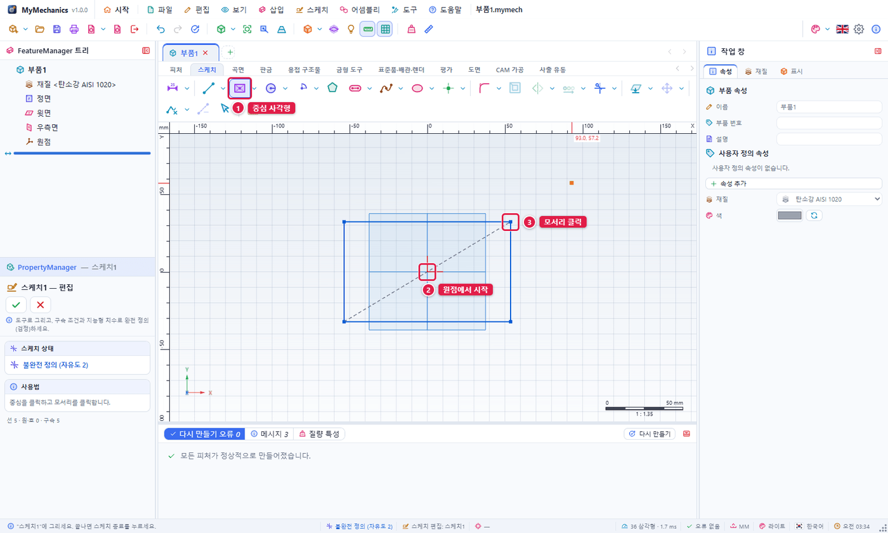
4. **지능형 치수**(D)로 위쪽 선을 클릭해 `80`, 오른쪽 선을 클릭해 `50` 을 넣습니다. 선이 검은색이 되면 완전 정의된 것입니다(파랑 = 아직 움직일 수 있음, 빨강 = 과잉 정의).

   
5. **스케치 종료**를 누릅니다.
6. **돌출 보스**를 누르고 깊이 `20` 을 넣은 뒤 ✔ 를 누릅니다.

   
7. **필렛**을 누르고 세로 모서리 4개를 클릭한 뒤 반지름 `5`, ✔.

   
8. **구멍 가공 마법사**를 누르고 크기 `M8`, 유형 **카운터보어**를 고른 뒤 윗면에서 구멍 자리(원점에서 X 15 mm쯤)를 클릭합니다. 같은 면을 더 클릭하면 구멍이 늘어납니다. 빨간 미리보기가 구멍입니다. ✔.

   
9. 트리에서 **구멍1**을 고르고 **원형 패턴**을 누른 뒤 축 `Y`, 인스턴스 `4`, ✔.

   
10. 저장(Ctrl+S). 파일은 `.mymech` 하나에 프로젝트 전체가 들어갑니다.

치수나 피처 값을 바꾸려면 트리의 피처를 두 번 클릭(또는 오른쪽 클릭 › 피처 편집)하세요. 스케치는 다시 열려 편집되고, 그 뒤의 모든 피처가 새 형상에 맞춰 다시 만들어집니다. 필렛·모따기·쉘이 고른 모서리와 면은 형상으로 기억되어, 앞의 치수가 바뀌어도 가장 가까운 모서리를 다시 찾습니다.

## 4. 스케치

| 도구 | 단축키 | 쓰는 법 |
|---|---|---|
| 선 | L | 클릭, 클릭 … 이어서 그립니다. 기존 점을 클릭하거나 Esc로 끝냅니다. 거의 수평·수직이면 그 구속이 자동으로 붙습니다. |
| 중심선 | | 보조선(점선). 회전 축이나 대칭 축으로 씁니다. |
| 코너 사각형 / 중심 사각형 | R | 두 번 클릭. 수평·수직 구속이 함께 들어갑니다. |
| 3점 모서리 사각형 / 3점 중심 사각형 | | 기울어진 사각형: 첫 변의 두 끝과 폭을 정할 점 / 중심, 한 변의 가운데, 다른 쪽 크기를 정할 점. 직각·평행 구속이 들어갑니다(수평으로 그리면 수평·수직). |
| 평행사변형 | | 세 꼭짓점을 클릭합니다. 마주 보는 변에 평행 구속이 들어갑니다. |
| 원 | C | 중심, 원 위의 점. |
| 3점 원 | | 원 위의 세 점. 기존 점을 클릭하면 그 점이 원 위에 묶입니다. |
| 3점 호 / 중심점 호 | A | 시작점·끝점·호 위의 점 / 중심·시작점·끝점. |
| 접선 호 | | 선이나 호의 끝점을 클릭하고 호의 끝을 클릭합니다. 그 곡선에 접해 이어지고 탄젠트 구속이 붙습니다(곧게 이어지면 같은 선상의 선). |
| 다각형 | P | 중심, 꼭짓점. 변의 수는 PropertyManager에서 정합니다. |
| 직선 홈 | | 두 끝의 중심, 폭. |
| 점 | | 구멍 위치 등. |
| 지능형 치수 | D | 선 하나 = 길이, 원 = 지름, 호 = 반지름, 두 선 = 거리(평행) 또는 각도, 두 점 = 거리. 치수 글자를 두 번 클릭해 값을 바꿉니다. 과잉 정의가 되는 치수는 참조 치수(괄호)로 들어갑니다. |
| 스플라인 | S | 점을 차례로 클릭합니다. Enter·Esc로 끝내고, 첫 점을 다시 클릭하면 닫힌 스플라인이 됩니다. 모든 점을 지나는 곡선입니다. 스플라인을 고르면 점마다 **접선 핸들**(방향·크기)을 켤 수 있고, **곡률 콤 표시**가 길이를 따라 얼마나 어느 쪽으로 휘는지 그립니다. |
| 스타일 스플라인 | | 제어 다각형(점선) 위의 3·5·7차 베지어 곡선 하나입니다. 차수 + 1개의 제어점을 클릭하면 곡선이 첫 점과 마지막 점을 지나고, 나머지 점이 모양을 당깁니다. |
| 타원 | E | 중심, 장축 끝, 단축 위의 점. |
| 부분 타원 | | 중심, 장축 끝, 단축 위의 점, 시작점, 끝점(반시계 방향). 끝점은 타원 위에 묶입니다. 고르면 장반경·단반경·각도를 PropertyManager에서 바꿉니다. |
| 포물선 | | 초점, 꼭짓점, 그리고 포물선의 시작과 끝. 정확한 포물선(유리 베지에)으로 만들어집니다. |
| 원뿔 곡선 | | 시작점, 끝점, 두 끝 접선이 만나는 꼭짓점, 곡선이 지날 어깨점. 어깨점이 rho(0.5 = 포물선, 작으면 타원, 크면 쌍곡선)를 정하고, 고르면 PropertyManager에서 rho를 바꿉니다. |
| 수식 곡선 | | PropertyManager에서 `y = f(x)` 또는 매개변수 `x(t)`, `y(t)`와 범위를 넣고 **곡선 추가**를 누릅니다. 각도는 라디안이고 `sin cos tan asin acos atan atan2 sinh cosh tanh sqrt abs exp ln log min max pow`, `pi`, `e`, `^`를 씁니다. 범위 안에서 계산되지 않으면 이유가 표시됩니다. 끝점은 식이 정하는 자리에 고정되고, 곡선은 식을 1 µm 안으로 따릅니다. |
| 스케치 필렛 / 모따기 | | 두 선이 만나는 모서리 점을 클릭합니다. 반지름·거리는 PropertyManager에서 정합니다. 모따기는 **같은 거리**, **거리-거리**(선마다 따로), **각도-거리**(첫 선을 따라 거리, 그 선과 모따기 선의 각도)로 정하고, **방향 바꾸기**로 두 선의 순서를 바꿉니다. |
| 요소 오프셋 | O | 설정 화면이 열립니다. 거리, **방향 반대로**, **양방향**(양쪽, 열린 체인의 끝은 호나 선으로 **끝 막기**), **체인 선택**(고른 곡선에 이어진 체인 전부), 원본 또는 오프셋을 **구성선으로** 정하고 **적용**합니다. 선과 호의 체인은 이어진 채로 오프셋되어, 조각이 서로 잘리거나 늘어나 만나고 벌어지는 곳은 둥글게 이어집니다. 닫힌 체인은 바깥쪽, 열린 체인은 진행 방향 왼쪽이 기본입니다. |
| 요소 대칭 복사 | | 요소와 중심선을 고르면 대칭으로 복사하고 대칭 구속을 넣습니다. |
| 동적 대칭 | | 중심선을 고르고 켜면 그 뒤에 그리는 모든 요소가 그 자리에서 대칭으로 복사됩니다(선 위의 점은 함께 쓰고 선 위에 묶이며, 나머지는 대칭 구속). 다시 누르면 꺼집니다. |
| 선형 / 원형 스케치 패턴 | | 고른 요소를 간격·개수(선형) 또는 개수·각도(원형, 고른 점 기준)로 복사합니다. |
| 자르기 | T | 클릭한 부분을 교차점 사이에서 잘라냅니다(교차가 없으면 요소를 지웁니다). 원은 호가 됩니다. |
| 요소 연장 | X | 선의 끝을 다음 요소까지 늘립니다. |
| 요소 분할 | | 곡선 위를 클릭하면 그 점에서 둘로 나뉩니다(선은 동일선상 구속, 원뿔 곡선은 탄젠트 구속으로 이어짐). 원·타원은 두 점을 클릭해 두 호로 나눕니다. 스플라인은 모양이 바뀌므로 나누지 않습니다. |
| 요소 늘이기 | | 고른 요소를 dx, dy 만큼 옮기되 구속을 지켜, 이어진 요소가 늘어납니다. 고르지 않은 요소는 구속이 허락하는 한 제자리에 있습니다. 구속 때문에 안 되면 아무것도 바뀌지 않습니다. |
| 실루엣 요소 | | 스케치 평면에 수직으로 본 부품 바디의 윤곽을 정확한 선·호·원으로 만듭니다(은선 투영: 날카로운 모서리와 곡면의 윤곽). **바깥**은 바깥 윤곽만, **안쪽 포함**은 끝에서 본 구멍까지 넣습니다. |
| 자동 추적 | | 스케치 그림이 있을 때 그림 속 어두운(또는 밝은) 모양의 윤곽을 따라 그림 자리에 선·호·원으로 만듭니다(밝기 경계, 픽셀 단위 맞춤 허용값, 최소 크기). |
| 스케치 수리 | | 작은 틈, 겹친 중복 곡선, 같은 선상에서 겹친 선, 아주 작은 곡선, 열린 끝, 세 곡선 이상이 만나는 점의 수와 틈 허용값을 보여 줍니다. **수리**는 틈을 잇고 중복과 작은 곡선을 지우며 겹친 선을 합치고, **열린 끝 보기**는 직접 고칠 곳을 선택해 보여 줍니다. |
| 기준선 치수 | | 기준(선이나 점)을 먼저, 그다음 다른 요소들을 고르면 기준에서 각 요소까지 치수가 들어갑니다(세로 기준이면 가로 치수, 가로 기준이면 세로 치수). |
| 스케치 완전 정의 | | 거의 수평·수직인 선에 구속을 넣고, 선 길이·원 지름·호 반지름, 원점에서 각 점까지의 가로·세로 치수를 차례로 넣어 자유도를 없앱니다. 과잉 정의가 되는 것은 넣지 않으며, 치수는 지금의 값을 그대로 가져 모양이 바뀌지 않습니다. |
| 문자 | | 클릭한 곳에 문자를 놓습니다(Roboto 글꼴, 높이는 PropertyManager). 돌출·컷·랩으로 각인·양각합니다. |
| 3D 스케치 | | 공간 경로: 정면·윗면·우측면을 바꿔 가며 클릭하거나 좌표 표에 입력합니다. 직선 또는 매끈한 스플라인, 닫힘 선택. 스윕 경로·구조 부재·채우기 곡면에 씁니다. **구속과 치수**: PropertyManager의 칩으로 선분이나 점을 고르고 X·Y·Z축 방향, XY·YZ·ZX 평면에 평행, 평행, 직각, 같은 길이, 고정, 일치, 또는 길이·거리·각도·X·Y·Z 좌표 치수를 넣습니다. 가장 적게 움직이도록 풀고 남은 자유도를 보여 주며, 과다 정의가 되는 치수는 참조 치수가 됩니다. |
| 보조선 전환 | | 고른 선·원을 보조선으로 바꾸거나 되돌립니다(보조선은 윤곽에 들어가지 않습니다). |

* **선택**(S) 도구에서 점이나 선을 끌면 구속을 지키면서 움직입니다.
* 스케치 안에서 **실행 취소**(Ctrl+Z)·**다시 실행**(Ctrl+Y)은 스케치의 단계(그리기·치수·구속)를 하나씩 되돌립니다.
* 점 하나를 고르면 **관통** 목록에 이 스케치보다 앞선 스케치의 곡선과 3D 곡선이 나옵니다. 점이 그 곡선이 이 스케치 평면을 지나는 곳에 놓이고, 다시 만들 때 곡선을 따라갑니다(경로 위 스윕 단면).
* 요소를 고르면 PropertyManager에 **기존 구속 조건**(지우기 가능)과 **구속 조건 부가** 버튼(수평·수직·평행·직각·동등·탄젠트·동심·일치·중간점·대칭·동일선상·고정)이 나옵니다.
* 기존 구속 목록의 치수는 **종속(참조) 치수**로 바꾸거나(잰 값만 보여 주고 아무것도 정하지 않음) 다시 구동 치수로 바꿀 수 있습니다. 원·호까지의 거리는 **중심**, **가장 가까운 점**(최소), **가장 먼 점**(최대) 중에서 잽니다.
* 스케치가 과다 정의되면 상태에 **충돌하는 구속**(하나를 없애면 풀림)과 **중복 구속**(다른 구속이 이미 정한 것)이 나오고, 각각 지우기와(치수는) 참조 치수로 바꾸기 버튼이 있습니다.
* 숫자 입력란에는 `25.4in`, `100/3`, `2*15` 처럼 단위와 계산식을 쓸 수 있습니다. 치수 값에 `=W` 처럼 쓰면 전역 변수와 연결됩니다(Σ 표시).
* 닫힌 윤곽만 피처가 됩니다. 윤곽 안의 닫힌 윤곽은 구멍이 됩니다.

## 5. 피처

| 피처 | 설명 |
|---|---|
| 돌출 보스 / 돌출 컷 | 마침 조건: 블라인드(깊이), 관통, 관통 - 양쪽, 중간 평면. 방향 2를 켜면 반대쪽으로도 돌출합니다. 컷은 기본으로 재료가 있는 쪽으로 들어갑니다. |
| 회전 보스 / 회전 컷 | 스케치의 중심선(또는 고른 선)을 축으로 돌립니다. 각도 0.1–360°. |
| 필렛 / 모따기 | 모서리를 클릭하거나, 면을 클릭해 그 면의 모서리를 모두 넣습니다. 모따기 종류: 거리, 거리-거리, 각도-거리, **면 오프셋**(두 거리만큼 오프셋한 면이 만나는 곳이 모따기 모서리 — 어떤 모서리든, 곡면 사이 각도가 모서리를 따라 바뀌는 곳도), 꼭짓점(세 거리), **면-면**(붙어 있든 떨어져 있든 두 면 사이를 없앰). |
| 필렛: 단면·셋백·피처 유지 | **원뿔**(rho)·**곡률 연속** 단면은 어떤 모서리에도 됩니다: 평면 사이 직선 모서리와 원형 모서리는 정확히, 그 밖에는 모서리를 따라 단면마다 실제 면에서 굴리는 공을 풀어 만듭니다. **셋백**: 필렛 모서리 셋 이상이 만나는 꼭짓점을 누르고 모서리마다 거리를 정하면 그곳부터 필렛에 접하는 한 장의 매끈한 곡면으로 꼭짓점을 잇습니다. **피처 유지**(필렛·모따기): 고른 앞쪽 보스·컷은 둥글리기에 먹히지 않습니다 — 그것 없이 만든 뒤 다시 더하거나 뺍니다. **넘침 처리**: 둥글기가 면보다 클 때 *곡면 유지*는 계속 이어 이웃 면을 잘라 내고, *모서리 유지*는 제 면에서 멈춰 이웃 모서리를 남깁니다(평면 사이 직선 모서리에서는 커널 필렛이 못 하는 경우에도 평면에서 직접 둥글기를 만듭니다). |
| 라이브러리 피처 | **라이브러리에 저장**은 고른 피처를 스케치와 함께 저장합니다. **라이브러리 피처 삽입**: 항목을 고르고 **크기 매개변수**(스케치 치수, 그 값으로 스케치를 다시 풂)와 **위치**(누른 곳 또는 면 중심에서 X·Y만큼 옮기고 면 안에서 각도만큼 돌림)를 정한 뒤 평평한 면을 누릅니다. |
| 쉘 | 열 면을 고르고 두께를 정합니다. 안쪽·바깥쪽, 또는 면을 열지 않은 속 빈 바디도 됩니다. **다중 두께**: 면마다 따로 정한 벽 두께(평면이든 원통의 둥근 벽·구 같은 곡면이든)를 줍니다. |
| 구멍 가공 마법사 | 단순 · 카운터보어 · 카운터싱크, ISO M3–M20 볼트 통과 구멍 크기, 관통 또는 블라인드(118° 드릴 끝). 평평한 면을 클릭해 위치를 정하며, 위치는 "구멍위치" 스케치로 저장됩니다. 규격: ISO, ANSI 인치, **DIN**(DIN EN 20273 / DIN 974-1 / ISO 15065), **JIS**(JIS B 1001 1~3급), **GB**(GB/T 5277 / 152.3 / 152.2) — 끼워맞춤별 통과 구멍, 육각 구멍 붙이 볼트용 카운터보어, 90° 카운터싱크. 위치는 **3D 스케치**에서도 가져옵니다. 그 점마다, 점이 놓인 면에 수직으로 구멍이 뚫립니다(여러 면에 한 번에). |
| 고급 구멍 | 점 스케치의 점마다, 면에서부터 쌓는 앞쪽 요소(카운터보어·카운터싱크·직선·탭·테이퍼, 지름·깊이·각)와 반대 면에서부터 쌓는 뒤쪽 요소로 된 구멍. 앞쪽 마지막 요소의 깊이가 0이면 뒤쪽 요소까지 관통합니다. |
| 교차 | 바디·곡면·평면이 함께 만드는 닫힌 영역을 나열합니다. 뺄 영역을 체크하고, 결과 병합·쓴 바디 대체를 정합니다. |
| 메이트 참조 | 부품의 기본·보조·3차 면과 각각의 메이트 종류·방향을 이름과 함께 저장합니다. 같은 이름의 메이트 참조가 있는 부품 옆에 넣으면 저절로 메이트됩니다. |
| 면 이동 | 바디의 면을 옮깁니다. **오프셋**, **평행 이동**(축이나 모서리 방향), **회전**(축이나 모서리 둘레로 각도만큼). 평면은 옮긴 평면으로 바뀌고 둘레 면이 늘어나거나 잘려 따라옵니다. 원통 면(구멍·보스)은 오프셋으로 반지름이 바뀝니다. |
| 바디 저장 | 여러 바디로 된 부품의 바디마다 따로 부품(원래 부품의 그 바디를 삽입해 연결된 채로)과, 그것들을 모은 어셈블리를 만듭니다. |
| 선형 패턴 | 방향(X·Y·Z 또는 모서리), 간격, 개수. 방향 2로 격자 배열. 피처 또는 바디 전체를 복사합니다. |
| 원형 패턴 | 축(X·Y·Z 또는 원형·직선 모서리), 전체 각도, 개수, 동등 간격. |
| 대칭 복사 | 표준 평면·참조 평면·평평한 면을 기준으로 피처나 바디를 복사합니다. |
| 패턴 인스턴스 · 변형 패턴 | 선형·원형 패턴과 대칭 복사에 **형상 패턴 (빠르게 복사)** 옵션이 있습니다. 켜면 씨앗의 모양을 복사하고, 끄면 인스턴스마다 씨앗 피처를 그 자리에서 다시 만들어 끝 조건(다음까지·면까지 등)을 그 자리에서 계산합니다. 선형 패턴은 첫 씨앗 스케치의 **치수를 인스턴스마다 바꿀** 수 있습니다(방향 1·방향 2마다 증가량, 인스턴스마다 스케치를 다시 풂). 바디 대칭에서 **결과 병합**을 끄면 대칭 형상이 별도 바디로 남습니다. |
| 참조 평면 | 평면이나 면에서 오프셋한 평면. 스케치 평면으로 씁니다. |
| 참조 점 · 질량 중심 | 참조 점은 좌표, 면 중심, 호 중심, 모서리 위, 그리고 **질량 중심**(지금까지 만든 바디의 부피 중심, 모델을 따라 움직임)으로 놓습니다. |
| 분할선 | 몸체의 면을 여러 면으로 나눕니다(구배·파팅·데칼·다른 색을 위해). **투영**: 스케치를 평면 법선 방향으로 투영, **실루엣**: 고른 평면의 법선에 대해 면이 돌아서는 곳(면 법선이 그와 수직; 원통·구·원뿔은 정확히, 그 밖의 곡면은 계산한 실루엣을 따라), **교차**: 고른 평면·곡면 바디·면과 만나는 곳. 면을 고르지 않으면 모든 면입니다. |
| 경계 상자 | **삽입 › 참조 형상 › 경계 상자**: 바디를 감싸는 가장 작은 상자를 12개 모서리로 그리고 길이·폭·두께를 PropertyManager에 보여 줍니다. **최적 맞춤**은 OCCT의 최적 방향 상자와 평면 면에 맞춘 상자 가운데 부피가 가장 작은 것, **평면에 맞춤**은 고른 평면에 반듯한 정확한 상자입니다. |
| 돌출 교차 · 구배 돌출 | 돌출의 동작을 **교차**로 바꾸면 겹치는 부분만 남습니다. 블라인드 돌출에서 **구배 켜기**로 옆면을 기울입니다. |
| 결과 병합 | 보스 돌출·회전의 **결과 병합**을 끄면 새 솔리드가 기존 바디에 합쳐지지 않고 따로 바디가 됩니다(겹쳐도 그대로). 다중 바디 부품, 스냅 훅 홈의 상대 바디, 결합·눌러 찍기 도구 바디에 씁니다. |
| 스윕 보스 / 스윕 컷 | 닫힌 윤곽을 경로(열린 스케치나 나선)를 따라 쓸어 만듭니다. 윤곽은 경로 시작점에 경로와 직각으로 그립니다. 나선에는 **프레네 방향**을 켭니다. |
| 스윕: 안내 곡선·접선·솔리드 스윕 | **안내 곡선**: 하나면 단면이 고르게 커지거나 작아지고, 둘 이상이면 경로의 각 위치에서 단면을 늘이고 돌려 모든 곡선을 지나게 한 뒤 단면들을 이어 만듭니다. **시작 접선** *경로에 수직*은 경로에 직각으로 그리지 않은 단면을 돌려 세운 뒤 쓸어 만듭니다. **솔리드 스윕**: 회전체 공구 바디(예: 별도 바디로 만든 원통·볼 엔드밀)를 축 방향을 유지한 채 경로를 따라 움직여 지나간 부피를 잘라냅니다 — 축에 수직인 평면 안의 이동, 직선 경사·수직 진입(공구와 이동의 민코프스키 합, 정확), 곡선 경사(짧은 직선 이동으로 나눔); 공구 바디는 사용되어 사라집니다. |
| 로프트 보스 / 로프트 컷 | 여러 평면의 닫힌 윤곽을 고른 순서대로 잇습니다. 직선 곡면 옵션. |
| 로프트: 면 조건·커넥터 | 시작·끝 구속 **면에 접선**, **면에 곡률 연속**: 몸체의 면 위에 그린 단면에서 로프트가 몸체의 옆면이 이어지는 방향(곡률이면 휘는 정도까지)으로 나가며, 단면의 점마다 그 아래 옆면에서 잽니다. **커넥터**: 단면마다 시작 꼭짓점(V1 …)과 **방향 반대**를 골라 그 점부터 이어 붙입니다(자동은 가장 덜 비틀리게). |
| 구배 | 중립 평면을 고르고 기울일 면을 고릅니다(0–45°). |
| 곡선 분할선 구배 | 분할선이 곡선(원·스플라인 등)이거나 옆 면이 곡면이면, 면을 분할선에서 시작해 당기는 방향과 구배 각을 이루는(곡선에 수직인) 직선들로 된 선직 곡면으로 바꿉니다. 원형 분할선 위의 원통은 정확한 원뿔이 됩니다. 양의 각은 분할선에서 멀어질수록 좁아지고, 음의 각은 넓어집니다. |
| 리브 | 벽 사이에 그린 열린 선에서 재료가 있는 쪽으로 두께만큼 판을 채웁니다. |
| 돔 | 평면 하나 위에 높이만큼 구면을 올립니다(오목하게도 가능). 구면·타원형·연속 모양이 있고, **방향**은 면에 수직·축·모서리 중에서 고릅니다. 축이나 모서리를 고르면 돔이 그 방향으로 기울어 솟습니다(면 위 높이와 부피는 같음). |
| 나선 | 평면·반지름·피치·회전 수로 나선 곡선을 만듭니다. 스윕 경로로 써서 스프링을 만듭니다. |
| 곡면 위 스플라인 | 면을 클릭하고 그 위의 점들을 클릭하면, 그 점들을 지나며 길이 전체가 면 위에 놓이는 스플라인이 됩니다(면의 매개변수 공간에서 만들어, 원통·구의 이음선도 짧은 쪽으로 넘어감). 점은 표에서 고치고 닫을 수 있으며, 스윕 경로나 패턴·투영용 곡선으로 씁니다. |
| 나사산 | 축 끝이나 구멍 입구의 원형 모서리에 60° V 나사를 깎습니다(수나사·암나사 자동 판별, M3–M24 피치 표). **표시용 나사산**은 형상을 바꾸지 않고 선만 그립니다. 형태: ISO 미터(ISO 68-1 / 965-1 정밀 형상), UN 60°, ISO 2904 사다리꼴, 7°/45° 버트레스, 55° 휘트워스 관용(둥근 산·골) — 모두 그 형상을 정확히 나선으로 쓸어 만든 솔리드이며, 다중 줄, 왼나사, 축을 따른 **시작 오프셋**(음수면 모서리에서 시작), **끝 면으로 다듬기**(끄면 막힌 탭 구멍의 나사가 길이만큼 이어짐)를 지원합니다. 재료 안에서 끝나면 나사가 불완전 나사부만큼 사라지며 끝납니다. |
| 랩 | 면 옆 평면의 스케치를 원통·평면에 양각/음각합니다(면 쪽으로 투영). |
| 모든 곡면에 감싸기 | 원뿔·스플라인 면에도 됩니다: 스케치 원점 바로 아래 점을 지나는 면의 v 방향 선을 따라 y를, 닿은 줄마다 그 u 방향 선을 따라 x를 호 길이로 재어 얹은 뒤 양각·음각·스크라이브합니다. |
| 변형 | **점**: 한 점 근처를 방향으로 밀고 부드럽게 퍼집니다. **곡선에서 곡선으로**: 처음 곡선과 목표 곡선의 쌍 — 처음 곡선의 점들이 같은 길이 비율의 목표 곡선 점으로 옮겨지고 몸체가 반경 안에서 따라갑니다. **표면 밀기**: 도구 바디(별도 바디)를 방향으로 눌러 넣어 그 모양대로 찌그러뜨리고 주변은 부드럽게 따라갑니다. 도구 바디는 사용되어 사라집니다. 결과는 면으로 이루어진(다면) 몸체입니다. |
| 자유형 | 조절점 격자(U·V 방향 점 수)로 한 면의 모양을 바꿉니다. 안쪽 점마다 면 법선 방향 거리를 넣으면, 테두리 줄은 고정되어 이웃 면과 계속 이어집니다(*접선*이면 두 줄). 매개변수 사각형이 경계인 면은 정확한 B-스플라인 면이 되어 몸체에 다시 꿰매지고, 그 밖의 면은 촘촘한 메시로 바뀝니다. |
| 바디 이동/복사 · 축척 · 분할 | 바디를 옮기거나(ΔX·ΔY·ΔZ), 회전 중심을 기준으로 X·Y·Z축 각각에 대해 돌려 눕히거나 뒤집고(복사 포함), 비율로 키우고, 평면으로 잘라 한쪽이나 양쪽(바디 2개)을 남깁니다. |
| OpenSCAD 피처 | **삽입 › 바디 › OpenSCAD 피처**: OpenSCAD 코드로 바디를 만듭니다. PropertyManager의 **Customizer**에 프로그램 맨 위 변수가 `/* [탭] */` 묶음별로 나오고(주석 `// [최소:최대]`는 슬라이더, `// [a, b]`는 목록, `/* [Hidden] */`은 숨김), 값을 바꾸면 미리 보기가 다시 만들어집니다. 코드는 그 자리에서 고치고 칸을 벗어나거나 Ctrl+Enter로 적용합니다(Tab은 들여쓰기). 코드에는 색이 입혀지고(키워드·내장 모듈과 함수·숫자·문자열·주석·$ 변수), 커서 앞 단어를 자동 완성합니다. 키워드, 인수까지 채운 내장 모듈·함수, 프로그램 안의 모듈·함수·변수가 나옵니다(두 글자 또는 Ctrl+Space, ↑ ↓, Enter 또는 Tab, Esc). echo 출력과 경고가 아래에 나오고, 줄 번호가 있는 메시지를 누르면 코드에서 그 줄이 선택됩니다. 찾지 못한 include 파일은 **폴더 고르기**로 피처에 담습니다. **애니메이션**에서 `$t`(시간 또는 프레임 막대)·초당 프레임·단계 수를 정하고, **재생**으로 프레임을 돌리며, **프레임 그림 저장**은 모든 프레임을 frame00000.png …로 ZIP에 담습니다. **결과 내보내기**는 프로그램이 만든 것을 씁니다. 솔리드는 STL·OFF·AMF·3MF, 2D 결과는 SVG·DXF·PDF(A4에 1:1), 그리고 **CSG 트리**(.csg: 모듈·반복·변수를 풀어 group()·multmatrix()와 모든 인수로 적은 파일)입니다. 프로그램·값·파일과 만들어진 솔리드가 프로젝트에 저장됩니다. |
| 마운팅 보스 | **삽입 › 체결 피처 › 마운팅 보스**: 평면 위(면 중심, 입력 좌표 또는 참조점, 면에 투영)에 원형 보스를 세웁니다. 높이, 위쪽 바깥 지름, 바깥 구배(아래로 넓어짐), 구멍(지름·위에서 깊이·구멍 구배, 또는 관통) 또는 핀(지름·높이), 핀(리브) 개수·길이·두께·높이·첫 각도, 삼각형·직사각형 모양. |
| 스냅 훅 | 평면 위에 외팔보 훅을 세웁니다: 팔 높이·폭·두께, 걸림 턱 깊이·길이, 삽입 경사각(턱 윗면의 경사; 경사가 턱보다 길면 턱이 삼각형), 턱 방향 각도. |
| 스냅 훅 홈 | 고른 스냅 훅의 모양을 틈새만큼 키워 다른 바디에서 깎아 훅이 걸릴 자리를 냅니다(상대 바디는 결과 병합을 끈 돌출 등으로 만든 별도 바디). |
| 통풍구 | 벽 위 스케치에서 가장 큰 닫힌 윤곽을 경계로 벽을 관통해 깎고, 경계 안의 선은 리브(폭), 다른 닫힌 윤곽은 스파(폭)로 남깁니다. |
| 립/홈 | 셸 벽의 윗면(테두리 면)을 고르면 안쪽(또는 바깥쪽) 모서리를 따라 폭만큼의 띠를 높이만큼 올리거나(립) 깊이만큼 깎습니다(홈, 틈새만큼 넓게). 안쪽 띠는 모서리에서 일정한 거리로 둥글게 이어집니다. |
| 부품 삽입 · 캐비티 | 프로젝트의 다른 부품을 이 부품에 더하거나(보스), 빼거나(캐비티 = 금형), 겹친 부분만 남깁니다. |
| 대칭 부품 | 지금 부품을 정면·윗면·우측면에 대해 대칭한 새 부품(반대쪽 부품)을 재질과 함께 만듭니다. 대칭 평면을 가진 부품 삽입이라 원본이 바뀌면 따라 바뀝니다. 부품 삽입에도 같은 **대칭** 옵션이 있습니다. |

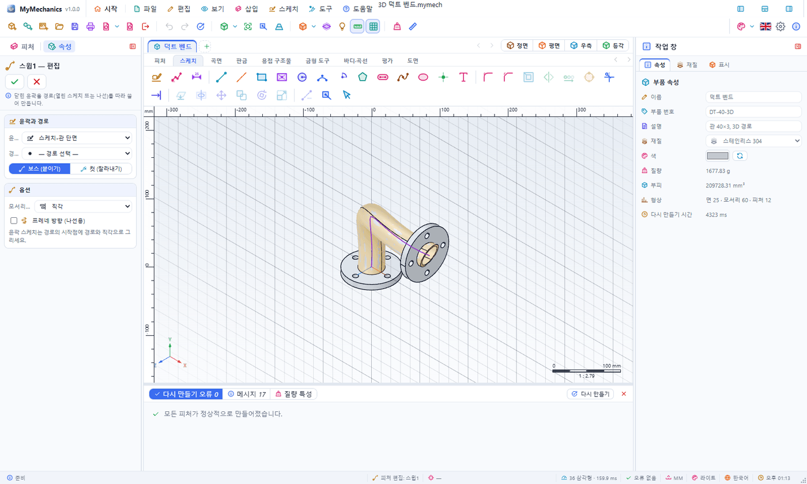

트리의 오른쪽 클릭 메뉴: 피처 편집, 이름 바꾸기(F2), 억제/억제 해제, 여기로 롤백, 삭제(이 피처를 쓰는 피처도 함께 지워집니다). 실패한 피처는 빨간색으로 표시되고 아래 패널 **다시 만들기 오류**에 이유와 고치는 방법이 나옵니다. 나머지 피처는 계속 만들어집니다.

트리에서 피처를 끌어 **순서를 바꿉니다**. 다른 피처 위에 놓으면 끈 피처(자기 스케치와 함께)가 그 앞으로 갑니다. 피처가 참조하는 것(스케치·평면·시드·경로 등)보다 앞으로 가게 되는 이동은 이유와 함께 거절됩니다. **새 폴더에 넣기**(오른쪽 클릭)는 트리에서 이어진 피처를 열고 닫는 폴더로 묶고, 폴더 위에 피처를 놓으면 그 안으로 옮겨집니다. 폴더의 오른쪽 클릭 메뉴에서 이름을 바꾸거나 풉니다.

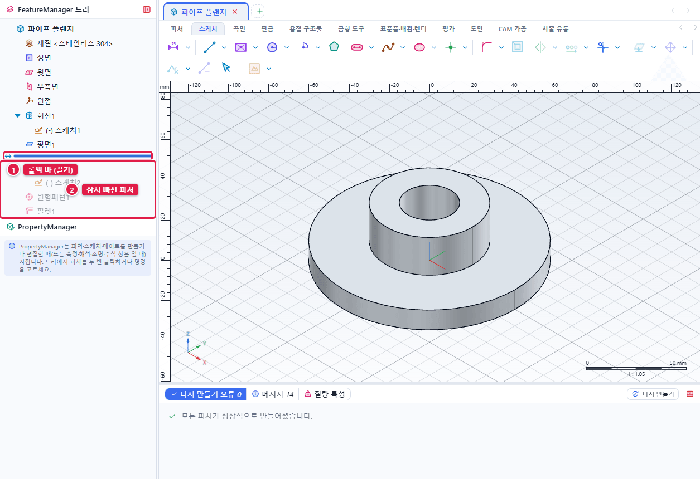

## 6. 곡면 · 판금 · 용접 구조물 · 금형 도구

* **곡면** 탭: 돌출·회전·평면·로프트 곡면, **경계 곡면**(닫힌 윤곽 사이를 매끈하게, 또는 열린 곡선들을 가장자리로), **채우기 곡면**(구멍의 모서리나 닫힌 3D 스케치를 덮는 패치), 면 오프셋, **곡면 자르기**(평면·다른 곡면으로 잘라 한쪽 유지), 곡면 붙이기(닫히면 솔리드). **두껍게**로 곡면을 바깥·안·양쪽으로 두께를 주어 솔리드로 만듭니다. 곡면은 반투명 청록색으로 보입니다.
* **경계 보스 / 경계 컷**: 경계 곡면 PropertyManager에서 동작을 **보스**나 **컷**으로 바꾸면 닫힌 윤곽들 사이의 솔리드를 붙이거나 깎습니다. **두껍게**의 컷 동작은 곡면을 두께만큼 깎는 두껍게 한 컷입니다.
* **경계 옵션**: **방향 2** 곡선은 단면들을 가로지르고 곡면이 그것을 따릅니다. 첫·마지막 단면의 **끝 조건**(단면에 수직·면에 접선·면에 곡률 연속)과 **영향**(조건이 미치는 길이)을 정합니다. 열린 곡선 패치는 곡선이 놓인 몸체 면에 **접선(G1)** 또는 **곡률(G2)** 로 이어질 수 있습니다. **채우기 곡면**: 구멍 둘레의 면에 같은 연속성(접촉·접선·곡률)과, 경계 안에서 패치가 지나갈 **구속 곡선**을 줄 수 있습니다.
* **곡면 스윕 / 곡면 로프트**도 솔리드와 같은 옵션을 씁니다: 비틀기, 시작 접선, 안내 곡선 하나·여러 개(열린 단면도 됨: 양 끝에 안내 곡선 둘이면 곡면의 가장자리가 그 곡선), 원형 단면; 로프트는 안내 곡선·중심선·시작/끝 조건·커넥터. 결과는 끝 면 없는 열린 곡면입니다.
* **곡면 필렛**(곡면 탭): 서로 가로지르는 두 곡면 바디를 고르면 서로 만나는 곳에서 잘라 정한 쪽만 남기고(*남길 쪽 반대로*로 바꿈) 반지름으로 둥글게 이어 한 장의 곡면 바디로 만듭니다.
* **곡면 스윕**: 프로파일 스케치의 곡선(열린 체인도 됨)을 경로를 따라 쓸어 곡면을 만듭니다(모서리 처리·프레네 프레임 선택).
* **곡면으로 자르기**: 바디를 가로지르는 곡면으로 바디를 나누고, 곡면 법선 쪽 재료를 깎아 냅니다(뒤집기 가능).
* **구멍 지우기 · 트림 해제 곡면**: 곡면의 구멍을 그 곡면 자체로 메웁니다(구멍 모서리를 고르면 그 구멍만). 트림 해제의 **자연 경계**는 곡면을 원래 매개변수 범위(원통은 한 바퀴 전체, B-스플라인은 패치 전체, 평면은 면을 감싸는 사각형)까지 넓힙니다.
* **중간 곡면**: 얇은 벽의 마주 보는 평면 쌍(골라 주거나 최대 두께 안에서 자동으로 찾음) 한가운데에 곡면을 만들고 이어 붙입니다.
* **방사 곡면**: 기준 평면과 나란한 한 평면 위의 모서리 체인에서 그 평면을 따라 바깥쪽(또는 안쪽)으로 일정한 거리만큼 곡면을 펼칩니다(금형 분할면 등).
* **곡면 펼치기**: 면 하나를 평면으로 펼칩니다. 평면·원통·원뿔은 경계의 길이와 넓이를 그대로 지키며 정확히 전개하고(구멍 포함), 구·토러스·B-스플라인 같은 면은 메시의 최소제곱 등각 사상으로 펼쳐 넓이를 맞춘 뒤 넓이 비율(왜곡) 범위를 보여 줍니다.

   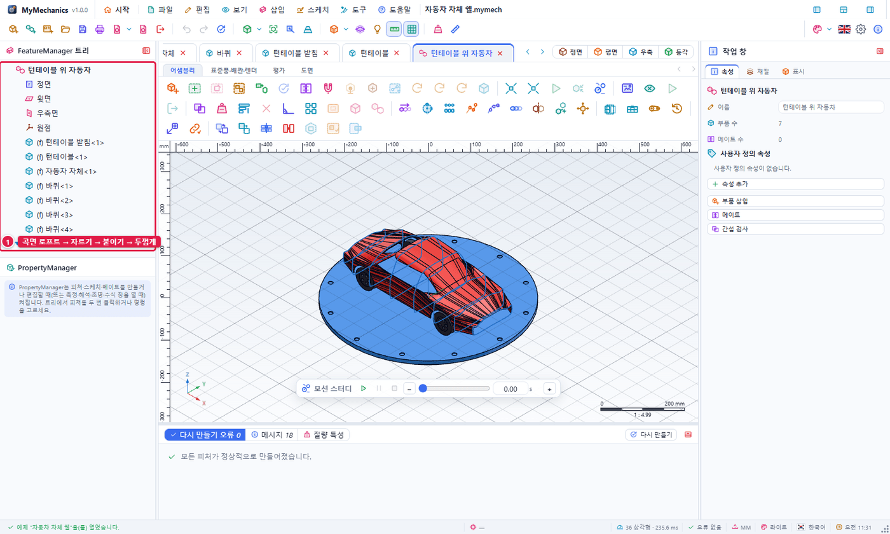
* **판금** 탭: **베이스 플랜지**(닫힌 스케치 + 두께, 굽힘 반지름, K 계수) → **모서리 플랜지**(판 윗면의 직선 모서리를 고르고 각도·길이) → **헴**(가장자리를 180° 되접기, 닫힘·열림) · **스케치 굽힘**(판 위에 그린 선을 따라 각도만큼 굽힘) · **조그**(선 너머를 높이만큼 올리는 두 번 굽힘) → **펼치기**로 전개도를 봅니다. 굽힘 여유 = 각도 × (반지름 + K × 두께).
* **전개도 DXF·DWG**: **파일 › 내보내기 › 전개도를 DXF/DWG로 내보내기**(판금 탭에도 있음)는 활성 판금 부품의 펼친 판을 부품에서 바로 저장합니다. 외곽과 구멍은 OUTLINE 층, 굽힘선은 접히는 쪽에 따라 BEND_UP 또는 BEND_DOWN 층, 굽힘마다 방향·각도·안쪽 반지름·여유 메모는 BEND_NOTES 층에 들어가며, 판 평면의 밀리미터 좌표입니다.
* **모서리 플랜지 위치·길이·폭**: **굽힘 바깥**(굽힘이 모서리 밖), **재질 바깥**(플랜지 안쪽 면이 모서리에), **재질 안**(바깥 면이 모서리에), **가상 꼭짓점에서 굽힘**; 굽힘이 안으로 들어오는 만큼 판을 잘라 냅니다. 길이는 굽힘 접선·바깥 가상 꼭짓점·안쪽 가상 꼭짓점에서 재며, 시작·끝에서 띄워 모서리보다 좁은 플랜지도 됩니다. **플랜지 윤곽 편집**은 곧은 부분을 꼭짓점(U: 모서리 방향, V: 플랜지 방향)으로 고치는 다각형으로 바꿔 사다리꼴·노치·탭을 만듭니다. 전개도도 따라갑니다.
* **사용자 성형 도구**: **성형 도구**에서 *사용자 성형 도구*를 고르고 **펀치 부품**(프로젝트의 어느 부품이든), 그 **정지 면**(평면)과 **뚫을 면**을 정합니다. 정지 면이 판의 반대쪽 면에 놓이고 펀치가 판을 뚫고 솟으며, 판이 두께만큼 펀치를 감쌉니다(볼록한 모서리 바깥은 둥글게). 아래는 비어 있고 열려 있으며, 뚫을 면 자리는 뚫립니다.
* **법선 컷**: 판금 부품의 돌출 컷에 *법선 컷 (판에 수직)* 옵션이 있습니다. 컷 윤곽이 들어오는 쪽 판 면(평면과 굽힘)에 닿은 자리를 면의 법선 방향(굽힘에서는 반지름 방향)으로 판 두께만큼 뚫어, 펼친 상태에서 자르고 접은 것과 같게 만듭니다.
* **게이지 표와 굽힘 계산**(베이스 플랜지, 판금으로 변환): **게이지 표**(강판 표준 게이지·아연 도금·스테인리스·알루미늄(B&S)·미터 두께, 또는 이름·두께·반경·K 행을 직접 넣는 사용자 표)가 두께, 굽힘 반지름(게이지가 허용하는 반지름 중 하나), K를 정합니다. **굽힘 계산**은 **K-계수**, r/t 별 **K 표**, **DIN 6935**, **굽힘 여유 표**, **굽힘 공제 표**(각도·반경·값 행, 사이 값은 보간; *K로 채우기*로 시작) 중 하나로 굽힘을 펼칩니다. 전개도와 도면의 굽힘 표가 이를 따릅니다.

   

   
* **판금 — 솔리드에서 시작하기:** **판금으로 변환**은 솔리드의 고정 면을 판의 바닥으로, 고른 모서리마다 그 너머 면까지를 벽으로 바꿉니다(두께 · 안쪽/바깥쪽 · 굽힘 반지름 · K 계수, 벽이 만나는 모서리는 **겹침**(한 벽이 다른 벽 끝을 덮고 찢기 간격만큼 띄움) 또는 **열림**). **굽힘 삽입**은 쉘처럼 얇은 벽 솔리드에서 두께를 벽에서 읽고 고정 면의 날카로운 모서리를 모두 굽힘으로 바꿉니다. **찢기**는 두 벽이 만나는 모서리를 간격만큼 잘라 펼 수 있게 합니다(이등분 또는 한쪽 벽 쪽).
* **판금 — 굽힘을 가로지르는 컷:** 트리에 **굽힘 펴기**를 넣으면 그 뒤부터 **굽힘 접기**까지는 판이 펴진 상태로 만들어집니다. 그 사이에 넣은 컷은 접을 때 굽힘을 따라 감기고(굽힘 부분은 원통에 감기고, 플랜지 위는 플랜지와 함께 돕니다) 다시 접힌 판에 들어갑니다. 조그나 로프트 굽힘이 있는 판에서는 쓸 수 없습니다.
* **판금 — 그 밖:** **교차 굽힘**(평평한 패널의 X자 보강 표시, 모양은 그대로) · **용접 모서리**(두 모서리 플랜지 사이 틈을 용접으로 채움, 용접 부피·길이 표시, 전개도에는 없음) · **탭과 슬롯**(따로인 두 바디에서 한 바디 모서리에 탭을, 그것이 서 있는 면의 바디에 틈새만큼 큰 슬롯을 만듦).
* **용접 구조물** 탭: 선으로 그린 스케치에 **구조 부재**(각관·직사각 관·파이프·환봉·각봉·앵글·채널·I형강·T형강, 크기 변경)를 놓고 **절단 목록**으로 부재별 길이와 합계를 봅니다.
* **구조 부재 옵션**: 스케치로 그린 **사용자 단면**(스케치 원점이 경로 위; 그 스케치를 **라이브러리에 저장**해 다른 부품에 넣으면 단면 라이브러리로 씀), 두 부재가 만나는 곳의 **코너 처리** — 겹침, **마이터**(이등분면에서 둘 다 자름), **끝 맞춤**(하나는 지나가고 다른 하나는 그 면에서 멈춤). 절단 목록(도면의 절단 목록 표 포함)은 부재마다 절단 길이와 양 끝 절단 각을 보여 줍니다.

   
* **금형 도구** 탭: **구배 분석**(빼는 방향 = 고른 평면/면의 법선, 기본 Y: 녹색 양의 구배·빨강 음의 구배·노랑 부족), 구배, **파팅 라인**(빼기 방향에 대해 면이 앞뒤로 바뀌는 모서리), **코어/캐비티 분할**(부품을 둘러싼 금형 블록을 파팅 높이에서 나누고 부품 모양을 빼서 벌려 보여 줌), **수축률 축척**, 분할, **캐비티**.
* **코어(사이드 코어)**: 툴링 분할 뒤 사이드 액션·리프터의 윤곽을 스케치하고 툴링을 지나도록(관통 또는 깊이, 구배 각) 돌출하면, 그 윤곽이 지나는 코어·캐비티 부분이 별도 바디가 되어 빠집니다. 성형 부품은 그대로입니다.

   

   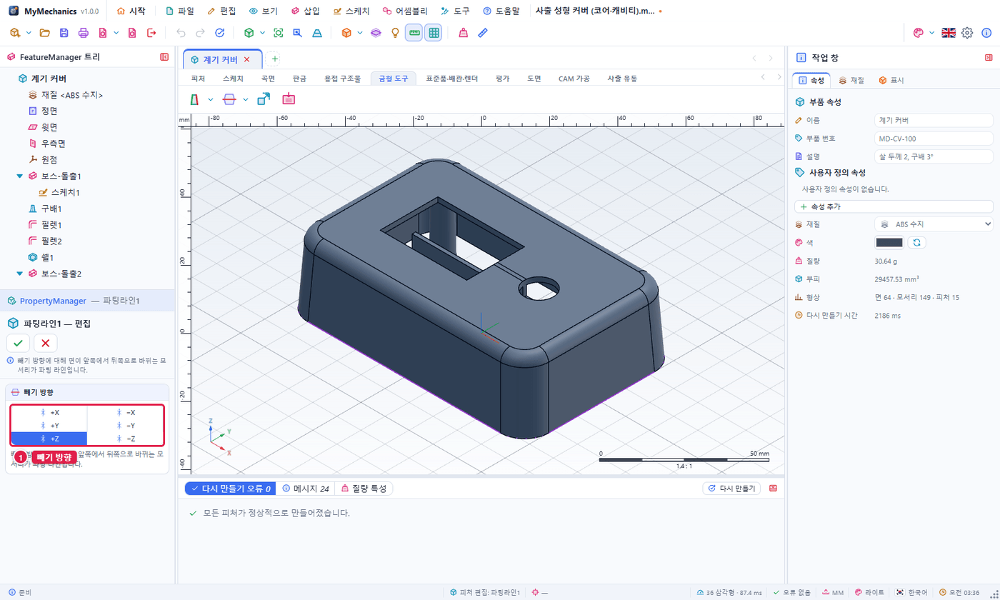

   

### 사출 유동 해석 · 금형 냉각 · 섬유 배향 · 휨

**사출 유동** 탭의 **사출 유동 해석**은 수지(Cross-WLF 점도·Tait PVT 자료), 성형 조건, 게이트(부품 위를 클릭하거나 자동 추천)로 충전과 보압을 계산하고 충전 시간·압력·유동 선단 온도·고화층·보압·수축·싱크·웰드 라인·에어 트랩을 부품 위 색으로 보여 줍니다. PropertyManager 에서 다음 세 단계를 더할 수 있으며, 모두 같은 백그라운드 작업에서 충전 뒤에 계산됩니다.

**러너·다중 캐비티·패밀리 금형**(사출 유동 해석의 마지막 묶음): **캐비티 수**(1~8)와, 프로젝트의 다른 부품을 체크해 함께 넣는 **패밀리 금형**을 정합니다. 캐비티는 스프루를 지나는 주 러너(x 방향) 양쪽에 두 줄로 놓이고, 분기 러너가 y 방향으로 각 캐비티의 게이트(그 부품의 첫 게이트, 없으면 제안 위치)까지 이어집니다. 러너는 원형 관로(하겐–푸아죄유 전도도 πr⁴/8L)로 캐비티와 같은 그래프에 들어가 스프루에서 함께 충전됩니다. **주 러너 지름**, **게이트 지름**(0이면 분기 지름의 0.6배), **캐비티 간격**을 정하고 **러너·캐비티 해석**을 누르면 캐비티별 충전 시간·충전율·분기 지름 표, **충전 불균형**((최대 − 최소) / 최대), 스프루 압력, 러너 부피와 스크랩 비율이 나오고, 모델 위에 캐비티 상자·러너·게이트가 그려집니다. **러너 균형 맞추기**는 늦게 차는 캐비티의 분기를 넓히고 빨리 차는 쪽을 좁히는 해석을 불균형이 3 % 아래가 될 때까지 되풀이하고, 찾은 분기 지름을 저장합니다.

**가스 보조·인서트 성형**(사출 유동 해석): **인서트 면 고르기**로 금속 인서트가 닿는 부품 면을 클릭하고 **인서트 온도**를 정하면, 그 둘레의 벽은 금형 온도 대신 인서트 온도로 식습니다. 차가운 인서트는 둘레를 빨리 굳혀 압력을 올리고(미성형 위험), 예열한 인서트는 그 반대입니다. 본 충전 해석에 반영됩니다. **가스 보조 해석**은 정한 **용융수지 쇼트**(%)만 넣은 뒤 가스 핀(첫 게이트, 또는 **가스 핀 위치**로 클릭)에서 가스가 저항이 작은 두꺼운 통로를 따라 굳은 스킨 사이의 코어를 비우고, 밀려난 수지가 유동 선단을 따라 나머지를 채우게 합니다. 가스는 공칭 두께의 정한 배율보다 얇은 벽에는 들어가지 않습니다. 결과로 완전 충전·미성형·블로스루(가스가 선단을 뚫음), 가스 부피(무게 절감), 침투 거리, 가스 노드가 나오고, 가스가 든 곳이 보라색 점으로 표시됩니다.

* **섬유 배향**: 유리 섬유 함량(%)과 종횡비를 넣으면 충전 중 섬유 배향 텐서를 Folgar–Tucker 식(하이브리드 클로저)으로 두께 방향 여러 층에서 구합니다. 벽 근처(표층)는 전단으로 유동 방향을 따르고, 퍼지는 흐름의 중심층은 가로로 섭니다. 정렬도·표층·중심층 값을 색으로 봅니다.
* **금형 냉각**: 코어·캐비티 양쪽에 지그재그 냉각 채널(지름, 채널당 유량, 입구 온도, 간격, 캐비티에서 채널 축까지 거리, 냉각제, 금형 재질)을 배치하고 사이클 평균 열전달로 금형 벽 온도와 위치별 냉각 시간을 구합니다. 채널마다 레이놀즈 수(난류 여부), 제거 열량, 냉각수 출구 온도, 압력 손실이 나오고, 난류가 아니거나 온도 상승이 3 °C 를 넘거나 캐비티와 너무 가까우면 경고합니다. 채널은 그래픽 영역에 선으로 보입니다.
* **휨**: 부품을 사면체로 나누어 불균일 수축·불균일 냉각·배향(섬유 또는 분자 배향)이 남기는 초기 변형률로 자유 상태(3-2-1 지지)의 변형을 구합니다. 원인별·전체 휨(고르게 줄어든 크기 변화와 강체 이동을 뺀 값)과 주된 원인이 나오며, **변형 형상 보기**와 **변형 배율**로 과장해 봅니다.

보고서(HTML)에는 이 세 단계의 결과 표도 들어갑니다.

## 7. 수식 · 컨피규레이션 · 디자인 테이블

* **평가 › 수식**: 전역 변수(`W = 120`, `H = W / 2`)를 만듭니다. 피처 값 입력란에 `=H - 5` 처럼 쓰면 그 값이 수식으로 정해집니다. 함수 `sin cos tan sqrt abs min max round iif(조건, 참, 거짓)`과 `pi`, 다른 피처의 값 `돌출1.depth`, 스케치 치수 `D1@스케치1` 을 쓸 수 있습니다.

   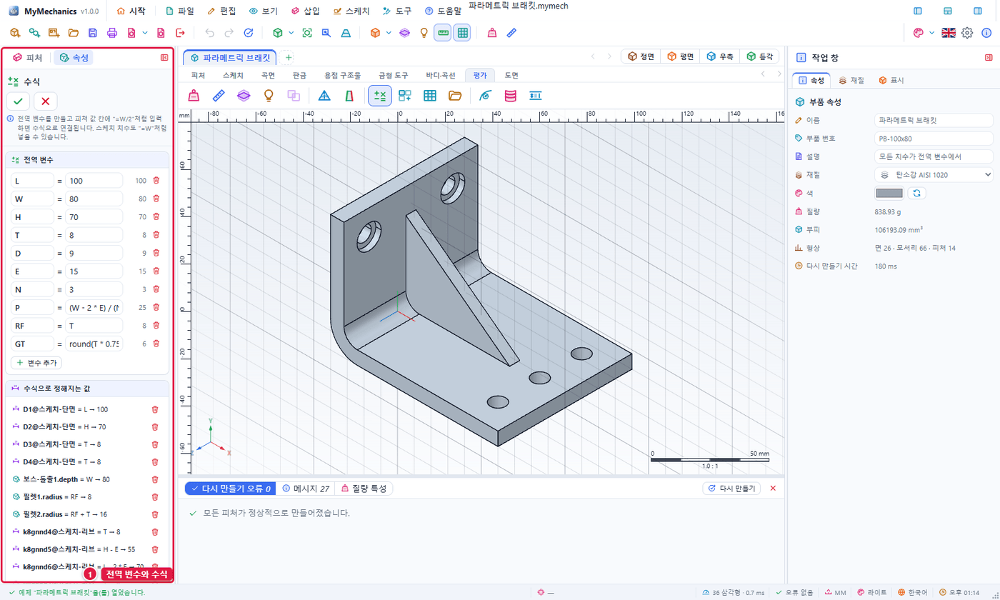
* **평가 › 컨피규레이션**: 컨피규레이션마다 변수 값과 피처 억제 상태가 따로 있습니다. 컨피규레이션을 켠 채 억제한 피처는 그 컨피규레이션에서만 억제됩니다. 트리 맨 위에 현재 컨피규레이션 이름이 나옵니다.

   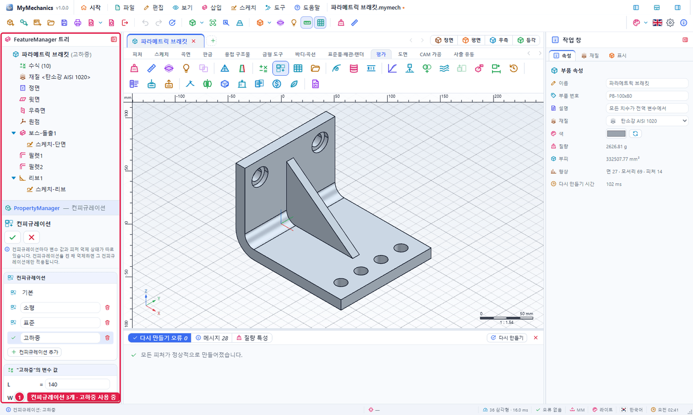
* **디자인 테이블**: 컨피규레이션 × 변수(그리고 `$STATE@피처`) 표를 CSV로 내보내고, 스프레드시트에서 고친 표를 가져오면 컨피규레이션이 만들어집니다.

### CAM 가공 (CAM 가공 탭 › CAM 관리자)

**CAM 관리자**의 탭은 다음과 같습니다.

- **설정**: 기계(밀링·선반), 소재(자동 여유 또는 직접 입력), 작업 원점, 포스트(Fanuc·Haas·LinuxCNC·ISO, 선반용 Fanuc·LinuxCNC)를 정합니다.
- **공구**: 평·볼·불노즈 엔드밀, 면 밀, 드릴, 센터 드릴, 탭, 선삭·보링·홈·나사 인서트를 관리합니다.
- **형상**: 면·포켓·슬롯·보스·단차·구멍·자유 곡면을 인식합니다.
- **작업**: 면삭, 포켓·적응형 황삭, 윤곽, 슬롯, 나선 보링, 센터·드릴·펙·칩 브레이크·탭, Z 레벨, 평행, 스캘럽, 워터라인과 선삭 공정을 다룹니다. **모두 계획**은 인식한 형상마다 작업을 만듭니다.
- **다축 가공**: **4축 회전 정삭**은 부품을 X축(A축)으로 돌리며 수직 공구로 정삭합니다. 축은 부품의 YZ 중심을 지나고, 무늬는 A 각마다 X 방향 줄과 X마다 한 바퀴 중에서 고릅니다. 포스트는 A 워드를 씁니다. **5축 동시 정삭**은 볼 엔드밀로 3축 평행 경로의 볼 중심을 따라갑니다. 공구축을 면 법선에 맞추고 진행 방향으로 기울이되, **최대 기울기**를 넘지 않습니다. 그래서 볼의 중심(절삭 속도 0)이 아닌 옆면으로 깎고, 짧은 공구로 가파른 면에 닿습니다. 포스트는 G43.4(공구 끝점 제어)와 테이블-테이블 A·C를 쓰고, C는 ±180°를 넘어도 이어지게 씁니다. 줄의 시작점이 부품 밖이면 소재 윗면 위까지만 급송하고 그 아래는 절삭 이송으로 들어갑니다. **밀턴 정면 드릴**은 선반의 라이브 공구로 축에서 벗어난 구멍을 C축 각도·반경으로 위치를 잡아 뚫습니다(G83). **밀턴 측면 드릴**은 외경에서 축을 향해 같은 간격의 반경 방향 구멍을 뚫습니다(G87). 소재 시뮬레이션은 5축 경로를 같은 볼 중심의 수직 공구로 재현합니다. 4축 회전·밀턴 경로는 시뮬레이션에서 빠지고, 빠졌다고 알려 줍니다.
- **시뮬레이션**: 소재 제거를 시뮬레이션해 과절삭을 검사하고 가공 시간을 계산합니다.
- **G 코드**: G 코드와 셋업 시트를 미리 보고 저장합니다.

밀링 작업의 **공구 경로 편집**(작업 매개변수 아래)은 생성된 경로 위에 얹는 편집입니다. 작업 매개변수를 바꿔 경로를 다시 만들어도 편집은 그대로 남습니다.

- **진입·후퇴**: 호(반지름·각도) 또는 직선(길이)으로 넣고, 접근하는 쪽(왼쪽·오른쪽)을 고릅니다.
- **패스 사이 이동**: 여유 높이까지 올라감, 최소 후퇴, 정한 거리 안에서 같은 높이면 머무른 채 이송 중에서 고릅니다.
- **순서**: 생성 순서 또는 가까운 순서입니다.
- **방향·이송**: 모든 패스의 방향을 뒤집거나 이송 배율을 줍니다.
- **영역으로 자르기**: X·Y 창의 안쪽 또는 바깥만 남깁니다.
- **패스 목록**: 패스마다 삭제·되살리기, 방향 반전, 이송 배율을 줍니다.

**편집 모두 지우기**를 누르면 생성된 경로로 돌아갑니다. 편집한 경로도 시뮬레이션과 G 코드에 그대로 쓰입니다.

## 8. 재질과 질량 특성 · 해석

작업 창 **재질** 탭(또는 트리의 재질 › 두 번 클릭)에서 강철·알루미늄·황동·티타늄·플라스틱 등 16가지 재질을 고릅니다. 밀도로 질량이 계산되고 표시 색이 바뀝니다(속성 탭에서 색만 바꿀 수도 있습니다). **평가 › 질량 특성**은 질량·부피·표면적·무게 중심·외곽 크기를 보여 줍니다. **측정**은 면·모서리 하나의 길이·면적·지름, 둘 사이의 최소 거리와 각도를 잽니다. **단면도**는 모델을 평면으로 잘라 보여 주며 작업 창 표시 탭에서 축과 위치를 바꿉니다.

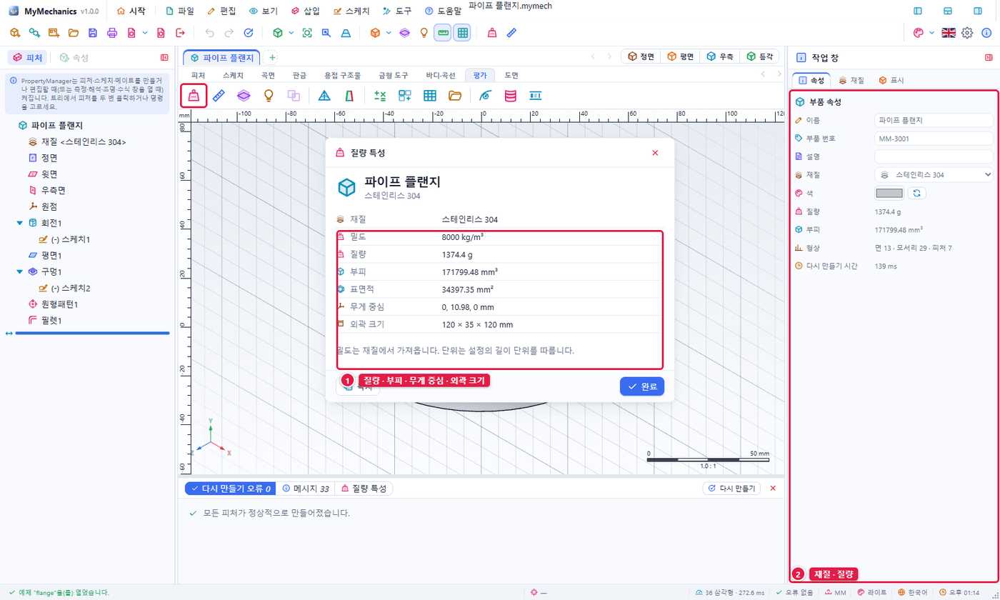

**평가 › 단면 특성**은 정면·윗면·우측면 또는 클릭한 평면·참조 평면을 오프셋만큼 옮긴 평면으로 부품을 자릅니다. 단면이 반투명 부품 위에 보이고, PropertyManager에 면적, 도심, 도심 기준 단면 2차 모멘트 Iu·Iv와 상승 모멘트 Iuv, 주 모멘트와 주축 각도, 극관성 모멘트, 회전 반지름이 나옵니다.

**데칼**(피처 탭)은 부품 면에 그림(라벨·로고)을 붙입니다. 면을 클릭하고 그림을 고릅니다. 데칼마다 폭(높이는 그림 비율), 면 중심에서의 가로·세로 위치, 각도, 불투명도를 정하고, 면의 법선 방향으로 **투영**하거나 원통·원뿔을 호 길이로 **감쌉니다**. 데칼은 부품과 함께 저장됩니다.

**평가 › 해석 (정적)**은 선형 정적 구조 해석입니다. 고정할 면과 하중을 받을 면을 클릭하고 힘(N, 방향 ±X·Y·Z) 또는 압력(MPa)을 넣고 **해석 실행**을 누릅니다. 바디는 von Mises 응력으로 색칠되고(파랑 → 빨강), 최대 응력·최대 변위·최소 안전율(항복 강도 ÷ 응력)이 나옵니다. 변형 형상(과장)도 볼 수 있습니다. 해석 종류를 **열**로 바꾸면 온도 고정 면과 대류(열전달 계수·주변 온도), 복사(방사율·주변 온도: εσ(T⁴ − T∞⁴), 뉴턴 반복으로 풂) 또는 열량(W) 면으로 정상 상태 온도 분포를, **진동**으로 바꾸면 고정 면에 대한 고유 진동수와 모드 형상(버튼으로 모드 선택)을 구합니다. 해석은 복셀(정육면체) 요소로 하므로 해상도를 높일수록 정확하며, 모서리의 국부 응력은 실제보다 크게 나올 수 있습니다.

**고정 조건 종류**: 고정, 롤러/대칭, 탄성 지지 외에 **고정 힌지**(핀 구멍을 반경·축 방향으로 묶고 축 둘레 회전은 자유), **원통면**(면의 축을 찾아 반경·원주·축 방향 중 체크한 성분만 주어진 값으로 묶음), **강제 변위**(X·Y·Z 중 체크한 성분을 값(mm)으로), **순환 대칭**(섹터 모델의 두 절단면을 차례로 고르면 둘이 만나는 축 둘레로 한쪽이 다른 쪽을 섹터 각도만큼 돌린 것처럼 움직임 — 전체 원판·임펠러를 한 조각으로 풂)이 있습니다. **하중 종류**: 힘·압력·토크·중력 외에 **베어링 하중**(원통면에 힘이 향하는 반쪽에 cos 분포 반경 압력, 합력이 정확히 그 힘), **원격 하중**(면에서 떨어진 점의 힘과 모멘트를 강체 연결처럼 고른 면들에 나눠 실음 — 합력·합모멘트가 정확히 같음), **원격 질량**(면에 붙은 질량의 무게, 질량 중심을 점으로 줄 수 있음), **원심력**(방향 = 회전축, 크기 = rpm, 축 위의 점; 각 요소에 ρω²r), **온도 하중**(부품 전체의 온도 변화 ΔT와 재질의 열팽창 계수로 생기는 열응력, 음수는 냉각)이 있습니다.  어셈블리 접촉 해석에서 두 부품이 처음부터 겹쳐 있으면(억지 끼워 맞춤·열박음) 하중 없이도 겹침만으로 해석되며, 접촉면은 2차 요소의 곡면 그대로 계산해 Lamé 해와 몇 % 안으로 맞습니다.

**커넥터**(정적 해석·어셈블리 해석): 두 면(다른 부품 또는 같은 부품) 사이에 **볼트**(지름으로 생크 강성 E·A/L, 예하중 — 결과는 볼트 축력·전단력), **스프링**(축·전단 강성), **핀**(함께 이동, 서로 회전 자유), **강체**(이동·회전 묶음), **스폿 용접**(면 A에서 누른 점 둘레 지름 안을 묶음), **베어링**(원통 축 둘레 반경 강성)을 넣습니다. 종류를 고르고 면 A·B를 차례로 클릭한 뒤 값을 넣고 **커넥터 추가**를 누르세요. 각 면은 면 노드의 면적 가중 평균 이동·회전으로 대표되며, 해석 뒤 커넥터마다 힘이 표로 나옵니다.

**적응 메시**(부품 정적 해석): 메시 묶음에서 **적응 메시**를 켜고 **목표 오차**(%)와 **최대 패스**를 정합니다. 한 번 해석한 뒤 요소마다 오차를 추정하고(요소 응력과 회복된 매끄러운 응력의 차이를 에너지 노름으로 잼 — Zienkiewicz–Zhu), 오차가 큰 요소 둘레만 작게 다시 나눠 해석하기를 추정 오차가 목표 아래가 될 때까지 되풀이합니다. 오차가 목표에 가까우면 조금만, 멀면 많이 줄이며 요소 8만 개를 넘으면 멈춥니다. 결과에 패스마다 요소 수·추정 오차·최대 응력 표가 나오고 보고서에도 들어갑니다. 구멍 둘레 같은 응력 집중을 같은 정확도에서 균일 메시보다 적은 요소로 풉니다.

**p 적응**: 적응 메시의 방식을 **p 적응(1차→2차, 이후 hp)**으로 하면, 같은 메시를 1차 사면체로 풀고 2차로 다시 풉니다. 변형 에너지의 변화로 1차 해의 오차를 재고, 2차 해는 응력 회복 오차로 판정합니다. 목표 오차를 넘으면 2차 메시를 오차가 큰 곳부터 세분해 이어 갑니다(hp). 패스 표에 요소 차수(p)가 함께 나옵니다. **혼합 메시**(어셈블리 해석): 부품 목록에서 부품마다 **요소 종류**를 솔리드·셸·빔 중에서 고릅니다. 셸 부품은 가장 얇은 방향 면의 중간면으로, 빔 부품은 가장 긴 축과 상자 단면으로 바뀌어 솔리드 사면체와 한 연립 방정식으로 풀립니다. 솔리드 표면에 닿은 셸·빔 절점은 둘레 솔리드 절점과 강체 연결(RBE2)로, 같은 자리의 셸·빔 절점끼리는 6자유도 모두로 묶입니다(선형, 접착). 결과는 부품마다 칠해집니다.

**셸 요소**(부품 정적 해석): 판금·얇은 판처럼 벽이 얇은 부품은 메시 묶음에서 **셸 요소(얇은 벽)**를 켜고 **벽의 한쪽 면**들을 고릅니다(굽힘부의 원통면까지 한쪽 면을 모두). 고른 면을 두께의 절반만큼 안쪽으로 옮긴 면이 중간면이 되고, **셸 두께**는 0이면 반대쪽 면까지 재서 정합니다. 중간면은 요소 크기(0이면 크기의 1/40, 두께보다 작게는 안 함)까지 최장변 분할로 나뉘고, 삼각형 셸(굽힘 DKT + 막 CST, 절점당 이동 3·회전 3)로 풉니다. 고정·하중은 그 면에 닿는 중간면 절점으로 옮겨집니다. 고정·힌지(→ 핀)·롤러, 힘, 압력(셸 면이면 그 요소에, 다른 면이면 면적 × 압력의 힘), 중력을 쓸 수 있고, 다른 조건은 쓰지 못했다고 알려 줍니다. 결과는 색칠한 중간면(변형 표시 가능)으로 나오고 부품은 반투명으로 둘러쌉니다. 응력은 윗면·아랫면(막 ± 굽힘) 중 큰 von Mises입니다. 솔리드 사면체로는 두께 방향에 요소를 여러 개 두어야 하는 얇은 벽을 훨씬 적은 계산으로 풉니다.

**하위 모델**(부품 정적 해석): 전체 해석을 거친 메시로 푼 뒤, 결과 위에 탐침 **P1**을 찍고 **하위 모델** 묶음에서 **영역 크기**(P1 중심 정육면체, 0이면 부품 크기의 1/4)와 **요소 크기**를 정해 **하위 모델 해석**을 누릅니다. 그 영역을 부품에서 잘라 촘촘한 메시로 다시 풀며, 잘린 면에는 전체 결과의 변위가 주어집니다(절단 경계 변위법). 영역 안 면의 고정 조건과 하중은 그대로 옮겨지고, 면에 준 힘·토크는 영역 안에 든 넓이 비율만큼 나뉩니다. 원격 하중·질량·베어링 하중처럼 여러 면에 묶인 하중이 영역에 걸치면 옮기지 못한다고 알려 줍니다. 결과는 같은 색 척도로 모델 위에 칠해지고, 하위 모델 최대 응력과 영역 안 전체 모델 최대 응력, 요소 수, 잘린 면 수, **절단면 응력 일치**(잘린 면에서 하위 모델과 전체 모델의 von Mises 평균 비)가 나옵니다. 이 비가 100 %에서 15 % 넘게 벗어나면 절단면이 응력 집중에 너무 가까운 것이니 영역을 키우세요.

**빔 해석 (골조)**(용접 구조물 탭): 구조 부재를 3D 빔 요소(접합점마다 6자유도)로 해석합니다. 단면 성질(면적·단면 2차 모멘트·주축·비틀림 상수: 닫힌 관은 Bredt 식, 열린 단면은 Σbt³/3)은 표준 프로파일이나 직접 그린 프로파일에서 구하고, 부재는 단면 도심선을 따라 놓입니다. 다른 부재의 끝이 놓인 곳에서 부재를 나누고, 면에 맞닿아 중심선이 떨어진 부재 끝은 단면 크기 안의 가까운 부재에 강체 연결로 잇습니다. 접합점을 목록이나 모델에서 골라 자유·핀·고정 지지와 힘(N)·모멘트(N·m)를 주고 자중을 켜고 실행하면 부재가 응력 색으로 그려지고 변형 형상(배율 조절)이 보이며, 최대 응력·처짐, 부재별 길이·응력·축력·안전율 표, 지지 반력이 나옵니다(CSV 저장). 지지와 하중은 부품에 저장됩니다.

**응력 선형화(압력 용기 검토).** 정적 결과에서 **프로브**로 벽 한쪽 표면과 반대쪽 표면을 차례로 찍으면, 두 점을 잇는 선(응력 분류선)을 따라 응력을 막(Pm)·굽힘(Pb)·막+굽힘·피크(F)·전체로 나눈 표가 나옵니다(각각 응력 강도(Tresca)와 von Mises, MPa). 그 아래 **허용 응력 S**(기본값 항복 강도 ÷ 1.5)를 넣으면 Pm ≤ S, Pm+Pb ≤ 1.5 S, 전체 ≤ 3 S 판정이 표시되고 넘는 줄은 빨간색입니다. 선이 모델 밖으로 나가면 두 점을 다시 고르라는 안내가 나옵니다.

**유동 해석**(외부·내부 유동)은 격자 볼츠만 방법으로 항력·양력·압력 강하·유선을 구합니다. 외부 유동에서는 **물체 주변 국부 세분화**를 1~3단계 고를 수 있습니다. 단계마다 셀을 절반으로 줄인 블록이 물체를 둘러싸고, 블록과 바깥 격자는 서로 값을 주고받으며(양방향 결합) 항력이 0.5 % 안에서 멈출 때까지 반복합니다. 결과 목록에 블록 크기와 결합 반복 횟수가 나오며, 바깥 격자가 레이놀즈 수에 비해 너무 거칠어 블록이 발산하면 그 사실을 알려 줍니다(셀 수를 늘리세요). **격자별 최대 반복**으로 계산 시간을 줄일 수 있습니다. **회전체**를 켜면 물체의 벽이 고른 축(물체 중심을 지남) 둘레로 rpm 만큼 움직이며(고정 회전자, 움직이는 벽의 반사 경계), 결과에 축 둘레 토크와 축 동력이 나옵니다 — 프로펠러·임펠러·롤러에 씁니다.

**입자 연구**(유동 해석의 마지막 묶음): 유동을 계산한 뒤 **입자 지름**(µm)·**밀도**·**추적 입자 수**·**질량 유량**·**중력**을 정하고 **입자 추적**을 누릅니다. 입자는 입구에서 평균 유속으로 들어와 계산된 유동장 속을 움직입니다. 항력은 Schiller–Naumann식이고(이완 시간에 맞춘 정확한 적분), 중력과 부력도 받습니다. 벽에 부딪히면 반발 계수(법선 0.6·접선 0.9)로 튕기며 벽을 침식합니다. 침식은 Finnie형으로 계산합니다: 입자 질량당 K·|v|ⁿ·f(α), 연성 재료 각도 함수 f(α)는 18.4° 이하에서 sin 2α − 3 sin²α, 그 위에서 cos² α / 3이고 기본값은 강재·모래 K = 2×10⁻⁹, n = 2.6입니다. 결과로 궤적(갈색), 충돌점(주황), 가장 심한 침식 위치(빨강)가 그려지고, 빠져나감·머묾·잃음 수, 충돌 수, 최대·전체 침식률(kg/s), 스토크스 수와 이완 시간이 나옵니다.

**유체 모델**(유동 해석): **압축성 기체(오일러)**를 고르면 **마하 수**·정압·정온도의 이상 기체를 유한 체적(HLL 플럭스, 2차 MUSCL)으로 풉니다. 아음속부터 초음속까지 다루며, 단면에 마하 수·압력·온도를 칠할 수 있습니다. 결과에는 최대 마하 수, 정면 정체압과 이론 피토압(초음속이면 수직 충격파 뒤 Rayleigh 값), 앞 충격파 여부, 항력·항력 계수가 나옵니다. 비압축(격자 볼츠만)에서는 **난류 모델**로 LES(Smagorinsky), 혼합 길이(RANS: ν_t = l²|S|, l = min(κ·벽 거리, 0.09·δ)), 층류/DNS 중에서 고릅니다. **유체 점성 모델**은 뉴턴, 멱법칙(K, n), Carreau(μ₀, μ∞, λ, n) 중에서 고르며, 비뉴턴 유체는 셀마다 전단률에 따라 점도가 바뀝니다. 외부 유동에서 **몸체를 다공성 매질로**를 켜면 유체가 몸체를 지나며 Darcy–Forchheimer 저항(투과율 K, 관성 계수 C_F)을 받고, 몸체 앞뒤 압력 강하가 나옵니다(필터·폼·충전층).

**목표와 매개변수 스터디**(유동 해석 아래): 결과로 볼 목표를 정합니다 — 전역(항력·양력·측력·항력 계수·압력 강하·최대 속도·열 전달량·누셀트 수·토크·축 동력·스트로할 수), 면(고른 면의 평균·최대·최소 압력과 흐름·양력·측면 방향 압력 힘), 영역(상자 안 유체의 평균·최대 속도, 평균 압력, 평균·최고 온도). 실행 뒤 목표 표에 값과 수렴 여부(앞뒤 창 평균의 변화)가 나오며, **목표가 수렴하면 끝내기**를 켜면 정상 상태 해석이 목표 기준으로 멈춥니다(흔들리는 힘은 평균으로 판정). **매개변수 스터디**는 입구 속도·입구 온도·회전 속도 또는 부품의 전역 변수(부품을 다시 만들고 면 목표는 서명으로 다시 찾음)를 시작·끝 값 사이 경우 수만큼 바꿔 가며 해석을 반복해 목표를 표와 그래프로 보여 주고 CSV로 저장합니다.

**자유 표면 유동**(부품 › 평가)은 부품을 용기(탱크·컵)로 보고, 옆과 아래가 막힌 안쪽 공간에 물·오일·글리세린을 채움 높이까지(채운 길이로 댐처럼 일부에만) 채운 뒤 용기가 정지하거나 +x 로 가속할 때(출렁임) 액체가 어떻게 움직이는지 자유 표면 격자 볼츠만 방법으로 계산합니다. 액체는 반투명 부품 안에 파란 표면으로 보이며 장면 번호와 재생으로 시간을 따라가고, 각 장면의 시각·액체 최고 높이(벽에서 올라간 높이)·무게 중심 이동·질량 변화가 나옵니다. 댐 붕괴의 선단 속도는 Martin & Moyce 의 실험과 맞춰 시험했습니다.

**전자 냉각**(어셈블리 › 평가)은 구성 요소마다 역할을 정합니다: 발열 부품(전력 W, 접합-케이스 열저항 θjc, 허용 온도), 기판(면 방향·두께 방향 열전도율 — 가장 얇은 방향이 두께), 전도 부품(재질의 열전도율), 외함(공기 통로), 제외. 공기는 강제 대류(축·속도), 자연 대류(부력, 0.05 m/s 의 약한 바깥 흐름), 팬(최대 풍량·최대 정압의 팬 곡선; 첫 계산으로 계통 곡선을 구해 운전점에서 다시 계산, 외함 필요)에서 고릅니다. 유동과 열은 격자 볼츠만 방법으로 함께 풀며(공액 열전달) 정상 상태에서는 고체의 열용량을 공기와 같게 두어 빨리 수렴시킵니다(정상 온도는 열용량과 무관). 구성 요소는 온도 색으로 바뀌고, 표에 부품마다 전력·최고·평균·접합부 온도(케이스 최고 + θjc × 전력)와 허용 온도가 나오며 넘는 줄은 빨간색입니다. 격자는 아주 작은 부품을 한두 칸으로만 나타내므로 해상도를 높일수록 정확합니다.

## 9. 어셈블리

1. **새 어셈블리**를 누릅니다. PropertyManager에 프로젝트의 부품과 예제 부품 목록이 나옵니다. 첫 부품은 원점에 고정(`(f)`)됩니다.
2. **어셈블리 › 부품 삽입**으로 부품을 더 넣습니다(STEP 파일도 가능).
3. **메이트**를 누르고 서로 다른 두 부품의 면을 차례로 클릭합니다. 원통면 두 개는 **동심**, 평면 두 개는 **일치**가 먼저 제안됩니다. 거리·각도·평행·직각, 정렬/반대 정렬을 고르고 ✔.

   
4. 모든 메이트를 동시에 풀어 위치를 정합니다. 위치가 완전히 정해진 부품은 접두사가 없고, 아직 움직일 수 있는 부품은 `(-)` 가 붙습니다. 충돌하는 메이트는 빨간색입니다.

   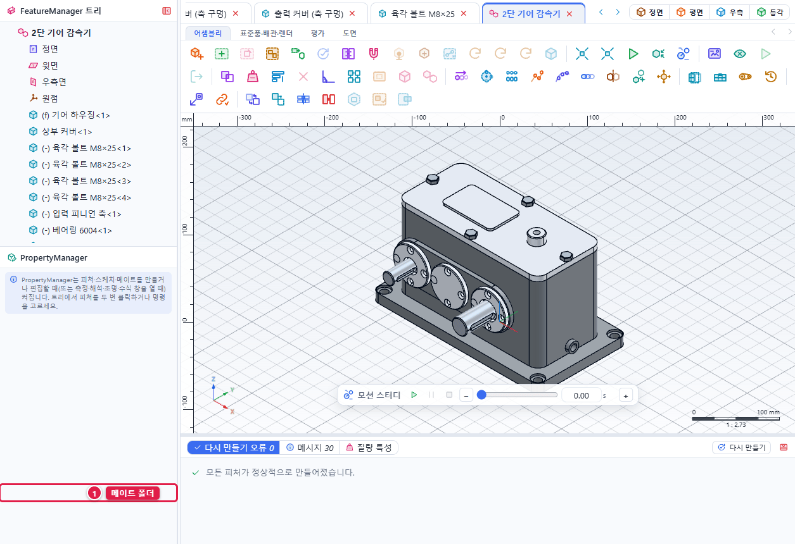
5. **간섭 검사**는 겹치는 부품 쌍과 겹친 부피를 보여 줍니다.

부품을 두 번 클릭하면 그 부품 탭이 열립니다. 부품을 고치면 어셈블리가 다시 풀립니다.

* **부품 회전**: 부품을 고르고 **X축으로 90° 회전 / Y축으로 90° 회전 / Z축으로 90° 회전**(바로 가기 메뉴·도구 모음)을 누르면 눕히거나 세웁니다.
* **부품 이동**(어셈블리 › 부품 이동): 부품을 **마우스로 끌어** 화면 평면에서 옮기거나(**이동**), 부품 원점을 중심으로 화면 축 둘레로 돌립니다(**회전** — 어느 쪽으로든 눕히기·뒤집기). Alt+끌기는 반대 방식, Shift+끌기는 끌 부품을 더합니다. ±X/±Y/±Z 버튼으로 정해진 거리·각도만큼 옮기거나 돌릴 수도 있습니다. 충돌 검사를 켜면 닿은 채 끝난 끌기는 되돌립니다. 끌기 한 번이 실행 취소 한 단계입니다.
* **부품 패턴**: 선형·원형·대칭 복사에 더해 **패턴 기반**(다른 부품의 선형·원형 패턴 피처를 따라, 예: 구멍마다 볼트), **스케치 기반**(부품 스케치의 점마다, 원본은 첫 점), **곡선 기반**(곡선을 따라 고르게 또는 간격마다, 접선 방향으로 돌리기 선택, 원본은 곡선 시작), **체인**(다음 핀이 앞 핀에서 직선으로 피치만큼 떨어진 경로 위의 점이 되도록 링크를 놓고 현을 따라 돌림) 패턴이 있습니다. 복사본은 고정되어 원본을 따라 움직입니다.

* **캠 메이트**: 캠의 평평한 면(그 외곽선이 캠 윤곽)과 종동절의 평면·원통·점을 고르면 종동절이 캠 윤곽에 닿은 채 움직입니다(모션 스터디로 돌려 봅니다).
* **고급 메이트**: 폭(두 면 사이 가운데), 대칭(대칭 평면 기준), 거리 제한·각도 제한(범위 안에서 움직임), 잠금, 선형/선형 커플러(한쪽 이동의 비율만큼 다른 쪽 이동), 윤곽 중심, 그리고 **경로** — 한 부품의 모서리를 꼭짓점 가까이에서 누르고(그 꼭짓점), 다른 부품의 모서리를 고르면(경로, 더 고르면 이어짐) 꼭짓점이 경로 위에 놓입니다. 아무 곳·거리·백분율(양 끝 어느 쪽에서나)로 정하고, 경로 방향을 따르게(피치/요 제어) 할 수 있습니다. **기계식 메이트**: 기어(기어비), 랙 피니언(피치 반지름), 나사(1회전당 거리), 힌지, 슬롯(자유·가운데·거리·백분율), 유니버설 조인트.
* **자석 메이트**: 부품에 **연결점**(부품 › 연결점: 평면의 중심과 법선 또는 핀의 끝, 이름·오프셋·뒤집기)을 둡니다. 어셈블리에서 **자석 메이트**를 누르면 스냅 거리(설정) 안에서 마주 보는 연결점끼리 붙습니다. 점이 만나고 서로 마주 보며, 그 축 둘레 회전은 자유입니다. 메이트 PropertyManager의 표준·고급·기계식 버튼으로 바꿉니다.
* **서브 어셈블리**: 부품 삽입 목록에 프로젝트의 다른 어셈블리가 나옵니다. 하나의 부품처럼 메이트하고, BOM에는 한 줄로 들어갑니다. **유연한 서브 어셈블리**(오른쪽 클릭 메뉴)로 바꾸면 안의 부품이 자유도를 그대로 가진 채 이 어셈블리에서 함께 풀려, 여기서 단 메이트나 모터로 안의 부품을 움직일 수 있습니다(서브 어셈블리 문서 자체는 바뀌지 않습니다).
* **어셈블리 컨피규레이션**: 어셈블리의 컨피규레이션마다 부품의 억제·숨김, 인스턴스가 쓸 부품 컨피규레이션, 메이트의 사용 여부를 따로 기억합니다.
* **분해도**: 분해를 누르면 부품을 중심에서 바깥으로 벌려 놓습니다. 다시 누르면 접히고, **분해 지우기**로 단계를 지웁니다. **분해도 편집**으로 단계를 직접 만듭니다. 부품을 고르고 **일반** 단계(방향·거리, 각 부품 중심을 지나는 X/Y/Z 축 회전)나 **방사형** 단계(가운데를 지나는 축에서 곧장 바깥으로)를 추가합니다. 단계는 목록에서 거리·각도를 고치거나 지우고, **분해 선**(점선)이 부품이 지나는 길을 보여 주며, **분해/조립 애니메이션**이 단계를 차례로 재생합니다.
* **여유 검사**: 최소 여유(설정)보다 가까운 부품 쌍을 가장 좁은 틈과 함께 보여 줍니다. 부품을 골라 두면 그 부품과 나머지만 검사하고, 닿은 쌍은 간섭 검사에 맡길 수 있습니다.
* **어셈블리 시각화**: 부품을 질량·부피·면적·밀도·개수로 정렬하고 값에 따라 파랑(낮음)부터 빨강(높음)까지 색을 칠합니다. **시각화 색 끄기**로 원래 색으로 돌아갑니다.
* **어셈블리 용접 비드**: 한 부품의 모서리(다른 부품 면 위에 서 있는)와 그 면을 고르면 모서리를 따라 필렛 비드(각장 = 용접 크기)가 생깁니다(직선과 완전한 원). 같은 화면의 용접 목록에 용접과 길이가 나옵니다.
* **단순화 표현**(오른쪽 클릭 메뉴): 서브 어셈블리를 **상자**로, 또는 **바깥 부품만**(다른 부품 안에 든 것과 아주 작은 것을 뺀) 보여 주어 빨리 그립니다. 질량·간섭·도면은 모든 부품을 그대로 씁니다. **전체 표현**으로 되돌립니다.
* **위에서 아래로 설계**: **문맥에서 새 부품**은 어셈블리 원점에 빈 부품을 넣고, 다른 부품을 반투명하게 둘러 보이게 한 채 엽니다. **문맥에서 부품 편집**은 고른 부품을 같은 방식으로 엽니다. 다른 부품의 면에 스케치를 둘 수 있는데, 이것이 **외부 참조**입니다. 어셈블리가 바뀌면 **외부 참조 업데이트**(문맥에 들어갈 때도 자동)가 그 스케치를 면이 있는 곳으로 옮깁니다. **외부 참조** 목록에서 잠그면 그대로 있고, 끊으면 고정된 평면이 됩니다. **문맥 편집 끝내기**로 어셈블리로 돌아갑니다.
* **레이아웃 기반 설계**: **새 레이아웃**은 어셈블리 원점에 고정된 레이아웃 부품(윗면 스케치)을 넣고 문맥에서 엽니다. 그 스케치에 **블록**(스케치 › 블록 만들기 / 블록 넣기)으로 배치를 그립니다. **블록에서 부품 만들기**는 블록마다 부품(첫 스케치가 그 블록)을 만들고, 인스턴스마다 그 평면·위치·각도에 연결된 부품을 놓습니다. 인스턴스를 옮기거나 블록을 고치면 **레이아웃에서 업데이트**(문맥 편집을 끝낼 때도 자동)로 부품 배치와 부품이 따라갑니다.

   

* **부품 교체**: 고른 인스턴스(또는 같은 부품의 모든 인스턴스)를 다른 부품으로 바꿉니다. 메이트 참조는 새 부품에서 같은 종류·방향의 가장 가까운 면으로 다시 찾고, 못 찾은 메이트는 억제하고 표시합니다. 몇 개를 못 찾는지는 확인 전에 PropertyManager가 알려 줍니다.
* **메이트 포함 복사**: 부품을 복사하면서 그 메이트를 되풀이합니다. 메이트마다 **그대로**(상대 부품의 같은 면), **새 참조**(상대 부품의 다른 면을 클릭), **빼기**를 고릅니다.
* **구멍 정렬 검사**: 서로 다른 부품의 구멍이 축 방향으로 맞닿아 겹치는데 축이 허용 오차(설정 › 구멍 정렬 허용 오차, 기본 0.01 mm)보다 어긋난 쌍을 찾아 목록으로 보여 줍니다.
* **엔벨로프**: 고른 부품을 참조용 엔벨로프로 지정합니다. 반투명으로 보이고 BOM·질량 특성·간섭 검사에서 빠집니다. **엔벨로프 안 선택 / 엔벨로프에 걸친 것 선택**으로 그 상자 안에 있거나 걸친 부품을 한 번에 고릅니다.

### 표준 부품 라이브러리 · 스마트 패스너

**라이브러리·배관·렌더** 탭의 **표준 부품 라이브러리**는 볼트·너트·와셔·베어링·핀·링·키·기어·풀리·배관 부속을 규격 치수표로 만듭니다. 각 항목은 규격 번호와 함께 표시되며(예: ISO 4017 M8×30), 나사산은 장식 또는 실제 모델링으로 고릅니다.

ISO 항목과 함께 **DIN 규격** 항목이 있습니다. DIN 이 ISO 와 다른 치수는 DIN 대로 만듭니다.

| DIN | 항목 | ISO 와 다른 점 |
|---|---|---|
| DIN 933 / 931 | 육각 볼트 (전산 / 반나사) | 맞변 거리 M10 17, M12 19 (ISO 16, 18), 머리 높이; 931 은 나사 길이 b = 2d + 6 (L ≤ 125), 2d + 12 (L ≤ 200) |
| DIN 934 | 육각 너트 | 맞변 거리는 DIN 933 과 같고 높이 m = 0.8 d |
| DIN 439 B | 얇은 육각 너트 | DIN 맞변 거리 |
| DIN 912 | 육각 구멍 볼트 | ISO 4762 와 같은 치수 |
| DIN 7991 | 접시머리 육각 구멍 볼트 | 머리 지름 (M10 20, ISO 10642 22.4) |
| DIN 7984 | 낮은 머리 육각 구멍 볼트 | 머리 높이 (M10 6, ISO 4762 10) |
| DIN 125 A | 평와셔 | ISO 7089 와 같은 치수 |

**스마트 패스너**는 어셈블리의 구멍에 맞는 크기와 길이의 볼트·와셔·너트를 넣으며, 볼트와 너트 종류에서 DIN 항목도 고를 수 있습니다.

**배관 ISO·스풀**(같은 탭): 배관·튜브 경로가 있는 부품(또는 그런 부품이 든 어셈블리)에서 누르면, 경로의 등각 배관도(ISO)를 담은 새 도면을 만듭니다. 도면에는 중심선, 엘보·티 등 피팅, 리듀서, 플랜지(이중선), 공장 용접점, 현장 용접(FW 표시), 직관마다의 중심간 치수, 스풀 번호, 끝단 높이(EL), 북쪽 화살표가 들어갑니다. 표는 스풀 표(관 규격·절단 길이, 피팅, 공장 용접 수, 무게), 자재 목록, 용접 목록 세 가지입니다. 스풀은 현장 용접 사이의 공장 제작 단위입니다. **스풀 최대 길이**를 넘는 스풀은 가장 긴 직관 가운데에 현장 용접을 넣어 나누고, **관 정척 길이**를 넘는 관은 공장 이음 용접을 셉니다. 공장 용접 수는 피팅 끝마다 하나입니다(엘보 2, 티 3, 크로스 4, 래터럴·Y 3, 리듀서 2, 용접 목 플랜지 1). 경로를 바꾸면 도면이 따라 바뀝니다(자동 업데이트를 끄면 "업데이트" 버튼). 표가 커지면 표들을 다시 배치해 겹치거나 시트 밖으로 나가지 않게 합니다.

**사용자 라우팅 부품**: 부품의 **연결점** 피처(피처 탭의 참조 형상 ▾)에서 **라우팅 부품**을 배관·튜브·케이블로 정하고, 규격(배관 DN 또는 외경)과 역할을 고릅니다. 역할은 **연결점(CPoint)** — 경로가 시작하거나 끝나는 곳 — 또는 **경로점(RPoint)** — 경로가 지나가는 곳 — 입니다. 이 부품(밸브·펌프·커넥터 등)을 어셈블리에 넣고 배관·튜브·케이블 경로를 시작하면, **라우팅 부품의 점** 목록에 같은 종류의 점이 나옵니다. **여기서 시작**은 그 규격을 이어받고 연결점 방향으로 직관(외경의 1.5배)을 낸 뒤 경로를 시작합니다. **여기서 끝**은 그 방향의 직관으로 들어가 경로를 끝내고, **경로점 추가**는 그 점을 경로에 넣습니다.
* **모션 스터디**: 회전 모터(rpm) 또는 직선 모터(mm/s)를 부품의 원통면에 달고 재생합니다. 기어·랙·나사 메이트로 이어진 부품이 따라 움직이며, 시간 막대로 원하는 순간을 봅니다. 모터에 진폭·주기를 주면 그 범위에서 왕복하고(한쪽 왕복이면 0에서 진폭까지 갔다가 돌아옴 — 뚜껑 열고 닫기, 나사 풀고 조이기), 다른 부품(부모)에 단 모터는 그 부품이 움직인 자리에서 돌아 로봇처럼 관절이 이어진 기구를 한꺼번에 움직입니다. 자체 모션이 있는 서브 어셈블리(로봇 예제의 그리퍼)는 함께 재생됩니다. 로봇 예제는 J1–J6 관절이 모두 움직이고 그리퍼가 열고 닫힙니다.

   

   스터디 종류 버튼으로 **기본 모션**(모터가 메이트를 구동), **애니메이션**, **모션 해석**을 바꿉니다.
   * **애니메이션**(키프레임): 고르면 0초 키가 만들어집니다. 부품을 옮기고 시간을 정한 뒤 **키 추가**를 누릅니다. 키 사이는 보간되고(일정 속도 또는 부드럽게), 회전은 짧은 쪽으로 돕니다.
   * **모션 해석**(물리): 부품이 솔리드와 재질에서 구한 실제 질량·질량 중심·관성을 가진 강체로 움직입니다. **중력**(방향·크기), **스프링과 감쇠기**(두 부품의 면을 고름, 강성 N/mm·감쇠 N·s/mm·자유 길이), **모터**가 작용하고 메이트가 구속합니다. 두 부품 사이 **접촉**을 넣으면 서로 파고들지 않고 반발 계수(0 … 1)만큼 튀어 오릅니다. **계산**한 뒤 재생하고, 그래프로 부품의 변위·속도·가속도, 스프링 힘, 메이트 반력, 모터 토크(N·mm)나 힘, 접촉력과 그 최댓값을 봅니다.

## 10. 도면

부품이나 어셈블리에서 **도면 › 도면 만들기**(또는 표준 3면도)를 누르면 A3 시트에 정면도·평면도·우측면도와 등각 보기가 놓입니다(제3각법, 설정에서 제1각법). 척도는 시트에 맞는 표준 척도로 자동 선택됩니다. 은선(점선), 외곽 치수, 표제란(이름·부품 번호·재질·질량·척도·작성·검도·날짜·개정)이 들어갑니다. 뷰는 끌어서 옮기고, 작업 창에서 시트 크기(A4–A0, Letter, Tabloid)·척도·투상법·뷰 추가·제거를 합니다. **DXF**(레이어: VISIBLE·HIDDEN·BORDER·HATCH·NOTES·DIMENSIONS·BREAKS·TABLES — 구멍 표·개정 표·끊기 선까지 시트에 보이는 모든 것), **DWG**(R2004, 설정에서 R2000), **SVG**로 내보내거나 인쇄(Ctrl+P)합니다.

* **단면도**(세로·가로): 고른 뷰를 가운데로 자른 단면, 해칭과 절단선·화살표·문자(A-A). **상세도**: 원으로 둘러싼 부분을 2배로 확대(B). **보조 뷰**: 원하는 방향(x, y, z)에서 본 뷰.

   
* **주석**: 노트, 풍선, 기하 공차(평면도·직각도·위치도 등 14종, ⌀·M/L 수정자, 데이텀), 데이텀, 표면 거칠기, 중심 표시. 명령을 누르고 시트를 클릭해 놓고, 끌어서 옮기며, 작업 창에서 내용을 고칩니다.
* **지능형 치수**(도면): 뷰에서 모서리·꼭짓점을 고릅니다. 수평·수직·평행·반지름·지름·각도·모따기·호 길이와, 점을 차례로 더하는 묶음 치수 **세로좌표**(첫 점에서의 좌표), **기준선**(모두 첫 점에서 잰 선형 치수, 뷰 밖으로 층층이 쌓임), **체인**(앞 점에서 잰 선형 치수를 한 줄로 이음)을 X 또는 Y 방향으로 넣습니다. 점을 계속 누르면 묶음에 더해지고, 정밀도·공차는 묶음의 모든 값에 적용됩니다.
* **BOM**: 어셈블리 도면에서 부품 번호·이름·재질·수량 표를 표제란 위에 놓습니다.

   
* **정렬 단면도**: 고른 뷰 가운데에서 꺾인 절단선(위로 한 다리, 아래로 30° 돌린 다리)으로 자르고, 돌린 다리 쪽을 첫 다리의 평면으로 돌려 펴서 한 단면으로 보여 줍니다. 부모 뷰에는 꺾인 절단선과 화살표가 그려집니다.
* **전개도 뷰**(판금 부품의 도면): 펼친 판을 위에서 본 뷰에 굽힘선(위로 굽힘은 쇄선, 아래로 굽힘은 점선)을 그립니다. **굽힘 표**는 굽힘마다 방향·각도·안쪽 반지름·K 계수·굽힘 여유를 표로 놓습니다. 교차 굽힘은 뷰에 X선으로 나옵니다.
* **용접 표**(주석): 도면의 용접 기호(같은 것은 묶어 셈)와 모델의 용접 비드(부품의 용접 비드 피처 또는 어셈블리 용접)를 크기별 한 줄로 — 필릿 zN, 총 길이, 비드 수, 용착량 — 표로 놓습니다. 다시 실행하면 표를 바꿉니다.
* **대체 위치 뷰**(어셈블리 도면): 고른 뷰에 분해 위치(분해 단계가 없으면 모션 끝 위치)를 가상선으로 겹쳐 그립니다. 다시 누르면 지웁니다.
* **수정 구름**(크기·호 길이·수정 기호), **데이텀 대상**(점은 X, 영역은 지름과 함께; 위에 크기, 아래에 이름), **영역 해치**(ANSI31·ANSI37·강재·채우기, 간격·각도)를 시트를 클릭해 놓고 오른쪽 패널에서 고칩니다. 모두 DXF로도 나갑니다(가상선·굽힘선은 각자 층).

## 11. 화면 · 조명 · 시작 화면

* **눈금자**: 그래픽 영역 위·왼쪽에 화면 방향의 좌표 눈금(1·2·5 단계)이 나오고, 포인터 위치가 빨간 표시와 값으로 나옵니다. 정면·윗면·우측면 보기에서는 눈금이 어느 축인지(X·Y·Z) 표시됩니다.
* **좌표계**: Z가 위입니다. 윗면 = XY, 정면 = XZ(−Y 쪽에서 봄), 우측면 = YZ(+X 쪽에서 봄). 끌어서 돌리면 화면 축 둘레로 자유롭게 돌아 어느 방향으로든 눕히고 뒤집을 수 있습니다(설정에서 Z가 늘 위인 턴테이블로 바꿀 수 있음). 예전(Y가 위) 파일은 열 때 자동으로 Z가 위로 바뀝니다.
* **격자**: 윗면(XY, 기본)·정면(XZ)·우측면(YZ) 중 고른 평면에 고정됩니다. 확대·축소하면 선 간격이 화면에서 너무 촘촘하거나 성기어질 때 1·2·5 단계로 다시 그려지며, 다섯 칸마다 진한 선(5×5 칸)입니다. 보기 › 표시에서 켜고 끄고 평면을 바꿉니다.
* **축척 막대**: 오른쪽 아래의 막대가 화면에서의 길이와 화면 축척(1 : n, 96 dpi 기준)을 보여 줍니다. 마우스로 끌어 원하는 곳으로 옮길 수 있습니다.

   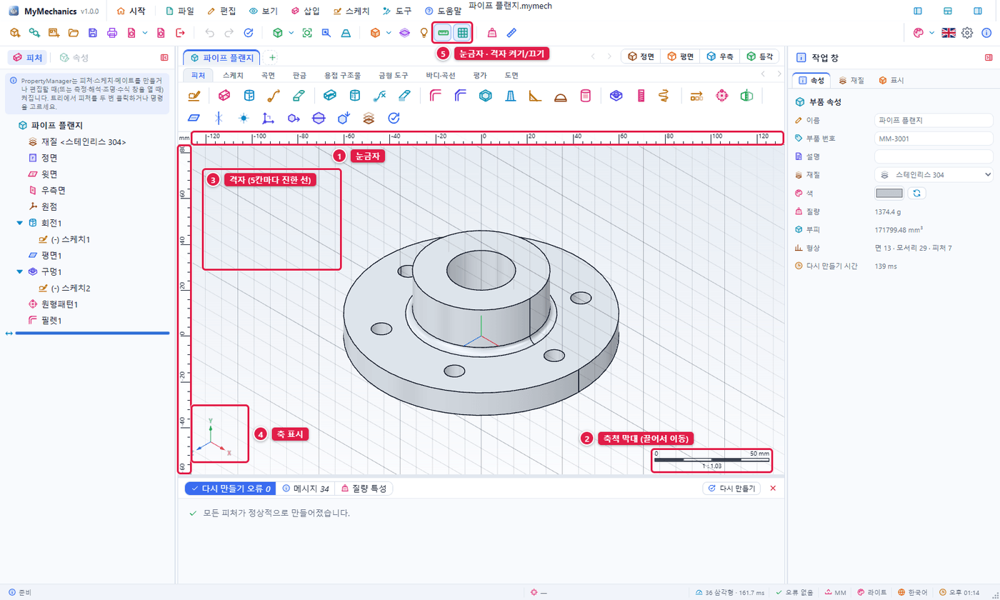
* **조명**(평가 탭 또는 보기 메뉴): 주변광(색·바닥 반사색·밝기), 보는 방향을 따라가는 카메라 조명(켜기·색·밝기), 그리고 방향광·점광원·스포트라이트를 추가해 색·밝기·위치·비추는 곳·원뿔 각도를 편집합니다. 조명 창이 열려 있는 동안 그래픽 영역의 조명 손잡이(작은 구)를 끌어 위치를 옮깁니다. 조명은 프로젝트 파일에 저장됩니다.
* **햇빛** 조명: 위도·경도·날짜·현지 시각·시간대와 북쪽 방향(+Y에서 돌린 각)을 넣으면 그 시각의 태양 위치에서 빛이 오고(방위각·고도 표시), 해가 지평선 아래이면 꺼집니다.
* **워크스루**(평가 탭 또는 보기 메뉴): 모델 안을 1인칭으로 걷습니다. W/S 또는 ↑/↓로 앞뒤, A/D 또는 ←/→로 옆걸음, Shift로 달리고, 그래픽 영역을 끌어 둘러봅니다. **중력**을 켜면 눈이 바닥 위 눈높이에 머물러 눈높이의 40 %보다 낮은 단은 올라서고 가장자리에서는 떨어지며, 끄면 보는 방향으로 날고 Q/E로 내려가고 올라갑니다. **충돌**을 켜면 벽 앞에서 멈추고 벽을 따라 미끄러집니다. 걷는 속도와 눈높이는 입력란에서 바꿉니다. 확인은 지금 보던 곳의 일반 보기로, 취소는 시작 전 화면으로 돌아갑니다.
* **영상 녹화**(평가 탭 또는 보기 메뉴): 그래픽 영역을 MP4(H.264) 또는 WebM 영상 파일로 저장합니다. 녹화할 것은 **턴테이블**(Z축 둘레로 카메라가 회전 수만큼 도는 길이 지정 영상), **모션 스터디**(어셈블리의 모션 스터디를 처음부터 끝까지 재생), **실시간 화면**(시작부터 중지까지 돌리기·워크스루 등 화면 그대로 — 워크스루 창의 녹화 버튼도 같음)입니다. 초당 프레임, 크기(창 크기·1280 × 720·1920 × 1080), 형식을 고릅니다. 프레임은 시계에 맞춰 넣으므로 그리기가 느린 컴퓨터에서도 영상 길이와 속도는 실제와 같고 프레임 수만 줄어듭니다.

   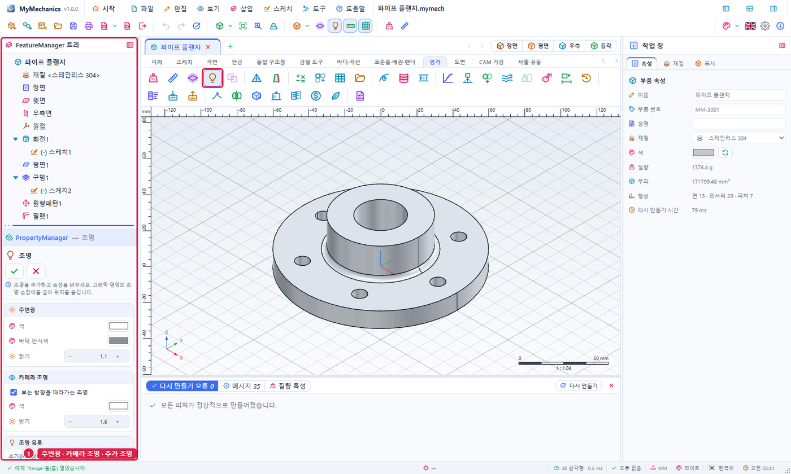
* **패널 접기/펴기**: 왼쪽·아래쪽·오른쪽 패널은 각 패널 머리줄의 접기 버튼으로 접고, 접힌 막대의 펼치기 버튼으로 다시 엽니다(보기 › 표시 메뉴와 단축키도 같음).
* **시작 화면**: 위쪽 프로그램 정보는 고정되어 움직이거나 크기를 바꿀 수 없습니다. 아래 카드들은 끌어서 옮기고 모서리로 크기를 바꾸며, **자동 정렬**은 바꾼 크기를 그대로 둔 채 카드를 가로·세로로 줄 맞춰 놓습니다. 예제는 그룹마다 15개입니다.

## 12. 파일

| 형식 | 용도 |
|---|---|
| `.mymech` | 프로젝트(부품·어셈블리·도면 전체, JSON). 데스크톱에서는 파일을 두 번 클릭해 엽니다. |
| STEP (`.step`, `.stp`) | 가져오기(가져온 바디 위에 피처를 더할 수 있음)·내보내기(어셈블리는 부품별 이름·색 포함). |
| STL | 3D 프린트용 내보내기, 가져오기. |
| IGES (`.igs`, `.iges`) | 가져오기(곡면을 꿰매 솔리드로)·내보내기(단위 mm/in). |
| OBJ · PLY · glTF/GLB · 3MF · VRML · OFF · AMF | 메시 가져오기(닫힌 메시는 솔리드로)·내보내기(부품 색 유지). USDZ는 내보내기만. |

**스캔 → 솔리드**(곡면 탭): STL·메시로 가져온 스캔 바디(또는 면이 삼각형 조각인 바디)를 해석 곡면의 솔리드로 다시 만듭니다. 메시를 평면 영역(꼭짓점이 허용 오차 안에 드는 이웃 삼각형을 키움)과 곡면 영역(매끈한 법선으로 키움)으로 나누고, 평면·원통·구를 최소제곱으로 맞춥니다. 정점은 맞춘 면 위로 옮겨집니다(두 평면이면 교선, 셋 이상이면 교점). 같은 평면의 삼각형은 한 면이 되고, 한 바퀴 원통은 정확한 원통면으로 바뀝니다(구멍은 빼고 보스는 더함, 막힌 구멍의 바닥은 유지). 맞지 않는 곳은 자유 곡면으로 남깁니다. **허용 오차**는 스캔 잡음보다 조금 크게 둡니다(0이면 크기의 0.05 %). **분석**은 찾은 영역과 맞춤(반경·한 바퀴 여부·RMS)을 보여 주고, **솔리드 만들기**는 결과를 프로젝트의 새 부품으로 넣습니다(원래 부품은 그대로).

**피처 인식**(곡면 탭): STEP·IGES·Parasolid 등에서 가져온 바디(가져오기 피처)를 편집할 수 있는 피처 트리로 바꿉니다. 먼저 X·Y·Z 축 방향의 한 바퀴 원통 구멍을 찾아 구멍 자르기로 만들고(막힌 구멍은 바닥 유지), 구멍을 메운 몸체를 평면이 가장 많은 축을 따라 평면 높이마다 자릅니다. 단면이 같은 구간마다 기준 평면 + 스케치(커널 단면의 직선·원호·원 그대로) + 보스 돌출을 쌓습니다. 다시 만든 부피가 원래와 같을 때만 트리에 넣고, 가져오기 피처는 그 위에 억제해 둡니다. 2.5D 각기둥 부품이 아니면 바꿀 수 없다고 알려 줍니다.
| Parasolid XT (`.x_t`, `.x_b`, `.xmt_txt`, `.xmt_bin`) | 가져오기(텍스트·바이너리, 내장 스키마를 가진 최신 판 포함; 빈 공간이 있는 솔리드는 공동이 유지됨)·내보내기(**파일 › 내보내기 › Parasolid 텍스트·이진 내보내기**, 부품 바로 가기 메뉴). 단위는 미터로 기록됩니다. 내보낸 파일은 독립 Parasolid 리더(parasolid-kit)로 다시 읽어 확인합니다. |
| IDF 2.0·3.0 (`.emn`·`.brd` 보드, `.emp`·`.lib` 라이브러리) | **파일 › IDF 가져오기**에서 보드 파일과 라이브러리 파일을 함께 고르면(데스크톱에서 보드 파일을 열면 같은 이름의 라이브러리를 찾아 씀) 보드(외곽선·호·컷아웃·구멍을 스케치로, 두께만큼 돌출, FR-4)와 패키지마다 부품(외곽선을 높이만큼 돌출)을 만들고 참조 번호(U1, C1 …)로 윗면·아랫면(뒤집어 놓음)에 회전·장착 높이대로 놓은 어셈블리가 됩니다. mm·THOU 단위, 라이브러리에 없는 부품은 알림에 나옵니다. **파일 › IDF 내보내기**는 보드(부품이면 그 부품, 어셈블리면 FR-4 부품)의 윗면 외곽선·컷아웃·둥근 구멍·두께와, 어셈블리의 다른 부품의 배치(면·회전·장착 높이)·패키지 외곽선·높이를 IDF 3.0 `.emn`·`.emp`로 저장합니다. |
| DWG (R2000–R2018) · DXF | 2D 도면 가져오기: 모델 공간의 선·원·호·폴리선·스플라인·타원·블록(INSERT)을 펼쳐 **새 부품의 윗면 스케치**로 만듭니다(INSUNITS로 mm 환산, 치수 블록·문자는 건너뜀). 도면 내보내기는 DXF와 **DWG(R2004 — 설정 › 모델링 › DWG 저장 버전에서 R2000)**. 저장한 DWG는 독립 구현인 LibreDWG로 다시 읽어 확인합니다. |
| 스케치 → DXF · DWG | **파일 › 내보내기 › 스케치를 DXF/DWG로 내보내기**: 편집 중인 스케치(없으면 활성 부품의 마지막 스케치)를 스케치 평면 좌표(mm)로 저장합니다. |
| OpenSCAD (`.scad`) | 가져오기: OpenSCAD 2021.01과 같은 언어(변수·함수·모듈·children·리스트 컴프리헨션·함수 리터럴·include/use·echo/assert)와 같은 형상 규칙($fn·$fa·$fs 분할, linear_extrude 꼬임·배율, rotate_extrude, offset, hull, minkowski, projection, text, import·surface), 그리고 새 판의 기능인 object() 값(o.name, o["name"], 이름에 대한 for, is_object, has_key), textmetrics()·fontmetrics(), roof()(method "straight": 직선 골격, 모든 면 45°; "voronoi": 높이가 윤곽까지의 거리, 오목한 모서리는 둥글게)으로 실행해 **OpenSCAD 피처**로 만듭니다(2D 결과는 윗면 스케치). include·use·import 파일은 프로그램 옆, OPENSCADPATH, 사용자 라이브러리 폴더(문서\OpenSCAD\libraries), 설치된 OpenSCAD의 libraries 순으로 찾습니다. 내보내기: **파일 › 내보내기 › OpenSCAD(.scad)** — 바디마다 polyhedron()과 색. |
| SVG | 도면 내보내기. |
| CSV | 디자인 테이블 내보내기·가져오기. |
| PNG | 그래픽 영역을 그림으로 저장. |

웹에서는 브라우저가 지원하면 파일 시스템 접근 API로 같은 파일에 바로 저장하고, 아니면 내려받기를 합니다.

## 13. 설정

설정(Ctrl+,)에는 일반(언어 등), 시작 화면, 테마(어두운·밝은 테마와 사용자 테마), 글꼴, 배경, **모델링**(길이 단위, 소수 자릿수, 격자 맞춤, 치수 입력, 도면 투상법, DWG 저장 버전(R2004 · R2000), 표시 스타일, 평면·원점·스케치 표시, 원근 보기, 곡면 표시 품질), 최근 항목, 단축키 탭이 있습니다.

## 14. 단축키

| 키 | 명령 |
|---|---|
| Ctrl+N / O / S / Shift+S | 새 부품 / 열기 / 저장 / 다른 이름으로 저장 |
| Ctrl+I · Ctrl+P | STEP 가져오기 · 인쇄 |
| Ctrl+Z / Y | 실행 취소 / 다시 실행 |
| Ctrl+B | 다시 만들기 |
| Enter / Esc | PropertyManager 확인 / 취소 |
| Delete · F2 | 삭제 · 이름 바꾸기 |
| F · Space · Ctrl+1–8 · K | 전체 보기 · 보기 방향 메뉴 · 표준 보기 · 표시 스타일 |
| L R C A P D T S | 스케치: 선 · 사각형 · 원 · 호 · 다각형 · 치수 · 자르기 · 선택 |
| E X O · Enter | 스케치: 타원 · 연장 · 오프셋 · 스플라인 끝내기 |
| Ctrl+Shift+L · Ctrl+Shift+H · Ctrl+, · F1 | 언어 · 시작 화면 · 설정 · 사용 설명서 |

### 사용자 정의 (도구 › 사용자 정의)

* **키보드**: 명령을 찾아 키보드 단추를 누른 뒤 원하는 키를 누르면 그 명령의 단축키가 됩니다(Esc 취소). Ctrl·Alt·Shift 조합, F 키, 한 글자 키(입력란 밖에서만)를 쓸 수 있고, 이미 쓰이는 키는 원래 명령에서 옮겨 옵니다. 기본 단축키도 × 로 끌 수 있으며 **단축키를 기본값으로**가 모두 되돌립니다. 설정 › 단축키 탭에 바꾼 단축키가 굵게 함께 나옵니다.
* **도구 모음**: 명령을 **내 도구** 탭(CommandManager 맨 앞 탭)이나 위쪽 도구 모음의 사용자 묶음에 넣고, 위·아래로 순서를 바꾸고 지웁니다. **보일 탭**에서 쓰지 않는 CommandManager 탭을 숨깁니다.
* **마우스 제스처**: 켜면 오른쪽 버튼을 누른 채 한 방향으로 끌었다 놓아 그 방향의 명령을 실행합니다. 끄는 동안 포인터 둘레에 여덟 방향의 명령이 보이고 가리키는 방향이 강조됩니다. 방향마다 명령을 고르며(기본: 위 평면도·아래 정면도·왼쪽/오른쪽 좌/우측면도·오른쪽 위 등각·왼쪽 위 면에 수직·오른쪽 아래 전체 보기·왼쪽 아래 실행 취소), 오른쪽 클릭은 그대로 바로 가기 메뉴입니다. 제스처를 켜면 화면 이동은 Ctrl+왼쪽 끌기로 합니다.
* **템플릿**(파일 › 템플릿): 열린 부품·어셈블리를 템플릿으로 저장하면 프로젝트 전체(피처·재질·속성·단위)를, 도면을 저장하면 용지·투상법·축척·표제란(회사·작성자 등)·주석·레이어·표준 뷰 배치를 담습니다. 목록에서 **새로 만들기**, ★ **기본 템플릿**(파일 › 새로 만들기가 이 템플릿으로 시작, 새 도면에는 도면 템플릿이 적용), **내보내기**(.mymechtpl 파일)·**가져오기**·삭제를 합니다.

## 15. 보관소 (제품 데이터 관리)

보관소는 여러 사람이 함께 쓰는 파일 저장소입니다. 파일을 체크아웃한 사람만 고칠 수 있고, 체크인할 때마다 버전이 남으며, 승인을 거쳐 릴리스됩니다. **파일 › 보관소 탐색기**(또는 평가 탭)를 누르면 작업 영역 오른쪽에 보관소 탐색기가 열립니다. 문서를 열지 않아도 쓸 수 있습니다.

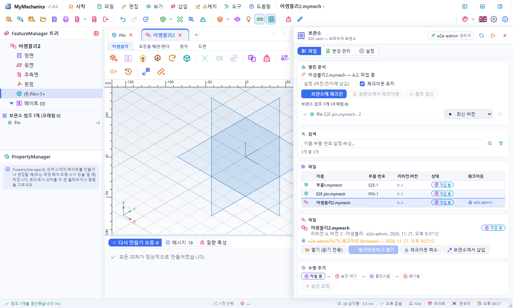

### 보관소 만들기와 로그인

- 데스크톱: **보관소 폴더 열기…** 로 있는 보관소를, **폴더에 새 보관소…** 로 새 보관소를 고릅니다. 로컬 폴더나 공유 드라이브의 폴더 모두 됩니다. 폴더에는 `vault.json`(목록), `files/`(최신 사본), `history/`(모든 버전), `.locks/`(잠금 파일)가 생깁니다.
- 웹: 보관소는 브라우저(IndexedDB)에 저장됩니다. 이름을 적고 **만들기**를 누릅니다.
- 보관소를 만드는 사람이 첫 관리자입니다. 사용자 이름과 비밀번호(4자 이상)를 정합니다. 비밀번호는 PBKDF2-SHA-256 해시로만 저장됩니다.
- 열 때마다 로그인합니다. 체크아웃·승인·변경 지시에는 로그인한 이름이 남습니다. 머리글의 로그아웃 단추나 설정 탭에서 로그아웃합니다.
- 관리자는 **설정** 탭에서 사용자를 추가하고(이름·비밀번호·역할), 역할을 바꾸고, 비밀번호를 재설정하고, 사용을 중지합니다. 사용자는 자기 비밀번호를 바꿀 수 있습니다.

| 역할 | 할 수 있는 일 |
|---|---|
| 보기 | 파일 보기·열기 |
| 편집자 | 파일 추가, 체크아웃·체크인, 승인 요청, 변경 요청 |
| 승인자 | 편집자의 일 + 파일·변경 지시 승인과 반려 |
| 관리자 | 모든 일 + 잠금 해제, 사용자·리비전 체계·데이터 카드 설정 |

### 체크인과 체크아웃

1. 문서를 열고 **보관소에 추가**를 누르면 버전 1, 작업 중, 첫 리비전(A 또는 01)으로 들어갑니다. 문서에는 자기 보관소 파일이 기록되어, 로컬에 저장했다가 다시 열어도 보관소 문서로 알아봅니다.
2. 보관소 문서는 체크아웃하기 전에는 읽기 전용입니다. **체크아웃하고 열기**(또는 **보관소에서 체크아웃**)를 누르면 잠금 파일이 만들어져 다른 사람은 체크아웃할 수 없습니다.
3. **보관소에 체크인**을 누르면 새 버전이 됩니다(바뀐 것이 없으면 버전이 늘지 않습니다). **체크아웃 유지**를 켜면 계속 고칠 수 있습니다.
4. 보관소 문서에서 **Ctrl+S** 를 누르면 체크인(체크아웃 유지 / 놓기) 또는 **사본으로 저장**을 고릅니다. 체크아웃하지 않은 문서는 사본으로만 저장됩니다.
5. **체크아웃 취소**는 체크인하지 않고 잠금을 풉니다. 관리자는 다른 사람의 잠금을 풀 수 있습니다.

### 버전과 리비전, 수명 주기

- 버전은 체크인마다 1, 2, 3 … 으로 늘고, 리비전(A, B, C … 또는 01, 02 …)은 릴리스된 파일을 개정할 때만 올라갑니다. 리비전 체계는 릴리스 전까지 설정 탭에서 바꿀 수 있습니다.
- 작업 중 → 승인 대기 → 릴리스됨 → 폐기됨. **승인 요청**은 데이터 카드의 필수 항목(부품 번호·설명)이 채워져야 하고, **승인**은 요청한 사람이 아닌 승인자가, 그 파일이 쓰는 파일이 모두 릴리스된 뒤에 합니다. 릴리스된 파일은 체크아웃할 수 없고, **개정**하려면 그 파일이 든 승인된 변경 지시가 있어야 합니다.
- **변경 관리** 탭: 변경 요청(ECR)을 만들고 승인되면 **변경 지시 만들기**로 변경 지시(ECO)를 만듭니다. 변경 지시는 승인 요청 뒤 정해진 수만큼 다른 승인자의 승인을 받습니다. 지시의 모든 파일이 새 리비전으로 다시 릴리스되면 닫을 수 있습니다.
- **함께 작업** 탭: 내가 처리할 일(승인할 파일·결정할 변경 요청·보낼 변경 지시), 지금 체크아웃된 파일과 작업자, 보관소 활동(체크인·전이·변경·댓글)이 나옵니다. 보관소를 정한 간격(끔·15초·1분·5분)마다 다시 읽어 다른 사람의 작업을 알림으로 알리고 열린 문서의 낡은 참조 표시도 새로 고칩니다. 파일의 **토론** 하위 탭과 변경 지시에서 댓글을 주고받습니다. 공유 폴더(네트워크 드라이브·클라우드 동기화 폴더)에 둔 보관소를 여러 사람이 동시에 씁니다(파일 잠금·색인 잠금으로 충돌 없음).

### 참조: 다른 파일의 부품·어셈블리 쓰기

- 어셈블리를 열고 탐색기에서 파일을 고른 뒤 **보관소에서 삽입**을 누르면 그 파일의 부품(또는 하위 어셈블리)이 **참조**로 들어갑니다. 보관소에 저장되는 것은 참조뿐이고, 문서를 열 때마다 참조한 파일의 내용을 읽어 옵니다. 하위 어셈블리의 부품도 함께 읽혀 오지만, 사용처·포함 목록에는 그 하위 어셈블리를 통해서만 나타납니다.
- 참조마다 **최신 버전**, **릴리스된 버전**, 또는 **고정 버전**을 고릅니다(열린 문서 › 보관소 참조 목록).
- 참조한 파일(또는 그 파일이 쓰는 파일)이 바뀌면 FeatureManager 트리 아래의 **보관소 참조** 목록과 탐색기에 ⚠ 표시가 붙습니다. **참조 갱신**을 누르면 새 내용으로 바뀝니다(실행 취소 가능).
- 참조로 들어온 문서는 여기서 고칠 수 없습니다. 원래 파일을 체크아웃해서 고칩니다.

### 파일 관리

- **사용처**·**포함** 탭은 파일을 쓰는 파일과 파일이 쓰는 파일을 트리로 보여 줍니다.
- **이름 바꾸기**는 그 파일을 쓰는 파일의 참조 이름도 새 버전으로 고칩니다(그 파일들이 체크아웃되어 있으면 거절됩니다).
- **트리 복사**는 파일과 그 파일이 쓰는 파일을 새 파일로 복사하고, 복사본끼리 서로를 가리키게 합니다.
- **팩 앤 고**는 파일과 쓰는 파일(선택하면 도면도)을 폴더나 ZIP으로 모읍니다. 참조는 새 이름을 가리키고, 각 파일은 보관소 없이도 열리도록 내용이 채워지며, `packandgo.json` 목록이 함께 들어갑니다. 이미 있는 파일은 덮어쓰지 않습니다.
- **기록** 탭에서 두 버전을 골라 비교하고, 예전 버전을 읽기 전용으로 열거나 그 내용으로 되돌립니다(새 버전으로 체크인됨).
- **BOM** 탭은 들여쓰기 BOM과 부품만 BOM(전체 수량)을 보여 줍니다. 부품 번호·리비전·상태는 보관소의 파일에서 가져옵니다.
- **검색**: 이름·부품 번호·설명·재질·속성 어디서나 찾고, 필터 단추로 부품 번호·설명·재질·상태·종류별로 찾습니다.
- **데이터 카드**: 부품 번호, 설명, 재질, 프로젝트, 공급업체, 단가, 표면 처리, 납기, 중요 부품(도면은 용지 크기·검토자도). 관리자는 설정 탭에서 필드를 더할 수 있습니다.

## 16. 도구: 일러스트레이션 · 전기 회로도 · 설계 검사기 · 작업 스케줄러 · 매크로 · 마크업

### 기술 일러스트레이션

**도구 › 기술 일러스트레이션**은 어셈블리로 분해도·조립 설명서를 만듭니다. 뷰마다 카메라·분해 거리·숨긴 부품을 기억하고, 뷰 사이를 이어 재생하며, 부품 번호 풍선을 자동으로 답니다. SVG 그림이나 하나의 HTML 파일(뷰 넘기기 포함)로 내보냅니다.

### 전기 회로도

**도구 › 전기 회로도**는 그래픽 영역 위에 A3 시트를 엽니다. 왼쪽 팔레트에서 기호(커넥터, 단자대, 스위치, 푸시 버튼, 릴레이 코일·접점, 퓨즈, 램프, 모터, 저항, 다이오드, 전원, 접지)를 골라 시트를 클릭하면 5 mm 격자에 놓입니다. **배선** 도구로 핀과 핀을 차례로 클릭하면 직각으로 꺾인 전선이 생깁니다. 기호를 끌면 전선이 따라오고, R은 90° 회전, Delete는 삭제, Esc는 취소입니다. 휠로 확대·축소, 가운데·오른쪽 버튼으로 끌어 이동, F로 시트 전체를 봅니다. 이름이 같은 전원과 모든 접지는 하나의 넷이며 전선 번호는 넷별로 자동으로 붙습니다. 검사 목록은 연결 안 된 핀·겹친 기호명·떨어진 전선을 보여 주고, SVG·결선표(CSV)·부품표(CSV)로 내보냅니다. 되돌리기가 됩니다.

**3D 하네스 연결.** 프로젝트의 부품에 전기 하네스 경로가 있으면 회로도 PropertyManager 의 **3D 하네스 연결**에 그 경로가 나옵니다. 태그가 하네스 커넥터 이름과 같은 기호(X1, X2 같은 커넥터, M1 같은 장치)가 하네스의 끝점이며, 핀은 기호의 핀 순서(커넥터는 번호)대로 대응합니다. 그런 핀 둘을 잇는 네트마다 하네스 선 하나가 되고 선 번호·색(RD·BU 같은 코드나 red·파랑 같은 이름)·단면적(1.5, 1,5 mm², AWG 18 → 가장 가까운 표준 단면적)은 회로도에서 옵니다. 목록에는 하네스에 없는 선, 회로도에 없는 선, 색·단면적이 다른 선과 함께 스플라이스가 필요한 네트(핀 셋 이상)와 하네스에 없는 커넥터가 나옵니다. **하네스로 보내기**는 하네스 경로의 선을 회로도대로 바꾸고(각 선의 클립 경유는 유지) 부품을 다시 만듭니다. **하네스 길이 가져오기**는 3D 로 배선된 길이를 회로도 선에 적어 선 속성과 결선표(CSV 의 Length 열)에 보여 줍니다. 반대로 하네스 경로를 편집할 때 선 표의 **회로도에서 가져오기**로도 같은 일을 합니다.

### 설계 검사기

**도구 › 설계 검사기**는 프로젝트를 표준(규칙 모음)과 비교합니다. 규칙은 문서(단위·이름), 부품(필수 속성·재질·억제된 피처·롤백·다시 만들기 오류·스케치 구속·기본 피처 이름·최소 필렛·표준 구멍 크기), 어셈블리(고정 부품·메이트 오류), 도면(도면 표준·투상법·용지 크기·표제란·리비전·날짜 형식·표준 척도·치수 정밀도·덮어쓴 치수·글자 높이·떨어진 주석)으로 나뉩니다. 규칙을 켜고 끄고, 이름을 눌러 심각도(오류·경고·정보)와 값을 바꿉니다. **프로젝트에서 배우기**는 열린 프로젝트의 설정으로 표준을 만들고, **저장…/불러오기…**는 `.mmstd` 파일로 회사 표준을 나눕니다. **검사**를 누르면 결과가 심각도별로 나오고, 항목을 누르면 그 문서를 열고 항목을 선택합니다. 🔧 표시가 있는 항목은 하나씩 또는 **모두 고치기**로 고치며(되돌리기 한 번), **보고서 (HTML)…**로 결과를 저장합니다.

### 작업 스케줄러

**도구 › 작업 스케줄러**는 여러 파일에 한꺼번에 하는 일을 지금 또는 정해진 때에 실행합니다. 작업 종류: **내보내기**(부품·어셈블리 → STEP·IGES·STL·3MF·GLB·OBJ, 도면 → DXF·SVG), **가져오기 변환**(모델 파일 → `.mymech`), **속성 바꾸기**(부품·도면 속성을 항상 또는 빈 곳만; 값에 `{file}` `{name}` `{project}` `{date}` 사용), **설계 검사**(파일마다 HTML 보고서와 요약 CSV), **다시 만들기**(실패한 피처 기록, 현재 형식으로 저장), **도면 만들기**(도면 없는 부품마다 ISO/ANSI 표준 뷰 도면). 대상은 파일 목록, 폴더(데스크톱, 하위 폴더·이름 패턴), 또는 열린 문서입니다. 출력은 원본 폴더나 정한 폴더에 `{name} - {doc}` 같은 이름으로 저장됩니다. 일정은 수동·한 번·매일·매주(요일)·간격(분)이며, 프로그램이 열려 있을 때 실행되고 닫혀 있던 동안 지난 예약은 다음에 열 때 한 번 실행됩니다. 실행 중에도 열린 문서는 그대로이며, 모든 단계가 기록에 남고 CSV로 내보낼 수 있습니다.

### 매크로

**도구 › 매크로 › 매크로 기록**을 누른 뒤 평소처럼 작업하면 명령, 그래픽 영역 선택, PropertyManager 입력, 트리 선택, 문서 전환, 스케치 내용이 기록됩니다(상태 표시줄에 ● 기록 중). **매크로 중지**를 누르면 기록이 `await mm.…(…)` 줄로 된 JavaScript가 되어 **매크로 편집기** 창에 열립니다. 편집기에서 고치고 **실행**(Ctrl+Enter), **중지**, **열기…/저장…**(`.mmjs`)을 합니다. 아래 콘솔에는 기록과 오류(누르면 그 줄로 이동)가 나오고, 프롬프트에 식을 넣으면 바로 계산합니다. 직접 쓰는 매크로는 반복문·변수와 함께 `mm.parts()`, `mm.feature(이름)`, `mm.project`, `mm.massProperties()`로 모델을 읽고 `mm.setParam(피처, 키, 값)`, `mm.setVariable`, `mm.setProperty`, `mm.run(명령)`, `mm.set/field/toggle/pm/accept`로 바꾸며, `mm.log`, `mm.wait`을 씁니다. **매크로 실행…**은 파일을 골라 바로 실행합니다.

**모델을 만드는 API.** 매크로는 화면 조작 없이 모델을 직접 만들고 읽을 수 있습니다. 모든 호출은 실행 취소 한 단계이며, 실패하면 이유와 줄 번호를 남기고 멈춥니다.

| 분류 | 함수 |
|---|---|
| 부품 만들기 | `mm.sketch(평면, 도형들, { name })` — 평면은 'front'·'top'·'right' 또는 평면 피처 이름, 도형은 `{ rect: [폭, 높이, cx, cy] }`, `{ circle: [cx, cy, 지름] }`, `{ line }`, `{ arc }`, `{ polygon }`, `{ slot }`, `{ polyline: [[x, y]…] }`, `{ axis }`(보조선); `mm.plane`, `mm.extrude(스케치, 깊이)`, `mm.cut(스케치, 'through')`, `mm.revolve`, `mm.fillet(반지름, 모서리 조건)`, `mm.chamfer`, `mm.shell`, `mm.hole`, `mm.feature(종류, 값들)` |
| 형상 조회 | `mm.edges(조건)`, `mm.faces(조건)` — 종류·중점·방향·길이(면은 중심·법선·넓이)로 고릅니다; `mm.boundingBox()`, `mm.massProperties()` |
| 피처 트리 | `mm.features()`, `mm.suppress`, `mm.renameFeature`, `mm.deleteFeature`, `mm.errors()` |
| 구성·속성 | `mm.configurations()`, `mm.addConfiguration`, `mm.useConfiguration`; `mm.properties()`, `mm.customProperty`, `mm.setCustomProperty` |
| 문서·어셈블리 | `mm.documents()`, `mm.addPart`, `mm.addAssembly`, `mm.document`, `mm.components()`, `mm.insertComponent(부품, [x, y, z])`, `mm.moveComponent`, `mm.interference()` |
| 이벤트 | `mm.on('change' · 'selection' · 'document', 함수)`, `mm.off`, `mm.events()` — 처리기는 지울 때까지 남고, 처리기 오류는 콘솔에 기록됩니다 |

**사용자 정의 속성.** 작업 창 속성 탭에서 부품·어셈블리에 이름과 값의 사용자 정의 속성을 추가·수정·삭제합니다(매크로의 `mm.setCustomProperty` 와 같은 자료).

### 마크업

**도구 › 마크업**은 부품·어셈블리의 그래픽 영역 위에 검토 의견을 그립니다. 도구는 뷰 조작(그리지 않고 모델을 돌림), 선택·이동, 펜, 형광펜, 선, 화살표(Shift 로 45° 단위), 사각형, 타원, 수정 구름, 글상자, 지우개이며 색 8가지와 선 굵기·글자 크기를 고릅니다. 그리기 시작하면 현재 뷰로 마크업이 만들어지고, 그 뷰(카메라)·작성자·날짜와 함께 문서에 저장됩니다. 목록에서 마크업을 고르면 그 뷰로 돌아가 그림이 다시 보입니다. 뷰를 돌려 벗어나면 그림이 잠시 숨고 **마크업 뷰로 돌아가기**가 나옵니다. 선택 도구로 항목을 끌어 옮기고 Delete 로 지우며, 글상자는 두 번 클릭해 고칩니다. 마크업마다 이름, 상태(열림·해결), 댓글(작성자·시간)을 남기고, **PNG 그림**(뷰를 두 배 해상도로 렌더링한 위에 그림) 또는 **검토 문서 (HTML)**(모든 마크업의 그림·상태·댓글)로 내보냅니다. 모든 편집은 실행 취소할 수 있습니다.

