# MyMechanics 사용 설명서

MyMechanics는 피처 기반의 파라메트릭 3D 기계 설계 프로그램입니다. 2D 스케치에 구속 조건과 치수를 넣고, 피처(돌출·회전·필렛·구멍 …)를 쌓아 부품을 만들고, 부품을 메이트로 조립하고, 2D 도면으로 내보냅니다. 형상 계산은 OpenCASCADE B-rep 커널이 맡습니다. Windows · macOS · Linux 데스크톱과 웹 브라우저에서 같은 기능으로 실행됩니다.

처음 쓰신다면 **튜토리얼 문서**(도움말 › 튜토리얼 문서, 또는 시작 화면의 **튜토리얼** 단추)를 먼저 따라 해 보세요. 첫 부품부터 스윕·판금·어셈블리·모션·도면·해석까지 단계마다 화면과 함께 안내합니다.

## 1. 화면 구성

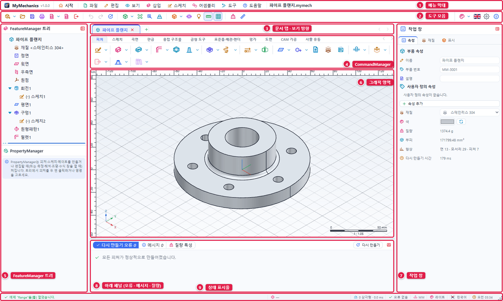

| 영역 | 설명 |
|---|---|
| 메뉴 막대 | 파일 · 편집 · 보기 · 삽입 · 스케치 · 도구 · 도움말. 프로그램 이름 옆의 **시작**은 시작 화면으로 돌아갑니다. 데스크톱에서는 이 줄이 창 제목 표시줄입니다. |
| 도구 모음 | 새 부품·어셈블리·도면, 열기·저장·인쇄·내보내기, 실행 취소, 다시 만들기, 보기 방향, 표시 스타일, 단면도, 질량 특성·측정, 패널 표시, 테마·언어·설정. |
| 문서 탭 | 프로젝트 안의 부품·어셈블리·도면. 탭을 눌러 오가고 **+** 로 부품을 추가합니다. 오른쪽에 정면·평면·우측·등각 보기 버튼이 있습니다. |
| CommandManager | 피처 · 스케치 · 평가 · 어셈블리 · 도면 탭의 큰 명령 버튼. 문서 종류에 맞는 탭만 보입니다. |
| FeatureManager 트리 (왼쪽) | 부품의 재질, 표준 평면(정면·윗면·우측면), 원점, 피처를 만든 순서대로 보여 줍니다. 피처가 쓰는 스케치는 그 아래에 들어갑니다. 실패한 피처는 빨간색, 불완전 정의 스케치는 `(-)` 가 붙습니다. 맨 아래 파란 **롤백 바**를 끌면 그 아래 피처를 잠시 빼고 볼 수 있습니다. |
| PropertyManager (왼쪽 아래) | 왼쪽 패널 아래쪽 섹션입니다(위쪽은 FeatureManager 트리, 사이의 경계선을 끌어 높이를 나눔). 피처·스케치·메이트를 만들거나 편집할 때 그 옵션이 나오고, 아무것도 편집하지 않을 때는 안내 메시지만 있습니다. 위의 ✔ (확인, Enter) / ✖ (취소, Esc). 분홍색 선택 상자는 그래픽 영역에서 고른 모서리·면을 받습니다. |
| 그래픽 영역 | 모델과 평면, 스케치. 왼쪽 아래 축 표시(X 빨강 · Y 초록 · Z 파랑). |
| 작업 창 (오른쪽) | 속성(이름·부품 번호·재질·색·질량), 재질 목록, 표시 설정. 도면에서는 시트·뷰·표제란 설정. |
| 아래 패널 | 다시 만들기 오류(실패한 피처와 고치는 방법), 메시지, 질량 특성. |
| 상태 표시줄 | 안내 문구, 스케치 정의 상태, 포인터 좌표, 오류 수, 단위(눌러서 mm·cm·in 전환), 테마, 언어, 시계. |

### 마우스와 보기

* **왼쪽 끌기·가운데 끌기**: 보기 회전 · **오른쪽 끌기 / Shift+왼쪽 / Ctrl+가운데**: 이동 · **휠**: 포인터 위치로 확대·축소
* **F**: 전체 보기 · **Space**: 보기 방향 메뉴 · **Ctrl+1…7**: 정면·배면·좌측·우측·평면·저면·등각 · **Ctrl+8**: 면에 수직 보기
* **K**: 표시 스타일 바꾸기 (모서리 표시 음영 → 음영 → 은선 제거 → 은선 표시 → 와이어프레임)
* 포인터 아래의 면·모서리·평면은 주황색으로, 고른 것은 파란색으로 표시됩니다. Ctrl·Shift+클릭으로 여러 개를 고릅니다.

## 2. 시작 화면

카드는 끌어서 옮기고 오른쪽 아래 모서리로 크기를 바꿀 수 있습니다(**자동 정렬**로 되돌림). **바로 가기**(열기, STEP 가져오기, 마지막 작업 이어서, 설정 …), **최근 항목**, **새 프로젝트**(부품 mm·inch, 어셈블리, 도면), **예제** 18개, **움직이는 배경**이 있습니다. 시작할 때 이 화면을 보일지는 왼쪽 위 확인란이나 설정 › 시작 화면에서 정합니다.

## 3. 부품 만들기 — 따라 하기

1. **새 부품**(Ctrl+N)을 누릅니다.
2. CommandManager **피처 › 스케치**를 누르고 **윗면**을 고릅니다(트리, 그래픽 영역, PropertyManager 버튼 중 어디서나). 보기가 평면에 수직으로 바뀌고 격자가 나타납니다.

   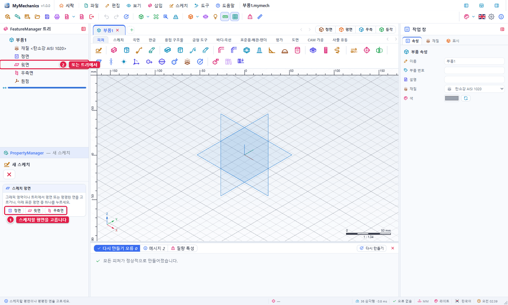
3. **스케치 › 중심 사각형**으로 원점을 클릭한 뒤 모서리를 클릭합니다. 끝점이 원점에 붙으면(주황 원) 일치 구속이 자동으로 들어갑니다.

   
4. **지능형 치수**(D)로 위쪽 선을 클릭해 `80`, 오른쪽 선을 클릭해 `50` 을 넣습니다. 선이 검은색이 되면 완전 정의된 것입니다(파랑 = 아직 움직일 수 있음, 빨강 = 과잉 정의).

   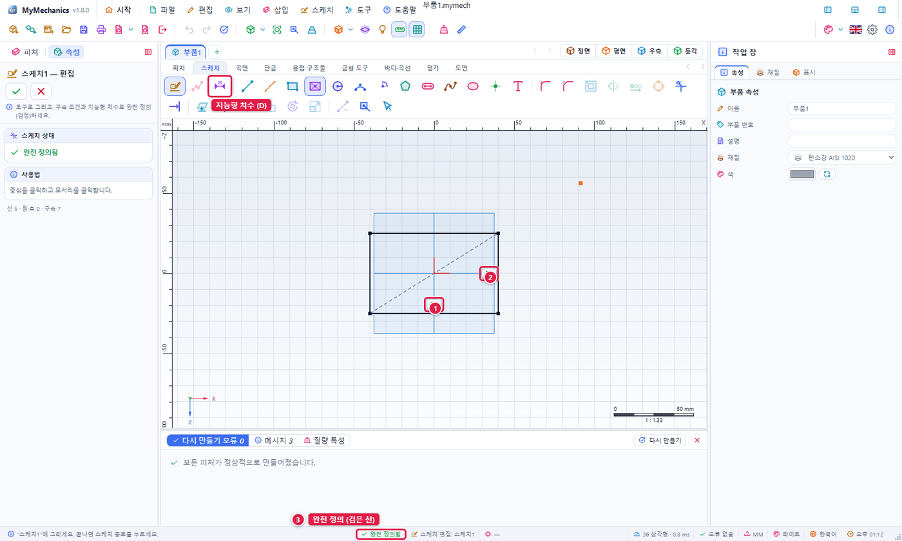
5. **스케치 종료**를 누릅니다.
6. **돌출 보스**를 누르고 깊이 `20` 을 넣은 뒤 ✔ 를 누릅니다.

   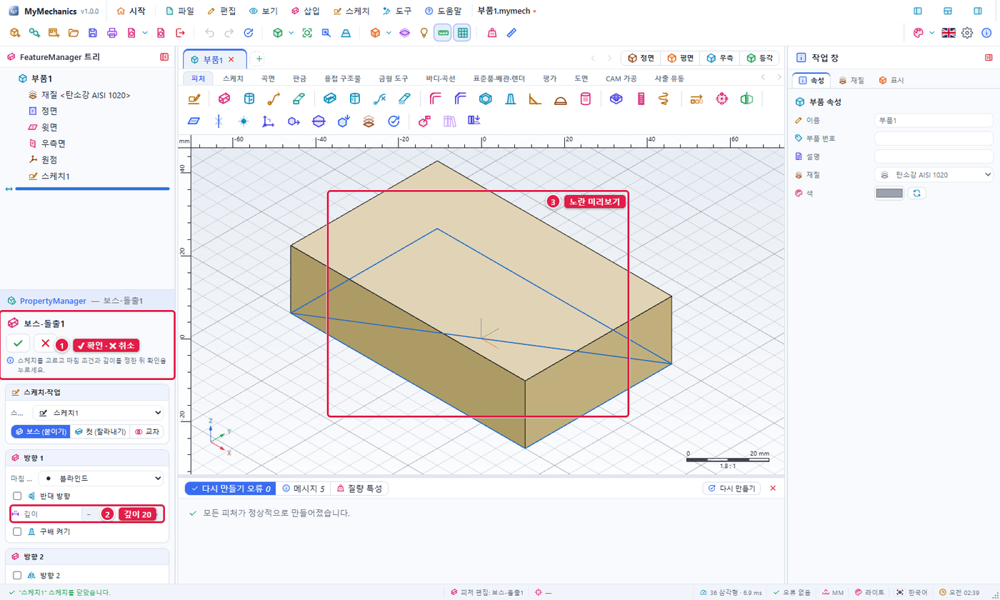
7. **필렛**을 누르고 세로 모서리 4개를 클릭한 뒤 반지름 `5`, ✔.

   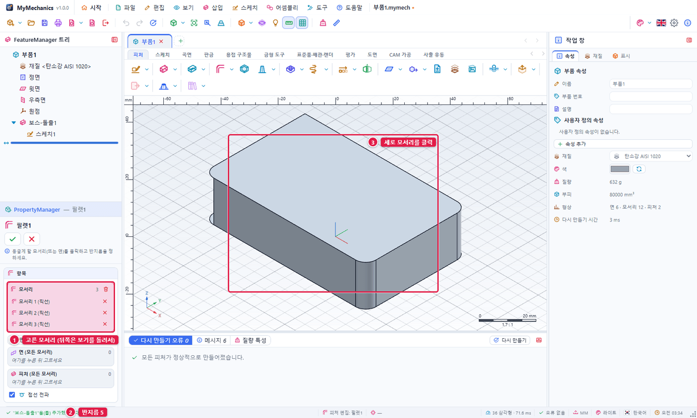
8. **구멍 가공 마법사**를 누르고 크기 `M8`, 유형 **카운터보어**를 고른 뒤 윗면에서 구멍 자리(원점에서 X 15 mm쯤)를 클릭합니다. 같은 면을 더 클릭하면 구멍이 늘어납니다. 빨간 미리보기가 구멍입니다. ✔.

   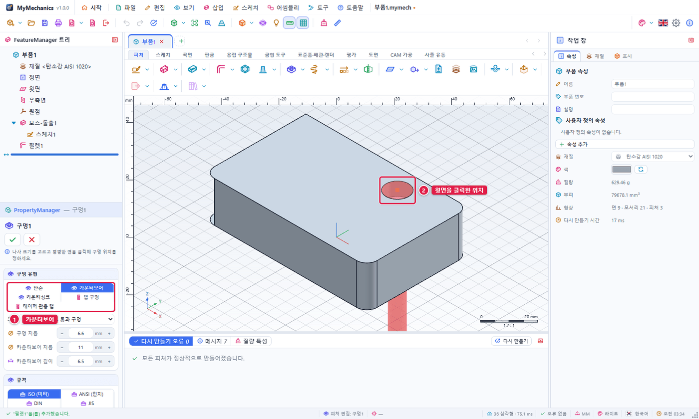
9. 트리에서 **구멍1**을 고르고 **원형 패턴**을 누른 뒤 축 `Y`, 인스턴스 `4`, ✔.

   
10. 저장(Ctrl+S). 파일은 `.mymech` 하나에 프로젝트 전체가 들어갑니다.

치수나 피처 값을 바꾸려면 트리의 피처를 두 번 클릭(또는 오른쪽 클릭 › 피처 편집)하세요. 스케치는 다시 열려 편집되고, 그 뒤의 모든 피처가 새 형상에 맞춰 다시 만들어집니다. 필렛·모따기·쉘이 고른 모서리와 면은 형상으로 기억되어, 앞의 치수가 바뀌어도 가장 가까운 모서리를 다시 찾습니다.

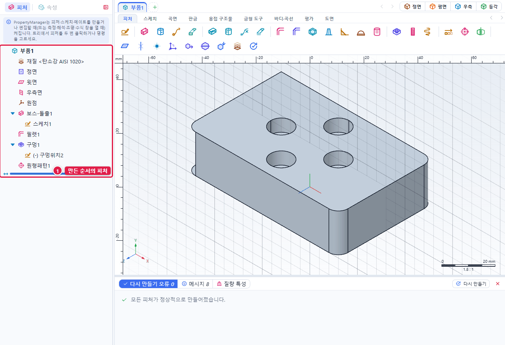

## 4. 스케치

| 도구 | 단축키 | 쓰는 법 |
|---|---|---|
| 선 | L | 클릭, 클릭 … 이어서 그립니다. 기존 점을 클릭하거나 Esc로 끝냅니다. 거의 수평·수직이면 그 구속이 자동으로 붙습니다. |
| 중심선 | | 보조선(점선). 회전 축이나 대칭 축으로 씁니다. |
| 코너 사각형 / 중심 사각형 | R | 두 번 클릭. 수평·수직 구속이 함께 들어갑니다. |
| 원 | C | 중심, 원 위의 점. |
| 3점 호 / 중심점 호 | A | 시작점·끝점·호 위의 점 / 중심·시작점·끝점. |
| 다각형 | P | 중심, 꼭짓점. 변의 수는 PropertyManager에서 정합니다. |
| 직선 홈 | | 두 끝의 중심, 폭. |
| 점 | | 구멍 위치 등. |
| 지능형 치수 | D | 선 하나 = 길이, 원 = 지름, 호 = 반지름, 두 선 = 거리(평행) 또는 각도, 두 점 = 거리. 치수 글자를 두 번 클릭해 값을 바꿉니다. 과잉 정의가 되는 치수는 참조 치수(괄호)로 들어갑니다. |
| 스플라인 | S | 점을 차례로 클릭합니다. Enter·Esc로 끝내고, 첫 점을 다시 클릭하면 닫힌 스플라인이 됩니다. 모든 점을 지나는 곡선입니다. |
| 타원 | E | 중심, 장축 끝, 단축 위의 점. |
| 스케치 필렛 / 모따기 | | 두 선이 만나는 모서리 점을 클릭합니다. 반지름·거리는 PropertyManager에서 정합니다. |
| 요소 오프셋 | O | 고른 선·호·원을 거리만큼 평행하게 복사합니다. 이어진 선은 모서리가 맞도록 이어집니다. |
| 요소 대칭 복사 | | 요소와 중심선을 고르면 대칭으로 복사하고 대칭 구속을 넣습니다. |
| 선형 / 원형 스케치 패턴 | | 고른 요소를 간격·개수(선형) 또는 개수·각도(원형, 고른 점 기준)로 복사합니다. |
| 자르기 | T | 클릭한 부분을 교차점 사이에서 잘라냅니다(교차가 없으면 요소를 지웁니다). 원은 호가 됩니다. |
| 요소 연장 | X | 선의 끝을 다음 요소까지 늘립니다. |
| 문자 | | 클릭한 곳에 문자를 놓습니다(Roboto 글꼴, 높이는 PropertyManager). 돌출·컷·랩으로 각인·양각합니다. |
| 3D 스케치 | | 공간 경로: 정면·윗면·우측면을 바꿔 가며 클릭하거나 좌표 표에 입력합니다. 직선 또는 매끈한 스플라인, 닫힘 선택. 스윕 경로·구조 부재·채우기 곡면에 씁니다. |
| 보조선 전환 | | 고른 선·원을 보조선으로 바꾸거나 되돌립니다(보조선은 윤곽에 들어가지 않습니다). |

* **선택**(S) 도구에서 점이나 선을 끌면 구속을 지키면서 움직입니다.
* 요소를 고르면 PropertyManager에 **기존 구속 조건**(지우기 가능)과 **구속 조건 부가** 버튼(수평·수직·평행·직각·동등·탄젠트·동심·일치·중간점·대칭·동일선상·고정)이 나옵니다.
* 숫자 입력란에는 `25.4in`, `100/3`, `2*15` 처럼 단위와 계산식을 쓸 수 있습니다. 치수 값에 `=W` 처럼 쓰면 전역 변수와 연결됩니다(Σ 표시).
* 닫힌 윤곽만 피처가 됩니다. 윤곽 안의 닫힌 윤곽은 구멍이 됩니다.

## 5. 피처

| 피처 | 설명 |
|---|---|
| 돌출 보스 / 돌출 컷 | 마침 조건: 블라인드(깊이), 관통, 관통 - 양쪽, 중간 평면. 방향 2를 켜면 반대쪽으로도 돌출합니다. 컷은 기본으로 재료가 있는 쪽으로 들어갑니다. |
| 회전 보스 / 회전 컷 | 스케치의 중심선(또는 고른 선)을 축으로 돌립니다. 각도 0.1–360°. |
| 필렛 / 모따기 | 모서리를 클릭하거나, 면을 클릭해 그 면의 모서리를 모두 넣습니다. |
| 쉘 | 열 면을 고르고 두께를 정합니다. |
| 구멍 가공 마법사 | 단순 · 카운터보어 · 카운터싱크, ISO M3–M20 볼트 통과 구멍 크기, 관통 또는 블라인드(118° 드릴 끝). 평평한 면을 클릭해 위치를 정하며, 위치는 "구멍위치" 스케치로 저장됩니다. |
| 선형 패턴 | 방향(X·Y·Z 또는 모서리), 간격, 개수. 방향 2로 격자 배열. 피처 또는 바디 전체를 복사합니다. |
| 원형 패턴 | 축(X·Y·Z 또는 원형·직선 모서리), 전체 각도, 개수, 동등 간격. |
| 대칭 복사 | 표준 평면·참조 평면·평평한 면을 기준으로 피처나 바디를 복사합니다. |
| 참조 평면 | 평면이나 면에서 오프셋한 평면. 스케치 평면으로 씁니다. |
| 돌출 교차 · 구배 돌출 | 돌출의 동작을 **교차**로 바꾸면 겹치는 부분만 남습니다. 블라인드 돌출에서 **구배 켜기**로 옆면을 기울입니다. |
| 스윕 보스 / 스윕 컷 | 닫힌 윤곽을 경로(열린 스케치나 나선)를 따라 쓸어 만듭니다. 윤곽은 경로 시작점에 경로와 직각으로 그립니다. 나선에는 **프레네 방향**을 켭니다. |
| 로프트 보스 / 로프트 컷 | 여러 평면의 닫힌 윤곽을 고른 순서대로 잇습니다. 직선 곡면 옵션. |
| 구배 | 중립 평면을 고르고 기울일 면을 고릅니다(0–45°). |
| 리브 | 벽 사이에 그린 열린 선에서 재료가 있는 쪽으로 두께만큼 판을 채웁니다. |
| 돔 | 평면 하나 위에 높이만큼 구면을 올립니다(오목하게도 가능). |
| 나선 | 평면·반지름·피치·회전 수로 나선 곡선을 만듭니다. 스윕 경로로 써서 스프링을 만듭니다. |
| 나사산 | 축 끝이나 구멍 입구의 원형 모서리에 60° V 나사를 깎습니다(수나사·암나사 자동 판별, M3–M24 피치 표). **표시용 나사산**은 형상을 바꾸지 않고 선만 그립니다. |
| 랩 | 면 옆 평면의 스케치를 원통·평면에 양각/음각합니다(면 쪽으로 투영). |
| 바디 이동/복사 · 축척 · 분할 | 바디를 옮기거나(복사 포함) 비율로 키우고, 평면으로 잘라 한쪽이나 양쪽(바디 2개)을 남깁니다. |
| 부품 삽입 · 캐비티 | 프로젝트의 다른 부품을 이 부품에 더하거나(보스), 빼거나(캐비티 = 금형), 겹친 부분만 남깁니다. |

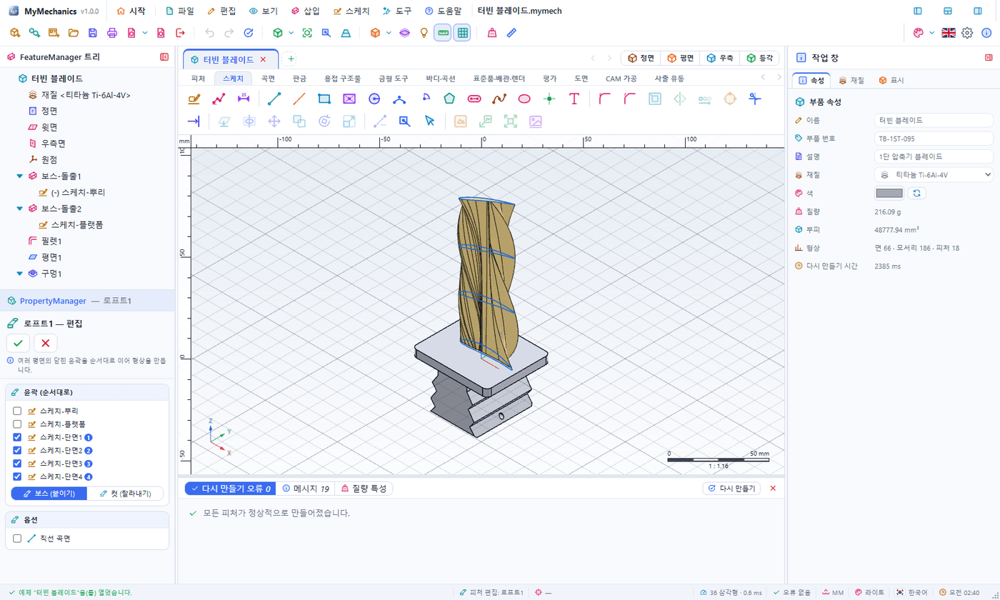

트리의 오른쪽 클릭 메뉴: 피처 편집, 이름 바꾸기(F2), 억제/억제 해제, 여기로 롤백, 삭제(이 피처를 쓰는 피처도 함께 지워집니다). 실패한 피처는 빨간색으로 표시되고 아래 패널 **다시 만들기 오류**에 이유와 고치는 방법이 나옵니다. 나머지 피처는 계속 만들어집니다.

## 6. 곡면 · 판금 · 용접 구조물 · 금형 도구

* **곡면** 탭: 돌출·회전·평면·로프트 곡면, **경계 곡면**(닫힌 윤곽 사이를 매끈하게, 또는 열린 곡선들을 가장자리로), **채우기 곡면**(구멍의 모서리나 닫힌 3D 스케치를 덮는 패치), 면 오프셋, **곡면 자르기**(평면·다른 곡면으로 잘라 한쪽 유지), 곡면 붙이기(닫히면 솔리드). **두껍게**로 곡면을 바깥·안·양쪽으로 두께를 주어 솔리드로 만듭니다. 곡면은 반투명 청록색으로 보입니다.

   
* **판금** 탭: **베이스 플랜지**(닫힌 스케치 + 두께, 굽힘 반지름, K 계수) → **모서리 플랜지**(판 윗면의 직선 모서리를 고르고 각도·길이) → **헴**(가장자리를 180° 되접기, 닫힘·열림) · **스케치 굽힘**(판 위에 그린 선을 따라 각도만큼 굽힘) · **조그**(선 너머를 높이만큼 올리는 두 번 굽힘) → **펼치기**로 전개도를 봅니다. 굽힘 여유 = 각도 × (반지름 + K × 두께).

   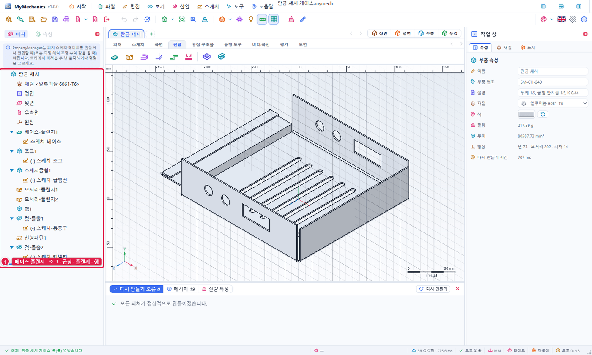

   
* **용접 구조물** 탭: 선으로 그린 스케치에 **구조 부재**(각관·직사각 관·파이프·환봉·각봉·앵글·채널·I형강·T형강, 크기 변경)를 놓고 **절단 목록**으로 부재별 길이와 합계를 봅니다.

   
* **금형 도구** 탭: **구배 분석**(빼는 방향 = 고른 평면/면의 법선, 기본 Y: 녹색 양의 구배·빨강 음의 구배·노랑 부족), 구배, **파팅 라인**(빼기 방향에 대해 면이 앞뒤로 바뀌는 모서리), **코어/캐비티 분할**(부품을 둘러싼 금형 블록을 파팅 높이에서 나누고 부품 모양을 빼서 벌려 보여 줌), **수축률 축척**, 분할, **캐비티**.

   

   

   

## 7. 수식 · 컨피규레이션 · 디자인 테이블

* **평가 › 수식**: 전역 변수(`W = 120`, `H = W / 2`)를 만듭니다. 피처 값 입력란에 `=H - 5` 처럼 쓰면 그 값이 수식으로 정해집니다. 함수 `sin cos tan sqrt abs min max round iif(조건, 참, 거짓)`과 `pi`, 다른 피처의 값 `돌출1.depth`, 스케치 치수 `D1@스케치1` 을 쓸 수 있습니다.

   
* **평가 › 컨피규레이션**: 컨피규레이션마다 변수 값과 피처 억제 상태가 따로 있습니다. 컨피규레이션을 켠 채 억제한 피처는 그 컨피규레이션에서만 억제됩니다. 트리 맨 위에 현재 컨피규레이션 이름이 나옵니다.

   
* **디자인 테이블**: 컨피규레이션 × 변수(그리고 `$STATE@피처`) 표를 CSV로 내보내고, 스프레드시트에서 고친 표를 가져오면 컨피규레이션이 만들어집니다.

## 8. 재질과 질량 특성 · 해석

작업 창 **재질** 탭(또는 트리의 재질 › 두 번 클릭)에서 강철·알루미늄·황동·티타늄·플라스틱 등 16가지 재질을 고릅니다. 밀도로 질량이 계산되고 표시 색이 바뀝니다(속성 탭에서 색만 바꿀 수도 있습니다). **평가 › 질량 특성**은 질량·부피·표면적·무게 중심·외곽 크기를 보여 줍니다. **측정**은 면·모서리 하나의 길이·면적·지름, 둘 사이의 최소 거리와 각도를 잽니다. **단면도**는 모델을 평면으로 잘라 보여 주며 작업 창 표시 탭에서 축과 위치를 바꿉니다.

**평가 › 해석 (정적)**은 선형 정적 구조 해석입니다. 고정할 면과 하중을 받을 면을 클릭하고 힘(N, 방향 ±X·Y·Z) 또는 압력(MPa)을 넣고 **해석 실행**을 누릅니다. 바디는 von Mises 응력으로 색칠되고(파랑 → 빨강), 최대 응력·최대 변위·최소 안전율(항복 강도 ÷ 응력)이 나옵니다. 변형 형상(과장)도 볼 수 있습니다. 해석 종류를 **열**로 바꾸면 온도 고정 면과 대류(열전달 계수·주변 온도) 또는 열량(W) 면으로 정상 상태 온도 분포를, **진동**으로 바꾸면 고정 면에 대한 고유 진동수와 모드 형상(버튼으로 모드 선택)을 구합니다. 해석은 복셀(정육면체) 요소로 하므로 해상도를 높일수록 정확하며, 모서리의 국부 응력은 실제보다 크게 나올 수 있습니다.

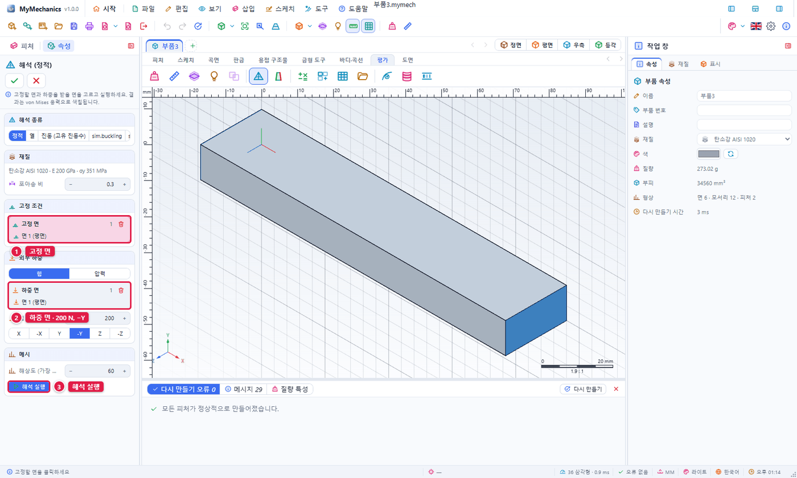

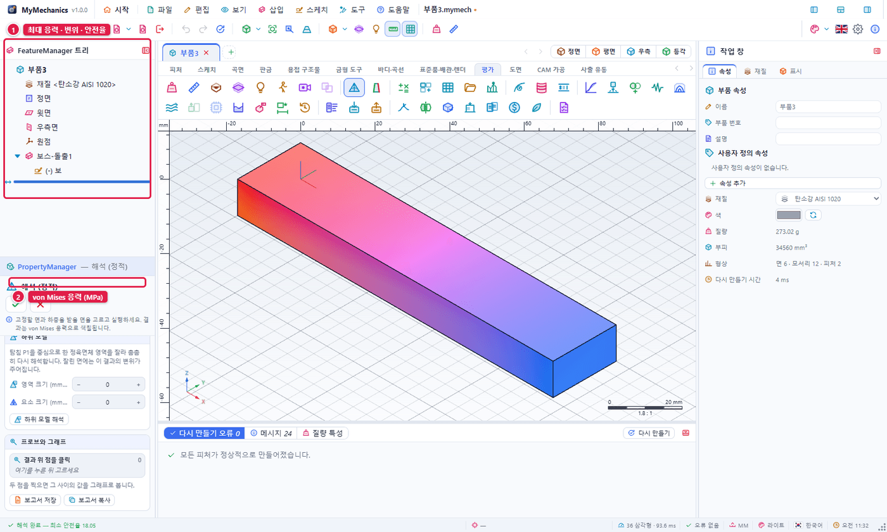

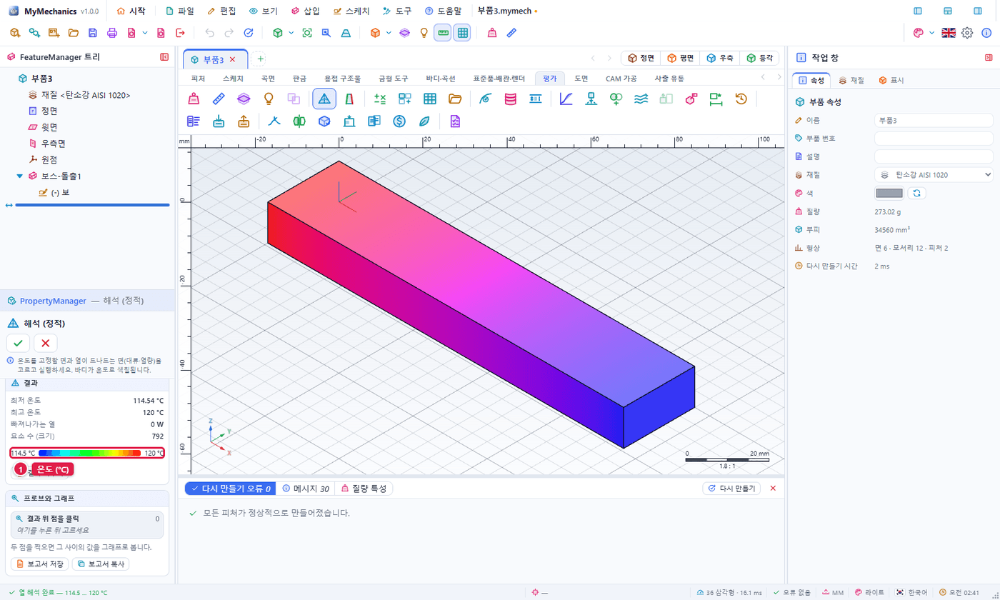

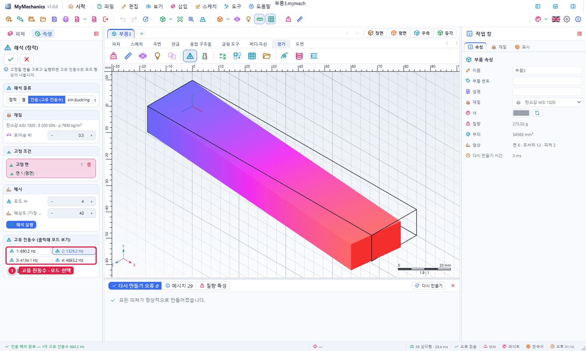

## 9. 어셈블리

1. **새 어셈블리**를 누릅니다. PropertyManager에 프로젝트의 부품과 예제 부품 목록이 나옵니다. 첫 부품은 원점에 고정(`(f)`)됩니다.
2. **어셈블리 › 부품 삽입**으로 부품을 더 넣습니다(STEP 파일도 가능).
3. **메이트**를 누르고 서로 다른 두 부품의 면을 차례로 클릭합니다. 원통면 두 개는 **동심**, 평면 두 개는 **일치**가 먼저 제안됩니다. 거리·각도·평행·직각, 정렬/반대 정렬을 고르고 ✔.

   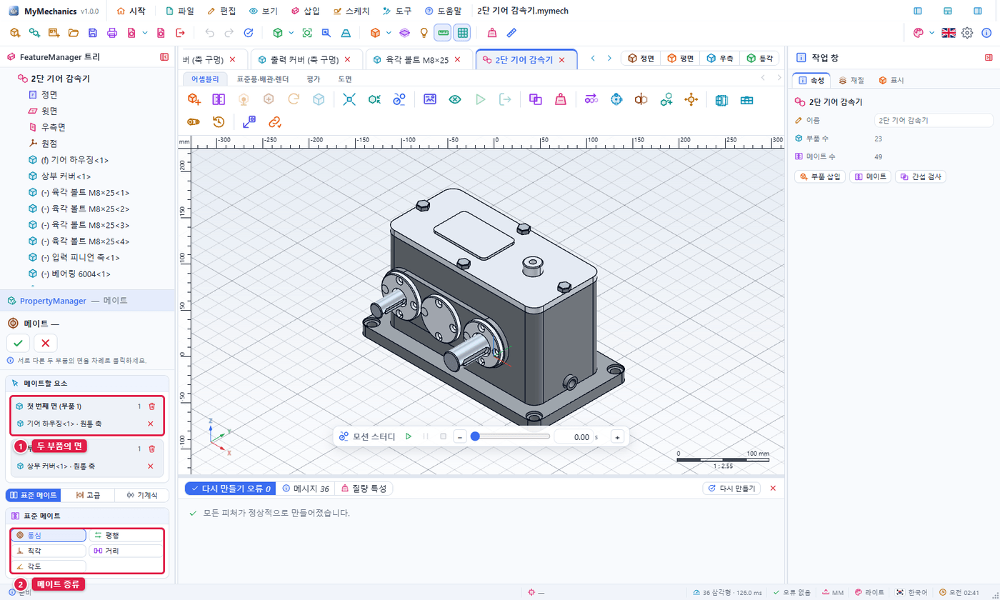
4. 모든 메이트를 동시에 풀어 위치를 정합니다. 위치가 완전히 정해진 부품은 접두사가 없고, 아직 움직일 수 있는 부품은 `(-)` 가 붙습니다. 충돌하는 메이트는 빨간색입니다.

   
5. **간섭 검사**는 겹치는 부품 쌍과 겹친 부피를 보여 줍니다.

부품을 두 번 클릭하면 그 부품 탭이 열립니다. 부품을 고치면 어셈블리가 다시 풀립니다.

* **캠 메이트**: 캠의 평평한 면(그 외곽선이 캠 윤곽)과 종동절의 평면·원통·점을 고르면 종동절이 캠 윤곽에 닿은 채 움직입니다(모션 스터디로 돌려 봅니다).
* **고급 메이트**: 폭(두 면 사이 가운데), 대칭(대칭 평면 기준), 거리 제한·각도 제한(범위 안에서 움직임), 잠금. **기계식 메이트**: 기어(기어비), 랙 피니언(피치 반지름), 나사(1회전당 거리), 힌지. 메이트 PropertyManager의 표준·고급·기계식 버튼으로 바꿉니다.
* **서브 어셈블리**: 부품 삽입 목록에 프로젝트의 다른 어셈블리가 나옵니다. 하나의 부품처럼 메이트하고, BOM에는 한 줄로 들어갑니다.
* **분해도**: 부품을 중심에서 바깥으로 벌려 놓습니다. 다시 누르면 접히고, **분해 지우기**로 단계를 지웁니다.

   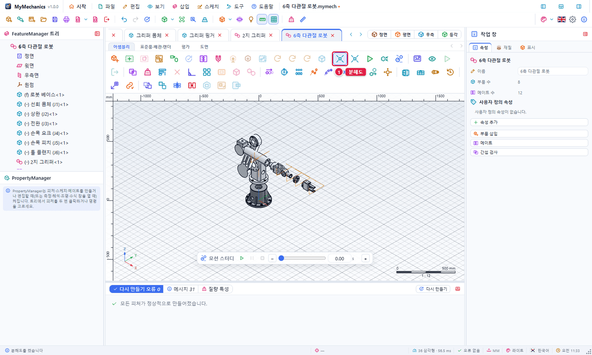
* **모션 스터디**: 회전 모터(rpm) 또는 직선 모터(mm/s)를 부품의 원통면에 달고 재생합니다. 기어·랙·나사 메이트로 이어진 부품이 따라 움직이며, 시간 막대로 원하는 순간을 봅니다.

   

## 10. 도면

부품이나 어셈블리에서 **도면 › 도면 만들기**(또는 표준 3면도)를 누르면 A3 시트에 정면도·평면도·우측면도와 등각 보기가 놓입니다(제3각법, 설정에서 제1각법). 척도는 시트에 맞는 표준 척도로 자동 선택됩니다. 은선(점선), 외곽 치수, 표제란(이름·부품 번호·재질·질량·척도·작성·검도·날짜·개정)이 들어갑니다. 뷰는 끌어서 옮기고, 작업 창에서 시트 크기(A4–A0, Letter, Tabloid)·척도·투상법·뷰 추가·제거를 합니다. **DXF**(레이어: VISIBLE·HIDDEN·BORDER·HATCH·NOTES)와 **SVG**로 내보내거나 인쇄(Ctrl+P)합니다.

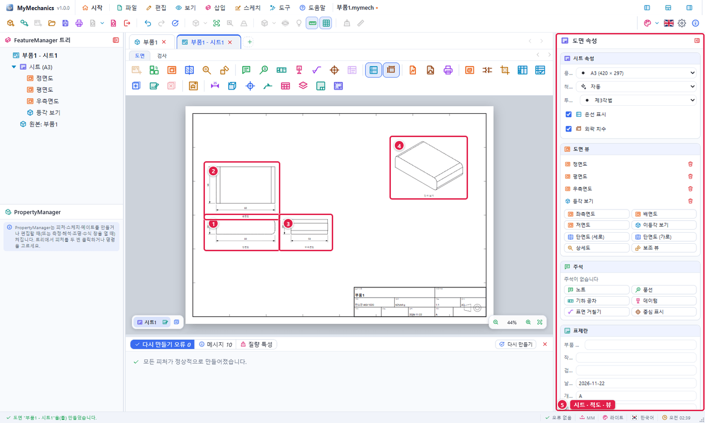

* **단면도**(세로·가로): 고른 뷰를 가운데로 자른 단면, 해칭과 절단선·화살표·문자(A-A). **상세도**: 원으로 둘러싼 부분을 2배로 확대(B). **보조 뷰**: 원하는 방향(x, y, z)에서 본 뷰.

   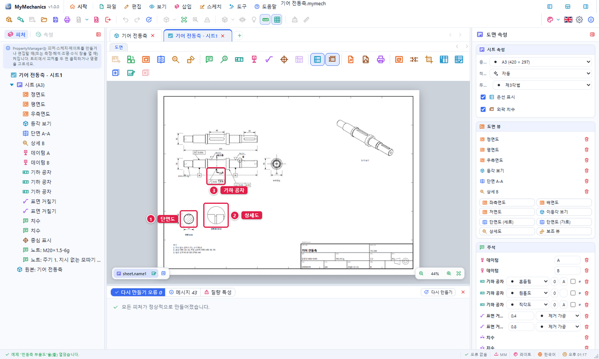
* **주석**: 노트, 풍선, 기하 공차(평면도·직각도·위치도 등 14종, ⌀·M/L 수정자, 데이텀), 데이텀, 표면 거칠기, 중심 표시. 명령을 누르고 시트를 클릭해 놓고, 끌어서 옮기며, 작업 창에서 내용을 고칩니다.
* **BOM**: 어셈블리 도면에서 부품 번호·이름·재질·수량 표를 표제란 위에 놓습니다.

   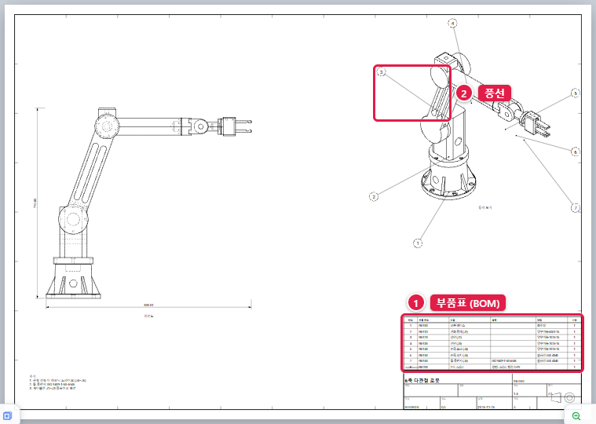

## 11. 화면 · 조명 · 시작 화면

* **눈금자**: 그래픽 영역 위·왼쪽에 화면 방향의 좌표 눈금(1·2·5 단계)이 나오고, 포인터 위치가 빨간 표시와 값으로 나옵니다. 정면·윗면·우측면 보기에서는 눈금이 어느 축인지(X·Y·Z) 표시됩니다.
* **격자**: 정면(XY, 기본)·윗면(XZ)·우측면(YZ) 중 고른 평면에 고정됩니다. 확대·축소하면 선 간격이 화면에서 너무 촘촘하거나 성기어질 때 1·2·5 단계로 다시 그려지며, 다섯 칸마다 진한 선(5×5 칸)입니다. 보기 › 표시에서 켜고 끄고 평면을 바꿉니다.
* **축척 막대**: 오른쪽 아래의 막대가 화면에서의 길이와 화면 축척(1 : n, 96 dpi 기준)을 보여 줍니다. 마우스로 끌어 원하는 곳으로 옮길 수 있습니다.

   
* **조명**(평가 탭 또는 보기 메뉴): 주변광(색·바닥 반사색·밝기), 보는 방향을 따라가는 카메라 조명(켜기·색·밝기), 그리고 방향광·점광원·스포트라이트를 추가해 색·밝기·위치·비추는 곳·원뿔 각도를 편집합니다. 조명 창이 열려 있는 동안 그래픽 영역의 조명 손잡이(작은 구)를 끌어 위치를 옮깁니다. 조명은 프로젝트 파일에 저장됩니다.

   
* **패널 버튼**: 왼쪽·아래쪽·오른쪽 패널 접기/펴기 버튼은 창 위쪽 최소화 버튼 바로 왼쪽에 있습니다.
* **시작 화면**: 위쪽 프로그램 정보는 고정되어 움직이거나 크기를 바꿀 수 없습니다. 아래 카드들은 끌어서 옮기고 모서리로 크기를 바꾸며, **자동 정렬**은 바꾼 크기를 그대로 둔 채 카드를 가로·세로로 줄 맞춰 놓습니다. 예제는 그룹마다 15개입니다.

## 12. 파일

| 형식 | 용도 |
|---|---|
| `.mymech` | 프로젝트(부품·어셈블리·도면 전체, JSON). 데스크톱에서는 파일을 두 번 클릭해 엽니다. |
| STEP (`.step`, `.stp`) | 가져오기(가져온 바디 위에 피처를 더할 수 있음)·내보내기(어셈블리는 부품별 이름·색 포함). |
| STL | 3D 프린트용 내보내기, 가져오기. |
| DXF · SVG | 도면 내보내기. |
| CSV | 디자인 테이블 내보내기·가져오기. |
| PNG | 그래픽 영역을 그림으로 저장. |

웹에서는 브라우저가 지원하면 파일 시스템 접근 API로 같은 파일에 바로 저장하고, 아니면 내려받기를 합니다.

## 13. 설정

설정(Ctrl+,)에는 일반(언어 등), 시작 화면, 테마(어두운·밝은 테마와 사용자 테마), 글꼴, 배경, **모델링**(길이 단위, 소수 자릿수, 격자 맞춤, 치수 입력, 도면 투상법, 표시 스타일, 평면·원점·스케치 표시, 원근 보기, 곡면 표시 품질), 최근 항목, 단축키 탭이 있습니다.

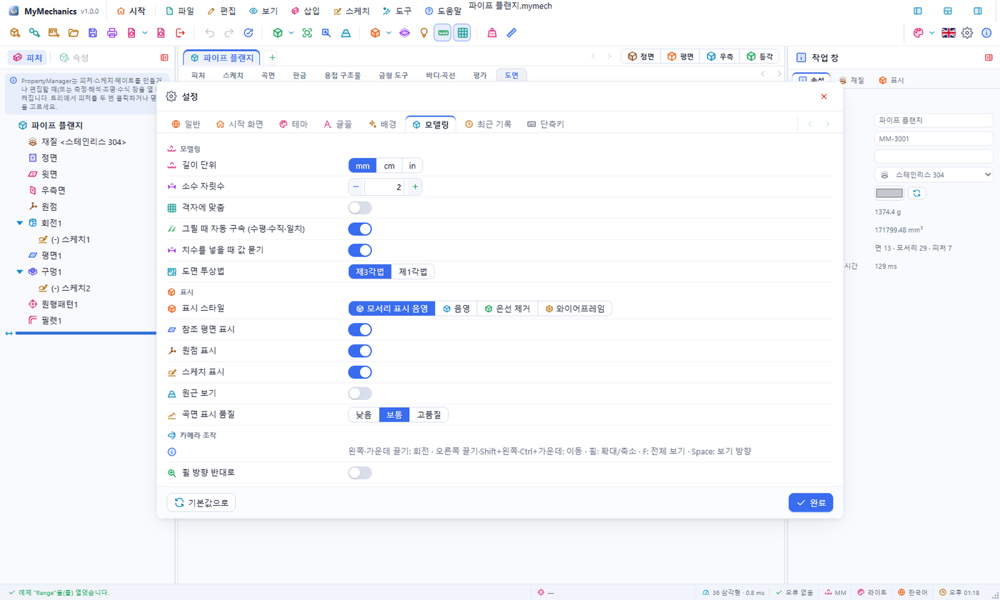

## 14. 단축키

| 키 | 명령 |
|---|---|
| Ctrl+N / O / S / Shift+S | 새 부품 / 열기 / 저장 / 다른 이름으로 저장 |
| Ctrl+I · Ctrl+P | STEP 가져오기 · 인쇄 |
| Ctrl+Z / Y | 실행 취소 / 다시 실행 |
| Ctrl+B | 다시 만들기 |
| Enter / Esc | PropertyManager 확인 / 취소 |
| Delete · F2 | 삭제 · 이름 바꾸기 |
| F · Space · Ctrl+1–8 · K | 전체 보기 · 보기 방향 메뉴 · 표준 보기 · 표시 스타일 |
| L R C A P D T S | 스케치: 선 · 사각형 · 원 · 호 · 다각형 · 치수 · 자르기 · 선택 |
| E X O · Enter | 스케치: 타원 · 연장 · 오프셋 · 스플라인 끝내기 |
| Ctrl+Shift+L · Ctrl+Shift+H · Ctrl+, · F1 | 언어 · 시작 화면 · 설정 · 사용 설명서 |

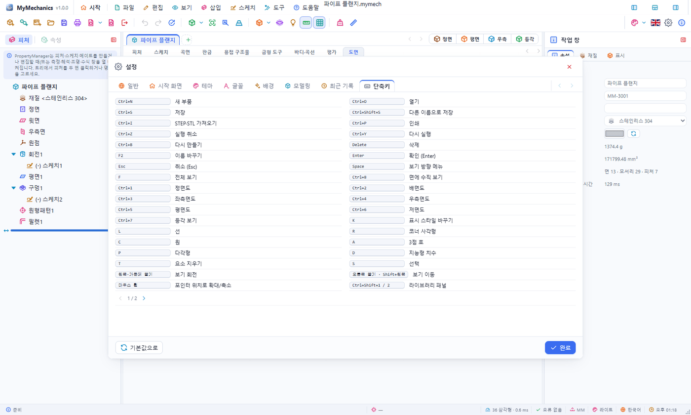

