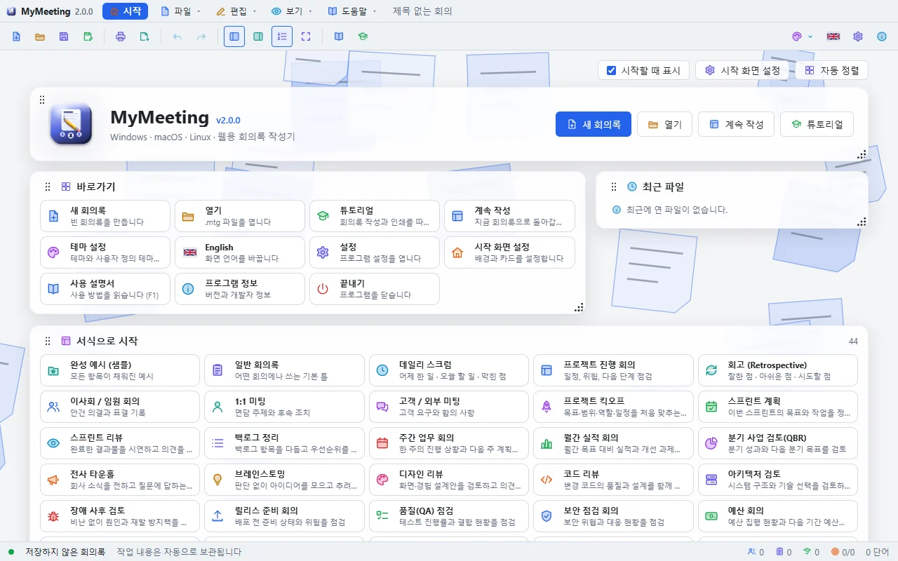

# MyMeeting

회의록을 빠르게 작성하고, 페이지 설정과 미리보기를 거쳐 인쇄하고, Word·HTML·Markdown·텍스트로 내보내는 데스크톱 프로그램입니다. **Tauri 2 + React 19 + TypeScript** 로 만들어 Windows, macOS, Linux 에서 같은 모양으로 동작하며, Electron 판보다 설치 파일이 작고 빨리 뜹니다.




## 주요 기능

- **시작 화면**: 새 회의록, 열기, 계속 작성, 튜토리얼, 바로가기·최근 파일·서식·테마·배경 카드. 카드는 끌어서 옮기고 크기를 바꿀 수 있습니다.
- **서식 45개**: 데일리 스크럼, 스프린트 계획, 킥오프, 장애 사후 검토, 예산, 채용 면접, 안전 점검 등. `templates/*.json` 에 파일을 추가하면 서식이 늘어납니다.
- **"+" 버튼 입력**: 참석자, 안건, 결정 사항, 실행 항목은 **+ 추가** 로 한 줄씩 넣고 ↑ ↓ 로 순서를 바꿉니다. 실행 항목에는 담당자, 기한, 완료 체크가 있습니다.
- **WYSIWYG 전용 편집기**: 회의 내용은 보이는 그대로 편집하고 Markdown 으로 저장합니다. 제목, 목록, 체크리스트, 표, 링크, 그림, 동영상, 가로줄을 지원합니다.
- **아이콘 135개**: 편집기의 😊 버튼으로 그룹, 검색, 크기(16·20·28·40)를 골라 컬러 아이콘을 넣습니다. 프로그램 자체의 아이콘 170개도 모두 컬러입니다.
- **인쇄**: 용지(A4·A5·B5·Letter·Legal…), 방향, 배율, 여백, 머리글·바닥글(`{title} {date} {time} {page} {pages}`), 인쇄 범위를 설정하면 페이지가 나뉜 미리보기가 바로 바뀝니다.
- **내보내기**: Word(.doc), HTML, Markdown, 텍스트. PDF 는 인쇄 창의 "PDF 로 저장".
- **테마 40개 + 사용자 정의**: 라이트 20, 다크 20, 직접 만든 테마 최대 24개.
- **독립 팝업 창**: 설정, 인쇄, 내보내기, 사용 설명서, 튜토리얼 카드는 모두 별도의 창이라 프로그램 창 밖으로 옮길 수 있습니다. ×에 마우스를 올리면 빨갛게 바뀝니다.
- **튜토리얼**: 시작할 때 고르기 창이 뜨며(설정에서 끌 수 있음), 단계마다 화면 그림과 강조 표시, "대신 해 주기"가 있습니다.
- **사용 설명서**: F1. 그림이 들어간 설명서를 프로그램 안에서 봅니다.
- **한국어 / English**, 자동 보관, 최근 파일, 실행 취소·다시 실행.

## 문서

- [사용 설명서](doc/UsersGuide.md) · [User Guide](doc/UsersGuide.en.md)
- [튜토리얼](doc/Tutorial.md) · [Tutorials](doc/Tutorial.en.md)
- [구조 설명](Architecture.md)

## 준비

- Node.js 20 이상
- Rust (stable) 와 [Tauri 2 준비물](https://tauri.app/start/prerequisites/) — Windows 는 WebView2 와 MSVC 빌드 도구

```bash
npm install
```

## 명령

| 명령 | 설명 |
|------|------|
| `npm run dev` | 데스크톱 앱을 개발 모드로 실행 |
| `npm run dev:web` | 브라우저에서 UI 만 실행 (http://localhost:5188) |
| `npm run build:ui` | 프런트엔드를 `dist/` 로 빌드 |
| `npm run typecheck` | TypeScript 검사 |
| `npm run build:win` / `build:mac` / `build:linux` | 설치 파일 만들기 (NSIS / DMG / AppImage·deb) |
| `npm run icons` | `assets/icon.svg` 로 앱 아이콘 만들기 |
| `npm run screenshots` | 설명서·튜토리얼 그림을 `doc/images/` 에 다시 찍기 (Edge 필요, `dev:web` 실행 중) |
| `npm test` | 테스트 |

`cargo run` 으로 직접 실행할 때는 먼저 `npm run build:ui` 로 `dist/` 를 만들어야 최신 화면이 들어갑니다.

## 폴더

```
src/                 React 프런트엔드
  App.tsx            상태, 명령, 단축키, 스크린샷 모드
  components/        툴바, 회의 양식, 시작 화면, 설정, 인쇄, 설명서, 튜토리얼, 팝업 창
  editor/            WYSIWYG 편집기, HTML→Markdown, 아이콘 선택기
  print/             페이지 나누기와 인쇄
  document.ts        회의록 → HTML/Markdown/텍스트/Word
  popout.ts          팝업을 독립 창으로 띄우기
  themes.ts          테마 40개와 사용자 정의 테마
  locales/           ko, en
src-tauri/           Rust 셸 (파일 대화상자, 글꼴 목록, 인쇄, 팝업 창 관리)
templates/           회의 서식 JSON 45개
doc/                 사용 설명서, 튜토리얼, 그림
scripts/             개발 서버, 스크린샷, 설치 파일 복사
```

## 라이선스

MIT
