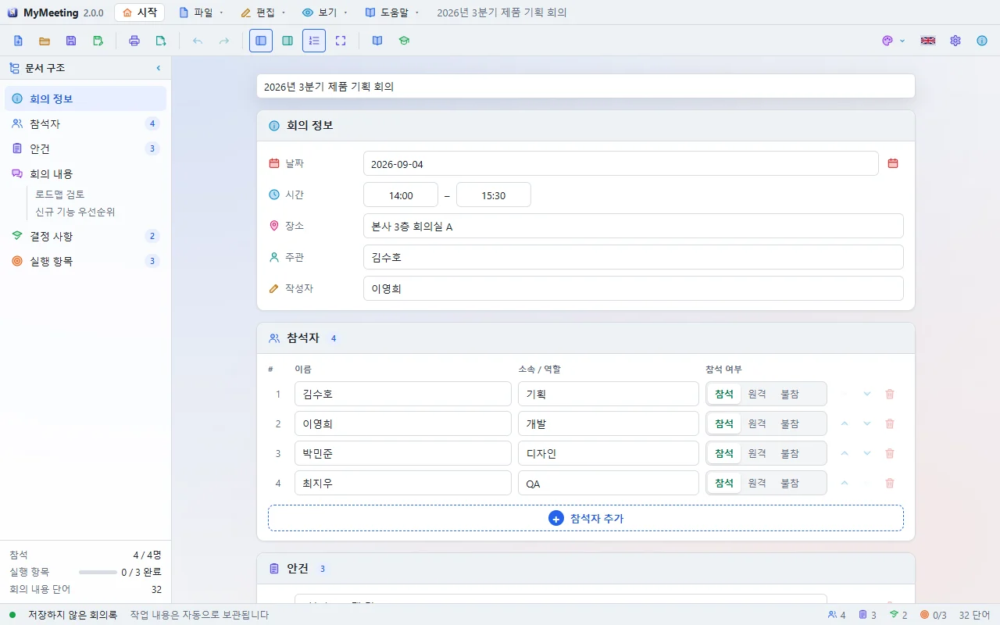
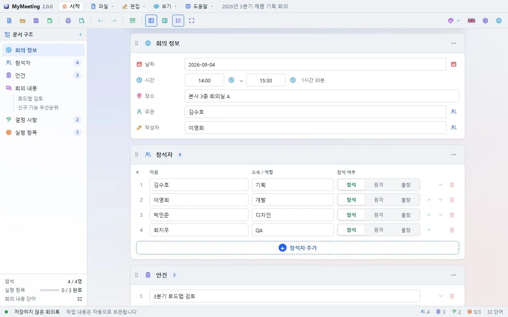
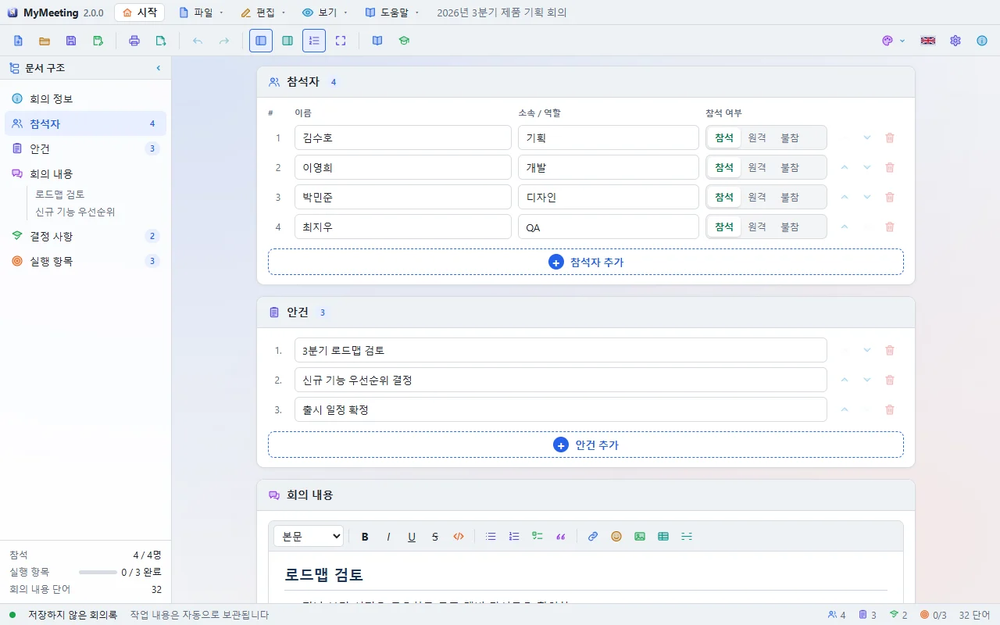
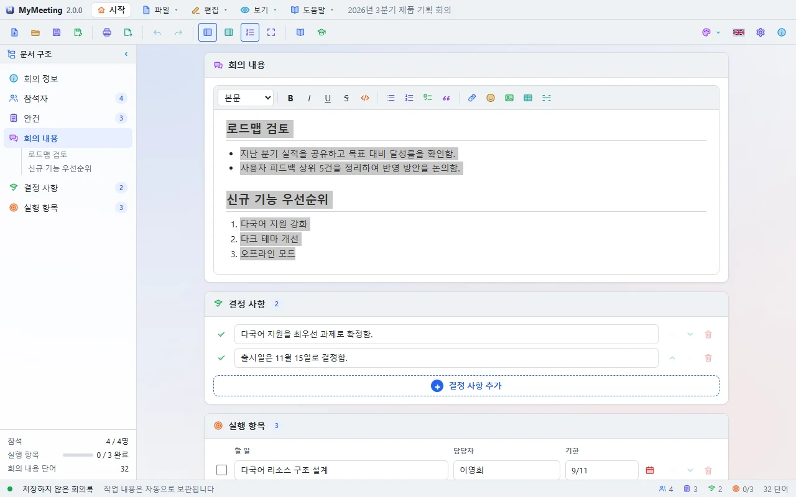
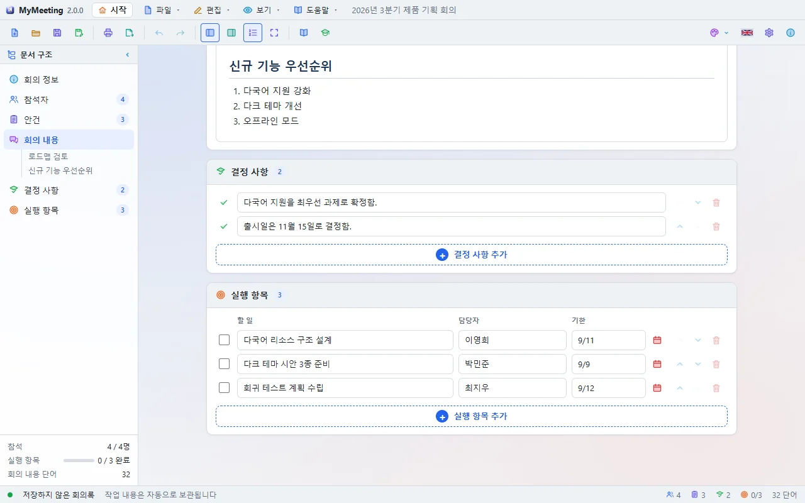
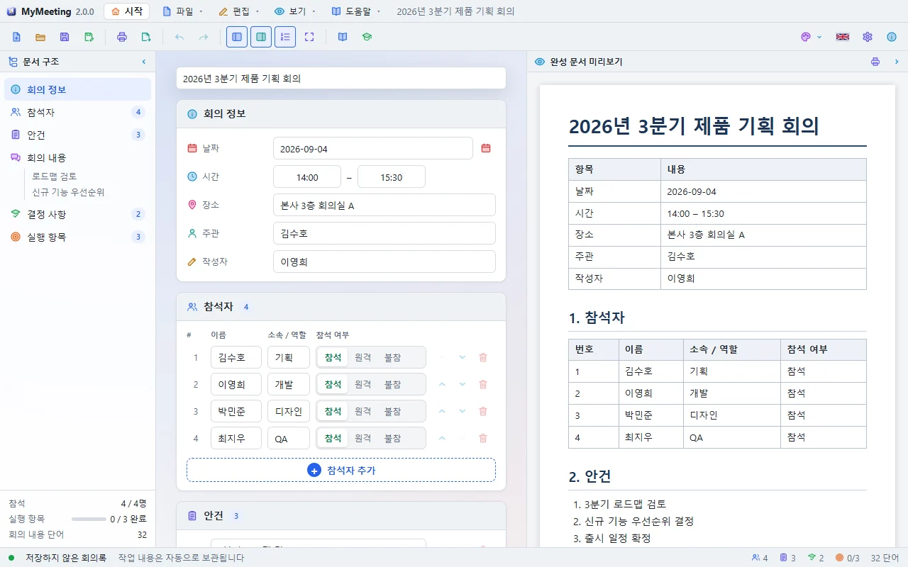

# MyMeeting Tutorials

Tutorials are done inside the program with the real controls. A card shows what to do and a screenshot for each step, and the place to work on glows on the screen. **Next** lights up when the step is done; **Do it for me** helps when you are stuck.

To open one: the start screen's **Tutorial** button, **Help → Tutorial**, or the **Choose a tutorial** window on the first start.

## 1. Write your first minutes (10 steps)

1. **Look around**: the outline on the left, the document in the middle, the preview on the right.
2. **Title**: type the meeting name in the title field at the top.
3. **Date and place**: fill in the date, time and place under Meeting details.

   

4. **Attendees**: add at least two with **+ Add attendee** and choose present, remote or absent.

   

5. **Agenda**: add agenda items with **+ Add agenda item**.
6. **Discussion**: write what was discussed in the editor.
7. **Formatting**: try a heading, a list and bold text, and insert an icon with the 😊 button.

   

8. **Decisions**: one decision per row.
9. **Action items**: task, owner and due date.

   

10. **Finish**: save the minutes as an `.mtg` file with **Save (Ctrl+S)**.

## 2. Print and export (6 steps)

1. **Load the sample**: open the filled-in sample minutes.
2. **Open print**: click **Print** in the toolbar. The print window is a window of its own; move it aside to watch both.
3. **Landscape**: switch the orientation to **Landscape** and watch the preview repaginate.
4. **Margins**: set the left margin to 25 mm.
5. **Export**: close the print window and pick Word, HTML, Markdown or text under **Export**.
6. **Finish**

## Ask on startup

Turn off **Ask on startup** at the bottom of the Choose a tutorial window to stop it from opening. Turn it back on in **Settings → General** or **Settings → Start screen**.
