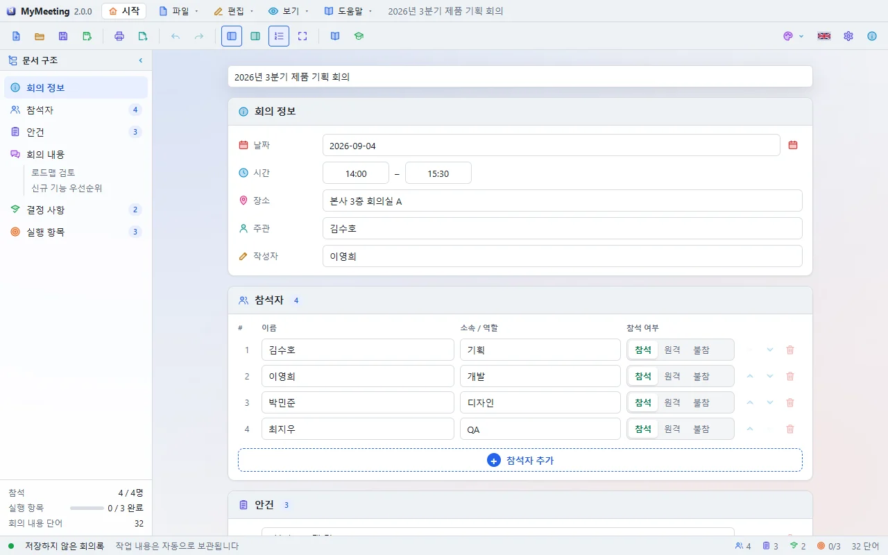
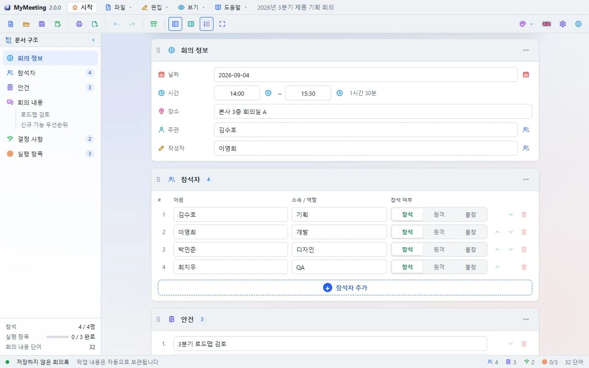
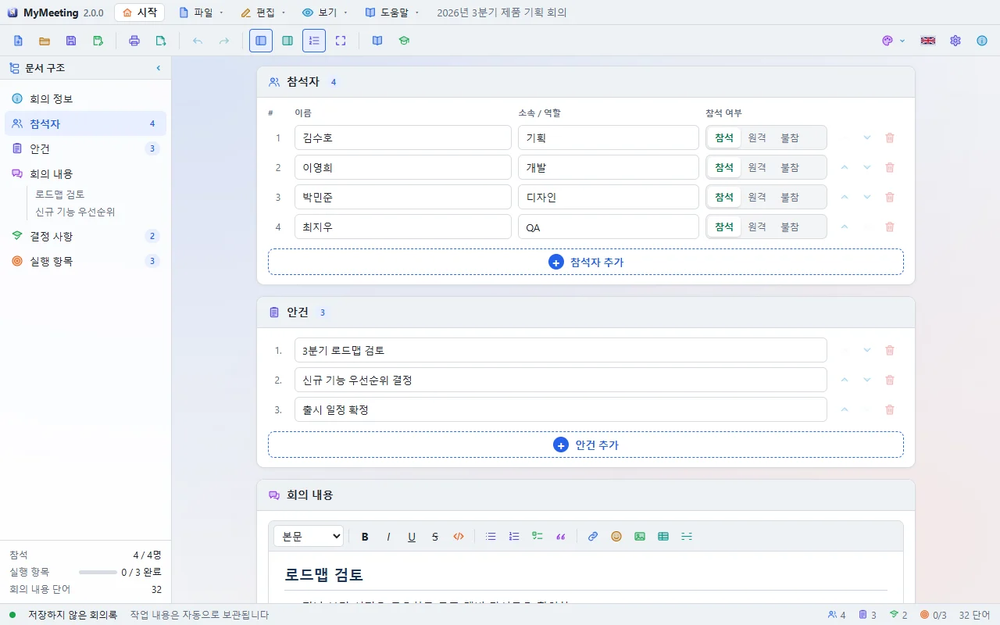
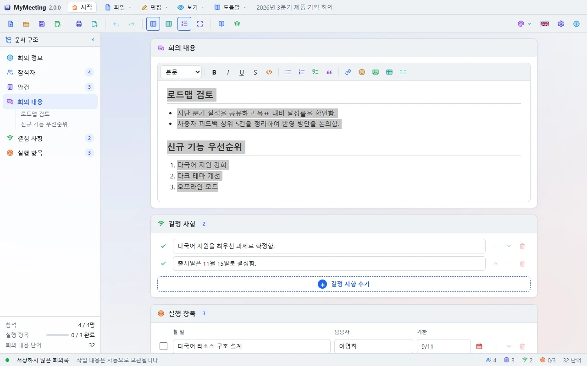
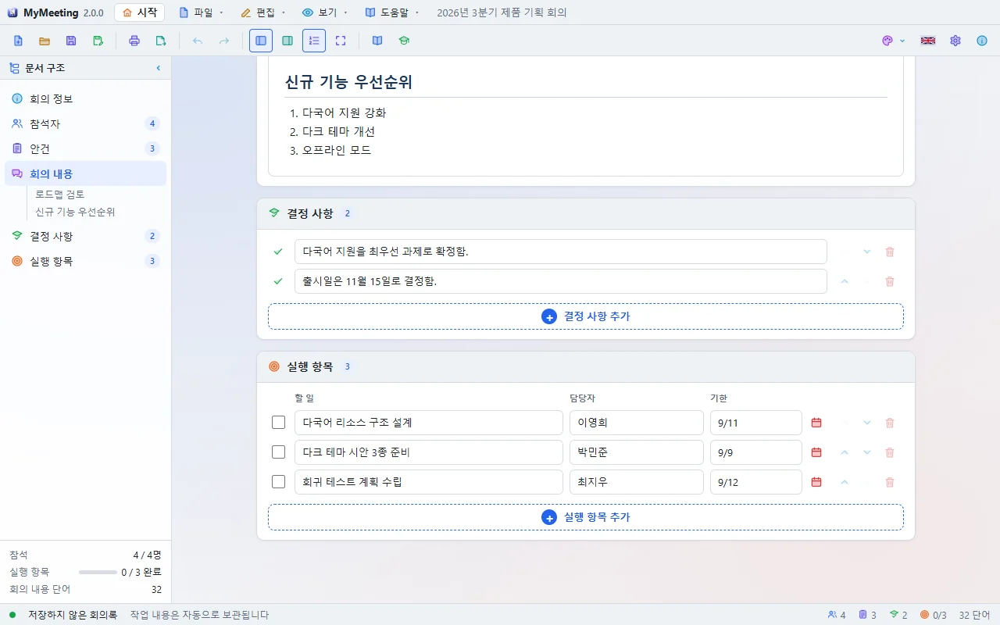
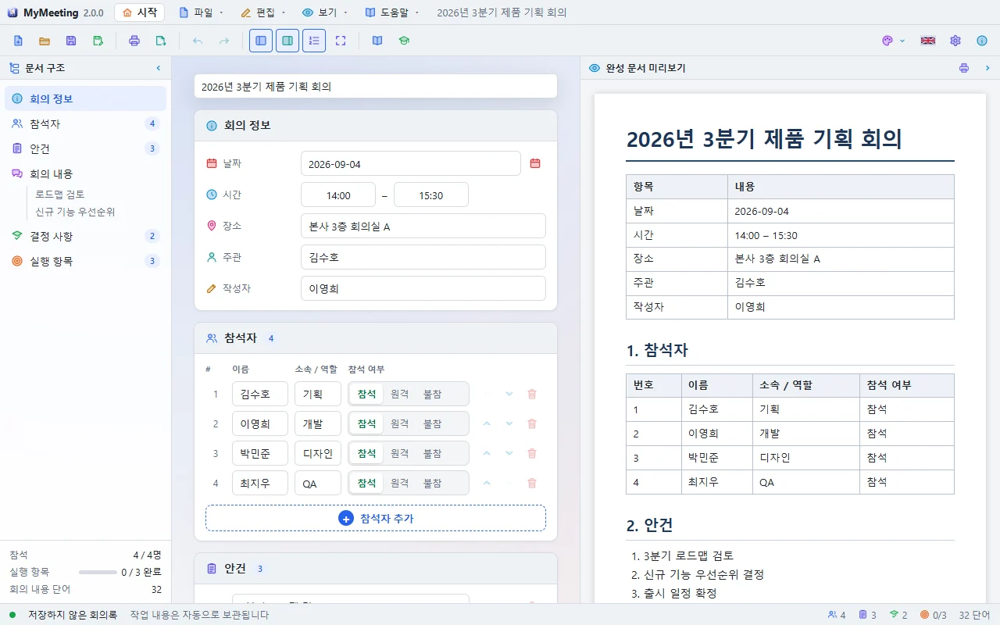

# MyMeeting 튜토리얼

튜토리얼은 프로그램 안에서 실제 버튼을 눌러 가며 따라 합니다. 카드가 단계마다 할 일과 화면 그림을 보여 주고, 다룰 곳을 화면에서 빛나게 표시합니다. 단계를 마치면 **다음** 이 켜지고, 막히면 **대신 해 주기** 를 누르세요.

여는 방법: 시작 화면의 **튜토리얼** 버튼, **도움말 → 튜토리얼**, 또는 처음 실행할 때 뜨는 **튜토리얼 고르기** 창.

## 1. 첫 회의록 작성하기 (10단계)

1. **화면 둘러보기** — 왼쪽 문서 구조, 가운데 문서, 오른쪽 미리보기를 확인합니다.
2. **제목 쓰기** — 맨 위 제목 칸에 회의 이름을 씁니다.
3. **일시와 장소** — 회의 정보에 날짜·시간·장소를 넣습니다.

   

4. **참석자 추가** — 참석자 카드의 **+ 참석자 추가** 로 두 명 이상 넣고 참석/원격/불참을 고릅니다.

   

5. **안건** — **+ 안건 추가** 로 안건을 적습니다.
6. **회의 내용** — 편집기에 논의한 내용을 씁니다.
7. **서식** — 서식 막대로 제목·목록·굵게를 써 보고, 😊 버튼으로 아이콘도 넣어 봅니다.

   

8. **결정 사항** — 결정한 내용을 한 줄씩 적습니다.
9. **실행 항목** — 할 일·담당자·기한을 넣습니다.

   

10. **마치기** — **저장(Ctrl+S)** 으로 `.mtg` 파일에 저장합니다.

## 2. 인쇄와 내보내기 (6단계)

1. **예시 불러오기** — 내용이 채워진 예시 회의록을 엽니다.
2. **인쇄 창 열기** — 툴바의 **인쇄** 를 누릅니다. 인쇄 창은 독립된 창이라 옆으로 옮겨 두고 볼 수 있습니다.
3. **가로 방향** — 용지 방향을 **가로** 로 바꾸고 미리보기가 다시 나뉘는 것을 봅니다.
4. **여백** — 왼쪽 여백을 25mm 로 바꿉니다.
5. **내보내기** — 인쇄 창을 닫고 **내보내기** 에서 Word·HTML·Markdown·텍스트 중 하나를 고릅니다.
6. **마치기**

## 시작할 때 묻기

튜토리얼 고르기 창 아래 **시작할 때 묻기** 를 끄면 다음 실행부터 창이 뜨지 않습니다. 다시 켜려면 **설정 → 일반** 또는 **설정 → 시작 화면** 에서 켭니다.
