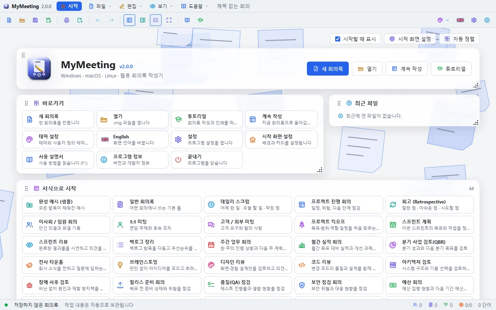
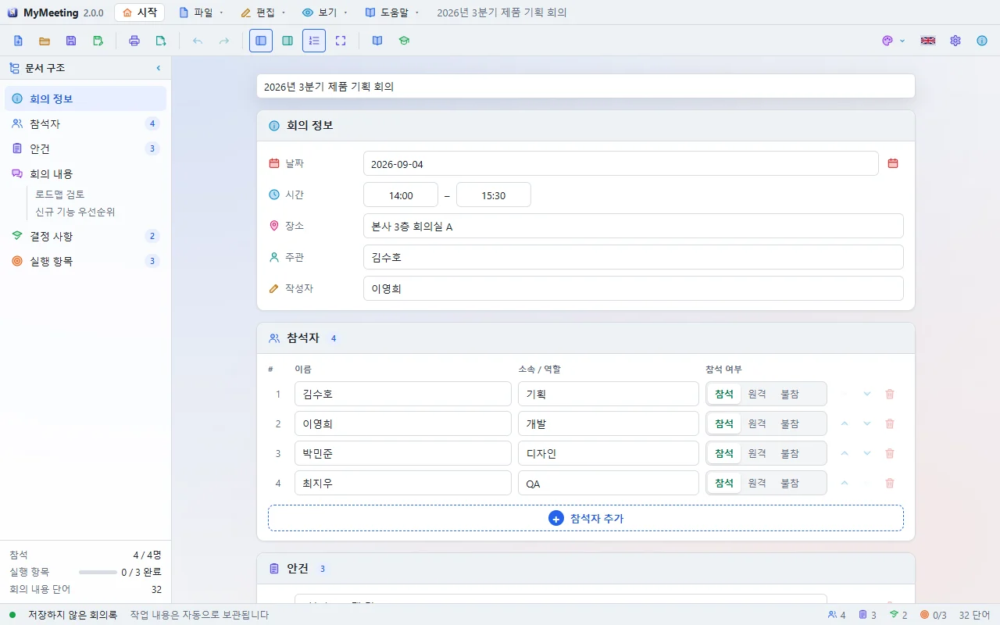
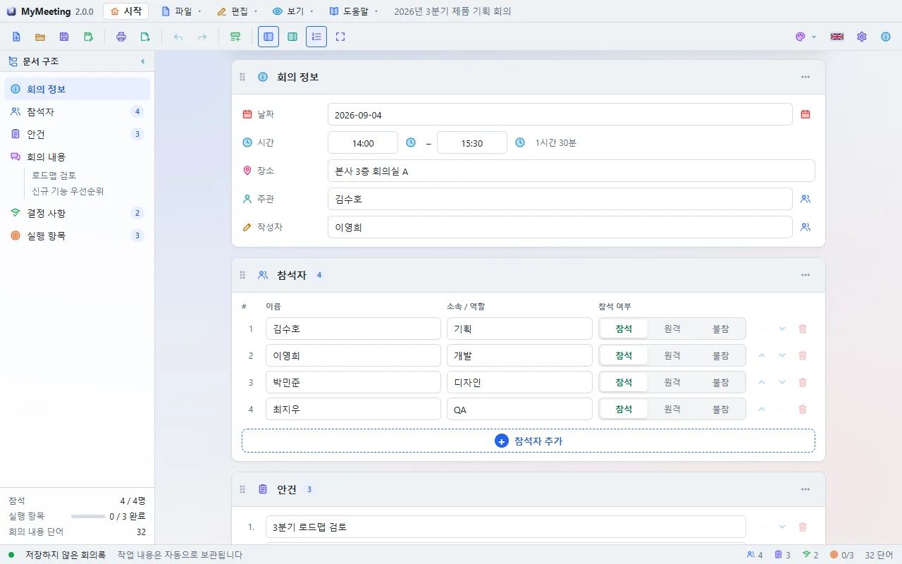
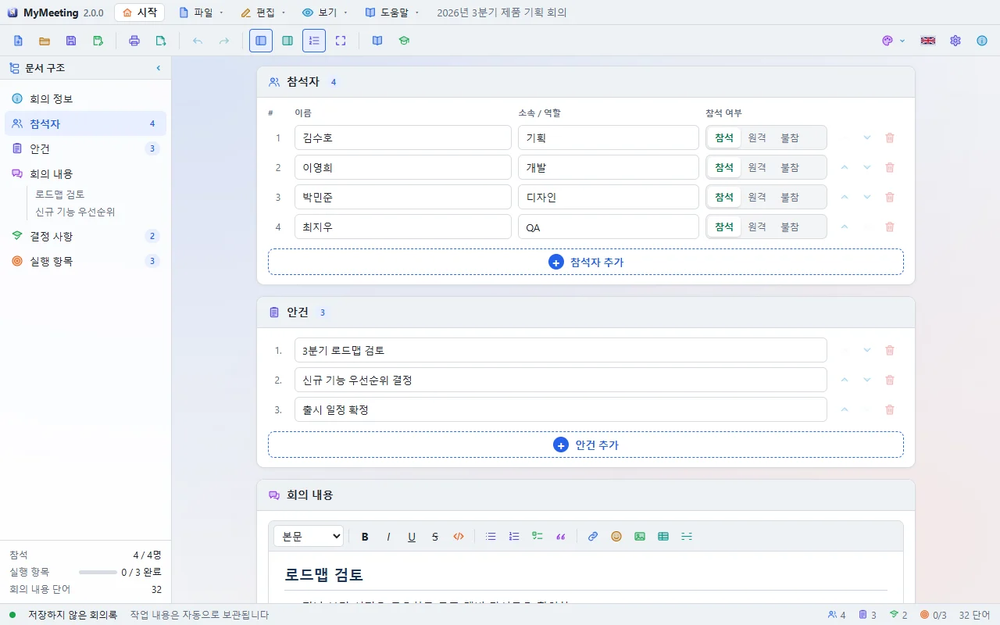
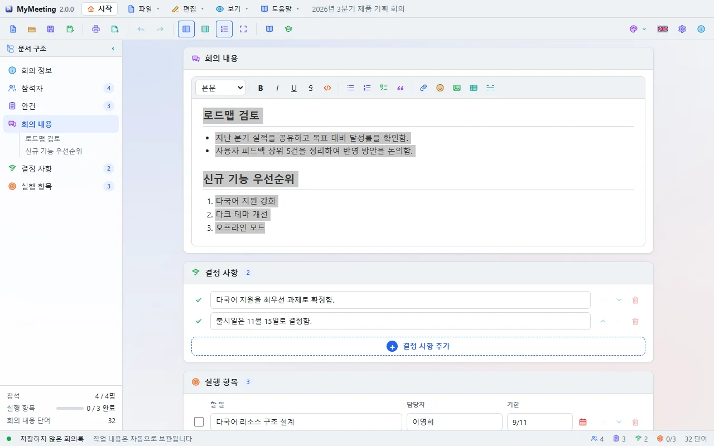
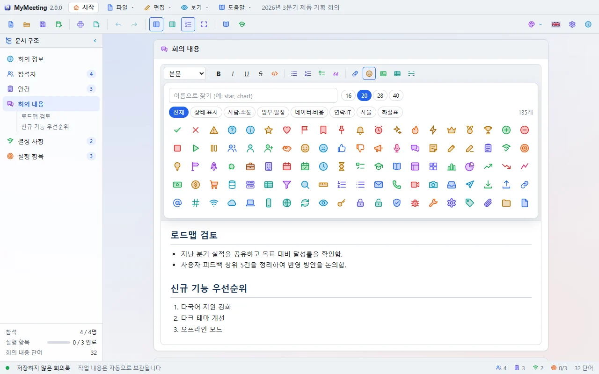
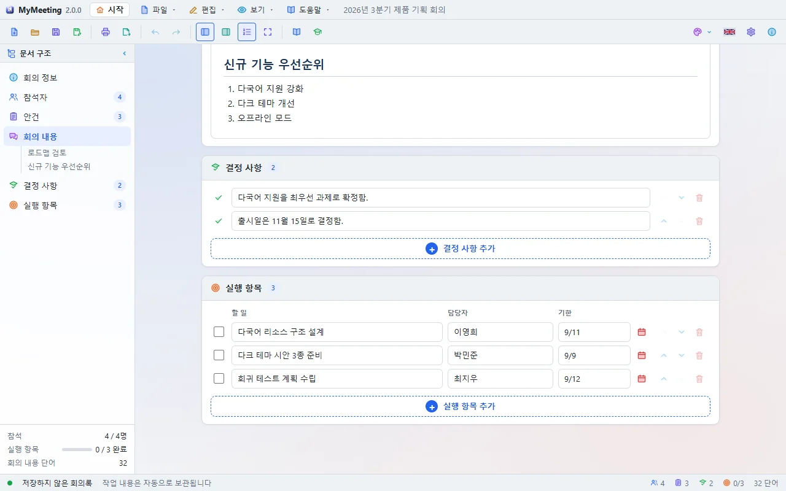
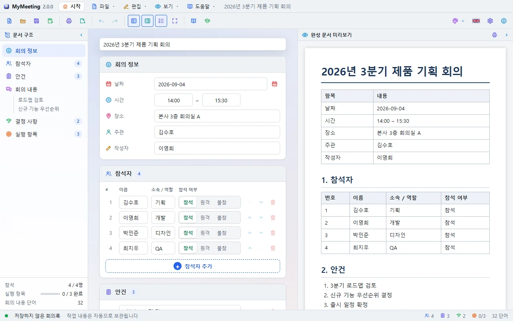

# MyMeeting User Guide

MyMeeting writes meeting minutes quickly, prints them well and exports them to Word, HTML, Markdown or plain text. It looks and works the same on Windows, macOS and Linux.

## Start screen

The start screen appears when the program opens. It has New, Open, Continue and Tutorial buttons, plus cards for shortcuts, recent files, templates, themes and the background.

- Drag a card by its handle (⠿) to move it, and by its lower-right corner to resize it. **Arrange** puts the cards back.
- Turn off **Show on startup** to go straight to the editor next time. The **Start** button in the toolbar brings the screen back at any time.
- On the first start a **Choose a tutorial** window opens. Turn off **Ask on startup** at its bottom to stop it. The same option is in **Settings → General** and **Settings → Start screen**.

## Starting from a template

The **Start from a template** card holds 45 meeting templates: daily scrum, sprint planning, kickoff, incident postmortem, budget, job interview, safety meeting and many more. Each one opens minutes with the agenda, attendee roles, body headings and a first action item already filled in.

## The editor

On the left is the **outline**, in the middle the minutes **document**, and on the right the **preview** when you open it.

- Click an outline entry to jump to it. Headings in the discussion also appear there.
- The status bar shows attendance, finished action items, word count and whether the file is saved.
- Your work is kept automatically, so it comes back even if the program closes unexpectedly.

## Meeting details

Write the meeting title at the top, then the date, time, place, organizer and recorder under **Meeting details**. The calendar button next to the date opens a date picker.

Pick a time with the clock button beside its field (or `↓` in the field), or type it however is convenient. `930`, `9.30`, `15`, `3pm` and `3:30 pm` become `09:30`-style times when you leave the field; text that can't be read as a time turns the field red. A number alone is read as it stands, so `3` is 3 in the morning. Entering a start time fills an empty end time an hour later, and changing the start moves the end with it so the meeting keeps its length. The end-time list shows the meeting's length beside each time. **Now** at the top of the list enters the current time.

## Attendees and agenda: add with "+"

Attendees, agenda, decisions and action items are all lists. The **+ Add** button below a list adds a row.

- Each attendee has a name, a team or role and **present / remote / absent**.
- The ↑ ↓ buttons on the right change the order, and the bin deletes a row.
- **Enter** while typing adds the next row, and **Backspace** in an empty row removes it.

## Discussion: WYSIWYG editor

The discussion is edited as it looks. The format bar sets the paragraph style (body, headings 1–3, quote, code), bold, italic, underline and strikethrough, and inserts lists, numbered lists, checklists, links, icons, pictures and videos, tables and rules.

- Typing `# `, `- `, `1. ` or `> ` at the start of a line makes a heading, list, numbered list or quote.
- In a table **Tab** moves to the next cell, and the format bar shows buttons to add and delete rows and columns.
- Pictures can also be dropped or pasted in. Click a picture for 25, 50, 75 and 100% buttons and a resize handle. Drag a picture to move it, also into another text section.
- Choose where a picture or video is kept as you put it in. **Inside the minutes** holds everything in the one `.mtg` file; **In the same folder as the minutes** copies the file beside the `.mtg` (a file of the same name is never written over: the copy takes a name like `name-2`). Files kept beside the minutes have to move with them. Minutes not saved yet ask where to save first. Saving As into another folder copies the files too, and exports carry the files inside them. Removing a picture from the document does not delete its file. To stop being asked, set **Settings → General → Keep pictures and video**.
- **Ctrl+click** opens a link.

### Inserting icons

The 😊 **Insert icon** button opens 135 colourful icons in groups (status, people, work, data, contact, things, arrows), and you can search by name (for example `star` or `chart`). Pick a size (16, 20, 28 or 40) and click an icon to put it in the text. Icons also appear in the preview, on paper and in every export.

## Decisions and action items

Write one decision per row. An action item has the task, an owner and a due date; tick the box when it is done. The owner field suggests attendee names.

## Preview

The **Preview** button shows the finished minutes on the right, exactly as they print and export.

## Printing and page setup

**Print (Ctrl+P)** opens the print window. The preview on the right repaginates as soon as you change a setting.

- **Paper**: size (A4, A5, B5, Letter, Legal and more), orientation, scale
- **Margins (mm)**: top, bottom, left and right
- **Header and footer**: three fields each. `{title}`, `{date}`, `{time}`, `{page}` and `{pages}` are filled in; they can be left off the first page.
- **Pages**: all, current, or a range such as `1-3, 5`
- Zoom the preview to fit the width or to 50–150%.

Choose the **Printer** and **Copies** at the top left and press **Print** at the bottom: the pages go straight to that printer, with no other window. The printer stays selected next time. Duplex, colour and other printer settings follow the printer's defaults in Windows. On macOS and Linux the system's print dialog opens instead of the list.

To make a PDF, choose **Save as PDF** as the printer, press the button and pick where to save it.

## Export

**Export (Ctrl+E)** offers these formats:

| Format | Extension | Use |
|--------|-----------|-----|
| Word | .doc | Editing in Word; paper size and margins are kept |
| HTML | .html | Sharing in a browser or by mail |
| Markdown | .md | Wikis and Git repositories |
| Text | .txt | Only the words |
| PDF | .pdf | Through the print window |

## Saving and opening

Minutes are saved as `.mtg` files. **Save (Ctrl+S)** writes to the same file, **Save As (Ctrl+Shift+S)** makes a new one. Dropping an `.mtg` file on the window opens it. If there are unsaved changes, the program asks before they would be lost.

## Settings

The ⚙ **Settings** button opens:

- **General**: language, start screen, ask about the tutorial on startup, reopen the last file, today's date for new minutes, clear recent files
- **Document**: font (from the installed fonts), size, heading numbers
- **Theme**: 20 light and 20 dark themes, and custom themes (background, panel, text and accent colours, up to 24 saved)
- **Start screen**: show on startup, ask about the tutorial, background pattern and speed, card opacity, reset the card layout

## Popup windows

Every popup (settings, print, export, the user guide, the tutorial card) is a **window of its own**. Drag its title bar to move it anywhere, also outside the program and onto another monitor. The **×** in its corner turns red under the mouse; click it or press **Esc** to close. The user guide and the print window can be resized.

## Tutorials

Open them from **Help → Tutorial** or the start screen's **Tutorial** button:

- **Write your first minutes** (10 steps): title, date and time, attendees, agenda, discussion, formatting, decisions, action items, saving
- **Print and export** (6 steps): load the sample, open print, landscape, margins, export

The tutorial card floats over the program as a small window with a screenshot for each step. Do the step with the real controls and the card notices; **Do it for me** does it for you. See [Tutorials](Tutorial.en.md) for details.

## Keyboard shortcuts

| Keys | Action |
|------|--------|
| Ctrl+N / Ctrl+O | New / Open |
| Ctrl+S / Ctrl+Shift+S | Save / Save As |
| Ctrl+P / Ctrl+E | Print / Export |
| Ctrl+Z / Ctrl+Y | Undo / Redo |
| Ctrl+B / I / U / K | Bold / Italic / Underline / Link |
| F1 | User guide |
| F11 | Full screen |
| Esc | Close a popup |
