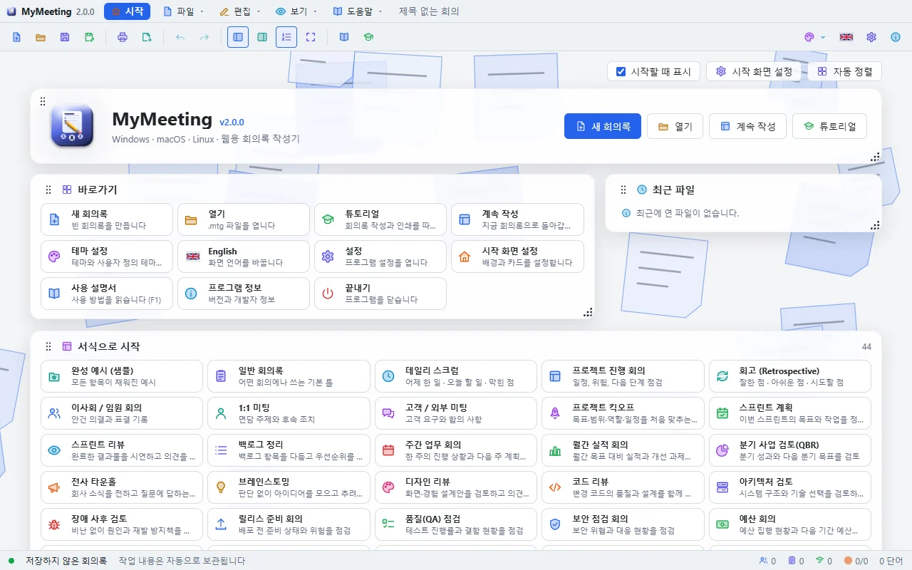
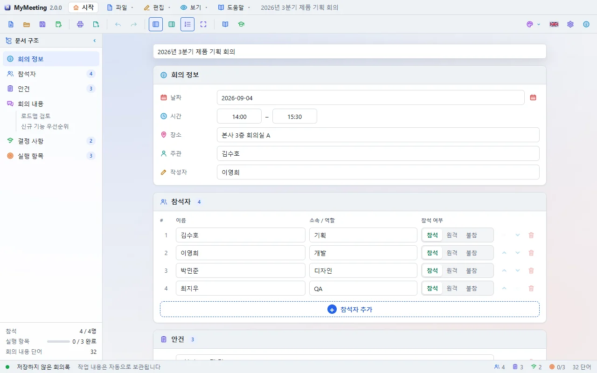
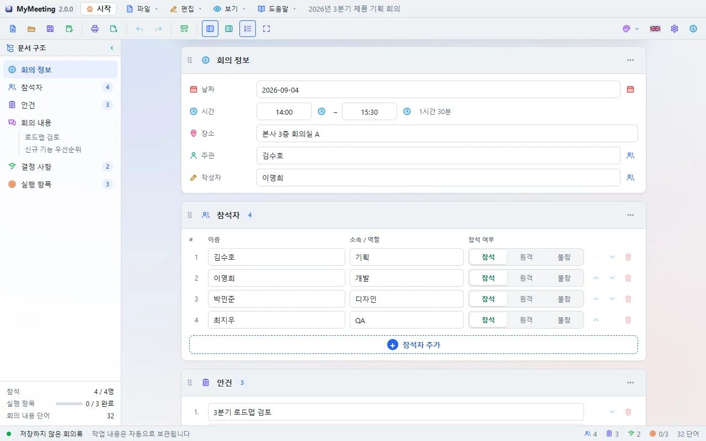
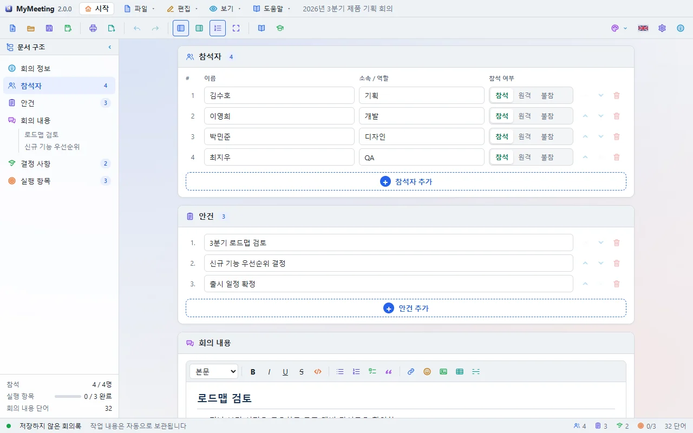
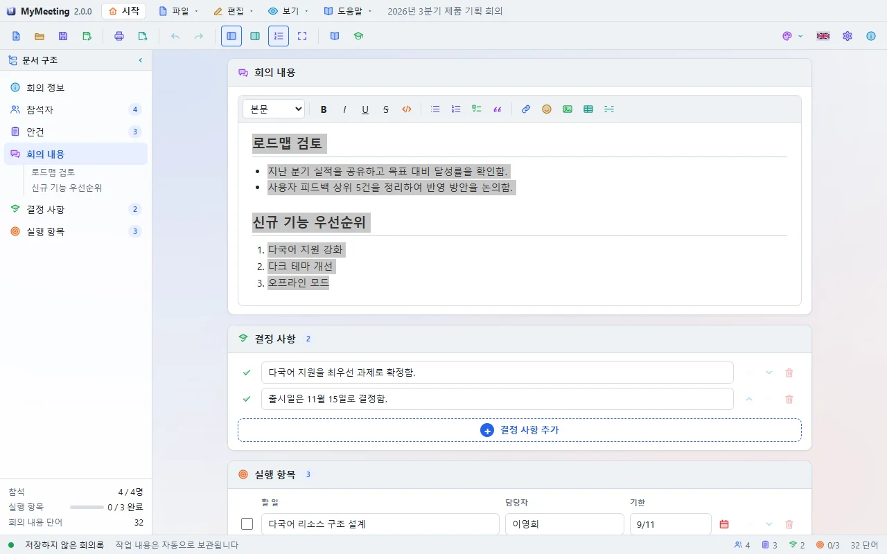
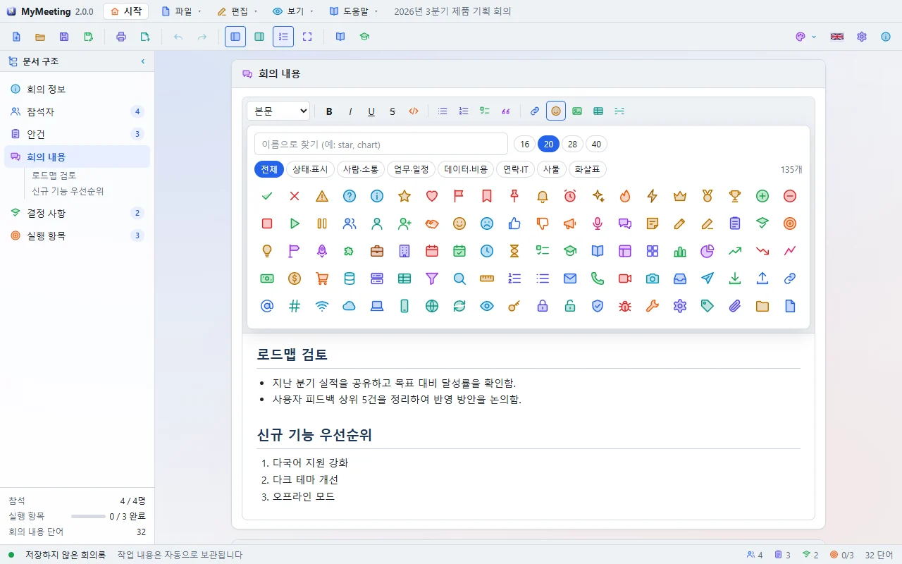
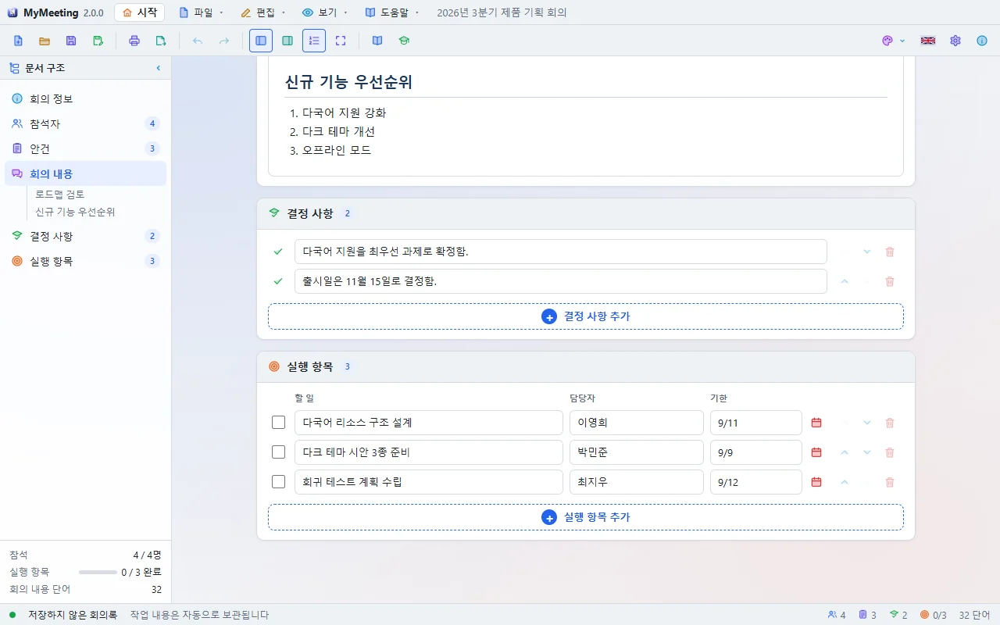
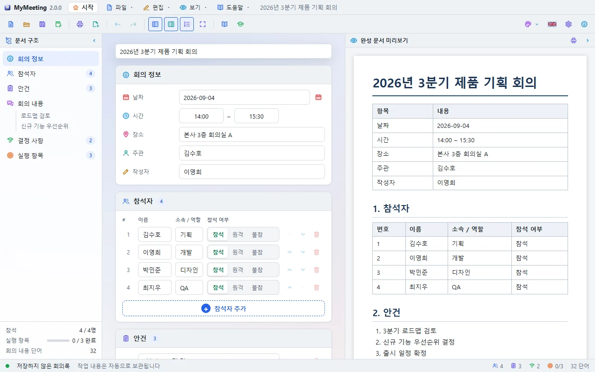

# MyMeeting 사용 설명서

MyMeeting 은 회의록을 빠르게 작성하고, 보기 좋게 인쇄하고, Word·HTML·Markdown·텍스트로 내보내는 프로그램입니다. Windows, macOS, Linux 에서 같은 모양으로 동작합니다.

## 시작 화면

프로그램을 켜면 시작 화면이 나타납니다. 새 회의록, 열기, 계속 작성, 튜토리얼 버튼과 바로가기·최근 파일·서식·테마·배경 카드가 있습니다.

- 카드는 머리 부분(⠿)을 끌어 옮기고, 오른쪽 아래 모서리를 끌어 크기를 바꿉니다. **자동 정렬** 은 처음 배치로 되돌립니다.
- **시작할 때 표시** 를 끄면 다음부터 바로 편집 화면이 열립니다. 툴바의 **시작** 버튼으로 언제든 다시 볼 수 있습니다.
- 처음 실행하면 **튜토리얼 고르기** 창이 뜹니다. 창 아래 **시작할 때 묻기** 를 끄면 더 이상 뜨지 않으며, 이 설정은 **설정 → 일반** 과 **설정 → 시작 화면** 에서도 바꿀 수 있습니다.

## 서식(템플릿)으로 시작하기

**서식으로 시작** 카드에는 45개의 회의 서식이 있습니다. 데일리 스크럼, 스프린트 계획, 킥오프, 장애 사후 검토, 예산 회의, 채용 면접, 안전 점검 등 회의 종류를 고르면 안건·참석자 역할·본문 제목·첫 실행 항목이 미리 채워진 회의록이 열립니다.

## 편집 화면

왼쪽은 **문서 구조**, 가운데는 회의록 **문서**, 오른쪽은 필요할 때 여는 **미리보기** 입니다.

- 문서 구조에서 항목을 누르면 해당 칸으로 바로 이동합니다. 회의 내용의 제목도 목록에 나타납니다.
- 아래 상태 줄에는 참석 인원, 실행 항목 완료 수, 단어 수와 저장 상태가 표시됩니다.
- 작성 중인 내용은 자동으로 보관되므로, 프로그램이 갑자기 꺼져도 다음 실행 때 이어서 쓸 수 있습니다.

## 회의 정보

맨 위에 회의 제목을 쓰고, **회의 정보** 칸에 날짜·시간·장소·주관·작성자를 입력합니다. 날짜 칸 오른쪽 달력 버튼으로 날짜를 고를 수 있습니다.

## 참석자와 안건 — "+" 버튼으로 추가

참석자·안건·결정 사항·실행 항목은 모두 목록입니다. 아래쪽 **+ 추가** 버튼을 누르면 한 줄이 생깁니다.

- 참석자마다 이름, 소속/역할, **참석 / 원격 / 불참** 을 고릅니다.
- 줄 오른쪽의 ↑ ↓ 로 순서를 바꾸고, 휴지통으로 지웁니다.
- 입력 중 **Enter** 를 누르면 다음 줄이 생기고, 빈 줄에서 **Backspace** 를 누르면 그 줄이 지워집니다.

## 회의 내용 — WYSIWYG 편집기

회의 내용은 보이는 그대로 편집합니다. 서식 막대에서 문단 종류(본문·제목 1~3·인용·코드), 굵게·기울임·밑줄·취소선, 목록·번호 목록·체크리스트, 링크, 아이콘, 그림·동영상, 표, 가로줄을 넣을 수 있습니다.

- 줄 처음에 `# `, `- `, `1. `, `> ` 를 쓰면 제목·목록·번호 목록·인용으로 바뀝니다.
- 표 안에서는 **Tab** 으로 다음 칸으로 가고, 서식 막대에 행·열 추가/삭제 버튼이 나타납니다.
- 그림은 끌어다 놓거나 붙여 넣어도 들어갑니다. 그림을 누르면 25·50·75·100% 크기 버튼과 크기 조절 손잡이가 나타납니다.
- 링크는 **Ctrl+클릭** 으로 엽니다.

### 아이콘 넣기

서식 막대의 😊 **아이콘 넣기** 를 누르면 135개의 컬러 아이콘이 나옵니다. 상태·사람·업무·데이터·연락·사물·화살표로 나뉘어 있고, 이름(예: `star`, `chart`)으로 찾을 수 있습니다. 크기(16·20·28·40)를 고르고 아이콘을 누르면 글자 사이에 들어갑니다. 넣은 아이콘은 미리보기, 인쇄, 내보내기에도 그대로 나옵니다.

## 결정 사항과 실행 항목

결정 사항은 한 줄에 하나씩 씁니다. 실행 항목에는 할 일, 담당자, 기한을 적고 끝나면 왼쪽 상자에 체크합니다. 담당자 칸은 참석자 이름을 추천해 줍니다.

## 미리보기

툴바의 **미리보기** 버튼으로 오른쪽에 완성된 회의록을 볼 수 있습니다. 인쇄물·내보내기와 같은 모양입니다.

## 인쇄와 페이지 설정

**인쇄(Ctrl+P)** 를 누르면 인쇄 창이 열립니다. 왼쪽에서 설정을 바꾸면 오른쪽 미리보기가 바로 다시 나뉩니다.

- **용지**: 크기(A4·A5·B5·Letter·Legal 등), 방향(세로/가로), 글자 배율
- **여백(mm)**: 위·아래·왼쪽·오른쪽을 각각 지정
- **머리글과 바닥글**: 왼쪽·가운데·오른쪽 세 칸. `{title}` 제목, `{date}` 날짜, `{time}` 시각, `{page}` 쪽 번호, `{pages}` 전체 쪽 수를 쓸 수 있고, 첫 페이지에서 뺄 수 있습니다.
- **인쇄 범위**: 모든 페이지, 현재 페이지, 페이지 지정(예: `1-3, 5`)
- 미리보기는 폭 맞춤 또는 50~150% 로 볼 수 있습니다.

PDF 로 저장하려면 인쇄 창에서 프린터를 "PDF 로 저장" 으로 고르면 됩니다.

## 내보내기

**내보내기(Ctrl+E)** 에서 형식을 고릅니다.

| 형식 | 확장자 | 용도 |
|------|--------|------|
| Word | .doc | Word 에서 열어 고칠 때. 용지와 여백이 유지됩니다 |
| HTML | .html | 웹 브라우저나 메일로 공유할 때 |
| Markdown | .md | 위키·Git 저장소에 올릴 때 |
| 텍스트 | .txt | 서식 없이 내용만 필요할 때 |
| PDF | .pdf | 인쇄 창에서 PDF 로 저장 |

## 파일 저장과 열기

회의록은 `.mtg` 파일로 저장합니다. **저장(Ctrl+S)** 은 같은 파일에 덮어쓰고, **다른 이름으로 저장(Ctrl+Shift+S)** 은 새 파일을 만듭니다. `.mtg` 파일을 창에 끌어다 놓아도 열립니다. 저장하지 않은 내용이 있을 때 새로 만들거나 닫으면 저장할지 묻습니다.

## 설정

툴바의 ⚙ **설정** 에서 다음을 바꿉니다.

- **일반**: 언어, 시작 화면 표시, 시작할 때 튜토리얼 묻기, 마지막 파일 다시 열기, 새 회의록 날짜를 오늘로, 최근 파일 지우기
- **문서**: 글꼴(설치된 글꼴 목록), 글자 크기, 제목 번호 매기기
- **테마**: 라이트 20개, 다크 20개, 사용자 정의 테마(배경·패널·글자·강조색 등을 직접 골라 최대 24개까지 저장)
- **시작 화면**: 시작 화면 표시, 튜토리얼 묻기, 배경 무늬와 속도, 카드 불투명도, 카드 배치 초기화

## 팝업 창

설정, 인쇄, 내보내기, 사용 설명서, 튜토리얼 카드 등 모든 팝업은 **독립된 창** 입니다. 제목 줄을 끌어 프로그램 창 밖, 다른 모니터로도 옮길 수 있습니다. 오른쪽 위 **×** 에 마우스를 올리면 빨갛게 바뀌고, 누르거나 **Esc** 를 누르면 닫힙니다. 사용 설명서와 인쇄 창은 크기도 바꿀 수 있습니다.

## 튜토리얼

**도움말 → 튜토리얼** 또는 시작 화면의 **튜토리얼** 버튼으로 엽니다. 두 가지가 있습니다.

- **첫 회의록 작성하기** (10단계): 제목, 일시, 참석자, 안건, 회의 내용, 서식, 결정, 실행 항목, 저장
- **인쇄와 내보내기** (6단계): 예시 불러오기, 인쇄 창, 가로 방향, 여백, 내보내기

튜토리얼 카드는 프로그램 위에 떠 있는 작은 창이며, 단계마다 화면 그림을 보여 줍니다. 실제 버튼으로 따라 하면 단계가 끝난 것을 스스로 알아차리고, **대신 해 주기** 를 누르면 그 단계를 자동으로 해 줍니다. 자세한 내용은 [튜토리얼](Tutorial.md) 문서를 보세요.

## 단축키

| 키 | 동작 |
|----|------|
| Ctrl+N / Ctrl+O | 새 회의록 / 열기 |
| Ctrl+S / Ctrl+Shift+S | 저장 / 다른 이름으로 저장 |
| Ctrl+P / Ctrl+E | 인쇄 / 내보내기 |
| Ctrl+Z / Ctrl+Y | 실행 취소 / 다시 실행 |
| Ctrl+B / I / U / K | 굵게 / 기울임 / 밑줄 / 링크 |
| F1 | 사용 설명서 |
| F11 | 전체 화면 |
| Esc | 팝업 닫기 |
