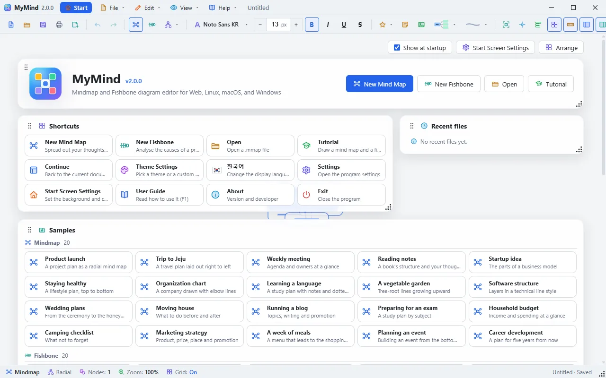
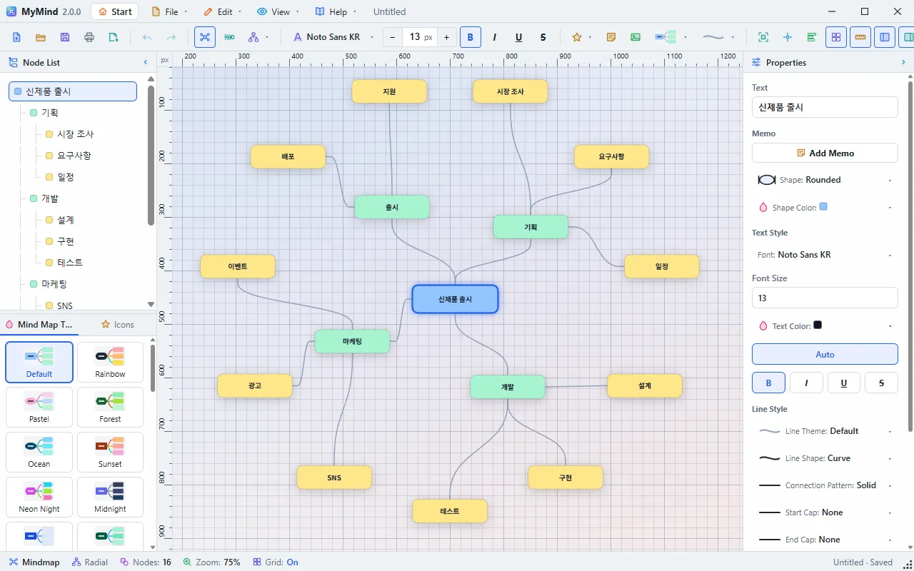
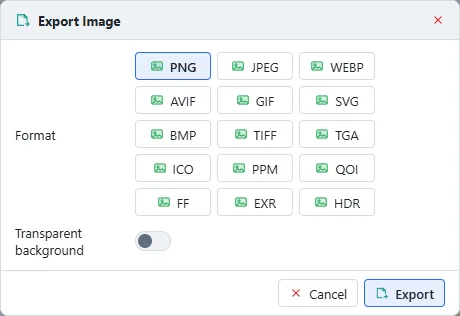
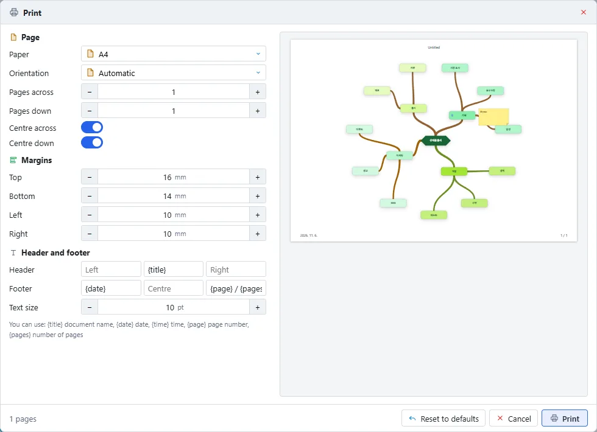
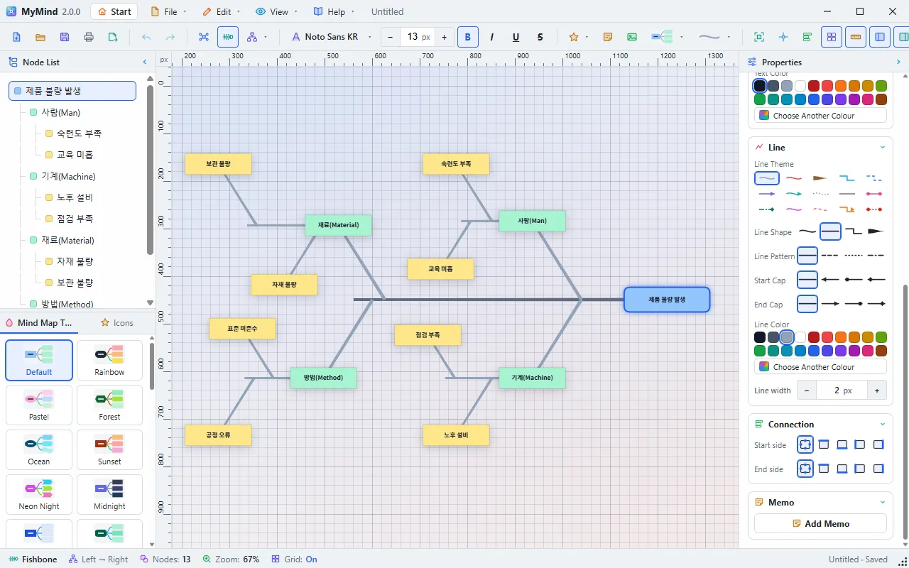
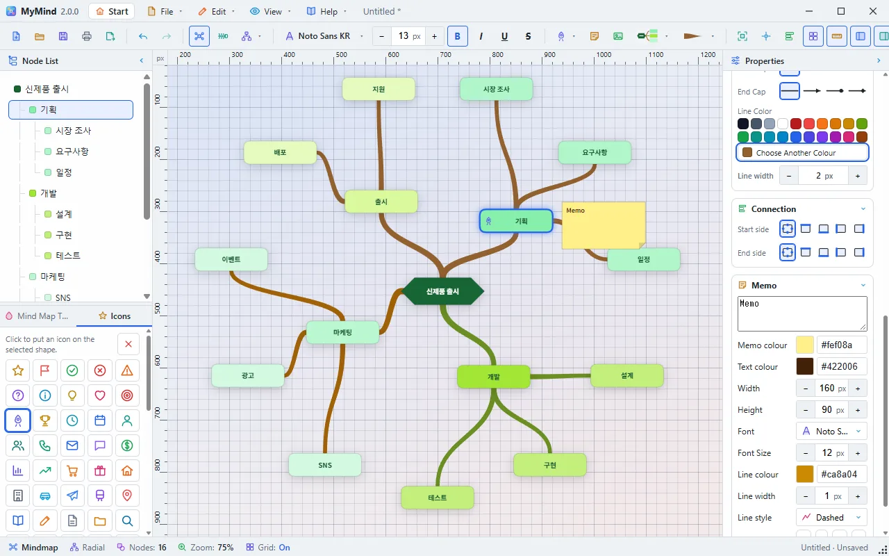
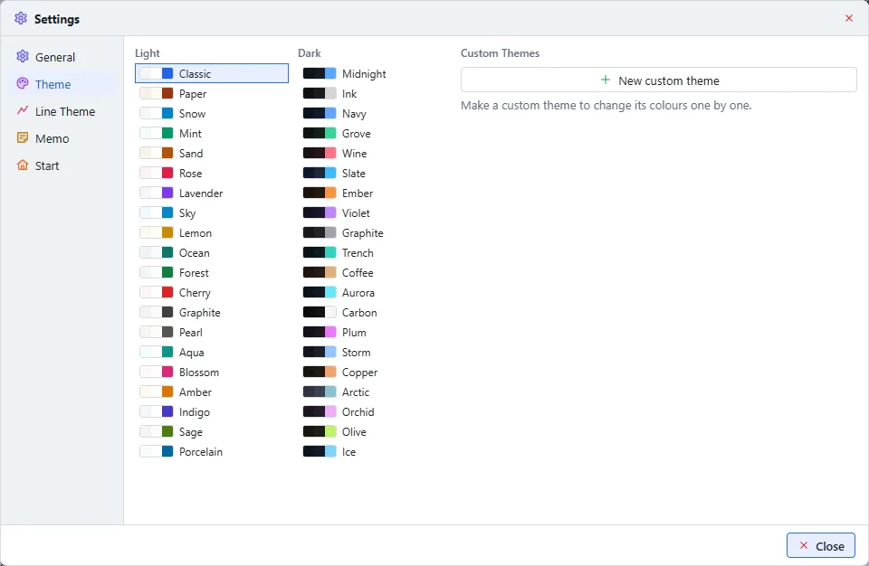
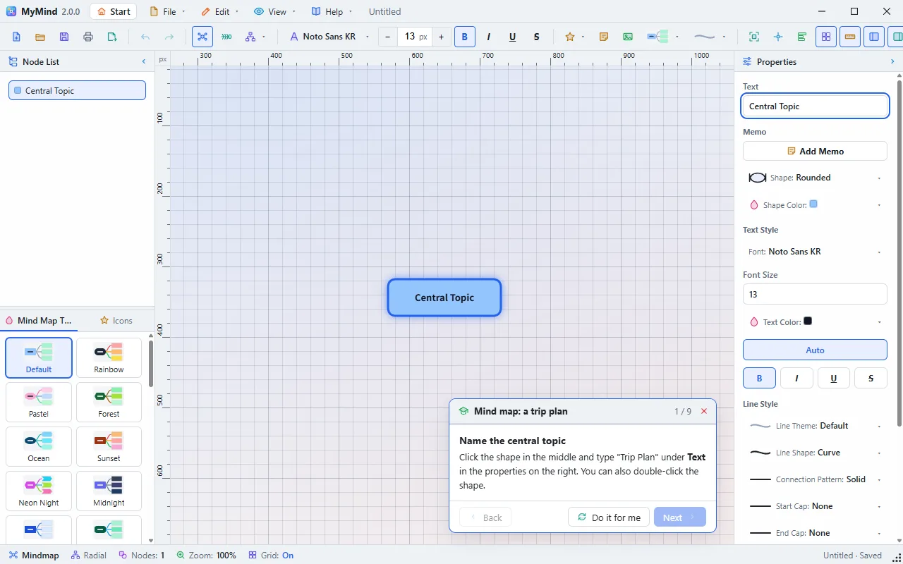

# MyMind User Guide

## 1. Introduction

MyMind is an editor for **mind maps** and **fishbone (Ishikawa)** diagrams, running as a desktop app (Windows / macOS / Linux) and in a web browser with the same screens. Both modes share the same data: switching only changes how it is drawn.

## 2. Installation (Windows)

1. Run `MyMind_2.0.0_x64-setup.exe`.
2. Pick the installer's language (Korean / English). The program's first start uses it too.
3. Follow the steps. `.mmap` files are associated with MyMind.

> The window has no system title bar. The top row takes its place: drag it to move the window, double-click it to maximize. Drag the dots at the bottom right to resize. The window's position and size are remembered.

## 3. Screen layout

| Area | Description |
|------|-------------|
| **Start screen** | Cards over a moving background: shortcuts, recent files, samples, themes, backgrounds. The **Start** button in the top row opens it at any time |
| **Top row** | Name and version, **Start**, **File▾ Edit▾ View▾ Help▾**, document name, window buttons |
| **Toolbar** | Icons only, explained at once by a tooltip when the pointer rests on them. Files, undo, mode and layout, font and size (−/+), icons, memos and images, mind map and line themes, view (grid, rulers, panels, full screen), theme, language, settings, about |
| **Left panel** | Above: node list as a **tree view** with parent/child connector lines. Below: the **mind map theme** gallery. They start half and half; drag the divider between them to resize |
| **Right panel** | Text·memo, shape·color, font·font size·text color·style, line shape/pattern/caps/color, connection point |
| **Canvas** | Diagram editing (grid, pan, zoom) |
| **Status bar** | Mode, layout, node count, zoom, grid, save status, resize dots |
| **Context menu** | Undo/redo, add/edit, duplicate/copy/paste, file (Save, Print, Export) and view actions, Select All, delete |

Dialogs and the settings window are windows of their own, which can be moved outside the program. The guide window can stay open while you work.

## 4. Basic tasks

### 4.1 File (File▾ menu)

- **New Mind Map / New Fishbone** (Ctrl+N uses the default mode from the settings): asks first about unsaved work
- **Open** (Ctrl+O): open `.mmap` (legacy `.mymind` too); the view fits the whole diagram
- **Save** (Ctrl+S), **Save As** (Ctrl+Shift+S): save as `.mmap` (the web version downloads)
- **Print** (Ctrl+P): the button right of Save in the toolbar, the File menu or the right-click menu. In a window of its own, choose the paper, orientation, margins, header and footer, page numbers and how many sheets to spread over, check the preview, then go on to the system's print window
- **Export**: save an image as **PNG, JPEG, WebP, AVIF, GIF, SVG, BMP, TIFF, TGA, ICO, PPM, QOI, Farbfeld, EXR or HDR**, optionally with a **transparent background** (where the format has one), cropped to the **smallest size holding every shape**
- **Samples**: open the 20 mind map and 20 fishbone samples from the Samples card on the start screen. They open as new unnamed documents, so the originals never change

### 4.2 Mode

The **Mind map / Fishbone** buttons in the toolbar redraw the current document in the other mode.

### 4.3 Nodes

| Action | How |
|--------|-----|
| Select | Click a node (or a row in the left tree — it highlights on canvas) |
| Select many | **Marquee drag**, or **Ctrl-click / Shift-click**. Shapes and lines can be selected together, and a second click takes one off. A marquee with the key held adds to the selection |
| Select all | **Ctrl+A** or the right-click menu |
| Change many at once | Select several shapes or lines, then change a property: all of them take it. With shapes and lines together, shape properties go to the shapes and line properties to the lines |
| Memo | Select a shape or a line, then **Memo** in the toolbar or the right-click menu. Change its colour, size, font and connecting line in the properties, and drag it to move it. With several selected, the look of all their memos changes at once |
| Icon | Select a shape, then pick from the **Icons** tab at the bottom left, or the toolbar |
| Image | **Insert Image** in the toolbar, or drop a file on the window. PNG, JPEG, GIF, WebP, BMP, SVG, AVIF, ICO, TIFF, TGA, DDS, HDR, EXR, PNM, QOI, Farbfeld, PSD |
| Move | Drag (moves the whole selection) |
| Edit text | Double-click or context menu |
| Add child / sibling | Context menu |
| Duplicate / Copy / Paste | Context menu (node + subtree) |
| Delete | **Delete/Backspace** or context menu (root/effect can't be deleted) |
| **Undo / Redo** | Toolbar, context menu, or **Ctrl+Z / Ctrl+Y / Ctrl+Shift+Z** |

### 4.4 Layout, shape, line

- **Layout** (toolbar) — Mindmap: Radial · Top→Bottom · Bottom→Top · Left→Right · Right→Left; Fishbone: Left→Right · Right→Left
- **Shapes (12)**: rounded, rectangle, ellipse, diamond, parallelogram, stadium, hexagon, octagon, cylinder, trapezoid, chevron, note — with previews
- **Line**: curve · straight · elbow · tree-root; **patterns**: solid · dashed · dotted · dash-dot; **start/end caps**: none · arrow · dot · diamond
- **Fonts**: presets + **all installed system fonts**, **font size**, color, bold/italic/underline/strike

Lines attach at the **midpoint of each node face**.

### 4.5 Selecting a line · manual connection point

- **Click a line** to select just that edge and edit its type/pattern/color/caps.
- In **Connection Point**, set the **start/end side** to Auto/Top/Bottom/Left/Right to place the connection manually.

### 4.6 View tools

| Button | Action |
|--------|--------|
| **Fit All** | Zoom and move so the whole diagram fits |
| **Center View** | Move the diagram to the middle, at the current zoom |
| **Auto Align** | Re-layout with the current rule, then fit |
| **Ruler** | Toggle the rulers along the canvas's top and left. They show diagram coordinates and mark the pointer's place in red on each ruler |
| **Left Panel / Right Panel** | Fold or open a panel. The arrow in a panel's title and the folded strip do the same |
| **Grid** | Toggle the grid. It is redrawn as you zoom, and its spacing changes by a factor of five when cells get too small or too large. **When the grid is on, left-drag on empty canvas pans the background** |

### 4.7 Canvas

- **Pan**: middle-button drag (or left-drag when the grid is on)
- **Zoom**: mouse wheel (10%–400%, centered)
- **Deselect**: click empty space

### 4.8 Theme, language, settings

- **Themes**: 20 light and 20 dark. Pick one from **Theme▾** in the toolbar, the Theme card on the start screen, or the settings window
- **Custom themes**: with the button at the top of the **Theme▾** menu, or in Settings → Theme, copy the current theme and change its colours one by one
- **Mind map themes**: the gallery at the bottom of the left panel, or **Mind Map Theme▾** in the toolbar, dresses the whole diagram: node colours, text and connectors, and the shapes of the centre, the main branches and the outer branches, in 40 themes. The canvas keeps the program theme's colours. Drag the divider under the node list to resize the two areas
- **Line themes**: **Line Theme▾** in the toolbar changes the shape, pattern, ends and colour of every connector at once. Lines added later follow it
- **Language**: Korean ↔ English, applied at once
- **Settings window**:
  - **General**: language, showing the start screen, reopening the last file, a new diagram's mode, layout, shape and line theme, the grid, clearing recent files
  - **Theme**: the 40 themes and the custom theme editor
  - **Line Theme**: the one for new diagrams, and applying it to the current diagram
  - **Memo**: the colour, size and font of new memos, and whether memos show
  - **Start**: the background (24 kinds), its speed, card opacity, putting the cards back
- Move a start screen card by the handle at its top left; resize it by the dots at its bottom right
- All settings are saved and last to the next start

### 4.9 Unsaved work

With unsaved work, closing the window or opening another document asks **Save / Don't Save / Cancel**.

### 4.10 Tutorials

The **Tutorial** button on the start screen (or the Help menu) offers **Mind map: a trip plan** and **Fishbone: why we are late**. Either opens a new document with a guide card.

- The program asks at startup whether to take a tutorial. Turn off **Ask about the tutorial at startup** in that window, or change it in Settings → Start
- Follow along with the real program. When a step is done the card notices and **Next** lights up
- **Do it for me** has the program do the step
- Drag the card by its header to move it

## 5. Fishbone tips

1. Toggle to **Fishbone**.
2. Right-click the Effect node → Add Child for categories.
3. Add causes under categories; children and deeper causes fan evenly above/below their parent.
4. Drag or **Auto Align** to tidy up.

## 6. File format

- Extension: `.mmap` (legacy `.mymind` too), JSON (UTF-8)
- Stores node positions/sizes/shapes/colors/memo/fonts, edges with line type/pattern/color/caps/**connection side**, and mode/layout — restored exactly on open
- Portable across MyMind installations

## 7. Troubleshooting

| Issue | Try |
|-------|-----|
| Content off-screen | **Center View** |
| Messy layout | **Auto Align** |
| Toolbar labels disappear | the window is narrow, so only the icons show; widen it to bring them back |
| A recent file left the list | a file that cannot be found is reported and removed from the list |
| Path not remembered (web) | web uses downloads; use the desktop app |

## 8. Support

Contact: **SHKWON** — knix008@naver.com
