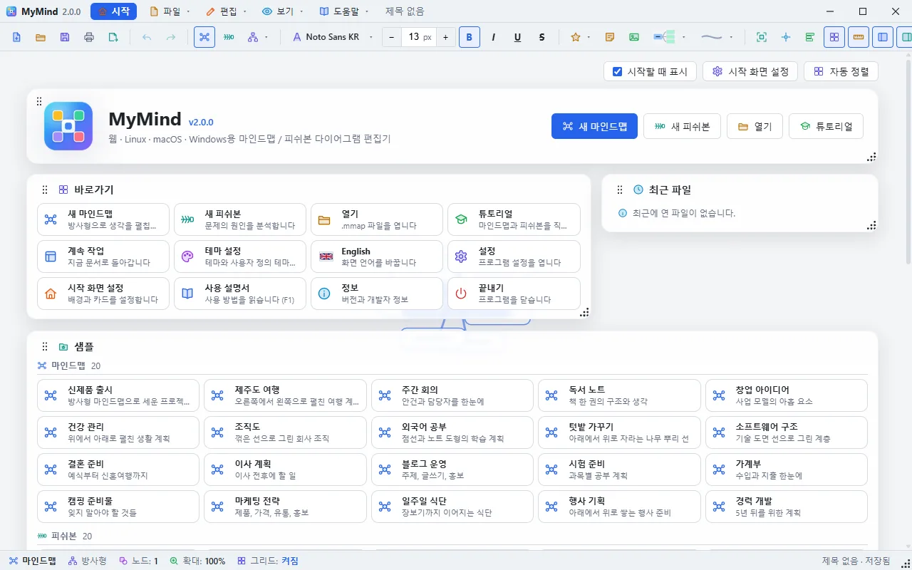
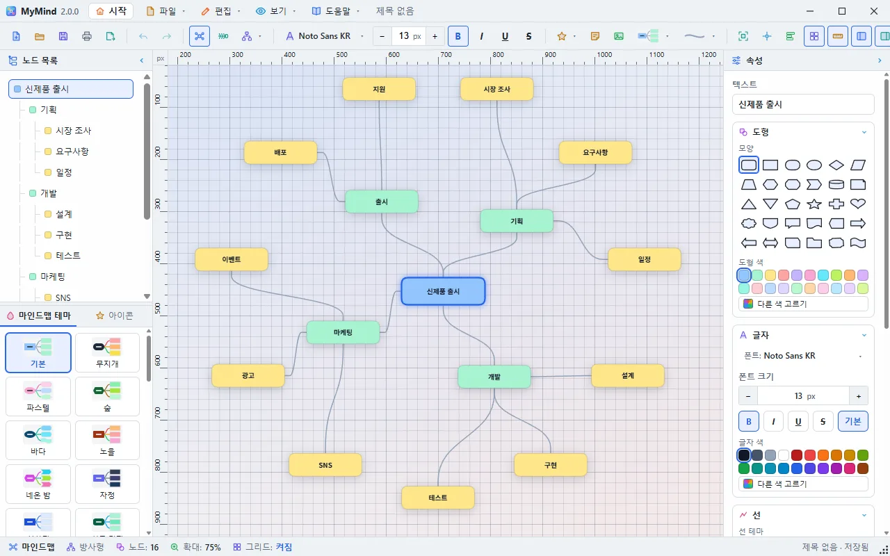
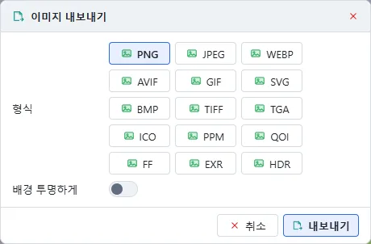
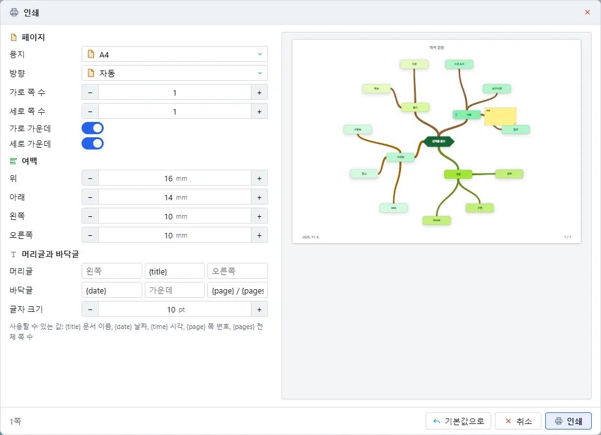
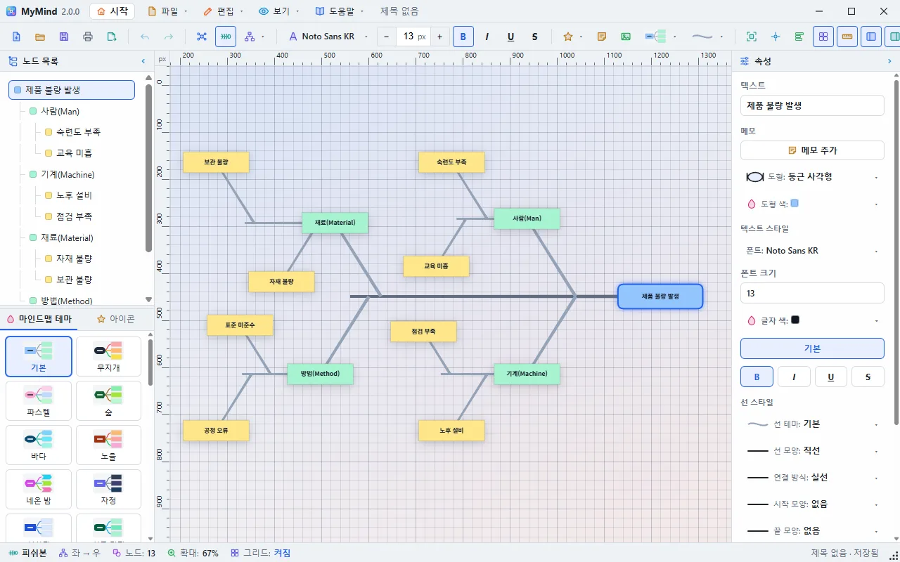
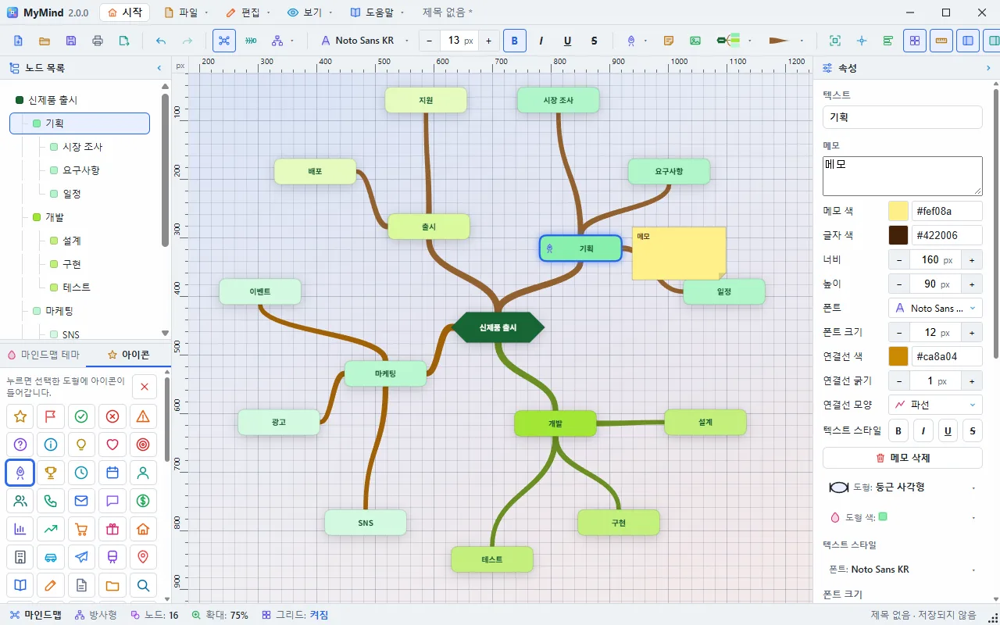
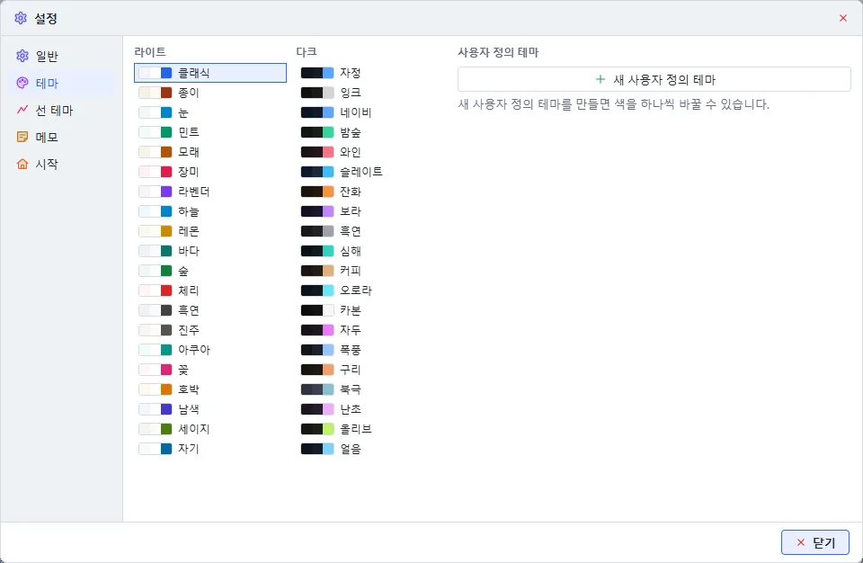
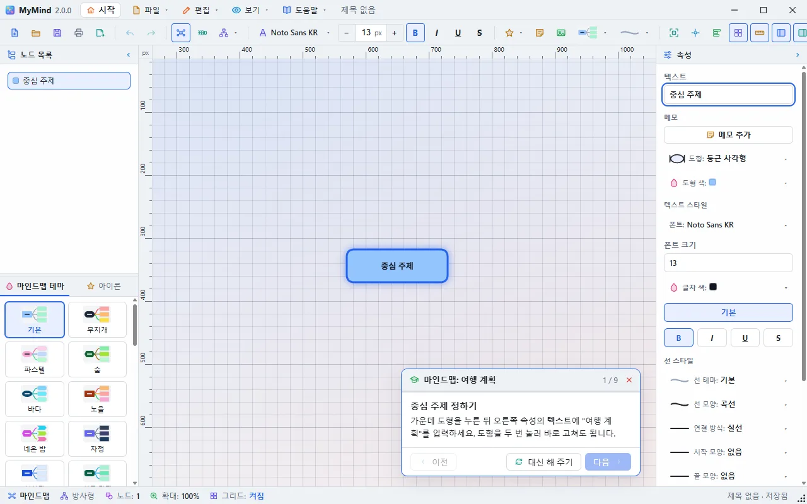

# MyMind 사용 설명서

## 1. 소개

MyMind는 마인드맵과 피쉬본(원인-결과, Ishikawa) 다이어그램을 작성하는 편집기입니다.
Windows / macOS / Linux 설치형 앱과 웹 브라우저에서 같은 화면으로 사용할 수 있습니다.
마인드맵과 피쉬본은 **같은 데이터**를 공유하므로, 모드를 바꾸면 보기만 전환됩니다.

## 2. 설치 (Windows)

1. `MyMind_2.0.0_x64-setup.exe`를 실행합니다.
2. 설치 언어(한국어 / English)를 고릅니다. 프로그램을 처음 실행할 때 이 언어로 시작합니다.
3. 안내에 따라 설치합니다. `.mmap` 파일이 MyMind에 연결됩니다.

> 창에는 기본 제목 표시줄이 없습니다. 맨 위 줄이 제목 표시줄 역할을 하며, 끌면 창이 움직이고 두 번 누르면 최대화됩니다. 오른쪽 아래 점 무늬를 끌면 크기가 바뀝니다. 창의 위치와 크기는 기억됩니다.

## 3. 화면 구성

| 영역 | 설명 |
|------|------|
| **시작 화면** | 움직이는 배경 위의 카드: 바로가기, 최근 파일, 샘플, 테마, 배경. 맨 위 줄의 **시작** 단추로 언제든 엽니다 |
| **맨 위 줄** | 프로그램 이름과 버전, **시작**, **파일▾ 편집▾ 보기▾ 도움말▾**, 문서 이름, 창 단추 |
| **툴바** | 아이콘만 있고, 마우스를 올리면 바로 설명이 나옵니다. 파일, 실행 취소, 모드와 레이아웃, 폰트와 크기(−/+), 아이콘·메모·이미지, 마인드맵 테마·선 테마, 보기(그리드·눈금자·패널·전체 화면), 테마·언어·설정·정보 |
| **좌측 패널** | 위쪽: 노드 목록 **트리뷰**(부모/자식 연결선). 아래쪽: **마인드맵 테마** 갤러리. 시작할 때 반반으로 나뉘고, 가운데 구분선을 끌어 크기를 바꿉니다 |
| **우측 패널(속성)** | 텍스트·메모, 도형·색, 폰트·폰트 크기·글자색·스타일, 선 모양·패턴·시작/끝 모양·색, 연결 위치 |
| **캔버스** | 다이어그램 편집 영역 (그리드, 팬, 줌) |
| **상태 바** | 모드, 레이아웃, 노드 수, 줌, 그리드, 저장 상태, 크기 조절 점 |
| **컨텍스트 메뉴** | 우클릭: 실행 취소/다시 실행, 추가·편집, 복제/복사/붙여넣기, 파일(저장·인쇄·내보내기)·보기 동작, 전체 선택, 삭제 |

대화상자와 설정 창은 각각 독립된 창이라 프로그램 밖으로도 옮길 수 있습니다. 설명서 창은 열어 둔 채로 작업할 수 있습니다.

## 4. 기본 작업

### 4.1 파일 (파일▾ 메뉴)

- **새 마인드맵 / 새 피쉬본** (Ctrl+N은 설정의 기본 모드): 저장하지 않은 내용이 있으면 먼저 묻습니다
- **열기** (Ctrl+O): `.mmap` 열기(기존 `.mymind`도 열림). 열면 전체가 보이도록 자동으로 맞춥니다
- **저장** (Ctrl+S), **다른 이름으로 저장** (Ctrl+Shift+S): `.mmap`으로 저장 (웹은 다운로드)
- **인쇄** (Ctrl+P): 툴바의 저장 오른쪽 단추, 파일 메뉴, 우클릭 메뉴. 독립된 창에서 용지, 방향, 여백, 머리글과 바닥글, 쪽 번호, 나누어 찍을 쪽 수를 정하고 미리보기로 확인한 뒤 시스템 인쇄 창으로 넘깁니다
- **내보내기**: 이미지로 저장. **PNG, JPEG, WebP, AVIF, GIF, SVG, BMP, TIFF, TGA, ICO, PPM, QOI, Farbfeld, EXR, HDR** 형식과 **배경 투명** 여부(투명을 지원하는 형식만)를 고르며, **모든 도형을 포함하는 최소 크기**로 저장합니다
- **샘플**: 시작 화면의 샘플 카드에서 마인드맵 20종과 피쉬본 20종을 엽니다. 이름 없는 새 문서로 열리므로 원본은 바뀌지 않습니다

### 4.2 모드 전환

툴바의 **마인드맵 / 피쉬본** 단추로 현재 문서를 다른 모드로 다시 그립니다.

### 4.3 노드 편집

| 동작 | 방법 |
|------|------|
| 선택 | 노드 클릭 (좌측 트리에서 클릭해도 캔버스에서 강조) |
| 여러 개 선택 | 빈 공간 **드래그(사각형 선택)** 또는 **Ctrl+클릭 / Shift+클릭**. 도형과 선을 섞어 고를 수 있고, 다시 클릭하면 빠집니다. 키를 누른 채 사각형을 그리면 선택에 더합니다 |
| 전체 선택 | **Ctrl+A** 또는 우클릭 메뉴 |
| 한꺼번에 변경 | 도형이나 선을 여러 개 고른 뒤 속성을 바꾸면 모두에 적용됩니다. 도형과 선을 함께 고르면 도형 속성은 도형에, 선 속성은 선에 적용됩니다 |
| 메모 | 도형이나 선을 고르고 툴바의 **메모** 또는 우클릭 메뉴. 색, 크기, 글꼴, 연결선은 오른쪽 속성에서 바꾸고 끌어서 옮깁니다. 여러 개를 고르면 메모 모양을 한 번에 바꿉니다 |
| 아이콘 | 도형을 고르고 좌측 아래 **아이콘** 탭이나 툴바에서 고릅니다 |
| 이미지 | 툴바의 **이미지 넣기**, 또는 파일을 창에 끌어다 놓습니다. PNG, JPEG, GIF, WebP, BMP, SVG, AVIF, ICO, TIFF, TGA, DDS, HDR, EXR, PNM, QOI, Farbfeld, PSD |
| 이동 | 노드 드래그 (여러 개 선택 시 함께 이동) |
| 텍스트 편집 | 더블클릭 또는 우클릭 → 편집 |
| 하위/형제 추가 | 우클릭 메뉴 |
| 복제 / 복사 / 붙여넣기 | 우클릭 메뉴 (노드와 하위 트리 전체) |
| 삭제 | **Delete/Backspace** 또는 우클릭 (루트/결과는 삭제 불가) |
| **실행 취소 / 다시 실행** | 툴바 버튼, 우클릭, 또는 **Ctrl+Z / Ctrl+Y / Ctrl+Shift+Z** |

### 4.4 레이아웃 · 도형 · 선

- **레이아웃**(툴바 드롭다운) — 마인드맵: 방사형 · 상→하 · 하→상 · 좌→우 · 우→좌 / 피쉬본: 좌→우 · 우→좌
- **도형**(30종): 우측 속성 패널에 작은 아이콘으로 모두 펼쳐져 있어 바로 누르면 됩니다. 아이콘 위에 마우스를 올리면 이름이 툴팁으로 나옵니다. 기본 도형(사각형, 타원, 마름모, 육각형, 원통 등)에 삼각형, 별, 십자, 하트, 구름, 방패, 말풍선, 문서, 꼬리표, 화살표 3종, 폴더, 명판, 물결 등이 있습니다.
- **속성 패널**은 도형 · 글자 · 선 · 연결 위치 · 메모 묶음으로 나뉩니다. 묶음 제목을 누르면 접히고, 색은 팔레트에서 바로 고르며 맨 끝의 무지개 칸으로 다른 색도 고를 수 있습니다.
- **선 모양**: 곡선 · 직선 · 꺾은 선 · 나무 뿌리형 / **패턴**: 실선 · 파선 · 점선 · 일점쇄선 / **시작·끝 모양**: 없음 · 화살표 · 원 · 마름모
- **폰트**: 프리셋 + **설치된 모든 시스템 폰트**, **폰트 크기**, 글자색, 굵게/기울임/밑줄/취소선

선은 **노드 각 면의 중앙**(도형 표면)에 연결됩니다.

### 4.5 선 개별 선택 · 연결 위치 수동 변경

- 선을 **클릭하면 그 선만 선택**되어 종류·패턴·색·양 끝 모양을 편집할 수 있습니다.
- 우측 **연결 위치**에서 **시작 면 / 끝 면**을 자동·위·아래·왼쪽·오른쪽으로 지정해 연결 지점을 수동 조정할 수 있습니다.

### 4.6 보기 도구

| 버튼 | 기능 |
|------|------|
| **전체 보기** | 전체가 화면에 들어오도록 확대율과 위치를 조정 |
| **중심 이동** | 지금 확대율 그대로 다이어그램을 화면 가운데로 이동 |
| **자동 정렬** | 현재 레이아웃 규칙으로 다시 배치 후 화면 맞춤 |
| **눈금자** | 캔버스 위쪽과 왼쪽의 눈금자 켜기/끄기. 다이어그램 좌표를 표시하고, 마우스 위치를 눈금자 위의 빨간 표시로 보여 줍니다 |
| **좌측 패널 / 우측 패널** | 패널 접기/펼치기. 패널 제목의 화살표나 접힌 띠를 눌러도 됩니다. 접힌 왼쪽 띠의 **마인드맵 테마**, **아이콘**을 누르면 그 탭이 열린 채로 펼쳐집니다 |
| **그리드** | 캔버스 격자 켜기/끄기. 확대·축소에 맞춰 다시 그려지고, 칸이 너무 작거나 커지면 5배 단위로 간격이 바뀝니다. **그리드가 켜진 상태에서는 빈 곳을 왼쪽 드래그하면 배경(화면)이 이동**합니다 |

### 4.7 캔버스 조작

- **팬**: 마우스 가운데(휠) 버튼 드래그 (또는 그리드 켜짐 시 왼쪽 드래그)
- **줌**: 마우스 휠 (10%~400%, 화면 중심 기준)
- **선택 해제**: 빈 공간 클릭

### 4.8 테마 · 언어 · 설정

- **테마**: 라이트 20종과 다크 20종. 툴바의 **테마▾**, 시작 화면의 테마 카드, 설정 창에서 고릅니다
- **사용자 정의 테마**: **테마▾** 메뉴 맨 위의 단추나 설정 → 테마에서 현재 테마를 복사해 색을 하나씩 바꿉니다
- **마인드맵 테마**: 좌측 패널 아래의 갤러리나 툴바의 **마인드맵 테마▾**로 다이어그램 전체를 꾸밉니다. 도형 색, 글자, 연결선과 함께 중심·주요 가지·바깥 가지의 도형 모양이 바뀌고 40종이 있습니다. 캔버스 배경은 프로그램 테마를 따릅니다. 노드 목록과의 구분선을 끌면 두 영역의 크기가 바뀝니다
- **선 테마**: 툴바의 **선 테마▾**로 모든 연결선의 모양, 무늬, 끝 모양, 색을 한 번에 바꿉니다. 그 뒤에 추가하는 선도 따릅니다
- **언어**: 한국어 ↔ English, 바로 적용됩니다
- **설정 창**:
  - **일반**: 언어, 시작 화면 표시, 마지막 파일 다시 열기, 새 다이어그램의 모드·레이아웃·도형·선 테마, 그리드, 최근 파일 지우기
  - **테마**: 40종 목록과 사용자 정의 테마 편집
  - **선 테마**: 새 다이어그램의 선 테마, 지금 다이어그램에 적용
  - **메모**: 새 메모의 색, 크기, 글꼴과 메모 표시 여부
  - **시작**: 배경(24종), 움직임 속도, 카드 불투명도, 카드 배치 되돌리기
- 시작 화면의 카드는 왼쪽 위 손잡이로 옮기고, 오른쪽 아래 점으로 크기를 바꿉니다
- 모든 설정은 저장되어 다음 실행에도 유지됩니다

### 4.9 저장 확인

저장하지 않은 내용이 있을 때 창을 닫거나 다른 문서를 열면 **저장 / 저장 안 함 / 취소**를 묻습니다.

### 4.10 튜토리얼

시작 화면의 **튜토리얼** 단추(또는 도움말 메뉴)에서 **마인드맵: 여행 계획**이나 **피쉬본: 지각의 원인**을 고르면 새 문서에서 안내 카드가 시작됩니다.

- 프로그램을 시작할 때 튜토리얼을 실행할지 묻습니다. 그 창의 **시작할 때 튜토리얼 물어보기**를 끄거나 설정 → 시작에서 바꿀 수 있습니다
- 프로그램을 그대로 쓰면서 따라 합니다. 단계를 마치면 카드가 스스로 알아채고 **다음**이 켜집니다
- **대신 해 주기**를 누르면 그 단계를 프로그램이 합니다
- 카드는 머리글을 끌어 옮깁니다

## 5. 피쉬본 팁

1. 토글로 **피쉬본**으로 전환합니다.
2. 결과(Effect) 노드에 우클릭 → 하위 추가로 원인 분류를 늘립니다.
3. 분류에 하위 추가로 개별 원인을 더합니다. 자식/손자는 부모 기준 위·아래로 고르게 배치됩니다.
4. 필요하면 노드를 드래그하거나 **자동 정렬**로 정리합니다.

## 6. 파일 형식

- 확장자: `.mmap` (기존 `.mymind`도 열림), JSON(UTF-8)
- 저장 내용: 노드 좌표·크기·도형·색·메모·글꼴/크기, 선의 연결·종류·패턴·색·양 끝 모양·**연결 면**, 모드/레이아웃 — 열면 그대로 복원됩니다.
- 다른 PC의 MyMind에서도 동일하게 열립니다.

## 7. 문제 해결

| 증상 | 조치 |
|------|------|
| 노드가 화면 밖으로 나감 | **중심 이동** |
| 배치가 어수선함 | **자동 정렬** |
| 툴바 글자가 사라짐 | 창이 좁아서 아이콘만 표시한 것입니다. 창을 넓히면 돌아옵니다 |
| 최근 파일이 목록에서 사라짐 | 파일을 찾을 수 없으면 알린 뒤 목록에서 뺍니다 |
| 저장 경로가 유지되지 않음(웹) | 웹은 다운로드 방식입니다. 데스크톱 앱을 사용하세요 |

## 8. 지원

문의: **SHKWON** — knix008@naver.com
