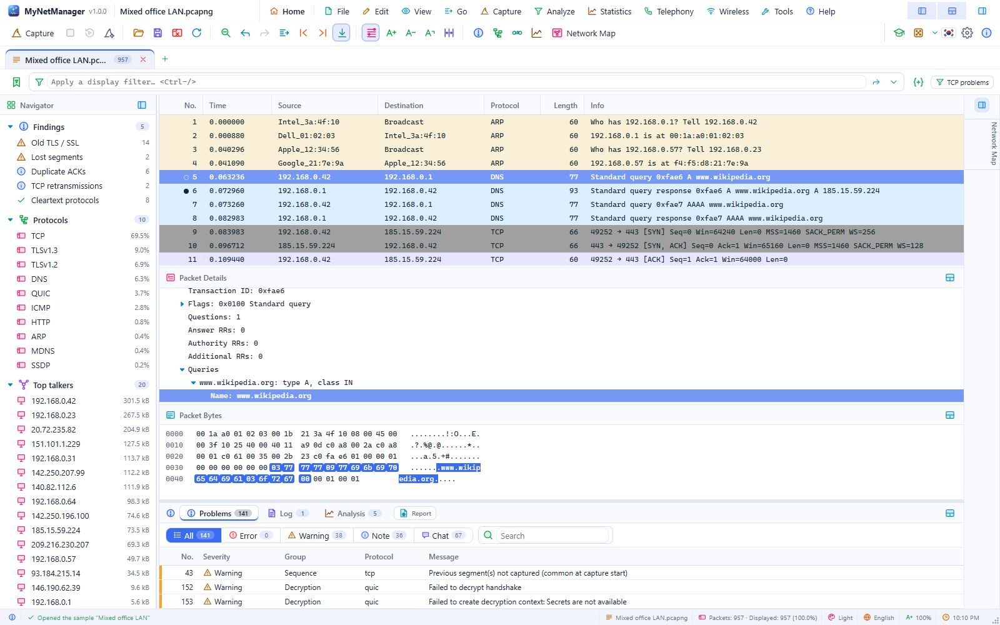
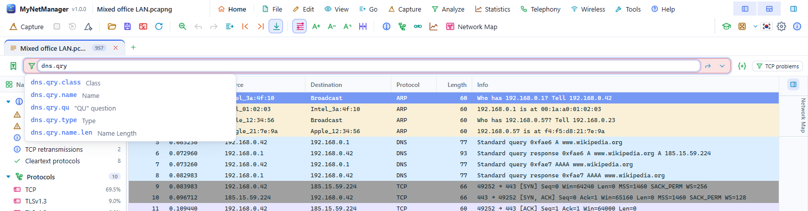
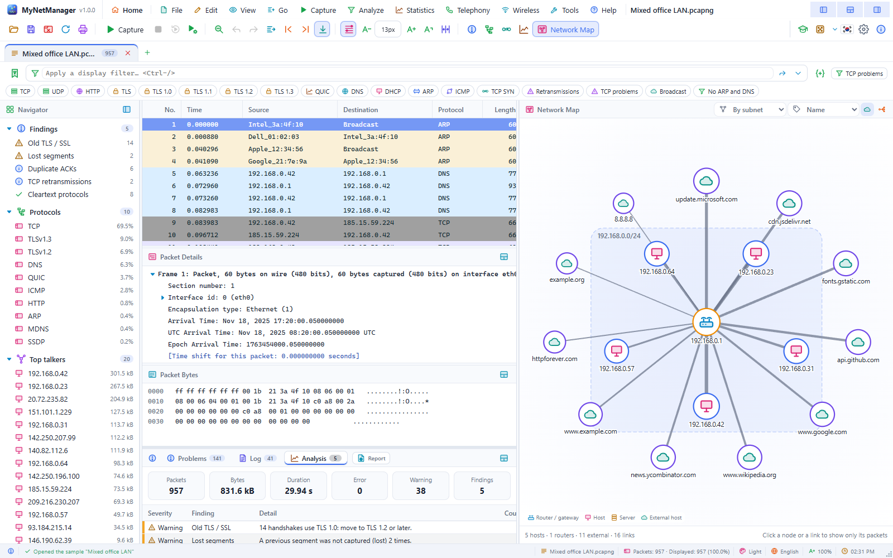

# MyNetManager

> **한국어 요약** — MyNetManager는 Wireshark 방식의 네트워크 프로토콜 분석기입니다. 네트워크 인터페이스에서
> 패킷을 실시간으로 캡처하거나 pcap / pcapng 파일을 열어, 100여 개 프로토콜을 계층별로 해석하고, Wireshark와
> 같은 디스플레이 필터로 거르고, 색칠 규칙·스트림 따라가기·전문가 정보·통계·I/O 그래프·흐름 그래프·네트워크
> 맵·자동 분석 보고서로 살펴봅니다. 웹 브라우저와 Windows · macOS · Linux 데스크톱(Tauri)에서 실행됩니다.
> 사용법은 [사용 설명서](doc/UserGuide.md)와 [튜토리얼](doc/Tutorial.md)을 보세요.

MyNetManager is a network protocol analyzer in the style of Wireshark. It captures packets live from a network
interface or opens pcap / pcapng files, dissects them layer by layer, filters them with Wireshark's display filter
language, and helps you understand them with colouring rules, follow stream, expert information, statistics, graphs,
a network map and an automatic analysis report. It runs in a web browser and as a desktop program for Windows,
macOS and Linux (Tauri 2).



## Features

- **Live capture** through libpcap / Npcap — set up by the program itself when missing (after asking; Windows:
  downloads and verifies Npcap, Linux: libpcap + capture rights via pkexec, macOS: /dev/bpf access), with reinstall
  in Settings: interface list with addresses and activity lights, BPF capture filters (saved filters,
  check, preset buttons that combine with OR), promiscuous and monitor mode, snapshot length, buffer size, auto-stop
  by packets / time / size, restart.
  A **demo interface** produces realistic LAN traffic anywhere, without permissions (also in the web version).
- **Capture files**: pcapng (sections, comments, name records, interface statistics) and pcap, gzip-compressed
  captures, cut-short files, drag and drop, recent files, merge (append or chronological), save as pcapng or pcap.
- **About 30 sample captures** (TCP handshake, HTTP, TLS, QUIC, DNS, DHCP, retransmissions, zero window, ARP storm,
  routing protocols, VLAN, Wi-Fi, tunnels, SIP / RTP, MQTT, Modbus, CoAP, SMB2, SMTP, FTP, SSH …).
- **Dissection** of 100+ protocols with Wireshark-compatible field names, TCP analysis (retransmissions, dup ACKs,
  lost segments, zero window), reassembly, request / response matching, name resolution, Decode As and enabled
  protocols.
- **Packet list, details and bytes** panes: sortable and configurable columns (custom field columns), colouring
  rules (Wireshark *colorfilters* import / export), marks, ignore, time references, time shift, packet comments,
  ten time formats, stacked or side-by-side layouts.
- **Display filters** with live validity colours, field suggestions, recent filters, bookmarks, filter buttons,
  preset filter buttons (TCP, UDP, HTTP, DNS, TLS 1.0 / 1.1 / 1.2 / 1.3, retransmissions … combined with OR),
  Wireshark's column fields (`_ws.col.protocol`, `_ws.col.info`), a
  filter expression builder, Apply / Prepare as Filter and conversation filters — operators, slices, sets, ranges
  and functions (`len`, `count`, `upper`, `lower` …).
- **Analysis**: follow TCP / UDP / TLS / HTTP / HTTP/2 / QUIC streams, expert information, a Problems / Log /
  Analysis panel with automatic findings (retransmissions, DNS and HTTP errors, old TLS, clear-text credentials,
  IP conflicts, rogue DHCP, port scans, broadcast storms …), and an analysis report in HTML, Markdown, PDF, Word or
  print.
- **Statistics**: capture file properties, resolved addresses, protocol hierarchy, conversations, endpoints, packet
  lengths, I/O graphs, flow graph, TCP stream graphs (Stevens, throughput, RTT, window), HTTP, DNS, IPv4 / IPv6,
  port types, VoIP calls, SIP flows, RTP streams, WLAN traffic, firewall ACL rules, credentials. Lists have their
  filter tools on top, striped rows, sortable trees with expand / collapse all, and print / export (HTML, Markdown,
  PDF, Word).
- **Network map** of hosts, gateways, servers and external hosts found in the traffic (by subnet, force-directed or
  radial); clicking a node or link filters the packet list. Pictures (map and graphs) save as PNG, JPEG, WebP,
  GIF, AVIF or SVG.
- **Export** of specified packets, dissections (text, CSV, JSON, PDML, PSML, C arrays), selected bytes and objects
  (HTTP, TFTP, IMF, FTP-DATA); **printing** in its own window with printer choice (prints at once), page setup,
  live preview and export to HTML, Markdown (pictures inside or linked), PDF and Word — written by the program itself,
  no Office or PDF library needed.
- Frameless window with menus in the title row, coloured icon toolbar (text size shown in px), card-board start page
  with context menus, 40 themes plus a custom theme, 20 network-themed moving backgrounds, Korean and English (the
  installer asks, the program starts in that language), a 42-step guided tutorial, user's guide and tutorial
  documents.





## Platforms

| Platform | How it runs | Live capture |
| --- | --- | --- |
| Web | any modern browser (`npm run build:web`, then serve `dist/`) | demo interface only — browsers cannot read network interfaces |
| Windows 10 / 11 | NSIS installer (`npm run build:win`) | real interfaces with Npcap |
| macOS | `.dmg` (`npm run build:mac`) | real interfaces with the system libpcap |
| Linux | `.deb`, `.rpm`, `.AppImage` (`npm run build:linux`) | real interfaces with libpcap |

### Live capture requirements

- **Windows** — install **Npcap** from <https://npcap.com> (with "WinPcap API-compatible mode"). If Npcap is
  installed to restrict capturing to administrators, run MyNetManager as administrator.
- **Linux** — install **libpcap** (`libpcap0.8` on Debian / Ubuntu, `libpcap` on Fedora) and allow the program to
  capture without root, once per installed version:

  ```sh
  sudo setcap cap_net_raw,cap_net_admin=eip <path to the mynetmanager executable>
  ```

- **macOS** — libpcap is part of the system; your user needs read access to `/dev/bpf*` (for example via
  Wireshark's *ChmodBPF*), or run the program as root.

Without these, the start page says live capture is unavailable; the demo interface, sample captures and files still
work. See *Troubleshooting* in the [User's Guide](doc/UserGuide.en.md#troubleshooting).

## Commands

Requires Node.js 22+; the desktop builds also need Rust and the [Tauri 2 prerequisites](https://tauri.app/start/prerequisites/).

| Command | What it does |
| --- | --- |
| `npm install` | install the dependencies |
| `npm start` | run the desktop program in development (`tauri dev`; frees the dev server port first) |
| `npm run dev` | run the web version on the Vite dev server |
| `npm test` | every test by category: JS unit, tshark witness, Rust, web E2E, desktop E2E — aligned result lines grouped under "▶" headings (test file, Rust module, E2E area), then a summary (passed, failed, skipped, time, pass rate), a "By group" table and the failed tests by name; `MYNETMANAGER_E2E_EXE` points the desktop suite at a build of its own |
| `npm test -- --quick` | the fast part only (JS unit tests and witness; no builds, no browser) |
| `npm run build:web` | the web app in `dist/` |
| `npm run build:win` | Windows installer (`MyNetManager-Setup-<version>.exe`) |
| `npm run build:mac` | macOS `.dmg` |
| `npm run build:linux` | Linux `.deb`, `.rpm` and `.AppImage` |
| `npm run build:all` | every installer this OS can build |
| `npm run build:docs` | turn `doc/*.md` into the HTML pages in `docs/` (and `public/docs/`) |
| `npm run doc:images` | take the pictures of the documents from the real app (`doc/images/{ko,en}/`) |
| `npm run samples` | write the sample captures to `samples/*.pcapng` |
| `npm run clean` | remove build output (`dist/`, `docs/`, `public/docs/`, `release/`, installers, `test-results/`) |
| `npm run clean:all` | the above plus `node_modules/` and `src-tauri/target/` |

Installers are built natively (Windows on Windows, macOS on macOS, Linux on Linux); they are collected in `release/`
and copied to the project root. Every installer build runs `build:docs` first.

## Project layout

```
src/
  main.js app.js popup.js viewer.js     the app shell, popup windows, document viewer
  views/                                packet list, details, bytes, network map, side and bottom panels
  ui/                                   start page (card board), tooltips, dropdowns, background, tutorial
  platform/                             Tauri / web boundary, popup windows, live capture client
  domain/
    capture/                            pcap / pcapng reading and writing, packet builder, samples, demo traffic
    dissect/                            dissection engine and one module per protocol family
    filter/                             display filter lexer, parser, compiler, suggestions, colouring rules, presets
    export/                             documents (HTML, Markdown, PDF, Word) and pictures (PNG … GIF, AVIF)
    analysis/                           statistics, follow stream, expert info, export, findings, topology
  i18n/                                 Korean and English strings
src-tauri/                              Rust: windows, popups, files, printing, capture (libpcap / Npcap)
test/                                   unit (node:test), e2e (headless browser / WebView2 over CDP), witness (tshark)
doc/                                    user's guide and tutorial (Korean, English) with pictures
samples/                                generated sample captures
scripts/                                start, test, build, docs, doc pictures, samples, clean
```

The module contracts are described in [ARCHITECTURE.md](ARCHITECTURE.md).

## Documents

- [UsersGuide.md](UsersGuide.md) — the user's guide in both languages in one file (written by `npm run build:docs`)
- [User's Guide](doc/UserGuide.en.md) · [사용 설명서](doc/UserGuide.md)
- [Tutorial](doc/Tutorial.en.md) · [튜토리얼](doc/Tutorial.md)
- [Document index](doc/README.md)

In the program: **Help › User's Guide**, **Help › Tutorial Document**, and **Help › Tutorial** (F11) for the
guided tour.

© SHKWON (knix008@naver.com)
