# MyNetManager 튜토리얼

이 튜토리얼은 프로그램 안에 들어 있는 투어(**도움말 › 튜토리얼**, F11)와 같은 9장 42단계로 MyNetManager를
직접 따라 해 봅니다. 단계마다 그 순간의 프로그램 그림과 직접 해 볼 일을 적었습니다. 네트워크 연결이나
권한은 필요 없습니다. 모두 프로그램에 들어 있는 예제 캡처와 가상 데모 인터페이스로 합니다.

- 쓰는 예제: **사무실 LAN 혼합 트래픽**(작은 사무실 네트워크 30초), **HTTP 페이지 로드**, **TCP 재전송과 중복
  ACK** — 모두 시작 화면의 **예제 캡처** 카드와 **파일 › 예제 캡처 열기**에 있습니다.
- 각 기능의 자세한 설명은 [사용 설명서](UserGuide.md)에 있습니다. English: [Tutorial](Tutorial.en.md).

> **프로그램 안의 투어.** 시작 화면의 **튜토리얼 시작**(또는 F11)을 누르세요. 오른쪽 아래 카드에 장, 단계
> 설명, ◀(*이전 단계*), ▶(*자동 재생*), **다음**, 장 목록이 나오고, ✕나 Esc로 끝냅니다. 단계가 설명하는
> 부분은 아래 그림처럼 주황색 테두리로 표시됩니다. 투어는 자기 예제 탭을 열고, 끝나면 바꾼 설정을 모두
> 되돌립니다.

## 1장 — 시작

### 1단계. MyNetManager에 오신 것을 환영합니다

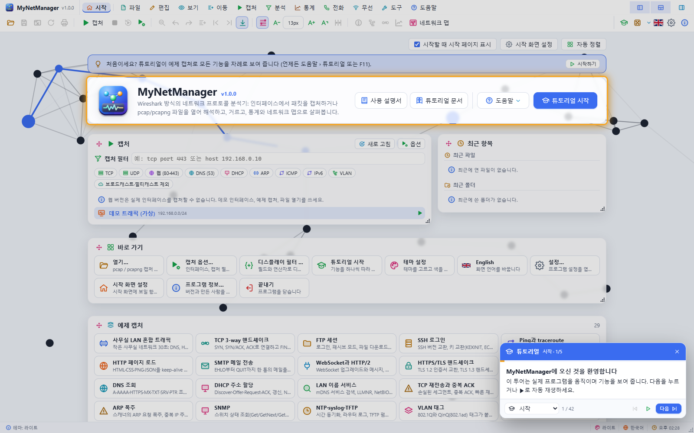

시작 화면은 프로그램의 첫 화면입니다. 맨 위의 큰 카드(자리가 고정된 프로그램 정보 카드)에 **사용 설명서**,
**튜토리얼 문서**, **도움말**, **튜토리얼 시작** 단추가 있습니다.

**해 보기:** **튜토리얼 시작**을 눌러 프로그램 안에서 함께 따라가거나, 이 문서를 읽으며 직접 해 보세요.

### 2단계. 시작 버튼

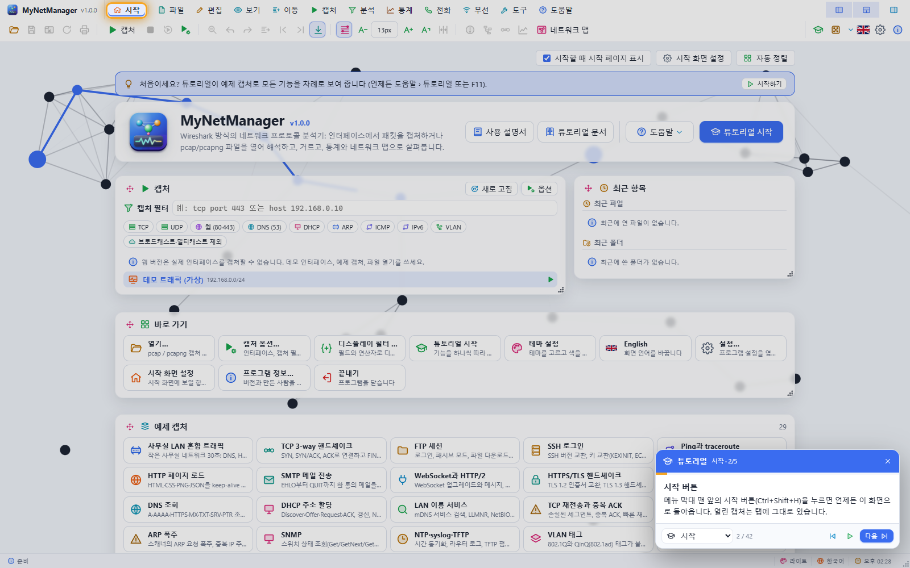

메뉴 막대 맨 앞의 **시작** 단추(Ctrl+Shift+H)를 누르면 어디서든 시작 화면으로 돌아옵니다. 열린 캡처는 탭에
그대로 있고, **시작**을 한 번 더 누르면 캡처로 돌아갑니다.

### 3단계. 캡처 카드

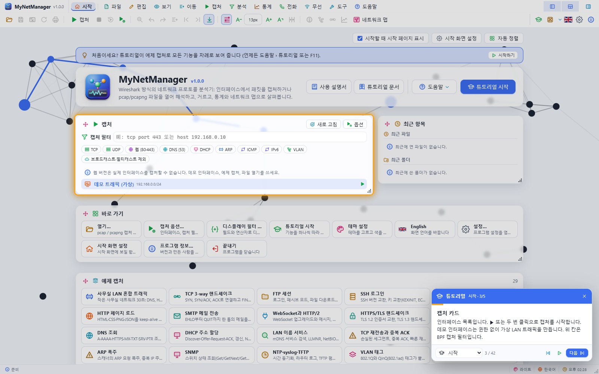

**캡처** 카드는 네트워크 인터페이스 목록입니다. **데모 트래픽 (가상)**은 언제나 있으며 권한 없이 LAN
트래픽을 만듭니다. 목록 위 칸은 BPF **캡처 필터**이고, 인터페이스의 ▶ 또는 두 번 클릭으로 캡처를 시작합니다.

**해 보기:** 데모 인터페이스의 ▶에 포인터를 올려 툴팁(*데모 트래픽 (가상)에서 캡처 시작*)을 보세요. 7장에서
이 인터페이스로 캡처합니다.

### 4단계. 예제 캡처

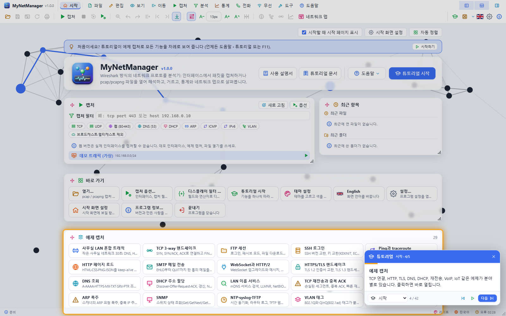

**예제 캡처** 카드에는 주제별로 묶은 캡처가 있습니다 — 기초, 웹, 이름 서비스, 문제 해결, 라우팅·LAN,
IoT·산업·VoIP. 클릭하면 새 탭에 열립니다.

### 5단계. 최근 항목

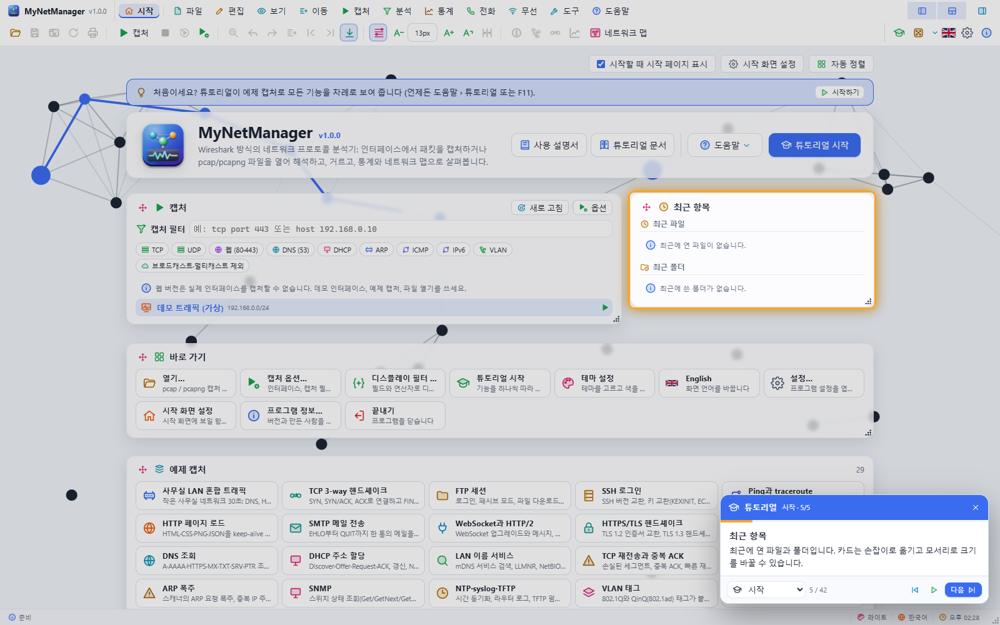

**최근 항목** 카드는 최근에 연 파일과 폴더입니다. 프로그램 정보 카드를 뺀 모든 카드는 왼쪽 위 손잡이로
옮기고 오른쪽 아래 모서리로 크기를 바꿀 수 있습니다. **자동 정렬**은 다시 가지런히 놓습니다.

**해 보기:** **최근 항목** 카드를 손잡이로 끌어 다른 곳에 놓은 뒤 **자동 정렬**을 누르세요.

## 2장 — 캡처 열기

### 6단계. 캡처 창

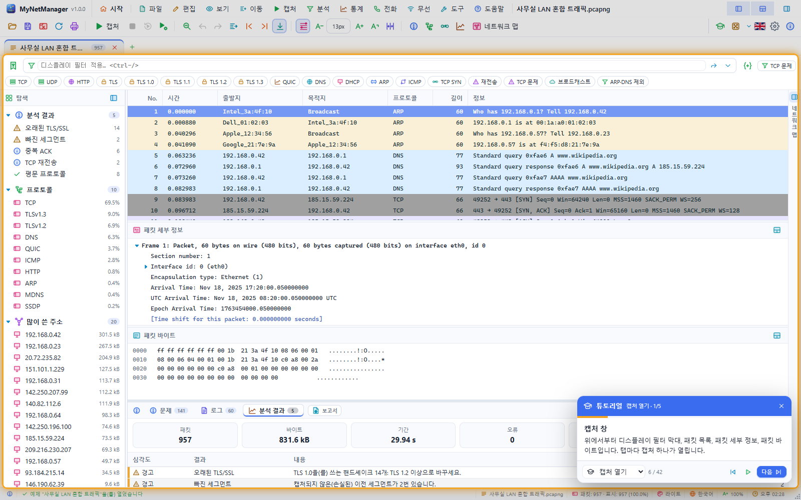

**해 보기:** 예제 캡처 카드에서 **사무실 LAN 혼합 트래픽**을 누르세요.

캡처가 탭에 열립니다. 위에서부터 디스플레이 필터 막대, 패킷 목록, 패킷 세부 정보, 패킷 바이트입니다. 왼쪽의
**탐색** 패널과 아래의 **문제·로그·분석** 패널에는 자동 분석이 찾은 내용이 벌써 나와 있습니다.

### 7단계. 패킷 목록

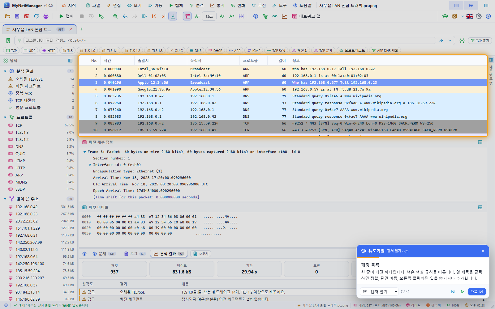

한 줄이 패킷 하나이며, 색칠 규칙에 따라 색이 칠해집니다(ARP 노랑, DNS 하늘색, TCP 연결 설정 회색 …).

**해 보기:** 3번 패킷을 클릭하세요. **프로토콜** 열 제목을 눌러 프로토콜로 정렬하고, 한 번 더 눌러 순서를
뒤집은 뒤 **No.**를 눌러 되돌리세요. 열 제목을 오른쪽 클릭하면 열 메뉴가 나옵니다.

### 8단계. 패킷 세부 정보

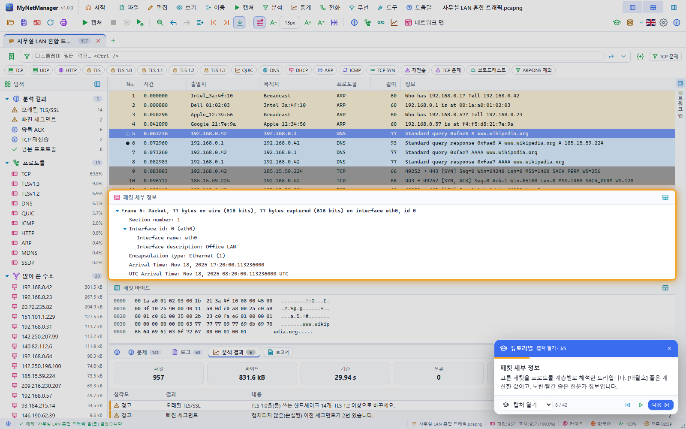

고른 패킷을 프로토콜 계층별로 해석한 트리입니다. [대괄호] 줄은 프로그램이 계산한 값이고, 노란·빨간 줄은
전문가 정보입니다.

**해 보기:** 5번 패킷(DNS 질의)을 고르고 **Domain Name System**을 펼치세요. **보기 › 세부 트리 › 모두
펼치기**(Ctrl+Shift+Right)로 모두 열 수 있습니다.

### 9단계. 패킷 바이트

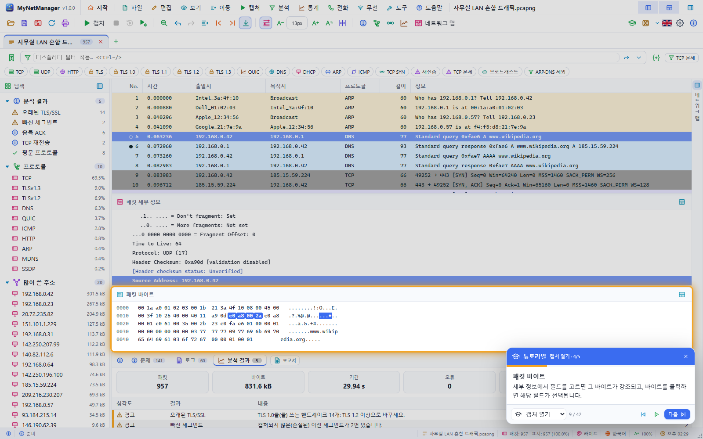

세부 정보에서 필드를 고르면 **패킷 바이트** 창에서 그 바이트가 강조되고, 바이트를 클릭하면 해당 필드가
선택됩니다.

**해 보기:** 5번 패킷의 *Internet Protocol Version 4* 아래 **Source Address**를 눌러 4바이트가 강조되는 것을
보고, 바이트 창의 글자 열에서 바이트 하나를 눌러 보세요.

### 10단계. 열

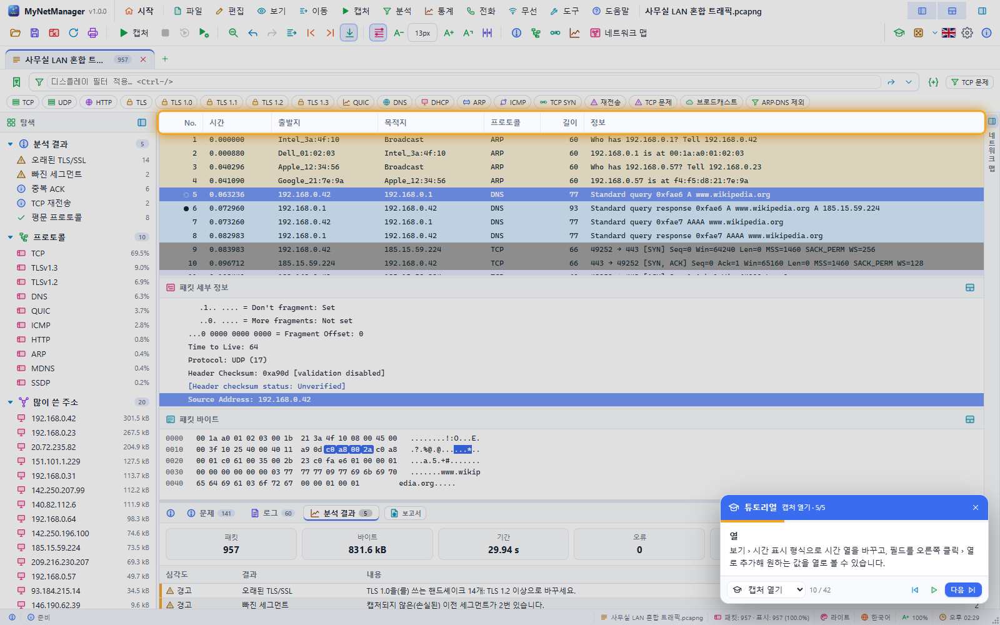

**보기 › 시간 표시 형식**으로 시간 열을 바꾸고(예: *시각*), 필드를 오른쪽 클릭 › **열로 추가**하면 원하는 값을
열로 볼 수 있습니다.

**해 보기:** *Frame* 아래 **Frame Length**(또는 아무 필드)를 오른쪽 클릭 › **열로 추가**. 새 열은 열 제목의
오른쪽 클릭 메뉴에서 다시 지웁니다.

## 3장 — 필터

### 11단계. 디스플레이 필터

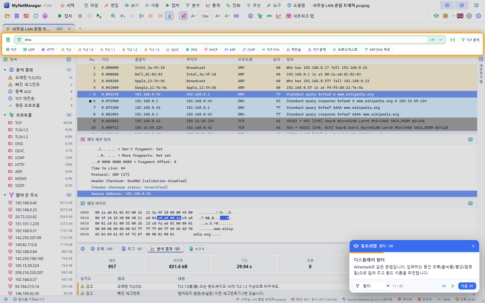

디스플레이 필터 막대는 Wireshark와 같은 문법입니다. 입력하는 동안 초록(올바름)·빨강(잘못됨)으로 알려 주고
필드 이름을 추천합니다.

**해 보기:** 막대를 누르고(또는 Ctrl+/) `dns`를 입력하세요.

### 12단계. 필터 적용

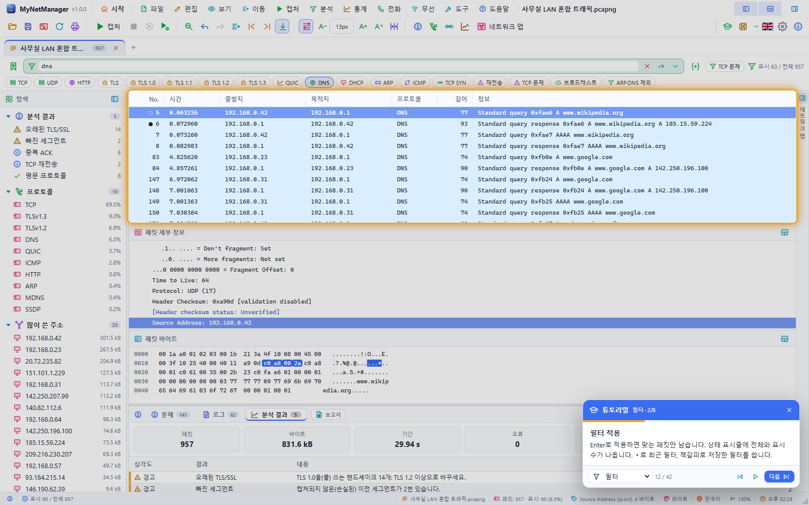

**해 보기:** **Enter**를 누르세요. DNS 패킷만 남고, 막대와 상태 표시줄에 *표시 N / 전체 957*이 나옵니다. ▾로
최근 필터를, 책갈피 단추로 저장한 필터를 씁니다.

### 13단계. 미리 설정된 필터

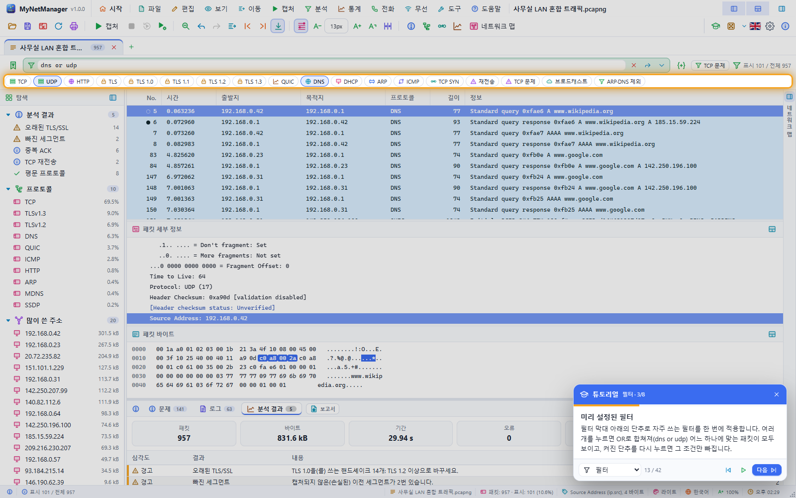

**해 보기:** 필터 막대 아래의 **DNS**, **UDP** 단추를 차례로 누르세요. 두 단추가 모두 강조되고 필터는 `dns or udp`가
됩니다(OR 조건 — 둘 중 하나에 맞는 패킷이 모두 보임). 켜진 단추를 다시 누르면 그 조건만 빠집니다. 캡처 카드와 **캡처 옵션**의
캡처 필터에도 같은 단추가 있습니다.

### 14단계. TLS 버전별로 보기

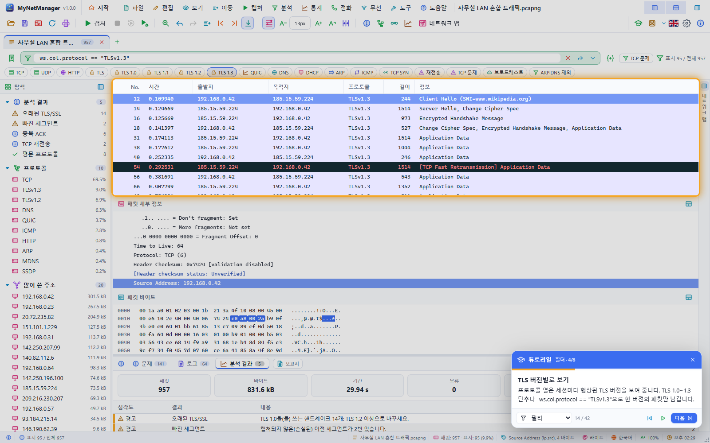

**해 보기:** **TLS 1.3** 단추를 누르거나 `_ws.col.protocol == "TLSv1.3"`을 적용하세요. 프로토콜 열이 *TLSv1.3*인 패킷만
남습니다. 프로토콜 열은 세션마다 협상된 버전을 보여 주므로(TLS 1.3 레코드도 머리에는 0x0303이 적혀 있음) 이 필터가 버전을
가르는 가장 확실한 방법입니다. **TLS 1.0**·**1.1**·**1.2** 단추도 있습니다.

### 15단계. 잘못된 필터

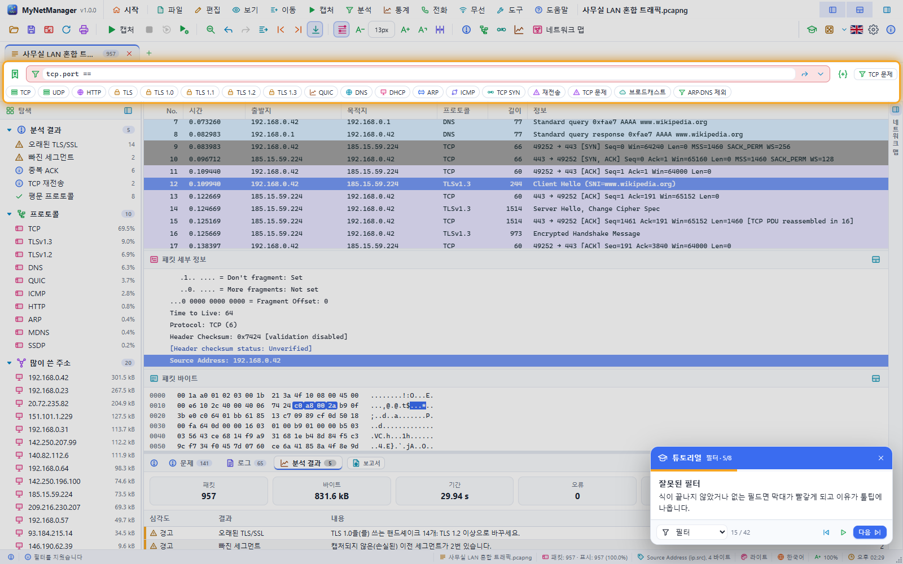

**해 보기:** `tcp.port == `처럼 `==` 뒤를 비워 두세요. 막대가 빨갛게 되며, 포인터를 올리면 이유가 나옵니다.
`tcp.port == 443`으로 마치면 초록으로 바뀝니다.

### 16단계. 필드로 필터 만들기

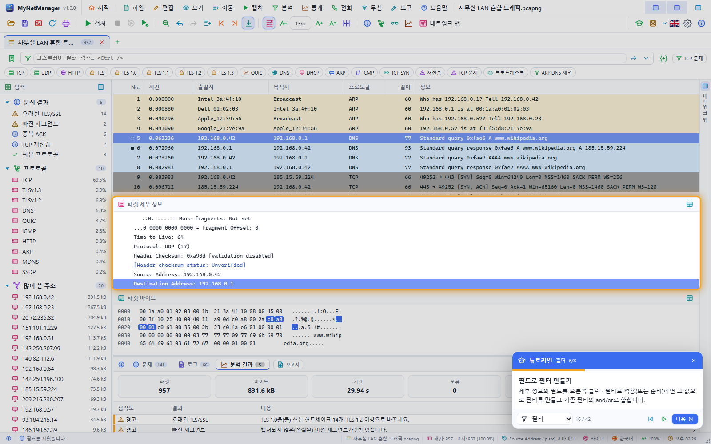

세부 정보의 필드를 오른쪽 클릭 › **필터로 적용**(또는 **필터로 준비**)하면 그 값으로 필터를 만들고,
*…그리고 선택한 것* / *…또는 선택한 것*으로 기존 필터와 합칩니다.

**해 보기:** 필터를 지우고(✕) 5번 패킷을 고른 뒤, 세부 정보의 **Destination Address**를 오른쪽 클릭 ›
**필터로 적용** › **선택한 것**. 막대에 `ip.dst == 192.168.0.1`이 들어갑니다.

### 17단계. 필터 식 만들기

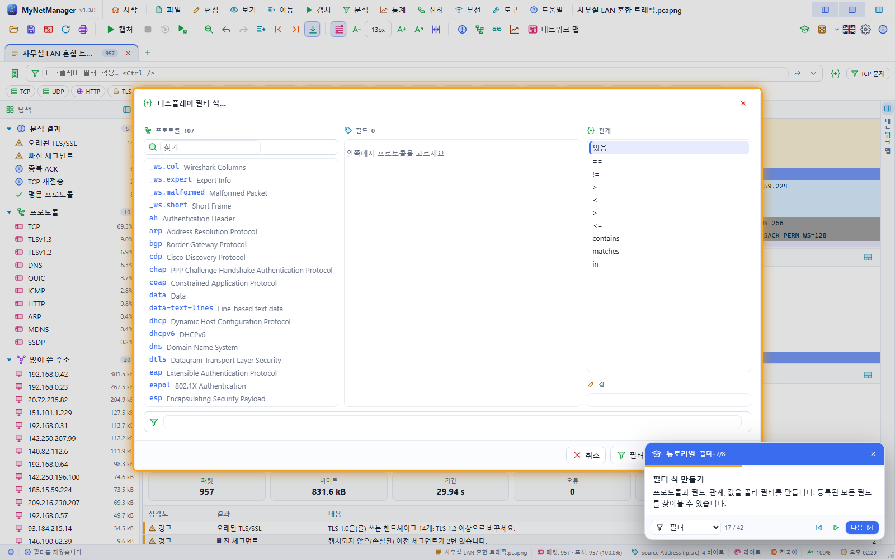

**분석 › 디스플레이 필터 식…**(또는 {+} 단추)에서 프로토콜, 필드, 관계, 값을 골라 필터를 만듭니다. 등록된
모든 필드를 찾아볼 수 있습니다.

**해 보기:** **dns**, **dns.qry.name**, **contains**를 고르고 값에 `wikipedia`를 적은 뒤 **필터 적용**.

### 18단계. 색칠 규칙

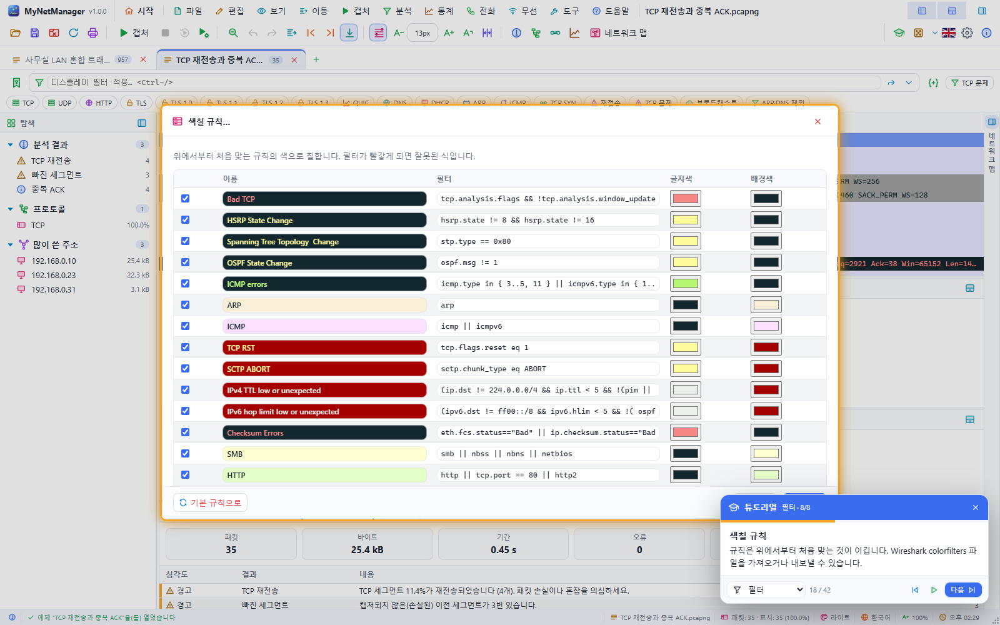

이 단계는 **TCP 재전송과 중복 ACK**를 열고 **보기 › 색칠 규칙…**을 엽니다. 위에서부터 처음 맞는 규칙이
이기며, Wireshark *colorfilters* 파일을 가져오거나 내보낼 수 있습니다.

**해 보기:** 예제 **TCP 재전송과 중복 ACK**를 열고 색칠 규칙에서 문제 있는 TCP를 칠하는 규칙을 꺼 보세요.
패킷 목록의 검은 줄이 바뀝니다. **기본 규칙으로**로 되돌립니다.

## 4장 — 분석

### 19단계. 전문가 정보

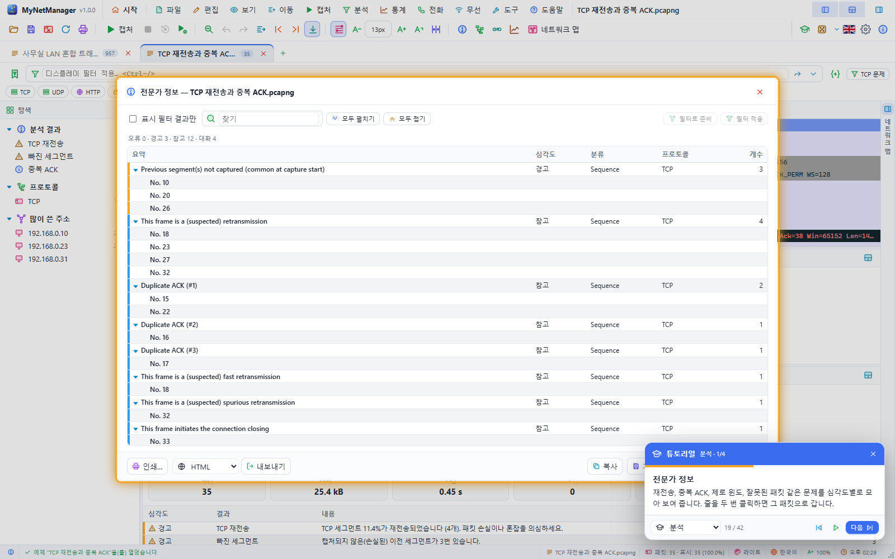

**분석 › 전문가 정보**(Ctrl+Shift+E)는 재전송, 중복 ACK, 제로 윈도, 잘못된 패킷 같은 문제를 심각도별로
모아 보여 줍니다. 줄을 두 번 클릭하면 그 패킷으로 갑니다. 아래 패널의 **문제** 탭에도 같은 항목이 패킷마다
나옵니다.

**해 보기:** **TCP 재전송과 중복 ACK**에서 아래 패널의 **문제** 탭을 열고 *경고* 줄을 눌러 보세요.

### 20단계. 스트림 따라가기

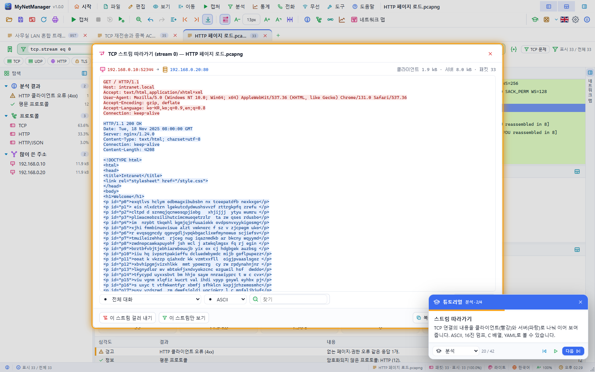

**해 보기:** **HTTP 페이지 로드**를 열고 정보가 `GET`으로 시작하는 첫 패킷을 고른 뒤 **분석 › 스트림
따라가기 › TCP 스트림**(Ctrl+Alt+Shift+T)을 고르세요.

TCP 연결의 내용이 이어져 나옵니다. 클라이언트(브라우저)는 빨강, 서버는 파랑입니다. **보기 형식**으로 16진
덤프, C 배열, YAML 등으로 바꿉니다.

### 21단계. 대화 필터

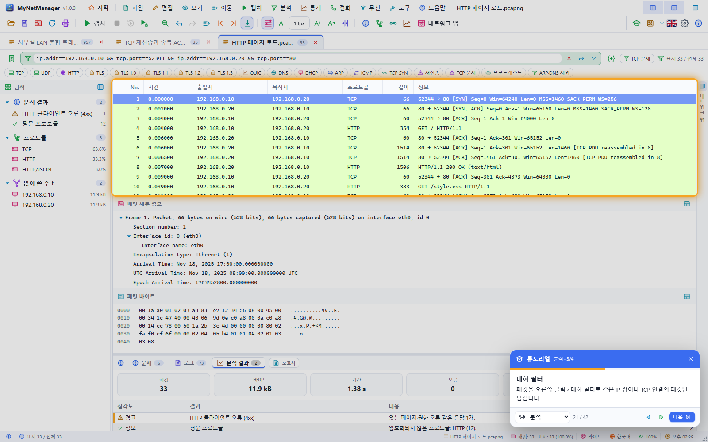

패킷을 오른쪽 클릭 › **대화 필터** › **TCP**는 그 TCP 연결의 패킷만 남깁니다 — 여기서는
`ip.addr==192.168.0.10 && tcp.port==52344 && ip.addr==192.168.0.20 && tcp.port==80`. **IPv4**를 고르면 두
호스트 사이의 모든 트래픽이 남습니다.

### 22단계. 다르게 해석

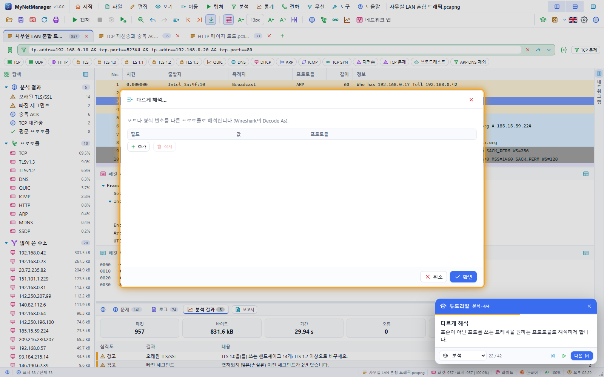

**분석 › 다르게 해석…**은 표준이 아닌 포트를 쓰는 트래픽을 원하는 프로토콜로 해석하게 합니다 — 예를 들어
8081번 포트의 웹 서버를 HTTP로. 고른 패킷의 값이 먼저 제시됩니다.

## 5장 — 통계

### 23단계. 캡처 파일 속성

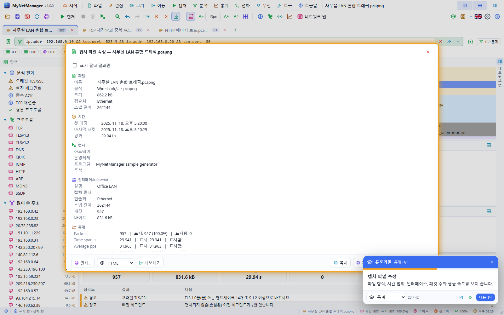

**통계 › 캡처 파일 속성** — 파일 형식, 시간 범위, 인터페이스, 패킷 수와 평균 속도.

### 24단계. 프로토콜 계층

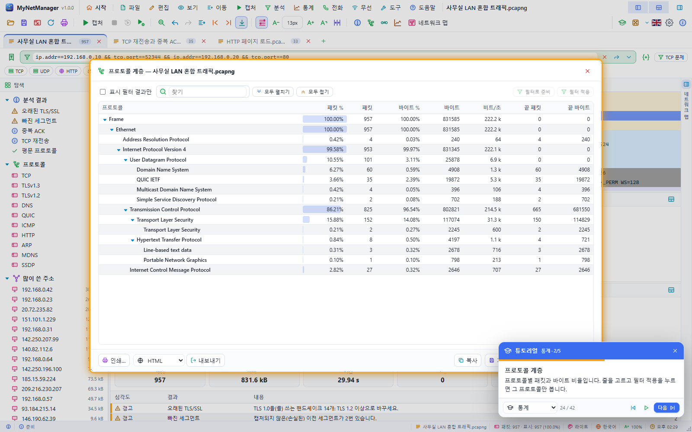

**통계 › 프로토콜 계층** — 프로토콜별 패킷과 바이트를 트리로 보여 줍니다.

**해 보기:** **Domain Name System** 줄을 고르고 **필터 적용**을 누르면 패킷 목록에 DNS만 남습니다.

### 25단계. 대화

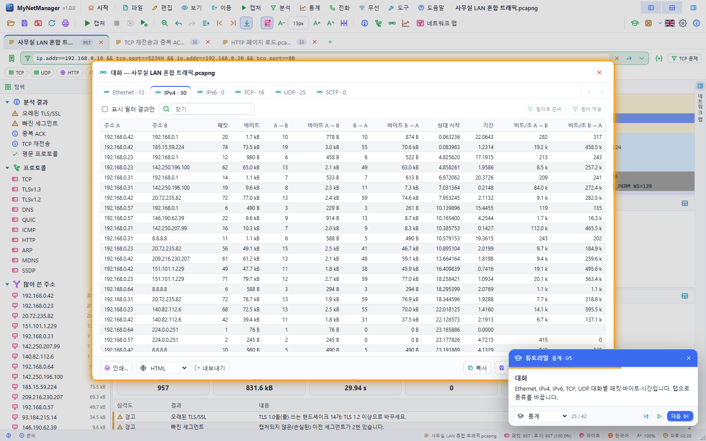

**통계 › 대화** — **Ethernet**, **IPv4**, **IPv6**, **TCP**, **UDP** 대화별 패킷·바이트·시간. 탭으로 종류를
바꾸고, 열 제목(예: **바이트**)을 눌러 정렬합니다.

### 26단계. I/O 그래프

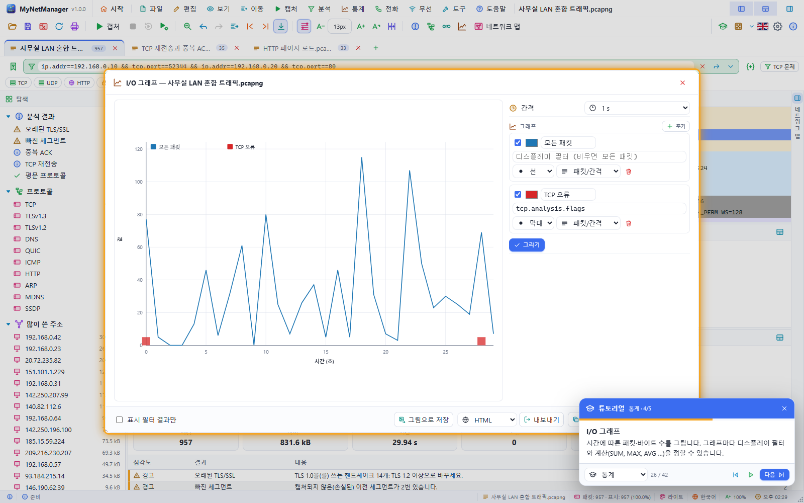

**통계 › I/O 그래프** — 시간에 따른 패킷·바이트 수. 그래프마다 디스플레이 필터와 계산(SUM, MAX, AVG …)을
정할 수 있습니다.

**해 보기:** **추가**를 눌러 새 그래프에 필터 `dns`와 색을 주고 **그리기**를 누르세요.

### 27단계. 흐름 그래프

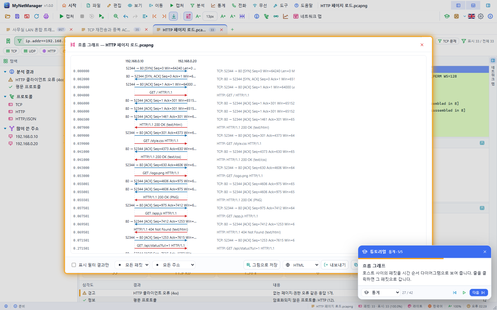

**통계 › 흐름 그래프**(여기서는 **HTTP 페이지 로드**)는 호스트 사이의 패킷을 시간 순서 다이어그램으로 보여
줍니다: TCP 핸드셰이크, `GET`마다의 `200 OK`. 줄을 클릭하면 그 패킷으로 갑니다.

## 6장 — 네트워크 맵

### 28단계. 네트워크 맵

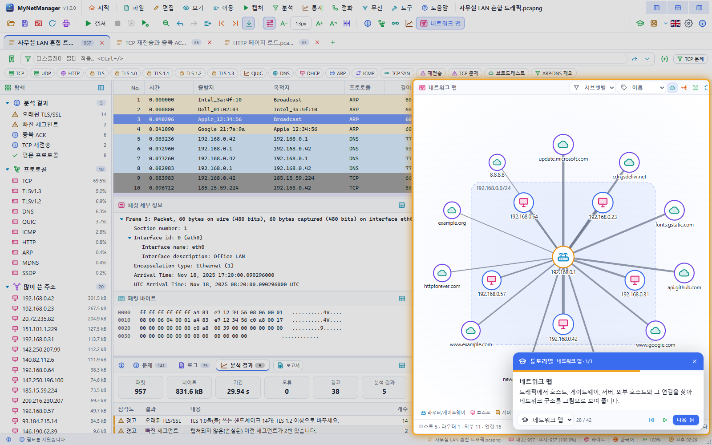

**해 보기:** **사무실 LAN 혼합 트래픽**을 다시 열고 툴바의 **네트워크 맵**(Ctrl+Shift+N)을 누르세요.

트래픽에서 찾은 호스트, 게이트웨이, 서버, 외부 호스트와 그 연결이 게이트웨이 둘레에 서브넷별로 그려집니다.
맵 위쪽의 **배치**와 **이름표**로 그리는 방식을 바꿉니다.

### 29단계. 노드로 거르기

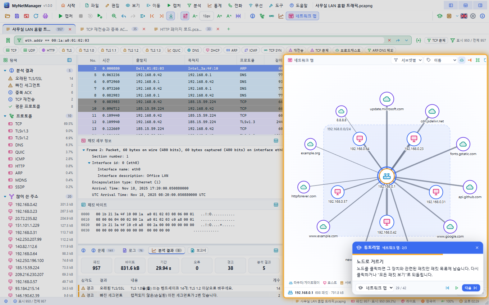

**해 보기:** 가운데의 라우터(게이트웨이)를 클릭하세요. 그 장치와 관련된 패킷만 패킷 목록에 남고, 필터 막대에
필터가 나옵니다. 다시 클릭하거나 **모든 패킷 보기**로 되돌립니다.

### 30단계. 연결로 거르기

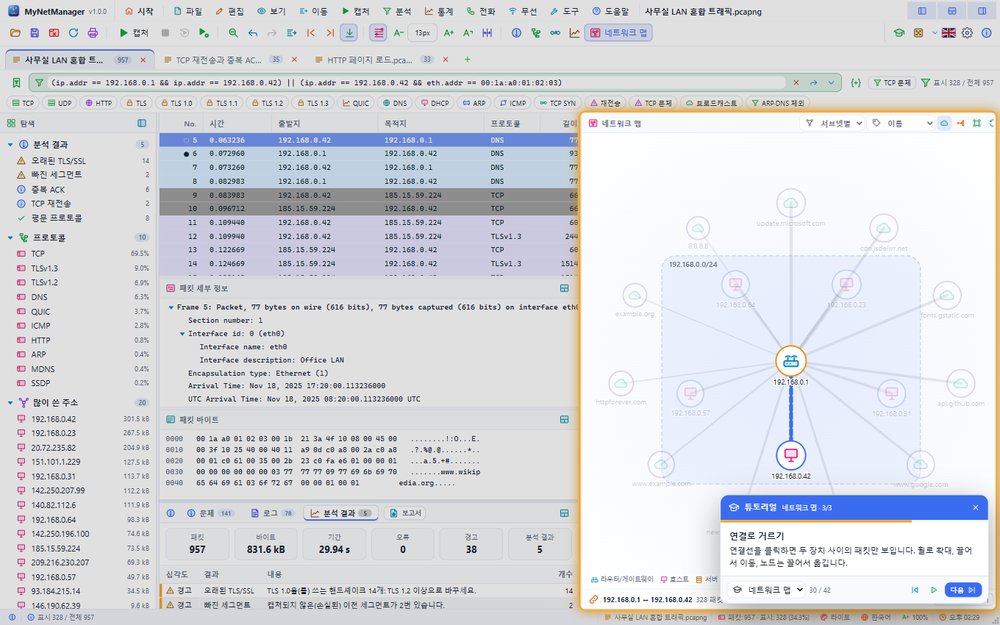

**해 보기:** 가장 굵은 연결선을 클릭하세요. 두 장치 사이의 패킷만 남습니다. 휠로 확대하고, 배경을 끌어
이동하며, 노드는 끌어서 옮깁니다.

## 7장 — 실시간 캡처

### 31단계. 캡처 옵션

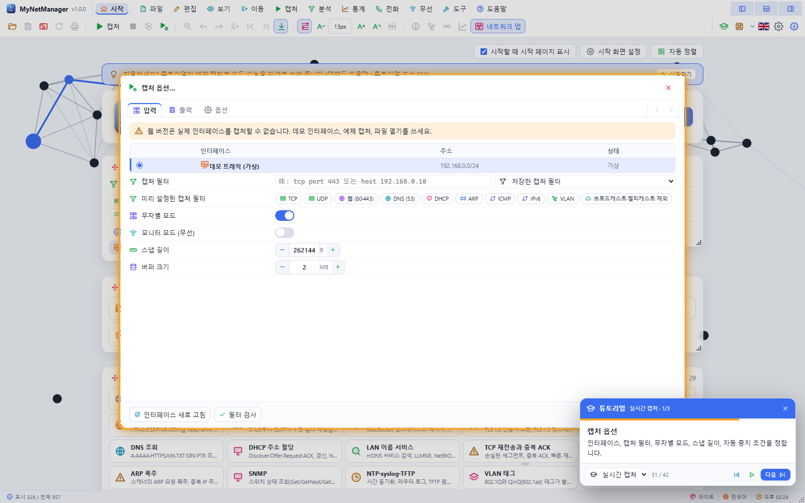

**캡처 › 캡처 옵션…**(Ctrl+K) — 인터페이스, 캡처 필터, 무차별 모드, 스냅 길이, 그리고 **옵션** 탭의 자동
중지 조건.

**해 보기:** **데모 트래픽 (가상)**을 고르고 **옵션** 탭에서 **시간 뒤 멈춤**을 10초로 정한 뒤 **캡처
시작**을 누르세요.

### 32단계. 실시간 캡처

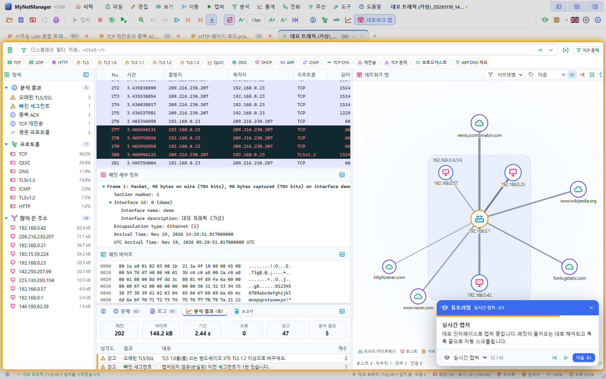

데모 인터페이스로 캡처 중입니다. 패킷이 들어오는 대로 해석되고 목록 끝으로 자동 스크롤됩니다. 상태 표시줄에
*데모 트래픽 (가상)에서 캡처 중*이 나옵니다.

### 33단계. 캡처 멈추기

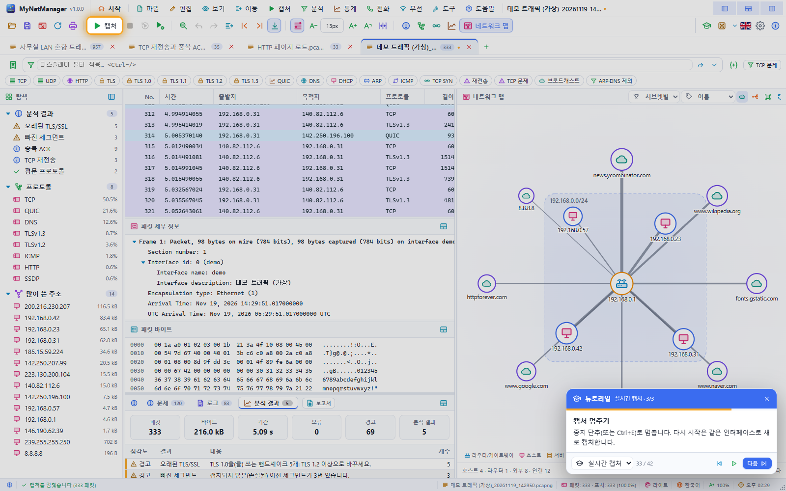

**캡처 중지** 단추(또는 Ctrl+E)로 멈춥니다. **캡처 › 캡처 다시 시작**은 같은 인터페이스로 새로 캡처합니다.
테두리로 표시된 **캡처** 단추로 다시 시작할 수 있습니다.

## 8장 — 파일

### 34단계. 저장

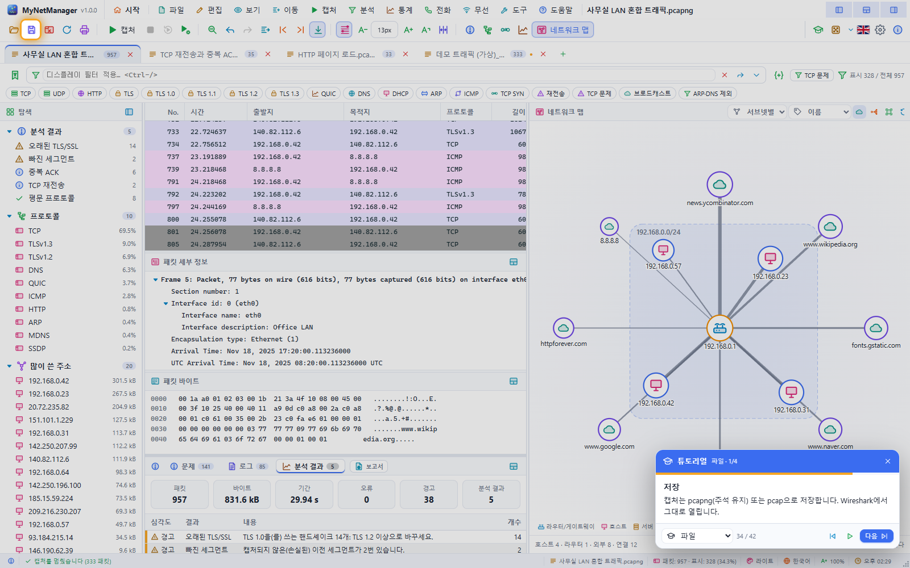

**파일 › 저장**(Ctrl+S)은 주석을 유지한 채 pcapng로, **pcap 형식으로 저장…**은 예전 pcap으로 저장합니다.
Wireshark에서 그대로 열립니다.

**해 보기:** 7장의 데모 캡처를 저장하고 탭을 닫은 뒤 **최근 항목** 카드에서 다시 열어 보세요.

### 35단계. 내보내기

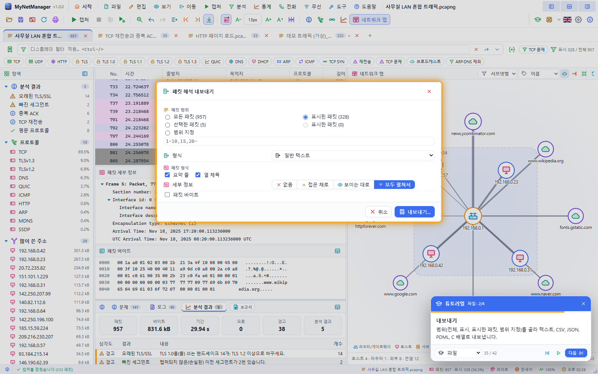

**파일 › 패킷 해석 내보내기** — 범위(전체, 표시, 표시한 패킷, 범위 지정)를 골라 텍스트, CSV, JSON, PDML,
C 배열로 내보냅니다. **파일 › 지정한 패킷 내보내기…**는 더 작은 캡처 파일을 만듭니다.

### 36단계. 인쇄와 내보내기

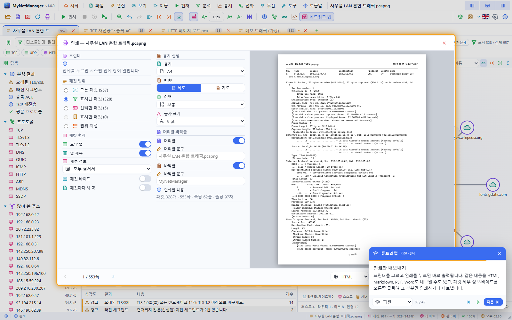

**해 보기:** 툴바 파일 묶음 끝의 **인쇄…**(Ctrl+P)를 누르세요. 프린터를 고르고 **인쇄**를 누르면 대화 상자 없이 바로
출력됩니다. 그 옆의 **내보내기**는 같은 내용을 **HTML**, **Markdown**, **PDF**, **Word**로 저장합니다. 패킷 목록·세부 정보·바이트를
오른쪽 클릭하면 그 부분만 **인쇄…**하거나 **내보내기**할 수 있고, 통계 창과 분석 보고서에도 같은 인쇄·내보내기가 있습니다.

### 37단계. 개체 내보내기

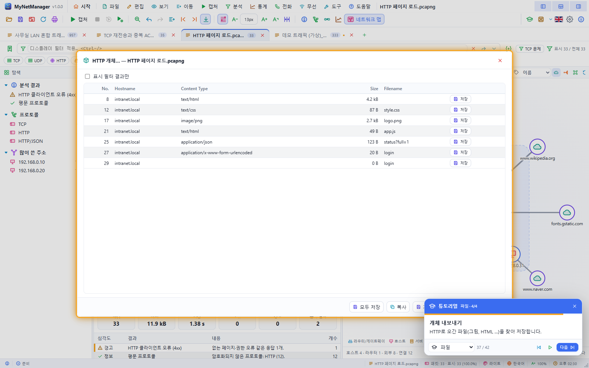

**파일 › 개체 내보내기 › HTTP 개체…**(여기서는 **HTTP 페이지 로드**)는 HTTP로 오간 파일 — HTML 페이지,
스타일시트, PNG 로고, JSON — 을 찾아 하나 또는 모두 저장합니다.

## 9장 — 사용자 설정

### 38단계. 테마

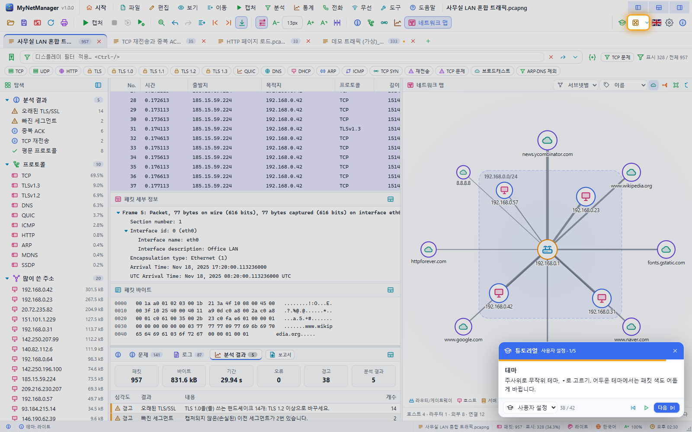

주사위 단추로 무작위 테마, ▾로 테마를 고릅니다. 어두운 테마에서는 패킷 색도 어둡게 바뀝니다.

### 39단계. 창 배치

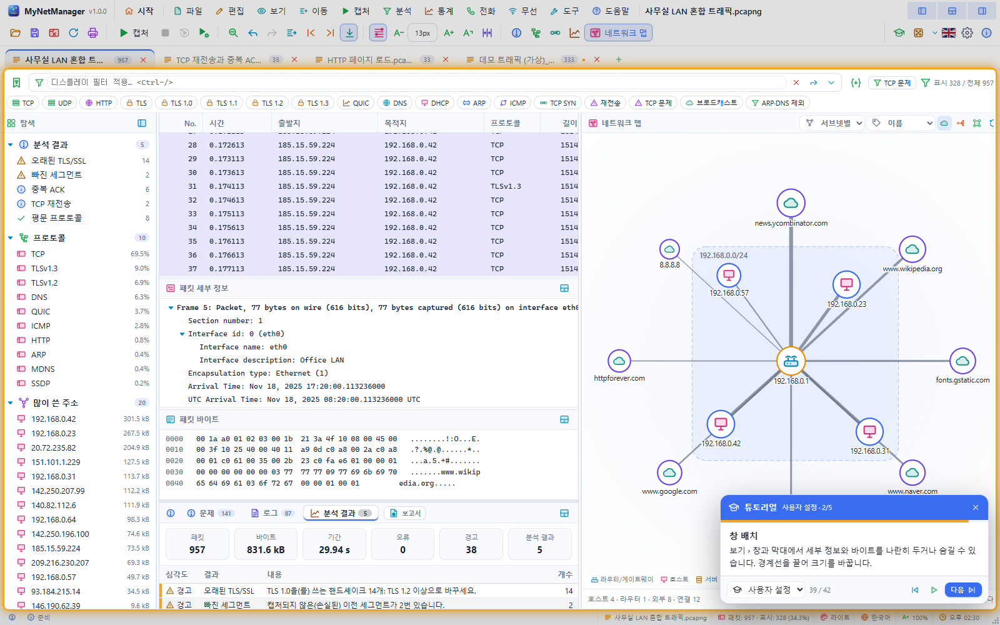

**보기 › 창과 막대**에서 세부 정보와 바이트를 나란히 두거나(**세부 정보 | 바이트**, **바이트 | 세부 정보**)
숨길 수 있습니다. 경계선을 끌어 크기를 바꿉니다. 제목 줄 오른쪽의 패널 단추로 탐색, 아래 패널, 네트워크 맵을
보이거나 숨깁니다.

### 40단계. 설정

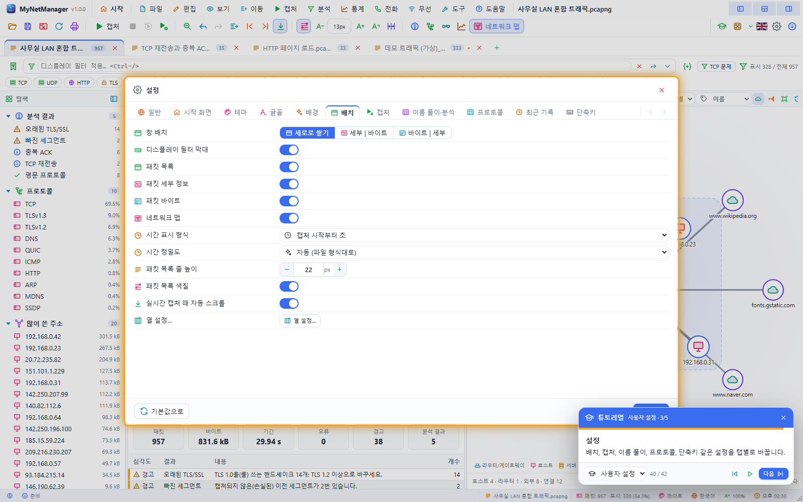

**편집 › 설정…** — 일반, 시작 화면, 테마, 글꼴, 배경, 배치, 캡처, 이름 풀이·분석, 프로토콜, 최근 기록,
단축키를 탭별로 바꿉니다. 바꾼 내용은 바로 적용됩니다.

### 41단계. 도움말

**도움말** 메뉴에서 사용 설명서, 이 튜토리얼 문서, 디스플레이 필터 참고, 단축키를 엽니다.

### 42단계. 끝

투어가 끝났습니다. 툴바의 **튜토리얼** 단추(F11)로 언제든 다시 볼 수 있습니다. 이제 자기 캡처 파일을 열어
보거나, 데스크톱 프로그램이라면 실제 인터페이스를 캡처해 보세요([사용 설명서](UserGuide.md#실제-인터페이스를-캡처하려면)의
*실제 인터페이스를 캡처하려면* 참고).
