# MyNetManager User's Guide

MyNetManager is a network protocol analyzer in the style of Wireshark. It captures packets from a network interface
(or reads pcap / pcapng capture files), dissects every packet layer by layer, filters them with Wireshark's display
filter language, colours them, follows streams, draws statistics and a map of the network, and exports or prints the
results. It runs in a web browser and as a desktop program on Windows, macOS and Linux.

This guide describes every part of the program. For a guided, hands-on walk through the same features, see the
[Tutorial](Tutorial.en.md). 한국어 설명서는 [사용 설명서](UserGuide.md)에 있습니다.

> The pictures in this guide were taken from the program itself (web version, 1600 × 1000 window, *Light* theme)
> with the sample captures that come with it. The desktop version looks the same, with window buttons at the
> right end of the title row.

## Contents at a glance

| Part | What it covers |
| --- | --- |
| [Start page](#start-page) | Cards, sample captures, recent files |
| [Opening captures](#opening-captures) | Files, samples, drag and drop, merge |
| [Live capture](#live-capture) | Interfaces, capture filter, options, demo interface, auto-stop |
| [The main window](#the-main-window) | Title row, menus, toolbar, tabs, status bar |
| [Packet list](#packet-list) · [Details and bytes](#packet-details-and-packet-bytes) | The three panes |
| [Display filters](#display-filters) | Syntax, colours, suggestions, bookmarks, buttons |
| [Analysis](#analysis) | Colouring rules, follow stream, expert information, decode as |
| [Statistics](#statistics) | Properties, hierarchy, conversations, graphs, HTTP, DNS, IP |
| [Panels](#panels-navigator-bottom-panel-and-network-map) | Navigator, Problems / Log / Analysis, network map |
| [Files and output](#files-and-output) | Save, export, report, print |
| [Settings](#settings-themes-and-language) | Settings tabs, themes, language |
| [Reference](#keyboard-shortcuts) | Shortcuts, troubleshooting, file formats |

## Start page

The start page appears when the program starts (and whenever no capture is open). The **Home** button at the left
of the menu bar (Ctrl+Shift+H) brings it back at any time; open captures stay in their tabs.

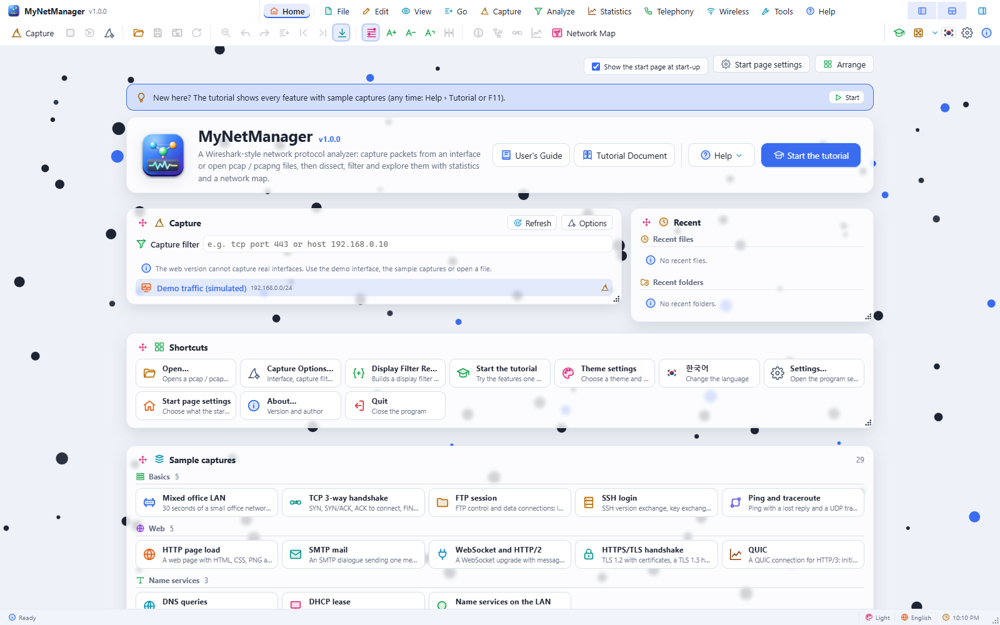

The top of the page holds three buttons: **Show the start page at start-up** (a check box), **Start page settings**
and **Arrange** (lays the cards out again). Below them, a banner offers the tutorial until you have run it once.

The **program-info card** (the large card with the MyNetManager icon) is fixed at the top. It has the
**User's Guide** and **Tutorial Document** buttons, a **Help** menu button and **Start the tutorial**.

The other cards form a board you can rearrange:

- **move** a card by dragging its handle (the four-arrow mark at its top-left corner, *Drag to move the card*);
- **resize** it by dragging its bottom-right corner (*Drag to resize the card*; a double-click on the corner fits the
  card to its content);
- **Arrange** puts all cards back into a tidy layout.

| Card | Contents |
| --- | --- |
| **Capture** | The capture filter box and the list of interfaces; **Refresh** and **Options** buttons |
| **Recent** | **Recent files** and **Recent folders**, each with a clear button |
| **Shortcuts** | Open…, Capture Options…, Display Filter Reference, Start the tutorial, Theme settings, the language switch (flag), Settings…, Start page settings, About…, Quit |
| **Sample captures** | The 29 sample captures together in one grid of equal tiles (in topic order: Basics, Web, Name services, Troubleshooting, Routing & LAN, IoT, industrial & VoIP; a tile's tooltip names its topic). With the **Open…** tile at the end there are 30, so every row is full at any card width (2, 3, 5 or 6 columns) |
| **Theme** | Every dark and light theme as a tile, and **Theme settings** |
| **Moving background** | 20 network-themed moving backgrounds, **Shuffle Background**, **Background Picture…**, motion speed, **Card opacity**, random at start and auto change |

The moving backgrounds all draw networks: packet flow, a three-tier network, a hex dump, signal waveforms, fiber
optics, Wi-Fi signals, a scan radar, a throughput graph, an internet globe, a data center, a circuit board, a bit
stream, a TCP flow graph, the OSI layers, ping pulses, satellite links, a traffic heatmap, a packet list, a radio
spectrum and mesh routing. Their colours follow the theme.

The **right-click menu** fits what is under the pointer:

| Where | Menu |
| --- | --- |
| An interface in the Capture card | *Start capture on (interface)*, **Select This Interface**, **Copy Interface Name**, **Copy Addresses**, Capture Options…, Capture Filters…, Refresh Interfaces (the interface is selected too) |
| A sample tile | **Open Sample**, **Copy File Name**, Open…, Open Sample Capture |
| A recent file or folder | **Open** / **Open from This Folder…**, **Copy Path**, remove from the list |
| Anywhere else | Open…, Capture Options…, Start Capture, **Arrange**, **Change Background**, **Theme settings**, **Start page settings**, Tutorial, About |

Which cards and parts are shown is set in **Settings › Start page**.

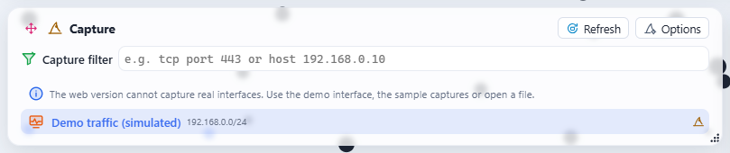

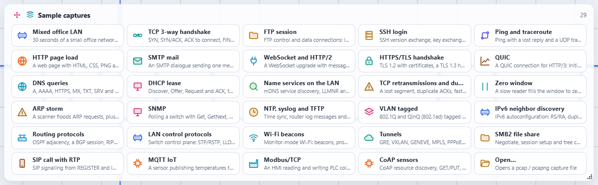

## Opening captures

There are four ways to open a capture; each capture opens in its own tab.

1. **File › Open…** (Ctrl+O), the **Open** toolbar button, the **+** at the end of the tab strip, or **Open…** on the
   start page. MyNetManager reads **pcapng** and **pcap** files (also `.cap`, `.ntar` and gzip-compressed
   `.pcapng.gz` / `.pcap.gz`).
2. **Sample captures**: click a tile on the start page, or use **File › Open Sample Capture**. The samples are
   generated by MyNetManager and need no files.
3. **Drag and drop** capture files onto the window (*Drop capture files to open them*). Files that are not captures
   are reported as such.
4. **File › Recent Files…** and the **Recent** card on the start page.

A file that is cut short (for example copied while it was still being written) opens as far as it could be read, with
a notice. **File › Merge…** combines another capture with the open one: **Append** puts the other file's packets
after the current ones, **Chronologically** interleaves them by time.

**File › Close** (Ctrl+W) closes the current tab and **Close All** every tab. Right-clicking a tab offers **Close**
and **Close Other Tabs**. Ctrl+Tab and Ctrl+Shift+Tab switch between tabs. A capture that has not been saved (a live
capture, or one with new comments) is marked with a dot, and the program asks before closing it.

## Live capture

### Interfaces and the capture filter

The **Capture** card on the start page lists the network interfaces (Ethernet, Wi-Fi, loopback, virtual adapters…)
with their addresses. The **light** in front of each shows whether packets are moving on it now: **blinking green** =
packets in the last second, **blinking red** = none, grey = still checking (the system's interface counters, read every
second — no capture needed). The demo interface is always green. Click an interface to choose it; double-click it, or press its ▶ button, to start capturing on
it. **Refresh** reads the list again (**Capture › Refresh Interfaces**).

The **Capture filter** box above the list takes a BPF capture filter, such as `tcp port 443` or `host 192.168.0.10`.
A capture filter works in the operating system while capturing — packets that do not match are never captured.
Its syntax is different from display filters (see [Display filters](#display-filters)).

| Capture filter | Captures |
| --- | --- |
| `host 192.168.0.10` | packets to or from one address |
| `net 192.168.0.0/24` | packets of one subnet |
| `tcp port 443` | TCP packets with source or destination port 443 |
| `udp port 53 or udp port 67` | DNS and DHCP |
| `not arp and not icmp` | everything except ARP and ICMP |

Under the capture filter box are **preset capture filters** (with **All** and **None** first): TCP, UDP, Web (80, 443), DNS (53), DHCP, ARP, ICMP,
IPv6, VLAN and No broadcast or multicast. Like the display filter presets they combine with **OR** (TCP and DNS make
`tcp or port 53`); a highlighted button pressed again takes only its condition out, and a filter typed in the box
stays. The capture filter of the **Capture Options** window has the same buttons.

### The demo interface

**Demo traffic (simulated)** is always the first interface. It produces realistic LAN traffic (DNS, HTTPS, HTTP,
QUIC, ARP, DHCP, ping …) without any permissions or capture library, so live capture can be tried anywhere —
including the web version, which cannot capture real interfaces.

### Capture options

**Capture › Capture Options…** (Ctrl+K), or **Options** on the Capture card, opens the capture options window with
three tabs:

- **Input** — the interface list (with addresses and state), the **Capture filter** with **Saved capture filters**,
  **Promiscuous mode (other hosts' packets too)**, **Monitor mode (wireless)**, **Snapshot length** and **Buffer size**.
  **Check filter** tests the capture filter on the chosen interface.
- **Output** — packets are kept in memory; save them afterwards with **File › Save**.
- **Options** — automatic stop: **Stop after packets**, **Stop after time**, **Stop after size** (0 = off), and the
  **Demo traffic rate** of the demo interface.

**Start Capture** starts capturing with these options.

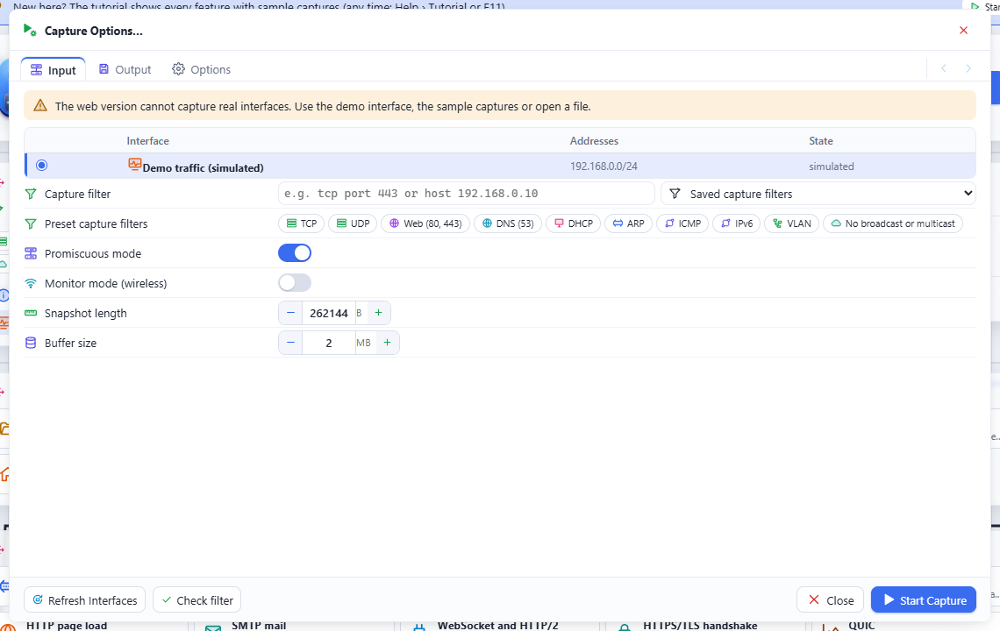

### Starting, stopping and restarting

| Action | How |
| --- | --- |
| Start | **Capture** toolbar button, **Capture › Start Capture**, Ctrl+E, double-click an interface |
| Stop | the **Stop** toolbar button (red square), **Capture › Stop Capture**, Ctrl+E |
| Restart | **Capture › Restart Capture** — a new capture on the same interface |

While capturing, packets are dissected as they arrive, the list scrolls to the newest packet (**Go › Auto Scroll in
Live Capture**), and the status bar shows *Capturing on … · dropped N*. When one of the auto-stop limits is reached
the capture stops by itself with a notice. A live capture is a new, unsaved document: save it with **File › Save**.

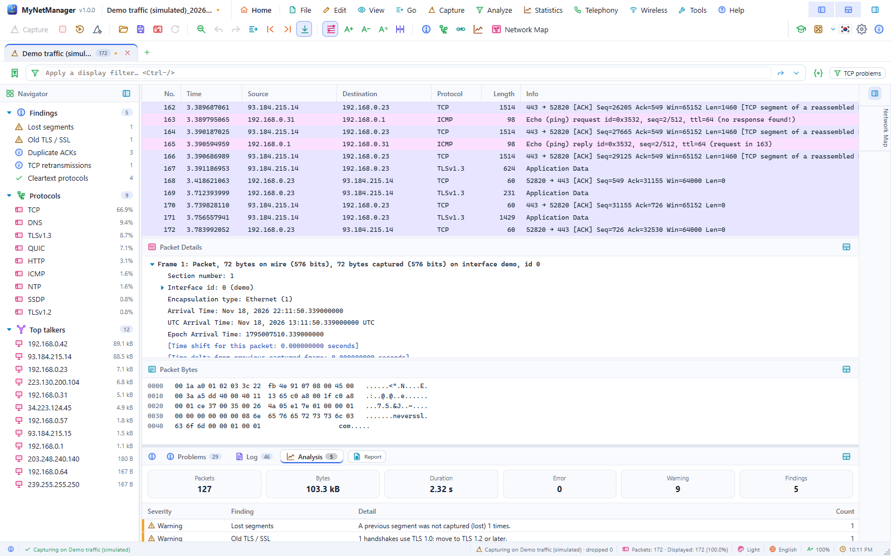

### Requirements for capturing real interfaces

| System | What is needed |
| --- | --- |
| Windows | **Npcap** from <https://npcap.com> (install it with "WinPcap API-compatible mode"). |
| Linux | **libpcap** (`libpcap0.8` / `libpcap`), and the right to capture: run `sudo setcap cap_net_raw,cap_net_admin=eip <path to the mynetmanager program>` once, or run as root. |
| macOS | libpcap is part of the system; your user needs read access to `/dev/bpf*` (for example through Wireshark's *ChmodBPF* helper), or run as root. |
| Web | Real interfaces cannot be captured in a browser; use the demo interface, the samples or files. |

Without these the Capture card says *Live capture is unavailable … The demo interface always works.*

## The main window

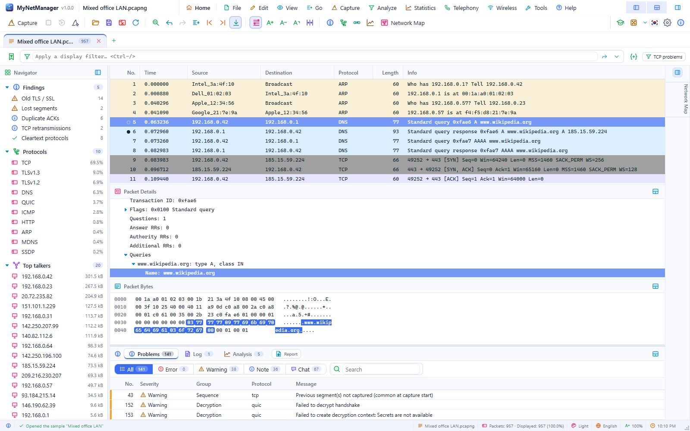

From top to bottom:

1. **Title row** — the program name and version, the name of the current capture (a dot when it is not saved), the
   **Home** button and the menus. At the right end are the **panel buttons** (left panel, bottom panel, right
   panel) and, in the desktop program, the window buttons (minimize, maximize, close). Drag an empty part of the
   title row to move the window.
2. **Toolbar** — coloured icon buttons (see below).
3. **Tabs** — one per open capture, with its packet count; **+** opens a file.
4. **Display filter bar**.
5. **Workspace** — the **Navigator** (left), the **packet list**, **packet details** and **packet bytes** (centre),
   the **Problems / Log / Analysis** panel (bottom) and the **Network Map** (right).
6. **Status bar** — the last message, the file name, *Packets: N · Displayed: M (x%)*, marked / ignored counts,
   the theme, the language, the text size and a clock.

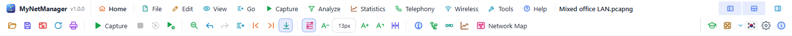

### Menus

| Menu | Contents |
| --- | --- |
| **File** | Open…, Recent Files…, Open Sample Capture, Merge…, Close, Close All, Save, Save As…, Save as pcap…, Export Specified Packets…, Export Packet Dissections (As Plain Text…, As CSV…, As JSON…, As PDML XML…, As PSML XML…, As C Arrays…), Export Selected Bytes…, Export Objects (HTTP, TFTP, IMF (Mail), FTP-DATA), Print…, Start Page, Quit |
| **Edit** | Copy (Summary Line, Summary as CSV, All Details, Visible Details, As JSON, Hex Dump, Hex Stream, Field Line, Value, As Filter, Field Bytes), Find Packet…, Find Next, Find Previous, Marks, Ignore, Time References, Time Shift…, Packet Comment…, Delete All Packet Comments, Settings… |
| **View** | Panes and Bars, Time Display Format, Name Resolution, Text Size, Colorize Packet List, Coloring Rules…, Resize Columns, Column Preferences…, Details Tree, Bytes As, Show Packet in New Window, Reload, Appearance (Random Theme, Choose Theme, language, Shuffle Background) |
| **Go** | Go to Packet…, First / Last / Previous / Next Packet, Previous / Next Packet in Conversation, Go to Related Packet, Go Back, Go Forward, Auto Scroll in Live Capture |
| **Capture** | Capture Options…, Start Capture, Stop Capture, Restart Capture, Capture Filters…, Interface List, Refresh Interfaces |
| **Analyze** | Display Filters…, Display Filter Expression…, Go to Display Filter, Apply as Column, Apply as Filter, Prepare as Filter, Conversation Filter, Enabled Protocols…, Decode As…, Follow (TCP, UDP, TLS, HTTP, HTTP/2, QUIC Stream), Expert Information |
| **Statistics** | Analysis Report…, Capture File Properties, Resolved Addresses, Protocol Hierarchy, Conversations, Endpoints, Packet Lengths, I/O Graphs, Flow Graph, TCP Stream Graphs, HTTP (Packet Counter, Requests, Load Distribution), DNS, IP Statistics (IPv4 Statistics, IPv6 Statistics, Port Types), Network Map |
| **Telephony** | VoIP Calls, SIP Flows, RTP Streams |
| **Wireless** | WLAN Traffic |
| **Tools** | Analysis Report…, Analyze Again, Firewall ACL Rules, Credentials, Settings… |
| **Help** | Welcome, Tutorial, Tutorial Document, User's Guide, Display Filter Reference, Keyboard Shortcuts, Settings…, About… |

Menu items show their shortcut on the right; items that cannot be used right now are dimmed. Submenus open when the
pointer rests on them.

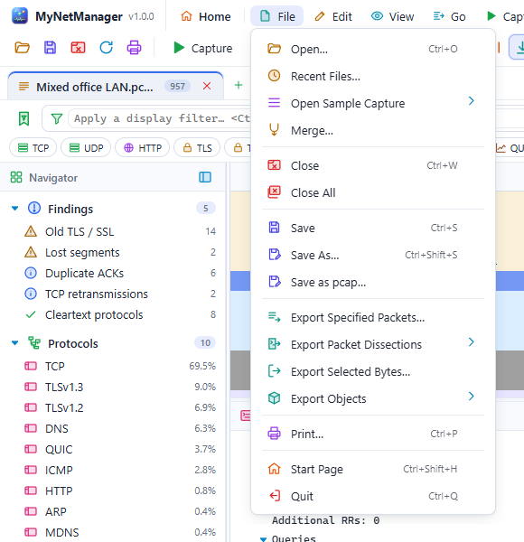

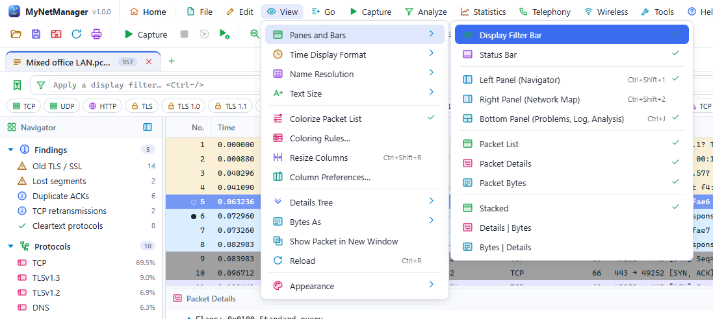

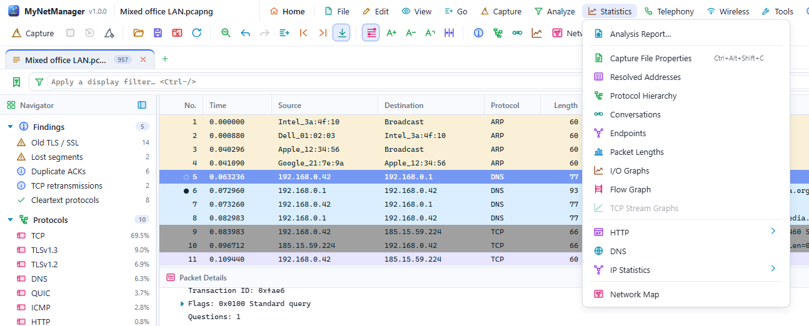

### Toolbar

| Group | Buttons |
| --- | --- |
| File | Open…, Save, Close, Reload, **Print…** |
| Capture | **Capture** (green ▶, start), Stop Capture (red ■), Restart Capture, Capture Options… |
| Go | Find Packet…, Go Back, Go Forward, Go to Packet…, First Packet, Last Packet, Auto Scroll in Live Capture |
| View | Colorize Packet List, Zoom Out (A−), **the current text size** (such as `13px`; a click returns to normal size), Zoom In (A+), Normal Size, Resize Columns |
| Analysis | Expert Information, Protocol Hierarchy, Conversations, I/O Graphs, **Network Map** |
| Right side | Tutorial, Random Theme with ▾ (Choose Theme), the language flag, Settings…, About… |

Every button has a tooltip with its name and shortcut. A button is dimmed when its command cannot be used (for example
**Stop Capture** when nothing is being captured).

### Panel buttons

The three buttons at the right of the title row show or hide the panels:

| Button | Panel | Shortcut |
| --- | --- | --- |
| Left Panel (Navigator) | findings, protocols and top talkers | Ctrl+Shift+1 |
| Bottom Panel (Problems, Log, Analysis) | problem list, log and analysis summary | Ctrl+J |
| Right Panel (Network Map) | the network map | Ctrl+Shift+2 (also Ctrl+Shift+N) |

Each panel also has a fold / unfold button at the right end of its title bar (the network map has it after its tool
buttons). A folded side panel shrinks to a 26-pixel rail with the panel's name written **vertically**; the rail's
button unfolds it. With details and bytes side by side, a folded pane becomes the same rail. The dividers between
panes can be dragged to resize them.

## Packet list

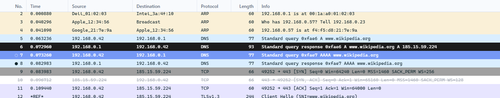

One row per packet, coloured by the [colouring rules](#colouring-rules). The default columns are **No.**, **Time**,
**Source**, **Destination**, **Protocol**, **Length** and **Info**.

- **Sort**: click a column heading (again for the reverse order).
- **Move** a column by dragging its heading; **resize** it by dragging its right edge.
- **Right-click a heading** to show or hide columns, **Resize Columns**, fit one column, remove a custom column,
  open **Column Preferences…** or go back to **Default columns**.
- **Column Preferences…** (View menu) adds columns of other kinds (Absolute time, Delta time, HW source, Net source,
  Src port, Expert, Stream, Comment, Interface, …) or a *Custom field* column showing any filter field.
  **Apply as Column** on a field in the details pane does the same in one step.
- **Select** a packet with a click or the arrow keys; Shift- and Ctrl-click select several.
- Symbols in the No. column link related packets (a request and its response, the packet a retransmission repeats).

**Right-clicking a packet** opens the packet menu: Mark/Unmark Packet, Ignore/Unignore Packet, Set/Unset Time
Reference, Time Shift…, Packet Comment…, Apply as Filter, Prepare as Filter, Conversation Filter, Copy, Decode As…,
Show Packet in New Window, Follow, Firewall ACL Rules, and **Print…** and **Export ▸** (HTML, Markdown, PDF, Word).

**Print…** / **Export** in a right-click menu work on what was clicked:

| Right-clicked | Printed or exported |
| --- | --- |
| A packet | its summary line and details (as displayed) |
| The details | the packet's details tree (as displayed) |
| The bytes | the packet's hex dump |
| A column heading | the packet list (summary lines of the displayed packets) |
| A tab | that capture's packet list (the tab comes to the front) |

Print opens the print window with that range and format chosen (pick the printer and press **Print**); Export saves
the same content to a file at once.

| Feature | What it does | How |
| --- | --- | --- |
| Marks | Highlights packets (black rows) to find or export them later | Ctrl+M, **Edit › Marks** (Mark All Displayed, Unmark All, Next Mark, Previous Mark) |
| Ignore | Treats a packet as if it were not in the capture (struck-through row, left out of statistics) | Ctrl+D, **Edit › Ignore** |
| Time reference | Measures the Time column from this packet (it shows `*REF*`) | Ctrl+T, **Edit › Time References** |
| Time shift | Moves the time stamps of all (or one) packets by seconds or `[-]h:mm:ss` | **Edit › Time Shift…** |
| Comments | A note stored in the pcapng file with the packet | Ctrl+Alt+C, **Edit › Packet Comment…** |

**View › Time Display Format** chooses how the Time column is shown: Date and Time of Day, Year/Day of Year and Time
of Day, Time of Day, Seconds Since 1970-01-01, Seconds Since Beginning of Capture (default), Seconds Since Previous
Captured Packet, Seconds Since Previous Displayed Packet, and the UTC variants — plus the precision (Automatic,
Seconds, Milliseconds, Microseconds, Nanoseconds).

**View › Text Size** (Ctrl+=, Ctrl+-, Ctrl+0) changes the text size of the packet panes; the status bar shows it.

## Packet details and packet bytes

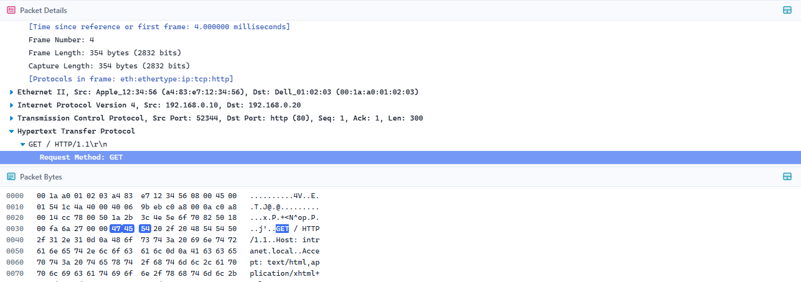

The **Packet Details** pane shows the selected packet as a tree, one branch per protocol layer (Frame, Ethernet II,
Internet Protocol, TCP, HTTP …). Lines in [brackets] are computed by MyNetManager (stream index, time since the
request, response-in links); yellow and red lines carry expert information.

- Click a ▸ to expand a branch. **View › Details Tree** has Expand Subtrees, Collapse Subtrees, Expand All, Collapse
  All (Ctrl+Right / Left, Ctrl+Shift+Right / Left).
- Selecting a line shows its filter name in the status bar and highlights its bytes in the bytes pane.
- **Right-click a line** for Expand/Collapse, **Apply as Column**, **Apply as Filter**, **Prepare as Filter**,
  **Conversation Filter**, **Copy**, **Export Selected Bytes…**, **Decode As…**, **Follow** and **Go to Related
  Packet** (for links such as *Response in* or *Request in*).

The **Packet Bytes** pane is a hex dump: offset, 16 bytes in hexadecimal, and the same bytes as text. Clicking a byte
selects the field it belongs to. Right-click it (or **View › Bytes As**) to show **Hexadecimal** or **Bits**, and the
text as **ASCII** or **EBCDIC**. Packets with reassembled or decrypted data show extra tabs for those data sources.

**View › Show Packet in New Window** opens the selected packet's details and bytes in a window of its own.

**View › Panes and Bars** shows or hides the display filter bar, status bar, side panels and the three packet
panes, and chooses the pane layout: **Stacked**, **Details | Bytes** or **Bytes | Details** (side by side).

## Display filters

The display filter bar sits above the packet list. A display filter keeps only the packets that match it; the others
are hidden, not deleted.

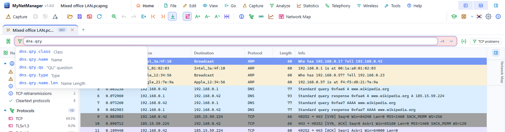

- Type a filter and press **Enter** (or the → button) to apply it. The ✕ button clears it.
- While you type, the bar is **green** when the filter is valid, **red** when it is invalid (the tooltip says why)
  and **yellow** when it uses deprecated syntax.
- Field names are **suggested** as you type; pick one with the arrow keys and Enter, or the mouse.
- **▾** lists the recent filters.
- The **bookmark** button at the left opens the filter bookmarks: **Save this filter…**, **Display Filters…**
  (manage saved filters), **Add filter button…** and the saved filters themselves.
- **Filter buttons** (such as **TCP problems**) at the right of the bar apply a saved filter with one click.
  **Add filter button…** makes a new one from the current filter.
- Under the bar is a row of **preset filters**. **All** at the front turns every button on (all ORed together) and
  **None** turns them all off (a filter typed in the box stays). Then come TCP, UDP, HTTP, TLS, **TLS 1.0**, **TLS 1.1**, **TLS 1.2**,
  **TLS 1.3**, QUIC, DNS, DHCP, ARP, ICMP, TCP SYN, Retransmissions, TCP problems, Broadcast, No ARP and DNS. Presets combine with **OR**, because most of them can
  never match the same packet: **DNS** applies `dns`, then **UDP** makes it `dns or udp` (packets that match either
  are shown) and both stay highlighted. Only pressing a highlighted button again takes its condition out. A filter
  already typed in the box is kept (`(frame.len > 60) or dns`). Any other filter is typed in the box as before.
- **TLS versions**: the Protocol column shows the version negotiated for each session (*TLSv1.2*, *TLSv1.3* …). TLS
  1.3 records still carry 0x0303 (1.2) in their header, so `tls.record.version` cannot tell them apart; the version
  buttons filter on the column, as in Wireshark: `_ws.col.protocol == "TLSv1.3"`. `_ws.col.protocol` and
  `_ws.col.info` are the columns exactly as the packet list shows them (after the whole file is read), so the result
  matches the list.
- **{+}** opens the **Display Filter Expression…** window.
- When a filter is applied the bar shows *Displayed N of M*, and so does the status bar.

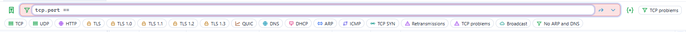

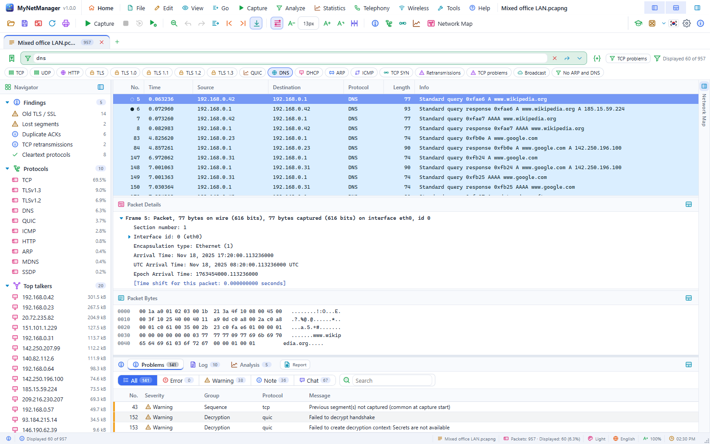

### Filter syntax

A filter is made of **fields** (`ip.src`, `tcp.port`, `http.request.method` …), **protocols** (`tcp`, `dns`, `arp`),
values, comparison operators and logical operators. A protocol or field name alone means "is present".

| Operator | Also written | Meaning | Example |
| --- | --- | --- | --- |
| `==` | `eq`, `any_eq` | equal (any occurrence) | `ip.addr == 192.168.0.10` |
| `!=` | `ne`, `all_ne` | not equal (no occurrence equals) | `ip.addr != 192.168.0.1` |
| `===` | `all_eq` | every occurrence equal | `ip.addr === 10.0.0.1` |
| `!==` / `~=` | `any_ne` | some occurrence not equal | `tcp.port !== 443` |
| `>` `<` `>=` `<=` | `gt` `lt` `ge` `le` | ordered comparison | `frame.len > 1000` |
| `contains` | | contains a string or bytes | `http.host contains "example"` |
| `matches` | `~` | regular expression | `dns.qry.name matches "wiki(pedia)?"` |
| `in` | | one of a set or range | `tcp.port in {80 443 8000..8080}` |
| `&` | `bitwise_and` | bitwise AND is non-zero | `tcp.flags & 0x02` |
| `&&` | `and` | both | `ip.src == 192.168.0.42 && tcp` |
| `\|\|` | `or` | either | `dns \|\| icmp` |
| `^^` | `xor` | exactly one | `tcp.srcport == 80 ^^ tcp.dstport == 80` |
| `!` | `not` | negation | `!arp` |
| `[i:n]` | | byte slice | `eth.src[0:3] == 00:1a:a0` |
| functions | | `len()`, `count()`, `upper()`, `lower()`, `string()`, `abs()`, `max()`, `min()` | `len(http.host) > 20`, `count(ip.addr) > 2` |

More examples:

| Filter | Shows |
| --- | --- |
| `tcp.analysis.flags` | TCP packets with any analysis flag (retransmission, dup ACK, zero window …) |
| `tcp.flags.syn == 1 && tcp.flags.ack == 0` | connection attempts |
| `http.request.method == "GET"` | HTTP GET requests |
| `http.response.code >= 400` | HTTP error responses |
| `dns.flags.rcode != 0` | DNS error answers |
| `tls.handshake.type == 1` | TLS Client Hello |
| `ip.addr == 192.168.0.0/24` | packets of a subnet |
| `eth.dst == ff:ff:ff:ff:ff:ff` | Ethernet broadcasts |
| `frame.time_relative > 10` | packets after the first 10 seconds |
| `_ws.expert` | packets with expert information |

**Help › Display Filter Reference** (or **Display Filter Re…** on the start page) opens the expression window, which
lists every protocol and field the program knows.

### Display Filter Expression

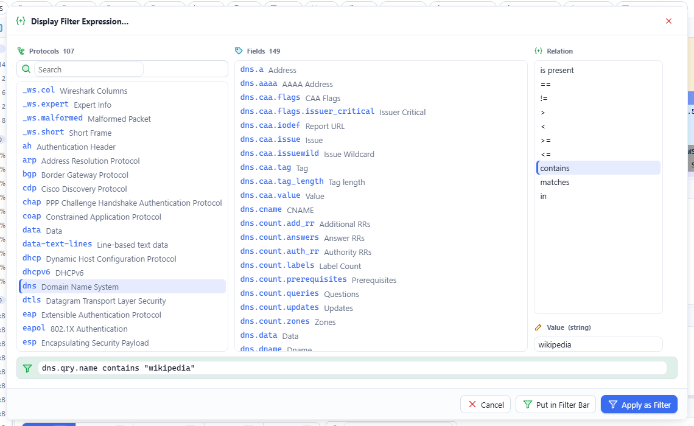

Pick a protocol in **Protocols** (with a search box), a field in **Fields**, a **Relation** (is present, ==, !=, >,
<, >=, <=, contains, matches, in) and a **Value** (fields with named values list them). The filter appears at the
bottom, coloured by validity. **Put in Filter Bar** copies it to the bar without applying it; **Apply as Filter**
applies it.

### Filters from packets: Apply / Prepare as Filter, Conversation Filter

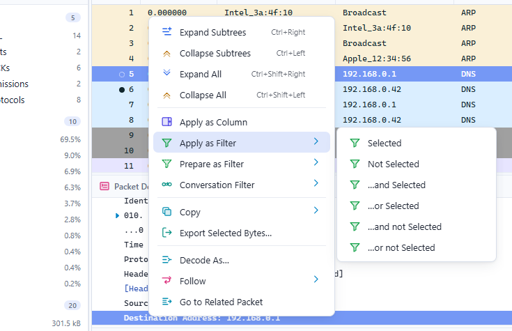

Right-click a field in the details pane (or use the **Analyze** menu):

- **Apply as Filter** builds a filter from the field's value and applies it at once; **Prepare as Filter** only puts
  it in the bar.
- Both offer **Selected**, **Not Selected**, **…and Selected**, **…or Selected**, **…and not Selected** and
  **…or not Selected** — the last four combine the new condition with the filter already in the bar.
- **Conversation Filter** (also in the packet menu) keeps the packets of the same **Ethernet**, **IPv4**, **IPv6**,
  **TCP** or **UDP** conversation as the selected packet.
- **Edit › Copy › As Filter** copies the field as filter text.

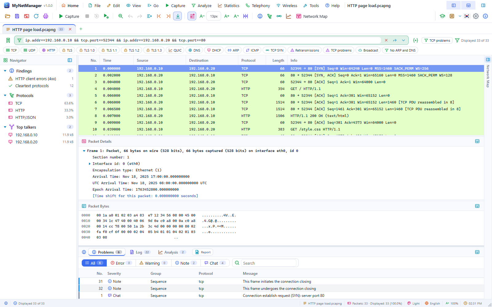

## Analysis

### Colouring rules

**View › Coloring Rules…** lists the rules that colour the packet list. The first matching rule from the top colours
a packet. Each rule has a **Name**, a **Filter** (red when invalid), a **Foreground** and a **Background** colour and
a check box to turn it on or off. Buttons: **Add**, **Copy**, **Up**, **Down**, **Delete**, **Import** (paste a
Wireshark *colorfilters* file), **Export…** and **Default rules**. **View › Colorize Packet List** turns colouring off
and on. In dark themes the packet colours are darkened automatically.

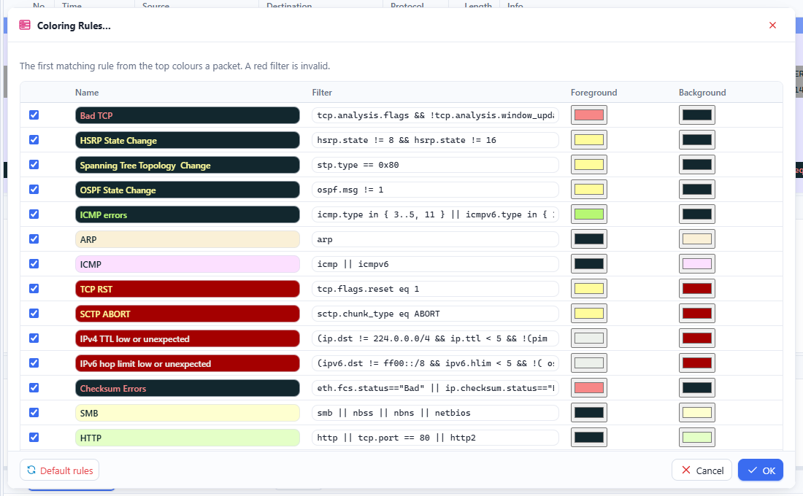

### Follow stream

Select a packet of a connection and choose **Analyze › Follow › TCP Stream** (Ctrl+Alt+Shift+T), **UDP Stream**,
**TLS Stream**, **HTTP Stream**, **HTTP/2 Stream** or **QUIC Stream**. The window shows the data of the whole
conversation put together: the client's data in red, the server's in blue.

- **Entire conversation**, **Client → server** or **Server → client** — which direction to show.
- **Show data as**: ASCII, EBCDIC, Hex Dump, C Arrays, Raw, YAML, UTF-8.
- **Find** searches the text; **Stream** steps to the previous or next stream.
- **Filter Out This Stream** hides the stream in the packet list, **Show Only This Stream** keeps only it.
- **Copy** and **Save As…** keep the text. Clicking a part of the text selects its packet.

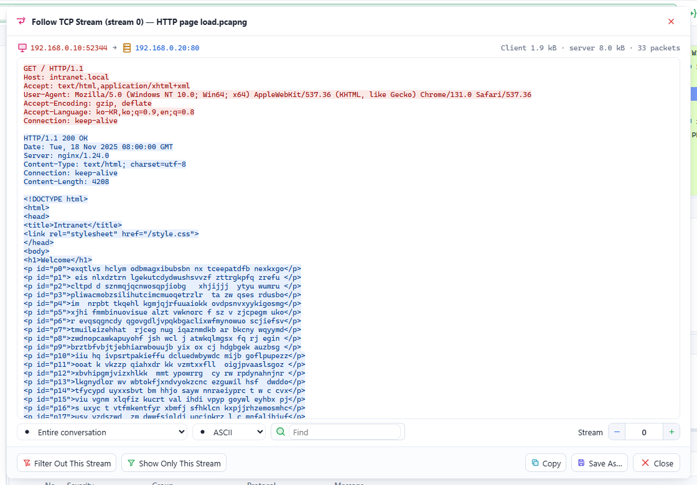

### Expert information

**Analyze › Expert Information** (Ctrl+Shift+E) groups the problems the dissectors found — retransmissions,
duplicate ACKs, lost segments, zero windows, malformed packets, protocol errors, and notes such as connection
setup — by **severity** (Error, Warning, Note, Chat), **group** and **protocol**, with a count. Expand a group to see
its packets; double-click a row to go to the packet. Rows are shaded in alternate colours.

- The filter tools are **above** the list: **Limit to display filter** (count only the displayed packets), the
  **search** box (shows the matching rows with their groups opened), **Expand All** / **Collapse All**, and
  **Prepare as Filter** / **Apply as Filter** for the selected row.
- A click on a heading sorts by that column (again: the other way, a third time: the original order). A tree is
  sorted within each group, so its structure stays.
- **Print…** and **Export** (HTML, Markdown, PDF, Word) at the bottom print or save the list as it is shown (search,
  sort and folding included).

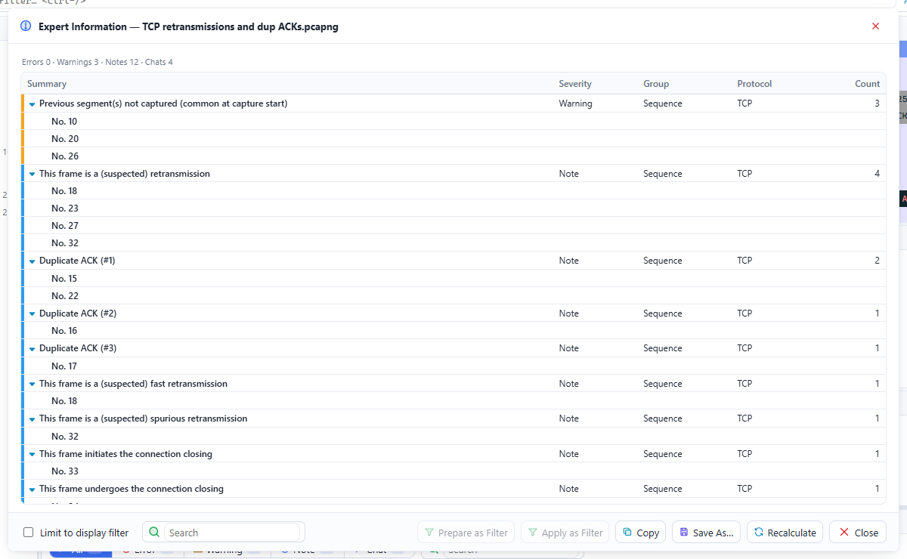

The same items are listed in the **Problems** tab of the bottom panel (see [Panels](#panels-navigator-bottom-panel-and-network-map)).

### Decode As

Traffic on a non-standard port can be dissected as another protocol: **Analyze › Decode As…** lists rules of a
**Field** (TCP port, UDP port, Ethertype, IP protocol …), a **Value** and the **Protocol** to use, or *(none)* to stop
dissecting it. The values of the selected packet are offered first. The rules are kept in the settings.

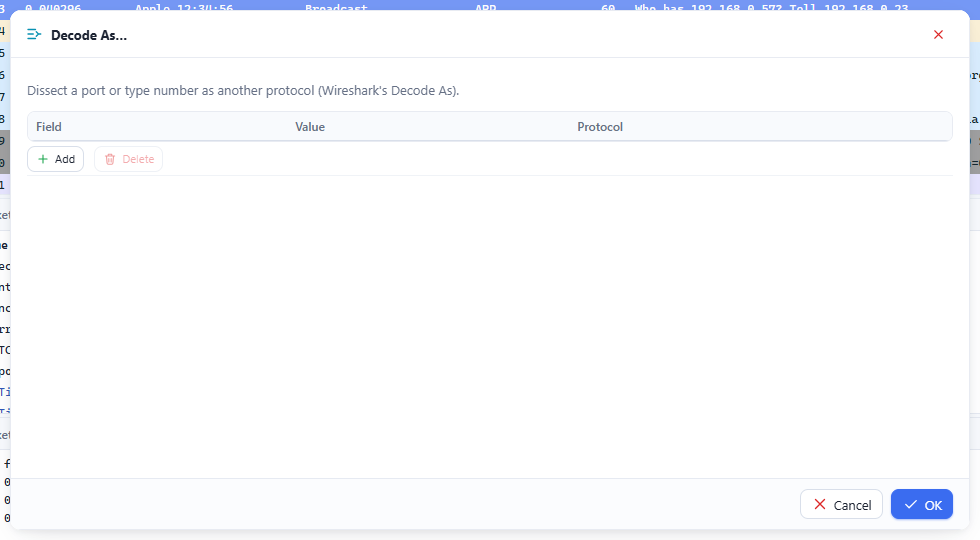

### Enabled protocols

**Analyze › Enabled Protocols…** turns individual protocols off (their bytes are shown as data) or on, with
**Enable All** and **Disable All** and a search box.

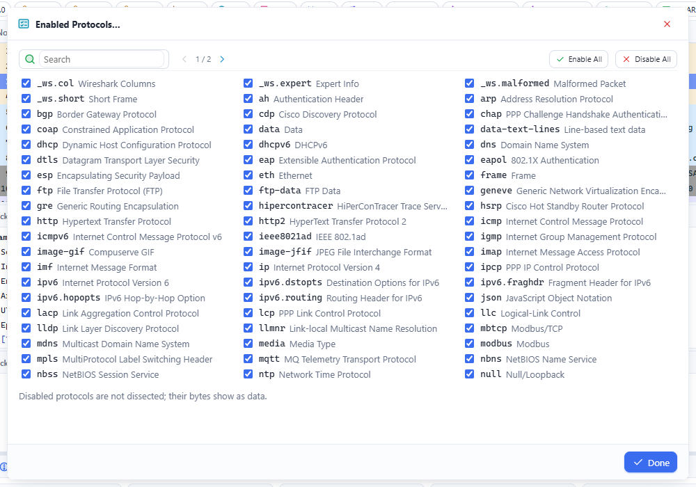

### Name resolution

**View › Name Resolution** has three switches: **Resolve Physical Addresses** (MAC vendor prefixes such as
`Intel_3a:4f:10`), **Resolve Transport Addresses** (port names such as `https`) and **Resolve Network Addresses**
(host names learned from DNS answers in the capture and from pcapng name records). **Statistics › Resolved Addresses** lists every name known for the capture.

## Statistics

Every statistics window has its filter tools at the top — **Limit to display filter** (count only the displayed
packets), a search box, **Prepare as Filter** / **Apply as Filter** for the selected row and, for a tree, **Expand All**
/ **Collapse All** — and at the bottom **Print…**, **Export** (format: HTML, Markdown, PDF, Word), **Copy**,
**Save As…**, **Recalculate** and **Close**. Tables sort by a click on a heading (trees within each group) and their
rows are shaded in alternate colours.

The I/O graph, TCP stream graph and flow graph windows add **Save as Picture…** (PNG, JPEG, WebP, GIF, AVIF, SVG)
and **Export** (the picture and its numbers in one document). With **Markdown**, a **Markdown pictures** list appears:
**Inside the document** (a data URL, one file) or **Saved as files, linked** (`name-1.png` saved beside the Markdown
and linked by name).

### Capture file properties

**Statistics › Capture File Properties** (Ctrl+Alt+Shift+C): file name, format, size, encapsulation, snapshot length,
first and last packet times, elapsed time, the capture hardware, OS and application, comments, each interface, and
packet / byte / rate totals for all, displayed and marked packets.

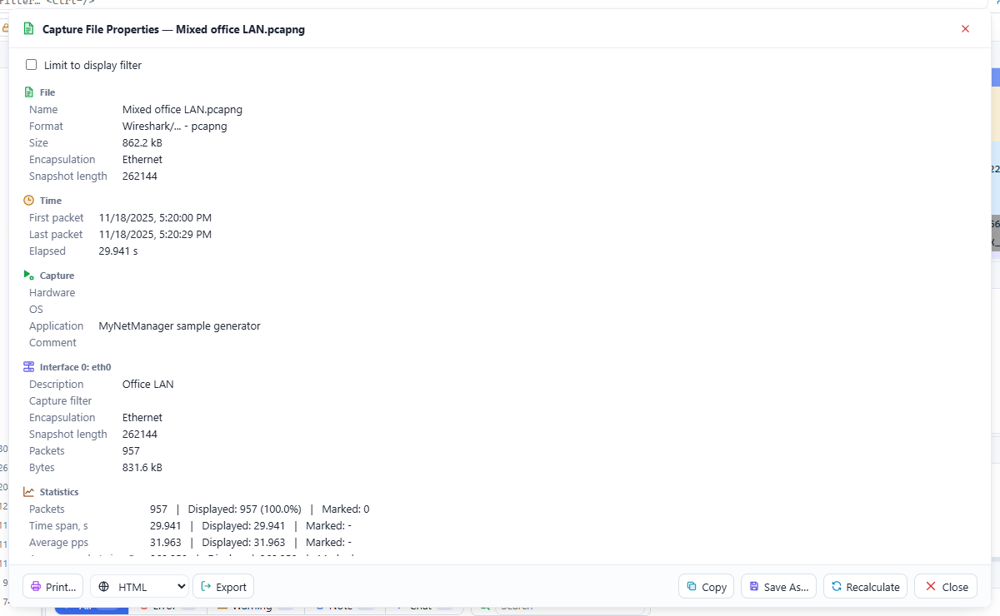

### Protocol hierarchy

**Statistics › Protocol Hierarchy** — every protocol as a tree with the percentage of packets and bytes, packets,
bytes, bits/s and the packets and bytes that end at that protocol.

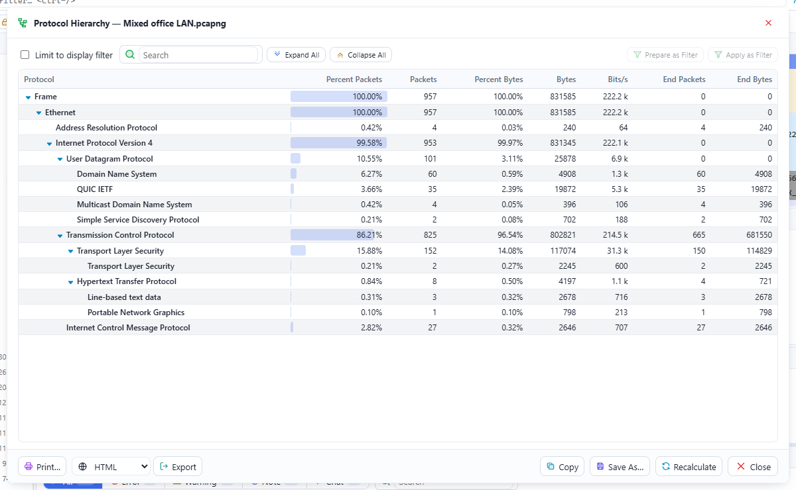

### Conversations and endpoints

**Statistics › Conversations** — one row per pair of addresses that talked, on tabs for **Ethernet**, **IPv4**,
**IPv6**, **TCP** and **UDP**: Address A, Port A, Address B, Port B, packets, bytes, bytes A → B and B → A, relative
start, duration and bits/s in each direction.

**Statistics › Endpoints** — one row per address with Tx / Rx packets and bytes.

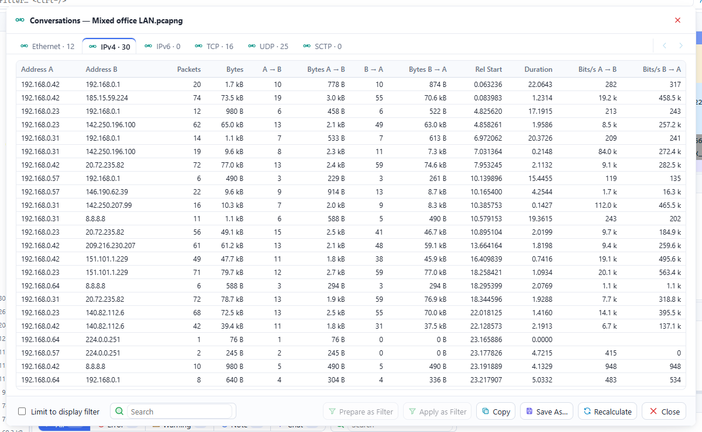

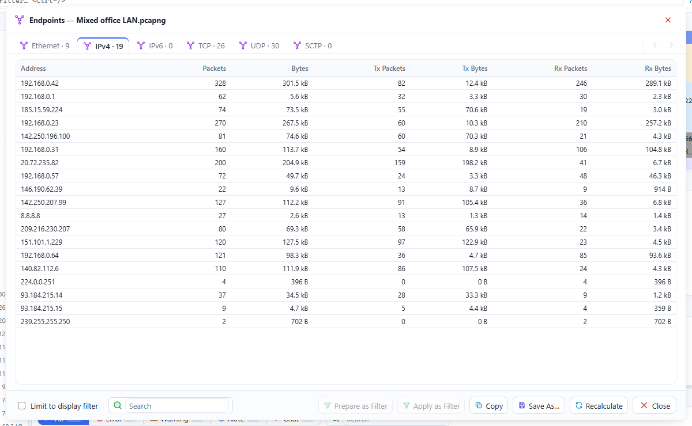

### Packet lengths

**Statistics › Packet Lengths** — how many packets fall into each length range, with average, minimum, maximum,
rate and percent.

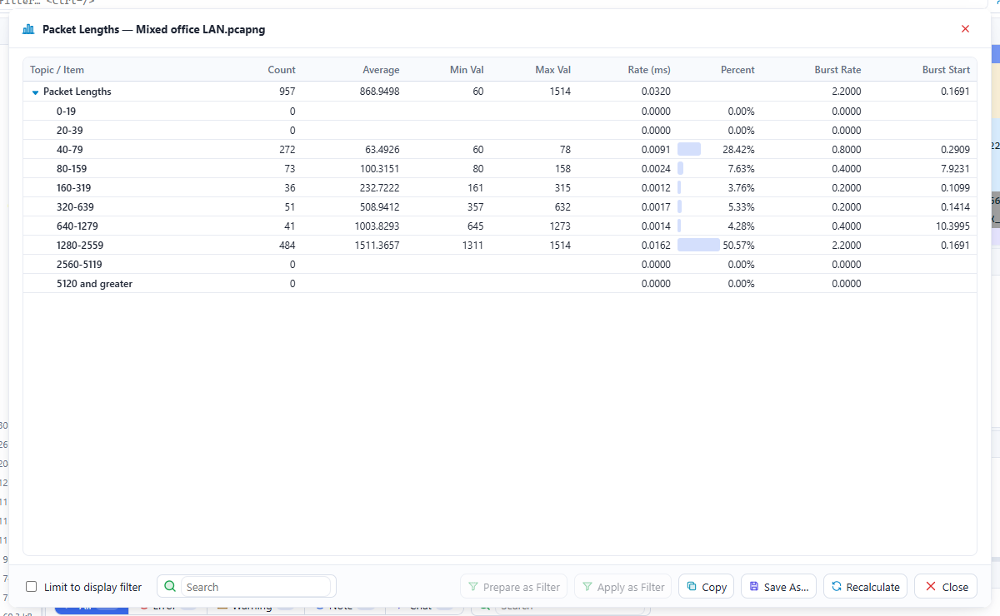

### I/O graphs

**Statistics › I/O Graphs** draws values over time. Each graph in the **Graphs** list has **Show**, a **Name**, a
**Display filter** (empty: all packets), a **Color**, a **Style** (Line, Bar, Dot) and a **Y axis** calculation:
Packets/interval, Bytes/interval, Bits/interval, or SUM / MIN / MAX / AVG / LOAD of a **Y field** (for example
`tcp.analysis.ack_rtt`). **Add** and **Remove** graphs, choose the **Interval**, **Draw**, and **Save as SVG…**.
Two graphs are ready at the start: *All packets* and *TCP errors*.

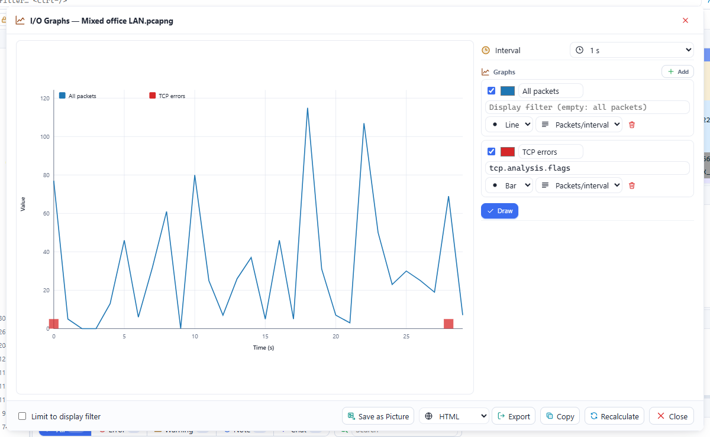

### Flow graph

**Statistics › Flow Graph** draws the packets between hosts as a sequence diagram, one column per address, with the
time on the left and the summary on the right. **Flow type** chooses **All packets** or **TCP flows**; **Addresses**
chooses **Any address** or **Network address**. Click a row to go to its packet. **Telephony › VoIP Calls** opens the
same graph for SIP, SDP, RTP and RTCP.

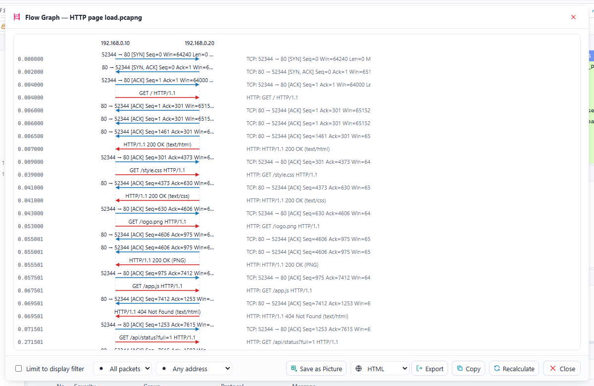

### TCP stream graphs

Select a TCP packet and choose **Statistics › TCP Stream Graphs**. **Graph type**: **Time / Sequence (Stevens)**,
**Throughput**, **Round Trip Time** or **Window Scaling**; **Stream** picks the TCP stream and **Reverse direction**
switches the direction. Gaps and repeated points in a Stevens graph show lost and retransmitted segments.

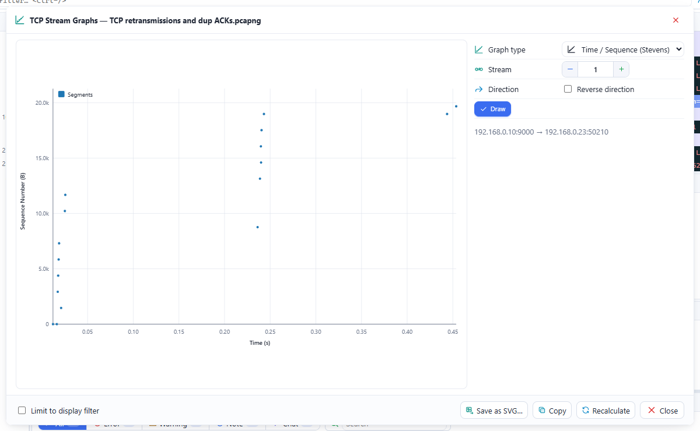

### HTTP, DNS and IP statistics

- **Statistics › HTTP**: **Packet Counter** (requests by method, responses by status code), **Requests** (by host and
  URI) and **Load Distribution** (by server).
- **Statistics › DNS**: queries and responses by type, rcode, opcode, and response times.
- **Statistics › IP Statistics**: **IPv4 Statistics** and **IPv6 Statistics** (by address) and **Port Types**.
- **Telephony**: **VoIP Calls**, **SIP Flows**, **RTP Streams**. **Wireless › WLAN Traffic**: 802.11 networks and
  stations. **Tools › Firewall ACL Rules** writes firewall rules for the selected packet; **Tools › Credentials**
  lists the clear-text logins found in the capture.

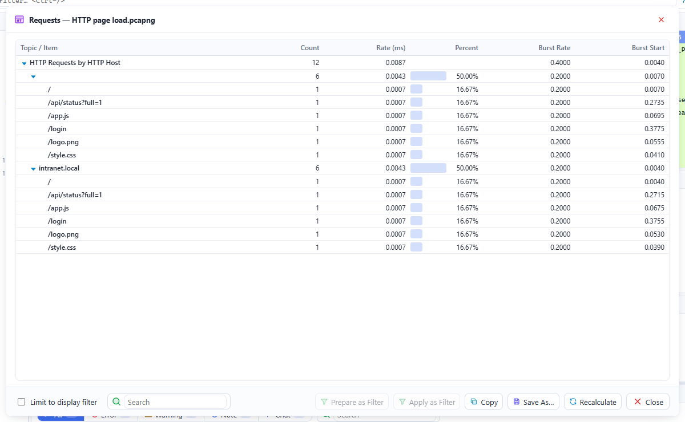

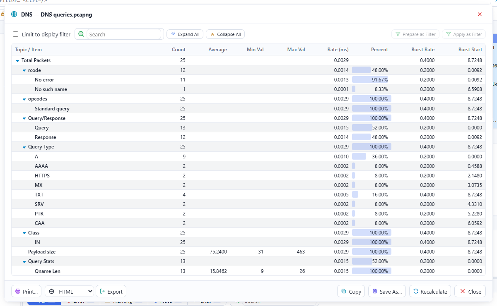

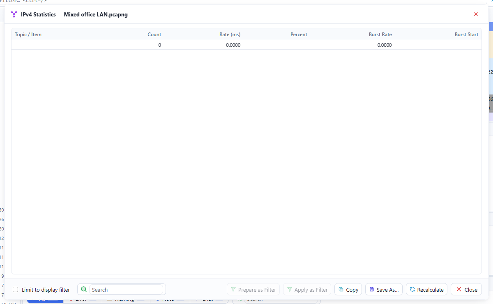

## Panels: navigator, bottom panel and network map

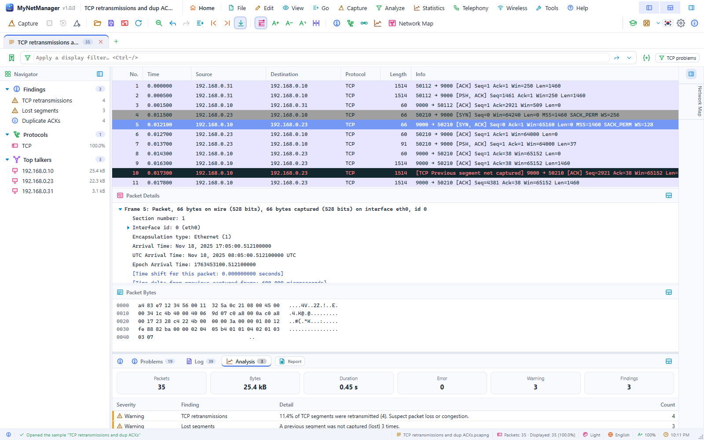

### Navigator (left panel)

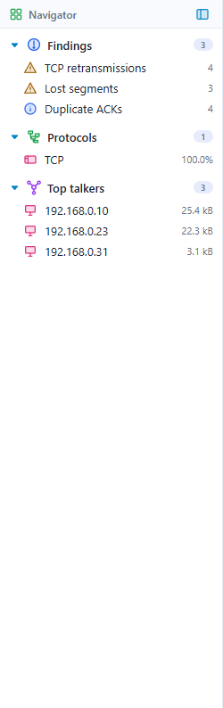

The **Navigator** has three sections you can fold: **Findings** (the problems the automatic analysis found, by
severity), **Protocols** (share of each protocol) and **Top talkers** (the addresses with the most bytes). Click an
item to filter the packet list by it; the tooltip shows the filter (*Click: …*).

### Bottom panel: Problems, Log, Analysis

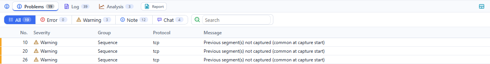

- **Problems** — every expert item of the capture, packet by packet, with **All / Error / Warning / Note / Chat**
  buttons and a **Search** box. Click a row to go to the packet.
- **Log** — what the program did (files opened, captures started and stopped, analyses, errors) with **Clear Log**.
- **Analysis** — summary cards (packets, bytes, duration, errors, warnings, findings) and the list of **findings**
  with severity and detail: TCP retransmissions, duplicate ACKs, lost segments, out of order, zero window, TCP
  resets, DNS errors, HTTP 4xx / 5xx, old TLS / SSL, clear-text credentials, IP address conflicts, several DHCP
  servers, possible port scans, many broadcasts, ICMP unreachable, TTL exceeded, malformed packets, clear-text
  protocols — or *No notable problems*. **Tools › Analyze Again** runs the analysis again.
- **Report** opens the analysis report window.

### Analysis report

**Statistics › Analysis Report…** (or **Report** in the bottom panel) writes the analysis as a document. Choose the
**Contents** (**Overview**, **Findings**, **Protocols**, **Top talkers**, **Problem list**, **Log**) and the
**Format**: **HTML** (opens in browsers and Word), **Markdown**, **PDF**, **Word** (.docx, tables as Word tables) or
**Print…** (goes to the print window: choose the printer and **Print** prints at once; the print window can also
export to the other formats), then press **Export…**.

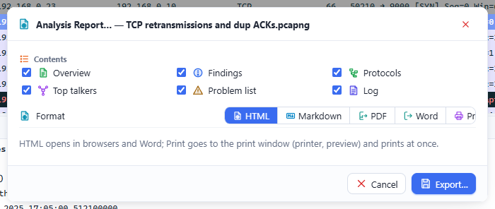

### Network map (right panel)

The **Network Map** (toolbar button, Ctrl+Shift+N, or the right panel button) draws the structure of the network found
in the traffic: hosts, routers / gateways, servers, printers, IP phones, IoT devices, external hosts and multicast
groups, and the links between them, sized by traffic.

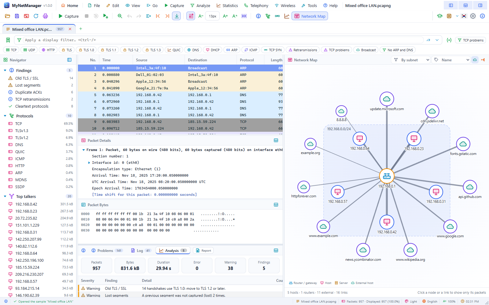

- **Layout**: **By subnet** (hosts grouped in their subnets around the gateway), **Force-directed** or **Radial**.
- **Labels**: **Name**, **IP address** or **MAC address**.
- Toggle **Show external hosts** and **Show multicast and broadcast**.
- **Fit** shows the whole map; **Rebuild** lays it out again; **Save as Picture…** saves it as **PNG**, **JPEG**,
  **WebP**, **GIF**, **AVIF** or **SVG** (the desktop program writes AVIF itself; the web version only where the
  browser can). The button at the far right folds the map.
- The wheel zooms, dragging the background pans, and nodes can be dragged. Hovering a node or link shows its kind,
  name, vendor, roles (DNS server, web server, DHCP server …), traffic and protocols.
- **Click a node** to show only that device's packets in the packet list; **click a link** to show only the packets
  between its two devices. Click it again, or **Show all packets**, to go back.

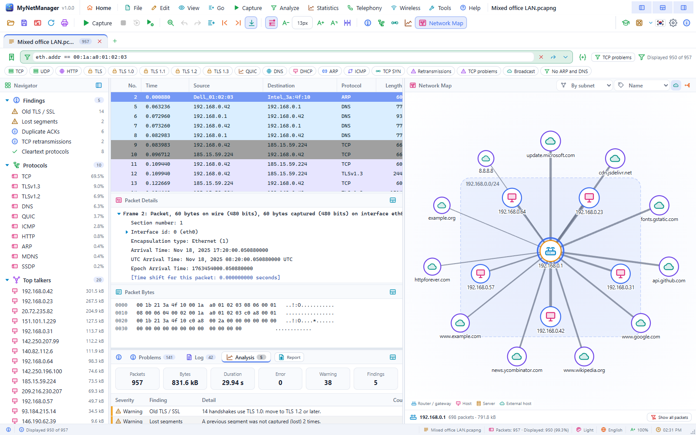

## Files and output

### Saving

**File › Save** (Ctrl+S) and **Save As…** (Ctrl+Shift+S) write **pcapng**, keeping packet comments, interfaces and
name records. **Save as pcap…** writes classic pcap (one link type, no comments). Wireshark opens both as they are.

### Export Specified Packets

**File › Export Specified Packets…** saves a subset as a new capture file. Choose the **Packet range** — **All
packets**, **Displayed**, **Selected packet**, **Marked packets** or a **Range** such as `1-10,15` — and the file type.

### Export Packet Dissections

**File › Export Packet Dissections** writes the dissections as **Plain text**, **CSV**, **JSON**, **PDML XML**, **PSML
XML** or **C arrays**. Choose the packet range and, for text, the **Packet format**: **Summary line**, **Column
headings**, **Details** (None, All collapsed, As displayed, All expanded) and **Bytes**.

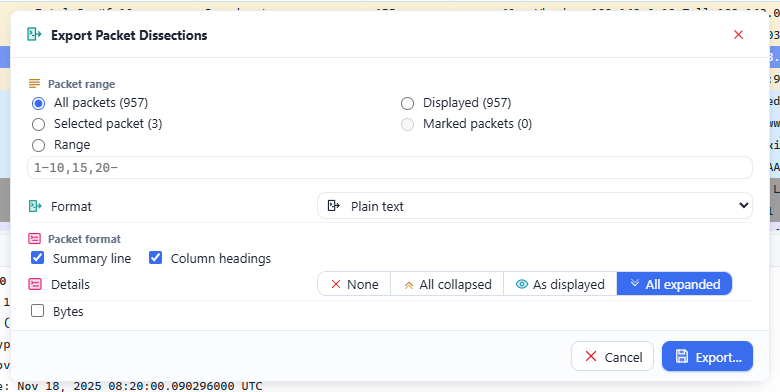

### Export bytes and objects

- **File › Export Selected Bytes…** saves the bytes of the selected field (in the details pane) as a binary file.
- **File › Export Objects** finds the files carried over **HTTP**, **TFTP**, **IMF (Mail)** and **FTP-DATA** —
  pictures, HTML pages, scripts, attachments — and saves one (**Save**) or all (**Save All**).
- **Edit › Copy** copies the summary, details, JSON, hex dump or a single field as text.

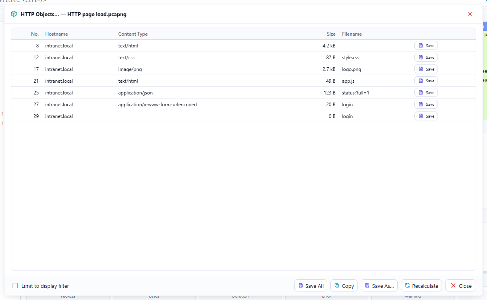

### Printing

**File › Print…** (Ctrl+P, the last button of the toolbar's file group) opens the print window — a window of its own
with a live preview of the pages. **Print…** in a statistics window and in the analysis report opens the same window.

- **Printer** — the desktop program prints straight to a printer you choose here; the web version opens the system
  print window.
- **Packet range** (All packets, Displayed, Selected packet, Marked packets, Range) and **Packet format** (Summary
  line, Column headings, Details, Bytes, **Each packet on a new page**).
- **Paper** (size, Portrait / Landscape, margins), **Font size**, **Header and footer** with their texts.
- The preview shows each page with ◀ ▶ to page through and how many pages and lines will be printed.

**Print** prints at once, without a further dialog. **Export** beside it saves the same content as **HTML**,
**Markdown**, **PDF** or **Word** (.docx):

| Format | Contents |
| --- | --- |
| HTML | One file for a browser (rows shaded in alternate colours, a print style included) |
| Markdown | Tables as Markdown tables, packet printouts as a code block; pictures inside or saved and linked |
| PDF | A4 (landscape for wide tables), Hangul shown with the PDF viewer's own Korean font, page numbers |
| Word | A .docx with the title, tables (the first row repeated on every page) and pictures |

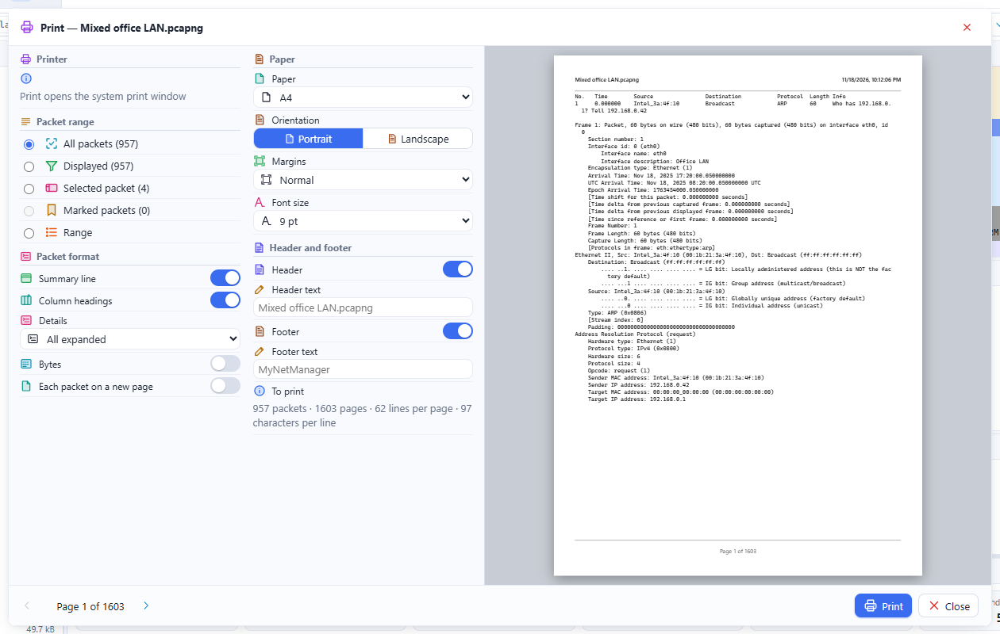

### Find packet and go to packet

**Edit › Find Packet…** (Ctrl+F) finds the next packet by **Display filter**, **Hex value** or **String**, searching
the **Packet list**, **Packet details** or **Packet bytes** (with **Case sensitive**). **Find Next** (Ctrl+N) and
**Find Previous** (Ctrl+B) repeat the search.

**Go › Go to Packet…** (Ctrl+G) jumps to a packet number. The **Go** menu also moves to the first, last, previous and
next packet, the previous / next packet of the same conversation (Ctrl+, / Ctrl+.), the related packet, and back and
forward through the packets you visited (Alt+Left / Right).

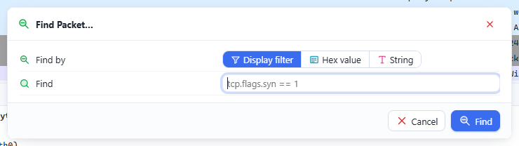

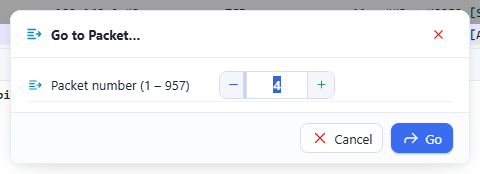

## Settings, themes and language

**Edit › Settings…** (also the gear button on the toolbar) opens the settings window. Changes apply at once;
**Defaults** puts every setting back; **Done** closes the window.

| Tab | Settings |
| --- | --- |
| **General** | Language (한국어 / English), reopen last files when starting, status bar clock, status bar, the last folder, start the tutorial |
| **Start page** | Show the start page at start-up, the welcome window, which cards and parts the start page shows, the number of recent files |
| **Theme** | Dark, light and custom themes |
| **Font** | The font and size of the program and of the packet panes |
| **Background** | Moving background, background picture, speed |
| **Layout** | Pane layout, display filter bar, packet list / details / bytes, network map, colouring, auto scroll, time display format and precision, row height of the packet list, column preferences |
| **Capture** | Capture filter, promiscuous and monitor mode, snapshot length, buffer size, auto-stop by packets and time, demo traffic rate |
| **Resolution & analysis** | Name resolution switches, TCP relative sequence numbers, TCP sequence analysis; **Dissect Now** applies them to open captures |
| **Protocols** | Enabled protocols |
| **Recent** | Recent files and folders (open, remove, clear) |
| **Shortcuts** | The keyboard shortcuts |

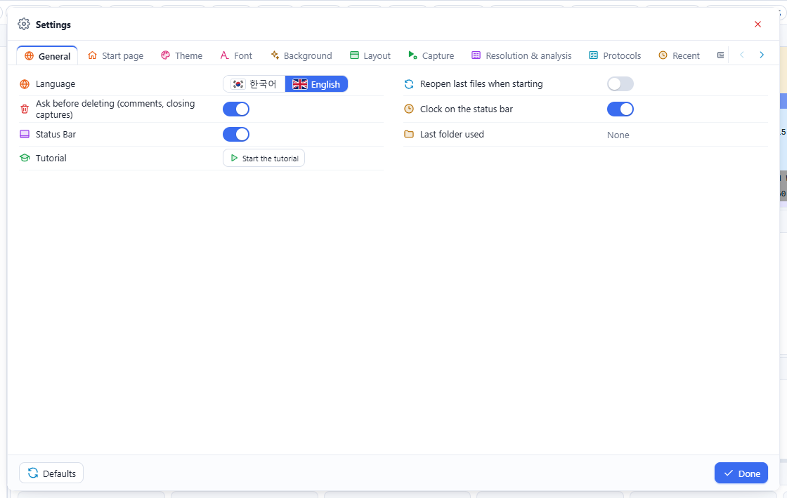

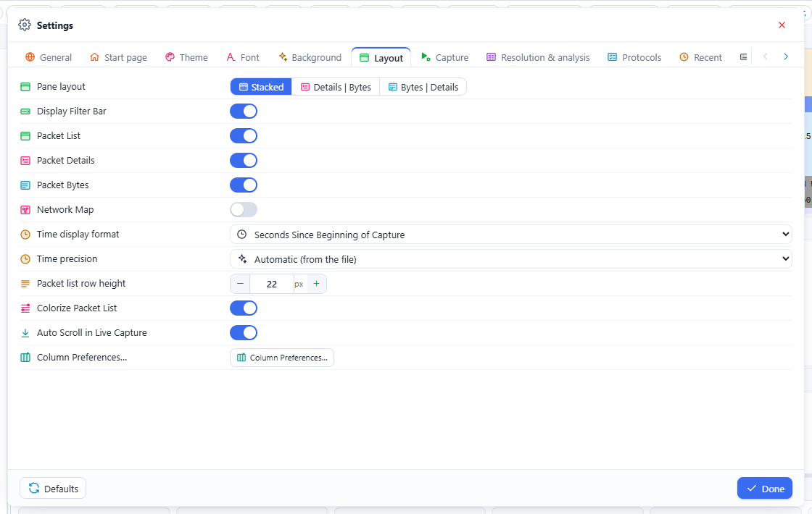

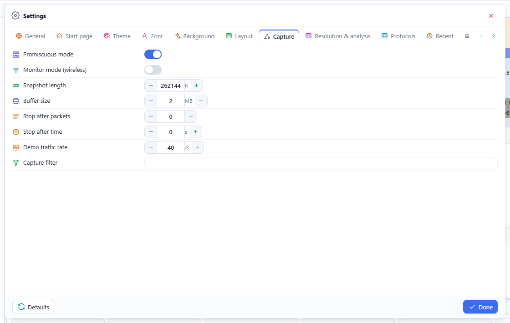

### Themes

The dice button on the toolbar (**Random Theme**) picks a random theme; the ▾ beside it (**Choose Theme**) opens the
theme list: **System setting**, **Custom**, 20 dark and 20 light themes, **Edit custom theme…** and **Random theme**.
The **Theme** card of the start page and **Settings › Theme** offer the same. The status bar shows the current theme;
in dark themes the packet colours become darker too.

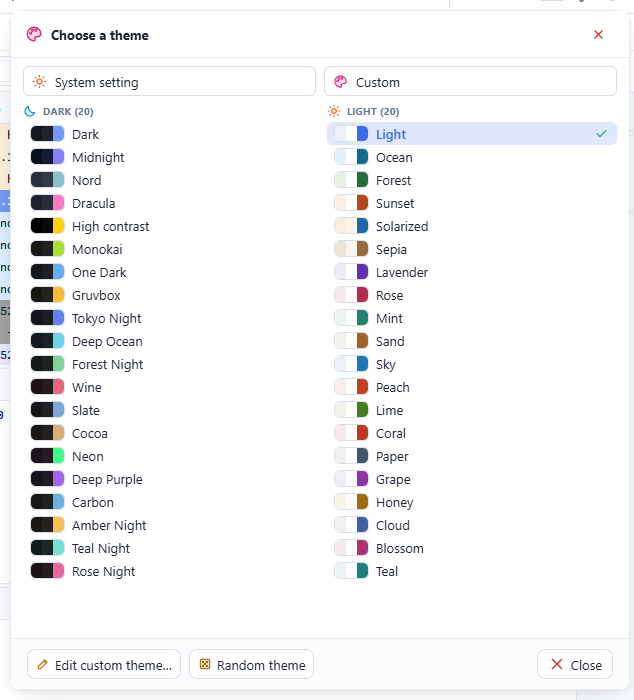

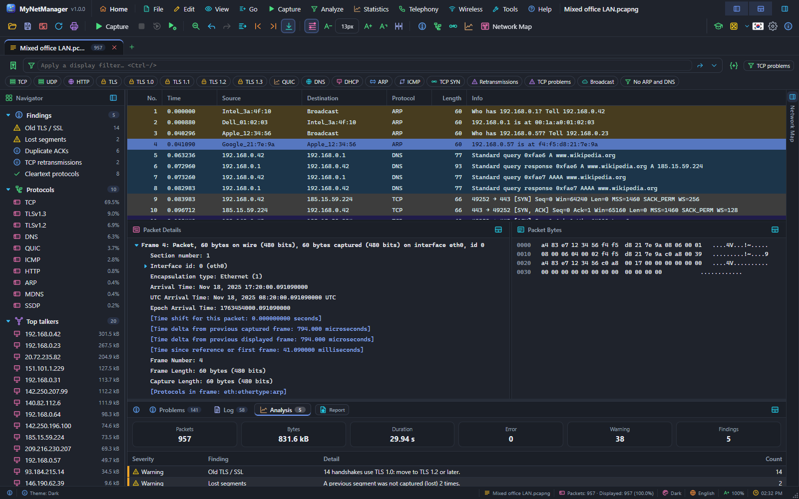

### Language

MyNetManager speaks **Korean** and **English**. The flag button on the toolbar (and the flag tile on the start page)
switches to the other language (Ctrl+Shift+L); **Settings › General › Language** chooses one. The status bar shows
the current language. Menus, windows, the guide and the tutorial all follow it.

## Tutorial

**Help › Tutorial** (F11), the tutorial button on the toolbar, or **Start the tutorial** on the start page runs a
guided tour of 42 steps in 9 chapters. It drives the real program with sample captures of its own; a card at the
bottom right shows each step with ◀ (*Previous step*), ▶ (*Auto play*), **Next**, a chapter list and ✕ (or Esc) to
end it. The
settings it changes are put back when it ends. The same tour is written up, with a picture of every step, in the
[Tutorial](Tutorial.en.md) document (**Help › Tutorial Document**).

## Keyboard shortcuts

On macOS, Cmd takes the place of Ctrl. **Help › Keyboard Shortcuts** (Settings › Shortcuts) lists them in the program.

| Shortcut | Command | Shortcut | Command |
| --- | --- | --- | --- |
| Ctrl+O | Open… | Ctrl+S / Ctrl+Shift+S | Save / Save As… |
| Ctrl+W | Close | Ctrl+P | Print… |
| Ctrl+Q | Quit | Ctrl+R, F5 | Reload |
| Ctrl+E | Start/Stop Capture | Ctrl+K | Capture Options… |
| Ctrl+I | Interface List | Ctrl+/ | Go to Display Filter |
| Ctrl+F | Find Packet… | Ctrl+N / Ctrl+B | Find Next / Find Previous |
| Ctrl+G | Go to Packet… | Ctrl+Up / Ctrl+Down | Previous / Next Packet |
| Ctrl+Home / Ctrl+End | First / Last Packet | Ctrl+, / Ctrl+. | Previous / Next Packet in Conversation |
| Alt+Left / Alt+Right | Go Back / Go Forward | Ctrl+M | Mark/Unmark Packet |
| Ctrl+D | Ignore/Unignore Packet | Ctrl+T | Set/Unset Time Reference |
| Ctrl+Alt+C | Packet Comment… | Ctrl+Alt+Shift+T | Follow TCP Stream |
| Ctrl+Alt+Shift+U | Follow UDP Stream | Ctrl+Alt+Shift+S | Follow TLS Stream |
| Ctrl+Alt+Shift+H | Follow HTTP Stream | Ctrl+Alt+Shift+C | Capture File Properties |
| Ctrl+Shift+E | Expert Information | Ctrl+Shift+N | Network Map |
| Ctrl+Shift+1 / Ctrl+Shift+2 | Left / Right Panel | Ctrl+J | Bottom Panel |
| Ctrl+= / Ctrl+- / Ctrl+0 | Zoom In / Zoom Out / Normal Size | Ctrl+Shift+R | Resize Columns |
| Ctrl+Right / Ctrl+Left | Expand / Collapse Subtrees | Ctrl+Shift+Right / Left | Expand All / Collapse All |
| Ctrl+Tab / Ctrl+Shift+Tab | Next / previous tab | Ctrl+Shift+L | Language |
| Ctrl+Shift+H | Start Page | Ctrl+, (on the start page) | Settings… |
| F11 | Tutorial | F1 | About… |

## Troubleshooting

| Problem | What to do |
| --- | --- |
| The Capture card lists only the demo interface and says *Live capture is unavailable* | Windows: install Npcap from <https://npcap.com>, then **Refresh**. Linux / macOS: install libpcap. |
| *The libpcap / Npcap library was not found* | As above; on Windows restart MyNetManager after installing Npcap. |
| *No permission to capture* | Linux: `sudo setcap cap_net_raw,cap_net_admin=eip <path to mynetmanager>` (again after every update), or run as root. macOS: give your user access to `/dev/bpf*`. Windows: Npcap installed with "Restrict Npcap driver's access to Administrators only" needs the program to run as administrator. |
| *The interface is down* / *No such interface* | Connect or enable the adapter and press **Refresh**. |
| *The capture filter is invalid* | Capture filters use BPF syntax (`tcp port 80`), not display filter syntax (`tcp.port == 80`). Use **Check filter** in Capture Options. |
| *This interface does not support monitor mode* | Turn **Monitor mode (wireless)** off, or use an adapter and driver that support it. |
| The web version cannot capture | Browsers cannot read network interfaces; use the desktop program, the demo interface or capture files. |
| A file opens only partly | The file is cut short; the packets up to the damage are shown (*the file is cut short; opened as far as it could be read*). |
| The filter bar is red | Point at it to see why; check field names in **Display Filter Expression…**. |
| Packets look wrong after changing name resolution or TCP settings | **Settings › Resolution & analysis › Dissect Now**, or **View › Reload**. |
| Too many packets to read | Apply a display filter, use the Navigator, Conversations or the network map to narrow down. |

## File formats

| Format | Read | Write |
| --- | --- | --- |
| pcapng (`.pcapng`, `.ntar`) | yes — sections, interfaces, comments, name records, interface statistics | **Save**, **Save As…**, Export Specified Packets |
| pcap (`.pcap`, `.cap`; micro- and nanosecond, both byte orders) | yes | **Save as pcap…** |
| gzip-compressed captures (`.pcapng.gz`, `.pcap.gz`) | yes | — |
| Plain text, CSV, JSON, PDML, PSML, C arrays | — | Export Packet Dissections |
| HTTP / TFTP / IMF / FTP-DATA objects | — | Export Objects |
| HTML, Markdown | — | Analysis Report |
| SVG / PNG | — | Network map, I/O and flow graphs |
| Wireshark *colorfilters* | Import | Export… (Coloring Rules) |

Link types: Ethernet, Linux cooked capture (SLL, SLL2), raw IPv4 / IPv6, BSD loopback (NULL, LOOP), IEEE 802.11 and
radiotap.
