# MyNetManager 사용 설명서

MyNetManager는 Wireshark 방식의 네트워크 프로토콜 분석기입니다. 네트워크 인터페이스에서 패킷을 캡처하거나
pcap / pcapng 캡처 파일을 열어, 패킷을 프로토콜 계층별로 해석하고, Wireshark와 같은 디스플레이 필터 문법으로
거르고, 색을 칠하고, 스트림을 따라가고, 통계와 네트워크 맵을 그리고, 결과를 내보내거나 인쇄합니다.
웹 브라우저에서도, Windows · macOS · Linux 데스크톱 프로그램으로도 실행됩니다.

이 설명서는 프로그램의 모든 부분을 설명합니다. 같은 기능을 직접 따라 해 보려면 [튜토리얼](Tutorial.md)을
보세요. The English guide is [UserGuide.en.md](UserGuide.en.md).

> 이 설명서의 그림은 모두 프로그램 자체(웹 버전, 1600 × 1000 창, *라이트* 테마)에서 함께 들어 있는 예제
> 캡처로 찍은 것입니다. 데스크톱 프로그램도 모양이 같고, 제목 줄 오른쪽 끝에 창 단추가 더 있습니다.

## 한눈에 보기

| 부분 | 내용 |
| --- | --- |
| [시작 화면](#시작-화면) | 카드, 예제 캡처, 최근 파일 |
| [캡처 열기](#캡처-열기) | 파일, 예제, 끌어 놓기, 병합 |
| [실시간 캡처](#실시간-캡처) | 인터페이스, 캡처 필터, 옵션, 데모 인터페이스, 자동 중지 |
| [주 창](#주-창) | 제목 줄, 메뉴, 툴바, 탭, 상태 표시줄 |
| [패킷 목록](#패킷-목록) · [세부 정보와 바이트](#패킷-세부-정보와-패킷-바이트) | 세 개의 창 |
| [디스플레이 필터](#디스플레이-필터) | 문법, 색, 추천, 책갈피, 단추 |
| [분석](#분석) | 색칠 규칙, 스트림 따라가기, 전문가 정보, 다르게 해석 |
| [통계](#통계) | 속성, 계층, 대화, 그래프, HTTP, DNS, IP |
| [패널](#패널-탐색-아래-패널-네트워크-맵) | 탐색, 문제·로그·분석, 네트워크 맵 |
| [파일과 출력](#파일과-출력) | 저장, 내보내기, 보고서, 인쇄 |
| [설정](#설정-테마-언어) | 설정 탭, 테마, 언어 |
| [참고](#단축키) | 단축키, 문제 해결, 파일 형식 |

## 시작 화면

프로그램을 시작하면(그리고 열린 캡처가 없을 때) 시작 화면이 나옵니다. 메뉴 막대 왼쪽의 **시작** 단추
(Ctrl+Shift+H)를 누르면 언제든 이 화면으로 돌아오며, 열려 있던 캡처는 탭에 그대로 남아 있습니다.

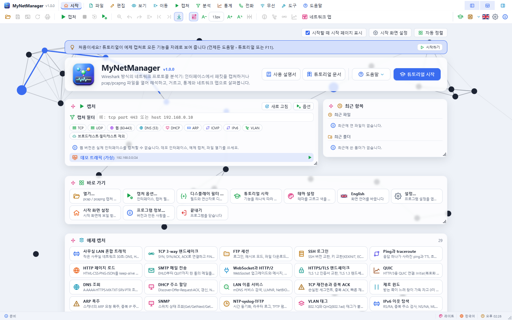

화면 위쪽에는 **시작할 때 시작 페이지 표시** 확인란, **시작 화면 설정**, **자동 정렬**(카드를 다시 가지런히
놓음) 단추가 있습니다. 그 아래 띠는 튜토리얼을 한 번 마칠 때까지 튜토리얼을 권합니다.

**프로그램 정보 카드**(MyNetManager 아이콘이 있는 큰 카드)는 맨 위에 고정되어 있습니다. 여기에
**사용 설명서**, **튜토리얼 문서** 단추와 **도움말** 메뉴 단추, **튜토리얼 시작** 단추가 있습니다.

나머지 카드는 자유롭게 배치할 수 있는 보드입니다.

- 카드 왼쪽 위의 손잡이(네 방향 화살표, *끌어서 카드 옮기기*)를 끌면 카드를 **옮깁니다**.
- 오른쪽 아래 모서리를 끌면 **크기를 바꿉니다**(*끌어서 카드 크기 바꾸기*, 모서리를 두 번 누르면 내용에 맞춤).
- **자동 정렬**은 모든 카드를 다시 정돈합니다.

| 카드 | 내용 |
| --- | --- |
| **캡처** | 캡처 필터 칸과 인터페이스 목록, **새로 고침**·**옵션** 단추 |
| **최근 항목** | **최근 파일**과 **최근 폴더**, 각각 지우기 단추 |
| **바로 가기** | 열기…, 캡처 옵션…, 디스플레이 필터 참고, 튜토리얼 시작, 테마 설정, 언어 전환(국기), 설정…, 시작 화면 설정, 프로그램 정보…, 끝내기 |
| **예제 캡처** | 예제 캡처 29개를 같은 크기의 타일로 한데 모은 격자(기초, 웹, 이름 서비스, 문제 해결, 라우팅·LAN, IoT·산업·VoIP 순서). 타일의 툴팁에 묶음 이름이 나옵니다. 마지막 **열기…** 타일까지 30개라 카드 폭이 바뀌어도(2·3·5·6열) 모든 줄이 꽉 찹니다 |
| **테마** | 어두운 테마와 밝은 테마 타일, **테마 설정** |
| **움직이는 배경** | 네트워크를 주제로 한 움직이는 배경 20가지, **배경 바꾸기**, **배경 그림…**, 움직임 속도, **카드 불투명도**, 시작할 때 무작위, 자동 변경 |

움직이는 배경은 모두 네트워크를 그립니다: 패킷 흐름, 3계층 네트워크, 헥스 덤프, 신호 파형, 광섬유, Wi-Fi
전파, 스캔 레이더, 처리량 그래프, 인터넷 지구본, 데이터 센터, 회로 기판, 비트 스트림, TCP 흐름도, OSI 계층,
Ping 펄스, 위성 링크, 트래픽 히트맵, 패킷 목록, 무선 스펙트럼, 메시 라우팅. 색은 테마를 따릅니다.

**오른쪽 단추 메뉴**는 포인터 아래에 맞는 것을 보여 줍니다.

| 누른 곳 | 메뉴 |
| --- | --- |
| 캡처 카드의 인터페이스 | *(인터페이스)에서 캡처 시작*, **이 인터페이스 선택**, **인터페이스 이름 복사**, **주소 복사**, 캡처 옵션…, 캡처 필터…, 인터페이스 새로 고침 (누른 인터페이스가 선택됩니다) |
| 예제 캡처 타일 | **예제 열기**, **파일 이름 복사**, 열기…, 예제 캡처 열기 |
| 최근 파일·폴더 | **열기** / **이 폴더에서 열기…**, **경로 복사**, 목록에서 지우기 |
| 그 밖의 빈 곳 | 열기…, 캡처 옵션…, 캡처 시작, **자동 정렬**, **배경 바꾸기**, **테마 설정**, **시작 화면 설정**, 튜토리얼, 프로그램 정보 |

어떤 카드와 항목을 보일지는 **설정 › 시작 화면**에서 정합니다.

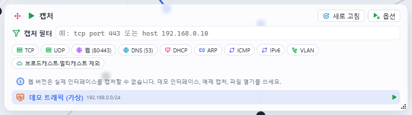

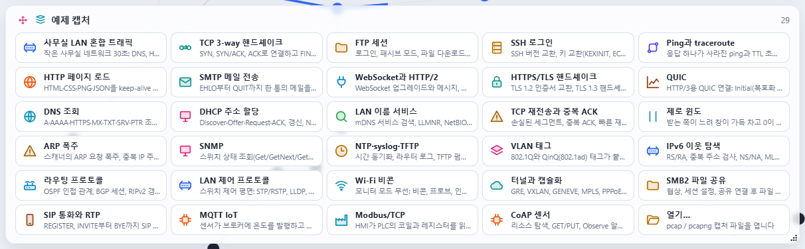

## 캡처 열기

캡처를 여는 방법은 네 가지이며, 캡처마다 탭이 하나씩 열립니다.

1. **파일 › 열기…**(Ctrl+O), 툴바의 **열기** 단추, 탭 줄 끝의 **+**, 시작 화면의 **열기…**.
   **pcapng**와 **pcap** 파일을 읽습니다(`.cap`, `.ntar`, gzip으로 압축한 `.pcapng.gz` / `.pcap.gz`도 됨).
2. **예제 캡처**: 시작 화면의 타일을 누르거나 **파일 › 예제 캡처 열기**를 씁니다. 예제는 MyNetManager가
   만들어 내므로 파일이 필요 없습니다.
3. 캡처 파일을 창에 **끌어 놓습니다**(*캡처 파일을 놓으면 엽니다*). 캡처 파일이 아니면 알려 줍니다.
4. **파일 › 최근 파일…**과 시작 화면의 **최근 항목** 카드.

끝이 잘린 파일(아직 쓰는 중에 복사한 파일 등)은 읽을 수 있는 데까지 열고 알림을 보여 줍니다.
**파일 › 병합…**은 다른 캡처를 지금 캡처에 합칩니다. **뒤에 붙이기**는 다른 파일의 패킷을 뒤에 붙이고,
**시간 순으로**는 시간에 따라 섞습니다.

**파일 › 닫기**(Ctrl+W)는 지금 탭을, **모두 닫기**는 모든 탭을 닫습니다. 탭을 오른쪽 클릭하면 **닫기**와
**다른 탭 닫기**가 나옵니다. Ctrl+Tab / Ctrl+Shift+Tab으로 탭을 옮겨 다닙니다. 저장하지 않은 캡처(실시간
캡처나 주석을 단 캡처)는 점으로 표시되고, 닫기 전에 저장할지 묻습니다.

## 실시간 캡처

### 인터페이스와 캡처 필터

시작 화면의 **캡처** 카드에는 네트워크 인터페이스(이더넷, Wi-Fi, 루프백, 가상 어댑터…)와 그 주소가
나옵니다. 인터페이스를 클릭하면 고르고, 두 번 클릭하거나 ▶ 단추를 누르면 그 인터페이스에서 캡처를
시작합니다. **새로 고침**은 목록을 다시 읽습니다(**캡처 › 인터페이스 새로 고침**).

목록 위의 **캡처 필터** 칸에는 `tcp port 443`, `host 192.168.0.10` 같은 BPF 캡처 필터를 적습니다. 캡처 필터는
캡처하는 동안 운영체제에서 미리 거르므로, 맞지 않는 패킷은 아예 캡처되지 않습니다. 문법이 디스플레이
필터와 다릅니다([디스플레이 필터](#디스플레이-필터) 참고).

| 캡처 필터 | 캡처하는 것 |
| --- | --- |
| `host 192.168.0.10` | 한 주소와 주고받는 패킷 |
| `net 192.168.0.0/24` | 한 서브넷의 패킷 |
| `tcp port 443` | 출발지나 목적지 포트가 443인 TCP 패킷 |
| `udp port 53 or udp port 67` | DNS와 DHCP |
| `not arp and not icmp` | ARP와 ICMP를 뺀 모든 패킷 |

캡처 필터 칸 아래에는 **미리 설정된 캡처 필터** 단추가 있습니다: TCP, UDP, 웹(80·443), DNS(53), DHCP, ARP,
ICMP, IPv6, VLAN, 브로드캐스트·멀티캐스트 제외. 디스플레이 필터의 미리 설정된 필터처럼 **OR 조건**으로 겹칩니다
(TCP와 DNS를 누르면 `tcp or port 53`). 강조된 단추를 다시 누르면 그 조건만 빠지고, 칸에 직접 적은 필터는
그대로 남습니다. **캡처 옵션** 창의 캡처 필터에도 같은 단추가 있습니다.

### 데모 인터페이스

**데모 트래픽 (가상)**은 늘 첫 번째 인터페이스입니다. 권한이나 캡처 라이브러리 없이 실제와 비슷한 LAN
트래픽(DNS, HTTPS, HTTP, QUIC, ARP, DHCP, ping …)을 만들어 내므로, 실제 인터페이스를 캡처할 수 없는 웹
버전을 포함해 어디서나 실시간 캡처를 해 볼 수 있습니다.

### 캡처 옵션

**캡처 › 캡처 옵션…**(Ctrl+K) 또는 캡처 카드의 **옵션**을 누르면 탭이 세 개인 캡처 옵션 창이 열립니다.

- **입력** — 인터페이스 목록(주소, 상태), **캡처 필터**와 **저장한 캡처 필터**, **무차별 모드 (다른 장치의
  패킷도)**, **모니터 모드 (무선)**, **스냅 길이**, **버퍼 크기**. **필터 검사**는 고른 인터페이스에서 캡처
  필터를 검사합니다.
- **출력** — 캡처한 패킷은 메모리에 쌓이며, 저장은 나중에 **파일 › 저장**으로 합니다.
- **옵션** — 자동 중지 조건 **패킷 수 뒤 멈춤**, **시간 뒤 멈춤**, **크기 뒤 멈춤**(0 = 끔)과 데모
  인터페이스의 **데모 트래픽 속도**.

**캡처 시작**을 누르면 이 옵션으로 캡처를 시작합니다.

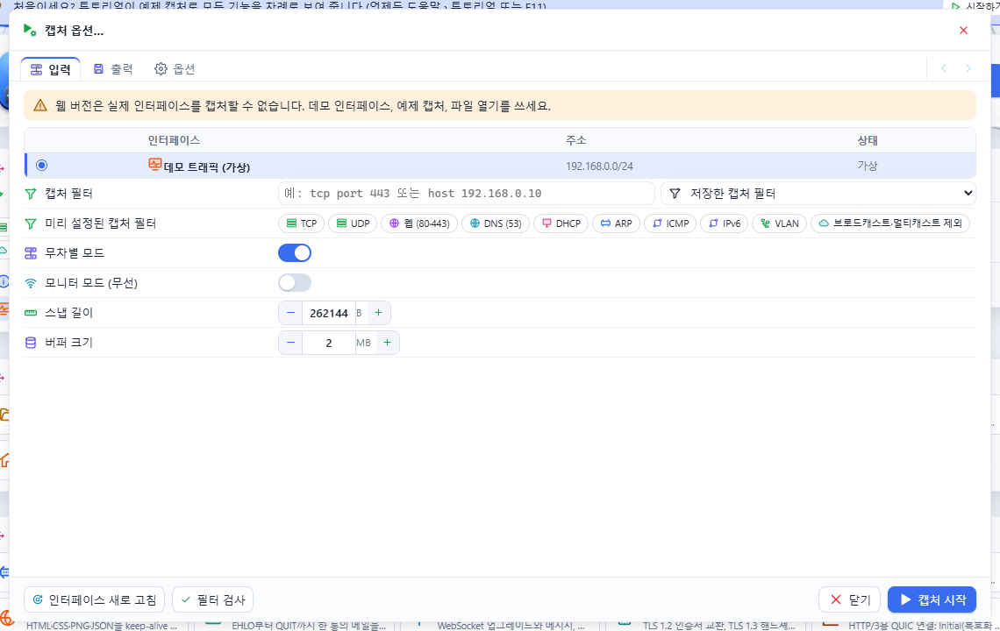

### 시작, 중지, 다시 시작

| 동작 | 방법 |
| --- | --- |
| 시작 | 툴바의 **캡처** 단추, **캡처 › 캡처 시작**, Ctrl+E, 인터페이스 두 번 클릭 |
| 중지 | 툴바의 **캡처 중지** 단추(빨간 네모), **캡처 › 캡처 중지**, Ctrl+E |
| 다시 시작 | **캡처 › 캡처 다시 시작** — 같은 인터페이스로 새로 캡처 |

캡처하는 동안 패킷은 들어오는 대로 해석되고, 목록은 가장 새 패킷으로 스크롤되며(**이동 › 실시간 캡처 때
자동 스크롤**), 상태 표시줄에 *…에서 캡처 중 · 버림 N*이 나옵니다. 자동 중지 조건에 이르면 알림과 함께
저절로 멈춥니다. 실시간 캡처는 저장하지 않은 새 문서이므로 **파일 › 저장**으로 저장하세요.

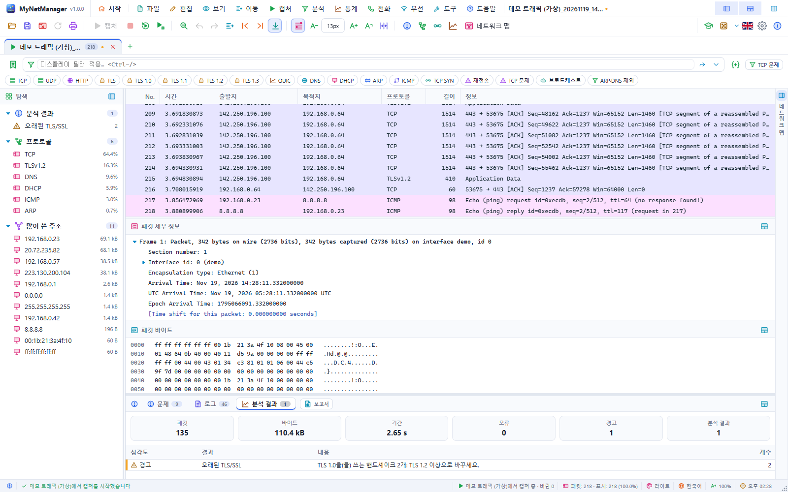

### 실제 인터페이스를 캡처하려면

| 시스템 | 필요한 것 |
| --- | --- |
| Windows | <https://npcap.com> 에서 받은 **Npcap** ("WinPcap API-compatible mode"로 설치) |
| Linux | **libpcap**(`libpcap0.8` / `libpcap`)과 캡처 권한: 한 번 `sudo setcap cap_net_raw,cap_net_admin=eip <mynetmanager 실행 파일 경로>`를 실행하거나 root로 실행 |
| macOS | libpcap은 시스템에 들어 있음. 사용자에게 `/dev/bpf*` 읽기 권한이 있어야 함(예: Wireshark의 *ChmodBPF*), 또는 root로 실행 |
| 웹 | 브라우저에서는 실제 인터페이스를 캡처할 수 없음. 데모 인터페이스, 예제, 파일을 사용 |

이것이 없으면 캡처 카드에 *실제 캡처를 쓸 수 없습니다 … 데모 인터페이스는 언제나 쓸 수 있습니다.*가 나옵니다.

## 주 창

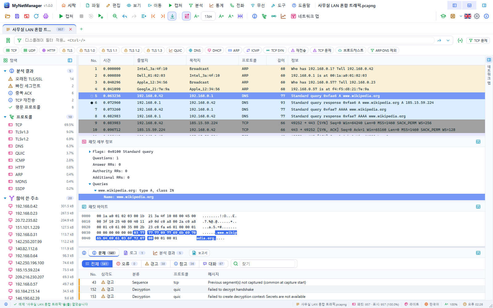

위에서부터 차례로:

1. **제목 줄** — 프로그램 이름과 버전, 지금 캡처의 이름(저장하지 않았으면 점), **시작** 단추와 메뉴. 오른쪽
   끝에는 **패널 단추**(왼쪽 패널, 아래 패널, 오른쪽 패널)가 있고, 데스크톱 프로그램에서는 창 단추(최소화,
   최대화, 닫기)가 이어집니다. 제목 줄의 빈 곳을 끌면 창이 움직입니다.
2. **툴바** — 색 아이콘 단추(아래 표).
3. **탭** — 열린 캡처마다 하나, 패킷 수가 함께 나옵니다. **+**는 파일을 엽니다.
4. **디스플레이 필터 막대**.
5. **작업 영역** — **탐색**(왼쪽), **패킷 목록**·**패킷 세부 정보**·**패킷 바이트**(가운데), **문제·로그·분석**
   패널(아래), **네트워크 맵**(오른쪽).
6. **상태 표시줄** — 마지막 메시지, 파일 이름, *패킷: N · 표시: M (x%)*, 표시·무시한 패킷 수, 테마, 언어,
   글자 크기, 시계.

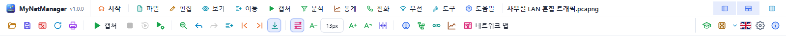

### 메뉴

| 메뉴 | 내용 |
| --- | --- |
| **파일** | 열기…, 최근 파일…, 예제 캡처 열기, 병합…, 닫기, 모두 닫기, 저장, 다른 이름으로 저장…, pcap 형식으로 저장…, 지정한 패킷 내보내기…, 패킷 해석 내보내기(일반 텍스트로…, CSV로…, JSON으로…, PDML(XML)로…, PSML(XML)로…, C 배열로…), 선택한 바이트 내보내기…, 개체 내보내기(HTTP, TFTP, 메일(IMF), FTP 데이터), 인쇄…, 시작 화면, 끝내기 |
| **편집** | 복사(요약 줄, 요약 (CSV), 모든 세부 정보, 보이는 세부 정보, JSON, 16진 덤프, 16진 문자열, 필드 줄, 값, 필터 식, 필드 바이트), 패킷 찾기…, 다음 찾기, 이전 찾기, 표시, 무시, 시간 기준, 시간 이동…, 패킷 주석…, 모든 패킷 주석 삭제, 설정… |
| **보기** | 창과 막대, 시간 표시 형식, 이름 풀이, 글자 크기, 패킷 목록 색칠, 색칠 규칙…, 열 너비 맞추기, 열 설정…, 세부 트리, 바이트 표시, 새 창에 패킷 표시, 다시 읽기, 모양(무작위 테마, 테마 고르기, 언어, 배경 바꾸기) |
| **이동** | 패킷으로 이동…, 첫 패킷 / 마지막 패킷 / 이전 패킷 / 다음 패킷, 대화의 이전 패킷 / 대화의 다음 패킷, 관련 패킷으로, 뒤로, 앞으로, 실시간 캡처 때 자동 스크롤 |
| **캡처** | 캡처 옵션…, 캡처 시작, 캡처 중지, 캡처 다시 시작, 캡처 필터…, 인터페이스 목록, 인터페이스 새로 고침 |
| **분석** | 디스플레이 필터…, 디스플레이 필터 식…, 필터 입력으로 이동, 열로 추가, 필터로 적용, 필터로 준비, 대화 필터, 사용할 프로토콜…, 다르게 해석…, 스트림 따라가기(TCP, UDP, TLS, HTTP, HTTP/2, QUIC 스트림), 전문가 정보 |
| **통계** | 분석 보고서…, 캡처 파일 속성, 풀이한 주소, 프로토콜 계층, 대화, 종단점, 패킷 길이, I/O 그래프, 흐름 그래프, TCP 스트림 그래프, HTTP(패킷 수, 요청, 부하 분포), DNS, IP 통계(IPv4 통계, IPv6 통계, 포트 종류), 네트워크 맵 |
| **전화** | VoIP 통화, SIP 흐름, RTP 스트림 |
| **무선** | WLAN 트래픽 |
| **도구** | 분석 보고서…, 다시 분석, 방화벽 규칙, 자격 증명, 설정… |
| **도움말** | 환영 인사, 튜토리얼, 튜토리얼 문서, 사용 설명서, 디스플레이 필터 참고, 단축키, 설정…, 프로그램 정보… |

메뉴 항목 오른쪽에는 단축키가 나오고, 지금 쓸 수 없는 항목은 흐리게 보입니다. 하위 메뉴는 포인터를
올려 두면 열립니다.

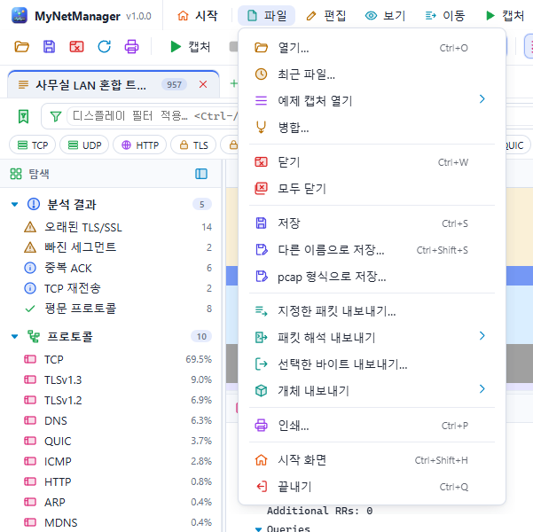

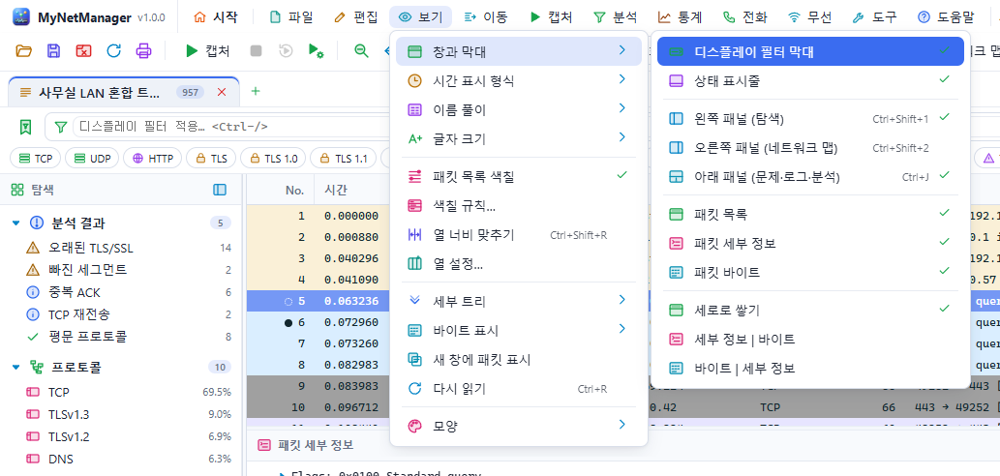

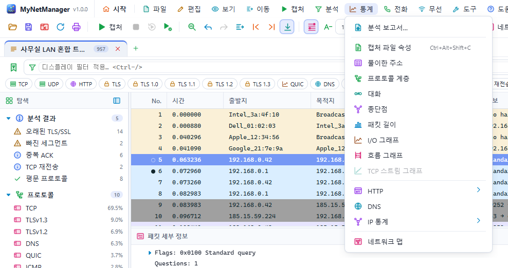

### 툴바

| 묶음 | 단추 |
| --- | --- |
| 파일 | 열기…, 저장, 닫기, 다시 읽기, **인쇄…** |
| 캡처 | **캡처**(초록 ▶, 시작), 캡처 중지(빨간 ■), 캡처 다시 시작, 캡처 옵션… |
| 이동 | 패킷 찾기…, 뒤로, 앞으로, 패킷으로 이동…, 첫 패킷, 마지막 패킷, 실시간 캡처 때 자동 스크롤 |
| 보기 | 패킷 목록 색칠, 작게(A−), **지금 글자 크기**(예: `13px`, 누르면 보통 크기), 크게(A+), 보통 크기, 열 너비 맞추기 |
| 분석 | 전문가 정보, 프로토콜 계층, 대화, I/O 그래프, **네트워크 맵** |
| 오른쪽 | 튜토리얼, 무작위 테마와 ▾(테마 고르기), 언어 국기, 설정…, 프로그램 정보… |

모든 단추에는 이름과 단축키를 알려 주는 툴팁이 있습니다. 지금 쓸 수 없는 단추는 흐리게 보입니다(예: 캡처
중이 아닐 때의 **캡처 중지**).

### 패널 단추

제목 줄 오른쪽의 단추 세 개로 패널을 보이거나 숨깁니다.

| 단추 | 패널 | 단축키 |
| --- | --- | --- |
| 왼쪽 패널 (탐색) | 분석 결과, 프로토콜, 많이 쓴 주소 | Ctrl+Shift+1 |
| 아래 패널 (문제·로그·분석) | 문제 목록, 로그, 분석 요약 | Ctrl+J |
| 오른쪽 패널 (네트워크 맵) | 네트워크 맵 | Ctrl+Shift+2 (Ctrl+Shift+N도 됨) |

패널마다 제목 막대의 오른쪽 끝에 접기/펴기 단추가 있습니다(네트워크 맵도 도구 단추들 맨 오른쪽). 접은
옆 패널은 폭 26픽셀의 가는 띠로 줄어들고, 띠에는 패널 이름이 **세로로** 적힙니다. 띠의 단추를 누르면 다시
펼쳐집니다. 패킷 세부 정보·패킷 바이트를 나란히 놓은 배치에서 접은 창도 같은 띠가 됩니다. 창 사이의
경계선을 끌면 크기가 바뀝니다.

## 패킷 목록

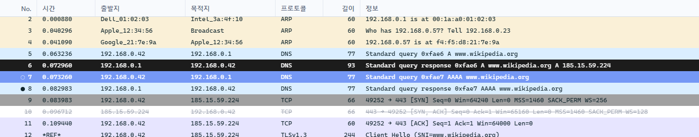

한 줄이 패킷 하나이며, [색칠 규칙](#색칠-규칙)에 따라 색이 칠해집니다. 기본 열은 **No.**, **시간**,
**출발지**, **목적지**, **프로토콜**, **길이**, **정보**입니다.

- **정렬**: 열 제목을 클릭합니다(한 번 더 누르면 반대 순서).
- 열 제목을 끌면 열이 **옮겨지고**, 오른쪽 가장자리를 끌면 **너비**가 바뀝니다.
- **열 제목을 오른쪽 클릭**하면 열 보이기/숨기기, **열 너비 맞추기**, 한 열 너비 맞추기, 사용자 열 지우기,
  **열 설정…**, **기본 열로**가 나옵니다.
- **열 설정…**(보기 메뉴)에서 다른 종류의 열(절대 시간, 이전과의 시간, 출발 MAC, 출발 IP, 출발 포트, 전문가,
  스트림, 주석, 인터페이스 …)이나 아무 필터 필드나 보여 주는 *사용자 필드* 열을 추가합니다. 세부 정보에서
  필드를 오른쪽 클릭 › **열로 추가**를 써도 됩니다.
- 패킷은 클릭이나 화살표 키로 **고릅니다**. Shift·Ctrl 클릭으로 여러 개를 고릅니다.
- No. 열의 기호는 관련 패킷(요청과 응답, 재전송이 되풀이한 패킷)을 이어 줍니다.

**패킷을 오른쪽 클릭**하면 패킷 메뉴가 나옵니다: 패킷 표시/해제, 패킷 무시/해제, 시간 기준 설정/해제,
시간 이동…, 패킷 주석…, 필터로 적용, 필터로 준비, 대화 필터, 복사, 다르게 해석…, 새 창에 패킷 표시,
스트림 따라가기, 방화벽 규칙, 그리고 **인쇄…**와 **내보내기 ▸**(HTML, Markdown, PDF, Word).

오른쪽 단추 메뉴의 **인쇄…** / **내보내기**는 누른 곳만 다룹니다.

| 오른쪽 클릭한 곳 | 인쇄·내보내기 내용 |
| --- | --- |
| 패킷 | 그 패킷의 요약 줄과 세부 정보(보이는 대로) |
| 패킷 세부 정보 | 그 패킷의 세부 트리(보이는 대로) |
| 패킷 바이트 | 그 패킷의 16진 덤프 |
| 열 제목 | 패킷 목록(표시된 패킷의 요약 줄) |
| 탭 | 그 캡처의 패킷 목록(탭이 앞으로 옴) |

인쇄는 그 범위와 형식이 고른 상태로 인쇄 창이 열리고(프린터를 고르고 **인쇄**), 내보내기는 같은 내용을
바로 파일로 저장합니다.

| 기능 | 하는 일 | 방법 |
| --- | --- | --- |
| 표시 | 나중에 찾거나 내보내려고 패킷을 강조(검은 줄) | Ctrl+M, **편집 › 표시**(표시된 패킷 모두 표시, 표시 모두 해제, 다음 표시로, 이전 표시로) |
| 무시 | 캡처에 없는 패킷처럼 다룸(취소선, 통계에서 빠짐) | Ctrl+D, **편집 › 무시** |
| 시간 기준 | 시간 열을 이 패킷부터 잼(`*REF*`로 표시) | Ctrl+T, **편집 › 시간 기준** |
| 시간 이동 | 모든(또는 한) 패킷의 시각을 초나 `[-]시:분:초`만큼 옮김 | **편집 › 시간 이동…** |
| 주석 | pcapng 파일에 패킷과 함께 저장되는 메모 | Ctrl+Alt+C, **편집 › 패킷 주석…** |

**보기 › 시간 표시 형식**에서 시간 열의 형식을 고릅니다: 날짜와 시각, 연도·일·시각, 시각, 1970년부터 초,
캡처 시작부터 초(기본), 이전 캡처 패킷부터 초, 이전 표시 패킷부터 초, UTC 형식들, 그리고 정밀도(자동 (파일
형식대로), 초, 밀리초, 마이크로초, 나노초).

**보기 › 글자 크기**(Ctrl+=, Ctrl+-, Ctrl+0)는 패킷 창의 글자 크기를 바꾸며, 상태 표시줄에 나옵니다.

## 패킷 세부 정보와 패킷 바이트

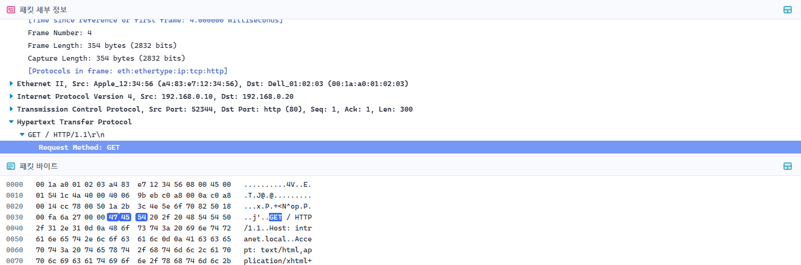

**패킷 세부 정보** 창은 고른 패킷을 프로토콜 계층마다 한 가지씩(Frame, Ethernet II, Internet Protocol, TCP,
HTTP …) 트리로 보여 줍니다. [대괄호] 줄은 MyNetManager가 계산한 값(스트림 번호, 요청 뒤 걸린 시간, 응답
패킷 링크)이고, 노란 줄과 빨간 줄은 전문가 정보입니다.

- ▸를 누르면 가지가 펼쳐집니다. **보기 › 세부 트리**에 하위 트리 펼치기, 하위 트리 접기, 모두 펼치기, 모두
  접기가 있습니다(Ctrl+Right / Left, Ctrl+Shift+Right / Left).
- 줄을 고르면 상태 표시줄에 필터 이름이 나오고, 바이트 창에서 그 바이트가 강조됩니다.
- **줄을 오른쪽 클릭**하면 펼치기/접기, **열로 추가**, **필터로 적용**, **필터로 준비**, **대화 필터**, **복사**,
  **선택한 바이트 내보내기…**, **다르게 해석…**, **스트림 따라가기**, **관련 패킷으로**(*Response in*, *Request
  in* 같은 링크)가 나옵니다.

**패킷 바이트** 창은 16진 덤프입니다: 오프셋, 16진수 16바이트, 같은 바이트의 글자. 바이트를 클릭하면 그
바이트가 속한 필드가 선택됩니다. 오른쪽 클릭(또는 **보기 › 바이트 표시**)으로 **16진수**나 **비트**, 글자를
**ASCII**나 **EBCDIC**으로 바꿉니다. 재조립하거나 복호화한 데이터가 있는 패킷은 그 데이터용 탭이 더 나옵니다.

**보기 › 새 창에 패킷 표시**는 고른 패킷의 세부 정보와 바이트를 따로 창에 엽니다.

**보기 › 창과 막대**에서 디스플레이 필터 막대, 상태 표시줄, 옆 패널, 세 패킷 창을 보이거나 숨기고, 창
배치를 **세로로 쌓기**, **세부 정보 | 바이트**, **바이트 | 세부 정보**(나란히) 중에서 고릅니다.

## 디스플레이 필터

디스플레이 필터 막대는 패킷 목록 위에 있습니다. 디스플레이 필터는 맞는 패킷만 남기고 나머지는 숨깁니다
(지우지 않습니다).

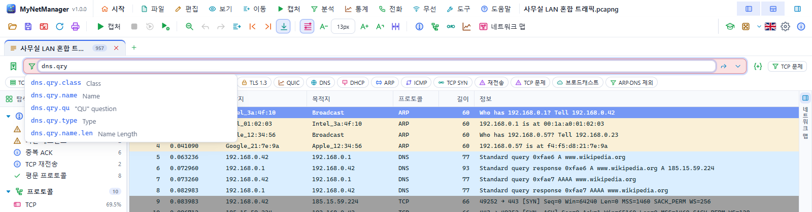

- 필터를 적고 **Enter**(또는 → 단추)를 누르면 적용됩니다. ✕ 단추는 필터를 지웁니다.
- 입력하는 동안 막대가 **초록**이면 올바른 식, **빨강**이면 잘못된 식(툴팁에 이유), **노랑**이면 권장하지 않는
  문법입니다.
- 입력하는 동안 필드 이름을 **추천**합니다. 화살표 키와 Enter, 또는 마우스로 고릅니다.
- **▾**는 최근 필터를 보여 줍니다.
- 왼쪽의 **책갈피** 단추는 필터 책갈피를 엽니다: **이 필터 저장…**, **디스플레이 필터…**(저장한 필터 관리),
  **필터 단추 추가…**, 그리고 저장한 필터들.
- 막대 오른쪽의 **필터 단추**(예: **TCP problems**)는 저장한 필터를 한 번에 적용합니다. **필터 단추 추가…**로
  지금 필터를 단추로 만듭니다.
- 막대 아래 줄에는 **미리 설정된 필터** 단추가 늘어서 있습니다: TCP, UDP, HTTP, TLS, **TLS 1.0**, **TLS 1.1**,
  **TLS 1.2**, **TLS 1.3**, QUIC, DNS, DHCP, ARP, ICMP, TCP SYN, 재전송, TCP 문제, 브로드캐스트, ARP·DNS 제외. 단추는 **OR 조건**으로 겹칩니다: **DNS**를
  누르면 `dns`, 이어서 **UDP**를 누르면 `dns or udp`가 적용되어 둘 중 하나에 맞는 패킷이 모두 보이고, 켜진
  단추는 강조됩니다. 강조된 단추를 다시 누르면 그 조건만 빠집니다. 입력 칸에 이미 적어 둔 필터가 있으면 거기에
  더해집니다(예: `(frame.len > 60) or dns`). 그 밖의 필터는 지금처럼 입력 칸에 직접 적습니다.
- **TLS 버전**: 프로토콜 열은 세션마다 협상된 버전(*TLSv1.2*, *TLSv1.3* …)을 보여 줍니다. TLS 1.3도 레코드
  머리에는 0x0303(1.2)이 적혀 있어 `tls.record.version`으로는 가를 수 없으므로, 버전 단추는 Wireshark처럼 열
  값으로 거릅니다: `_ws.col.protocol == "TLSv1.3"`. `_ws.col.protocol`과 `_ws.col.info`는 패킷 목록에 보이는 열
  그대로(파일 전체를 본 뒤의 값)라서, 거른 결과가 목록의 열과 정확히 같습니다.
- **{+}**는 **디스플레이 필터 식…** 창을 엽니다.
- 필터가 적용되면 막대와 상태 표시줄에 *표시 N / 전체 M*이 나옵니다.

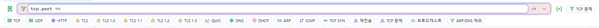

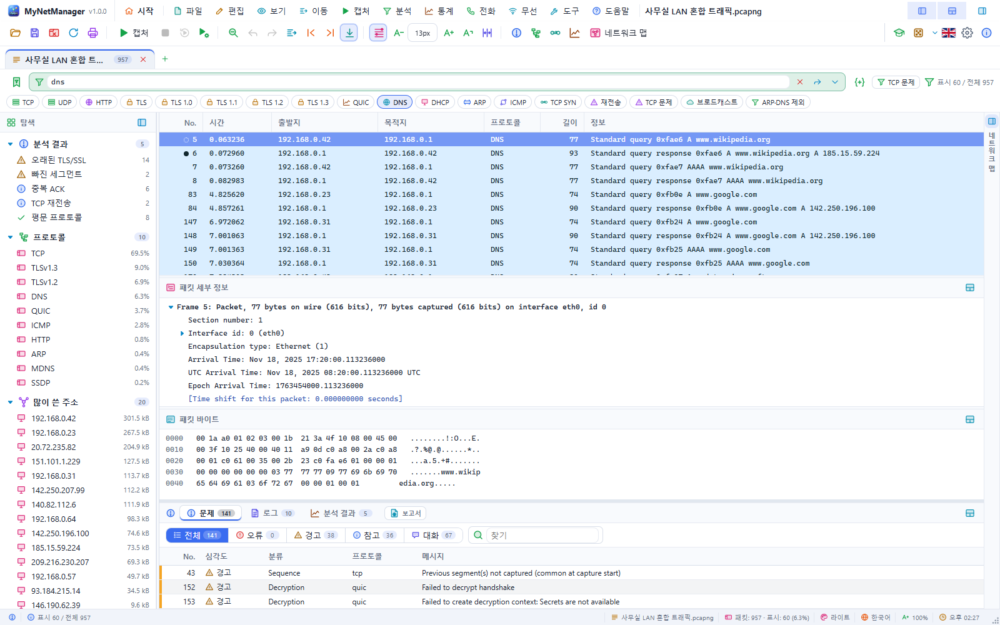

### 필터 문법

필터는 **필드**(`ip.src`, `tcp.port`, `http.request.method` …), **프로토콜**(`tcp`, `dns`, `arp`), 값, 비교
연산자, 논리 연산자로 이루어집니다. 프로토콜이나 필드 이름만 쓰면 "있음"이라는 뜻입니다.

| 연산자 | 다른 표기 | 뜻 | 예 |
| --- | --- | --- | --- |
| `==` | `eq`, `any_eq` | 같음(하나라도) | `ip.addr == 192.168.0.10` |
| `!=` | `ne`, `all_ne` | 같지 않음(같은 것이 하나도 없음) | `ip.addr != 192.168.0.1` |
| `===` | `all_eq` | 모두 같음 | `ip.addr === 10.0.0.1` |
| `!==` / `~=` | `any_ne` | 하나라도 다름 | `tcp.port !== 443` |
| `>` `<` `>=` `<=` | `gt` `lt` `ge` `le` | 크기 비교 | `frame.len > 1000` |
| `contains` | | 문자열·바이트를 포함 | `http.host contains "example"` |
| `matches` | `~` | 정규식 | `dns.qry.name matches "wiki(pedia)?"` |
| `in` | | 집합이나 범위 중 하나 | `tcp.port in {80 443 8000..8080}` |
| `&` | `bitwise_and` | 비트 AND가 0이 아님 | `tcp.flags & 0x02` |
| `&&` | `and` | 둘 다 | `ip.src == 192.168.0.42 && tcp` |
| `\|\|` | `or` | 둘 중 하나 | `dns \|\| icmp` |
| `^^` | `xor` | 하나만 | `tcp.srcport == 80 ^^ tcp.dstport == 80` |
| `!` | `not` | 부정 | `!arp` |
| `[i:n]` | | 바이트 조각 | `eth.src[0:3] == 00:1a:a0` |
| 함수 | | `len()`, `count()`, `upper()`, `lower()`, `string()`, `abs()`, `max()`, `min()` | `len(http.host) > 20`, `count(ip.addr) > 2` |

예를 더 들면:

| 필터 | 보이는 것 |
| --- | --- |
| `tcp.analysis.flags` | 분석 표시(재전송, 중복 ACK, 제로 윈도 …)가 붙은 TCP 패킷 |
| `tcp.flags.syn == 1 && tcp.flags.ack == 0` | 연결 시도 |
| `http.request.method == "GET"` | HTTP GET 요청 |
| `http.response.code >= 400` | HTTP 오류 응답 |
| `dns.flags.rcode != 0` | DNS 오류 응답 |
| `tls.handshake.type == 1` | TLS Client Hello |
| `ip.addr == 192.168.0.0/24` | 한 서브넷의 패킷 |
| `eth.dst == ff:ff:ff:ff:ff:ff` | 이더넷 브로드캐스트 |
| `frame.time_relative > 10` | 처음 10초 뒤의 패킷 |
| `_ws.expert` | 전문가 정보가 있는 패킷 |

**도움말 › 디스플레이 필터 참고**(시작 화면의 **디스플레이 필터 참고**)는 프로그램이 아는 모든 프로토콜과
필드를 보여 주는 필터 식 창을 엽니다.

### 디스플레이 필터 식

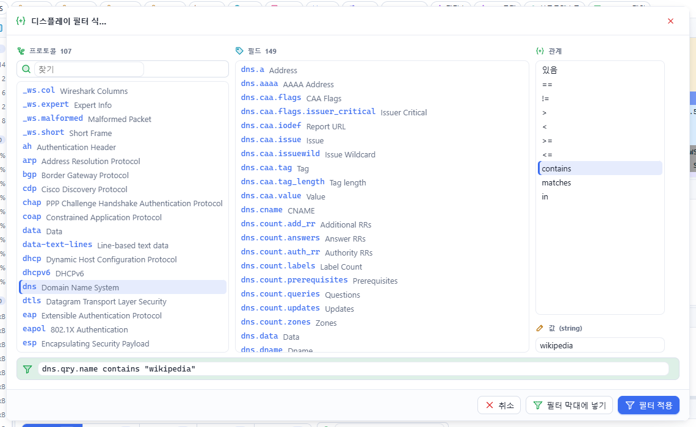

**프로토콜**(찾기 칸 있음)에서 프로토콜을, **필드**에서 필드를, **관계**(있음, ==, !=, >, <, >=, <=,
contains, matches, in)와 **값**을 고릅니다(값에 이름이 있는 필드는 목록이 나옵니다). 아래쪽에 만들어진
필터가 올바른지에 따라 색과 함께 나옵니다. **필터 막대에 넣기**는 적용하지 않고 막대에 옮기기만 하고,
**필터 적용**은 바로 적용합니다.

### 패킷에서 필터 만들기: 필터로 적용 / 준비, 대화 필터

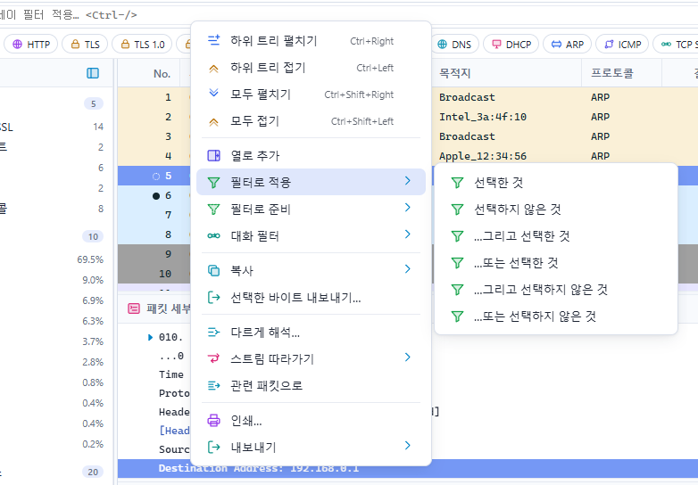

세부 정보의 필드를 오른쪽 클릭하거나 **분석** 메뉴를 씁니다.

- **필터로 적용**은 필드 값으로 필터를 만들어 바로 적용하고, **필터로 준비**는 막대에 넣기만 합니다.
- 둘 다 **선택한 것**, **선택하지 않은 것**, **…그리고 선택한 것**, **…또는 선택한 것**, **…그리고 선택하지 않은
  것**, **…또는 선택하지 않은 것**이 있으며, 뒤의 넷은 막대에 이미 있는 필터와 새 조건을 합칩니다.
- **대화 필터**(패킷 메뉴에도 있음)는 고른 패킷과 같은 **Ethernet**, **IPv4**, **IPv6**, **TCP**, **UDP** 대화의
  패킷만 남깁니다.
- **편집 › 복사 › 필터 식**은 필드를 필터 문자열로 복사합니다.

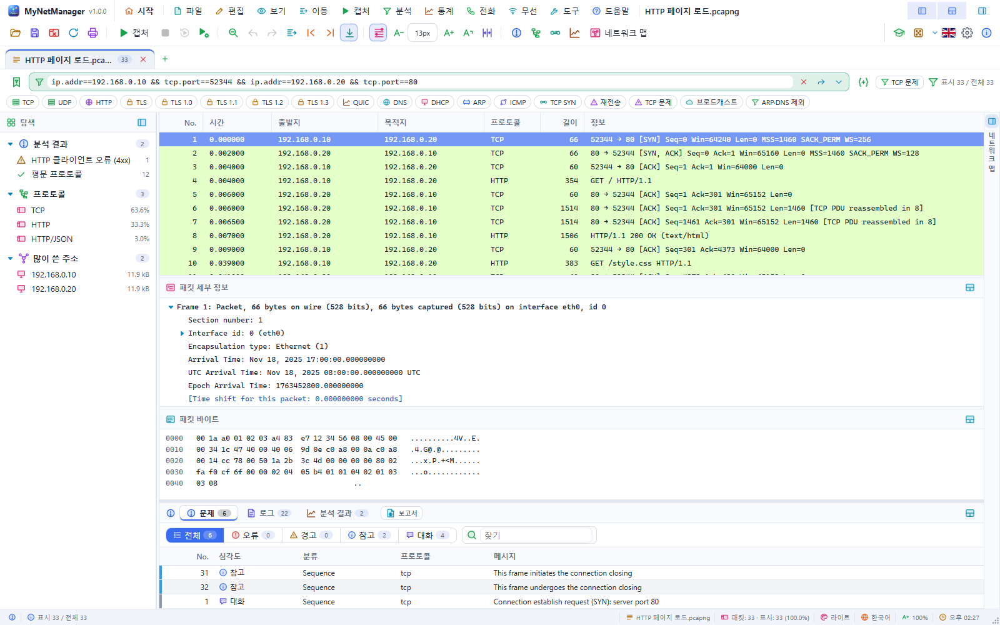

## 분석

### 색칠 규칙

**보기 › 색칠 규칙…**은 패킷 목록을 칠하는 규칙 목록입니다. 위에서부터 처음 맞는 규칙의 색으로 칠합니다.
규칙마다 **이름**, **필터**(잘못되면 빨강), **글자색**, **배경색**과 켜고 끄는 확인란이 있습니다. 단추:
**추가**, **복제**, **위로**, **아래로**, **삭제**, **가져오기**(Wireshark *colorfilters* 파일 내용 붙여 넣기),
**내보내기…**, **기본 규칙으로**. **보기 › 패킷 목록 색칠**로 색칠을 끄고 켭니다. 어두운 테마에서는 패킷
색도 저절로 어두워집니다.

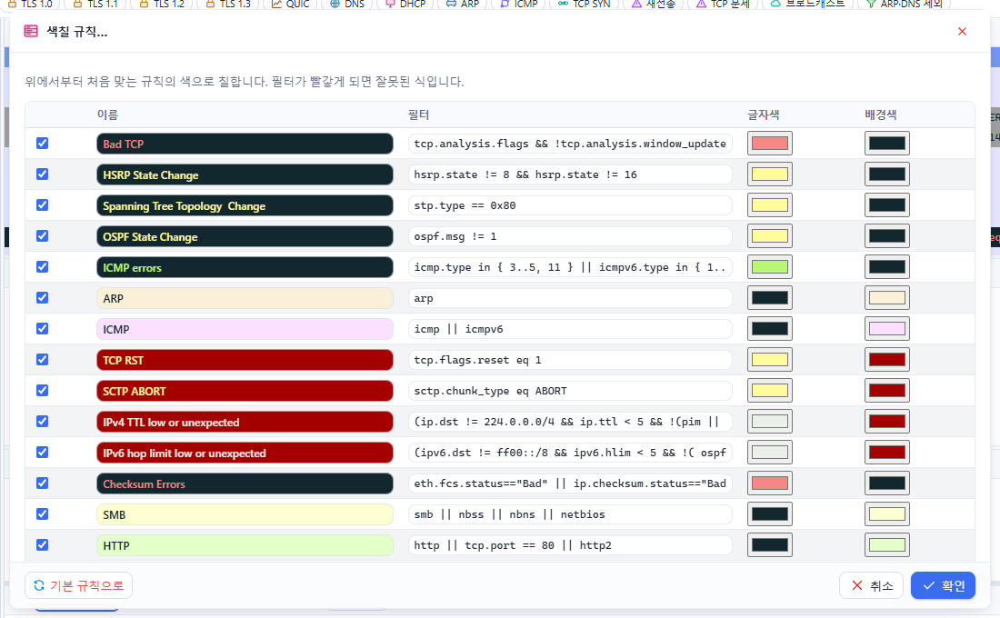

### 스트림 따라가기

연결의 패킷을 하나 고르고 **분석 › 스트림 따라가기 › TCP 스트림**(Ctrl+Alt+Shift+T), **UDP 스트림**,
**TLS 스트림**, **HTTP 스트림**, **HTTP/2 스트림**, **QUIC 스트림**을 고릅니다. 창에 대화 전체의 데이터가
이어져 나오며, 클라이언트 데이터는 빨강, 서버 데이터는 파랑입니다.

- **전체 대화**, **클라이언트 → 서버**, **서버 → 클라이언트** — 보일 방향.
- **보기 형식**: ASCII, EBCDIC, 16진 덤프, C 배열, 원시, YAML, UTF-8.
- **찾기**로 글을 찾고, **스트림**으로 이전·다음 스트림으로 갑니다.
- **이 스트림 걸러 내기**는 패킷 목록에서 이 스트림을 숨기고, **이 스트림만 보기**는 이 스트림만 남깁니다.
- **복사**, **저장…**으로 글을 남깁니다. 글의 한 부분을 클릭하면 그 패킷이 선택됩니다.

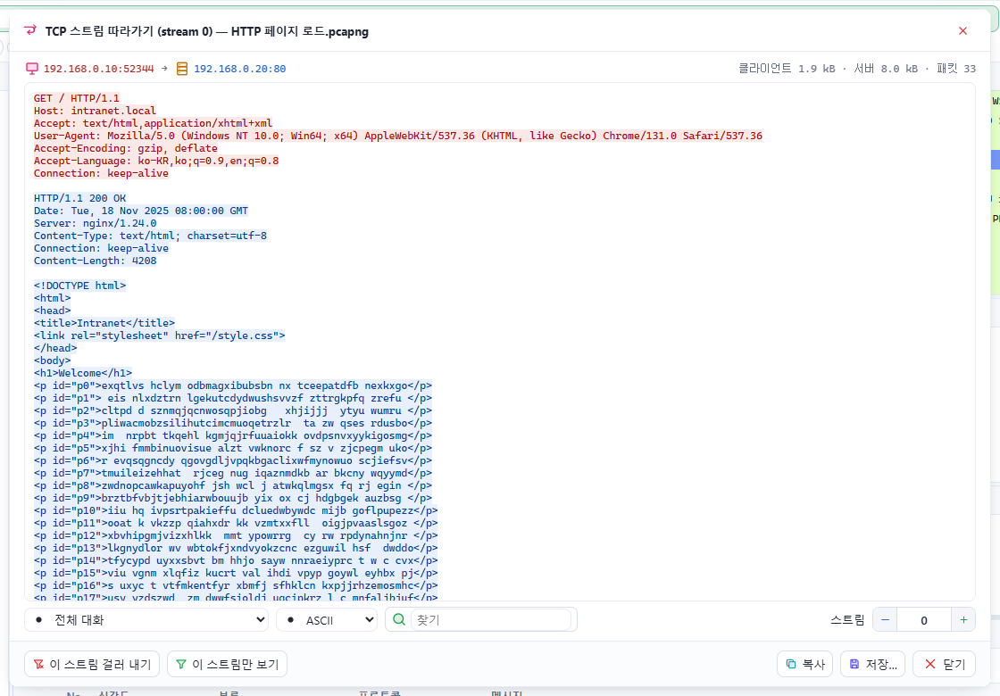

### 전문가 정보

**분석 › 전문가 정보**(Ctrl+Shift+E)는 해석기가 찾은 문제 — 재전송, 중복 ACK, 빠진 세그먼트, 제로 윈도,
잘못된 패킷, 프로토콜 오류와 연결 설정 같은 참고 사항 — 를 **심각도**(오류, 경고, 참고, 대화), **분류**,
**프로토콜**별로 묶어 개수와 함께 보여 줍니다. 묶음을 펼치면 패킷이 나오고, 줄을 두 번 클릭하면 그 패킷으로
갑니다. 줄은 한 줄씩 색이 번갈아 칠해집니다.

- 목록 **위쪽**에 필터 도구가 있습니다: **표시 필터 결과만**(표시된 패킷만 셈), **찾기** 칸(찾은 줄과 그 위
  묶음만 펼쳐 보임), **전체 펼치기** / **전체 접기**, 고른 줄로 필터를 만드는 **필터로 준비** / **필터 적용**.
- 열 제목을 누르면 그 열로 정렬합니다(다시 누르면 반대로, 세 번째는 원래 순서). 트리는 묶음 안에서 정렬되어
  구조가 유지됩니다.
- 아래쪽의 **인쇄…**와 **내보내기**(HTML, Markdown, PDF, Word)는 지금 보이는 대로(찾기·정렬·접힘 그대로)
  인쇄하거나 저장합니다.

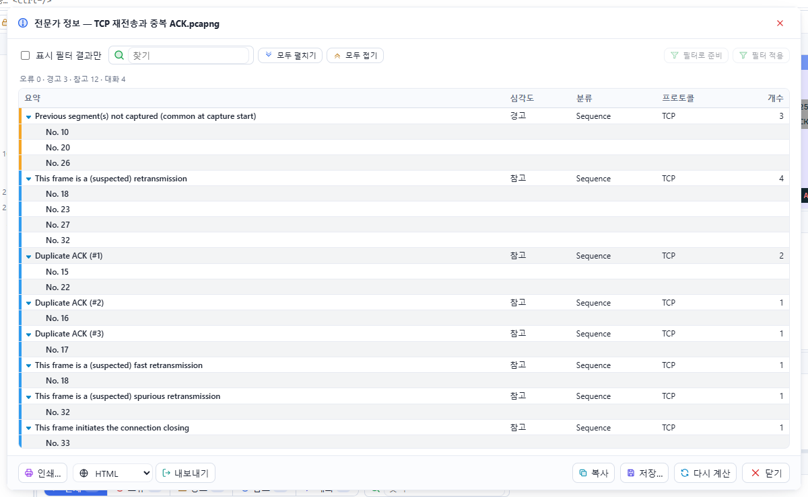

같은 항목이 아래 패널의 **문제** 탭에도 나옵니다([패널](#패널-탐색-아래-패널-네트워크-맵) 참고).

### 다르게 해석

표준이 아닌 포트를 쓰는 트래픽을 다른 프로토콜로 해석하게 할 수 있습니다. **분석 › 다르게 해석…**에서
**필드**(TCP 포트, UDP 포트, Ethertype, IP 프로토콜 …), **값**, 쓸 **프로토콜**(또는 *(해석 안 함)*)로 규칙을
만듭니다. 고른 패킷의 값이 먼저 제시됩니다. 규칙은 설정에 저장됩니다.

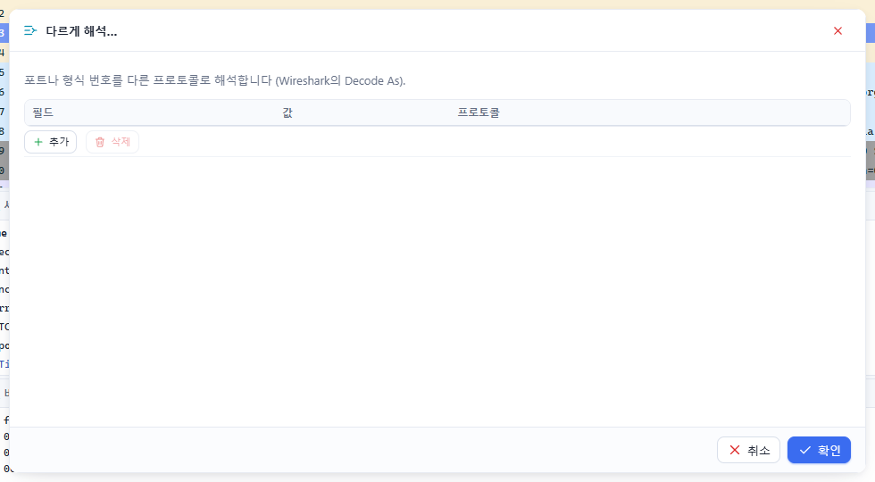

### 사용할 프로토콜

**분석 › 사용할 프로토콜…**에서 프로토콜을 하나씩 끄거나(끈 프로토콜의 바이트는 데이터로 보임) 켭니다.
**모두 켜기**, **모두 끄기**와 찾기 칸이 있습니다.

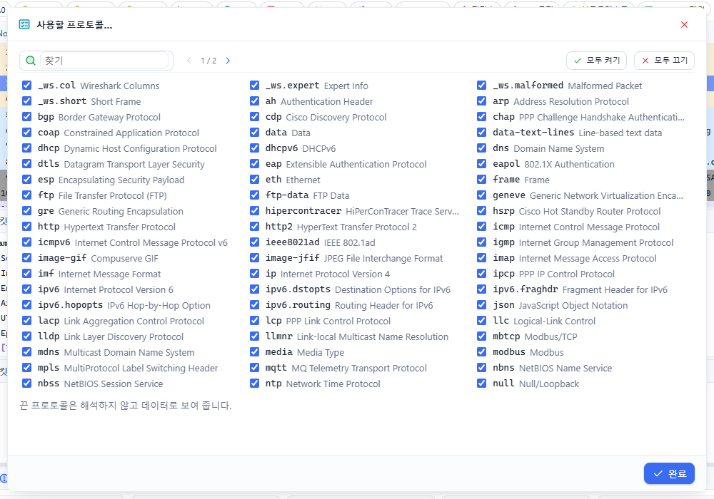

### 이름 풀이

**보기 › 이름 풀이**에는 스위치가 셋 있습니다: **물리 주소 이름 풀이**(`Intel_3a:4f:10` 같은 MAC 제조사
접두어), **포트 이름 풀이**(`https` 같은 포트 이름), **네트워크 주소 이름 풀이**(캡처 안의 DNS 응답과 pcapng
이름 레코드에서 알아낸 호스트 이름). **통계 › 풀이한 주소**는 캡처에서 알아낸 모든 이름을 보여 줍니다.

## 통계

통계 창의 위쪽에는 필터 도구 — **표시 필터 결과만**(표시된 패킷만 셈), 찾기 칸, 고른 줄을 위한 **필터로
준비** / **필터 적용**, 트리면 **전체 펼치기** / **전체 접기** — 가 있고, 아래쪽에는 **인쇄…**, **내보내기**
(형식: HTML, Markdown, PDF, Word), **복사**, **저장…**, **다시 계산**, **닫기**가 있습니다. 표는 열 제목을
눌러 정렬하고(트리도 묶음 안에서 정렬), 줄은 한 줄씩 색이 번갈아 칠해집니다.

I/O 그래프, TCP 스트림 그래프, 흐름 그래프 창은 **그림으로 저장…**(PNG, JPEG, WebP, GIF, AVIF, SVG)과
**내보내기**(그림과 숫자 표를 한 문서로)를 함께 제공합니다. **Markdown**을 고르면 옆에 **Markdown 그림**
목록이 나타나, 그림을 **문서 안에 넣기**(data URL, 파일 하나) 또는 **파일로 저장하고 링크**(`이름-1.png`를
Markdown 옆에 저장하고 이름으로 연결) 중에서 고릅니다.

### 캡처 파일 속성

**통계 › 캡처 파일 속성**(Ctrl+Alt+Shift+C): 파일 이름, 형식, 크기, 캡슐화, 스냅 길이, 첫 패킷과 마지막
패킷 시각, 경과 시간, 캡처한 하드웨어·운영체제·프로그램, 주석, 인터페이스마다의 정보, 그리고 전체·표시·
표시함 패킷의 패킷·바이트·속도 합계.

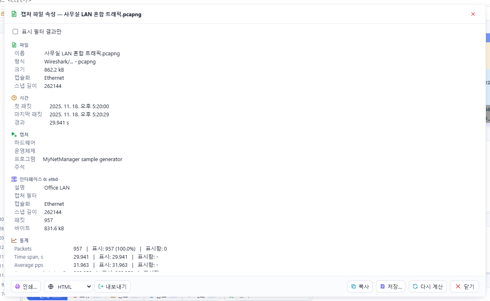

### 프로토콜 계층

**통계 › 프로토콜 계층** — 모든 프로토콜을 트리로, 패킷 %와 바이트 %, 패킷, 바이트, 비트/초, 그 프로토콜에서
끝나는 패킷과 바이트를 보여 줍니다.

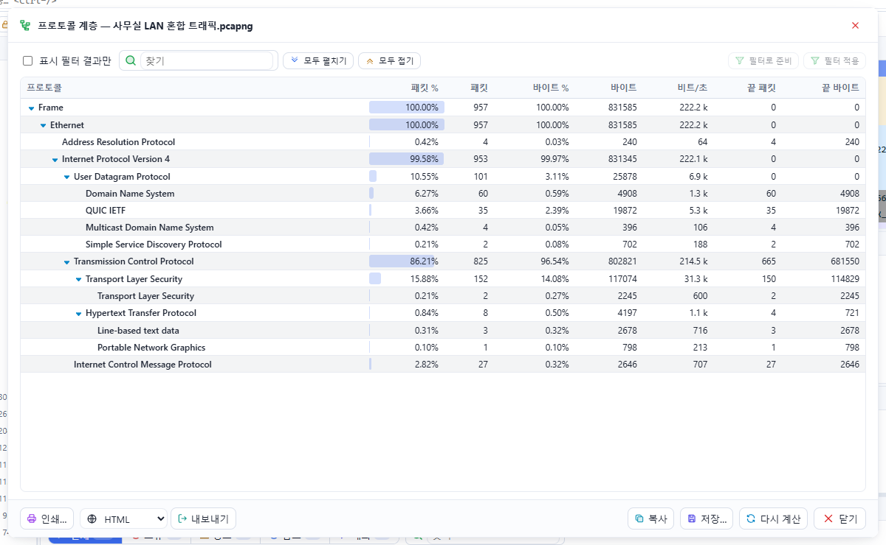

### 대화와 종단점

**통계 › 대화** — 서로 주고받은 주소 쌍마다 한 줄. **Ethernet**, **IPv4**, **IPv6**, **TCP**, **UDP** 탭에서
주소 A, 포트 A, 주소 B, 포트 B, 패킷, 바이트, 바이트 A → B와 B → A, 상대 시작, 기간, 방향별 비트/초를
보여 줍니다.

**통계 › 종단점** — 주소마다 한 줄, 보낸 패킷·바이트와 받은 패킷·바이트.

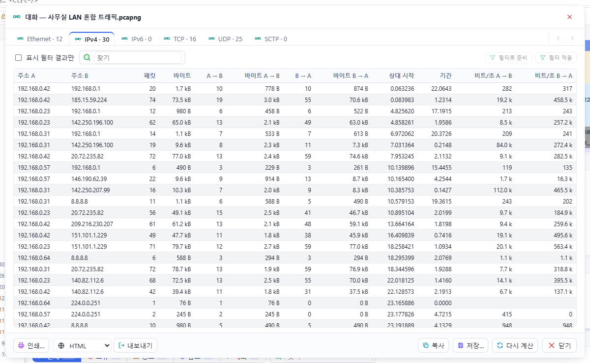

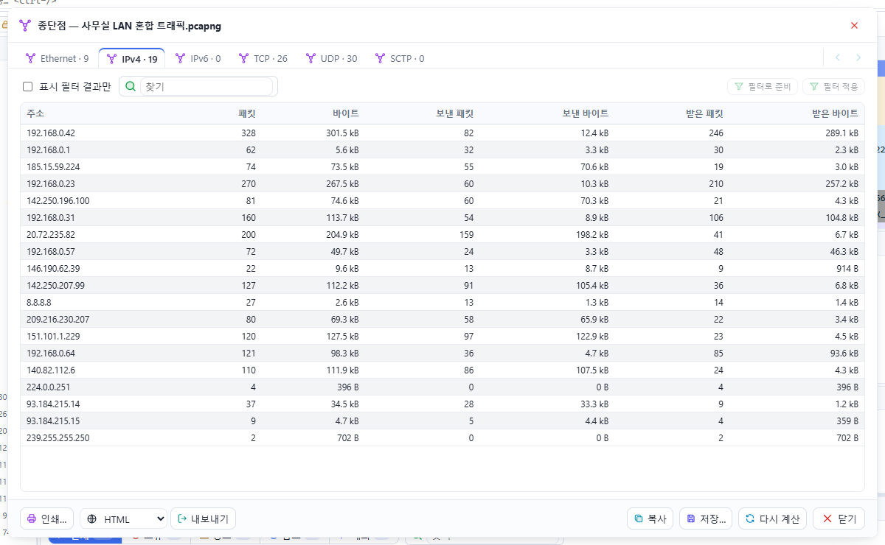

### 패킷 길이

**통계 › 패킷 길이** — 길이 구간마다 패킷 수와 평균, 최소, 최대, 비율, 백분율.

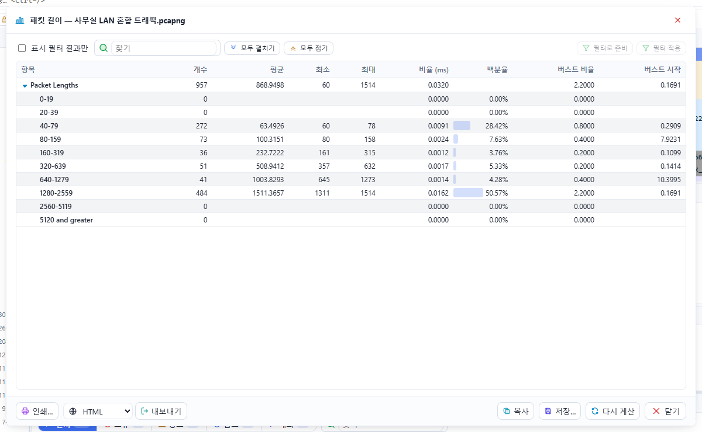

### I/O 그래프

**통계 › I/O 그래프**는 시간에 따른 값을 그립니다. **그래프** 목록의 그래프마다 **보이기**, **이름**,
**디스플레이 필터**(비우면 모든 패킷), **색**, **모양**(선, 막대, 점), **Y 값** 계산(패킷/간격, 바이트/간격,
비트/간격, 또는 **Y 필드**의 SUM / MIN / MAX / AVG / LOAD — 예: `tcp.analysis.ack_rtt`)이 있습니다.
**추가**, **지우기**로 그래프를 더하거나 빼고, **간격**을 고르고, **그리기**, **SVG로 저장…**을 합니다. 처음에는
*모든 패킷*과 *TCP 오류* 두 그래프가 준비되어 있습니다.

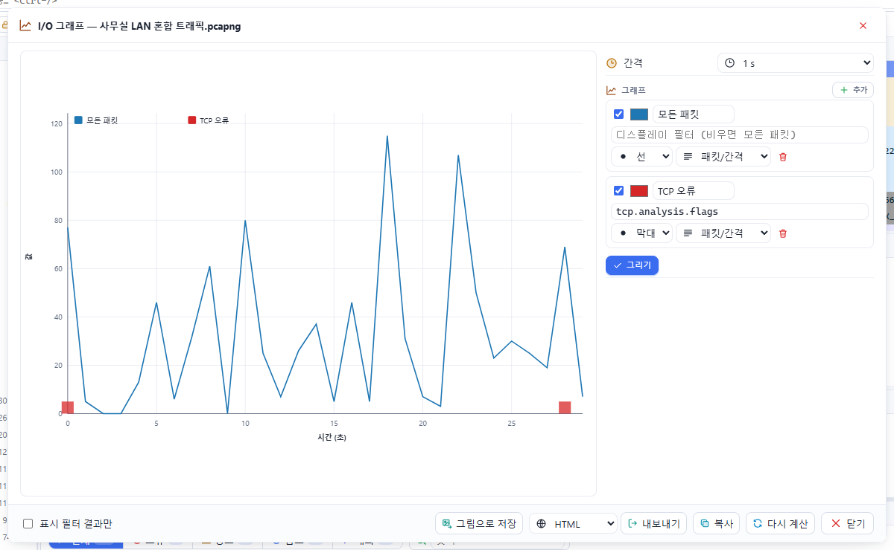

### 흐름 그래프

**통계 › 흐름 그래프**는 호스트 사이의 패킷을 시간 순서 다이어그램으로 그립니다. 주소마다 세로줄 하나,
왼쪽에 시각, 오른쪽에 요약이 나옵니다. **흐름 종류**는 **모든 패킷** 또는 **TCP 흐름**, **주소**는 **모든 주소**
또는 **네트워크 주소**입니다. 줄을 클릭하면 그 패킷으로 갑니다. **전화 › VoIP 통화**는 SIP, SDP, RTP, RTCP로
같은 그래프를 엽니다.

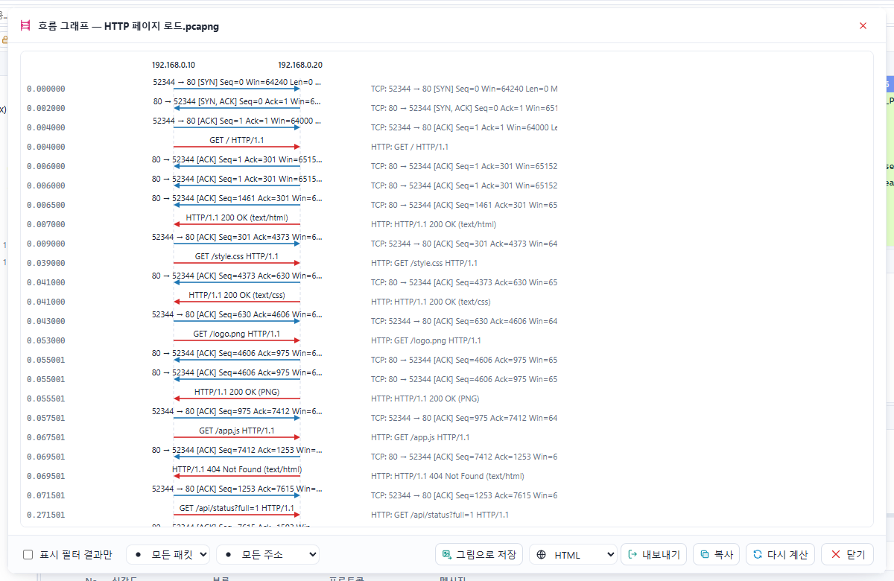

### TCP 스트림 그래프

TCP 패킷을 고르고 **통계 › TCP 스트림 그래프**를 엽니다. **그래프 종류**는 **시간/순서 번호 (Stevens)**,
**처리량**, **왕복 시간**, **윈도 크기**이고, **스트림**으로 TCP 스트림을 고르며, **반대 방향**으로 방향을
바꿉니다. Stevens 그래프의 빈틈과 되풀이된 점은 손실되고 재전송된 세그먼트입니다.

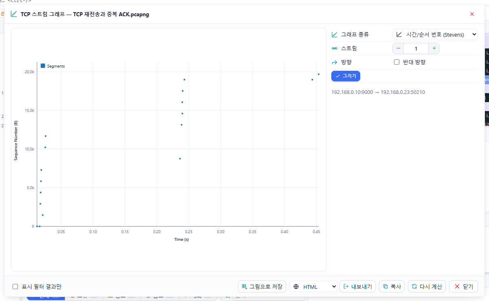

### HTTP, DNS, IP 통계

- **통계 › HTTP**: **패킷 수**(메서드별 요청, 상태 코드별 응답), **요청**(호스트와 URI별), **부하 분포**(서버별).
- **통계 › DNS**: 종류, rcode, opcode별 질의와 응답, 응답 시간.
- **통계 › IP 통계**: **IPv4 통계**, **IPv6 통계**(주소별)와 **포트 종류**.
- **전화**: **VoIP 통화**, **SIP 흐름**, **RTP 스트림**. **무선 › WLAN 트래픽**: 802.11 네트워크와 단말.
  **도구 › 방화벽 규칙**은 고른 패킷에 대한 방화벽 규칙을 만들고, **도구 › 자격 증명**은 캡처에서 찾은 평문
  로그인 정보를 보여 줍니다.

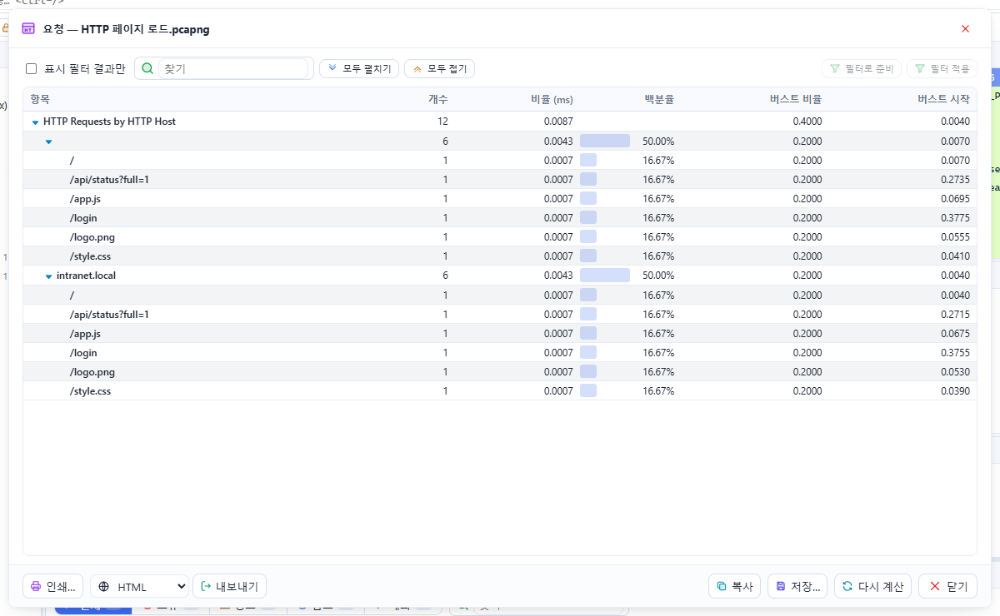

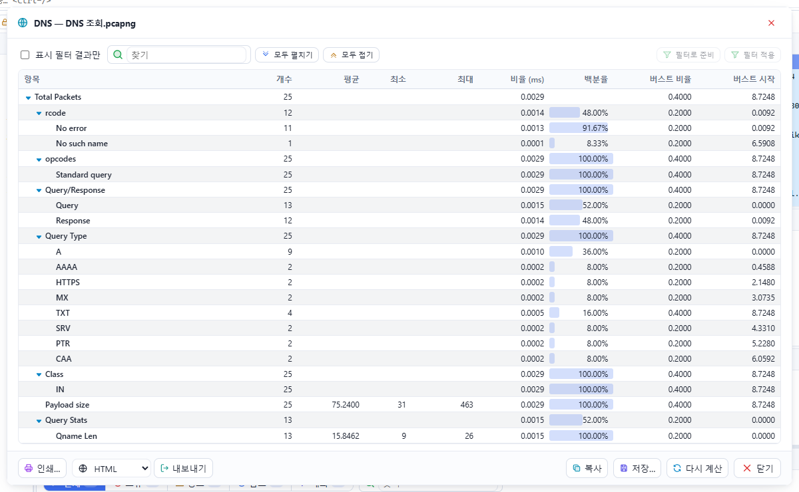

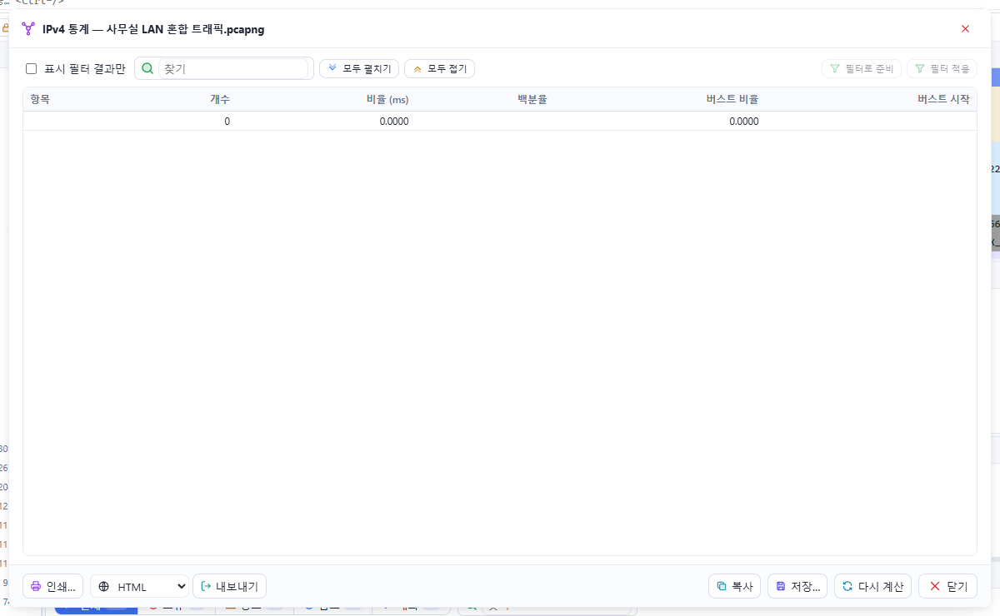

## 패널: 탐색, 아래 패널, 네트워크 맵

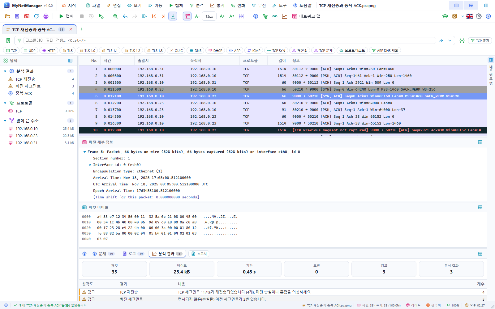

### 탐색 (왼쪽 패널)

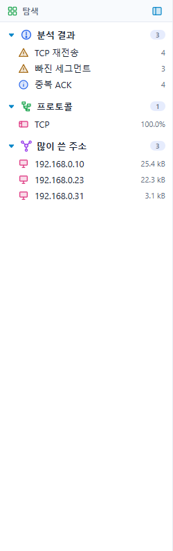

**탐색** 패널에는 접을 수 있는 세 부분이 있습니다: **분석 결과**(자동 분석이 찾은 문제, 심각도별),
**프로토콜**(프로토콜별 비율), **많이 쓴 주소**(바이트가 가장 많은 주소). 항목을 클릭하면 그 항목으로 패킷
목록을 거릅니다. 툴팁에 필터가 나옵니다(*클릭: …*).

### 아래 패널: 문제, 로그, 분석 결과

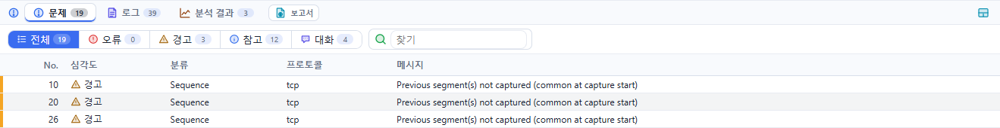

- **문제** — 캡처의 모든 전문가 정보를 패킷마다 보여 주며, **전체 / 오류 / 경고 / 참고 / 대화** 단추와
  **찾기** 칸이 있습니다. 줄을 클릭하면 그 패킷으로 갑니다.
- **로그** — 프로그램이 한 일(파일 열기, 캡처 시작·중지, 분석, 오류)과 **로그 지우기**.
- **분석 결과** — 요약 카드(패킷, 바이트, 기간, 오류, 경고, 결과)와 **분석 결과** 목록(심각도와 내용): TCP
  재전송, 중복 ACK, 빠진 세그먼트, 순서 어긋남, 제로 윈도, TCP 리셋, DNS 오류 응답, HTTP 4xx / 5xx, 오래된
  TLS/SSL, 평문 자격 증명, IP 주소 충돌, DHCP 서버 여러 대, 포트 스캔 의심, 브로드캐스트 과다, ICMP 도달
  불가, TTL 초과, 잘못된 패킷, 평문 프로토콜 — 또는 *눈에 띄는 문제 없음*. **도구 › 다시 분석**은 분석을 다시
  합니다.
- **보고서**는 분석 보고서 창을 엽니다.

### 분석 보고서

**통계 › 분석 보고서…**(또는 아래 패널의 **보고서**)는 분석 결과를 문서로 만듭니다. **넣을 내용**(**개요**,
**분석 결과**, **프로토콜**, **많이 쓴 주소**, **문제 목록**, **로그**)과 **형식**을 고른 뒤 **내보내기…**를 누릅니다: **HTML**(브라우저와
Word에서 열림), **Markdown**, **PDF**, **Word**(.docx, 표는 Word 표로), **인쇄…**(인쇄 창으로 감 — 프린터를 고르고
**인쇄**를 누르면 바로 출력, 인쇄 창에서 다시 다른 형식으로 내보낼 수도 있음).

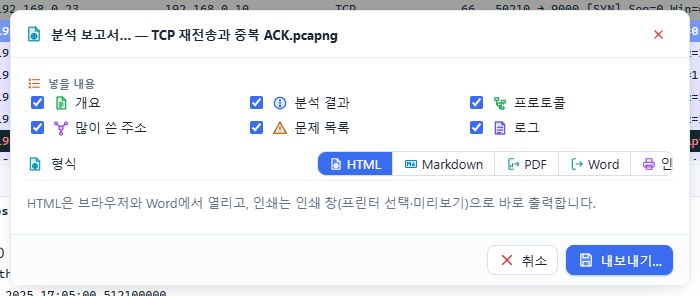

### 네트워크 맵 (오른쪽 패널)

**네트워크 맵**(툴바 단추, Ctrl+Shift+N, 오른쪽 패널 단추)은 트래픽에서 찾아낸 네트워크 구조를 그립니다:
호스트, 라우터/게이트웨이, 서버, 프린터, IP 전화, IoT 장치, 외부 호스트, 멀티캐스트 묶음과 그 사이의 연결
(트래픽에 따라 굵기가 다름).

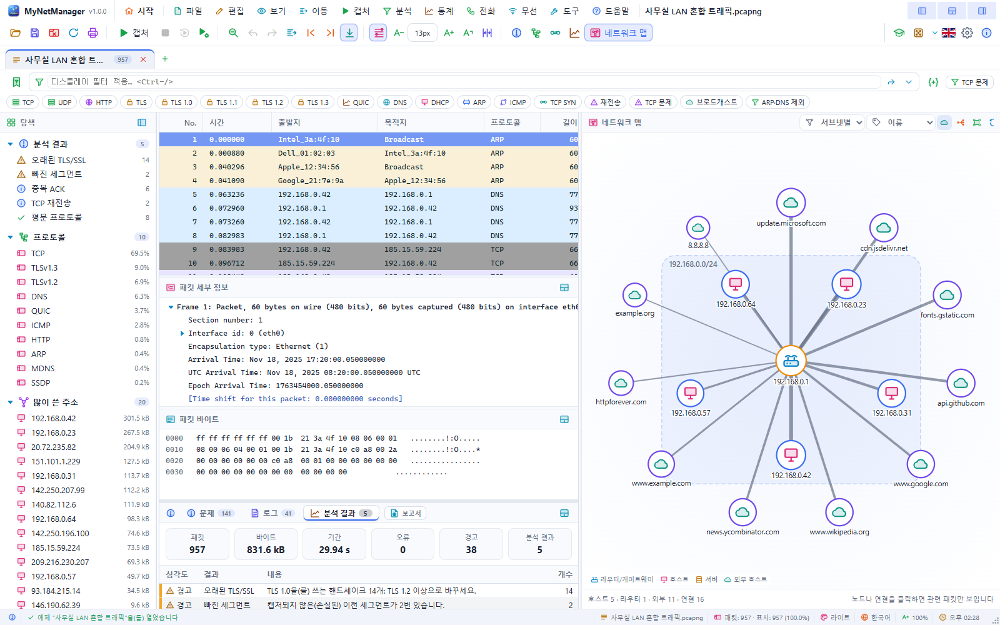

- **배치**: **서브넷별**(게이트웨이 둘레에 서브넷별로 묶음), **힘 기반**, **방사형**.
- **이름표**: **이름**, **IP 주소**, **MAC 주소**.
- **외부 호스트 보이기**, **멀티캐스트·브로드캐스트 보이기**를 켜고 끕니다.
- **전체 보기**는 맵 전체를 보여 주고, **다시 만들기**는 다시 배치하며, **그림으로 저장…**은 **PNG**, **JPEG**,
  **WebP**, **GIF**, **AVIF**, **SVG** 중에서 골라 저장합니다(AVIF는 데스크톱 프로그램이 직접 만듭니다. 웹
  버전은 브라우저가 AVIF를 쓸 수 있을 때만). 맨 오른쪽 단추는 맵을 접습니다.
- 휠로 확대·축소하고, 배경을 끌어 이동하며, 노드도 끌어 옮길 수 있습니다. 노드나 연결에 포인터를 올리면
  종류, 이름, 제조사, 역할(DNS 서버, 웹 서버, DHCP 서버 …), 트래픽, 프로토콜이 나옵니다.
- **노드를 클릭**하면 그 장치의 패킷만, **연결을 클릭**하면 두 장치 사이의 패킷만 패킷 목록에 남습니다.
  다시 클릭하거나 **모든 패킷 보기**를 누르면 되돌아갑니다.

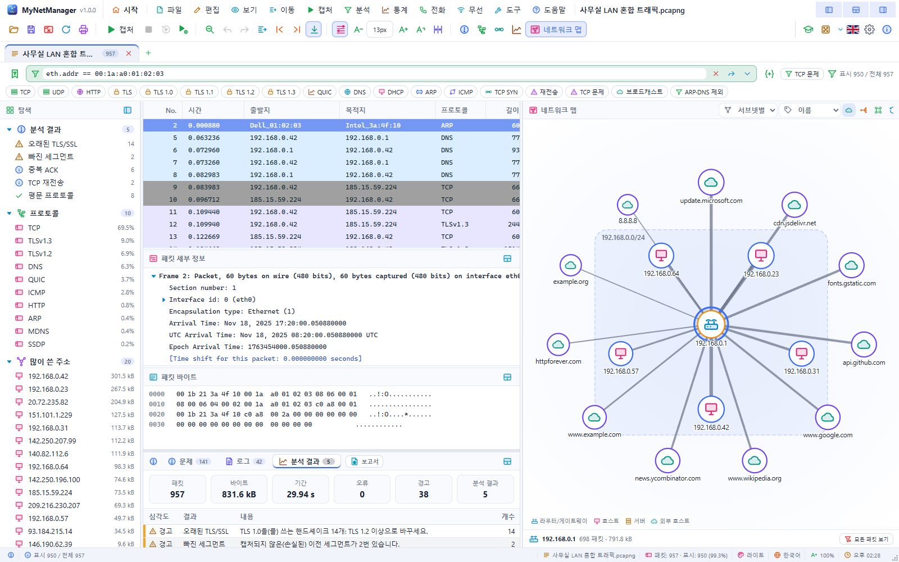

## 파일과 출력

### 저장

**파일 › 저장**(Ctrl+S)과 **다른 이름으로 저장…**(Ctrl+Shift+S)은 패킷 주석, 인터페이스, 이름 레코드를
유지한 채 **pcapng**로 저장합니다. **pcap 형식으로 저장…**은 예전 pcap(링크 종류 하나, 주석 없음)으로
저장합니다. 둘 다 Wireshark에서 그대로 열립니다.

### 지정한 패킷 내보내기

**파일 › 지정한 패킷 내보내기…**는 일부 패킷을 새 캡처 파일로 저장합니다. **패킷 범위** — **모든 패킷**,
**표시된 패킷**, **선택한 패킷**, **표시한 패킷**, `1-10,15` 같은 **범위 지정** — 와 파일 형식을 고릅니다.

### 패킷 해석 내보내기

**파일 › 패킷 해석 내보내기**는 해석 결과를 **일반 텍스트**, **CSV**, **JSON**, **PDML(XML)**, **PSML(XML)**,
**C 배열**로 내보냅니다. 패킷 범위와, 텍스트일 때는 **패킷 형식** — **요약 줄**, **열 제목**, **세부 정보**
(없음, 접은 채로, 보이는 대로, 모두 펼쳐서), **패킷 바이트** — 를 고릅니다.

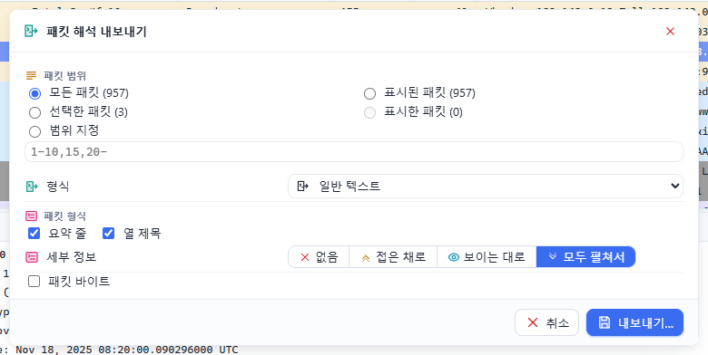

### 바이트와 개체 내보내기

- **파일 › 선택한 바이트 내보내기…**는 세부 정보에서 고른 필드의 바이트를 바이너리 파일로 저장합니다.
- **파일 › 개체 내보내기**는 **HTTP**, **TFTP**, **메일(IMF)**, **FTP 데이터**로 오간 파일(그림, HTML 페이지,
  스크립트, 첨부 파일)을 찾아 하나(**저장**) 또는 모두(**모두 저장**) 저장합니다.
- **편집 › 복사**는 요약, 세부 정보, JSON, 16진 덤프, 필드 하나를 글로 복사합니다.

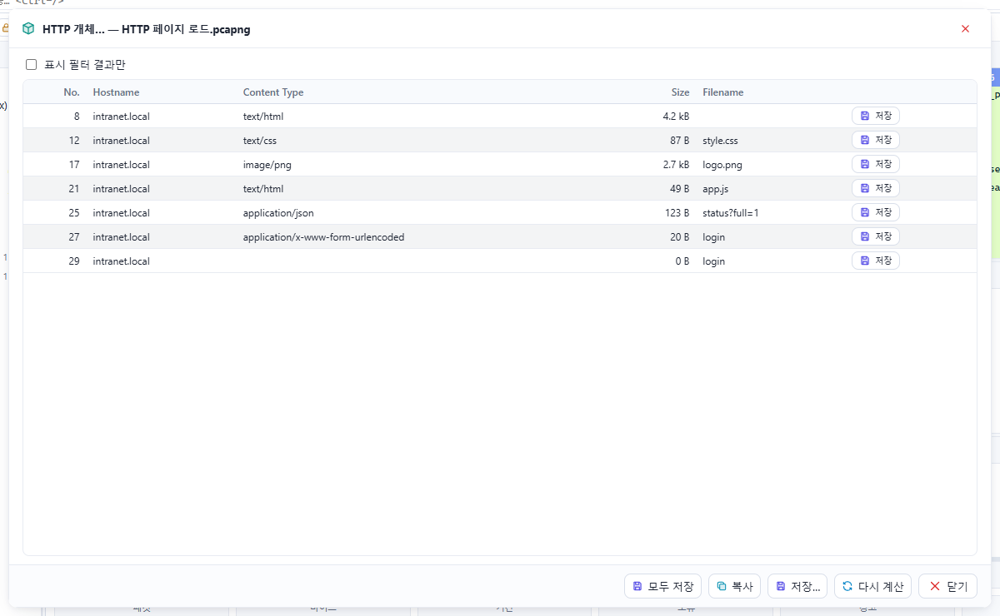

### 인쇄

**파일 › 인쇄…**(Ctrl+P, 툴바 파일 묶음의 마지막 단추)는 쪽 미리보기가 있는 인쇄 창(따로 뜨는 창)을 엽니다.
통계 창의 **인쇄…**와 분석 보고서의 **인쇄…**도 같은 창으로 옵니다.

- **프린터** — 데스크톱 프로그램은 여기서 고른 프린터로 바로 인쇄하고, 웹 버전은 시스템 인쇄 창을 엽니다.
- **패킷 범위**(모든 패킷, 표시된 패킷, 선택한 패킷, 표시한 패킷, 범위 지정)와 **패킷 형식**(요약 줄, 열 제목,
  세부 정보, 바이트, **패킷마다 새 쪽**).
- **용지 설정**(용지, 방향 세로/가로, 여백), **글자 크기**, **머리글·바닥글**(머리글 문구, 바닥글 문구).
- 미리보기는 쪽마다 ◀ ▶로 넘겨 보고, 몇 쪽 몇 줄이 인쇄될지 알려 줍니다.

**인쇄**를 누르면 다른 대화 상자 없이 바로 인쇄합니다. 그 왼쪽의 **내보내기**는 미리보기와 같은 내용을
**HTML**, **Markdown**, **PDF**, **Word**(.docx) 파일로 저장합니다.

| 형식 | 내용 |
| --- | --- |
| HTML | 브라우저로 여는 한 파일(표는 줄마다 색이 번갈아 칠해짐, 인쇄용 스타일 포함) |
| Markdown | 표는 Markdown 표, 패킷 출력은 코드 블록. 그림이 있으면 문서 안에 넣거나 파일로 저장하고 링크 |
| PDF | A4(넓은 표는 가로), 한글은 PDF 뷰어의 기본 한글 글꼴로 표시, 쪽 번호 |
| Word | 제목·표(첫 줄은 쪽마다 반복)·그림이 있는 .docx |

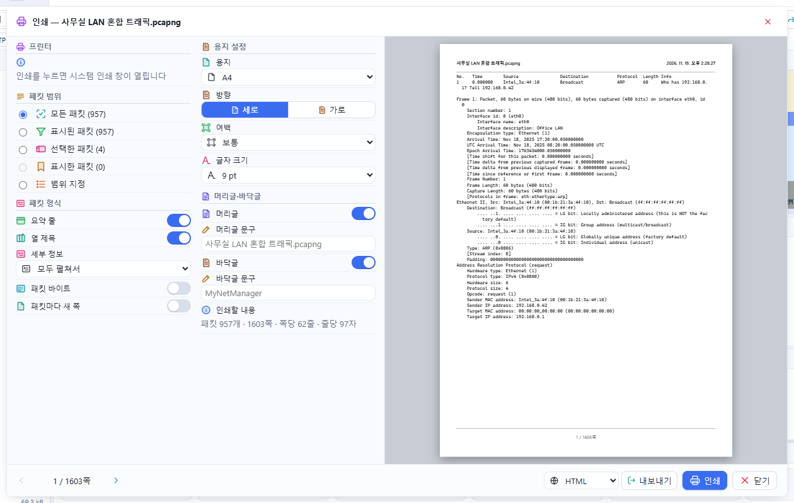

### 패킷 찾기와 패킷으로 이동

**편집 › 패킷 찾기…**(Ctrl+F)는 **디스플레이 필터**, **16진 값**, **문자열**로 다음 패킷을 찾으며, **패킷 목록**,
**세부 정보**, **패킷 바이트** 중 어디서 찾을지(**대소문자 구분** 포함) 고릅니다. **다음 찾기**(Ctrl+N)와 **이전
찾기**(Ctrl+B)로 다시 찾습니다.

**이동 › 패킷으로 이동…**(Ctrl+G)은 패킷 번호로 갑니다. **이동** 메뉴로 첫·마지막·이전·다음 패킷, 같은
대화의 이전·다음 패킷(Ctrl+, / Ctrl+.), 관련 패킷으로 가고, 지나온 패킷을 뒤로·앞으로(Alt+Left / Right)
오갈 수 있습니다.

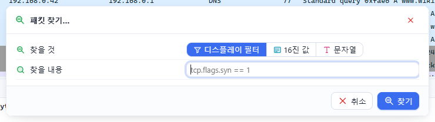

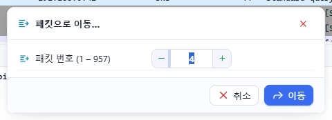

## 설정, 테마, 언어

**편집 › 설정…**(툴바의 톱니바퀴 단추)은 설정 창을 엽니다. 바꾼 내용은 바로 적용됩니다. **기본값으로**는
모든 설정을 처음으로 되돌리고, **완료**는 창을 닫습니다.

| 탭 | 설정 |
| --- | --- |
| **일반** | 언어(한국어 / English), 시작할 때 지난번에 연 파일 다시 열기, 상태 표시줄에 시계 표시, 상태 표시줄, 마지막 폴더, 튜토리얼 시작 |
| **시작 화면** | 시작할 때 시작 페이지 표시, 안내 창, 시작 화면에 보일 카드와 항목, 최근 파일 수 |
| **테마** | 어두운 테마, 밝은 테마, 사용자 테마 |
| **글꼴** | 프로그램과 패킷 창의 글꼴과 크기 |
| **배경** | 움직이는 배경, 배경 그림, 속도 |
| **배치** | 창 배치, 디스플레이 필터 막대, 패킷 목록·세부 정보·바이트, 네트워크 맵, 색칠, 자동 스크롤, 시간 표시 형식과 정밀도, 패킷 목록 줄 높이, 열 설정 |
| **캡처** | 캡처 필터, 무차별·모니터 모드, 스냅 길이, 버퍼 크기, 패킷 수·시간 뒤 자동 중지, 데모 트래픽 속도 |
| **이름 풀이·분석** | 이름 풀이 스위치, TCP 상대 순서 번호, TCP 순서 분석. **지금 다시 해석**으로 열린 캡처에 반영 |
| **프로토콜** | 사용할 프로토콜 |
| **최근 기록** | 최근 파일과 폴더(열기, 지우기, 모두 지우기) |
| **단축키** | 단축키 목록 |

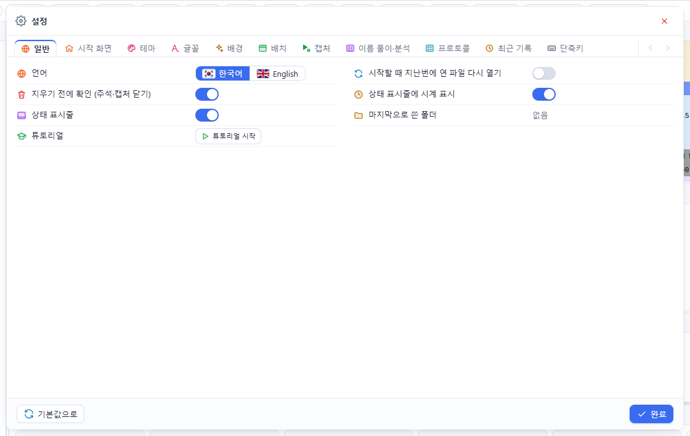

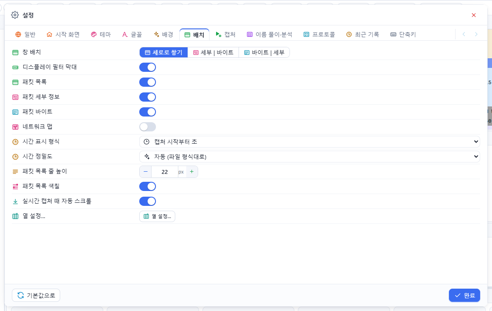

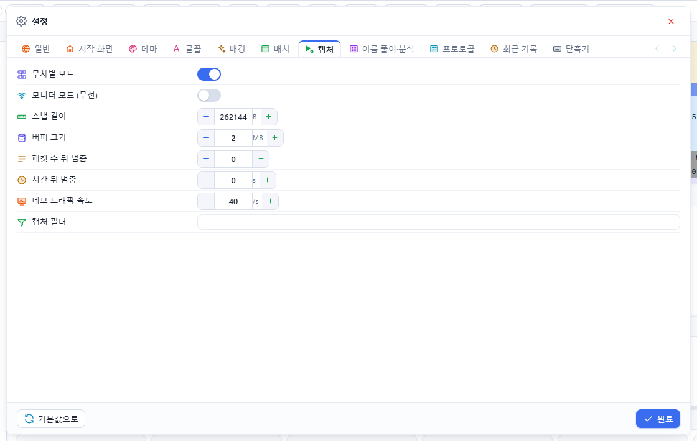

### 테마

툴바의 주사위 단추(**무작위 테마**)는 테마를 무작위로 고르고, 옆의 ▾(**테마 고르기**)는 테마 목록을 엽니다:
**시스템 설정**, **사용자 정의**, 다크 테마 20개, 라이트 테마 20개, **사용자 정의 테마 편집…**, **테마 무작위로 바꾸기**. 시작 화면의
**테마** 카드와 **설정 › 테마**도 같습니다. 상태 표시줄에 지금 테마가 나오고, 어두운 테마에서는 패킷 색도
어두워집니다.

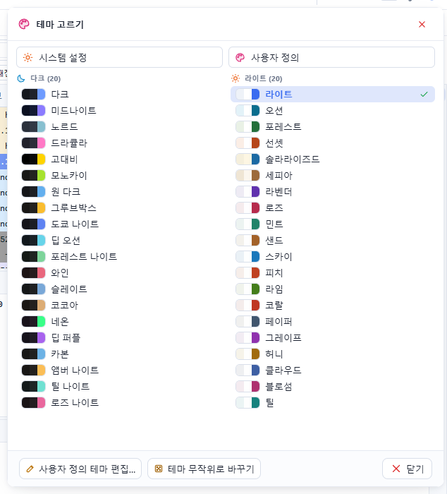

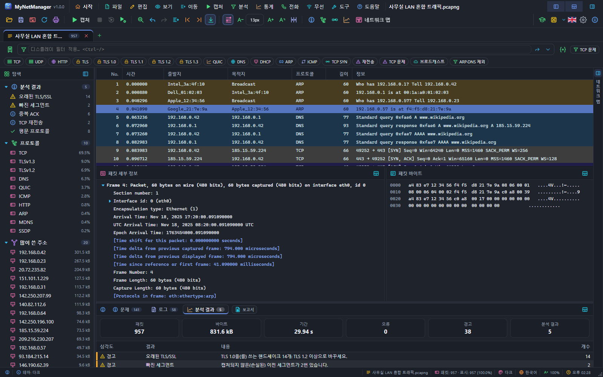

### 언어

MyNetManager는 **한국어**와 **영어**를 씁니다. 툴바의 국기 단추(시작 화면의 국기 타일)는 다른 언어로
바꾸고(Ctrl+Shift+L), **설정 › 일반 › 언어**에서 고를 수도 있습니다. 상태 표시줄에 지금 언어가 나옵니다.
메뉴, 창, 설명서, 튜토리얼이 모두 따라 바뀝니다.

## 튜토리얼

**도움말 › 튜토리얼**(F11), 툴바의 튜토리얼 단추, 시작 화면의 **튜토리얼 시작**은 9장 42단계의 안내 투어를
실행합니다. 투어는 자기 예제 캡처로 실제 프로그램을 움직이며, 오른쪽 아래 카드에 단계마다 **이전 단계** /
**다음**, ▶ **자동 재생**, 장 목록, ✕(또는 Esc, *튜토리얼 끝내기*)가 있습니다. 투어가 바꾼 설정은 끝날 때
되돌려집니다. 같은 투어를 단계마다 그림과 함께 [튜토리얼](Tutorial.md) 문서(**도움말 › 튜토리얼 문서**)에
정리했습니다.

## 단축키

macOS에서는 Ctrl 대신 Cmd를 씁니다. **도움말 › 단축키**(설정 › 단축키)에서 프로그램 안에서도 볼 수 있습니다.

| 단축키 | 명령 | 단축키 | 명령 |
| --- | --- | --- | --- |
| Ctrl+O | 열기… | Ctrl+S / Ctrl+Shift+S | 저장 / 다른 이름으로 저장… |
| Ctrl+W | 닫기 | Ctrl+P | 인쇄… |
| Ctrl+Q | 끝내기 | Ctrl+R, F5 | 다시 읽기 |
| Ctrl+E | 캡처 시작/중지 | Ctrl+K | 캡처 옵션… |
| Ctrl+I | 인터페이스 목록 | Ctrl+/ | 필터 입력으로 이동 |
| Ctrl+F | 패킷 찾기… | Ctrl+N / Ctrl+B | 다음 찾기 / 이전 찾기 |
| Ctrl+G | 패킷으로 이동… | Ctrl+Up / Ctrl+Down | 이전 패킷 / 다음 패킷 |
| Ctrl+Home / Ctrl+End | 첫 패킷 / 마지막 패킷 | Ctrl+, / Ctrl+. | 대화의 이전 패킷 / 대화의 다음 패킷 |
| Alt+Left / Alt+Right | 뒤로 / 앞으로 | Ctrl+M | 패킷 표시/해제 |
| Ctrl+D | 패킷 무시/해제 | Ctrl+T | 시간 기준 설정/해제 |
| Ctrl+Alt+C | 패킷 주석… | Ctrl+Alt+Shift+T | TCP 스트림 따라가기 |
| Ctrl+Alt+Shift+U | UDP 스트림 따라가기 | Ctrl+Alt+Shift+S | TLS 스트림 따라가기 |
| Ctrl+Alt+Shift+H | HTTP 스트림 따라가기 | Ctrl+Alt+Shift+C | 캡처 파일 속성 |
| Ctrl+Shift+E | 전문가 정보 | Ctrl+Shift+N | 네트워크 맵 |
| Ctrl+Shift+1 / Ctrl+Shift+2 | 왼쪽 / 오른쪽 패널 | Ctrl+J | 아래 패널 |
| Ctrl+= / Ctrl+- / Ctrl+0 | 크게 / 작게 / 보통 크기 | Ctrl+Shift+R | 열 너비 맞추기 |
| Ctrl+Right / Ctrl+Left | 하위 트리 펼치기 / 접기 | Ctrl+Shift+Right / Left | 모두 펼치기 / 모두 접기 |
| Ctrl+Tab / Ctrl+Shift+Tab | 다음 / 이전 탭 | Ctrl+Shift+L | 언어 바꾸기 |
| Ctrl+Shift+H | 시작 화면 | Ctrl+, (시작 화면에서) | 설정… |
| F11 | 튜토리얼 | F1 | 프로그램 정보… |

## 문제 해결

| 문제 | 해결 방법 |
| --- | --- |
| 캡처 카드에 데모 인터페이스만 있고 *실제 캡처를 쓸 수 없습니다*가 나옴 | Windows: <https://npcap.com> 에서 Npcap을 설치하고 **새로 고침**. Linux / macOS: libpcap 설치. |
| *libpcap/Npcap 라이브러리를 찾을 수 없습니다* | 위와 같음. Windows는 Npcap 설치 뒤 MyNetManager를 다시 시작. |
| *캡처 권한이 없습니다* | Linux: `sudo setcap cap_net_raw,cap_net_admin=eip <mynetmanager 경로>`(업데이트할 때마다 다시) 또는 root로 실행. macOS: 사용자에게 `/dev/bpf*` 권한. Windows: Npcap을 "Restrict Npcap driver's access to Administrators only"로 설치했다면 관리자 권한으로 실행. |
| *인터페이스가 꺼져 있습니다* / *인터페이스가 없습니다* | 어댑터를 연결하거나 켜고 **새로 고침**. |
| *캡처 필터가 잘못되었습니다* | 캡처 필터는 디스플레이 필터(`tcp.port == 80`)가 아니라 BPF 문법(`tcp port 80`)입니다. 캡처 옵션의 **필터 검사**를 쓰세요. |
| *이 인터페이스는 모니터 모드를 지원하지 않습니다* | **모니터 모드 (무선)**을 끄거나 지원하는 어댑터와 드라이버를 쓰세요. |
| 웹 버전에서 캡처가 안 됨 | 브라우저는 네트워크 인터페이스를 읽을 수 없습니다. 데스크톱 프로그램, 데모 인터페이스, 캡처 파일을 쓰세요. |
| 파일이 일부만 열림 | 파일 끝이 잘려 있어 손상된 곳 앞까지만 보입니다(*파일 끝이 잘려 있어 읽은 데까지만 엽니다*). |
| 필터 막대가 빨갛게 됨 | 포인터를 올려 이유를 보고, **디스플레이 필터 식…**에서 필드 이름을 확인하세요. |
| 이름 풀이나 TCP 설정을 바꿨는데 그대로임 | **설정 › 이름 풀이·분석 › 지금 다시 해석** 또는 **보기 › 다시 읽기**. |
| 패킷이 너무 많아 보기 어려움 | 디스플레이 필터, 탐색 패널, 대화, 네트워크 맵으로 좁혀 보세요. |

## 파일 형식

| 형식 | 읽기 | 쓰기 |
| --- | --- | --- |
| pcapng (`.pcapng`, `.ntar`) | 예 — 섹션, 인터페이스, 주석, 이름 레코드, 인터페이스 통계 | **저장**, **다른 이름으로 저장…**, 지정한 패킷 내보내기 |
| pcap (`.pcap`, `.cap`, 마이크로초·나노초, 두 바이트 순서) | 예 | **pcap 형식으로 저장…** |
| gzip 압축 캡처 (`.pcapng.gz`, `.pcap.gz`) | 예 | — |
| 일반 텍스트, CSV, JSON, PDML, PSML, C 배열 | — | 패킷 해석 내보내기 |
| HTTP / TFTP / IMF / FTP 데이터 개체 | — | 개체 내보내기 |
| HTML, Markdown | — | 분석 보고서 |
| SVG / PNG | — | 네트워크 맵, I/O 그래프, 흐름 그래프 |
| Wireshark *colorfilters* | 가져오기 | 내보내기… (색칠 규칙) |

링크 종류: Ethernet, Linux cooked capture(SLL, SLL2), raw IPv4 / IPv6, BSD 루프백(NULL, LOOP), IEEE 802.11,
radiotap.
