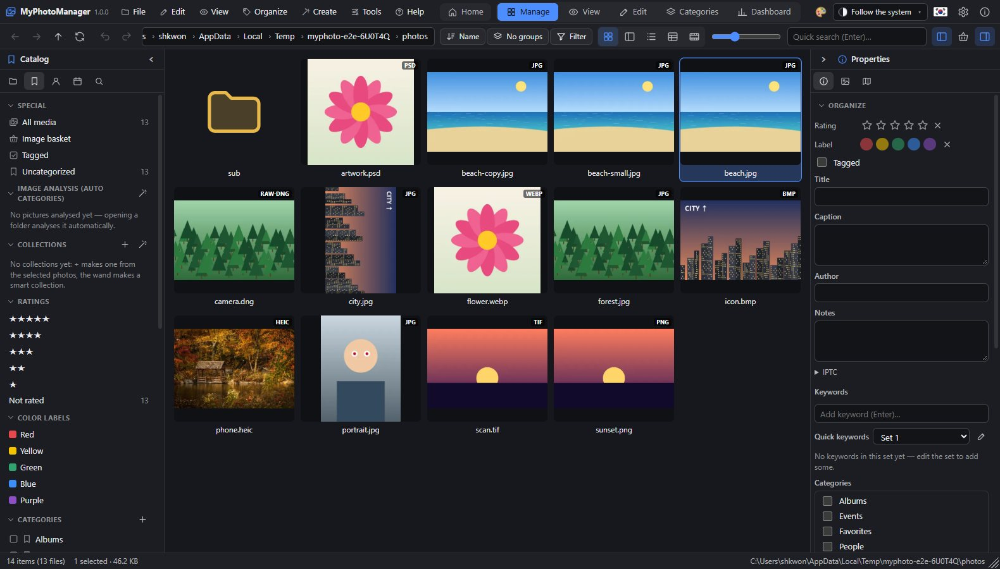
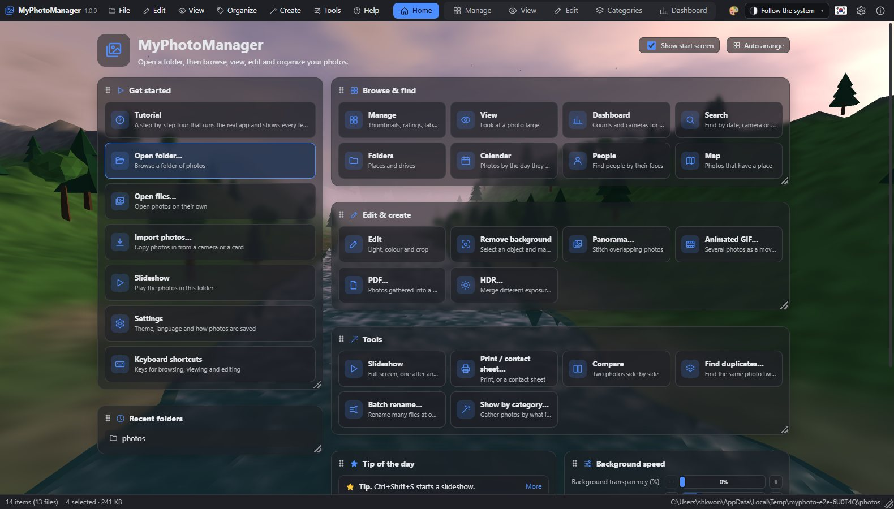
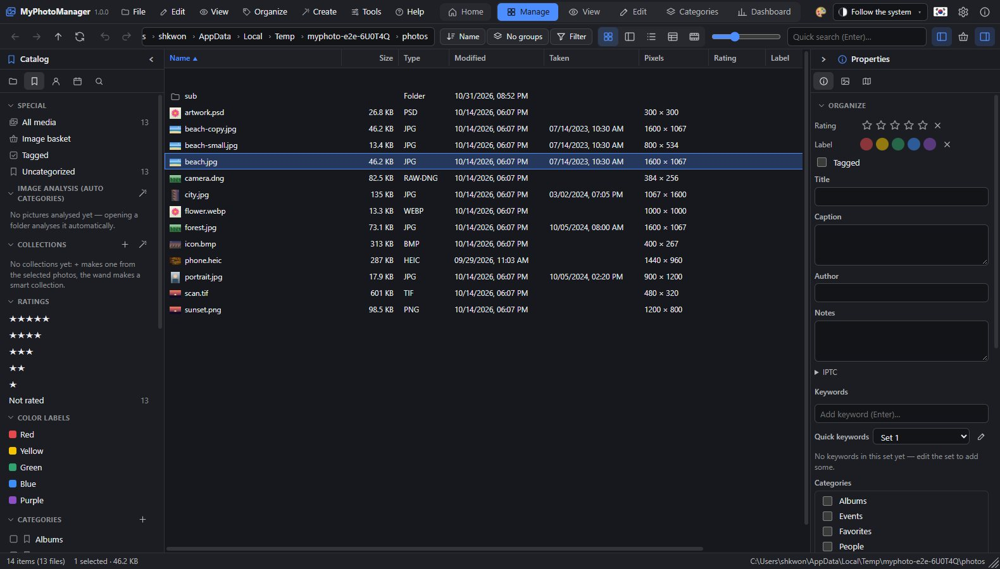
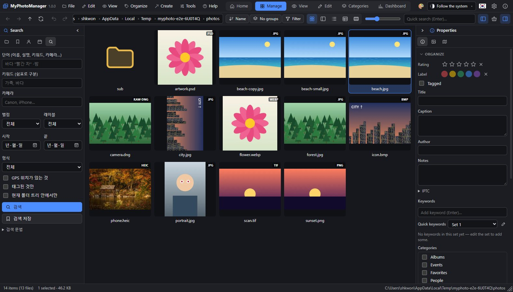
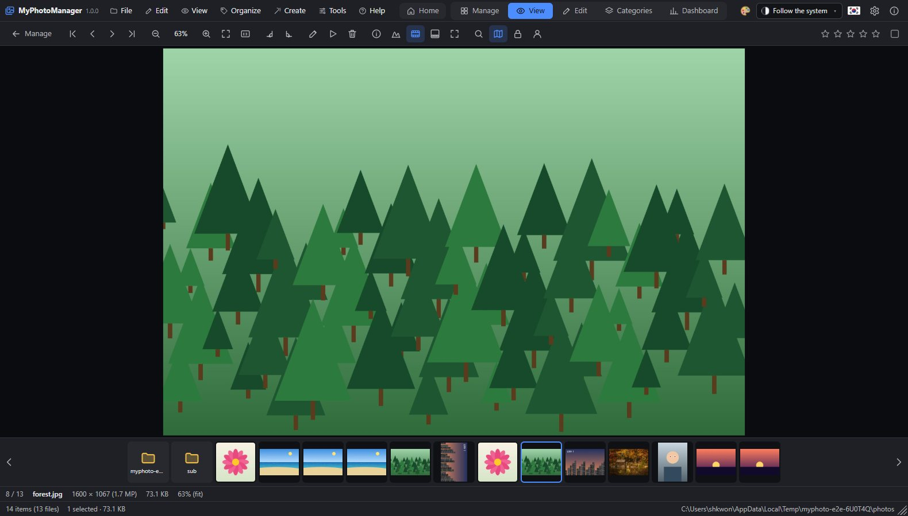
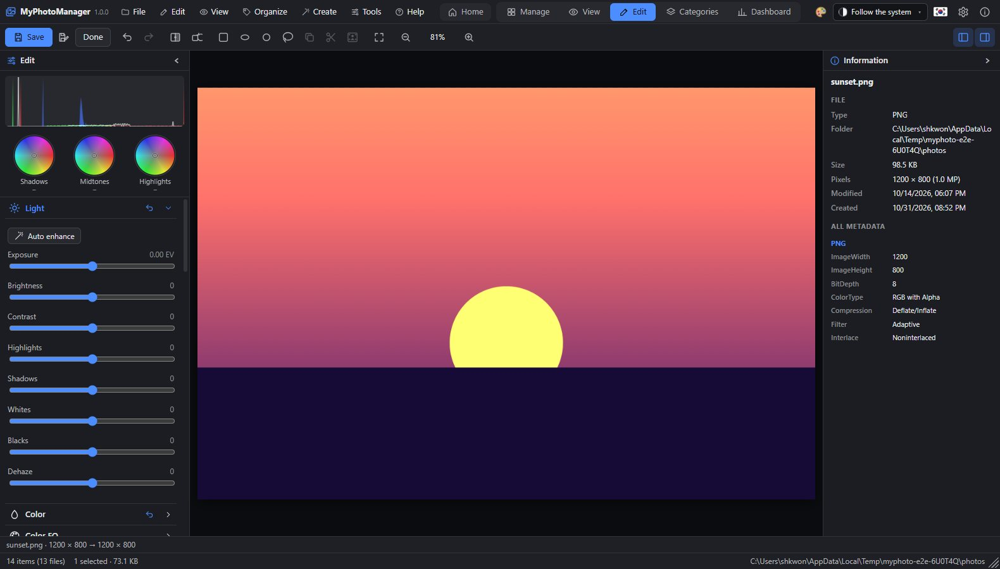
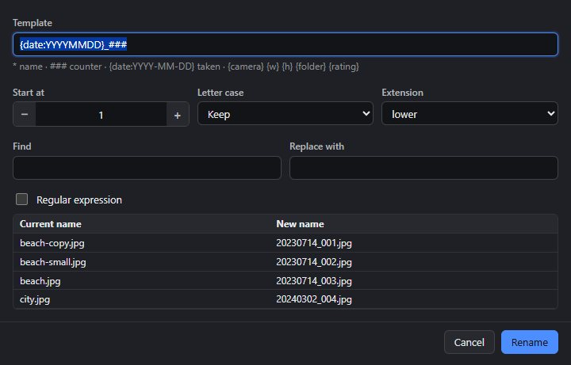
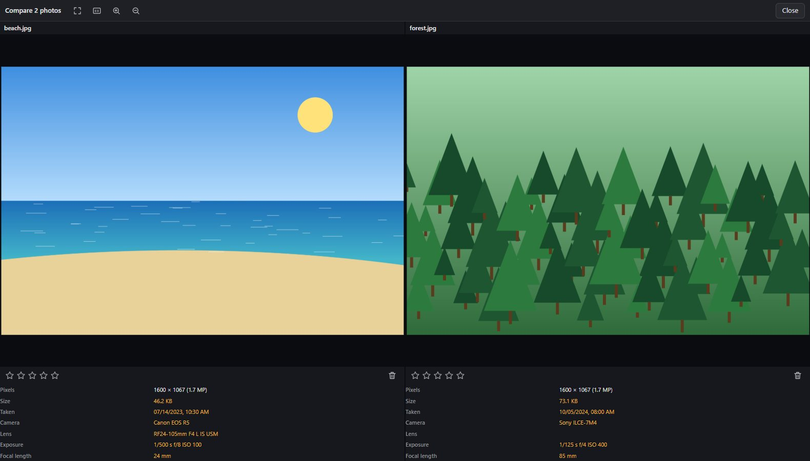
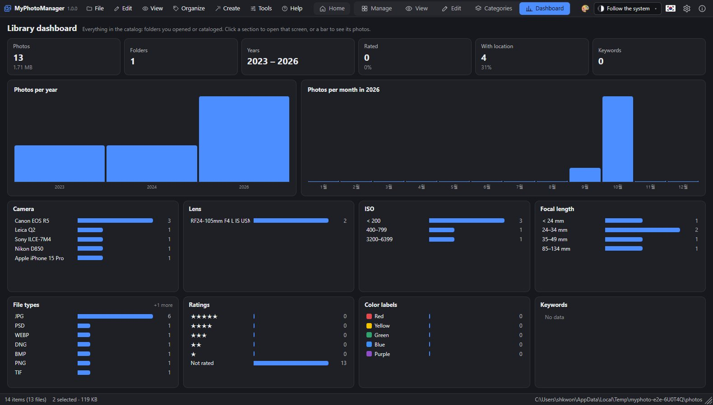
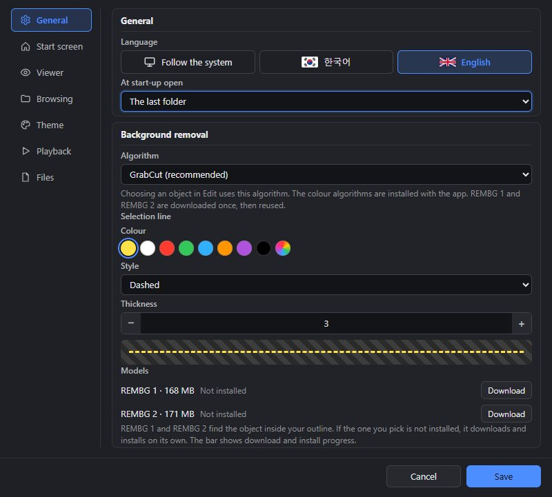

# MyPhotoManager User Guide

> To follow along screen by screen, see the [tutorial](docs/tutorial/README.md) or run **Tutorial** from the app's Home screen (also under Help › Tutorial). The tutorial works only in its own sample folder and restores any settings it changed when it ends. This guide opens in its own window from *Help › User guide*; at the top you switch the language (Korean / English, with flags) and the text size (smaller · current px · larger). Tooltips show almost at once when you rest the mouse on a button.

## 1. Window layout



```text
┌ Menu (File Edit View Organize Create Tools Help)  [Home] [Manage|View|Edit|Categories|Dashboard]  Theme ▾Themes · Flag · ⚙ · ⓘ ┐
│ ← → ↑ ⟳ │ ↶ ↷ │ Address (path)      │ Sort Group Filter │ Thumbnails/Tiles/List/Details/Filmstrip │ Size │ Quick search │ Panes │
├──────────────┬──────────────────────────────────────────────┬───────────────┤
│ Folders│Catalog│                                              │ Properties│Preview│
│ People│Calendar│          File list (thumbnails)              │ Map           │
│ Search       │                                              │               │
│              ├──────────────────────────────────────────────┤               │
│              │  Image basket (visible when turned on)       │               │
└──────────────┴──────────────────────────────────────────────┴───────────────┘
 Status bar: item count · selection · thumbnail/loading progress · current path
```

- **Manage mode**: browsing, organizing and file operations. Drag the borders between panes to change their width.
- **View mode**: one photo, large (Enter or double-click).
- **Edit mode**: develop, adjust, local adjustments, layers, text (Ctrl+E).
- **Dashboard**: catalog statistics. Click a bar to list those photos.

**Header**: from the left, the menu, **Home** (the Home screen), the mode buttons (Manage · View · Edit · **Categories** · Dashboard) and the right-hand group.

- **Home**: just left of the mode buttons. Returns to the Home screen. The **Tip** below Recent folders changes once a day; click **More** to expand how to use that feature, and **Less** to collapse it to one line. The 22 **Background** effects behind the Home screen (Valley · Ocean · Aurora · Stars · Rain · Snow · Dusk · Forest · Dunes · City · Nebula · Bokeh · Grid · Ribbons · Embers · Lake · Sunrise · Fireflies · Shapes · Ink · Petals · Mountains) are all moving 3D scenes. The speed sliders below set the **Overall speed** (0–100 %, 20 % is the default pace) and **Camera**, **Objects** (waves · rain · snow · trees · particles · shapes) and **Sky & light** (clouds · sun · stars) separately at 0–300 %. Anything at 0 % stops; the rest keeps moving. Raising **Background transparency** (0–100 %) fades the background toward the theme's background color; at 100 % it is not drawn. **Reset speeds** returns everything to the defaults. The same controls are in the Settings › Start screen tab. Each background button shows an icon of its scene. The items of the Home screen are grouped into cards (Get started · Browse & find · Edit & create · Tools · Recent folders · Tip of the day · Background · Background speed). Drag the **⠿** left of a card's title to move it anywhere on the 3-column grid (a dashed outline shows where it lands; cards in the way move down), and drag the bottom-right corner to change its width (1–3 columns) and height. Double-click the corner to fit the height to the content. From the keyboard, on ⠿: Alt+arrows move, Alt+Shift+arrows resize. The layout is kept for the next start, and **Auto arrange** packs the cards again without gaps. Turn off **Show start screen** (top right, also in Settings › Start screen) to open the app straight into the manage view.
- **Categories**: just left of **Dashboard**. Shows the people, scene and object categories collected in the catalog with their photo counts; choose one to see only that category in Manage mode. It does not copy files or create folders. If no photos have been analyzed yet, it says so.

**Right side of the header** (in order):

- **Theme button**: each click switches to the next theme (20 dark themes, 20 light themes). Pick one directly from the **drop-down** just to its right, or use *Edit custom theme…* to build your own theme by choosing background, text, accent and panel colors from round swatches (the window updates as you choose; once saved it stays as *Custom*).
- **Language button**: Korean ↔ English. It shows the flag of the language you will switch to (the UK flag while in Korean, the Korean flag while in English).
- **Settings** (gear) and **About MyPhotoManager** (ⓘ: icon · description · version · build · data folder · author SHKWON (knix008@naver.com)). The About window lists the supported formats in two columns so nothing is cut off.

**Left and right panes**: each pane title has an icon and a name; collapse it with the `<` (left) or `>` (right) button. A collapsed pane keeps only a row of icons and a vertical title; expand it again with `>` / `<`, or click an icon to open that tab. The buttons at the right of the toolbar hide or show the panes completely. The collapse button is always at the right end of the title row. The window never gets narrower than the width that shows all toolbar buttons (this follows the mode). The **Filmstrip** view style in Manage mode also has ◀ ▶ on both sides of the strip. When no photo is selected, the right pane shows a summary of the current list (types · date range · cameras · ratings; click one to show only those).

**Windows**: every dialog — Settings, About, confirmations, Print and so on — opens as a separate window from the app window (a fixed-size window with a title and an icon), and closing that window cancels it. Number fields change one step at a time with the − + on either side (hold to repeat). Colors are picked from round swatches; the rainbow circle picks any color.

**Undo**: ↶ ↷ on the toolbar (Ctrl+Z / Ctrl+Y) undo or redo moves, copies, renames and new folders (moving many photos at once is undone in one step). Edit mode has its own undo/redo for editing steps.

## 2. Opening folders and importing



- **Desktop**: the top of the *Folders* pane lists every drive on the system with its name (volume name or "Local Disk (C:)") and a free-space bar. Click to open and expand. Below are *Quick access* (Home · Pictures · Desktop · Documents · Downloads) and *Favorites*. *File → Open folder…* (Ctrl+O) opens any location. Right-click a folder and choose **Add to favorites**. Opening a photo from Explorer with "Open with → MyPhotoManager" opens its folder and shows the photo in View mode. You can also drag files and folders onto the window (for files, it asks whether to copy them into the current folder).
- **Web**: *Open folder* — Chrome and Edge open it with write access and remember it for the next visit (for a folder that asks for permission again, click *allow* next to its name). *Open photos* picks individual files, and you can also drag photos and folders onto the window. *Sample photos* lets you try it right away.
- **Recent** (*File → Recent folders*): the last 10 folders and 10 files you opened. Click one to open it (a file opens in View mode with its folder); × at the end of a row removes one, and *Clear the list* removes all. At start-up the last folder opens (Settings → General).
- **Thumbnails**: opening a folder builds all its thumbnails in the background (progress in the status bar). Thumbnails are stored per folder, so the next time the stored ones show at once (only changed files are rebuilt). Clear them in *Settings → Data & privacy*.
- **ZIP archives**: opening a `.zip` or `.cbz` (double-click) shows the photos and videos inside as a read-only folder.
- **Import** (*File → Import photos…*, Ctrl+Shift+I): choose photos from a memory card (drives with a DCIM folder appear automatically) or any folder and copy them into a library folder. Sub-folders by date taken (`YYYY/MM`, `YYYY/YYYY-MM-DD` …), a rename template (same as batch rename), keywords and rating, **Skip photos that are already there** (files with the same content), and deleting the originals after import.
- **Import from phones and cameras (USB)**: connected devices appear in the *Phones and cameras (USB)* row of the Import window (Windows and Linux; unlock the phone and allow file transfer). Clicking one copies only the new photos and videos from DCIM and Pictures into the app data folder, then you choose what to import from that list. Files already copied are skipped.
- **Import from a scanner** (*File → Scan…*, Windows): the scanner window opens, and the scanned picture is saved in the current folder as `scan-datetime.jpg`.
- **Folder sync** (*File → Synchronise folders…*): copies new and changed files from the source folder to the target folder. With *Mirror* on, files in the target that are not in the source are deleted (after confirmation).

## 3. File list



| Action | Result |
| --- | --- |
| Click / Ctrl+click / Shift+click | Select / add or remove / range |
| Drag on empty space | Select several with a rectangle |
| Double-click, Enter | Opens a folder, shows a photo in View mode, opens a ZIP like a folder |
| Drag onto a folder (tree, folder thumbnail, address bar) | Move (hold Ctrl to copy) |
| Drag onto the map | Assign that location to the photo (geotag) |
| Drag onto the basket | Add to the basket |
| Box at the top left of a thumbnail | Tag / untag |
| Right-click | Menu for that photo |
| ←↑→↓ · Home/End · PageUp/Down | Move (Shift extends the selection) |
| Backspace · Alt+↑ | Up one folder |
| Ctrl+C · Ctrl+X · Ctrl+V | Copy · cut · paste into the current folder |

Toolbar: **Sort** (names compare numbers as numbers: img2 < img10), **Group** (day · month · year · folder · rating · label · type · camera), **Filter** (minimum rating · label · tag · type), view style (**Thumbnails · Tiles · List · Details · Filmstrip** — Filmstrip shows a large preview on top and one row below), thumbnail size, **Quick search**.
The captions under thumbnails (name · size · pixels · date) and the overlay icons are chosen in *Settings → Browsing*.

## 4. Organizing

- **Rating**: Ctrl+1…5, clear with Ctrl+0. **Color label**: Alt+1 (red) … Alt+5 (purple), clear with Alt+0. **Tag**: the `` ` `` key.
- **Properties pane → Organize**: rating · label · tag, title · caption · author · notes, the **IPTC** section (headline · copyright · credit · source · event · sublocation · city · state/province · country · country code · usage terms · instructions), keywords (type and press Enter, commas for several), category check boxes. With several photos selected, changes apply to all of them, and differing values show as "(different values)".
- **Hierarchical keywords**: join levels with `|`, as in `Places|Korea|Busan`. `kw:Places` or a parent keyword in the Catalog pane also finds photos tagged with the keywords below it.
- **Catalog pane**: click an item to show its photos; **Ctrl+click** adds conditions (same kind = "or", different kinds = "and" — switch with *all / any* at the top). **All media** is every photo in the catalog. Clicking the box in front of a category or keyword **assigns it to / removes it from the selected photos**. Right-click a category to add a sub-category, rename or delete it.
- **Automatic categories**: Camera · Lens · Year taken · ISO · Focal length · Aperture · Flash · Orientation · Location · Country — built automatically from EXIF.
- **Catalog this folder (with sub-folders)** (right-click a folder, or the Organize menu): reads EXIF down through the sub-folders so that the catalog, calendar, map, dashboard and search cover all those photos. Folders you open are cataloged automatically.
- **Quick keywords** (Properties pane → Organize): create named keyword sets and add or remove them on the selected photos with one button. The first nine are **Alt+Shift+1…9**. Edit the sets with the pencil button.
- **Metadata template** (top of the IPTC section): saves the IPTC values and keywords shared by the selected photos under a name; choose it to apply them to other photos in one go.
- **Collections** (Catalog pane): lists of photos independent of folders. Create one from the selected photos with +, and add more with *Add to collection* in the right-click menu. A **smart collection** (magic wand button) fills itself from rules (rating · label · keyword · category · person · text · camera · lens · kind · type · folder · date taken · width · tag · location), and the list changes when the conditions change.
- **Image basket**: add with Ctrl+B, and open it at the bottom with the basket button on the toolbar. Gather photos from several folders for a slideshow, printing or batch processing.
- **Metadata**:
  - *Organize → Edit EXIF…*: writes the date taken · make · model · artist · copyright · description · software · GPS (including clearing it) of JPEGs directly into the file (the image is not recompressed).
  - *Organize → Write metadata to files…*: puts what you organized (title · caption · keywords · rating · label · IPTC · geotag) inside JPEG, PNG, WebP and TIFF files as XMP (JPEG also gets artist · copyright · description · GPS in EXIF). Other formats get a sidecar `.xmp`.
  - *Organize → Geotag with a GPX track…*: choose a `.gpx` from a GPS logger or phone, and each photo's position on the track is found from its capture time (interpolated between two points). Set the camera clock offset (hours, minutes) and the maximum gap, review the preview for each photo, then apply.
  - *Organize → Look up place names*: fills city · state/province · country · sublocation for photos with GPS (OpenStreetMap; map use must be turned on in *Settings → Data & privacy*).
  - **XMP sidecars** (Settings → Files): when on, organizing writes `photoname.xmp` so Lightroom, Bridge and darktable can read ratings, labels and keywords. Turn on *Embed metadata in JPEG files when organizing* to write into the file instead of a sidecar. XMP ratings and keywords already in a photo are imported automatically the first time it is viewed.

## 5. People

- *Find faces in these photos* in the **People** pane on the left (or *Organize → Find faces in these photos*) finds faces in the photos of the current list. All processing happens on your computer (the model ships with the app).
- Click *Unnamed faces* to open a window with a name field for each face. Faces that look like someone you have already named get a **suggested name**; accept it with ✓. ✕ means "not a face".
- Click a person's name to see only that person's photos. Right-click to rename or delete. Search with `person:name`.
- In View mode, press **G** to show boxes and names on faces; click a box to name it.

### Image analysis · automatic categories

When you open a folder, photos are **analyzed in the background** and categorized by what they show. Analysis runs on a separate thread (a web worker), so scrolling the list or viewing photos does not slow down, and progress appears only in the status bar (*Analysing 12 / 40*).

- **People**: portrait (1 person, close) · 1 person · 2 people · group (3–5) · crowd (6 or more) · no people
- **Scene**: beach · sea and waterside · mountains and valleys · nature and forest · flowers · sky · sunset · snow · city and buildings · indoors · night and dark · food · documents and screenshots · black & white
- **Objects**: animals (dog · cat · bird · horse · fish · insect · livestock · wild animals) · vehicles (car · bus · truck · motorcycle · bicycle · train · airplane · boat) · food · kitchenware · furniture · plants · electronics · appliances · sports equipment · personal items · street fixtures · books · household items

*Image analysis (auto categories)* in the **Catalog** pane on the left shows the photo count per category; click one to see only that category (Ctrl+click to combine, such as "group + beach"). *Analysis* in the **Properties** pane on the right shows the photo's categories and what was recognized (for example seashore, dog).

- *Tools → Analyse this folder* analyzes right away, *Analyse again* redoes the selected photos, and *Stop analysis* stops. A photo that has been analyzed is not analyzed again unless the file changes.
- *Tools → Show by category…*: choose people, scene or objects as the basis, and the photos in each category are gathered into a list. The preview shows the count per category. The files stay in their original folders; no folders are created and nothing is copied or moved. The **Categories** button left of the dashboard opens the same list.
- Automatic analysis can be turned off in *Settings → Data & privacy*.
- All processing happens on your computer: the MobileNet v2 (1,000 ImageNet classes) and SSDLite (80 COCO objects and people) models, plus color statistics (sky · sand · green · sunset · darkness · paper and text). The models ship with the app.

## 6. Private folder

*File → Private folder*:

- **Open**: the first time, you set a password. Photos are encrypted with a key derived from the password (AES-GCM) and kept in the app data. If you forget the password, it cannot be opened.
- **Move the selected photos**: the originals are deleted and remain only in the private folder.
- **Restore**: takes the chosen photos out of the private folder into a folder of your choice.
- **Lock**: the password is asked for again next time.

## 7. Searching



In the quick search box (Ctrl+F) or the **Search pane**:

```text
beach "red car" -night               words and phrases, - excludes
rating:3   rating:>=4   label:red   tagged   is:edited
kw:beach   kw:Places|Korea   cat:People/Family   person:Minji
camera:canon   lens:24-70   ext:jpg   iso:>=1600   has:gps   is:raw   is:video
date:2024   date:2024-05   date:2024-01..2024-06
```

*Save search* in the Search pane keeps the search under **Saved searches** in the Catalog pane. The **Calendar** pane finds photos by date taken (file date if there is none), and the **Map** pane by GPS. Right-click the map to assign that location to the selected photos (you can also drag from the file list onto the map).

## 8. View mode



| Key | Action |
| --- | --- |
| ← → · Space · PageUp/Down · wheel | Previous / next (the wheel can be set to zoom in Settings; Ctrl+wheel always zooms) |
| Ctrl+PageUp · Ctrl+PageDown | Previous / next page of a multi-page TIFF or PDF |
| + − · * · / | Zoom in · zoom out · 100% · fit to window (double-click also toggles fit ↔ 100%) |
| Drag | Pan a zoomed photo (when zoomed, the **Navigator** at the bottom right shows the position and can be dragged) |
| L | Loupe (magnifies around the cursor) |
| Z | Lock zoom — the next photo keeps the same zoom and position |
| G | Show faces |
| I · H | Information (shooting data · keywords · caption) · histogram |
| F · F11 | Full screen |
| Ctrl+[ · Ctrl+] | Rotate left · right (lossless for JPEG) |
| E · S · Delete | Edit · slideshow · delete |
| Esc · Enter | Back to Manage mode |

**− zoom +** on the toolbar zooms out and in, with the current zoom shown in the middle. **I** and the information button on the toolbar turn the shooting-data panel on and off, and the panel's `>` · `<` collapse it. The **Filmstrip** at the bottom is centered, and **◀ ▶** on either side go to the previous and next photo (the wheel scrolls the strip sideways). Along with photos, the strip shows sub-folders and the parent folder with a folder icon and the folder name. Clicking a folder enters it while staying in View mode, and the arrow keys move only between photos. The status bar shows the coordinates and RGB value of the pixel under the cursor and the embedded color profile (ICC). **Video**: the playback controls are drawn at the video's width from the start; ▶ / ❚❚ appear briefly on play and pause, and a *Paused* indicator stays while stopped. The toolbar changes repeat · sound · playback speed · display (fit to window · actual size · fill window) (*Settings → Video* has autoplay · controls · volume · resume · next when finished); **Save this frame** saves the current frame as a JPEG, and **Trim the video…** saves only the part between start and end as a new WebM. Photos that take time to open, such as large RAW, TIFF and PDF files, show a loading message in the status bar.

Opening **DICOM (medical images, .dcm)** shows the DICOM toolbar.

- **Window/level**: the window stored in the file and presets per modality (CT: brain · subdural · stroke · soft tissue · liver · mediastinum · lung · bone), center (C) and width (W) fields, a drag tool (left-right = width, up-down = center), reset
- **Display**: invert, color maps (gray · hot iron · PET · jet · rainbow · bone …), VOI LUT and functions (LINEAR · LINEAR_EXACT · SIGMOID), overlay planes
- **Frames**: multi-frame images have a slider (also the wheel), previous/next (↑ ↓) and **cine playback** — the file's frame time or 1…120 fps, loop · bounce · once. The window presets also include *Auto (from the values)*
- **Measure**: distance (click twice or drag), **angle** (click three points in turn — end of the first arm, vertex, end of the second arm; or drag the first arm), **Cobb angle** (two lines, click or drag), rectangle and ellipse ROI statistics (mean · standard deviation · min · max · area). The length unit is mm · cm · inch in *Settings → Viewer*. Measurements belong to their frame; undo them with **Undo · Redo** on the toolbar (dimmed when empty) and Ctrl+Z / Ctrl+Y, and Del deletes the last one. The rotate left · right buttons use a right angle and an arc so they are distinct from undo. The pointer is + while drawing
- **Scale**: **X · Y rulers** along the top and left edges of the window (the whole axis, 0 at the top left of the image, following zoom and pan, showing the cursor position), a draggable **scale bar** (double-click to put it back), **− zoom +** buttons (changing together with the toolbar zoom) and the scale ratio (1 px = … mm, screen 1:N), **1:1** actual size. Rulers, scale and information display are each turned on and off and remembered
- **Grid**: the *Grid ON/OFF* button (or D) turns a faint grid on and off. Its squares match the ruler spacing, with 5×5 inside each cell. The lines are faint so the image shows through, and they follow zoom and pan like the rulers
- **Crosshair**: draws a red dotted cross at the pointer (*Crosshair ON/OFF* or X). The pointer is always +, and the + stays even with the crosshair off. The frame number field keeps its width during playback. Switching the language keeps the image, zoom and frame you are viewing
- **Shortcuts**: R distance · A angle · C Cobb · T rectangle · E ellipse · L window drag · Esc ends the tool (cancels a measurement in progress), I invert · W reset window · M next color map · V overlay, G rulers · B scale bar · O information · D grid, ↑↓ Home End frames, Space cine. Ctrl+drag or middle-button drag adjusts the window in any tool
- **Information**: patient · study · series · window · frame · zoom in the four corners, orientation (R · L · A · P · H · F) on the edges, the real value under the cursor (HU for CT), and every tag browsable in the **DICOM tags** window
- **Save**: the ⤓ button opens the **Export frame** window — the visible frame or all frames (to a folder) in **every format** the app can write (JPEG · PNG · WebP · BMP · TIFF · GIF · JPEG 2000 · JPEG XL · PSD · PDF · DICOM · ICO · TGA · QOI · PPM · PCX · SGI · RAS · DDS · HDR · XBM · 16-bit TIFF/PNG), with a quality setting (with the on-screen window, color map and inversion). All frames as a **video (WebM)**, and the tags as JSON · CSV · TXT (*Copy* in the tags window copies to the clipboard)
- **Samples**: real moving DICOM — `samples/cine_us_echo_color_120f.dcm` (color Doppler echocardiogram, 120 frames), `samples/cine_us_echo_30f.dcm` (echocardiogram, 30 frames), `samples/cine_mr_10f.dcm` (MR, 10 frames; pydicom test data). Generated samples `samples/cine_heart.dcm` · `samples/cine_phantom.dcm` (`node scripts/make-samples.mjs`). Open one and press ▶ to play it. Color images do not show window/level or color maps

Compressed DICOM (JPEG · 12-bit JPEG · lossless JPEG · JPEG-LS · JPEG 2000 · RLE, big endian · Deflate) also opens.

## 9. Edit mode



Expand each section in the left panel to adjust it. **Double-click a slider to reset it to 0**; **↺** in a section title returns that section to its original values. The three **color wheels** just below the histogram (shadows · midtones · highlights) add color to that range when you drag the dot (direction = color, distance = strength, double-click = reset).

- **Light**: auto enhance, exposure (EV) · brightness · contrast · highlights · shadows · whites · blacks · dehaze. RAW files are developed with LibRaw, with a choice of white balance (camera · auto · daylight).
- **Color**: white balance **picker** (click something that should be gray), temperature · tint · saturation · vibrance · hue
- **Color EQ**: hue · saturation · luminance per color range (red · orange · yellow · green · aqua · blue · purple · magenta) / **Light EQ**: brightness in 9 steps from dark to bright / **Split toning**: highlight and shadow colors and balance
- **Levels**: auto levels, black point · gamma · white point / **Tone curve**: RGB or per channel; drag to add and move points, double-click a point to delete it
- **Detail**: sharpen (radius) · clarity · noise reduction · blur
- **Lens**: distortion · chromatic aberration · vignetting; **Perspective**: vertical · horizontal tilt · rotation
- **Crop & geometry**: rotate · flip, straighten (slider or **Straighten by a line** — drag along a line that should be level), crop (free · original ratio · 1:1 · 4:3 · 3:2 · 16:9 …, adjust with the handles, Enter applies), resize, **Canvas size** (position · background color)
- **Remove background**: outline the subject with **Rectangle** or **Freehand** on the toolbar. While drawing, Freehand shows only a dotted line; when you release, the selected area remains. Selecting alone does not change the picture. Only clicking **Remove background** makes the background inside it transparent, with progress shown in a pop-up. **Cancel** discards the selection, or, pressed in the progress pop-up, stops the removal. The left panel holds only the algorithm buttons (GrabCut · background color · edges · color clusters · contrast · REMBG 1 · REMBG 2). GrabCut is the default. REMBG 1 and 2 are downloaded once in *Settings › Background removal*, or downloaded and installed automatically when you click their button. If a download fails, a pop-up gives the reason and asks you to try again. Undo (Ctrl+Z) reverts the result. Saving keeps only the rectangle around the subject, as a PNG or WebP with a transparent background (JPEG cannot hold transparency, so it cannot be overwritten in place). The selection line is a yellow dashed line by default; the same settings change its color, style (solid · dashed · dotted) and thickness (1–24).
- **Local adjustments**: define an area with gradient · radial · brush, **Lasso** (draw around it), **Magic wand** (a connected area of similar color) or **Colour range** (pixel targeting: every pixel within the hue, saturation and brightness range of the clicked color), and apply exposure · contrast · saturation · temperature · sharpness and more only inside it. Invert · feather the edge. Several can be stacked.
- **LUT**: built-in looks (teal & orange · warm film · cool fade · monochrome film · high contrast) or `.cube` files (1D · 3D), with strength
- **Repair**: red-eye · heal spot · **Clone stamp** (Alt+click sets the source, click to paint) · **Erase (content-aware)** (paint over what to remove and it is filled from the surroundings) · skin smoothing — brush size · hardness
- **Effects**: basic effects such as black & white and sepia with strength, vignette · grain · pixelate · emboss · find edges, **Special effects** (22 kinds, stackable: oil painting · pencil sketch · color sketch · cartoon · watercolor · lomo · glow · halftone · old photo and more), **Tilt-shift**
- **Drawing**: line · arrow · rectangle · ellipse · freehand (color · thickness · fill)
- **Text & border**: watermark text (font · color · size · opacity · shadow; click the photo to place it), border thickness · color
- **Layers**: place other photos on top with a blend mode (16 kinds such as multiply · screen · overlay) · opacity · size · position. **Adjustment layers** (exposure · contrast · saturation · temperature… over everything below), and a **mask** per layer (top/bottom/left/right gradient · center ellipse · paint with a brush, invert)
- **Presets**: save the current settings under a name and apply them to other photos in one go. *Copy settings* (Ctrl+Shift+C) · *Paste settings* (Ctrl+Shift+V)
- **History**: the list of steps so far. Click a step to go back to it. **Snapshots** (Ctrl+Shift+N) save the current settings under a name; click one to return to it.
- **16-bit photos** (16-bit PNG · TIFF): *16-bit* appears in the info line, and tone and color adjustments are computed on a high-precision copy, so even strong brightening does not cause banding. Saving keeps 16 bits (there are also TIFF/PNG 16-bit formats).
- **Record in an action** (Presets section): adds the current settings as a step of a batch action.

Toolbar: **Save** (Ctrl+S) and **Save as…** (Ctrl+Shift+S) open the same save dialog. The file name suggested is a new one with the changes in front (e.g. `Exposure_photo.jpg`) and can be edited; on the desktop you then pick where to save. A progress window shows while saving (at once for a large photo). Formats: JPEG · PNG · WebP · BMP · TIFF · GIF · JPEG 2000 · JPEG XL · PSD · PDF · DICOM · ICO · TGA · QOI · PPM · PCX · SGI · Sun RAS · DDS · Radiance HDR · XBM, quality), **Done**, undo/redo (Ctrl+Z / Ctrl+Y), **Before / after** (B), reset all, **Rectangle** · **Freehand** (selection for background removal), **Remove background** (applies when there is a selection), and at the right end the left and right panel toggles. To save in place after removing the background, the original must be PNG or WebP; otherwise choose PNG or WebP with Save as.
Saving as JPEG keeps the original photo's EXIF, XMP and ICC (orientation upright, old thumbnail removed).
On the desktop, the first time you overwrite an original, the original is kept separately and the edit settings are remembered. When you edit it again, it asks whether to **continue from the original and settings** — then adjustments do not stack and you can change the earlier settings (non-destructive re-editing). *Edit → Restore original* reverts it. On the web, edits to photos in read-only folders are downloaded.

## 10. Create (Create menu)

- **PDF**: one photo per page, paper (photo size · A4 · Letter) · orientation · margin · quality · title.
- **Animated GIF**: long side · frame delay · repeat · dithering.
- **Slideshow video / page**: a WebM video (size · interval · fade · **background music** — an Opus sound track) or a self-contained HTML file (music included).
- **Panorama** (select 2 or more): *Automatic* matches feature points and **corrects perspective** (photos taken by turning the camera); if they do not match, it stitches by shifting only.
- **HDR** (2 or more with different exposures): aligns, then merges the exposures.
- **Focus stack** (2 or more with different focus): gathers the sharp parts of each photo.
- **ZIP archive**: the selected files in one ZIP.
- Print · contact sheet, desktop wallpaper.

## 11. Batch processing (Tools menu · right-click → Batch)



- **Batch actions**: chain steps — edit settings · auto levels · watermark · rotate · size · rating · keywords · save format — save them under a name, and run them again on many photos.
- **Rename**: template `*` (original name) `###` (number, as many digits as #) `{date:YYYYMMDD_HHmmss}` (date taken) `{camera}` `{w}` `{h}` `{folder}` `{rating}` `{ext}`, start number, letter case, find and replace (regular expressions). If the preview shows duplicate or existing names in red, it does not run. Swapping names between files is handled safely.
- **Resize**: long side in pixels · fit within width × height · percent, format · quality, save location (replace the originals / new files with a suffix / another folder).
- **Convert format**: JPEG · PNG · WebP · BMP · TIFF (keep the originals or move them to the recycle bin).
- **Batch adjust**: auto levels per photo, exposure · contrast · saturation · sharpen, black & white / sepia.
- **Watermark**: text · position · size · opacity · color.
- **Apply preset / settings**: a saved preset or copied edit settings on many photos (*Edit → Paste settings* does the same).
- **Change date/time**: shift by days · hours · minutes (when the camera clock was wrong) or set to a given time. It changes the EXIF date of JPEGs directly (no recompression) and can also change the file modified time.
- **File date ← date taken**: sets the file modified time to the EXIF date taken.
- **Rotate & flip**: lossless rotation for JPEG that changes only the EXIF orientation; other formats are saved again. **Auto-rotate (EXIF)** actually rotates the pixels of JPEGs that only have an orientation flag and saves them.

## 12. Other tools





- **Compare** (select 2–4): zoom and pan move together, and differing shooting data is highlighted in yellow. Rate or delete right there.
- **Find duplicates**: in the current list or the folder tree, *identical files* (content hash) or *similar-looking photos* (resized or re-saved). In each group only the largest photo is kept and the rest are marked for deletion.
- **Slideshow** (Ctrl+Shift+S, S in View mode): Space pauses, ←→ move, Esc ends. Interval · transition (fade · slide · Ken Burns) · shuffle · repeat · captions are in Settings.
- **Print / contact sheet** (Ctrl+P): settings on the left, a page preview on the right (updates as settings change; `<` `>` turn pages).
  - Printer · copies · color/black & white · double-sided
  - Paper (A3 · A4 · A5 · B5 · Letter · Legal · Tabloid · 4×6 · 5×7 · 8×10 · custom mm) · orientation (auto · portrait · landscape)
  - Layout (one per page · 2×2 · 3×3 · contact sheet · wallet size, or columns × rows) · gap · whole photo/fill · rotate to fit cell · border
  - Top · bottom · left · right margins
  - File name · date · rating, header, footer, page numbers
  - Output: **Print** sends straight to the printer with no preview window (desktop). You can also save as PDF, JPEG or PNG. The last settings are remembered.
- **Share**: *File → Share / e-mail…* opens the system share window (if there is one) or a new e-mail listing the photo names plus the file location. *Copy picture* (Ctrl+Shift+C) puts the photo on the clipboard.
- **Open with…**, **Open with default program**, **Show in file manager**, **Set as desktop wallpaper** (desktop).
- **External editors** (*Edit → Edit in*): register programs such as Photoshop or GIMP and pass the selected photos to them. Ctrl+Shift+E uses the first editor. Thumbnails are rebuilt when you come back.
- **Workspaces** (*View → Workspaces*): save panes · tabs · widths · view style · sort under a name and switch with Ctrl+Alt+1…9. *Default layout* goes back.
- **Slideshow background music**: choose a music file and volume in *Settings → Slideshow*; it loops during the show and pauses with it.

## 13. Settings



- General: language (flag button: System/한국어/English), folder to open at start-up, **Background removal** (algorithm, selection line color · style · thickness, REMBG 1 · 2 download)
- Errors: when an operation fails, a pop-up shows the message and stack, and **Copy** puts that text on the clipboard. Errors that follow are added to the same pop-up.
- Theme: System · Custom · 20 dark · 20 light as preview cards (click to see it at once; Cancel reverts), edit custom theme
- Browsing: hidden files, files that are not photos, sub-folders, thumbnail captions and icons
- Viewer: mouse wheel behavior, enlarging small photos, smoothing when zoomed, length unit (mm · cm · inch), color management (embedded ICC profiles to sRGB)
- Video: autoplay, repeat, start muted, controls, resume, next when finished, volume, speed, display
- Slideshow: interval · transition · shuffle · repeat · captions · background music · music volume
- Files: confirm before deleting, use the recycle bin, JPEG quality, XMP sidecars, embed metadata in JPEG
- Data & privacy: use map tiles (off means no internet requests — place-name lookup is off too), clear thumbnail cache, export/import/empty the catalog

Data location — desktop: in `%APPDATA%\com.shkwon.myphotomanager` (Windows), `~/Library/Application Support/com.shkwon.myphotomanager` (macOS), `~/.local/share/com.shkwon.myphotomanager` (Linux): `catalog.sqlite` (the catalog, one row per photo — an older `catalog.json` is migrated on first run) · `settings.json` · `originals/` · `thumbnails/` · `mtp/` (photos copied from devices). The thumbnail cache and the private folder are in WebView storage (IndexedDB). Web: the browser's IndexedDB.

## 14. Supported formats

JPEG · PNG · GIF · WebP · BMP · TIFF (multi-page) · HEIC/HEIF · AVIF · PSD · SVG · ICO · DICOM (.dcm, including multi-frame and compressed) · camera RAW (DNG · CR2 · CR3 · NEF · ARW · ORF · RW2 and more — embedded preview or LibRaw development), JPEG 2000 (JP2 · J2K), JPEG XL, TGA · PCX · PNM (PBM/PGM/PPM/PAM) · Radiance HDR · DDS · SGI · Sun RAS · XBM · QOI, PDF (page by page), video (MP4 · WebM · MOV and more — whatever the system can play), ZIP · CBZ (like folders). The full list is in *Help → About MyPhotoManager*. Embedded ICC profiles in TIFF and PSD are converted to sRGB for display.

**Saving (Save as · Convert format)**: JPEG · PNG · WebP · BMP · TIFF · GIF · JPEG 2000 · JPEG XL · PSD · PDF · DICOM · ICO · TGA · QOI · PPM · PCX · SGI · Sun RAS · DDS · Radiance HDR · XBM, 16-bit TIFF · PNG. HEIC and AVIF are read-only (the browser engine has no encoder for them). Overwriting the original is done only for JPEG · PNG · WebP · BMP · TIFF (other formats go to a new file).

## 15. Keyboard shortcuts

Help → Keyboard shortcuts (F1) shows the full list. *Help → Customize shortcuts…* reassigns the shortcuts of Manage, View and Edit mode commands (click a field and press the new key combination; ↺ restores the default, ✕ sets none). Giving the same key to two commands shows it in red.
