# My Photo Work Tutorial

## Before you start

This is a hands-on course built around one sample picture, **Blonde woman in a red bikini**. You learn the basics of My Photo Work on it, then retouch the same photo from start to finish.

- **Part 1 (steps 1–7)** covers the screen and the basic controls: opening the sample, document tabs, zoom and scrolling, tools and the options row, the Work Panels, the Output panel and undo.
- **Part 2 (steps 8–17)** edits the photo for real: duplicate the layer, crop, brightness, recolour the bikini, blur the background, remove an object, a vignette, a title, before and after, and export.
- Mistakes are fine. **Ctrl+Z** undoes and **Ctrl+Y** redoes.
- Every feature is described in **Help → User Guide**, and **Help → Tutorial** points at the screen itself.
- At the top of this window you can change the font, the text size and the language, and **Print** it.

## Step 1 — Open the sample from the start screen

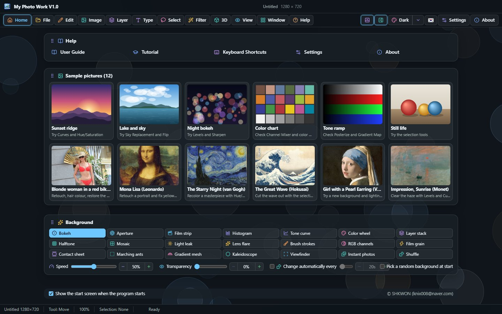

1. The **Home** button at the far left of the menu bar opens the start screen.
2. In the **Sample pictures** card, click **Blonde woman in a red bikini**.
3. The photo opens as a new document and the start screen closes.

> On the first run a **model setup** window may appear. Choose **Later**; everything in this tutorial works without it.

## Step 2 — The editing screen and document tabs

- A **document tab** appears above the canvas. Every file you open adds a tab; click a tab to switch. With many tabs, use **<** and **>** at the right end.
- Where there is no picture you see a white and grey **checkerboard**: that means transparent.
- On the left is the **tool strip**, on the right the **Work Panels**, and at the bottom the **Output** panel.

## Step 3 — Zoom and scroll

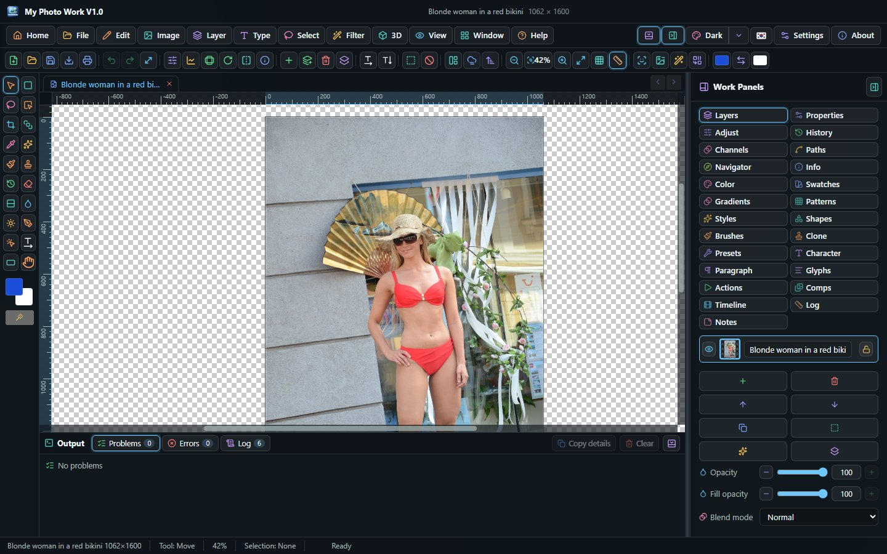

1. Choose **View → Zoom in** (**Ctrl++**) twice. The number in the toolbar is the zoom level.
2. Drag the **scrollbars** below and to the right of the canvas to move around the photo. Dragging with the space bar held down works too.
3. **View → Fit on screen** (**Ctrl+0**) shows the whole photo again.

## Step 4 — Tools and the options row

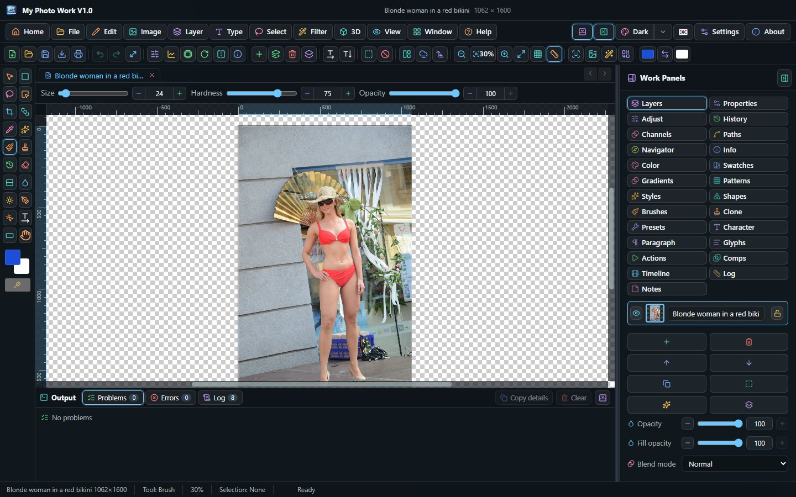

1. Pick the **Brush** (**B**) in the tool strip.
2. The **options row** appears under the document tabs with size, hardness and opacity. The **−** and **+** beside each slider move one step.
3. Pick **Move** (**V**) again: it has nothing to set, so the options row disappears. The chosen tool's description goes to **Output → Log**.

## Step 5 — The Work Panels and layers

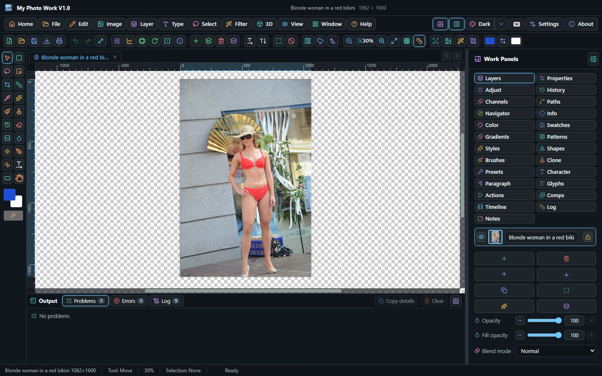

- In the **Work Panels** on the right, pick the **Layers** tab. For now there is one layer, the photo.
- The eye button hides and shows a layer, and **Opacity** below changes how see-through it is.
- The button at the right of the title bar folds the panel away; folded, its title still shows, written down the strip.

## Step 6 — The Output panel: Problems, Errors and Log

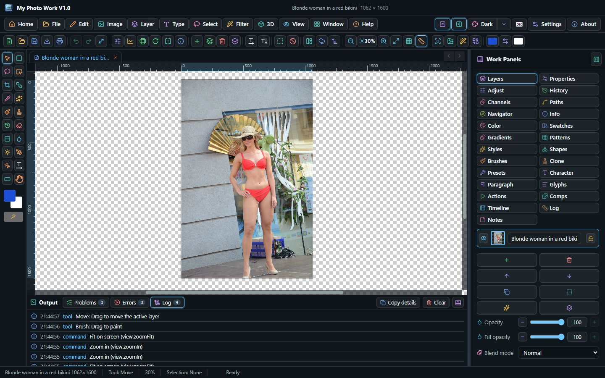

- The **Log** tab of the **Output** panel under the canvas lists the commands you ran, the files you opened and the tools you chose, in time order.
- **Problems** shows what is worth knowing now, such as unsaved changes or hidden layers; **Errors** shows what failed.
- Every tab has **Copy details** and **Clear**. The button at the far right folds the panel.

## Step 7 — Undo and History

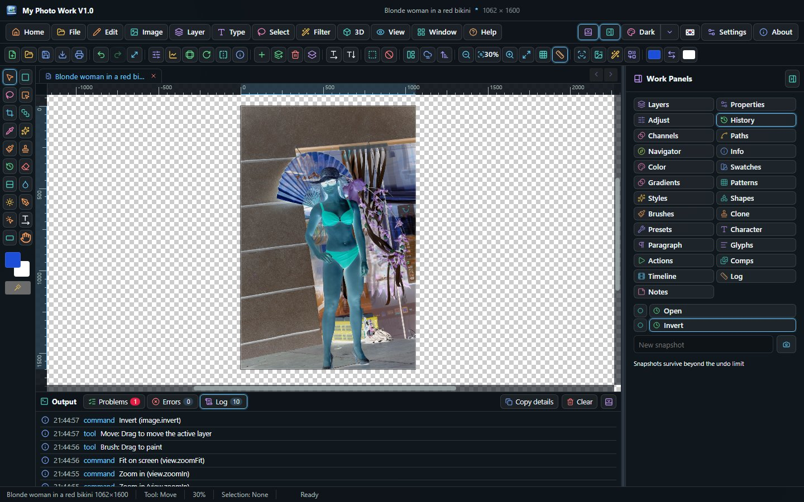

1. As a test, choose **Image → Invert**: the colours flip.
2. The **History** tab of the Work Panels gains an **Invert** row. Clicking an earlier row goes back to that moment.
3. **Edit → Undo** (**Ctrl+Z**) puts it back. Part 2 now edits this photo for real.

## Step 8 — Duplicate the original layer

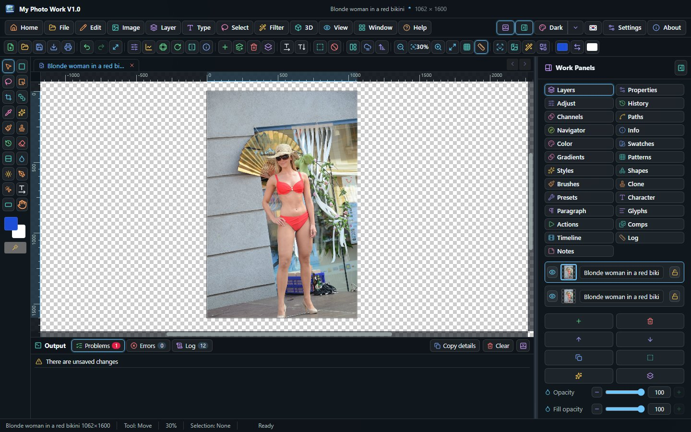

1. Choose **Layer → Duplicate layer**. A second copy of the photo appears in the Layers panel, and the copy on top is selected.
2. All the following edits go on this copy. The original stays untouched underneath for the before-and-after in step 16.

## Step 9 — Crop to a portrait

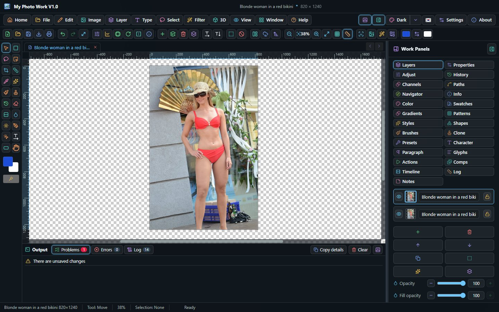

1. Pick the **Rectangular marquee** (**M**) and drag a tall rectangle around the model, trimming a little of the wall at the top and the floor at the bottom.
2. Choose **Image → Crop to Selection**. The canvas shrinks to the selection.
3. **View → Fit on screen** shows the whole picture again.

## Step 10 — Fix brightness and contrast

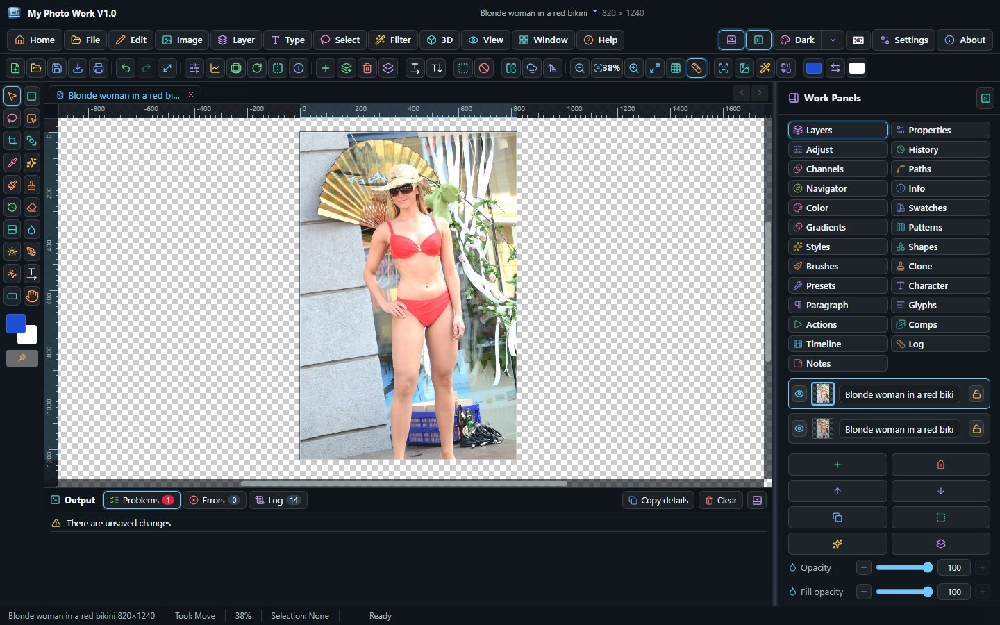

1. Open **Image → Brightness/Contrast**.
2. Raise **Brightness** to about 12 and **Contrast** to about 18. The preview shows the result at once.
3. Click **Apply**. The photo looks a little crisper.

## Step 11 — Turn the bikini blue

1. With the **Eyedropper** (**I**), click the red of the bikini. That colour becomes the **Foreground** colour.
2. Open **Select → Colour range**, keep **Tolerance** around 40 and apply. Only the red of the bikini is selected. Too high a tolerance also picks up the reddish shadows of the skin, so raise it a little at a time.
3. In **Image → Hue/Saturation**, move **Hue** to about −135 and click **Apply**. The colour turns blue while the folds and shading stay.
4. If some red is left in the folds, pick the remaining red with the eyedropper and repeat 2–3 once.
5. **Select → Deselect** (**Ctrl+D**) clears the selection.

## Step 12 — Blur the background

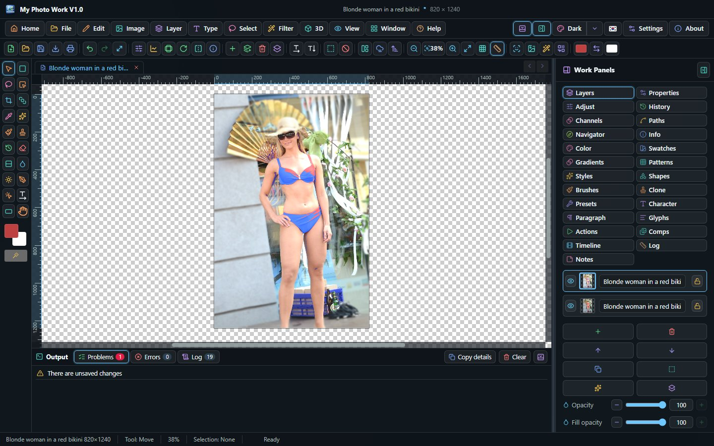

1. Choose **Select → Select subject**. The model is selected automatically.
2. **Select → Inverse** (**Ctrl+Shift+I**) selects only the background.
3. In **Filter → Blur → Gaussian blur**, set **Radius** to about 7 and click **Apply**. The wall and the fan go soft and the model stands out.
4. Finish with **Select → Deselect**.

## Step 13 — Remove the cables on the floor

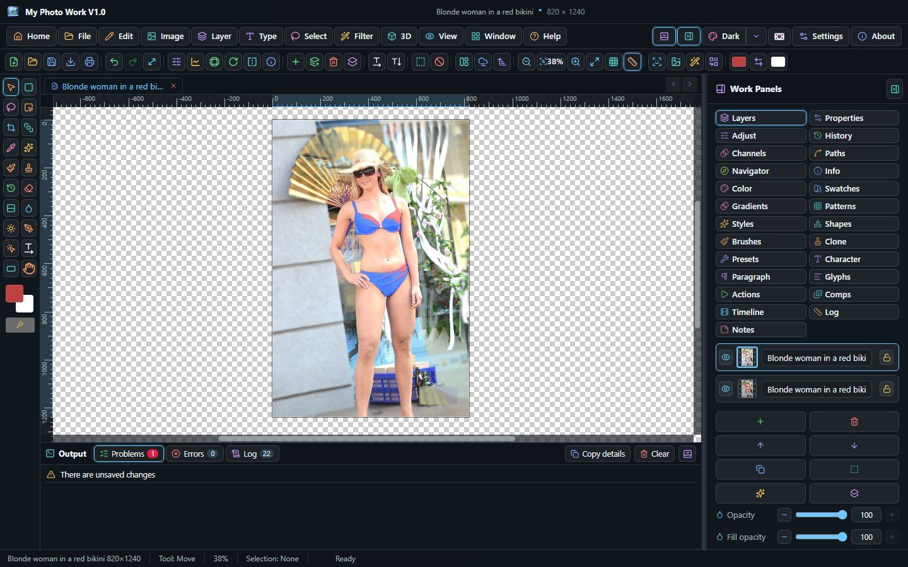

1. Draw a **Rectangular marquee** around the bundle of black cables on the floor at the bottom right.
2. Pick the **Remove** tool from the healing group (**J**) and click once inside the selection. It is filled from the floor around it.
3. Small marks left over can be painted away with the **Spot healing** tool.
4. Deselect and go back to the **Move** tool.

## Step 14 — Darken the edges with a vignette

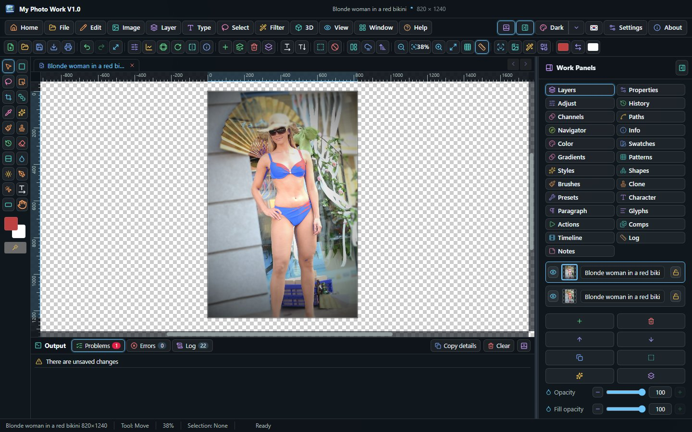

1. Open **Filter → Lens Correction**.
2. Lower **Vignette** to about −70 and click **Apply**. The edges darken and the eye goes to the centre.

## Step 15 — Add a title

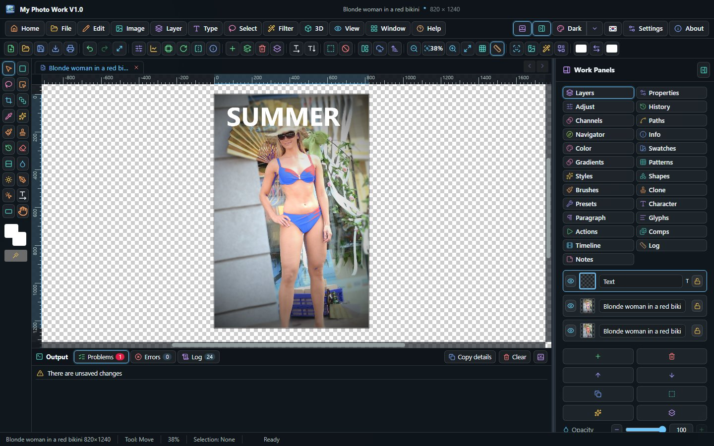

1. Set the foreground colour in the toolbar to white.
2. Pick **Horizontal type** (**T**) and click near the top left of the photo.
3. Type `SUMMER` in the text window, make the size large, turn on bold and click **Apply**. A text layer appears in the Layers panel.
4. Double-click the text layer later to change it again.

## Step 16 — Before and after

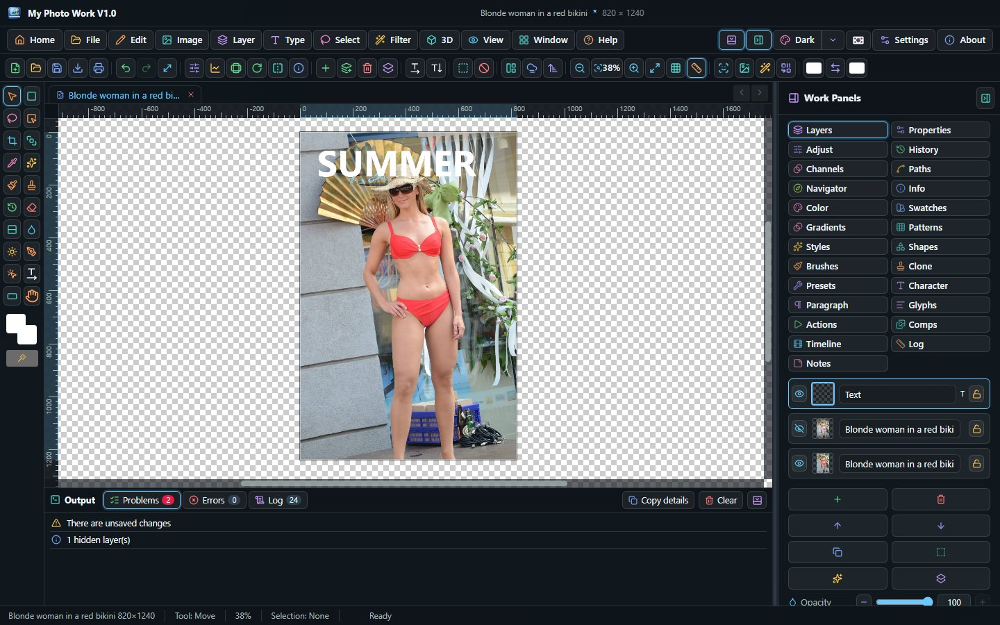

1. In the Layers panel, click the eye button of the edited copy to hide it. The original underneath shows, so you can compare with the starting photo. **Problems** now lists **1 hidden layer(s)**.
2. Click it again to show the edits.

## Step 17 — Export as JPEG or PNG

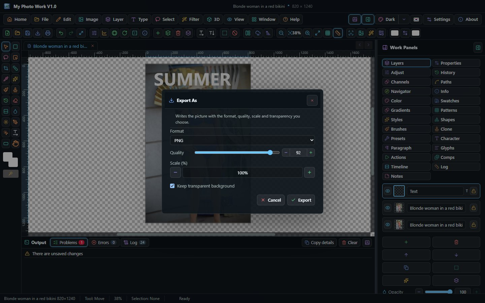

1. Open **File → Export As**.
2. Choose JPEG or PNG under **Format** and set **Quality** and **Scale**. PNG can **keep a transparent background**.
3. Click **Export** and choose where to save it.
4. To keep the layers for later changes, also save the project with **File → Save** (**Ctrl+S**).

## Next steps

- Try the same edits on the other samples: the paintings, the beach and the colour chart.
- Every menu command and shortcut is listed in **Help → User Guide** (**F1**).
