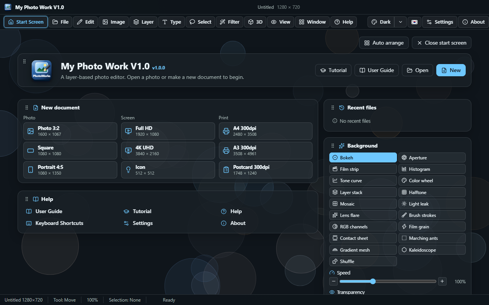
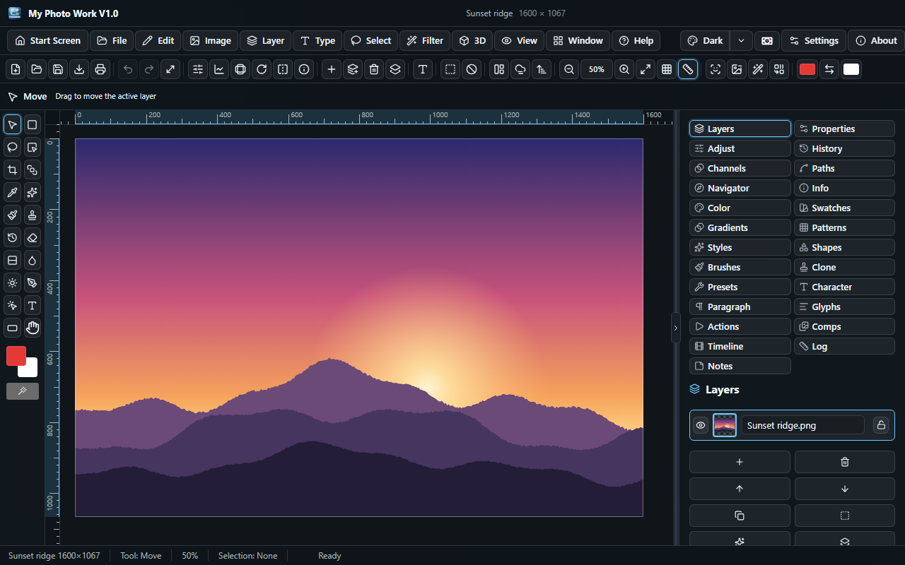
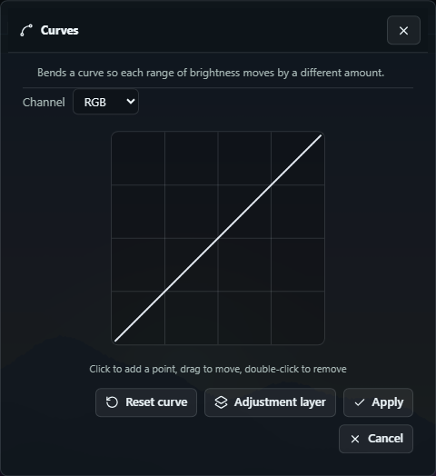
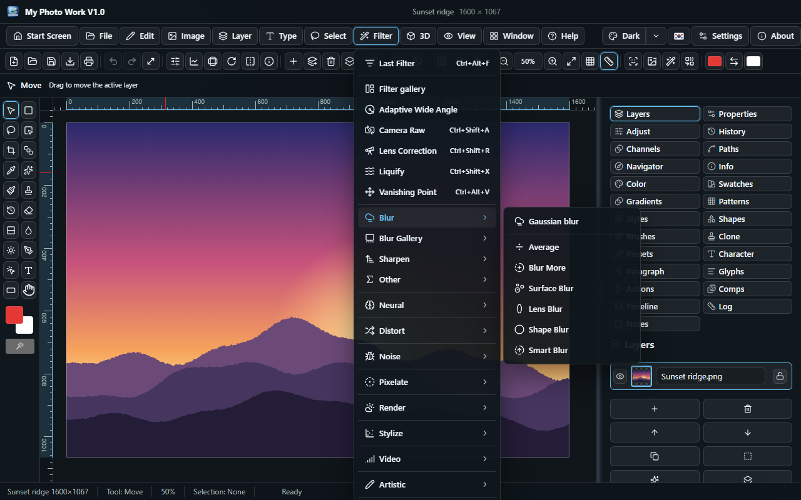
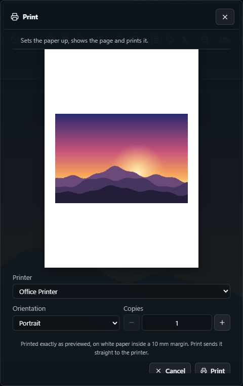
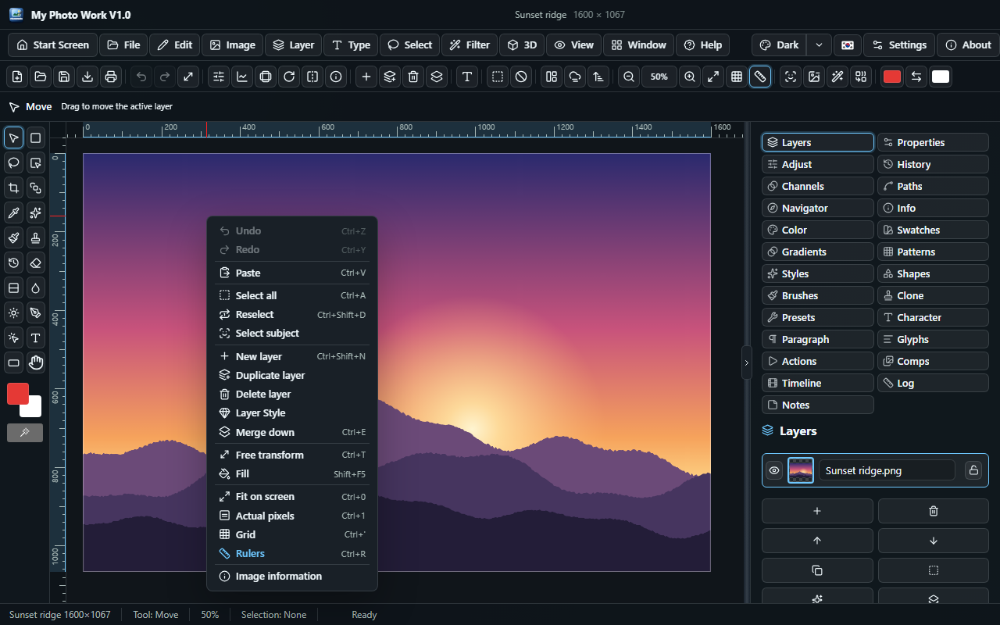

# My Photo Work Tutorial

## Before you start

This document is a hands-on course for people new to My Photo Work: you **follow along in the app** as you read.
Each step takes a few minutes and builds on the result of the one before.
Every feature is described in full in **Help → User Guide**.

- For a tour that points at the screen itself, run **Help → Tutorial**. This document is that tour written down.
- Mistakes are fine: **Ctrl+Z** undoes and **Ctrl+Y** redoes.
- At the top of this window you can change the font, the text size and the language, and **Print** it.

## Step 1 — Open a sample from the start screen

1. Press **Home**, the first button on the menu bar, to show the start screen.
2. In the **Sample pictures** card, click **Lake and sky**. It opens as a new document, with a tab above the canvas.
3. Open **Mona Lisa (Leonardo)** the same way. With two tabs, click them to switch between the pictures.
4. When there are more tabs than fit on the row, use **<** and **>** at its right end.

> Where there is no picture the canvas shows a white and grey checkerboard: that area is transparent.

## Step 2 — Find your way around

- **Menu bar**: File, Edit, Image, Layer, Type, Select, Filter, 3D, View, Window, Help. At its right end: the bottom and right panel buttons, the theme, the language, Settings and About.
- **Toolbar**: the commands used most. The number between zoom out and zoom in is the zoom.
- **Tools** (left): the chosen tool's settings appear in the **options bar** under the tabs. A tool with nothing to set shows no options bar.
- **Work Panels** (right): Layers, Properties, Adjustments and more, chosen by tab. The button at the right of its title bar folds and unfolds it.
- **Bottom panel**: **Problems**, **Errors** and **Log**, each with **Copy** and **Clear**.
- The **scrollbars** along the right and the bottom of the canvas move the picture; so does dragging with the space bar held.

## Step 3 — Make a layer

1. Choose **Layer → New Layer** (**Ctrl+Shift+N**). The new layer appears at the top of the **Layers** tab in the Work Panels.
2. Double-click its name and call it `Practice`.
3. Hide the layer with the eye button and show it again. While a layer is hidden, the bottom panel's **Problems** says so.
4. Use the **−** and **+** buttons of the **Opacity** slider to change it in steps of 5.

## Step 4 — Select

1. Choose the **Rectangular Marquee** (**M**) and drag a rectangle over the sky.
2. Clear it with **Select → Deselect**, then try **Select → Select Subject**: the main subject is picked out for you.
3. **Select → Inverse** turns the selection around, so only the background is selected.

> While there is a selection, the adjustments and filters in the next steps change only what is inside it.

## Step 5 — Adjust the colours

1. Open **Image → Curves** (**Ctrl+M**). Drag the middle of the curve up a little and the picture brightens.
2. In **Image → Hue/Saturation** (**Ctrl+U**) raise **Saturation** to make the sky bluer.
3. To keep the original untouched, add the same adjustment from the **Adjustments** tab as an **adjustment layer**; its values can be changed at any time.

## Step 6 — Try a filter

1. Open the **Filter** menu and choose **Blur ▸ Gaussian Blur**.
2. Change the **Radius** and the preview follows at once. Press **Apply**.
3. **Filter → Filter Gallery** lets you choose among the artistic effects by their pictures.

## Step 7 — Paint and stamp

1. Choose the **Brush** (**B**), set its size and hardness in the options bar, and paint on the `Practice` layer.
2. Choose the **Pattern Stamp** (**S** twice), pick a pattern in the **Patterns** tab of the Work Panels, and paint with it.
3. With the **Clone Stamp** (**S**), **Alt**-click a source, then paint elsewhere to copy it there.

> A locked layer cannot be painted on. You are told so once, and the bottom panel's **Problems** keeps the note.

## Step 8 — Add text

1. Choose **Horizontal Type** (**T**), click the picture and type `Hello`.
2. Change the font, size and colour in the options bar.
3. Go back to the Move tool (**V**) and drag the text layer into place.

## Step 9 — Save and export

1. **File → Save** (**Ctrl+S**) saves a `.mpw` project with all its layers.
2. **File → Export** writes a picture file such as PNG, JPEG or WebP. Choose PNG to keep the transparent areas.
3. **File → Print** (**Ctrl+P**) lets you set the paper and the size and print.

## Step 10 — When something goes wrong

- The bottom panel's **Errors** tab records what went wrong. **Copy** it and paste it into a report.
- The **Log** tab lists the commands you ran, the files you opened and the tools you chose, in order.
- Right-click the picture for a menu of the commands used most.
- Anything else is in **Help → User Guide**.

## Where next

You can now open a photo, split it into layers, change only the part you select, and save the result.
Change the colours of the screen with the **theme** button, and make the start screen and the tool defaults your own in **Settings**.
