# My Photo Work 튜토리얼 문서

## 시작하기 전에

이 문서는 샘플 그림 **빨간 비키니의 금발 여성** 한 장으로 My Photo Work 의 기본 기능을 익히고, 이어서 실제 사진 보정을 처음부터 끝까지 따라 해 보는 연습 과정입니다.

- **1부 (1–7단계)** 는 화면과 기본 조작입니다: 샘플 열기, 문서 탭, 확대와 스크롤, 도구와 옵션 줄, 작업 패널, 출력 패널, 실행 취소.
- **2부 (8–17단계)** 는 같은 사진을 실제로 고칩니다: 레이어 복제, 자르기, 밝기, 비키니 색 바꾸기, 배경 흐림, 물건 지우기, 비네트, 제목 글자, 전후 비교, 내보내기.
- 실수해도 괜찮습니다. **Ctrl+Z** 로 되돌리고 **Ctrl+Y** 로 다시 실행합니다.
- 기능 하나하나의 자세한 설명은 **도움말 → 사용자 설명서** 에, 화면을 짚어 주는 안내는 **도움말 → 튜토리얼** 에 있습니다.
- 이 창의 위쪽에서 글꼴, 글자 크기, 언어를 바꾸고 **인쇄** 로 종이에 뽑을 수 있습니다.

## 1단계 — 시작 화면에서 샘플 열기

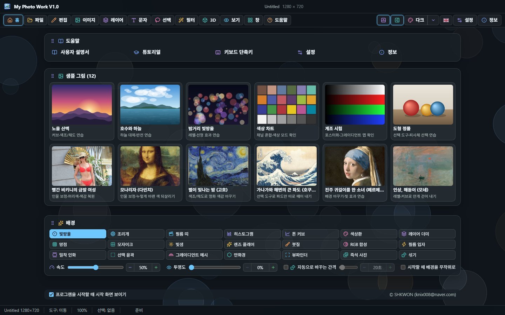

1. 메뉴 막대 맨 왼쪽의 **홈** 단추를 누르면 시작 화면이 나옵니다.
2. **샘플 그림** 카드에서 **빨간 비키니의 금발 여성** 을 누릅니다.
3. 사진이 새 문서로 열리고 시작 화면이 닫힙니다.

> 처음 실행하면 **필요한 모델 준비** 창이 뜰 수 있습니다. **나중에** 를 눌러도 이 튜토리얼은 모두 따라 할 수 있습니다.

## 2단계 — 편집 화면과 문서 탭

- 캔버스 위에 **문서 탭** 이 생겼습니다. 파일을 더 열면 탭이 늘어나고, 탭을 눌러 오갑니다. 탭이 많으면 오른쪽 끝의 **<** **>** 로 넘깁니다.
- 사진이 없는 부분은 흰색과 회색 **체크무늬** 로 보입니다. 투명하다는 뜻입니다.
- 왼쪽은 **도구 막대**, 오른쪽은 **작업 패널**, 아래는 **출력** 패널입니다.

## 3단계 — 확대·축소와 스크롤

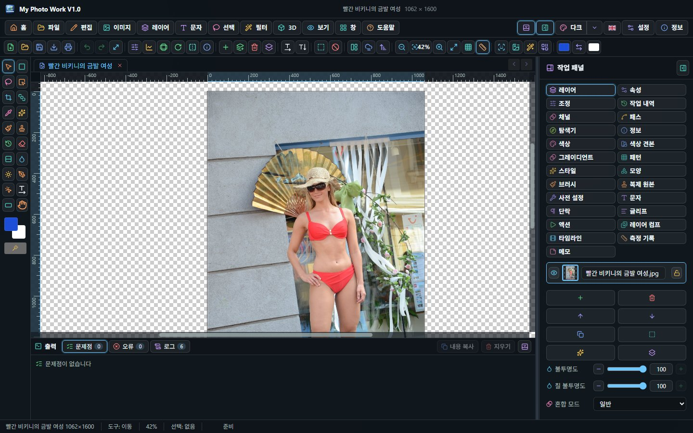

1. **보기 → 확대**(**Ctrl++**)를 두 번 눌러 사진을 크게 봅니다. 툴바의 숫자가 확대 비율입니다.
2. 캔버스 아래와 오른쪽의 **스크롤 막대** 를 끌어 사진의 다른 부분으로 옮깁니다. 스페이스바를 누른 채 끌어도 됩니다.
3. **보기 → 화면에 맞춤**(**Ctrl+0**)으로 사진 전체가 보이게 되돌립니다.

## 4단계 — 도구와 옵션 줄

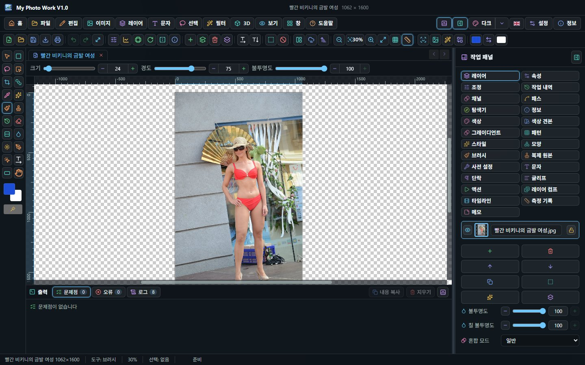

1. 도구 막대에서 **브러시**(**B**)를 고릅니다.
2. 문서 탭 아래에 **옵션 줄** 이 나타나 크기, 경도, 불투명도를 바꿀 수 있습니다. 슬라이더 옆의 **−** **+** 로 한 단계씩 바꿉니다.
3. 다시 **이동**(**V**)을 고르면 설정할 것이 없어 옵션 줄이 사라집니다. 고른 도구의 설명은 **출력 → 로그** 에 남습니다.

## 5단계 — 작업 패널과 레이어

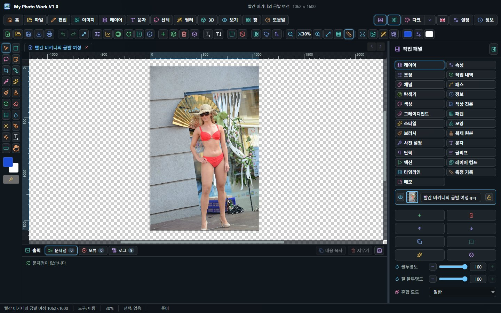

- 오른쪽 **작업 패널** 에서 **레이어** 탭을 고릅니다. 지금은 사진 레이어 하나뿐입니다.
- 레이어의 눈 단추로 숨기고 보이게 하며, 아래의 **불투명도** 로 투명도를 바꿉니다.
- 제목 막대 오른쪽 단추로 패널을 접고 펼 수 있습니다. 접어도 제목은 세로로 보입니다.

## 6단계 — 출력 패널: 문제점·오류·로그

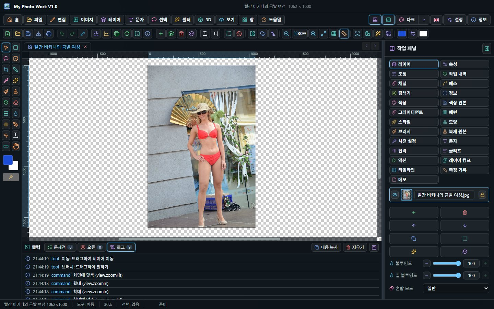

- 캔버스 아래 **출력** 패널의 **로그** 탭에는 실행한 명령, 연 파일, 고른 도구가 시간 순서로 남습니다.
- **문제점** 탭은 저장하지 않은 변경이나 숨겨진 레이어처럼 지금 알아 둘 것을, **오류** 탭은 실패한 작업을 보여 줍니다.
- 각 탭에는 **내용 복사** 와 **지우기** 단추가 있습니다. 오른쪽 끝 단추로 패널을 접습니다.

## 7단계 — 실행 취소와 작업 내역

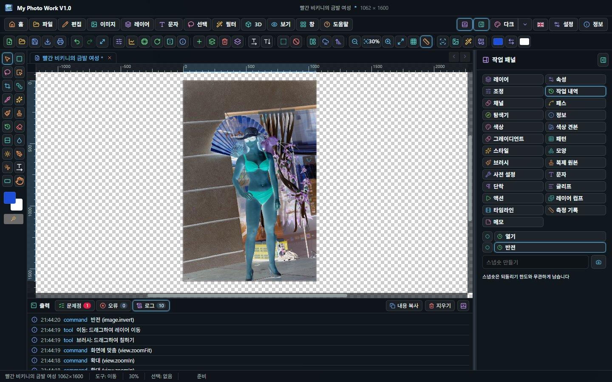

1. 연습 삼아 **이미지 → 반전** 을 누르면 색이 뒤집힙니다.
2. 작업 패널의 **작업 내역** 탭에 **반전** 이 한 줄 생깁니다. 위 줄을 누르면 그 시점으로 돌아갑니다.
3. **편집 → 실행 취소**(**Ctrl+Z**)로 원래대로 돌립니다. 이제 2부에서 이 사진을 실제로 고칩니다.

## 8단계 — 원본 레이어 복제

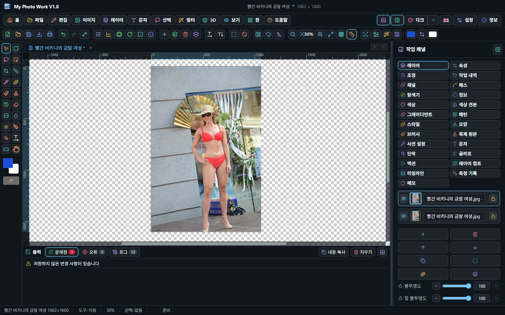

1. **레이어 → 레이어 복제** 를 누릅니다. 레이어 패널에 같은 사진이 하나 더 생기고 위쪽 복사본이 선택됩니다.
2. 앞으로의 보정은 이 복사본에 합니다. 아래의 원본은 그대로 남아 16단계에서 전후 비교에 씁니다.

## 9단계 — 세로 구도로 자르기

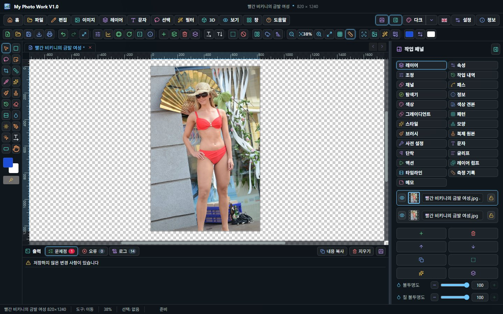

1. 도구 막대에서 **사각형 선택**(**M**)을 고르고, 위쪽 벽과 아래쪽 바닥을 조금 덜어 내도록 모델을 중심으로 세로로 긴 사각형을 끕니다.
2. **이미지 → 선택 영역으로 자르기** 를 누릅니다. 캔버스가 선택한 크기로 줄어듭니다.
3. **보기 → 화면에 맞춤** 으로 다시 전체를 봅니다.

## 10단계 — 밝기와 대비 맞추기

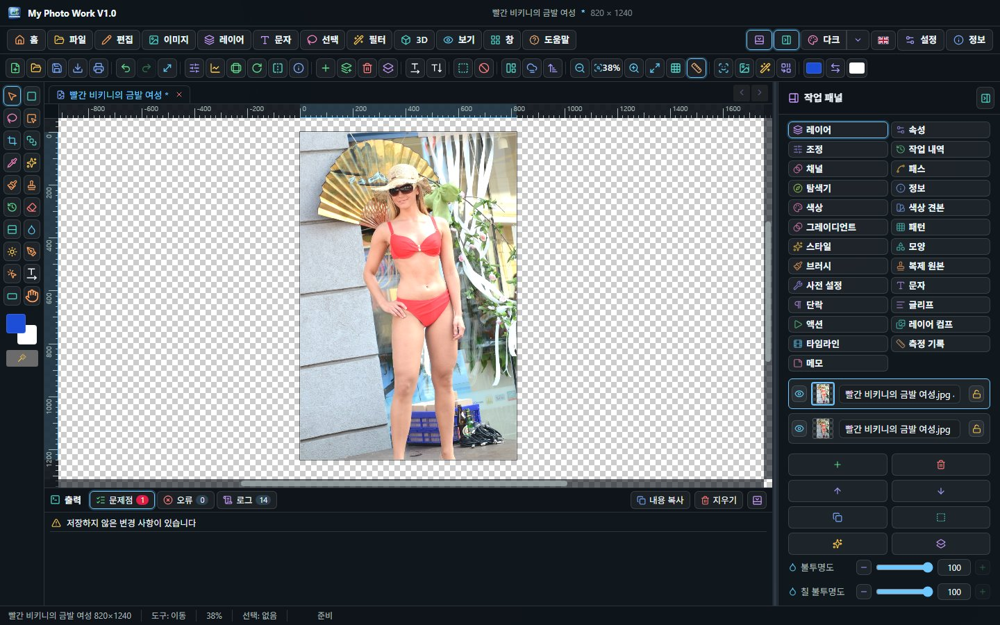

1. **이미지 → 밝기/대비** 를 엽니다.
2. **밝기** 를 12 정도, **대비** 를 18 정도로 올립니다. 미리 보기로 바로 확인됩니다.
3. **적용** 을 누릅니다. 사진이 조금 더 또렷해집니다.

## 11단계 — 비키니 색을 파랑으로 바꾸기

1. 도구 막대의 **스포이드**(**I**)로 비키니의 빨간 부분을 누릅니다. 그 색이 **전경색** 이 됩니다.
2. **선택 → 색상 범위** 를 열고 **허용치** 를 40 정도로 둔 채 적용합니다. 비키니의 빨간 부분만 선택됩니다. 허용치가 너무 크면 피부의 붉은 그늘까지 선택되니 조금씩 올리세요.
3. **이미지 → 색조/채도** 에서 **색조** 를 −135 정도로 옮기고 **적용** 합니다. 주름과 그늘은 그대로 둔 채 색만 파랗게 바뀝니다.
4. 접힌 곳에 빨간색이 남았으면 스포이드로 남은 빨강을 다시 찍고 2–3을 한 번 더 합니다.
5. **선택 → 선택 해제**(**Ctrl+D**)로 선택을 지웁니다.

## 12단계 — 배경 흐리게 하기

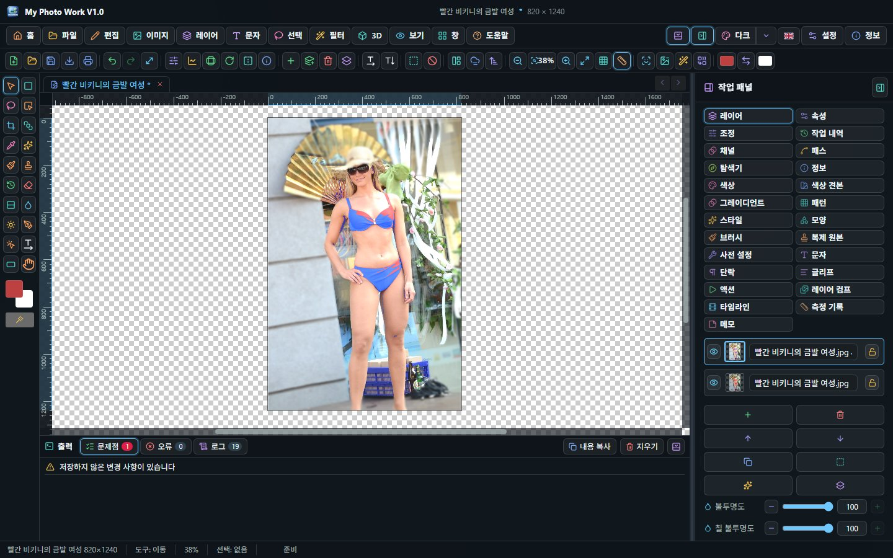

1. **선택 → 피사체 선택** 을 누릅니다. 모델이 자동으로 선택됩니다.
2. **선택 → 선택 반전**(**Ctrl+Shift+I**)으로 배경만 선택합니다.
3. **필터 → 흐림 효과 → 가우시안 흐림** 에서 **반경** 을 7 정도로 두고 **적용** 합니다. 벽과 부채가 흐려져 모델이 앞으로 나와 보입니다.
4. **선택 → 선택 해제** 로 마칩니다.

## 13단계 — 바닥의 전선 지우기

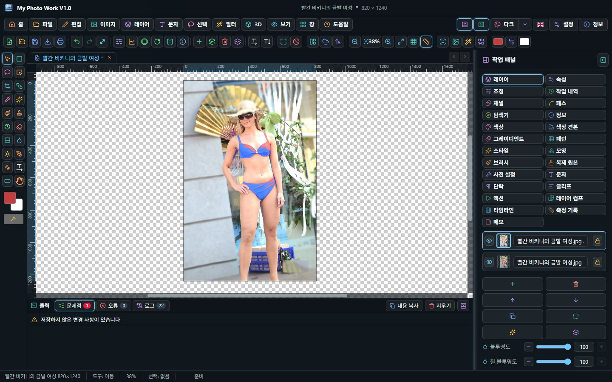

1. 오른쪽 아래 바닥의 검은 전선 뭉치를 **사각형 선택** 으로 감쌉니다.
2. 도구 막대의 복구 그룹(**J**)에서 **제거** 도구를 고르고 선택 영역 안을 한 번 누릅니다. 주변 바닥으로 채워집니다.
3. 작은 티는 **스팟 복원** 도구로 그 위를 칠해 지웁니다.
4. **선택 해제** 후 **이동** 도구로 돌아갑니다.

## 14단계 — 비네트로 가장자리 어둡게

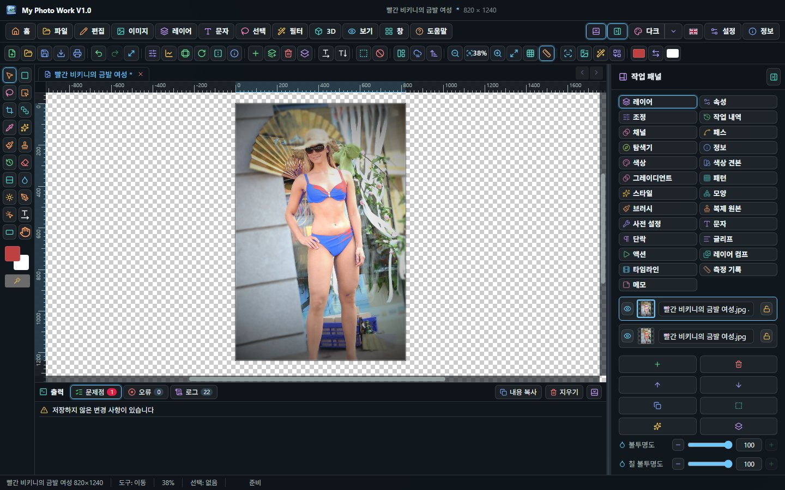

1. **필터 → 렌즈 교정** 을 엽니다.
2. **비네트** 를 −70 정도로 내리고 **적용** 합니다. 가장자리가 어두워져 시선이 가운데로 모입니다.

## 15단계 — 제목 글자 넣기

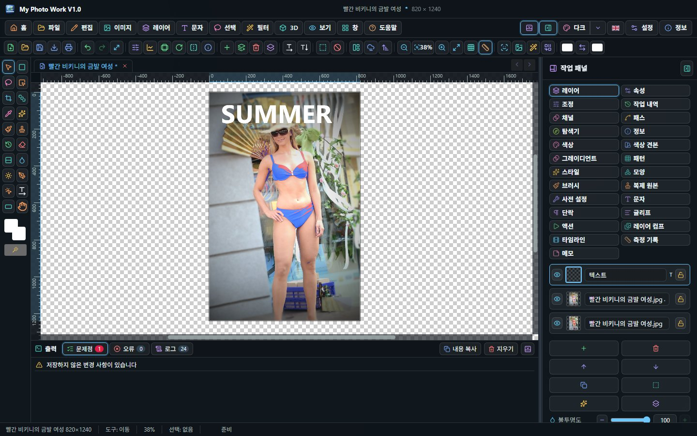

1. 툴바의 전경색을 흰색으로 바꿉니다.
2. 도구 막대에서 **가로 문자**(**T**)를 고르고 사진 왼쪽 위를 누릅니다.
3. 글자 창에 `SUMMER` 를 쓰고 크기를 크게, 굵게를 켠 뒤 **적용** 합니다. 레이어 패널에 문자 레이어가 생깁니다.
4. 문자 레이어는 나중에 두 번 눌러 다시 고칠 수 있습니다.

## 16단계 — 전후 비교

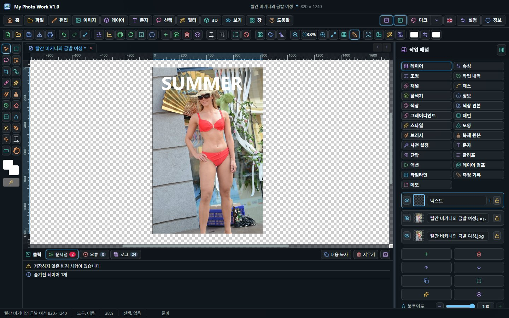

1. 레이어 패널에서 보정한 복사본의 눈 단추를 눌러 숨깁니다. 아래의 원본이 보여 처음 사진과 비교할 수 있습니다. **문제점** 탭에 **숨겨진 레이어 1개** 가 나타납니다.
2. 다시 눌러 보이게 합니다.

## 17단계 — JPEG·PNG로 내보내기

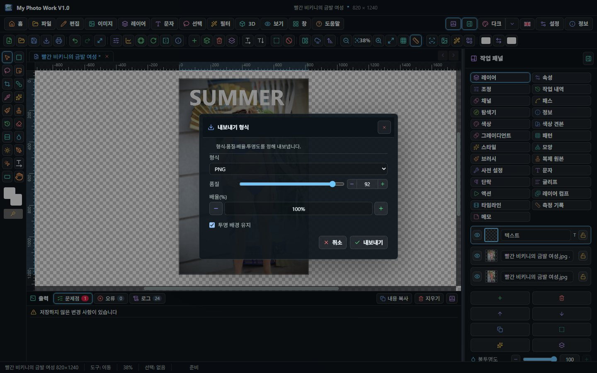

1. **파일 → 내보내기 형식** 을 엽니다.
2. **형식** 에서 JPEG 나 PNG 를 고르고, **품질** 과 **배율** 을 정합니다. PNG 는 **투명 배경 유지** 를 쓸 수 있습니다.
3. **내보내기** 를 누르고 저장할 곳을 고릅니다.
4. 레이어를 그대로 두고 나중에 다시 고치려면 **파일 → 저장**(**Ctrl+S**)으로 프로젝트 파일도 저장해 두세요.

## 다음 단계

- 같은 방법으로 다른 샘플(명화, 해변, 색상 차트)도 고쳐 보세요.
- 메뉴의 모든 명령과 단축키는 **도움말 → 사용자 설명서**(**F1**)에 정리되어 있습니다.
