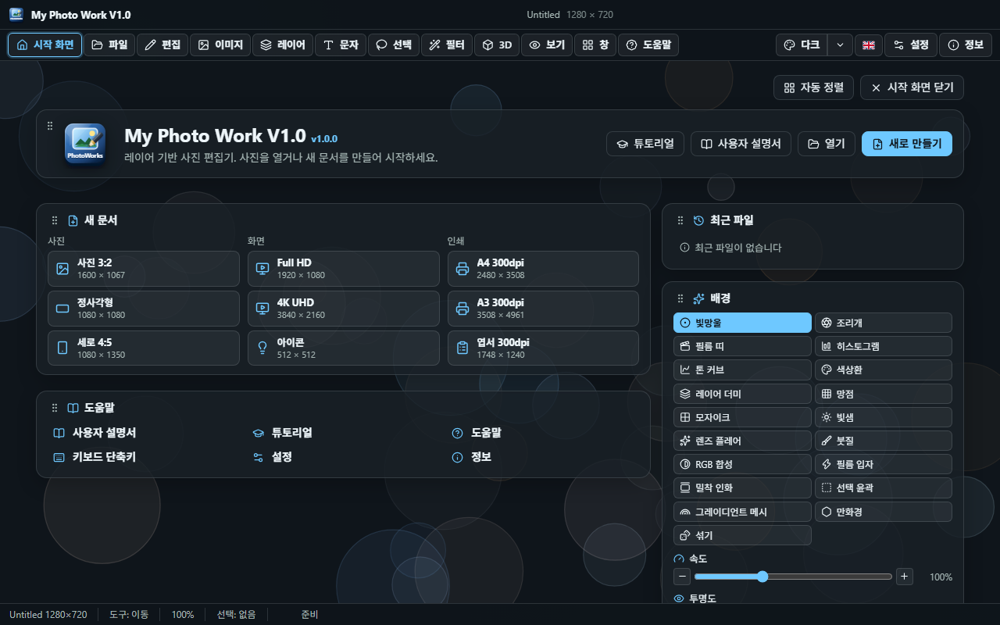
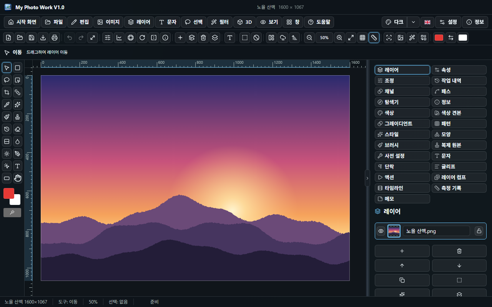
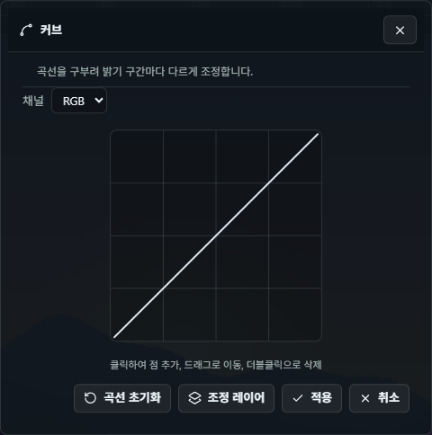
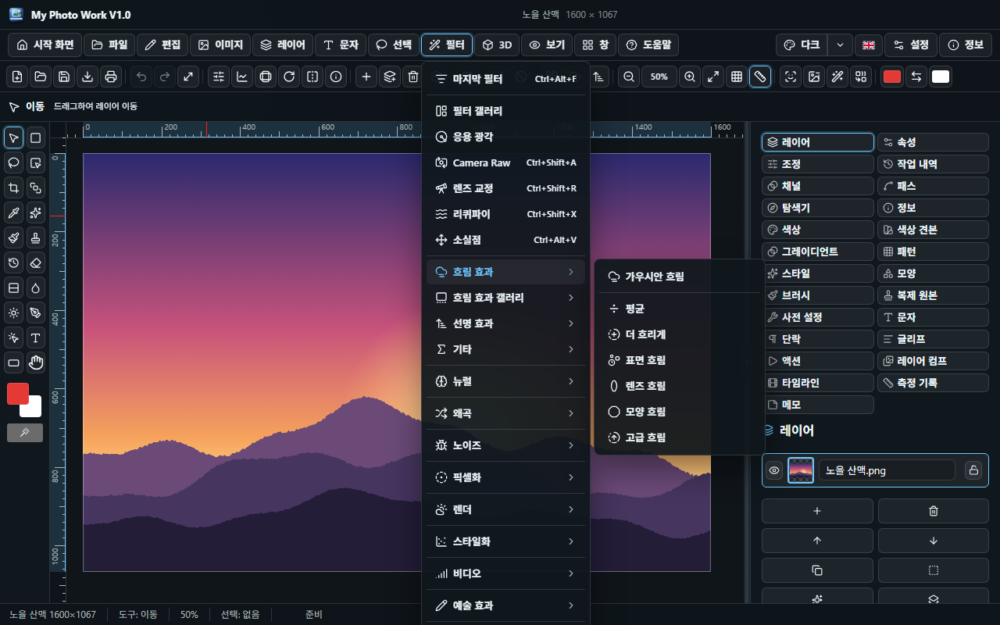
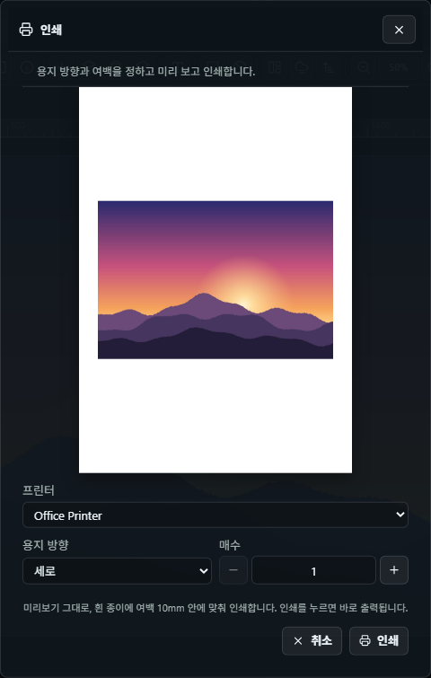
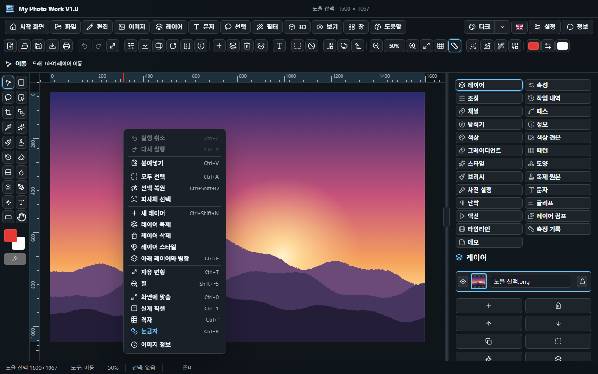

# My Photo Work 튜토리얼 문서

## 시작하기 전에

이 문서는 My Photo Work 를 처음 쓰는 분이 **직접 따라 하면서** 익히도록 만든 연습 과정입니다.
각 단계는 몇 분이면 끝나고, 앞 단계에서 만든 결과를 다음 단계에서 이어서 씁니다.
기능 하나하나의 자세한 설명은 **도움말 → 사용자 설명서** 에 있습니다.

- 화면 안에서 짚어 주는 안내를 원하면 **도움말 → 튜토리얼** 을 실행하세요. 이 문서는 그 안내를 글로 옮긴 것입니다.
- 실수해도 괜찮습니다. **Ctrl+Z** 로 되돌리고 **Ctrl+Y** 로 다시 실행합니다.
- 이 창의 위쪽에서 글꼴, 글자 크기, 언어를 바꾸고 **인쇄** 로 종이에 뽑을 수 있습니다.

## 1단계 — 시작 화면에서 샘플 열기

1. 메뉴 막대 맨 왼쪽의 **홈** 단추를 누르면 시작 화면이 나옵니다.
2. **샘플 그림** 카드에서 **호수와 하늘** 을 누릅니다. 새 문서로 열리고 캔버스 위에 탭이 하나 생깁니다.
3. 같은 방법으로 **모나리자 (다빈치)** 도 엽니다. 탭이 두 개가 되면 탭을 눌러 두 그림을 오가 보세요.
4. 탭이 많아져 한 줄에 다 보이지 않으면 탭 줄 오른쪽 끝의 **<** **>** 로 넘깁니다.

> 그림이 없는 부분은 흰색과 회색 체크무늬로 보입니다. 투명하다는 뜻입니다.

## 2단계 — 화면 둘러보기

- **메뉴 막대**: 파일, 편집, 이미지, 레이어, 문자, 선택, 필터, 3D, 보기, 창, 도움말. 오른쪽 끝에 하단 패널·우측 패널 접기 단추, 테마, 언어, 설정, 정보가 있습니다.
- **툴바**: 자주 쓰는 명령. 축소와 확대 단추 사이의 숫자가 확대 비율입니다.
- **도구 막대**(왼쪽): 도구를 고르면 그 도구의 설정이 탭 아래 **옵션 막대** 에 나옵니다. 설정할 것이 없는 도구는 옵션 막대가 나오지 않습니다.
- **작업 패널**(오른쪽): 레이어, 속성, 조정 같은 패널을 탭으로 고릅니다. 제목 표시줄 오른쪽 단추로 접고 펼 수 있습니다.
- **하단 패널**: **문제점**, **오류**, **로그**. 각 탭에서 **내용 복사** 와 **지우기** 를 쓸 수 있습니다.
- 캔버스 오른쪽과 아래의 **스크롤 막대** 로 그림을 움직이거나, 스페이스바를 누른 채 끌어도 됩니다.

## 3단계 — 레이어 만들기

1. **레이어 → 새 레이어**(**Ctrl+Shift+N**)를 누릅니다. 작업 패널의 **레이어** 탭에 새 레이어가 맨 위에 생깁니다.
2. 레이어 이름을 두 번 눌러 `연습` 으로 바꿉니다.
3. 눈 모양 단추로 레이어를 숨겼다가 다시 보이게 해 봅니다. 숨긴 레이어가 있으면 하단 패널 **문제점** 에 표시됩니다.
4. **불투명도** 슬라이더의 **−** 와 **+** 단추로 값을 5씩 바꿔 봅니다.

## 4단계 — 선택하기

1. 도구 막대에서 **사각형 선택**(**M**)을 고르고 하늘 부분을 끌어 사각형으로 선택합니다.
2. **선택 → 선택 해제** 로 지운 뒤, 이번에는 **선택 → 피사체 선택** 을 눌러 봅니다. 그림에서 주된 대상을 자동으로 고릅니다.
3. **선택 → 반전** 으로 선택을 뒤집으면 배경만 선택됩니다.

> 선택 영역이 있으면 다음 단계의 조정과 필터는 그 안에서만 적용됩니다.

## 5단계 — 색 조정하기

1. **이미지 → 커브**(**Ctrl+M**)를 엽니다. 곡선 가운데를 조금 위로 끌면 그림이 밝아집니다.
2. **이미지 → 색조/채도**(**Ctrl+U**)에서 **채도** 를 올려 하늘을 더 파랗게 만들어 봅니다.
3. 원래대로 두고 싶으면 작업 패널의 **조정** 탭에서 같은 조정을 **조정 레이어** 로 추가하세요. 나중에 언제든 값을 바꿀 수 있습니다.

## 6단계 — 필터 써 보기

1. **필터** 메뉴를 열고 **흐림 ▸ 가우시안 흐림** 을 고릅니다.
2. **반경** 을 바꾸면 미리 보기가 바로 바뀝니다. **적용** 을 누릅니다.
3. **필터 → 필터 갤러리** 에서는 여러 예술 효과를 그림으로 보면서 고를 수 있습니다.

## 7단계 — 그리기와 도장

1. **브러시**(**B**)를 고르고 옵션 막대에서 크기와 경도를 정한 뒤 `연습` 레이어에 그려 봅니다.
2. **패턴 도장**(**S** 를 두 번)을 고르고 작업 패널 **패턴** 탭에서 무늬를 하나 고른 뒤 칠합니다.
3. **복제 도장**(**S**)은 **Alt** 를 누른 채 원본을 찍고, 다른 곳을 칠하면 그 부분이 복사됩니다.

> 잠긴 레이어에는 그릴 수 없습니다. 그러면 안내 창이 한 번 뜨고, 하단 패널 **문제점** 에도 남습니다.

## 8단계 — 문자 넣기

1. **가로 문자**(**T**)를 고르고 그림 위를 클릭한 뒤 `안녕하세요` 를 입력합니다.
2. 옵션 막대에서 글꼴, 크기, 색을 바꿉니다.
3. 이동 도구(**V**)로 돌아가 문자 레이어를 끌어 자리를 옮깁니다.

## 9단계 — 저장하고 내보내기

1. **파일 → 저장**(**Ctrl+S**)은 레이어를 그대로 담은 `.mpw` 프로젝트로 저장합니다.
2. **파일 → 내보내기** 는 PNG·JPEG·WebP 같은 그림 파일로 저장합니다. 투명한 부분을 지키려면 PNG 를 고르세요.
3. **파일 → 인쇄**(**Ctrl+P**)에서 용지와 크기를 정해 인쇄합니다.

## 10단계 — 문제가 생겼을 때

- 하단 패널의 **오류** 탭에 무엇이 잘못되었는지 남습니다. **내용 복사** 로 복사해 문의할 때 붙여 넣으세요.
- **로그** 탭에는 실행한 명령, 연 파일, 고른 도구가 시간 순서로 남습니다.
- 그림 위에서 마우스 오른쪽 단추를 누르면 자주 쓰는 명령이 메뉴로 나옵니다.
- 더 알고 싶은 기능은 **도움말 → 사용자 설명서** 에서 찾아보세요.

## 마치며

이제 사진을 열고, 레이어를 나누고, 선택한 부분만 고치고, 결과를 저장할 수 있습니다.
**테마** 단추로 화면 색을 바꾸고, **설정** 에서 시작 화면과 도구 기본값을 내 손에 맞게 바꿔 보세요.
