# User Guide — My Photo Work V1.0

## Getting started

- Installed version: run the installer and a shortcut appears on the desktop and in the Start menu.
- Desktop from source: `npm start`
- Browser: run `npm run dev`, then open the address shown in the terminal.

The first time you run it, a window asks whether you want to run the tutorial, and then the Start Screen appears. Behind it, a 1280×720 transparent canvas is already prepared as your document. Choose **File → New** to pick another size or background.

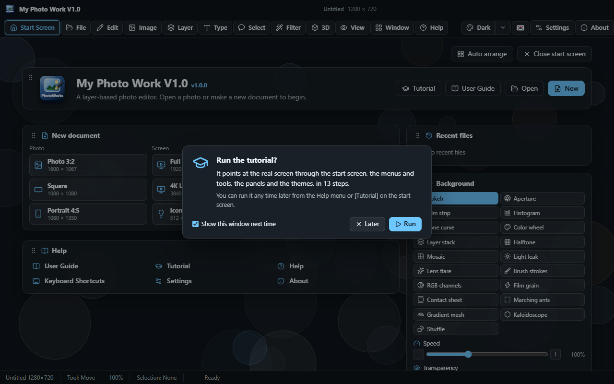

You can also drag an image or an `.mpw` project from the desktop onto the window. Dropped on an untouched document, the file opens in place of it. Dropped on a document you have already edited, it comes in as a new layer.

## Start Screen

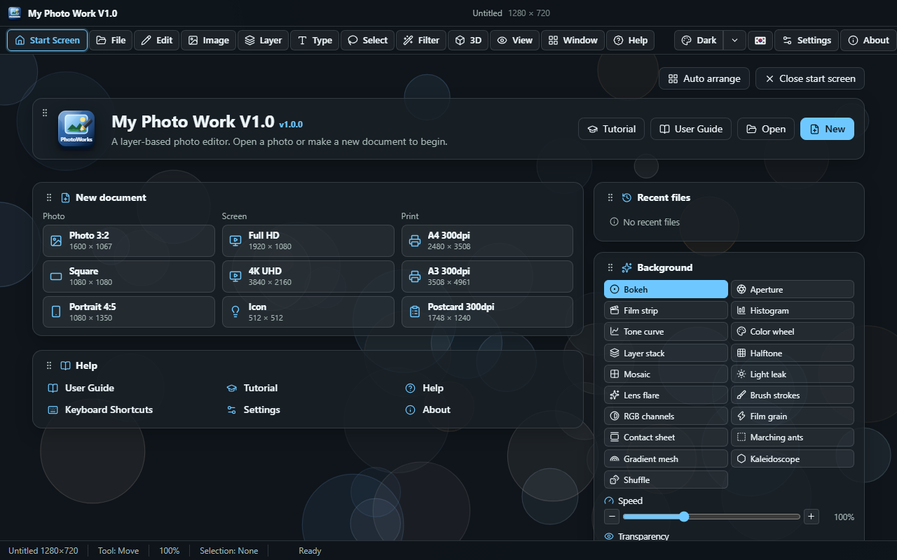

Open and close it at any time with the **Start Screen button at the far left of the menu bar**. The Help menu has the same item. The document you are editing stays behind the Start Screen, and the Start Screen closes by itself when you pick a command that starts work.

The cards are:

| Card | What it does |
| --- | --- |
| Title | The program name and version, plus the Tutorial, User Guide, Open and New buttons |
| New document | Nine photo, screen and print sizes. Click one to make a white document of that size |
| Recent files | Files you opened recently. ✕ removes one at a time; **Clear list** removes them all |
| Background | 18 backgrounds, plus speed, transparency, the auto-change interval and pick-at-random on start |
| Help | User Guide, Tutorial, Help, Keyboard Shortcuts, Settings, About |
| Sample pictures | Six pictures to practise on. Click one to open it as a new document |

Drag a card by its ⠿ handle to move it, and drag its bottom-right corner to resize it. Double-click the corner to return to the height that fits the content. You can also focus a handle and press **Alt+Arrow** to move it or **Alt+Shift+Arrow** to resize it. **Auto arrange** at the top restores the original layout.

The 18 backgrounds are **Bokeh, Aperture, Film strip, Histogram, Tone curve, Color wheel, Layer stack, Halftone, Mosaic, Light leak, Lens flare, Brush strokes, RGB composite, Film grain, Contact sheet, Marching ants, Gradient mesh, Kaleidoscope**, drawn in the colours of the current theme. **Speed** runs from 0–300% (0 stops it). **Transparency** runs from 0–100% (at 100 only the theme's plain background remains). Turn on **Shuffle** or set the **auto-change interval** and the background switches to a different one at that interval.

### Changing it in Settings

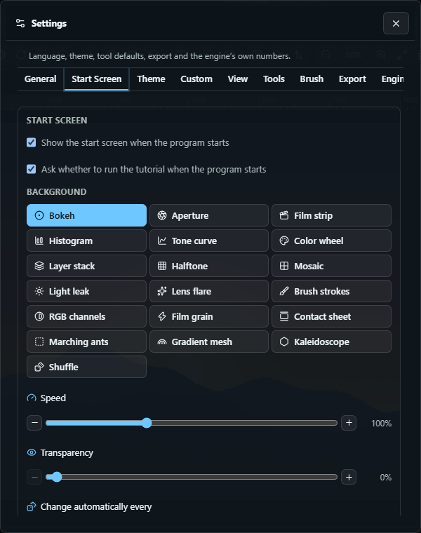

Change the same values on the **Settings → Start Screen** tab. Changes show on the Start Screen immediately. The tab also has boxes for whether to show the Start Screen when the program starts and whether to ask about the tutorial, along with the **Default background**, **Reset card layout** and **Show the Start Screen now** buttons.

## Tutorial

When the program starts, it asks whether to run the tutorial. Click **Run** and it points at the real screen and walks you through the Start Screen, menus, toolbar, tools, options bar, canvas, panels, themes and Help in turn. Click **Later** to close it. Turn off **Show this window next time** and it won't ask again; you can turn it back on under Settings → Start Screen.

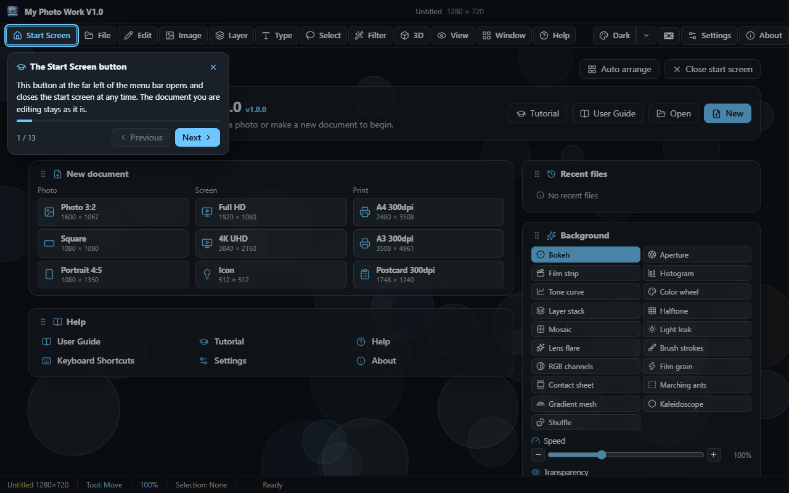

Move with the **Next** and **Previous** buttons on the guide card, or the **→** key (or Space) and **←**, and end it with **Esc**. You can see it again at any time from **Help → Tutorial** or the **Tutorial** button on the Start Screen.

## The window

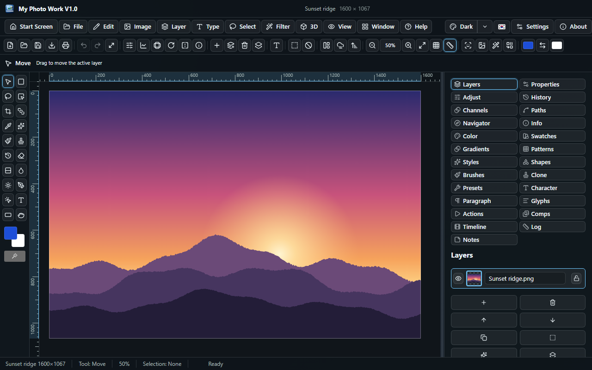

Four rows sit above the canvas.

| Row | What is in it |
| --- | --- |
| Title bar | The app icon, the document name and size, and the window buttons |
| Menu bar | The Start Screen button at the far left, then every command grouped into menus: File, Edit, Image, Layer, Type, Select, Filter, 3D, View, Window, Help — then the theme button (click for the next theme, use the arrow to pick one), the language switch, Settings and About |
| Toolbar | The commands you reach for all the time, as icons — the zoom level sits between the Zoom out and Zoom in buttons — followed by Select subject / Remove background / Generative fill / Harmonize, and the foreground–swap–background colours |
| Options bar | The current tool and its settings, plus a one-line description of what that tool does |

The toolbox runs down the left edge. Click a group that is already active again and it cycles through the tools in that group. Flyout groups work this way.

Menus and every dialog open as **their own separate windows**. You can drag them anywhere, a long menu may extend past the edge of the app, and they all close with the app. Clicking the button that opens a dialog again does not make a new window; it brings the one already open to the front.

A menu shows the main commands in one list, and a row ending in **▸** is a group — Blur, Artistic and Sketch under Filter, Masks under Layer, Adjustments under Image. Hover over or click such a row and the group opens as a small **submenu** beside it. This works like Photoshop's menus, and menus are no longer split into several columns.

The window never gets narrower than **1280px**. That is the width the toolbar needs to show all its buttons on one row. The resize handle is the cluster of dots in a triangle at the bottom-right corner. The window's position and size are remembered the next time you run the program.

When you choose a tool, the **mouse pointer over the picture** changes to match it. The Hand tool shows a hand (a closed one while pressed), Zoom a magnifier (zoom out while Alt is held), the Type tools a text caret and the Move tool a move pointer. Other tools show a crosshair on the exact pixel they act on, with the tool's icon beside it. Tools with a size, such as the Brush, also show a **circle** of the current size at the current zoom. The Clone Stamp shows a plain crosshair while Alt is held, for picking the source. Outside the picture and over the rulers the pointer is the usual arrow.

The rulers show the pointer's position with a **red line**. The grid is **5×5**: a heavy line after every five fine cells. As the zoom changes the cell size changes by a factor of five, so the spacing stays readable.

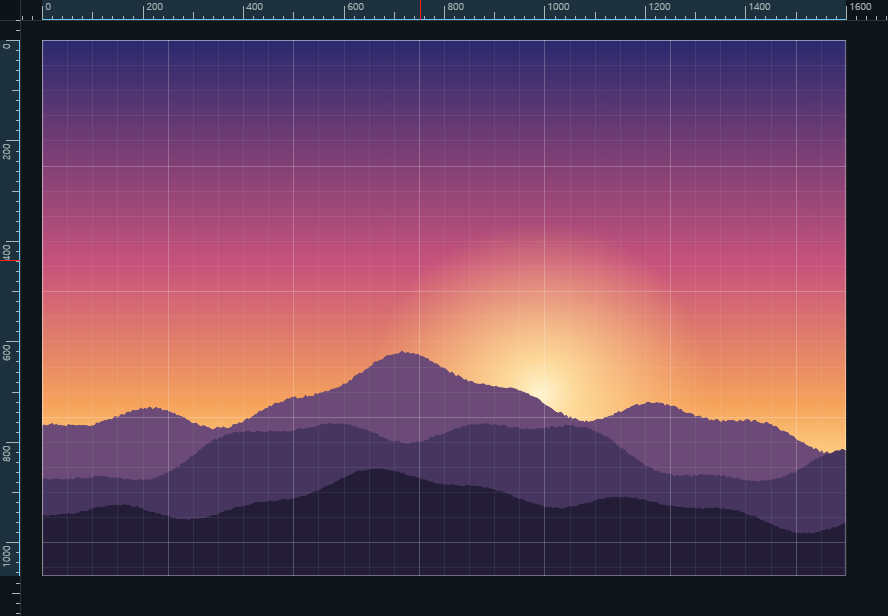

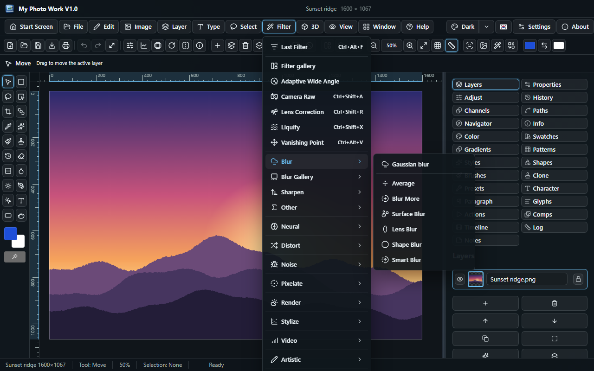

The zoom level sits between the **Zoom out** and **Zoom in** buttons on the toolbar, where it reads as the number those two buttons are changing. Click it to return to 100%.

## Tools

### Selection

| Key | Tool | What it does |
| --- | --- | --- |
| M / Shift+M | Rectangular / Elliptical marquee | Drag to select a rectangle or an ellipse |
| M | Single row / column marquee | Click to select a one-pixel horizontal or vertical line |
| L | Lasso | Draw the outline by hand |
| Shift+L | Polygonal lasso | Click at each corner. Enter or a double-click closes it |
| L | Magnetic lasso | Follow an edge and the outline snaps to it. Edge width sets how far it looks |
| W | Magic wand / Quick selection | Click to take an area of similar colour. Tolerance sets how similar it must be |
| W | Object selection | Click once to take the subject |

Ctrl/Cmd+A selects all and Ctrl/Cmd+D deselects. **Ctrl/Cmd+Shift+D** brings back the last selection. This is what to reach for after deselecting by accident.

#### Refining an existing selection

All of these are in the **Select** menu, and they work on whatever is selected now, whether you drew it with a marquee or a lasso or took it with the magic wand.

| Command | What it does |
| --- | --- |
| **Expand** | Pushes the edge outward by the number of pixels you set |
| **Contract** | Pulls it inward by the same amount, including where it meets the edge of the canvas |
| **Border** | Turns the selection into a band straddling its edge — it selects the outline of the shape, not the shape |
| **Smooth** | Rounds corners, fills pinholes and removes one-pixel bumps. The cure for a ragged magic-wand selection |
| **Feather** | Softens the edge so that whatever you do next fades out rather than stopping abruptly |
| **Grow** | Spreads to adjoining pixels that resemble the ones already selected |
| **Similar** | Takes every pixel of that colour, connected or not |
| **Colour range** | Selects by colour alone: everything close to the current foreground colour |

Grow and Similar use the same **Tolerance** as the magic wand, which you set in Settings. Colour range has its own tolerance slider, so you can widen or narrow it without leaving the window. All of them can be undone with Ctrl/Cmd+Z.

The **Select** menu also holds Inverse, Find distractions and the command that removes a background in one step.

### Copy, paste, fill and stroke

These are in the **Edit** menu.

| Command | Key | What it does |
| --- | --- | --- |
| **Cut** | Ctrl/Cmd+X | Lifts the selected pixels off the active layer |
| **Copy** | Ctrl/Cmd+C | Copies from the active layer |
| **Copy merged** | Ctrl/Cmd+Shift+C | Copies *the whole picture* that the selection shows, with all layers combined |
| **Paste** | Ctrl/Cmd+V | Places what you copied as a new layer |
| **Paste into selection** | — | The same, but masked by the current selection so it shows only inside it |
| **Fill** | — | Fills the selection with the foreground colour, background colour, white or black, at the opacity you choose |
| **Stroke** | — | Draws a line along the edge of the selection, inside, outside or centred |

Where the browser allows it, the copy also goes onto the system clipboard so you can paste it into other programs. With nothing selected, Copy takes the whole layer. Paste places the content at the selection if there is one, and in the middle of the document if not.

### Drawing and retouching

| Key | Tool | What it does |
| --- | --- | --- |
| B | Brush, Pencil | Paint. `[` and `]` change the size, and Hardness sets the edge |
| B | Color replacement | Repaints the colour you click with the foreground colour |
| E | Eraser, Background eraser, Magic eraser | Erase by stroke, by colour, or a whole area with one click |
| S | Clone stamp | **Alt+click to set the source**, then drag to clone from there |
| J | Spot healing, Healing brush, Patch | Blends blemishes away. With the Patch tool you drag the selection over clean pixels |
| J | Content-aware move | Drag the selection somewhere else and the gap it leaves is filled |
| O | Dodge, Burn, Sponge | Lighten, darken or change the saturation under the brush |
| — | Blur, Sharpen, Smudge | Soften, sharpen or smear where you drag |
| G | Paint bucket, Gradient | Flood fill, or drag out one of five gradients |

### Shapes, paths and type

| Key | Tool | What it does |
| --- | --- | --- |
| P | Pen | Click for a corner, drag for a curve. Enter closes it |
| Shift+P | Curvature pen | Just click and the curve is smoothed for you |
| P | Freeform pen | Draw a path by hand |
| A / Shift+A | Path selection, Direct selection | Move a whole path, or drag anchor points and handles |
| U | Rectangle, Rounded rectangle, Ellipse, Polygon, Line, Custom shape | Drag to draw. Shift keeps it regular. Each becomes an editable shape layer |
| T / Shift+T | Horizontal type, Vertical type | Click, type, confirm |

When a path is selected, the options bar lets you stroke it, fill it, turn it into a selection or delete it.

### Crop, measure and view

| Key | Tool | What it does |
| --- | --- | --- |
| C | Crop | Drag a box, Enter to apply, Esc to cancel |
| Shift+C | Perspective crop | Click the four corners and press Enter to straighten |
| C | Slice | Drag out an area to export separately |
| K | Frame | Drag a frame and the layer shows only inside it |
| I | Eyedropper, Color sampler | Pick up a colour or leave a marker |
| I | Ruler | Drag to measure. Distance and angle appear in the Info panel |
| I | Note, Count | Leave a note or a numbered marker |
| H / Space | Hand | Pan the view |
| R | Rotate view | Drag to turn the view. Double-click to straighten it |
| Z | Zoom | Click to zoom in, Alt+click to zoom out |
| X | Swap colours | Swaps the foreground and background colours |

Zoom with Ctrl/Cmd+wheel, and pan with the wheel or Space+drag.

Turn on the grid and rulers in the **View** menu. The rulers read in document pixels. Each number has a full-height line, with a half-height mark between two of them and short marks at every tenth.

## Transform

Ctrl/Cmd+T starts Free transform on the active layer. Drag a corner to resize, drag the handle above the box to rotate, and drag the box itself to move.

- **Shift** on a corner keeps the proportions, and on the rotation handle it snaps to 15° steps
- **Alt** resizes from the centre
- Drag a handle past the opposite edge and the layer flips
- The options bar takes exact width, height and angle, and has its own flip buttons
- **Enter** applies and **Esc** cancels

The **Image** menu rotates or flips the whole document; the **Layer** menu does so for one layer.

## Layers

The panel on the right lists the layers from top to bottom.

- The eye and the padlock control whether a layer is visible and whether it can be edited
- Opacity, fill opacity and blend mode apply when the layers are composited
- The **Layer** menu has New, Duplicate, Delete, Merge, Flatten image, Group and Ungroup
- **Merge visible** combines only the layers that are switched on and leaves hidden ones alone. **Flatten image** takes everything
- **Rasterize layer** bakes type, shape and fill layers into pixels. From then on they are painted on like any other layer
- **Bring to front / Bring forward / Send backward / Send to back** move a layer up and down the stack
- Layer styles: drop shadow, stroke, colour overlay, inner and outer glow, bevel
- A layer mask hides part of a layer without erasing it
- A **clipping mask** makes a layer visible only where the layer directly below has pixels — the way to keep a texture, a colour wash or an adjustment inside the shape beneath

Besides plain raster layers there are **adjustment**, **fill**, **live type**, **shape** and **group** layers. An adjustment layer changes everything painted beneath it and can be switched off at any time.

You can drag a layer off the canvas and back without it being cropped, because a move is always replayed from the layer's untouched pixels.

## Smart objects and smart filters

Choose Layer ▸ Convert to smart object to make a layer a **smart object**. At that moment what the layer was drawing is frozen as an untouched original, and the document draws from that original every time. Shrink it to a thumbnail and enlarge it again and it comes back sharp, because it was never resampled twice.

A filter applied to a smart layer does not touch its pixels. It is added to that layer's **smart filter** stack, and a list appears in the Layers panel. Every entry has a switch, an amount and a bin. Switch one off and the image beneath it is exactly as it was before. When you want to make it permanent, **Rasterize layer** bakes the placement and the whole stack into ordinary pixels.

## Channels

The **Channels** tab in the right panel shows the picture split into red, green and blue, and keeps your saved selections.

- **Select ▸ Save selection** stores the current selection as a named alpha channel.
- **Select ▸ Load selection** brings it back. Load it as it is, or combine it with what is selected now: **Replace / Add / Subtract / Intersect**.
- The panel lists what has been saved. Click a name to load it, and the bin beside it throws it away.

Saved selections travel inside the `.mpw` file, so a mask you worked hard on is still there tomorrow.

## More transforms

Edit ▸ Free transform handles size and rotation. The rest of the Edit menu does what it cannot.

| Command | What it does |
| --- | --- |
| **Skew** | Slides the top and bottom, or the two sides, past each other |
| **Distort** | Moves each of the four corners separately in x and y |
| **Perspective** | Narrows one edge so the image leans away from the viewer |
| **Warp** | Bends it into one of eleven shapes — Arc, Bulge, Flag, Wave, Fish and more. A Bend slider and two Distortion sliders come with it |
| **Puppet warp** | Put pins in the parts that should stay still, then drag a pin to move that part. Enter applies, Esc cancels |
| **Content-aware scale** | Resizes by carving out the least interesting columns first, so the subject keeps its shape. **Protect skin tones** is on by default so that the seams steer clear of faces and arms. Turn it off for photos with no people. All layers are carved along the same seams, so they never drift out of register |

### Content-aware scale, and looking after people

An ordinary resize squashes everything equally. This one looks for the emptiest column of pixels running from top to bottom — a patch of sky, a plain wall, calm water — removes it, and repeats until the picture reaches the width you want. The subject keeps its proportions and the empty parts give way.

Left to itself, it goes wrong on photos of people. It measures how busy each part of the picture is, and skin is smooth. A cheek has less going on than the leaves behind it, so the carving eats the face and leaves the fence alone. **Protect skin tones** is the answer, and it is on by default. It recognises skin by colour rather than texture, covers the outline too, and makes the seams go around.

Turn it off for photos with no people — landscapes, still lifes, diagrams. There is nothing to protect and the protection can only get in the way. On anything in shades of grey, such as a black-and-white scan or a single DICOM slice, it already switches itself off in effect, because there is no colour there to mistake for skin.

The seams are chosen on the flattened picture and every layer is carved along the same seams, so several layers stay side by side without tearing.

## Type

Type ▸ Enter text (or the Type tool) opens one window for the whole type layer.

- The text itself, any number of lines.
- **Font size / Line height / Letter spacing / Indent / Paragraph spacing** — a blank line starts a new paragraph, and the indent applies to the first line of each paragraph.
- **Alignment**, Bold, Italic.
- **Type on a path** — pick a path and the text follows it, each letter turning to face the curve.
- **Shape** and **Bend** warp the finished text into the same eleven shapes as Layer Warp.

If you open the window with a type layer selected, it edits that layer instead of adding a new one.

## Colour modes, bit depth and profiles

Image ▸ Mode switches the document between **RGB**, **Grayscale**, **CMYK** and **Lab**. The layers themselves stay RGBA and the mode is applied when the document is composited, so going back costs nothing and loses nothing.

Image ▸ **8 bits/channel** and **16 bits/channel** set the working depth. At 16 bits, adjustments are calculated at full precision and TIFF is written at 16 bits per channel. Use it when you are retouching a photo heavily or handing it on.

Image ▸ **Colour profile** chooses one of the four working spaces the editor knows, under the names the ICC standard gives them, and does one of two things.

- **Assign profile** leaves the numbers alone and changes how they are read. Use it for a file that arrived untagged and whose space you know.
- **Convert to profile** rewrites the numbers so that the colours look the same in the new space.

A JPEG that carries an ICC profile has it read, and its name is shown here and in the Image information window. A photo that looks flat can be explained rather than guessed at.

## Actions, batch and layer comps

The **Actions** tab records what you do and plays it back.

1. Click **Start recording**, then work as usual. Every menu command and every answer in a window is written down.
2. Give it a name and save it. Actions are stored with your settings, so they are still there next time.
3. **▶** plays it on the open document. No windows open during playback — it reuses the answers you gave the first time.
4. The layers button beside it runs the action over a whole folder and saves each file in the current export format. It needs the desktop app.

**Layer comps**, on the same tab, remember which layers are visible and at which opacity and blend mode. Store as many arrangements as you like and click one to go back to it. It is a way to keep three designs in one document.

## Animation and video

The **Timeline** tab makes frame-by-frame animation.

- Set the layers the way a frame should show them, then **Add frame**.
- Each frame has its own delay in milliseconds.
- **▶** plays inside the document, and the square stops it.
- **Export as GIF** writes an animated GIF. The app encodes it itself and chooses a palette for each frame, so it does not borrow colours from the first frame.
- **Export as video** records the frames as a WebM video.

File ▸ **Import video** takes a video file and splits it into twelve evenly spaced frames. Each becomes a layer and a timeline frame, ready to edit or export again straight away.

## Patterns and brushes

Edit ▸ **Define pattern** keeps the selection — or the whole layer, if nothing is selected — as a tile. Patterns you define appear in the Edit ▸ Fill window, and picking one there tiles it across the selection instead of filling with a colour. A pattern fill layer repeats it too.

The **Brush** section of the Settings window sets the brush shape: the **Spacing** between the marks it stamps, the **Angle**, the **Roundness** (below 100 it flattens), and **Scatter**, which spreads the marks off the line and turns a stroke into a spray. Save the current shape with a name and from then on it takes one click.

## 3D

3D ▸ **Extrude to 3D** turns the active layer into a lit solid. The flat picture becomes the front face and depth is built up behind it.

- **Depth** is how far it goes back.
- **Rotate X / Rotate Y / Rotate Z** turn it in space.
- **Perspective** is how much the far side shrinks. At 0 you get a flat view.
- **Light X / Y** move the light. Faces toward the light brighten and the sides darken.

The layer stays editable — paint on it and the solid is rebuilt with the new picture. 3D ▸ **Remove 3D** flattens it again, and Layer ▸ Rasterize bakes the render into pixels.

## Adjustments and filters

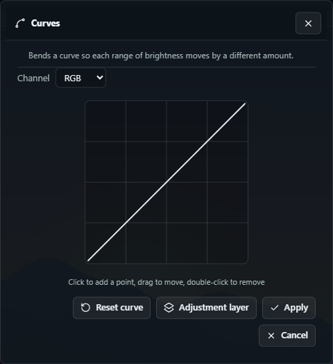

The **Image** menu has Brightness/Contrast, Hue/Saturation, Camera Raw, **Curves**, **Levels**, Auto levels, Invert, Grayscale, and the colour work below.

| Command | What it is for |
| --- | --- |
| **Auto colour** | Stretches red, green and blue separately to remove a photo's colour cast. Auto levels moves all three together, so the cast stays |
| **Equalize** | Spreads the tones so that every brightness is equally common. Opens up flat, hazy images |
| **Channel mixer** | Builds each output channel from the three input channels and a constant. For a proper black-and-white conversion, or for swapping channels outright |
| **Selective colour** | Moves the cyan, magenta, yellow and black inside one colour family — reds, blues, neutrals — and leaves the rest alone |
| **Gradient map** | Reads a two-colour gradient from the image's own brightness and repaints with it. Duotone and split toning come from here |
| **Replace colour** | Changes everything close to the foreground colour into another colour. It fades out at the edge of the tolerance, so no hard border is left |

**Rotate 180 degrees** and **Trim transparent edges** are in the same menu. Trim transparent edges cuts away the fully transparent border around what you can see, so run it after erasing a background.

- **Curves** are edited per channel on a 256×256 grid. Click to add a point, drag to move it, double-click to remove it.
- **Levels** sets the input black point, gamma and white point, and the output range. An Auto button reads the values from the layer.

Both can be applied straight to the layer or added as an adjustment layer.

The **Filter** menu holds the gallery. The **Filter gallery** window has **one tab per group**, with that group's filters laid out as a grid of buttons and two sliders beside them. The window is a fixed size and never scrolls, so Cancel and Apply are always where you left them. The groups the menu lists are:

- **Blur** — Gaussian, Motion, Box, and Radial blur by spin or zoom
- **Sharpen** — Sharpen, **Unsharp mask** (it has a threshold, so only edges sharpen and flat areas stay as they are), High pass
- **Noise** — Add noise, **Median** (removes blotches), **Dust and scratches** (a median that acts only where a pixel is far from its neighbours, so real detail survives)
- **Pixelate** — Mosaic, Crystallize
- **Distort** — Liquify, Twirl, Ripple, Wave, Spherize, Pinch
- **Stylize** — Find edges, Emboss, Solarize
- **Render** — Clouds, Vignette, Lens flare
- **Other** — Offset, Minimum (widens the dark areas), Maximum (widens the light ones)
- **Artistic** — Oil paint. **Neural** — Skin smoothing

The gallery takes the radius and amount from the Blur and Sharpen windows you used last, so if the defaults come out too strong, set those first.

Generative work — Content-aware fill, Generative expand, Generative upscale, Harmonize, Select subject, Remove background, Find distractions — runs on this computer. No cloud model is used.

**If there is a selection, all of this is limited to the selected pixels of the active layer.**

## Files

- **Open** turns the document into an image or an `.mpw` project
- **Place image** adds a file as a new layer
- **Save / Save as** writes an `.mpw` project, in which the layers stay alive
- **Export** flattens to PNG, JPG, WebP, AVIF, GIF or TIFF
- **Print** shows the page in a preview and then sends it to the printer
- **Image information** lists everything known about what is open
- With the Slice select tool you can export just one slice

Unsaved changes are confirmed before New, Open, Close or quitting.

### Opening photos

File ▸ Open (Ctrl/Cmd+O), the folder button on the toolbar, and dragging files onto the window all do the same thing. You can drop several files at once. On an untouched document they open one after another, and on a document you have already edited they come in as new layers.

The editor reads PNG, JPG, GIF, BMP, WebP, AVIF, TIFF, **HEIC / HEIF**, **DICOM** and its own `.mpw` projects.

### HEIC and HEIF photos

Phones and mirrorless cameras save their best-quality photos as HEIF — `.heic` on an iPhone, `.heif` elsewhere, `.hif` on Fujifilm bodies. No browser can show those files, so the editor decodes them itself.

1. Choose a `.heic` file in File ▸ Open, or drag it onto the window.
2. The first HEIC of a session takes a little longer while the decoder loads — about 2 megabytes, and once downloaded it is reused for every later file.
3. The photo opens at its original resolution as an ordinary raster layer. From then on every tool, adjustment and filter behaves just as it does with a JPG.

A HEIC that holds several frames — a burst, or the still from a Live Photo — opens as its **primary** frame, the one the camera shows in its gallery, and the Image information window tells you how many frames the file held.

Saving back to HEIC is not offered. The encoder for this format is tied up in patents and is not in the app. Export as PNG (no loss of quality), TIFF (no loss of quality, larger) or JPG instead.

`images/test04.heic` in the project folder is an example you can try. It comes from Nokia's public HEIF conformance set, and you can replace it with a photo of your own whenever you like.

### Exporting, and transparent backgrounds

File ▸ Export (or the download button on the toolbar) opens a small window with two controls.

- **Format** — PNG, JPG, WebP, AVIF, GIF, TIFF.
- **Keep transparent background** — whether the see-through parts of the picture stay see-through in the file.

When it is on, erased areas, a document made with a transparent background and a faded layer are written with their transparency. When it is off, the same picture is first placed on white paper. That is the one you need for a photo you will print, email or put on a white page.

This option applies only to formats that can actually hold transparency: PNG, WebP, AVIF, GIF, TIFF. If you choose **JPG**, the option is greyed out with a one-line explanation — JPEG has no alpha channel at all, so JPG is always written on white however the option is set. Either way, the document itself does not change; only the exported file does.

Both choices are remembered and also appear in the Settings window, where you also choose the format used to export a single slice.

### Printing

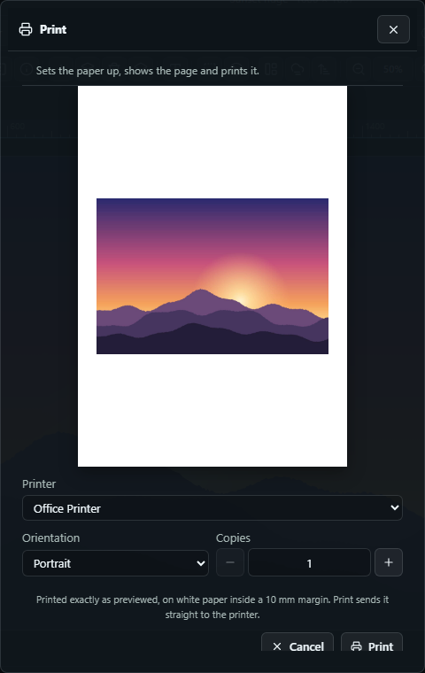

File ▸ Print, the printer button on the toolbar, or **Ctrl/Cmd+P**.

One window opens, and it is both the preview and the print dialog — the page as it will come out, with the settings beside it.

- **Paper** is drawn at the proportions of the sheet, with the same 10 mm margin as the printed page, and the picture sits on a white background inside it, flattened — transparency means nothing on paper.
- **Printer** lists this computer's printers, with the one the system calls the default already chosen.
- **Orientation** starts on whichever suits the picture: landscape for a wide photo, portrait for a tall one. Change it and the paper in the preview turns with it, just as a sheet of paper would.
- **Copies** is how many to print.
- **Print** sends the job straight to that printer. **Cancel** closes the window and prints nothing.

This window is a fixed size and never scrolls. The paper, three settings and two buttons are all on one screen, and turning to landscape shortens the paper rather than pushing something out of reach.

The image is scaled to fill the margins while keeping its proportions, so it is neither cropped nor stretched. Only the picture is printed — no toolbar, panels or background.

In a browser the only way to print is the browser's own print dialog, so that opens instead. It has its own preview, and you choose the printer and paper there. Choosing **Save as PDF** (or **Microsoft Print to PDF**) in it is the quickest way to get the document as a PDF.

### DICOM (.dcm) medical images

CT, MR, ultrasound and X-ray studies are stored as DICOM, one file per image. Open a `.dcm` (or `.dicom`) like any other image; a file with no extension at all is recognised by its contents.

A DICOM file holds measurements, not screen colours, so before showing anything the editor does what a viewer does.

- **Rescale** — the slope and intercept in the file turn stored values into real units. For CT, that means Hounsfield numbers.
- **Window** — the centre and width in the file choose the slice of that range the screen will show. A file that doesn't specify a window is windowed from its own data so the whole range is visible, and from there Image ▸ Brightness/Contrast or Levels adjusts it the way a radiologist's window controls would.
- **MONOCHROME1** files, in which 0 means white, are inverted to match.

It reads uncompressed studies — implicit and explicit VR, little and big endian — and baseline JPEG. Studies compressed with JPEG 2000, JPEG-LS or RLE name the problem in an error rather than opening as a blank image. Colour (RGB) images such as ultrasound captures keep their colour, and a multi-frame file opens as its first frame.

Everything the file says about the patient, study and equipment is in the Image information window described below. `images/test05.dcm` is a sample CT slice you can try. It is one of the DICOM standard's own "CompressedSamples" test files, redistributed for conformance testing.

Saving back to DICOM is not offered. This program is a photo editor, and a slice with paint on it is no longer a record of anything. Export as PNG or TIFF.

### Image information

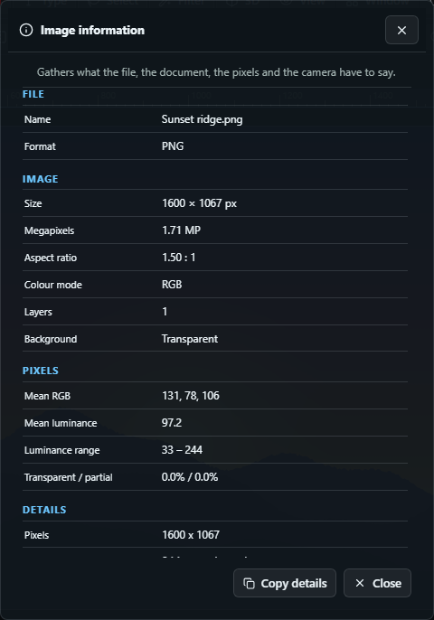

Image ▸ Image information, or the ⓘ button on the toolbar, opens a window that gives the facts about what is open in four blocks.

- **File** — the name it was opened under, where it is on disk, and its format and file size.
- **Image** — pixel size, megapixels, aspect ratio, colour mode, how many layers there are and what the background is.
- **Pixels** — measured not from the file but from the document as flattened at this moment. Mean R, G and B, mean luminance, the range from the darkest pixel to the brightest, and how much of the picture is fully or partly see-through. Watching that range as you work is the quickest way to tell whether an adjustment has crushed the blacks or blown the highlights.
- **Details** — what the file's own header carried. A photo taken with a camera shows its EXIF: camera and lens, the date taken, exposure, aperture, ISO and focal length, metering and white balance. A PNG shows its bit depth and colour type. DICOM shows its tags — modality, study and series, patient, equipment, slice thickness and pixel spacing, transfer syntax and the window applied. A file that carries none of these says so instead of showing invented values.

**Copy details** puts the whole window on the clipboard as plain text. This is what to paste into a note or a bug report.

The window reads the document at the moment it opens, so close it and open it again to see new figures after you edit.

## Settings, guides and About

The right panel has twenty-five tabs — Layers, Properties, Adjustments, History, Channels, Paths, Navigator, Info, Color, Swatches, Gradients, Patterns, Styles, Shapes, Brushes, Clone Source, Tool Presets, Character, Paragraph, Glyphs, Actions, Layer Comps, Timeline, Measurement Log, Notes. They sit three to a row at the top of the panel so all are visible, and the panel scrolls as one. You can move between them with the Window menu or by clicking a tab.

At the right end of the menu bar are the theme controls, the language switch (한국어 / English), and the Settings and About windows.

### Themes

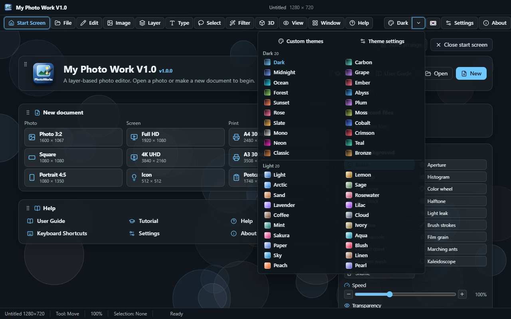

There are **20 Dark and 20 Light themes**. The theme control is two buttons in one. The wide side **moves to the next theme** (the tooltip tells you which one is next), and the arrow beside it opens a drop-down. At the top of the drop-down are the **Custom themes** and **Theme settings** buttons, below them Dark, and below that Light, in two vertical columns. If you have made your own themes, they appear right under the buttons.

You can pick from the same list on the **Settings → Theme** tab.

### Custom themes

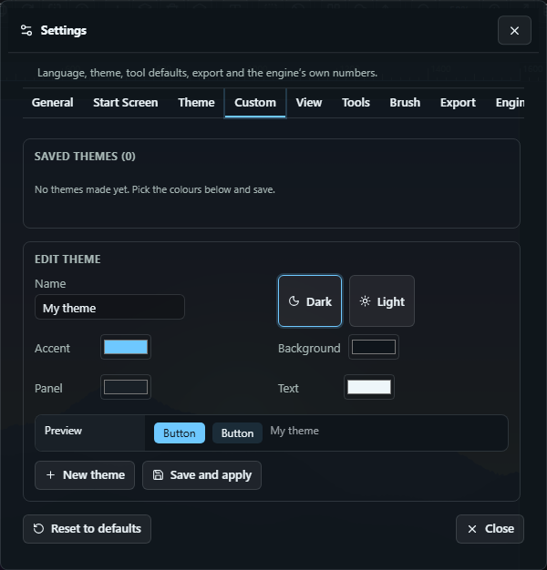

Make one on the **Settings → Custom** tab. Type a name, choose Dark or Light, then set four colours — accent, background, panel and text — and the remaining colours are worked out from them. Check the preview and click **Save and apply**; it joins the list and takes effect at once. Click a saved theme to edit it again, and delete it with the bin button. Resetting the settings to their defaults leaves the themes you made.

### User Guide

This guide you are reading opens in its own window. Open it with **Help → User Guide** (**F1**), the **User Guide** button on the Start Screen, or the **Open the User Guide** button in the **Help → Help** window. At the top of the window you can change the **font**, **font size** and **language**, and those settings are kept the next time you open it. The left side is the table of contents, and it marks where you are reading. The colours follow the program's theme.

### Neural models

A model, once downloaded, is not downloaded again. When the program starts it looks for models already on this computer and uses them as they are (including models fetched by the earlier Electron version), and if even one model is present it skips the download notice that appears on first run. On Windows the files are in `%APPDATA%\My Photo Work V1.0\models`.

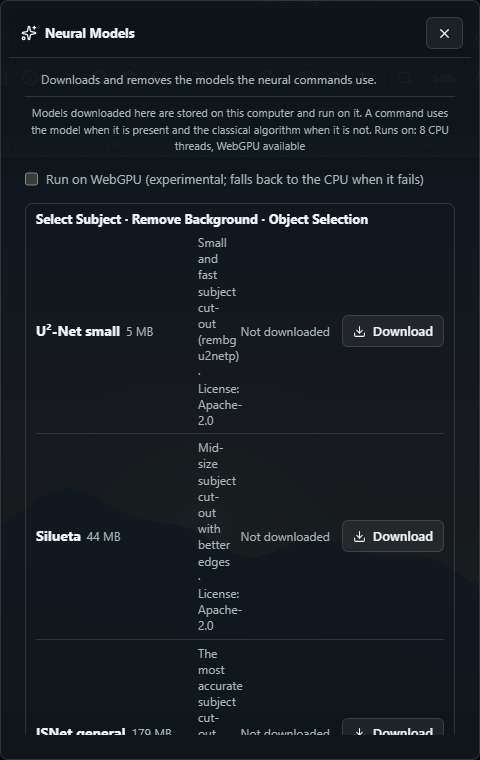

Settings is a window with tabs. Each tab is divided into titled sections, and the window changes its height to suit the tab you are looking at, so no tab scrolls and none leaves empty space.

- **General** — the language and the number of History steps.
- **Start Screen** — whether to show the Start Screen and the tutorial question, and the background, its speed and transparency.
- **Theme** — 20 Dark and 20 Light themes, four colour swatches on each row. Also shortcuts to Keyboard Shortcuts and the Neural Models window, a button that clears the recent files list, and the WebGPU switch for neural models.
- **Custom** — the list of your own themes, and editing them.
- **View** — what to show (rulers, grid, guides, pixel grid, smart guides, slices, notes, paths, visibility, pattern preview), the snapping settings (snap, to guides, to grid, lock guides), ruler units, panel width, and the out-of-gamut and low-resolution print colour warnings.
- **Tools** — selection defaults (mode, feather, anti-alias, contiguous, sample all layers) and the sampling and fill settings (tolerance, eyedropper sample size, aligned clone, impressionist pattern stamp).
- **Brush** — brush shape defaults (size, hardness, opacity, spacing, angle, roundness, scatter) and saved brushes.
- **Export** — format and transparent-background settings.
- **Engine** — the numbers the algorithms themselves use. They are for three commands whose right values differ from photo to photo.
  - *Content-aware fill and the Remove tool* — **Finishing rounds** (1–8, default 4) and **Searches per round**. More rounds bring back the texture of the filled patch, at the cost of time. Beyond five, the fill starts to show bands.
  - *Select subject, Object selection, Remove background* — **GrabCut iterations**, whether to **tidy the result into one object**, and how large a piece must be, against the biggest, to survive that tidying. At 100% only the single biggest piece is kept. If an arm or a prop is being read as separate from the body, lower the value.
  - *Select sky and Sky replacement* — the **colour step** between neighbouring pixels at which the sky stops spreading, how far the colour may **drift** in the strip along the top of the picture, and the **horizon allowance**. A smaller step stops earlier at the horizon, and a smaller drift can miss a sky that shades from one side to the other.

  These values apply to the built-in algorithms. Once you have downloaded the matching model in Edit ▸ Neural Models, the model runs instead and these values are not used.

**When you open a file**, the dialog starts in the folder you last opened from, and remembers it when you restart the program. The **Open Recent** submenu of the File menu lists the twenty files you worked on most recently. Click a row to open that file, the ✕ beside it removes that one file from the list, and the bottom row clears the whole list.

The **Filter gallery** lists one group of filters at a time, with an icon and a name. Hover over a filter and it tells you what it does. Pick one and that sentence appears above the Radius and Amount sliders in the right panel, and a preview is applied to the picture. The sentence describes what happens to the photo — "Colours pool and the edges darken, like watercolour drying" — so this window is a place to learn filters as well as to run them. Until you pick a filter, Apply stays greyed out.

**Sliders and numbers everywhere in the editor** work the same way. The knob and the number beside it follow the mouse, but the picture is redrawn when you let go. A preview means running the whole image through the filter, and doing that at every pixel of a drag would slow the drag to the speed of the filter, for results that are thrown away a moment later — only the value where you stop is worth drawing. A number you type is applied when you press Enter or move to something else, so typing "120" doesn't draw three times, for 1, 12 and 120. The buttons on either side of a number move one step at a time, so they apply immediately.

Every number has decrease and increase buttons. **Reset to defaults**, at the bottom left, returns every setting in that window to its default. It leaves alone the things you made yourself — brushes, gradients, swatches, shapes, tool presets, styles, workspaces, actions — and the recent files list, and keeps your language.

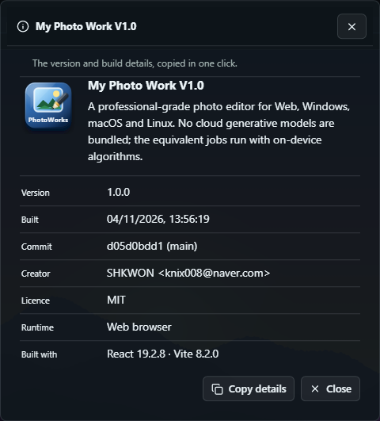

The About window lists the version, build time, commit, creator, licence, the Tauri and WebView versions, and the platform, and one click copies all of it. It is the quickest way to describe your environment in a bug report.

## While a task runs

Some things take time. Content-aware fill on a large picture, a four-picture panorama, and a neural network running on the processor can take several seconds, sometimes minutes. While one of them runs, the program holds the screen and does not answer clicks, because the place where the work is done and the place where the drawing is done are the same.

So it tells you so. A window appears bearing the task's name, with a bar beneath it. A task that can count its own progress shows a real percentage — **Batch** shows the name of each file it is working on, and **Generative upscale** shows the number of tiles — and one that cannot shows the elapsed time. For tasks that are always slow it appears at once, and for the rest after about half a second, so the hundreds of filters that finish in the blink of an eye don't make the window flicker.

While the work runs, the spinning bar may stand still. That is understandable: the task holds the thread, and nothing on the page can move until it gives it back. **That the window is up at all** is the point — it is the difference between a program that is working and one that has hung.

## Undo and redo

The **Edit** menu has **Undo** (Ctrl+Z) and **Redo** (Ctrl+Y), and both have buttons on the toolbar. They are greyed out when there is nothing to go back to. Right after a session starts, Undo is dead, and Redo comes alive only after you have undone something. A greyed button isn't broken; it means there is nowhere to go.

The **History** panel on the right lists each step by name and lets you jump to any point.

## When something goes wrong

Any failure opens a window that names what you were doing and shows every detail: the error, stack, document, tool and environment. The text can be selected, and **Copy details** puts all of it on the clipboard.

## The Photoshop way

Everything in the Photoshop menus is here as a row with the same name. So this guide describes only what behaves differently from the previous version.

- **Selections combine.** With every selection tool, Shift adds, Alt subtracts and Shift+Alt intersects. You can also choose the mode on the options bar, where Feather and Anti-alias are too. The Quick selection brush spreads to similar pixels the more you drag, and the Object selection tool takes a box and keeps what stands out from its border. Select ▸ Sky, Focus area and Select and mask do what their names say.
- **Masks are painted.** Click the mask preview in the Layers panel (or create a mask) and the Brush, Gradient and Fill write to the mask — white reveals and black hides — until you click the layer preview again. Layer ▸ Layer mask has Disable, Invert, Apply and Delete. Q enters Quick mask.
- **Windows preview live.** Every adjustment and filter window shows its effect on the picture as you move the slider, and Cancel puts it back.
- **History.** The History panel lists each state with the tool or command that made it, and clicking one returns you to it. The camera makes a named snapshot. The circle beside a state makes it the source for the History brush.
- **Layer styles.** Layer ▸ Layer style (or double-clicking a layer) opens ten effects with their settings. Save one as a style and you can apply it again from the Styles panel.
- **Guides.** Drag them out of the rulers to make them, and drag them back in to remove them. View ▸ New Guide, New Guide Layout, Lock Guides, and snapping to guides and grid.
- **Documents.** You can have several open. The tabs above the picture move between them (Ctrl+Tab). Editing a smart object's contents opens the original in its own tab, and saving writes it back.
- **PSD.** Open PSD and Save as PSD keep layers, groups, masks, opacity and blend modes. Type, styles and smart objects go across as rendered pixels.
- **Liquify is a brush.** On the options bar choose Forward warp, Twirl, Pucker, Bloat, Reconstruct, Freeze or Thaw, then press Enter to apply or Esc to cancel.
- **Menus fold away.** A menu shows the main commands, and a row with ▸ opens a submenu beside it when you hover over or click it. This is how Photoshop does it.
- **The commands that analyse the picture are real, and run on this computer.** Photomerge and Auto-Align match features between frames and warp each into place (rotation and perspective included). Auto-Blend softens the edges of each layer. Merge to HDR fuses exposures. Content-aware fill, Generative fill and the Remove tool rebuild a hole from the surrounding texture (PatchMatch). Harmonize re-solves the colour of a pasted layer so its edges meet the background (Poisson blending). Object selection and Select subject cut an object out with GrabCut. Crop and Straighten Photos finds each print on a scanned page and opens it upright in its own tab. The first of these you use loads OpenCV (with a brief pause). Nothing is downloaded and nothing leaves the computer.
- **Vanishing point clones in perspective.** Click four times to set the plane, pick the Clone stamp with S, Alt+click a source on the plane, then paint, and what you clone shrinks and tilts along the plane. Apply still pastes the clipboard into the plane.
- **Neural models, if you want them.** Edit ▸ Neural Models… lists the neural networks the app can use, with size and licence — subject cut-out (U²-Net, Silueta, ISNet), sky (SegFormer), depth (Depth Anything V2), object removal (LaMa), super resolution (Swin2SR). Download one and from then on Select subject, Remove background, Object selection, Select sky, Sky replacement, Depth blur, Generative fill, the Remove tool, Super Zoom and Generative upscale use it. Without one, they use the classical methods described above. The weights are downloaded once from a public repository, kept on this computer and run here (on all CPU cores; WebGPU is a checkbox in the same window). Nothing you edit leaves the computer.
- **The Neural filters' Skin smoothing, Colorize and Restoration** are still algorithms, and say so.

## Keyboard

| Key | Action |
| --- | --- |
| Ctrl/Cmd+N / O / S / Shift+S | New, Open, Save, Save as |
| Ctrl/Cmd+P | Open the print preview |
| Ctrl/Cmd+Z / Shift+Z or Y | Undo, Redo |
| Ctrl/Cmd+A / D | Select all, Deselect |
| Ctrl/Cmd+Shift+D | Bring back the selection you just cleared |
| Ctrl/Cmd+X / C / V | Cut, Copy, Paste |
| Ctrl/Cmd+Shift+C | Copy merged — with all layers combined |
| Ctrl/Cmd+T | Free transform |
| Delete / Backspace | Clear the selected pixels |
| Enter | Apply a crop or transform, or close a path or lasso |
| Esc | Cancel what is in progress |
| `[` `]` | Brush size |
| X | Swap foreground and background colours |
| Space | Hold with any tool to pan |
