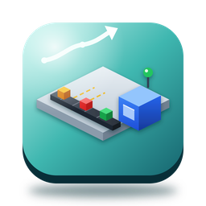
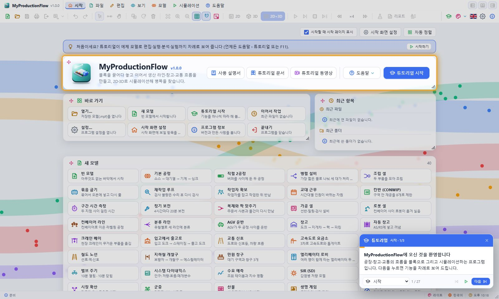
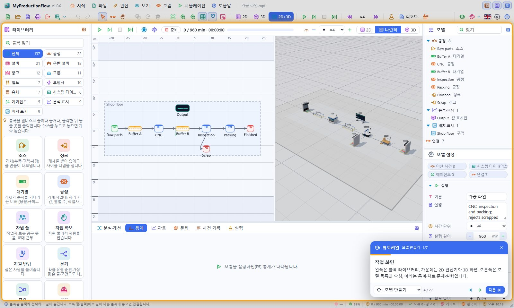
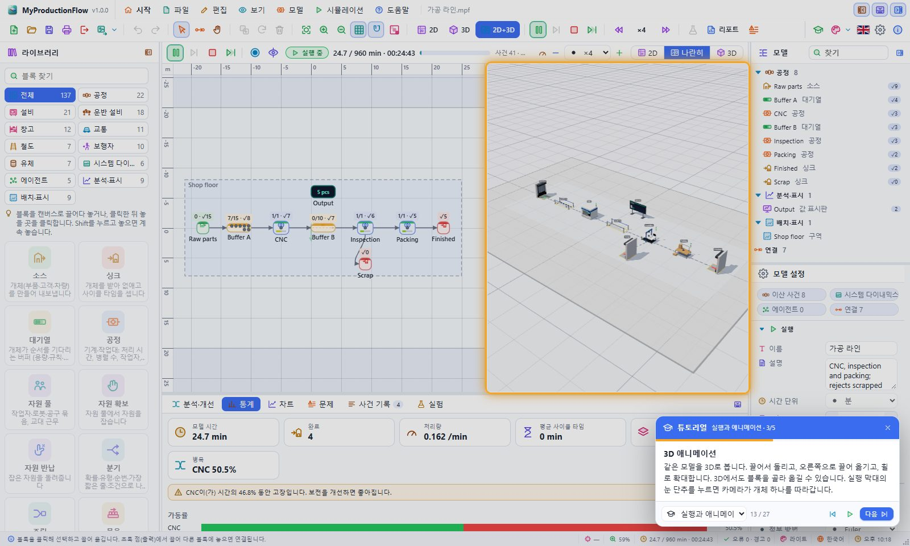
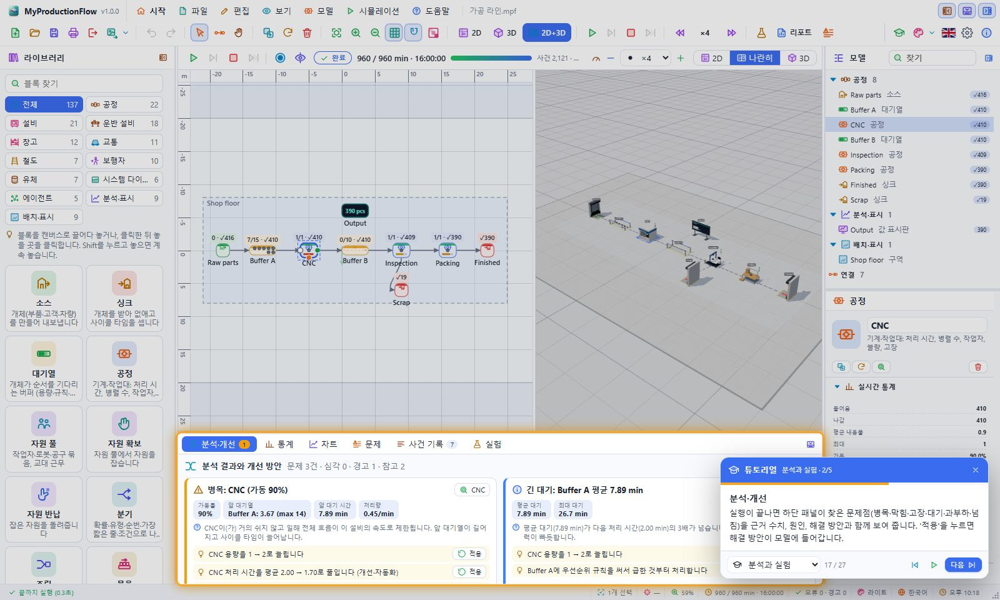
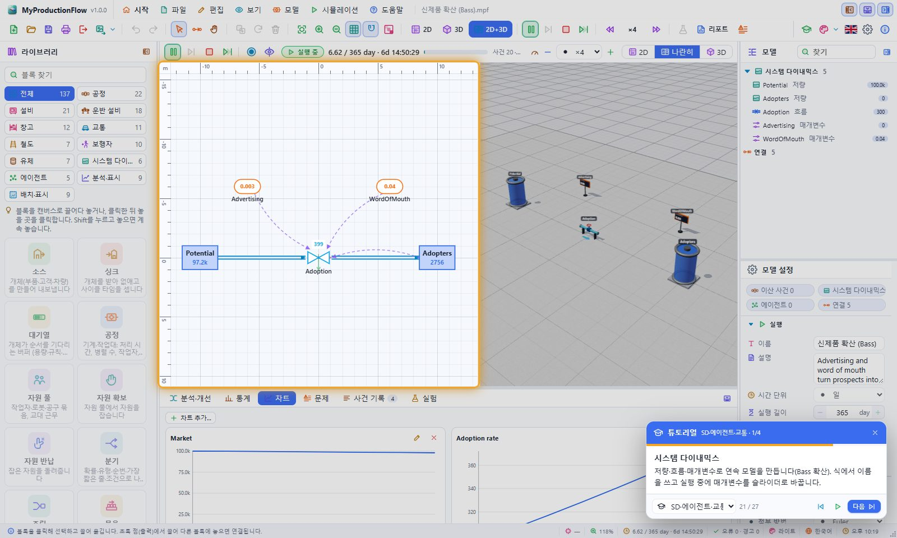
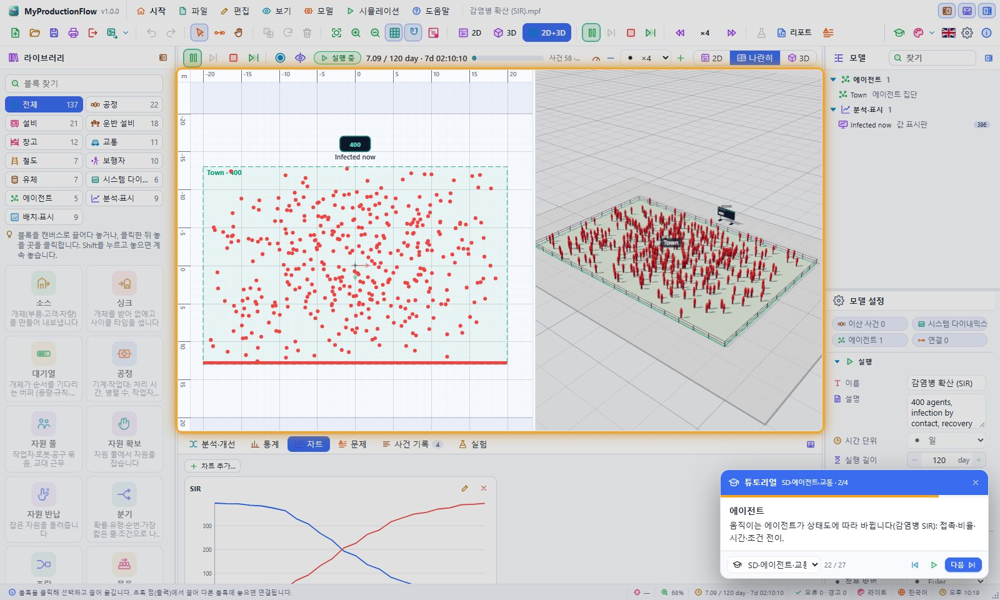

# MyProductionFlow

Windows · macOS · Linux · 웹에서 쓰는 **생산 라인·물류 창고·교통 흐름 시뮬레이터**입니다 (AnyLogic · FlexSim 스타일). 블록을 끌어다 놓고 이어서 모델을 **그래픽으로** 만들고, **이산 사건 · 시스템 다이내믹스 · 에이전트 기반** 시뮬레이션을 한 모델에서 함께 실행하며, **2D와 3D 애니메이션**으로 보고 병목을 찾습니다. vanilla JavaScript + three.js(Vite) 화면과 Tauri 2(Rust) 데스크톱 셸로 만들었고, 화면 구성은 MySketchBook을 따릅니다.

- 버전: 1.0.0
- 사용법: [doc/UsersGuide.md](doc/UsersGuide.md) (English: [doc/UsersGuide.en.md](doc/UsersGuide.en.md)) — 앱 안에서는 **도움말 › 사용 설명서**
- 튜토리얼 문서: [doc/Tutorial.html](doc/Tutorial.html) (English: [doc/Tutorial.en.html](doc/Tutorial.en.html)) — 앱 안에서는 **도움말 › 튜토리얼 문서**, 실제 화면 튜토리얼은 **F11**
- 튜토리얼 동영상: [doc/video/MyProductionFlow-Tutorial.mp4](doc/video/MyProductionFlow-Tutorial.mp4) — 앱 안에서는 **도움말 › 튜토리얼 동영상** (장 목록·속도 조절)
- 구조(개발자용): [ARCHITECTURE.md](ARCHITECTURE.md)

## 화면

| | |
|---|---|
|  |  |
| 시작 화면 — 템플릿 40 · 예제 60 · 최근 파일 | 작업 화면 — 라이브러리 · 2D 편집기 + 3D · 모델/속성 · 하단 패널 |
|  |  |
| 2D·3D 동시 애니메이션 | 분석·개선 — 문제점 · 근거 · 원인 · 해결 방안(적용) |
|  |  |
| 시스템 다이내믹스 (Bass 확산) | 에이전트 (SIR 감염병) |

## 주요 기능

### 그래픽 편집기

- 라이브러리 **12개 분류 137종 블록** (공정 22 · 설비 21 · 운반 18 · 창고 12 · 교통 11 · 철도 7 · 보행자 10 · 유체 7 · SD 6 · 에이전트 5 · 분석·표시 9 · 배치 9)을 캔버스로 **끌어다 놓기** 또는 클릭–클릭으로 놓기, Shift로 여러 개.
- **초록 출구 점을 끌어 연결**, 연결 도구(C), 블록을 이어 놓으면 **자동 연결**, 연결선 꺾기, SD 물질 흐름(파이프)·영향 화살표.
- 이동(격자 맞춤, Alt로 자유), 사각형 선택(포함/걸침), 회전, 복제, 복사·붙여넣기, 맞춤·간격, 실행 취소 200단계.
- 컨베이어·도로·벽은 **점을 찍어 그리고** 점을 끌어 고치기, 구역·집단·차트 판 크기 조절, **3D 화면에서도 선택·이동**.
- 속성 패널이 블록마다 자동 생성: 분포 편집기(13종, 표본 막대그래프 미리보기), 식(이름 자동 완성·오류 표시), 유형·일정표·상태·전이 목록.
- 편집할 때마다 **모델 검사** (연결 안 된 출구, 틀린 식, 모르는 이름, 없는 자원 풀 …).

### 시뮬레이션

- **이산 사건**: 소스(분포/도착률 식/시간대별), 싱크, 대기열(용량·FIFO/LIFO/우선순위/무작위·이탈), 공정(병렬·작업자·준비·불량·고장 MTBF/MTTR·비용, 기계 모양 14가지), 자원 풀(교대 근무), 자원 확보/반납, 분기(확률·유형·차례·최단 줄·조건), 조립, 묶음/풀기, 게이트, 속성 지정, 지연. 막히면 뒤로 전파되는 **역압(back-pressure)**.
- **물류·교통**: 쌓임형 컨베이어, AGV·지게차·카트·드론 운반차 무리, 로봇, 랙(칸×단 보관), 도크, 차로가 있는 도로(정체), 신호등(주기·차량 간격), 주차장.
- **시스템 다이내믹스**: 저량·흐름·변수·매개변수, 오일러/RK4, 실행 중 매개변수 슬라이더.
- **에이전트**: 움직이는 집단, 상태도(비율·시간·접촉·조건 전이), 수천 개. **셀 자동자**(산불·생명 게임, 이웃 규칙).
- **흐름 제어**: 복제·짝 맞추기, 제한 구역(CONWIP·칸반), 구간 시간 측정, 정기 보전, 합류, **이벤트**(정한 시각·주기·조건에 속성이나 매개변수 바꾸기).
- **철도·보행자·유체**: 선로·역·분기기·신호·조차장, 개찰구·에스컬레이터·엘리베이터·대기 구역, 탱크(용량)·배관·밸브(주기)·펌프. SD 조회 테이블·지수 평활.
- **하이브리드**: SD 식이 도착률을 정하고 SD가 공정 지표를 읽음.
- 같은 시드는 같은 결과, 워밍업, M/M/1·M/M/2·RK4 해석해와 일치하는지 테스트로 확인.

### 2D·3D 애니메이션

- 2D: 개체 이동, 블록 상태 색·가동률 막대·내용물, 가동률 열지도, 작업자·차량·에이전트, 실시간 툴팁.
- 3D(three.js): 블록마다 실제 설비 모양(기계·CNC·로봇 팔·오븐·랙·도크·도로·신호등·탱크·표시판), 그림자, 이름표, 개체·차량·작업자·에이전트 인스턴싱, 시점 4가지, 그림 저장.
- 2D / 3D / 나란히, 속도 ×0.1 … ×5000 (도구 모음의 − 배속 + 단추), 한 사건씩, 끝까지 빠르게.
- 2D 눈금자(마우스 위치 빨간 선), 확대해도 크기가 일정한 5×5 격자(2D·3D), **애니메이션 녹화**(WebM), **3D 개체 따라가기**.

### 분석

- **분석·개선 탭**: 실행 후 문제점(병목·막힘·고장·불량·대기열 증가·이탈·손실·자원/운반 부족·과잉·보관 부족·라인 불균형·재공 누적·탱크 넘침)을 근거 수치·원인·해결 방안과 함께 나열하고, 매개변수로 바꿀 수 있는 해결 방안은 **적용** 단추로 바로 반영.
- 통계: 처리량·사이클 타임·재공·병목·손실·비용, 블록별 표.
- 차트: 모델 차트, 재공·완료, 공정 상태 타임라인(간트), 사이클 분포, 캔버스 위 차트 판·값 표시판.
- **실험**: 매개변수 변화, 몬테카를로(신뢰구간), 최적화(최적 값 적용), **민감도 분석**(토네이도), **다중 최적화**(여러 매개변수 조합, 패턴 탐색), **시나리오 비교**(저장한 실행을 나란히).
- **리포트 생성**: 내용 골라 미리 보고 **Markdown · HTML · Word · PDF**로 (그림 포함), CSV, 시계열 CSV, 2D/3D PNG.
- **인쇄 창** (별도 창): 프린터·매수·용지·방향·여백·글자 크기·흑백·머리글/바닥글·쪽 범위·내용 선택, 실제 쪽 미리보기, 고른 프린터로 바로 인쇄, PDF 저장.

### 그 밖에

- **.mpf** 모델 파일(JSON), 탐색기에서 두 번 클릭해 열기(파일 연결), 예제 파일 `samples/`(한·영 60개씩).
- 템플릿 40개, 예제 60개 — 분류마다 10개씩 (제조 · 물류·창고 · 서비스 · 교통·철도·보행자 · SD·유체 · 에이전트·하이브리드).
- 한국어/영어, 테마 40가지 + 사용자 정의, 움직이는 배경 20가지(컨베이어·AGV·창고·교통·철도·간트·공급망 …), 시작 화면 카드 배치, 튜토리얼(6장 27단계, F11), 사용 설명서·튜토리얼 문서 창.
- 툴바의 **2D · 3D · 2D+3D** 단추로 화면을 따로 또는 나란히.

## 요구 사항

- Node.js 22 이상, npm
- 데스크톱 실행/빌드: Rust(stable)와 [Tauri 2 준비물](https://tauri.app/start/prerequisites/) — Windows는 WebView2와 MSVC 빌드 도구

## 명령

| 명령 | 하는 일 |
|---|---|
| `npm install` | 의존성 설치 |
| `npm start` | 데스크톱 앱 개발 실행 (Vite + tauri dev) |
| `npm run dev` | 웹 개발 서버 (http://127.0.0.1:5488) |
| `npm test` | 단위 · 패키징 · 웹 E2E 검사 (`--only unit,static,web,desktop`, `--case 이름`) |
| `npm run test:desktop` | 디버그 빌드 창으로 E2E (`npm run build:debug` 먼저) |
| `npm run build:win` / `build:mac` / `build:linux` / `build:all` | 설치 파일 (release/ 와 프로젝트 루트) |
| `npm run build:web` | 웹 배포본 (dist/) |
| `npm run build:debug` | 디버그 데스크톱 실행 파일 |
| `npm run build:docs` | 사용 설명서·튜토리얼 HTML |
| `npm run tutorial:docs` | 튜토리얼 화면 캡처(한·영) + 문서 빌드 |
| `npm run tutorial:video` | 튜토리얼 동영상 녹화 → `doc/video/` + 루트 `MyProductionFlow-Tutorial.mp4` (ffmpeg 필요, `--preview`는 첫 장만, `TUTORIAL_LANG=en`) |
| `npm run samples` | `samples/*.mpf` 다시 만들기 |
| `npm run build:icons` | 아이콘·설치 화면 그림 |
| `npm run i18n:check` | 빠진 한국어/영어 문구 찾기 |
| `npm run clean` / `clean:all` | 빌드·테스트 결과 지우기 / + node_modules |

## 라이선스와 제작

© SHKWON (knix008@naver.com). 사용한 오픈 소스: three.js, Tauri — [licenses/](licenses/).
