# MyProductionFlow User's Guide

MyProductionFlow builds the flow of factory production lines, warehouses, service desks and traffic systems by **dragging blocks and connecting them**, simulates it, and shows it as **2D and 3D animation** so you can find the bottleneck. Three simulation methods work together in one model.

| Method | For | Blocks |
|---|---|---|
| **Discrete event** | Parts, customers, vehicles, trains or pedestrians passing steps one at a time | Process 22 · machines 21 · handling 18 · warehouse 12 · traffic 11 · rail 7 · pedestrians 10 |
| **System dynamics (SD), fluids** | Amounts that accumulate and flow (inventory, population, money, liquids), feedback | SD 6 (stock, flow, variable, parameter, lookup table, smooth) · fluids 7 (tank, pipe, valve, pump …) |
| **Agent-based (ABM)** | Things that move and change state (epidemics, word of mouth), cellular automata | Agent population · consumers · crowd · cell grid · Game of Life |

In all: **137 blocks in 12 categories**, with 9 analysis displays and 9 layout items. After a run the **Analysis** tab lists the problems found and how to fix them.

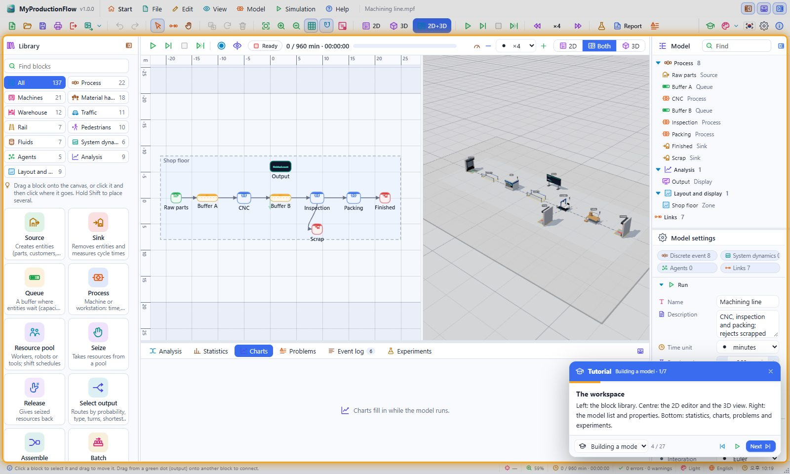

## 1. The window

- **Menu bar** — Start · File · Edit · View · Model · Simulation · Help. At the right: the **left / bottom / right panel buttons** (off on the start page) and the window buttons (minimize, maximize, close); drag the bar to move the window.
- **Toolbar** — new, open, save; undo; the select, connect and pan tools; duplicate, rotate, delete; zoom; grid; 2D / side by side / 3D; run buttons; **playback speed (− current speed +; click the speed for a list)**; experiment, report, model check; tutorial, theme, language, settings, about. In a narrow window the rest goes into the **»** menu.
- **Library (left)** — every block by category, with a search box.
- **Run bar (top centre)** — run, step, stop, run to the end; state; model time and clock; progress; events; speed; the 2D / both / 3D switch.
- **2D editor and 3D view (centre)** — draw the model in 2D and see the same model in 3D. Drag the border between them to change the split.
  - The 2D view has **rulers** (metres) along its top and left edges, with a **red line** on each at the mouse position (View › Show › Rulers).
  - The **grid is 5 × 5** (a bold line every 5 thin ones) and keeps about the same size on screen while you zoom: it steps by 5× (0.2 m · 1 m · 5 m · 25 m …) and the thin lines fade in. The 3D floor grid follows the camera distance the same way.
- **Model list and properties (right)** — the blocks by category above, the selected block's properties below. With nothing selected it shows the **model settings**.
- **Bottom panel** — Analysis · Statistics · Charts · Problems · Event log · Experiments (with the scenario comparison).
- The **side panels** start at the same width (280 px) and both narrow to 240 px. The fold button in a panel header (a panel with an arrow) folds it; the same button on the toolbar unfolds it.
- Every **number field** is [− value unit +]: − / + step the value (hold to repeat) and the unit (min · m · pcs · /min · % …) is shown next to it.
- The **theme button** (the palette on the right of the toolbar) switches to a **random** theme on each click. The **▾** on its right is a dropdown menu: system · light themes ▸ · dark themes ▸ · custom · theme settings….
- **Status bar** — notices, selection, pointer position (m), zoom, model time, problem count, theme, language, clock.

## 2. Getting started

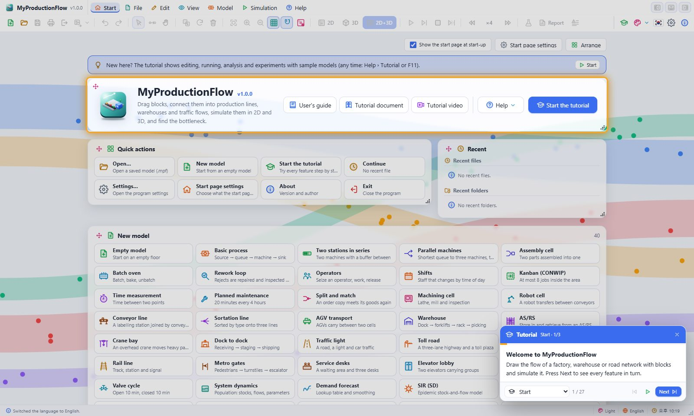

On the start page choose a **new model** (40 templates) or one of the 60 **sample models** (10 in each of the 6 groups). Samples run straight away with **F5**.

**40 templates** — empty model · basic process · two stations in series · parallel machines · assembly cell · batch oven · rework loop · operators · shifts · kanban (CONWIP) · time measurement · planned maintenance · split and match · machining cell · robot cell · conveyor line · sortation line · AGV transport · warehouse · AS/RS · crane bay · dock to dock · traffic light · toll road · bus line · rail line · metro gates · service desks · elevator lobby · tank fill and drain · valve cycle · system dynamics · demand forecast · SIR (SD) · agents · market adoption · crowd · forest fire · Game of Life · dashboard.

| Sample group | Samples |
|---|---|
| Manufacturing (9) | machining line · assembly line · job shop · bottling line · shift work · kanban line · machining with maintenance · paint shop · electronics assembly |
| Logistics (7) | warehouse · cross-dock · AGV factory · supply chain (SD) · AS/RS centre · e-commerce fulfilment · container port |
| Services (6) | bank · emergency room · airport security · car wash · restaurant · call centre |
| Traffic, rail, pedestrians (7) | signalised junction · car park · highway toll plaza · rail network · metro station · stadium exit · bus corridor |
| System dynamics & fluids (6) | Bass diffusion · predator and prey · workforce planning · water treatment · batch mixing · inventory policy |
| Agents & hybrid (5) | epidemic (SIR) · word of mouth · hybrid (SD demand → production) · forest fire · Game of Life |

## 3. Building a model graphically

### 3.1 Placing blocks

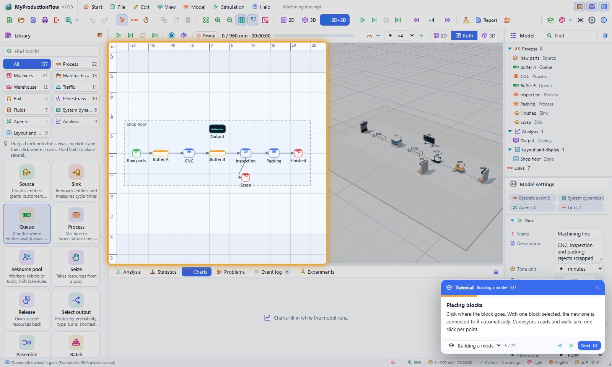

- **Drag a card onto the canvas**, or **click a card and then click where it goes**. Hold **Shift** to keep placing the same block; **Esc** stops.
- With one block selected, a newly placed block is **connected to it automatically** (Ctrl+Z undoes).
- **Conveyors, roads and walls**: click their points one after another and finish with a **double-click** or **Enter**. Shift draws right angles.
- Blocks snap to a **0.5 m grid** (change it in Settings; hold **Alt** while dragging to place freely).

### 3.2 Connecting

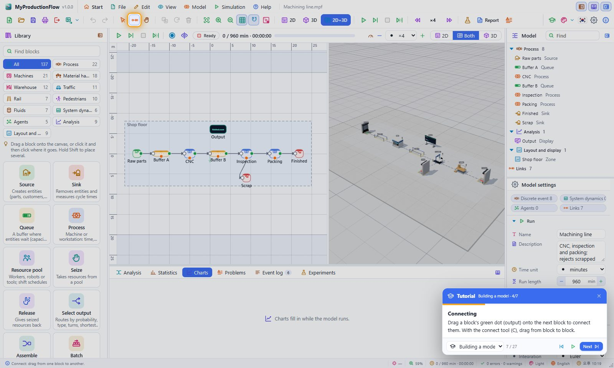

- Drag a block's **green dot (output)** onto the next block (or one of its inputs).
- With the **connect tool (C)**, drag from block to block.
- Blocks with two outputs: the orange dot at the bottom of a **queue** is for entities that waited too long; on a **process** it is the reject output.
- System dynamics: stock → flow (drains) and flow → stock (fills) become **material flows** (pipes); other SD connections become **influence arrows** (dashed).
- Drag a link to add a **bend**; drag a bend to move it. Right-click a link › *Straighten link*.

### 3.3 Selecting, moving, editing

- Click to select, **Shift/Ctrl+click** to add, drag on empty space for a **selection box** (left to right: fully inside; right to left: touching).
- Drag to move, **arrow keys** to nudge (Shift: 5 m), **R** rotates 90°, **Ctrl+D** duplicates, **Delete** deletes, Ctrl+C / V copy and paste, **F2** or double-click renames.
- With several blocks selected the properties panel offers **align and distribute**.
- Select a conveyor, road or wall and **drag its points**; **double-click** a segment to add a point; **right-click** a point to remove it. Zones, agent populations and chart boards resize from their corners.
- **In the 3D view too** a click selects a block, and dragging a selected block moves it on the floor.
- The wheel zooms; the middle button or **Space+drag** pans; **Ctrl+0** fits everything.

### 3.4 Properties

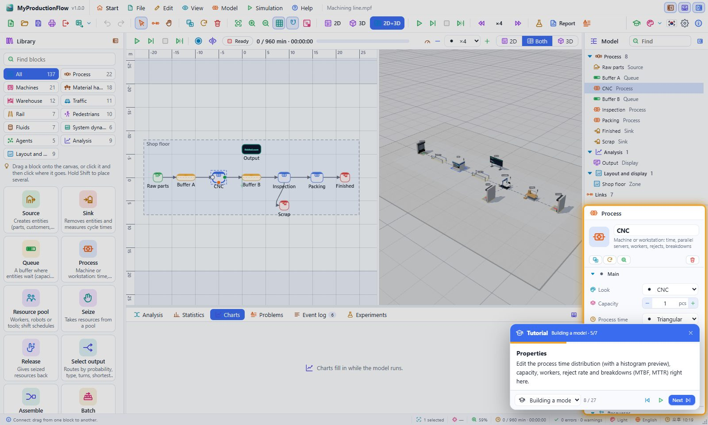

Selecting a block shows its properties at the bottom right. Changes go straight into the model and can be undone.

- **Distributions** — constant, uniform, triangular, normal, exponential, lognormal, Erlang, gamma, Weibull, beta, Poisson, empirical (values and weights), expression, with a **histogram of samples and the mean** below.
- **Expressions** — e.g. `Queue1.length * 2`, `if(Stock1 > 100, 1, 0)`, `0.35 + sinwave(0.2, 720, t)`. The names you can use are suggested as you type.
- **Lists** — entity types (name, colour, weight), schedules (start, end, value), states (name, colour), transitions (from → to, kind, value).
- **Position and size** — X, Y, rotation, width and depth, path length and travel time.

### 3.5 Block reference

| Category | Blocks |
|---|---|
| **Process (21)** | Source · sink · queue · process · resource pool · seize · release · select output · assemble · batch · unbatch · gate · assign · delay · **split** · **match** · **restricted area start / end** (CONWIP, kanban) · **time measure start / end** · **maintenance** · **event** |
| **Machines (21)** | CNC machine · lathe · milling machine · drill press · press · injection molder · oven · dryer · paint booth · welding robot · laser cutter · saw · grinder · 3D printer · assembly station · inspection station · test bench · labeler · packing machine · washing machine · kitting station |
| **Material handling (18)** | Conveyor · roller conveyor · chute · transporter · forklift fleet · AGV fleet · tugger train · overhead crane · drone fleet · robot · vertical lift · turntable · sorter · diverter · **merge** · palletizer · depalletizer · accumulation buffer |
| **Warehouse (12)** | Rack · dock · AS/RS · flow rack · floor storage · cold storage · receiving dock · shipping dock · pick station · pack station · staging lane · quality hold |
| **Traffic (11)** | Road · traffic light · car park · car source · car sink · highway · bus stop · toll booth · fuel station · crosswalk · junction |
| **Rail (7)** | Rail track · train source · train sink · station platform · rail switch · rail signal · rail yard |
| **Pedestrians (10)** | Pedestrian source · pedestrian sink · walkway · escalator · service desks · waiting area · turnstile · security check · elevator · seating area |
| **Fluids (7)** | Tank (capacity) · pipe · valve (open / closed cycle) · pump · fluid source · fluid drain · mixing tank |
| **System dynamics (6)** | Stock (optional capacity) · flow · variable · parameter · **lookup table** (x → y graphical function) · **smooth** (SMOOTH) |
| **Agents (5)** | Agent population · consumer market · crowd · **cell grid** (neighbour rules) · Game of Life |
| **Analysis (9)** | Display · gauge · counter · progress bar · time chart · bar · area · pie · histogram |
| **Layout (9)** | Zone · office area · wall · fence · floor marking · pillar · door · tree · label |

Machine, handling, warehouse, traffic, rail and pedestrian blocks are **real equipment** built on the basic behaviours (process, conveyor, transporter, rack …) with their own look and defaults. Their properties are those of the behaviour (process time, capacity, breakdowns, rejects …) and each looks like itself in 2D and 3D.

Main properties:

| Block | Main properties |
|---|---|
| Source | Interarrival distribution / rate expression (Poisson) / rate by time of day, arrivals together, maximum, mix of types, shape, wait or drop when the exit is full |
| Queue | Capacity, FIFO / LIFO / priority / random, maximum wait (then the bottom output) |
| Process (machines) | 34 looks, parallel servers, process time, resource pool and units, changeover, reject rate, breakdowns (MTBF, MTTR), cost per time |
| Split / match | Copies, copy type and colour / same type only, capacity |
| Restricted area | Most entities inside (the end block names its start block) |
| Maintenance | Machine, interval distribution, duration distribution, first time |
| Event | Trigger (once · cyclic · when a condition becomes true), first time, repeat interval, most times, target block, property (`capacity`, `time.mean` …; empty for a parameter), new value expression (`current` is the value before) — e.g. CNC capacity `current + 1` at minute 240 (an extra machine), the arrival-rate parameter doubled every morning (rush hour) |
| Conveyor, road, track, walkway | Path, speed, spacing, width, accumulating, lanes |
| Transporter | AGV, forklift, cart, drone, crane or tugger; fleet; speed; load and unload; right-angle or straight; return home |
| Rack, storage | Bays and levels, dwell, store and retrieve time, retrieval order |
| Traffic light | Green, yellow, red, offset, headway |
| Tank, valve | Capacity, initial level / open and closed time |
| Lookup, smooth | Input expression, x and y values / input, delay time, initial value |
| Agents, cell grid | Count and speed / columns, rows, neighbourhood (8 or 4), wrap; states, initial shares, transitions (rate, timeout, contact, neighbours, condition) |
| Display | Expression; number, gauge, bar or counter; min and max |

### 3.6 Names in expressions

| Name | Meaning |
|---|---|
| `time`, `t` | The current model time |
| `Stock1`, `Rate` | SD elements (names start with a letter, no spaces) |
| `Queue1.length`, `Queue1.waitTime` | Queue length, mean wait |
| `CNC.utilization`, `CNC.busy`, `CNC.contents` | Process utilization, busy servers, contents |
| `Sink1.count`, `Sink1.cycleTime`, `Sink1.throughput` | Completed, mean cycle time, throughput |
| `Crew.utilization`, `Crew.idle` | Resource pools |
| `Rack1.fill`, `Gate1.open` | Rack fill, gate open (1 / 0) |
| `Town.Infected`, `Town.count` | Agents by state |

Functions: `min max abs sqrt exp ln log pow sin cos round floor ceil clamp if step(height, start) pulse ramp sinwave random() uniform(a,b) normal(m,s) exponential(m) triangular(a,c,b) poisson(m)`. A select condition and an assigned priority can also use the entity's `priority`, `age` and `size`. An event's new value can use `current` (the value before the change).

### 3.7 Model check

The model is checked as you edit and the **Problems** tab lists what it finds: unconnected outputs, wrong expressions or unknown names, missing pools, quantities or weights that do not match, paths with too few points, statechart errors. A model with errors does not run. Click a line to go to its block; **F8** checks now.

## 4. Running and animation

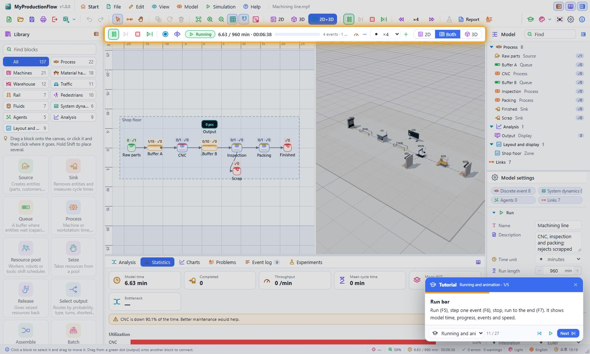

| Button | Key | Does |
|---|---|---|
| Run / pause | F5 | Runs with live animation |
| Step | F6 | Handles the next event only |
| Stop | Shift+F5 | Back to the start (the results stay in Statistics) |
| Run to the end | F7 | As fast as possible, no animation (progress window, can be cancelled) |
| Speed | `[` `]` | Model time per second (×0.1 … ×5000) |

- **2D** — entities move through queue slots, process servers, conveyors and rack cells. A block's top band shows its state (busy green · idle yellow · blocked orange · failed red), a bar below its utilization, and a badge above its contents / capacity and count. The **utilization heat map** (toolbar) colours whole blocks. Hover a block for live numbers.
- **3D** — the same model as a factory, warehouse or road scene: boxes, pallets, vehicles and people; AGVs, forklifts and drones; workers (green vest when busy); status lamps, traffic lights, tanks (stock level) and screens. Left-drag orbits, right-drag pans, the wheel zooms; View › 3D views (isometric, top, front, side).
- The structure cannot change while the model runs. **SD parameters** can be changed during the run with their sliders in the properties panel.
- Select a block to see its **live statistics** (utilization, waiting, throughput, breakdowns …) above its properties.
- **Record animation** (the red circle in the run bar · Simulation › Record animation) — records the visible 2D and 3D views, laid out as on screen, as a video (WebM). Press again to stop and choose where to save it (the shortest recording is 4 seconds). It also starts the run if the model is not running.
- **Follow an entity in 3D** (the eye button in the run bar · View › 3D views) — the 3D camera follows one moving entity, keeping your viewing angle and distance; when it leaves, the camera moves on to the next one.

## 5. Analysis, statistics, charts and reports

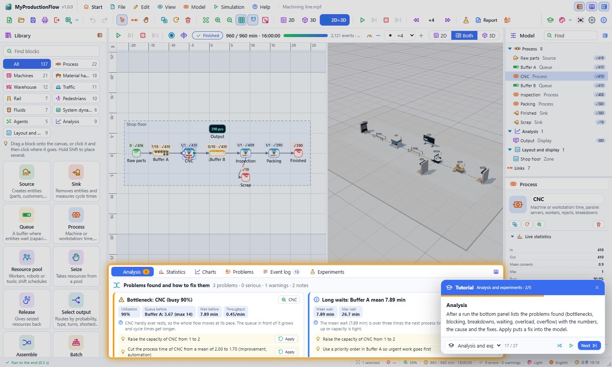

The **Analysis** tab opens by itself when a run ends and updates live during a run. Each problem found is a card:

- **Title and severity** — serious (red), warning (orange), note (blue); green "No major problems" when nothing shows.
- **Evidence** — utilization, the queue in front and its wait, blocked and down shares, reneged or lost counts, fill and so on.
- **Cause** — why, in one sentence.
- **Fixes** — several. Those that are a parameter change have an **Apply** button that puts them into the model (undoable). **Run again** shows the effect.

| Problem found | Fixes, for example |
|---|---|
| Bottleneck (busy over 85%) | Capacity +1, process time −15%, halve changeovers, a parallel machine, more staff or vehicles |
| Blocked (the next step cannot take the output) | Buffer ×1.5, add a buffer, strengthen the next step |
| Breakdowns | Halve repair time, double time between failures (preventive maintenance), buffers around |
| Rejects | Halve the reject rate, inspect earlier |
| Growing queue, long waits | Next station +1, cap WIP with CONWIP, pace arrivals, priorities |
| Reneging, losses | Patience ×1.5, serve faster, wait instead of dropping |
| Too few / too many resources or vehicles | Staff or fleet ±1, 25% faster, shift plan |
| Storage nearly full | 30% more bays, shorter dwell |
| Unbalanced line, mostly waiting, WIP piling up | Rebalance work, cap WIP, pull system |
| Tank full or empty | Capacity ×1.5, adjust in- and outflow |

The **Problems** tab (model check) also says how to fix each problem.

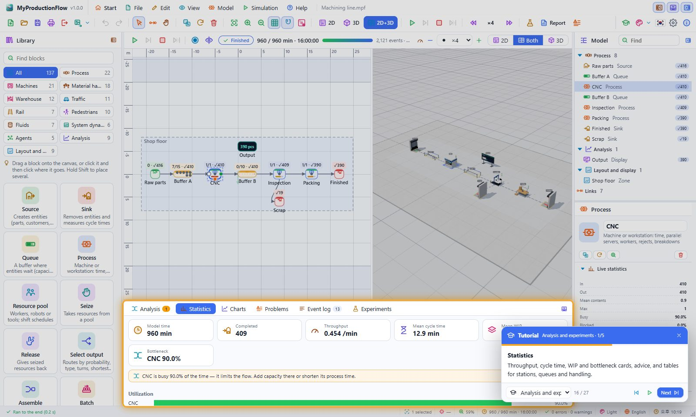

- **Statistics** — cards for model time, completed, throughput, mean cycle time, mean WIP, the **bottleneck** (the busiest resource), lost and cost; **advice** (bottleneck, blocking, breakdowns, long queues, losses, reneging); busy / blocked / failed bars; tables for stations, queues, sources and sinks, handling and storage, SD and agents.
- **Charts** — the model's charts, WIP and output, the **station state timeline** (Gantt) and the cycle time distribution. **Add chart…** plots any values (comma separated); the pencil edits, × deletes.
- **Event log** — breakdowns, repairs, reneging, warm-up, errors and notices.
- **Report (the Report button on the toolbar · Ctrl+R)** — choose what to include (overview, 2D layout picture, 3D picture, key figures, analysis, statistics tables, chart pictures, SD values, experiment), preview it and make a **Markdown · HTML · Word (.docx) · PDF** file. Pictures are in every format (inside the Markdown / HTML file, inside the Word document, and the PDF has the printed pages). CSV too.
- **Print (the Print button right of Save · File › Print · Ctrl+P)** — a print window of its own: printer, copies, paper (A4 · A3 · Letter · Legal), orientation, margins, text size, colour or grayscale, header and footer, pages, what to include, paper size / page count / sheets, and a preview of the real pages on the right. **Print** sends the pages straight to the chosen printer (in the browser: the print dialog). **Save as PDF** saves the same pages.
- **Export** — 2D / 3D pictures (PNG), statistics CSV, time series CSV, experiment CSV, report HTML.
- **Warm-up** — after the warm-up time of the model settings the statistics restart (removing the empty-start effect).

## 6. Experiments

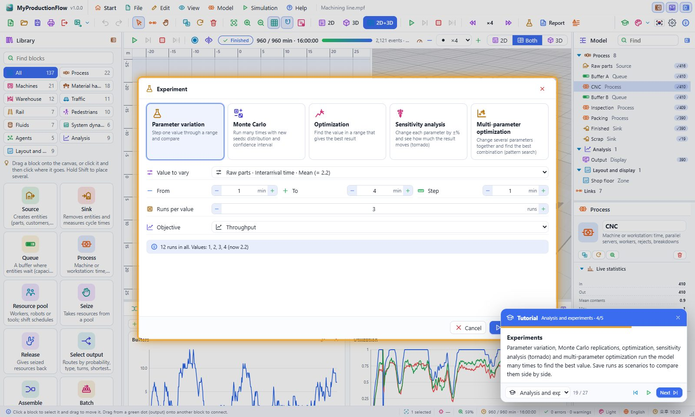

**Simulation › Experiment… (Ctrl+Shift+X)**

| Kind | Does |
|---|---|
| Parameter variation | Steps one block property or distribution parameter through a range (from, to, step), runs each value several times and compares the objective |
| Monte Carlo | Runs N times with new seeds → mean, 95% confidence interval, min, max, distribution |
| Optimization | Finds the value in the range that gives the best objective (maximize throughput, minimize cycle time …) |
| Sensitivity analysis | Changes each chosen parameter ±% (20% by default) low and high and shows how much the objective moves as a **tornado chart** — which value matters most |
| Multi-parameter optimization | Changes up to 4 parameters together (each from, to, step) and finds the best **combination**. It does not run every combination: a pattern search with random restarts within the run budget, with a convergence chart and the top 10 combinations |

The results appear in the **Experiments** tab as a chart and a table, and **Apply the best value to the model** puts it in. Objectives: throughput, completed, mean cycle time, mean WIP, cost, lost, and every `Block.metric`, SD name and agent state. Results can be saved as **CSV**.

### Scenario comparison

After a run, **Simulation › Save as scenario** keeps that run's KPIs (throughput, completed, cycle time, WIP, cost, lost, bottleneck). Change the model, run again and save again: the scenarios appear side by side under the **Experiments** tab, with the best value of each KPI in green, the change against the first scenario (%), and the **properties that differ** from the first (e.g. `CNC.capacity: 1 → 2`). Scenarios are kept until the model is closed (12 at most).

## 7. System dynamics and agents

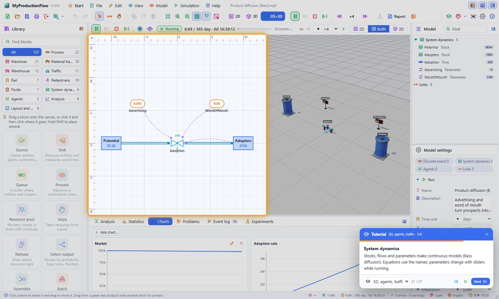

- A **stock** accumulates (initial value), a **flow** is a rate equation that fills or drains stocks, a **variable** is computed, a **parameter** is a constant. The model settings choose the SD time step and the integration method (Euler, Runge–Kutta 4).
- Mixing with discrete events: set a source's arrival rate by an SD expression (`Demand`), read a process metric in an SD flow (`Production.busy / 4.6`). See the **Hybrid** sample.

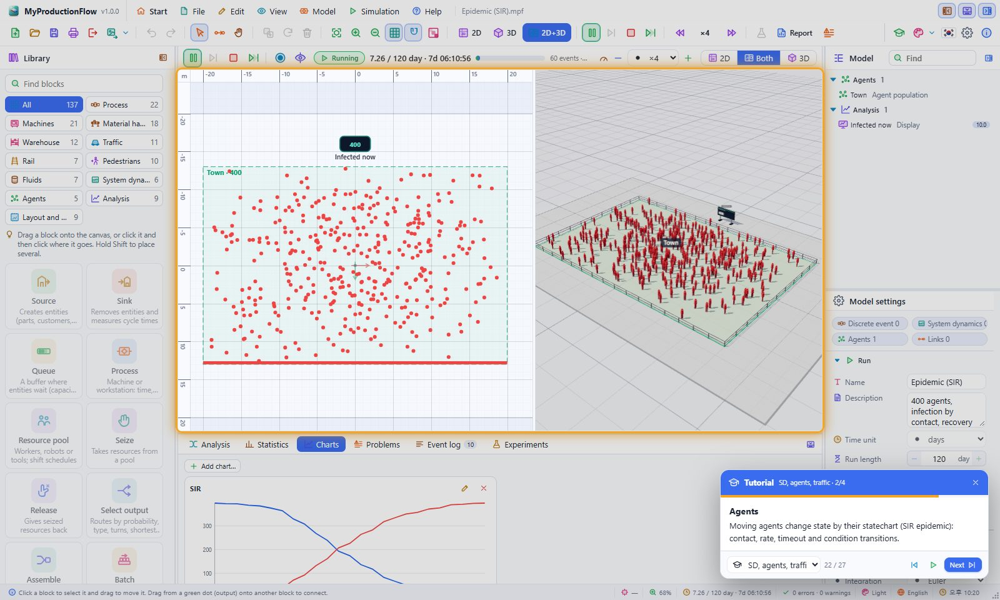

- A **cell grid** gives every cell a state that changes with its neighbours (forest fire, Game of Life); its transitions add 'neighbours in range' and 'out of range'.
- An **agent population** is a set of agents moving in a rectangle. States (name, colour), initial shares (`S:0.98, I:0.02` or counts) and transitions:
  - **Rate** — at random, at a rate per time unit
  - **Timeout** — after a time spent in the state
  - **Contact** — rate × the number of agents in the trigger state within the radius
  - **Condition** — when an expression is true
- Counts by state are `Population.State` in expressions and charts.

## 8. Files

- Models are **.mpf** files (JSON text). Double-click one in Windows Explorer to open it (file association), or drop it on the window.
- Save Ctrl+S, save as Ctrl+Shift+S, open Ctrl+O, recent files and folders, close the model Ctrl+W.
- The installation's `samples/` (Korean) and `samples/en/` (English) folders hold the sample files.

## 9. Settings

**Settings (Ctrl+,)**: General (language, restore session, clock), Start page (show the tutorial welcome window again — it only appears on the start page), Theme (20 dark · 20 light · custom), Font, Background (20 moving scenes: conveyors, assembly line, AGV paths, warehouse racks, road traffic, railway, pedestrian flow, process network, material flows, Gantt chart, gears, pipes and tanks, stocks and flows, supply chain, utilization heat map, queues, robot arms, container yard, live charts, agents spreading), **Simulation** (default view, grid snap, showing the grid, rulers, ports, names and links, utilization heat map, automatic check, 3D shadows, name tags and quality, time unit of new models, default speed), Recent, Shortcuts (all on one page). The user's guide, tutorial document and video windows switch language with the Korean and UK flag buttons.

## 10. Keyboard shortcuts

| Key | Does | Key | Does |
|---|---|---|---|
| V / C / H | Select / connect / pan | F5 / Shift+F5 | Run–pause / stop |
| R | Rotate 90° | F6 / F7 | Step / run to the end |
| F2 | Rename | F8 | Check the model |
| Delete | Delete | Ctrl+R | Report |
| Ctrl+D | Duplicate | Ctrl+Shift+X | Experiment |
| Ctrl+Z / Y | Undo / redo | Ctrl+1 / 2 / 3 | 2D / 3D / side by side |
| Arrows | Nudge | Ctrl+0 | Fit all |
| G | Grid | [ / ] | Slower / faster |
| Ctrl+N / O / S | New / open / save | F11 | Tutorial |
| Ctrl+Shift+L | Language | F1 | About |

## 11. Troubleshooting

- **It does not run** — fix the errors (red) in the **Problems** tab.
- **Entities only pile up** — an output is not connected, or the next step is too slow. See the bottleneck and blocking advice in Statistics.
- **No 3D** — the graphics driver must support WebGL. Try 3D quality *Fast* in Settings.
- Errors open a window with every detail, ready to copy. Contact: SHKWON (knix008@naver.com).
